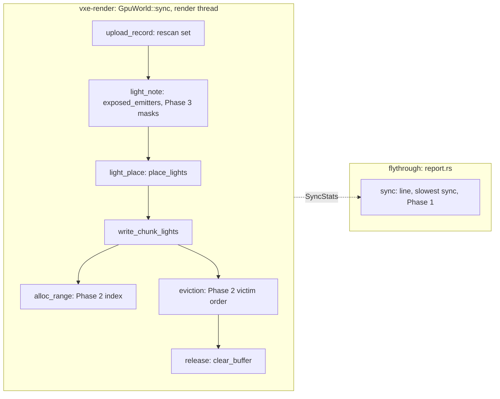

# 0074: The sync's light stages: the windowed placement spikes attributed, then bounded, and exposed emitters found by masks

> **Status:** draft (awaits the owner's go; owner questions at the end of "Risks & open
> questions")
> **Created:** 2026-11-13 (the owner, at Plan 0058's refresh, its answer 9: "draft it now, run
> beside 0058")
> **Milestone:** M2 in [`docs/roadmap.md`](../roadmap.md) (a playable frame under the light that
> holds), cross-cutting like Plans 0067 and 0070. It serves `docs/nfr.md` section 2's streaming
> line and Plan 0067's 16.6 ms bar on `update + poll + sync` p99.
> **Related ADRs:** [ADR-0025](../adrs/0025-light-candidates-from-a-power-over-distance-table-of-near-emitter-chunks.md)
> (the light-sample buffer and its ranges by radius, which this plan keeps byte for byte);
> [ADR-0056](../adrs/0056-the-mirrors-slot-image-is-packed-on-the-stream-workers-and-the-render-thread-only-allocates-and-copies.md)
> (accepted, deferred by reading): its worker-side emissive samples are this plan's route if
> Phase 3's in-place scan falls short, not its mechanism. No new ADR (see Decision).
> **Source:** [Plan 0070](done/0070-the-sync-off-the-frame-slot-words-packed-on-the-workers.md)'s
> Phases 5 and 6 ([`docs/plans/logs/0070.md`](logs/0070.md)) and the backlog entry "The sync's
> `light_note` stage and the windowed glide's light walks".
> **Starts after:** the owner's go. It runs as a lane **beside Plan 0058** (owner, 2026-11-13);
> "Beside Plan 0058" below names the files the two lanes share and how they stay apart.

## TL;DR

After Plan 0070 the sync's largest p99 stage is `light_note` (8.2 to 8.4 ms of a cave
`update + poll + sync` p99 of 22.8 to 24.6 ms; the goal is 16.6), and in the owner's windowed
`--glide 300` flight the per-second `light place` p99 spiked to 846 ms, which no headless bench
has shown. This plan **reads first**: Phase 1 adds the light walks' counters and the slowest
sync of each second to the `sync:` line, re-reads the base with the lamp off, reproduces the
spikes (headless glides at the windowed step first, then a self-ending window under `perf`), and
profiles `light_note`. Then it fixes only what Phase 1 attributes: **Phase 2** bounds the light
placement's searches (the leading hypothesis: eviction and free-range scans that walk every
chunk, once per eviction, when the buffer fills in a long glide), **Phase 3** finds a brick's
exposed emitters with 512-bit masks instead of a per-voxel scan of the decoded brick. The light
buffer's bytes, `light_chunks()` and the goldens do not move in any phase, and tests say so. The
first thing anyone sees: the `sync:` line naming the slowest sync of its second, with its
evictions and searches, so a hitch in a window has a name.

## Context & problem

Every figure is a reading unless marked. "RTX" is the NVIDIA GeForce RTX 3080 Laptop GPU,
"Radeon" the AMD Radeon Graphics (RADV RENOIR), on the same laptop CPU. Every reading since
2026-11-05 on this host is on the `hpet` clocksource (`docs/backlog.md`, "The RTX laptop's TSC
is marked unstable"), and every reading here states it.

- **The p99 stages left** (Plan 0070 Phase 5, `ef0b55c`, tester benches headless, RTX at
  2530 x 1378, Radeon at 1280 x 720, three rounds, lamp on): cave `update + poll + sync` p99
  23.9 to 24.6 ms (RTX), 22.8 to 23.0 (Radeon); castle 25.2 to 28.2 and 24.4 to 24.5. The cave
  sync p99 is 20.9 to 22.3 ms, and its stages' p99s are `light` 10.1 to 10.4 ms (`light_note`
  8.2 to 8.4, `light_place` 1.9 to 2.0), `alloc` 6.9 to 7.4, `size` 2.8 to 3.1, `select` 2.4 to
  3.0, `copy` 0.8 to 1.0. Their sum is close to the sync p99, so the stages peak in the same
  syncs: the ones that write many fresh chunks.
- **What `light_note` does** (`crates/vxe-render/src/gpu_world/slot.rs`, `upload_record`; and
  `gpu_world/lights.rs`, `note_lights`, `exposed_emitters`): for every written brick of a record
  that emits, the brick and its six neighbours in the chunk go into the rescan set (dense since
  Plan 0070); for each, `exposed_emitters` checks the packed brick's palette for an emissive
  material, then decodes all 512 voxels and tests each emissive opaque voxel's six neighbours,
  across a brick face through `Brick::get` on the neighbour. A fresh record writes every brick,
  so every emitter brick of a newly mirrored chunk is decoded and scanned voxel by voxel. The
  showcase's first sync reads 8.3 to 8.8 ms of `light_us` for 21 484 bricks and 16 471
  samples (`docs/nfr.md` section 7, Plan 0038 Phase 5, loaded, before Plan 0070 split the
  stage): about 0.4 us a brick, emitters and quick rejects together.
- **The windowed spikes** (Plan 0070 Phase 6, windowed, RTX host, 1-minute loads 0.13 to 7.7
  at the starts, all but one over 2): `light place` p99 over 20 ms in 19 of the tip's 30 per-second lines of the cave
  glide 300 (max 846 ms) and 12 of the base's 73 (max 330 ms); in the Radeon's cave by hand, 11
  of the base's 53 lines and none of the tip's; never over 2.5 ms in Phase 5's headless benches.
  **Two differences the record does not separate:** the headless runs were the tester's paths,
  never a headless glide; and a windowed glide advances by the frame's wall time
  (`apps/flythrough/src/run/frame.rs`, `prepare_frame`: `dt.clamp(0.0, 0.1)`, against `1/60`
  headless), so a slow frame moves the camera up to 30 voxels and the next sync meets more
  fresh chunks. The window runs were also loaded.
- **What `light place` holds** (`gpu_world/lights.rs`): `place_lights`' release and write
  walks, `write_chunk_lights` (each written chunk's samples gathered, thinned and staged),
  `alloc_range` (first fit by start, a linear walk of the free ranges), the eviction loop (on a
  failed fit, a scan of every chunk holding a range for the farthest beyond the writer, once per
  eviction, until a run fits), `release_lights` and `flush_dropped_lights` (a `clear_buffer`
  each), and each record's emissive check. **A hypothesis, not a reading:** the held radius is
  the window's farthest corner plus the light radius plus one (`frame/baked.rs`, `hold_lights`),
  so every emitting chunk of the window keeps a range while the buffer (2^20 samples, at most
  8192 a chunk, so at least 128 chunks at the cap) holds them; a long fast glide fills it, and
  from then each write may evict, each eviction scans every chunk, and freed ranges fragment
  the first fit's walk. `SyncStats` already counts `light_evicted` and `light_refused`; the
  `sync:` line prints neither.
- **The lamp.** Since `4ea561f` the tester's bench paths run with the headlamp off; Plan
  0070's bench readings ran with it on and are not compared with this plan's.

## Decision

Measure, then cut the two light stages in place on the render thread, with the light buffer's
bytes as the guard: Phase 1 attributes the windowed spikes and profiles `light_note`; Phase 2
(only if Phase 1 puts the spikes in the placement's searches) answers `alloc_range`'s first fit
and the eviction's farthest victim from indexes that give the same answers as today's linear
walks; Phase 3 finds exposed emitters with 512-bit masks and the six neighbours' face planes,
visiting set bits in voxel-index order so the samples and their order are today's. We rejected
moving the emitter lists to the stream workers now (ADR-0056's emissive part): it crosses a
thread boundary and a format for a stage whose per-brick cost no reading has split yet; it stays
Phase 3's route. We rejected a per-sync budget on light writes or evictions: it changes which
chunks hold ranges, so the bytes move and the light changes on screen, and Plan 0064's reading
of a time budget on the sync (residency p95 2.7 to 6.9 s) argues against it. No ADR: both cuts
are data-structure changes with byte-identical output, and the alternative to them is an
existing ADR's mechanism, not a new decision.

## Architecture diagram



## Beside Plan 0058

Plan 0058's lane (`plan-0058`, from `98e69b8`) owns the analytic light list: `vxe-render`'s
`light.rs`, `lib.rs`, `frame/` (including the new `frame/lights.rs`), `fsr2/`, `probes.rs`,
the shaders, `temporal`/`atrous`; and in the fly-through `lights.rs` (new), `toggles.rs`,
`run/keys.rs`, `run/frame.rs`, `cli/flags.rs`, `hud/modes.rs`, `tests/toggles.rs`, the
`gpu_*` tests it names and the lamp-lit goldens it re-blesses. **This plan touches none of them.**
Its code is `vxe-render`'s `gpu_world/` (`mod.rs`, `lights.rs`, `slot.rs`, `window.rs`, and a
new `gpu_world/emitters.rs` if Phase 3's scan wants its own file), `tests/gpu_mirror_budget.rs`,
and the fly-through's `report.rs` and `tests/path.rs`. Rules that keep it so:

- **No new flag, key or HUD row.** The slowest sync and the new counters reach the `sync:`
  line and `run.json` through `report.rs` (`SYNC_FIELDS`, `SyncSeries`), which `run/frame.rs`
  already calls; `run/frame.rs` is not edited.
- **No new re-export.** `exposed_emitters` keeps its signature (`lib.rs` re-exports it under
  `internals`, and `apps/flythrough/tests/showcase.rs` calls it); new types stay `pub(super)`
  or `pub(crate)`; test switches are `#[doc(hidden)] pub` methods on `GpuWorld`, as Plan 0070's.
- **No golden is blessed here.** The goldens are a byte-identical guard. If Plan 0058 merges
  first and re-blesses baselines, this lane merges main and re-runs the same binaries against
  main's baselines.
- **Shared files** (docs and the machine): `docs/backlog.md` (both edit the entry "The sync's
  `light_note` stage..."; this draft adds one line under its heading, apart from 0058's lines),
  `docs/plans/README.md` (separate rows), `docs/nfr.md` section 2 and
  `docs/nfr/02-frame-budget.md` (this plan writes the sync's paragraph only; 0058 its lighting,
  denoise and upscale lines), `docs/roadmap.md`'s M2 section, and at the close `Cargo.toml`'s
  version and `CHANGELOG.md`. The second lane to close merges main into its branch (a merge,
  never a rebase) and takes the next version. **The perf lock and the GPU are shared:** each
  lane's readings run under the exclusive perf lock; a base-against-tip session holds its
  rounds back to back and logs each run's load; a run that starts loaded is re-run. The two
  windows (this Phase 5, 0058's Phase 4) are batched into one ping when both are ready.

## Implementation phases

Every phase gates on `node scripts/test-changed.mjs --profile quick`, plus `--profile gpu
--binaries <names>` under the perf lock for the binaries it names; the tip gates on
`cargo nextest run --profile gate`. Every code phase proves the light buffer did not move:
`the_first_sync_lights_are_pinned` and `the_light_walks_skip_only_what_did_not_change`
(`gpu_mirror_budget`) hold, and the fly-through's `gpu_lights`, `gpu_golden` and
`gpu_castle_golden` pass unchanged. No phase changes a shader, a buffer layout or `vxe-world`.
Readings: release, the exclusive perf lock, the load before and after, the clocksource named,
never a clock read per brick or per voxel.

### Phase 1: the light walks on the line, the base, the spikes reproduced and the scan profiled (walking skeleton)
- **Owner skill:** dev
- **What:** `SyncStats` gains counters (additive): `light_emitter_bricks` (bricks whose palette
  holds an emitter, the ones decoded), `light_fresh_records` (records written with every brick),
  `light_chunks_written`, `light_scan_steps` (free ranges walked by `alloc_range` plus chunks
  walked by the eviction scans) and `light_free_ranges` (after the sync). `report.rs`'s
  `SYNC_FIELDS` carries them with `light_bricks`, `light_samples`, `light_evicted` and
  `light_refused`, so `run.json`'s `streaming` object has their percentiles; `SyncSeries::line`
  appends **the slowest sync of the line**: its wall, every stage and every light counter. Then
  the readings, in `docs/plans/logs/0074.md`:
  - **(a) The base:** the tester's cave and castle benches (`--tester --path cave|castle
    --report DIR --headless`, lamp off by default since `4ea561f`; RTX at 2530 x 1378, Radeon at
    1280 x 720), three rounds, with this phase's binary kept as `live/bin/flythrough-base74`.
  - **(b) Headless glides:** `--seed 1 --glide 300` and `--glide 1000` (1000 voxels a second at
    the headless 1/60 s step is 16.7 voxels a frame, the windowed 300's step at 18 fps), the
    streamed cave, RTX, `--frames` long enough to fill the light buffer (the log states when
    `light_evicted` first reads non-zero), three runs each.
  - **(c) A window, only if (b) shows no per-second `light place` p99 over 20 ms:** the
    windowed `--seed 1 --glide 300` cave on the RTX, ended by `--frames N` (never closed through
    the compositor), stdout to the terminal, three runs, one under `perf record -g` and one under
    `perf sched record` for the render thread's off-CPU time.
  - **(d) The profile of `light_note`:** `perf record` over the base's cave bench, the ranking
    inside `exposed_emitters` (the palette check, `decode`, the per-voxel loop, the neighbours'
    `get`), and `light_note_us` over `light_emitter_bricks` per sync (us a decoded brick), with
    the fresh records' share. `alloc`'s profile is read the same way for the next plan.
- **Files touched:** `crates/vxe-render/src/gpu_world/{mod.rs,lights.rs,slot.rs,window.rs}`,
  `crates/vxe-render/tests/gpu_mirror_budget.rs`, `apps/flythrough/src/report.rs`,
  `apps/flythrough/tests/path.rs`, `docs/plans/logs/0074.md` (new).
- **GPU binaries per phase:** vxe-render's `gpu_mirror_budget`; the fly-through's `gpu_lights`.
- **Done when:**
  - `the_sync_line_names_its_slowest_sync` (`path.rs`, CPU, under 1 s): a `SyncSeries` fed a
    fixed series of 60 syncs, one of them 40 ms, prints that sync's wall, stages and light
    counters after the percentiles, and `run.json` from the same series has the new fields'
    p50 and p99.
  - `the_light_counters_follow_a_full_buffer` (`gpu_mirror_budget`, lavapipe, about 3 s): a
    seeded emissive world synced with a light-sample buffer that holds all its chunks reads
    `light_evicted` and `light_refused` 0; the same world with a buffer of half its samples
    reads `light_evicted` above 0 and `light_scan_steps` at least `light_evicted`; and
    `the_first_sync_lights_are_pinned` still holds (the counters move no byte).
  - The log holds rigs (a) to (d) with loads and clocksource, and names, for each per-second
    line of the reproducing rig with `light place` p99 over 20 ms, the slowest sync's
    `light_place_us`, evictions, scan steps, chunks written, free ranges and (rig (c)) its
    off-CPU share.
  - **Stop rules** (each a stop for an architect amendment, the readings committed first):
    **S1, outside the sync:** if half or more of the spike syncs' `light place` time is off-CPU
    or inside the driver (`clear_buffer`, the belt's growth) by `perf`, or no rig reproduces a
    spike, Phase 2 is struck, the spike's evidence goes to the backlog, and the lane goes on to
    Phase 3 (Phase 5's window then reads the new line). **S2, another mechanism:** if the spike
    syncs' time is on-CPU in the light code but not in the searches (`light_scan_steps` does not
    grow with it), the lane stops before Phase 2 with the profile. **S3:** if the profile puts
    under half of `light_note` in `decode`, the per-voxel loop and the neighbours' `get`, the
    lane stops before Phase 3.

### Phase 2: the placement's searches by index (only on Phase 1's attribution)
- **Owner skill:** dev
- **What:** `alloc_range` answers its first fit (the lowest-start free range of at least `n`)
  from an index over the free ranges (for example ranges by start with a maximum length per
  node), not a linear walk; the eviction loop takes its victims from one ordering of the ranged
  chunks by `(distance to the focus, coordinate)`, built once per sync on the first failed fit
  and popped from the far end, not a scan of every chunk per eviction. Both return what today's
  walks return, in the same order; a comment names why (the ranges' starts are the buffer's
  bytes). The linear forms stay as a `#[doc(hidden)]` reference switch, as
  `force_light_walks` is. If Phase 1 names another search on the spike path, it is indexed the
  same way and named in the log.
- **Files touched:** `crates/vxe-render/src/gpu_world/{lights.rs,mod.rs}`,
  `crates/vxe-render/tests/gpu_mirror_budget.rs`, `docs/plans/logs/0074.md`.
- **GPU binaries per phase:** `gpu_mirror_budget`; the fly-through's `gpu_lights`.
- **Done when:**
  - `the_indexed_first_fit_picks_the_linear_fit` (unit in `gpu_world`, CPU, under 1 s): over
    1000 seeded sequences of up to 500 allocations and frees (lengths 1 to 8192 in a 2^20
    buffer), every `alloc_range` returns the start the linear walk returns, and the free ranges
    and high-water mark after each step are equal.
  - `a_full_buffer_evicts_what_the_scan_evicts` (`gpu_mirror_budget`, lavapipe, about 4 s): a
    scripted flight over a seeded emissive world with a buffer of a quarter of its samples
    (evictions on most syncs) gives, after every sync, the same light buffer bytes,
    `light_chunks()`, `light_oldest_wait`, `light_evicted` and `light_refused` with the
    indexes as with the reference switch.
  - **Reading:** the reproducing rig of Phase 1, this binary and the base alternated, three
    runs each: the slowest sync's `light_place_us` at most 5 ms in every per-second line (a
    proposal; the window's lines read up to 846 ms), `light_scan_steps` p99 under a tenth of
    the base's. **Stop:** if a line still reads `light place` over 20 ms with the searches
    bounded, the lane stops for an amendment with that sync's counters.

### Phase 3: exposed emitters by masks
- **Owner skill:** dev
- **What:** `exposed_emitters` builds, for a `Full` brick whose palette holds an emitter, a
  512-bit mask of its emissive opaque voxels and one of its opaque voxels (from the palette's
  flags over the packed indices; a decode only where the packed class gives no cheaper way),
  and for each of the six faces the facing layer of the neighbour brick's opaque voxels (64
  bits, or all open at the chunk's face); a voxel's open faces come from the opaque mask
  shifted by one along each axis (x by 1 within a row of 8, y by 8, z by 64), the brick's face
  layers taken from the neighbours' planes. The samples are the set bits of `emissive & any
  open face`, visited in ascending index (x fastest), each with its six face bits: the order and
  values of today's per-voxel scan. The per-voxel scan stays as the test reference
  (`#[cfg(test)]`). If Phase 1's profile shows the cost in the bricks with no emitter (the
  palette check on every rescan slot), the record's emitter bricks are kept as a 512-bit set
  beside the rescan set and only they are scanned.
- **Files touched:** `crates/vxe-render/src/gpu_world/lights.rs` (or a new
  `gpu_world/emitters.rs`), `gpu_world/slot.rs` if the emitter set is built,
  `crates/vxe-render/tests/gpu_mirror_budget.rs`, `docs/plans/logs/0074.md`.
- **GPU binaries per phase:** `gpu_mirror_budget`; the fly-through's `gpu_lights`,
  `gpu_golden`, `gpu_castle_golden`.
- **Done when:**
  - `the_mask_scan_finds_what_the_voxel_scan_finds` (unit in `gpu_world`, CPU, under 2 s): over
    10 000 seeded `Full` bricks (2 to 16 materials drawn from emissive opaque, emissive
    translucent, opaque, translucent and air) with seeded neighbours (each of the six a `Full`
    brick, a `Uniform` brick or `None`), the mask scan's `Vec<LightSample>` equals the
    reference's, element for element.
  - `the_first_sync_lights_are_pinned` and `the_light_walks_skip_only_what_did_not_change`
    hold unchanged; `apps/flythrough/tests/showcase.rs` (which calls `exposed_emitters`) and
    the three fly-through binaries above pass with no baseline touched.
  - **Reading:** rig (a)'s cave bench on the RTX, this binary and Phase 2's (or the base, if
    Phase 2 was struck) alternated, three rounds: `light_note` p99 at least 70 % under (a
    proposal: about 2.5 ms from Phase 1's base; Plan 0070 read 8.2 to 8.4 with the lamp on).
    **Route, then stop:** under 50 %, the lane stops for an amendment that weighs the emitter
    lists on the stream workers (ADR-0056's emissive samples, `ChunkPrep`) with Phase 1's
    fresh-record share.

### Phase 4: the readings against the base
- **Owner skill:** dev
- **What:** the tip and `flythrough-base74` alternated, one session, three rounds: rig (a) on
  both adapters, the reproducing rig of Phase 1 on the RTX, section 5's autopilot (`--autopilot
  --headless --seed 1 --render 1280x720`, RTX), and the fly-through's `B` line (`--level --seed
  1 --headless --bench 1 --frames 1`, three runs each binary). Read: `update + poll + sync`
  p99, sync p50 and p99 per stage, the light counters, wall p50 and p95, frames over 33 ms,
  residency p95, peak RSS and the bake queue's step beside them (never pooled).
- **Files touched:** `docs/plans/logs/0074.md`, `docs/nfr/02-frame-budget.md`.
- **Done when:** the log holds the tables per adapter, rig and binary, with loads and the
  clocksource; each Budgets row is marked met or missed by the tip against the base of the
  same session; if `update + poll + sync` p99 still reads over 16.6 ms, the log names the
  largest stage left with Phase 1's profile of it. **Route, not a stop:** if that stage is
  `alloc`, the close review puts it at the head of the backlog as the next sync plan; if
  `pack + size` is half or more of the tip's cave sync p99, ADR-0056's worker packing goes there.

### Phase 5: the owner's window
- **Owner skill:** human
- **What:** the owner flies the streamed cave at `--glide 300` and by hand, the castle, and
  the tester's cave, with the tip's binary and the base's, HUD on, stdout visible (the `sync:`
  line with its slowest sync); `dev` prepares `live/session74.sh` and pings, batched with Plan
  0058's window when both are ready; the Radeon if the owner wants it.
- **Files touched:** `docs/plans/logs/0074.md`.
- **Done when:** the log records the owner's words on whether the hitches on fast passes are
  fewer, each hitch the owner names beside that second's slowest sync, and that the picture did
  not change (a difference is a stop: the bytes were asserted equal, so it is a defect).

### Phase 6: the lines and the bookkeeping
- **Owner skill:** dev
- **What:** the readings replace the sync's paragraph in `docs/nfr.md` section 2 (machine,
  clocksource, commit, lamp off) and go to `docs/nfr/02-frame-budget.md`; the backlog's "The
  sync's `light_note` stage and the windowed glide's light walks" leaves for one line naming
  this plan, and "Slot words packed on the workers" gets Phase 4's share; `docs/roadmap.md`'s
  M2 gets one sentence.
- **Files touched:** `docs/nfr.md`, `docs/nfr/02-frame-budget.md`, `docs/backlog.md`,
  `docs/roadmap.md`, `docs/plans/logs/0074.md`.
- **Done when:** the gate tier is green at the tip; the doc gates pass.

## Data shapes

```rust
// illustrative
// SyncStats gains (additive): light_emitter_bricks, light_fresh_records, light_chunks_written,
// light_scan_steps, light_free_ranges. SYNC_FIELDS gains them with light_bricks,
// light_samples, light_evicted and light_refused; SyncSeries keeps its slowest sync.

// Phase 3: one brick's masks, x fastest (bit i = x + 8 y + 64 z).
struct BrickMasks { emissive: [u64; 8], opaque: [u64; 8] }
// The neighbour's facing layer on axis k toward dir: 64 bits, all open at the chunk's face.
type FacePlane = u64;
```

**Arithmetic.** A brick is 8^3 = 512 voxels, 8 words of 64 bits; a z step is one word, a y step
8 bits, an x step 1 bit masked at each row's ends; a face plane is 8 x 8 = 64 bits. The light
buffer is 2^20 samples x 16 B = 16 MiB; with the chunk cap of 8192 samples it holds at least
128 chunks at the cap. Today's eviction loop costs up to (evictions x ranged chunks) steps a
sync: 100 evictions over 500 ranged chunks is 50 000 steps (an example, not a reading; Phase 1
reads the counts). **The goal against the projection:** if `light_note` p99 falls 70 % (8.3 to
about 2.5 ms) and the stages keep peaking together, the cave's `update + poll + sync` p99 falls
by up to about 5.8 ms, from 23.9 to 24.6 to about 18.1 to 18.8 on the RTX and 17.0 to 17.2 on
the Radeon (Plan 0070's lamp-on figures). The 16.6 ms goal is therefore **not expected from
this plan alone**; `alloc` (6.9 to 7.4 ms) is the next stage.

## Budgets

"Base" is Phase 1's binary (`flythrough-base74`), read in the same session as the tip; every
figure from the RTX 3080 Laptop host on `hpet` unless named; bench readings lamp off (after
`4ea561f`), so Plan 0070's lamp-on figures are on record, not compared.

| `docs/nfr.md` figure | On record | Proposed (tip against base, one session) | How the close measures it |
|---|---|---|---|
| `update + poll + sync` p99, tester cave and castle (Plan 0067's 16.6 ms bar) | cave 22.8 to 24.6 ms, castle 24.4 to 28.2 (Plan 0070, lamp on, both adapters) | **goal 16.6 ms, kept**; projected about 17 to 19 ms in the cave; a miss names the next stage | Phase 4, rig (a), both adapters |
| the cave sync's `light_note` p99 (no line) | 8.2 to 8.4 ms (Plan 0070) | at least 70 % under the base (a proposal) | Phase 3 and Phase 4 |
| the slowest sync's `light_place_us` per `sync:` line in the reproducing rig (no line) | up to 846 ms windowed (Plan 0070 Phase 6) | at most 5 ms in every line (a proposal), if Phase 2 runs | Phase 2, Phase 4, Phase 5's lines |
| section 2, streaming CPU per frame (1.0 ms p50) | autopilot p50 0.038 to 0.039 ms, p99 26.4 to 27.9 ms | p50 stays under 1.0 ms; p99 read | the autopilot, both binaries, three rounds |
| section 5 residency p95 (500 ms) | 212 to 213 ms (Plan 0070) | no worse than the base's spread | the autopilot's residency line |
| section 4, the edit's upload in the streaming line | `B` line sync 2.05 to 2.06 ms | unchanged or lower within its spread | the `B` line, three runs each binary |
| section 3, RAM | peak RSS 0.94 to 1.58 GB across the benches (Plan 0070) | within 2 % of the base (the indexes are a few hundred KB at most, an estimate) | Phase 4's log |

## Risks & open questions

- **The attribution.** The spikes are seen only in loaded windowed runs, whose glide steps by
  wall time. Rig (b) separates the step from the window, rig (c) the window from the step, and
  `perf sched` the CPU from the scheduler; S1 and S2 keep the lane from fixing a cause no
  reading named.
- **The bytes.** The index and the victim order must return exactly today's answers, the mask
  scan exactly today's samples in today's order, or `light_chunks()` and the buffer move. The
  reference switches, the 1000- and 10 000-case equality tests and the pinned hash are the guard.
- **A `Uniform` emitter brick shows no samples.** `note_lights` scans `Full` bricks only, so a
  brick of a single emissive material contributes nothing, even at faces toward air (read from
  the tree at `98e69b8`, not seen on screen). The byte guard keeps it; owner question 5.
- **The machine.** Readings depend on the clocksource and on the other lane's load; base and
  tip are always read in one session, loaded starts re-run.
- **Determinism:** nothing here touches `vxe-world`; the render-side lists are asserted equal.

**Owner questions** (the plan is a draft; each has a recommendation):

1. **Go, as a lane beside Plan 0058**, sharing the perf lock and batching the two windows.
   *Recommended:* yes; the code sets are disjoint ("Beside Plan 0058").
2. **Rig (c), the window, run by `dev`** as self-ending runs (`--frames N`, never closed
   through the compositor), not as an owner session. *Recommended:* yes; it needs no eye, and
   the owner's window stays Phase 5.
3. **If no rig reproduces the spikes (S1),** strike Phase 2 and let Phase 5's window read them
   through the new slowest-sync line. *Recommended:* yes. Alternative: more windowed sessions
   with the owner before Phase 3.
4. **The mask scan in place first, the emitter lists on the workers only on Phase 3's route.**
   *Recommended:* yes; the workers' path crosses a thread boundary and a format (ADR-0056) for a
   cost Phase 1 has not split. Alternative: go straight to the workers.
5. **The `Uniform` emitter brick:** a backlog entry for a look check after this plan
   (*recommended*: fixing it changes the light, which the byte guard forbids here), or a phase
   here with the owner's eye.
6. **The goal:** 16.6 ms stays the bar, a miss names `alloc` as the next sync plan
   (*recommended*). Alternative: widen this plan to `alloc` now, which needs its own reading
   first (Phase 1 profiles it for that).

## What this plan does NOT do

- `alloc`, `size` and `select` (6.9 to 7.4, 2.8 to 3.1 and 2.4 to 3.0 ms p99): Phase 1 profiles
  `alloc` for the next sync plan; nothing here cuts them.
- The worker packing or worker-side emitter lists (ADR-0056): a route, not a phase.
- A budget on the sync or on light writes, any change to which chunks hold ranges, the light
  radius or the hold radius.
- The glide's wall-time step in a window (the testbed's motion, read here, not changed).
- Plan 0058's analytic lights and anything in its file set; any shader, layout, golden or
  look change; any `vxe-world` change.
- The machine's clocksource (the owner's boot setting, `docs/backlog.md`).

## Implementation log

> Written by `dev`: one row per phase as its commit lands, then the close block. **The phases
> above are the contract. This section records what happened.** Observations, never conclusions:
> no pass list, no self-assessment. Deviations and unmet done-whens are **always** disclosed.
> Keep it shorter than `## Implementation phases`. Readings, gate counts, attempts, sweeps and
> resume notes go to the plan's readings log, `docs/plans/logs/0074.md`, and this section links
> it once it exists.

| phase | owner | state | commit |
|---|---|---|---|
| 1: the light walks on the line, the base, the spikes reproduced and the scan profiled | dev | not started | |
| 2: the placement's searches by index | dev | not started | |
| 3: exposed emitters by masks | dev | not started | |
| 4: the readings against the base | dev | not started | |
| 5: the owner's window | human | not started | |
| 6: the lines and the bookkeeping | dev | not started | |

### Notes

### Close triggers

## Followups
