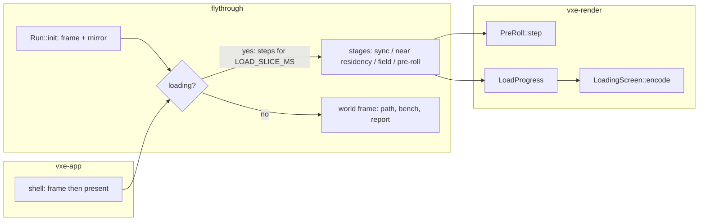

# 0075: A loading screen: steppable start-up, a progress signal and a default loading frame

> **Status:** in-progress (approved 2026-11-15; a lane stacked on plan-0062, started 2026-11-16)
> **Created:** 2026-11-15
> **Milestone:** none of its own. The testbed and the tester build (M7, Plan 0068); the engine
> side serves any consumer's start-up.
> **Related ADRs:** [ADR-0059](../adrs/0059-loading-runs-as-time-sliced-steps-on-the-apps-frame-loop-behind-an-engine-loading-frame.md)
> (proposed): loading as time-sliced steps on the app's frame loop, the engine's pieces and the
> app's sequence. Rests on ADR-0001 (the game owns its loop), ADR-0009 (the text overlay, no UI
> library) and ADR-0054 (the tester runs the fly-through as a child).
> **Starts after:** Plan 0062 has merged (it is in flight in the same app). See "Order" below.

## TL;DR

The fly-through's window opens on a loading screen and stays live while the world loads: an
animation, a progress bar that only moves forward, the scene's name and the current stage
("lighting 31 / 49 chunks"). The engine gains three pieces, no loop: `vxe_render::PreRoll`, the
light pre-roll as a steppable object; `LoadProgress`, app-named weighted stages whose overall
fraction never moves back; and `vxe_render::LoadingScreen`, a default loading frame on the text
overlay that a game can replace. The fly-through steps its start-up from `App::frame` a slice at
a time and presents a loading frame between slices; the tester gets it for free, and its
benchmark starts at the first world frame. The first thing the owner sees is
`flythrough --castle`: a window at once, the bar filling, then the castle.

## Context & problem

`Run::init` (`apps/flythrough/src/run/mod.rs`) does every start-up step before the shell's first
redraw: the level's first mirror sync (349 to 517 ms on the bounded cave, `docs/nfr.md` section
7) or the streamed world's loop to near residency, the field's initial fill, then
`Run::queue_pre_roll` (`apps/flythrough/src/run/queue.rs`), which loops sync and bake steps until
the near chunks hold their light and the coarse pass is done or boxed at 5 s, capped at 120 s
(3.6 s and 8.6 s on a streamed cave, `docs/plans/logs/0060.md`, Phase 1, run 1). The window is
blank and the event loop is not pumped through all of it. The tester (Plan 0068) starts one
child per scene, so every run opens that way. Before `init`, `device_request` joins the level's
generation thread, because the device's limits are sized from the level's content
(`level_pool_units`, `apps/flythrough/src/scene.rs`).

The owner (2026-11-15): "we should add some form of loading screen to tester build (and for
engine?)", then "I want to be able to see loading screen with some animation and loading bar".
Their standing preferences apply: a mode shows on screen, and a stable image first (no
flicker, no stutter).

## Decision

Per ADR-0059: `Run::init` creates the frame and the mirror and returns; a `Loading` state in the
run holds an ordered list of stages, and while it is present `Run::frame` runs stage steps until
`LOAD_SLICE_MS` (proposal 25 ms) of wall time is spent, then encodes the `LoadingScreen` into the
surface and returns without touching any per-frame world path. The pre-roll moves into
`vxe-render` as `PreRoll`, its box and cap measured on the work time the caller passes, so a
sliced and an unsliced load stop at the same work. Headless runs default to
`--loading-screen off` (the whole load inside the first frame call, as today), so the gate's
frame counts and timings do not move; the loading tests turn it on. `vxe-app` and `vxe-world`
do not change. We rejected presenting from inside a blocking `init` (the event loop starves),
a loading thread (the queue is shared, nothing gained) and a launcher-drawn screen (tester only).

## Architecture diagram



## Order

No active plan touches the start-up or the pre-roll. Plan 0062 (entities, in flight) edits the
fly-through's run; this plan starts after it merges, and can run beside Plan 0063's Phases 3-4
(the model viewer and text authoring), whose files it does not share. Plan 0069 (render
settings) rewrites the setters `Run::init` calls, so whichever lands second rebases its `init`
edits; this plan is smaller and should land first. Plan 0071 curates `vxe-render`'s public
surface: `PreRoll`, `LoadProgress` and `LoadingScreen` are called by the testbed and stay public.
Plan 0073 later adds the loading flags as settings rows. Phase 6 is Linux only; Windows is
seen at the owner's periodic Windows run, not per plan (owner, 2026-11-15).

## Implementation phases

Each phase ships as its own commit. `dev` implements all `dev` phases in one session. Phases 1 to
5 are **exploration** for the screen's look (owner, 2026-11-10): they name readings, not image
tests; their CPU tests of data, ordering and API stay. Phase 7 writes the golden after the
owner's window.

### Phase 1: the pre-roll stepped behind a plain loading frame (walking skeleton)
- **Owner skill:** dev
- **What:** the pre-roll runs from `Run::frame` a slice at a time behind a loading frame of HUD
  rows and a text bar, and start-up is read stage by stage.
- **Files touched:** `apps/flythrough/src/run/mod.rs`, `run/queue.rs`, new `run/loading.rs`,
  `run/frame.rs`, `apps/flythrough/src/app.rs`, `apps/flythrough/src/cli/` (the flag),
  `apps/flythrough/tests/gpu_loading.rs` (new), `docs/flythrough.md`, `docs/plans/logs/0075.md`.
- **Shape:** `Run::init` keeps the sync or near-residency loop for now and stops before the
  pre-roll; the pre-roll's loop body becomes a step on a `Loading` struct holding its state
  (near list, `near_done`, `first_pass`, work time). While `Loading` is present, `Run::frame`
  steps for `LOAD_SLICE_MS`, then clears the surface and draws the existing `HudOverlay` rows:
  the scene (castle banner, pose banner, else the source), the stage, `k / N chunks`, a 40-cell
  text bar, elapsed seconds. Loading frames do not advance `self.frame`, the path player, the
  recorder, `--frames`, `--bench`, `--dig-at` or the HUD's wall times; the first world frame is
  frame 0 as today. The box (5 s past the near chunks) and the cap (120 s) count step time only.
  `--loading-screen on|off` (default on in a window, off headless) picks it; off is today's start.
  Stdout gains `loading: pre-roll <ms> ms, <n> loading frames, longest frame <ms> ms`.
- **Done when:**
  - `gpu_loading`: `a_sliced_pre_roll_bakes_what_an_unsliced_one_bakes`: on the smallest level
    the `gpu_queue` tests use, headless, `--loading-screen on` with `LOAD_SLICE_MS` forced small
    enough for at least 3 loading frames, the pre-roll's baked chunk count and total samples equal
    the `off` run's, and `--frames 3` renders exactly 3 world frames in both. Expected under 10 s
    on lavapipe; if it reads over, it is born `#[ignore = "soak"]` and a smaller world takes the
    gate.
  - Readings, in the readings log: on the RTX 3080 Laptop, release, exclusive perf lock, three
    windowed runs each of `--source cave`, `--source showcase` and `--castle`, the time of each
    start-up stage from the process start (window created, generation joined, `Coarse::build`,
    `level_pool_units`, device ready, frame created, mirror reserved, first sync or near
    residency, field fill, pre-roll near and end, first world frame), with the screen on and
    off; the loading frames' interval p50, p95 and max; the longest single step of each stage.

### Phase 2: every stage after the device steps, and the engine's PreRoll and LoadProgress
- **Owner skill:** dev
- **What:** the level's first sync, the streamed near residency and the field fill become
  stages too, the pre-roll moves into `vxe-render`, and the bar reads one weighted fraction.
- **Files touched:** `crates/vxe-render/src/bake/pre_roll.rs` (new), `crates/vxe-render/src/
  loading.rs` (new: `LoadProgress`), `crates/vxe-render/src/lib.rs`, the mirror's sync budget
  for a fixed window if it ignores one (`crates/vxe-render/src/gpu_world/`), `apps/flythrough/src/
  run/{mod,queue,loading}.rs`, `apps/flythrough/tests/gpu_loading.rs`.
- **Shape:** `PreRoll::new(PreRollConfig)` and `step(&mut self, frame, device, queue, mirror,
  world, view, work_ms) -> PreRollState` (`Near { settled, of }`, `Coarse { passed, of }`,
  `Done(PreRollSummary)`); the fly-through keeps the streaming it does before each step and its
  printed line. The level's first sync runs under a time budget per step (`MirrorConfig`'s
  `sync_budget_time`, the streamed window's mechanism) so no step holds the frame for the whole
  upload. GPU work in flight is capped: a slice waits for the previous slice's submissions
  before it submits more (`device.poll`), so a loading frame's present never queues behind more
  than one slice of bake work. Stage weights in the fly-through come from Phase 1's readings
  (the share of loading time each stage took on the reference), named constants per stage.
- **Done when:**
  - CPU, `vxe-render` unit tests (under 1 s): `the_box_and_the_cap_count_work_time_only`: a
    `PreRoll` decision fed `work_ms` boxes 5000 ms past the near chunks regardless of the wall
    time between calls; `the_bar_never_moves_back`: a `LoadProgress` of stages weighted 1, 2, 7
    reports 0.1 at stage 1 done, 0.3 at stage 2 done, and a stage whose count drops (a chunk
    withdrawn) holds the bar where it was; `an_unweighted_stage_fills_by_its_count`.
  - `gpu_loading`: `the_streamed_load_reports_its_stages_in_order_and_ends_at_one`: the streamed
    world at the smallest residency the `gpu_queue` tests use, headless, screen on, records each
    loading frame's (stage, fraction): stages appear in order (near residency, pre-roll near,
    pre-roll coarse), fractions are non-decreasing, the last is 1.0. Expected wall time stated
    from its first run; over 10 s on lavapipe it is born soak.
  - Phase 1's level test still passes against `PreRoll` (the same chunks and samples).
  - Reading: the longest loading-frame interval per scene after this phase, in the log.

### Phase 3: the engine's loading frame
- **Owner skill:** dev
- **What:** `vxe_render::LoadingScreen` draws a background, an animation, a progress bar and the
  text rows; the fly-through uses it and fades it out over the first world frames.
- **Files touched:** `crates/vxe-render/src/loading.rs`, `crates/vxe-render/src/shaders/
  loading.wgsl` (new), `crates/vxe-render/src/lib.rs`, `crates/vxe-render/tests/gpu_loading.rs`
  (new), `apps/flythrough/src/run/{loading,frame}.rs`, `apps/flythrough/src/cli/`.
- **Shape:** one fullscreen fragment pass for the background, a small voxel cube (a 3 x 3 x 3
  block of voxels with gaps between them) turning about a tilted axis, about one turn in three
  seconds, ray-traced in the fragment shader against the boxes with flat per-face shading, and
  a bordered bar, all analytic with a one-pixel coverage ramp at every silhouette and edge (no
  hard edge that crawls), then the owned `HudOverlay` for the rows. `encode(queue, enc,
  target, size, &LoadingView { title, stage, detail, progress, seconds, alpha })`: time comes in
  as an argument, so the frame is a pure function of its inputs. The bar shows an eased value:
  it approaches the true fraction with a 0.15 s time constant, never exceeds it, never moves
  back, and snaps to 1.0 when loading ends. After the last stage the screen is drawn over the
  first world frames with alpha falling to 0 over `--loading-fade MS` (default 250, 0 cuts).
- **Done when:**
  - CPU (under 1 s): `the_eased_bar_is_monotone_and_reaches_the_target`: fed fractions 0.2, 0.2,
    0.6 at 16 ms steps, the shown value never decreases, never exceeds the target, and is within
    0.01 of 0.6 by 1.0 s.
  - `vxe-render` `gpu_loading` (lavapipe, under 3 s): `the_bar_fills_to_its_fraction`: at
    1280 x 720, progress 0.5, alpha 1, the bar's inner row reads the fill colour for the left
    half of the bar's inner width and the empty colour for the right, to within 1 px at the
    edge; `the_loading_frame_allocates_nothing_after_the_first`: a second `encode` with
    different rows grows no CPU buffer (the `HudOverlay` count).
  - Reading: the loading pass's GPU time at 1920 x 1080 on the RTX 3080 and on lavapipe.

### Phase 4: the fly-through and the tester around it
- **Owner skill:** dev
- **What:** the title, `Esc` during loading, the report's load time, and the tester's row.
- **Files touched:** `apps/flythrough/src/run/{loading,frame}.rs`, `apps/flythrough/src/
  report.rs`, `apps/flythrough/src/cli/`, `apps/tester/src/run.rs`, `apps/tester/src/menu.rs`,
  `apps/flythrough/tests/gpu_shutdown.rs`, `apps/tester/` tests, `docs/flythrough.md`,
  `dist/README-TESTER.txt`.
- **Shape:** under `--tester` the title is the scene and the mode (`castle - benchmark`).
  `Esc` or the window's close during loading exits through the ordinary teardown; a `bench`
  path run so ended reports `ended: "aborted"` with 0 frames. `run.json` goes to schema 2 with
  `load_ms` (device ready to the first world frame) and `load_stages` (`[{name, ms}]`); the
  tester reads schemas 1 and 2 and its run row adds `load 7.4 s`. `--quit-at-loading-frame N`
  (a test flag, listed under diagnostics in `--help`) acts as `Esc` at loading frame N.
- **Done when:**
  - `gpu_shutdown`: `quitting_while_loading_tears_down_within_bound`: headless, screen on,
    `--quit-at-loading-frame 2` exits 0 and logs every teardown stage within the binary's
    existing bound.
  - CPU: `a_schema_2_report_carries_its_load_time` (report round-trip with `load_ms` and the
    stage list); the tester's `read_run` accepts a schema 1 and a schema 2 `run.json`, and its
    row shows the load time for 2 and none for 1.
  - A benchmark's warm-up still starts at the first world frame: a headless `--path showcase
    --path-mode bench` run with the screen on reports the same `warmup_s` rule (2 s from frame 0)
    and `frames` counts world frames only (`path.rs` test, CPU where it can be).

### Phase 5: the budget readings
- **Owner skill:** dev
- **What:** the loading screen's cost and smoothness read against the `## Budgets` proposals.
- **Files touched:** `docs/plans/logs/0075.md`.
- **Done when:** on the RTX 3080 Laptop and on the Radeon iGPU (`--adapter Radeon`), release,
  windowed, exclusive perf lock, three runs each of cave, showcase and castle with the screen on
  and off: the loading wall time (device ready to first world frame), the loading frames'
  interval p50, p95 and max, the loading pass's GPU time, and the blank time (process start to
  the first loading frame), each with the 1-minute load. If the screen costs more than the
  budget, `LOAD_SLICE_MS` 15, 25 and 40 are read on the castle and the result goes to the
  owner's window as a pick, not a silent change.

### Phase 6: the owner's window
- **Owner skill:** human
- **What:** the owner watches the loading screen on Linux.
- **Done when:** the owner has started `flythrough --castle`, `--source cave` and
  `--source showcase` in a window, and the tester's "run all benchmarks", and answered: the
  animation runs without a visible stutter, the bar only moves forward and does not sit still
  for long, the scene name is right, the end (fade or cut) looks right, and the start-up is not
  noticeably slower.
  Each answer and pick goes to the readings log.

### Phase 7: after the window
- **Owner skill:** dev
- **What:** the owner's picks applied, the golden written, the docs brought up to date.
- **Files touched:** `crates/vxe-render/src/loading.rs`, `crates/vxe-render/tests/gpu_loading.rs`
  and its golden, the fly-through files the picks touch, `docs/flythrough.md`.
- **Done when:** `vxe-render` `gpu_loading`: `loading_screen_golden`: at 1280 x 720, progress
  0.37, `seconds` 0.4, alpha 1, title "castle - benchmark", byte-exact against a lavapipe-blessed
  golden as `gpu_hud_golden`'s overlay goldens are (under 3 s); the picks are the defaults and every unpicked
  arm that costs nothing when off stays a flag (owner, 2026-11-12).

## Data shapes

```rust
// illustrative
pub struct LoadStage { pub name: &'static str, pub weight: f32, pub done: u64, pub of: Option<u64> }
pub struct LoadProgress { stages: Vec<LoadStage>, current: usize, shown: f32 }
impl LoadProgress {
    pub fn fraction(&self) -> f32;          // weighted, never below its last value
    pub fn stage(&self) -> &LoadStage;
}
pub struct PreRollConfig { pub near: Vec<ChunkCoord>, pub coarse: u32, pub box_ms: f64, pub cap_ms: f64, pub samples: u64 }
pub enum PreRollState { Near { settled: usize, of: usize }, Coarse { passed: usize, of: usize }, Done(PreRollSummary) }
pub struct LoadingView<'a> { pub title: &'a str, pub stage: &'a str, pub detail: &'a str,
                             pub progress: f32, pub seconds: f32, pub alpha: f32 }
```

`run.json` schema 2 adds `"load_ms": 7412.0, "load_stages": [{"name": "pre-roll", "ms": 6120.0}]`.

## Budgets

`docs/nfr.md` section 7 (start-up) gains a loading-screen line; all figures are proposals until
Phase 5 reads them:

- **Cost:** loading wall time (device ready to the first world frame) with the screen on within
  3 % of off, median of three runs per scene on the RTX 3080 Laptop. The loading pass's GPU time
  under 0.3 ms at 1920 x 1080 there (a guess: one fullscreen pass and the overlay's).
- **Smoothness:** loading-frame interval p95 at most 50 ms and max at most 200 ms after the first
  loading frame, on the RTX 3080 Laptop; read, not bound, on the Radeon iGPU.
- **Blank time:** the first loading frame within 300 ms of `device ready`. The time before the
  device (window, adapter, the level's generation join) is read, not bound (open question 1).
- **Memory:** the screen's buffers are the overlay's 128 KiB cell grid plus one uniform; no
  figure in section 3 moves.
- **The gate:** headless defaults to the screen off, so section 7's gate wall time does not move
  beyond the new tests' own seconds.

## Risks

- **A step longer than the slice** is a hitch: the level's first sync (up to 517 ms) and the
  streamed near-residency syncs. Phase 2 budgets the sync per step; Phase 1's longest-step
  readings say whether anything else needs it.
- **GPU work in flight:** the bake step does not wait on the GPU when given a sample count, so
  a slice could queue seconds of dispatches ahead of the present. Phase 2 caps it at one slice.
- **Wall-time boxes:** the pre-roll's 5 s box and 120 s cap run on step time, so the loading
  frames do not shorten the coarse pass; a streamed world's worker timing still varies run to
  run, as today.
- **Frame-count semantics:** every test that counts frames relies on loading frames not counting;
  the headless default off keeps them unchanged, and Phase 1's test pins `--frames 3`.
- **Determinism:** `vxe-world` is untouched; the pre-roll's GPU state on a level is a function of
  the step sequence, which slicing does not change.

## Open questions

Answered by the owner at the go, 2026-11-15 (Amended 2026-11-15 (owner)):

1. **The blank before the device:** accepted, and read in Phase 5 (0.4 to 1.9 s cold on the
   RTX, `docs/nfr.md` section 7). A device whose limits do not wait on the level's content
   would be its own plan if the readings say the generation join is long.
2. **The end of loading:** a 250 ms fade of the loading screen over the first world frames
   (`--loading-fade 0` cuts).
3. **The animation:** a small turning voxel cube in the loading shader (the owner's pick over
   the recommended ring of squares), Phase 3's Shape. Its GPU time stays inside section 7's
   0.3 ms loading-pass budget; if Phase 3's reading on the RTX or lavapipe misses it, the cube
   drops to fewer voxels before anything else changes.
4. **Windows:** not in this plan. The owner checks Windows once in a while, not per plan
   (owner, 2026-11-15); the next periodic Windows run looks at the loading screen.

## What this plan does NOT do

- Show anything before the device exists: the device's limits still wait on the level's
  generation (open question 1).
- Load on a thread, or make generation itself report progress (the level generates on its own
  threads; its stage shows the animation without a count).
- Rebuild the world live behind the loading screen (Plan 0069's `Rebuild` class, a later idea for
  the backlog at the close).
- A consumer-facing loading API in `vxe-app`, or an engine-owned loading loop (ADR-0001).
- Tips, images or any game content on the screen; the look is the consumer's to replace.

## Implementation log

> Written by `dev`: one row per phase as its commit lands, then the close block. Readings,
> attempts and resume notes go to [`docs/plans/logs/0075.md`](logs/0075.md).

| phase | owner | state | commit |
|---|---|---|---|
| 1: the pre-roll stepped behind a plain loading frame | dev | done; readings headless, not windowed (lane rule 10); the test runs `--room 12`; `test_support.rs` gained the `Run` field; the loading flags in a new `cli/loading.rs` with a Loading and a Diagnostics section | 1ff6ffb1 |
| 2: every stage steps; PreRoll and LoadProgress | dev | done; the streamed stage test is born soak (22 s on lavapipe); the sync's time budget covers the first stage only (an attempt with it through the pre-roll starved the coarse pass); the GPU cap is a `device.poll(wait)` at each loading frame's start; `GpuWorld` gained `set_sync_budget_time` | 3a291c9a |
| 3: the engine's loading frame | dev | done; the text rows are not drawn while the screen fades (alpha below 1); the loading pass reads 1.70 ms on lavapipe at 1080p against the 0.3 ms budget (1.06 ms without the cube; see Notes); the Phase 1 text bar and clear pass are gone | a6fc3c87 |
| 4: the fly-through and the tester around it | dev | done; "the title" read as the loading frame's title row (the window's title is unchanged); the warm-up test is a lavapipe run in `gpu_loading.rs`, not CPU in `path.rs`; outside `Files touched`: `run/mod.rs` (the recorder's device-ready time), `run/tour.rs` and `tests/path.rs` (the new `RunReport` fields); `menu.rs` unchanged (the row is `Outcome::row`) | 559b48a4 |
| 5: the budget readings | dev | done; headless, not windowed (lane rule 10; the windowed readings are the Phase 6 runner's); the cost misses 3 % on the streamed worlds (+9.6 % cave, +8.1 % castle on the RTX) and the interval p95 misses 50 ms there (96 to 104 ms); the slice picks 15 / 25 / 40 read on the castle go to the owner's window; tip gate green | committed with this row |
| 6: the owner's window | human | not started | |
| 7: after the window | dev | not started | |

### Notes

- The plan file and ADR-0059 were checked out from main (2cdd89f + fecf6a3) into this lane,
  which is stacked on plan-0062 (2836bf8) and predates their approval (933b64ec); main is not
  merged in.
- No name drift from the tree: `Run::init`, `Run::queue_pre_roll`, `level_pool_units`,
  `HudOverlay`, `MirrorConfig::sync_budget_time` and `Frame::bake_queue_step` were where the
  plan names them; `queue_pre_roll` now lives in `run/loading.rs`, its loop body in
  `vxe_render::PreRoll`.
- Every Phase 1 and Phase 5 reading is headless, not windowed (lane rule 10, the owner
  asleep); the windowed ones are Phase 6's runner.
- The loading pass reads 1.70 to 1.88 ms on lavapipe at 1080p (1.06 ms without the cube) and
  0.21 ms on the Radeon, 0.079 ms on the RTX; open question 3 names the RTX or lavapipe
  missing 0.3 ms as the trigger to shrink the cube, and lavapipe misses it without one: an
  owner question, the cube unchanged.
- The cost budget (on within 3 % of off) is missed on the streamed worlds: each loading
  frame waits for the previous slice's GPU work (the plan's cap on work in flight), and the
  pre-roll's bake step runs 70 to 140 ms on the RTX, over the 25 ms slice, which also puts
  the interval p95 near 100 ms. The slices 15 and 40 read worse and slightly better on the
  cost; both go to the owner's window.
- `--residency 2,3` and `4,6` with `--near 0` run the pre-roll to its 120 s cap with the
  screen on or off (the camera's chunk never settles); seen while sizing the streamed test,
  not acted on.
- The window's title stays `flythrough`; the `--tester` title is the loading frame's row.

### Close triggers

## Followups
