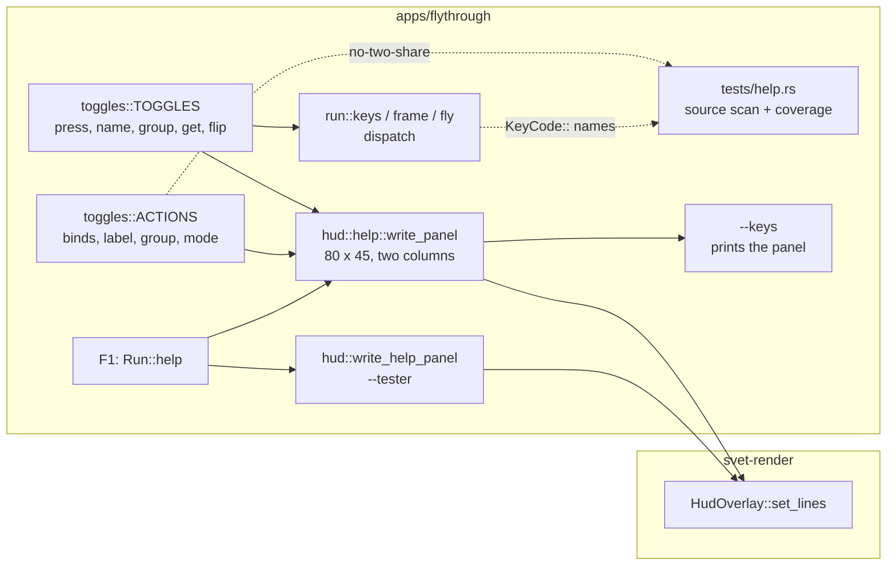

# 0076: A key help overlay for the fly-through, written from the key table

> **Status:** superseded by Plan 0080 (2026-11-16, the owner approved the fold: Phase 1 is 0080's Phase 1, Phase 2 sits in 0080's Phase 3, the panel is the menu's Keys page)
> **Created:** 2026-11-16
> **Milestone:** none of its own. The testbed (`apps/flythrough`); nothing under `crates/` changes.
> **Related ADRs:** none new. Rests on ADR-0009 (the text overlay, no UI library) and ADR-0054
> (the tester runs the fly-through as a child).
> **Starts after:** Plans 0062 and 0075 have merged. Both edit `apps/flythrough/src/toggles.rs`
> (0062 adds `` ` ``, `F11` and `F12` and gives `4` a second meaning; 0075 binds `Esc` while
> loading), so this lane branches from the main that holds both and lists their keys.
> **Amended 2026-11-16 (architect; the owner approved it 2026-11-16 with Plan 0080):** the owner asked the same day for a menu
> system in place of a full keyboard ("keep using keys to minimal"). ADR-0061 and
> [Plan 0080](done/0080-the-fly-throughs-menu-one-overlay-a-palette-and-the-minimal-key-set.md) answer
> it, and the recommendation (0080's owner question 6) is to **fold this plan into Plan 0080**:
> its Phase 1 (the `ACTIONS` table, the groups, `--keys`, the source scan) is 0080's Phase 1 as
> written here; its Phase 2 (`F1` opens the help, `Enter` takes the readings, the `F1` renames)
> is inside 0080's Phase 3; its panel becomes the menu's flat **Keys page** (every entry with its
> binds and live value, the fixed keys on top), which `F1` opens, instead of a two-column overlay
> of its own; its Phase 4 backdrop facility is 0080's Phase 5. The owner's answers of 2026-11-16
> (`F1` is help everywhere, the readings move to `Enter`, no backdrop until a window asks, `Esc`
> keeps quitting with the menu closed) carry over unchanged. On the owner's go this plan's status
> becomes `superseded by Plan 0080` and no lane starts on it; if the owner keeps it, it runs first
> as approved and 0080 replaces its panel.

## TL;DR

`F1` opens a key help panel over the fly-through's window: every key, button and pad input the
run binds, grouped as `docs/flythrough.md` groups them, each toggle with its current mode beside
it, read live, so a press while the panel is open changes its own row. The frame readings that
`F1` takes today move to `Enter`. Under `--tester`, `F1` keeps opening the tester's own short
panel: one meaning per mode, help in both. The panel is written each frame from the same tables
the key dispatch reads (`toggles::TOGGLES` and a new `toggles::ACTIONS` that replaces the bare
`ACTION_KEYS` list), and a CPU test fails when the source reads a key the help does not list. It
fits 1280 x 720 at the HUD's scale (80 x 45 cells) in two columns. While it is open it takes the
overlay's place; closing it brings back whatever `F2` had. The first thing seen:
`flythrough --keys` prints the panel at the start modes, and a test pins that every bound key is
in it.

## Context & problem

The owner, 2026-11-16, after the Plan 0062 window: "we need to have a help for keys inside the
app, its too many already". The fly-through binds every letter, every digit, `F1` to `F12`,
every punctuation key on the main block, `Tab`, `Backspace`, `Space`, `Esc`, `Shift`, both
mouse buttons, the wheel and a pad. The only list is `docs/flythrough.md`, outside the window.

What the tree has (main 50baf7be):

- **Toggles** are one table, `TOGGLES` in `apps/flythrough/src/toggles.rs`: press, name, HUD
  row, a `get` that names the mode in words, and a `flip`. `run::keys::toggle_keys` dispatches
  through it and `tests/toggles.rs` pins that every toggle shows its mode in its HUD row.
- **Actions** (keys with no mode of their own: the bench, the stamp, walk mode, the lights'
  drop, removal and shot, the audio's keys, the flight keys, `F1`, `F2`, `Esc`) are dispatched by
  hand in `run/keys.rs`, `run/frame.rs` and `fly.rs`. `ACTION_KEYS` lists their key codes only,
  with no words, for `no_two_inputs_share_a_key`. Nothing stops a key being read in the source
  and left out of `ACTION_KEYS`.
- **The overlay** is `svet_render::HudOverlay`: a 256 x 128 cell grid of 8 x 8 glyphs at
  `HUD_SCALE` 2, coloured rows from the top-left, each glyph with a 0.75-alpha shadow. With the
  stats HUD (`F2`) on it draws the stats rows and the mode banner under them; off, the banner
  alone. At 1280 x 720 it shows 80 x 45 cells.
- **`F1` today** samples the next frames and prints the frame-time line, with the collapse line,
  the last dig's region count and the audio line beside it (`run/keys.rs`, `Samples`). Under
  `--tester` the frame loop maps `F1` to the tester's help panel (`hud::write_help_panel`, a few
  hand-written rows, behind `Run::help`) through `path::tester_action`, which drops every debug
  key, the readings among them.

The panel serves the owner's own testing; no `docs/nfr.md` figure is touched (Budgets).

## Decision

**Keys: `F1` is help, `Enter` takes the readings** (the owner, 2026-11-16, option (b)). `F1` is
the help key by convention and already the tester's. `Enter` is the one large key no table or
source line in the fly-through reads, on main and on the `plan-0062` and `plan-0075` branches
(checked by `KeyCode::` in `apps/flythrough/src`; the tester launcher reads `Enter` in its own
menu window, not the child's). The readings keep everything they print; only the key and the
name "the `F1` line" change, to "the readings line" (`Enter`). We rejected leaving `F1` on the
readings and putting help on `Enter` (the draft's recommendation): two help keys, one per mode.

**One `F1` meaning per mode, one flag.** `Run::help` already holds the tester's panel. `F1` flips
it in every run; `compose_banner` already branches on `--tester`, so a tester run shows
`write_help_panel` and every other run the key panel. The tester filter keeps mapping `F1` to
`TesterAction::Help` and maps `Enter` to nothing, so a tester run takes no readings, as today.

**One table per kind of input, the help written from both.** `TOGGLES` gains a `group`.
`ACTION_KEYS` becomes `ACTIONS`: each row its binds (keys, pad buttons, mouse buttons, the
wheel), a label and a group, and an optional mode over the run's state where one exists (walk
or fly, the stats overlay, the walkers' walk and eye lights). The no-two-share test and the
help both read these tables; the dispatch keeps its code, and a test that scans the fly-through's
source for `KeyCode::` names fails on a key the tables miss. We rejected a dispatch rewritten
to run from `ACTIONS` (each action a `fn(&mut Run)`): it moves every action's body for a guard
that the scan gives at a fraction of the change.

**The panel replaces the overlay while open.** Open, the overlay draws the panel only (no stats
rows, no strip, no banner, since each toggle's row shows its mode live); closed, the overlay is
what `F2` left. Every other key still acts with the panel open, so the owner can press a key
and read the change in its row. `Esc` still quits. We rejected drawing the panel beside the
stats rows: the stats rows already take up to the full 80 columns, and the panel needs both
halves.

No ADR: the keys and the layout are testbed choices a later plan changes in a line, and the one
structural choice (tables plus a source scan, not a table-driven dispatch) is recorded here.

## Architecture diagram



## Implementation phases

The plan is not look-driven: the panel is text, and its tests are CPU tests of that text. No
phase writes a GPU test; the overlay's drawing is unchanged and `gpu_hud_golden` pins it.

### Phase 1: the tables and the panel, printed by `--keys`
- **Owner skill:** dev
- **What:** `ACTIONS` replaces `ACTION_KEYS`, `TOGGLES` rows gain a group, a new
  `hud::help` writes the panel from both at a `Modes` (and the few run flags the actions' modes
  read), and `flythrough --keys` prints it at the start modes and exits. The tables already name
  `F1` as help and `Enter` as the readings; the dispatch moves in Phase 2.
- **Files touched:** `apps/flythrough/src/toggles.rs`, `apps/flythrough/src/hud/help.rs` (new),
  `apps/flythrough/src/hud/mod.rs`, `apps/flythrough/src/cli/table.rs`,
  `apps/flythrough/src/cli/parse.rs`, `apps/flythrough/src/main.rs` or `app.rs` (the early exit,
  beside `--help`'s), `apps/flythrough/tests/toggles.rs` (reads `ACTIONS`),
  `apps/flythrough/tests/help.rs` (new).
- **Layout:** row 0 a title (`keys - F1 closes, Esc quits`), row 1 blank, then groups in the
  order of `docs/flythrough.md`'s key sections (moving and editing, readings and views, look and
  upscaler, lighting, dynamic lights and walkers, the light queue, audio, gamepad, the run),
  each a header row and its entries, filled down the left column (cols 0..39) and on down the
  right (cols 41..80), a group not split across columns. An entry is its binds (`F3`, `W A S D`,
  `[ ]`, `LMB / R2`) padded to a key field, then the toggle's `get` words (or `name: get` where
  `get` does not begin with the name), or the action's label and mode. Grouped binds (`W A S D`,
  the audio's trim pairs) are one entry. The audio group's header says `(with --audio)` when the
  run has none. A row longer than its column is cut with a `~` in the last cell.
- **Done when** (all CPU, in `tests/help.rs` unless named; each under 0.1 s):
  - `every_bound_key_is_in_the_help`: every `KeyCode` in `TOGGLES` and `ACTIONS` is a bind of
    exactly one help entry, and its label (`F3`, `Backspace`, `` ` ``) appears in the panel's
    text at the start modes; `F1` is the help's own entry and `Enter` the readings'.
  - `the_source_reads_no_key_the_help_misses`: every `KeyCode::<Name>` token in the `.rs` files
    under `apps/flythrough/src/` (read from `CARGO_MANIFEST_DIR`, a plain token scan, no regex
    dependency) names a key bound in `TOGGLES` or `ACTIONS`. The scan is a function of the text,
    and a second assertion bites it: fed `input.pressed(KeyCode::ArrowUp)`, it reports
    `ArrowUp` as unlisted.
  - `the_panel_fits_1280_by_720`: the panel at the start modes, and after each toggle's `flip`,
    is at most 45 rows of at most 80 bytes, and no entry's binds or name is cut.
  - `a_press_changes_its_own_help_row`: for each toggle, flipping it once from the start modes
    changes the visible part (before any `~`) of that toggle's own row, and no other toggle's
    row except those sharing its HUD row's words (`F`, `Tab`, `/` share the queue order). Where
    a row's change would be cut, the fix is narrower words for that row, not a wider column.
  - `no_two_inputs_share_a_key` (`tests/toggles.rs`) reads `ACTIONS` and still passes, with
    `F1` and `Enter` each bound once.
  - `flythrough --keys` prints the panel and exits 0 without opening a device (a CPU test
    through the parser's early exit, as `--help`'s is tested in `cli/tests.rs`).

### Phase 2: `F1` opens the panel, `Enter` takes the readings
- **Owner skill:** dev
- **What:** `F1` flips `Run::help` in every run; outside `--tester` the overlay draws the key
  panel alone while it is open and returns to `F2`'s state after, under `--tester` it draws the
  tester's panel as today. `Enter` starts the readings that `F1` started. The start banner
  names `F1` for `hud::BANNER_MS`. Every place that names "the `F1` line" or the `F1` readings
  names the readings line (`Enter`) instead; the tester's `F1` help stays as written.
- **Files touched:**
  - Code: `apps/flythrough/src/run/frame.rs` (`F1` read in both branches; the overlay's text
    chosen by help, stats or banner; the `F1` samples comment at the frame-times filing),
    `apps/flythrough/src/run/keys.rs` (`Enter` starts `Samples`), `apps/flythrough/src/run/mod.rs`
    (`help`'s doc: both panels), `apps/flythrough/src/run/hud_feed.rs` (the panel written into the
    HUD's reused buffers; the "Frames `F1` averages over" doc), `apps/flythrough/src/path.rs`
    (`TesterAction::Help`'s and the filter's docs; `Enter` maps to none, no new arm),
    `apps/flythrough/src/edits.rs` (the collapse line's doc), `apps/flythrough/src/report.rs`
    (the module doc's and `the_median_and_the_p50_agree`'s "the `F1` line's median"),
    `apps/flythrough/src/cli/mod.rs` (the module docs naming `F1`'s readings: `--frames`, the
    dig's region count, the audio line). `cli/flags.rs` needs no change: `--frames`' row does
    not name the key, and `--tester`'s keeps `F1`.
  - Tests: `apps/flythrough/src/run/tests.rs`, `apps/flythrough/tests/path.rs`.
  - Docs: `docs/flythrough.md` (the readings-and-views table: `F1` the key panel, with
    `--tester` its panel, `Enter` the readings; `--frames`' row; `--keys`; a line that the panel
    is generated from the tables), `docs/nfr.md` (the audio section's "Fly-through `F1`" figure
    names `Enter`, the 2026-10-17 reading kept as read under `F1`).
  - Left as written, being records of their day: ADR-0009 and ADR-0011 (accepted),
    `docs/nfr/02-frame-budget.md`'s 2026 readings, the readings logs and closed plans. Not the
    readings key: `svet-sim`'s and `svet-world`'s `F1` to `F6` fixtures, the backlog's "followup
    F1" (Plan 0067), `dist/README-TESTER.txt` and `--tester`'s help (the tester's `F1` stays
    help). No skill under `.claude/` names the key, and `run.json` carries no `F1` field (its
    numbers come from the run, not the key). `plan-0062` and `plan-0075` add no `F1` use in
    code; their one mention is in `docs/plans/logs/0062.md`, left as written.
- **Done when** (CPU, each under 0.1 s):
  - The overlay's text is chosen by one function of (tester, help open, stats visible): outside
    `--tester`, help open gives the key panel's rows, all white, and no strip, whatever the
    stats state; under `--tester`, help open gives today's tester panel; closed gives today's
    two cases unchanged. A test in `run/tests.rs` covers the combinations, and pressing `F1`
    twice leaves the stats state as it was.
  - Outside `--tester`, `Enter` starts the readings and `F1` does not: a key step with `Enter`
    pressed leaves `Run::samples` set, one with `F1` leaves it unset and `help` flipped.
  - The banner at a run's start (time 0) holds a row `F1 shows the keys`, and at
    `BANNER_MS + 1` does not; under `--tester` the path row's `F1 help, Esc ends the run` is
    unchanged and the new row never shows.
  - `tester_action(TesterInput::Key(KeyCode::Enter))` is `None` and `F1` still maps to
    `TesterAction::Help` (`tests/path.rs`).
  - No "`F1` line" or "`F1` readings" is left in the Phase 2 files: `git grep -n "F1"` over
    `apps/flythrough` and `docs/flythrough.md` returns only the help key, the tester's help, and
    `KeyCode::F1`.
  - The panel's formatting reuses the HUD's buffers: the `HudOverlay::allocations` count after
    the first open frame does not grow over the next 60 open frames (the `get` words may
    allocate, the overlay's staging may not). Reading: the panel's format time on the RTX 3080
    laptop, from the HUD's `format_us`, into `docs/plans/logs/0076.md`.

### Phase 3: the owner's window
- **Owner skill:** human
- **What:** On Linux only (Windows is checked periodically, not per plan; owner 2026-11-15), the
  owner runs `cargo run --release -p flythrough` in a 1280 x 720 window and at the laptop's own
  size, opens the panel with `F1`, and judges: can every row be read over the cave and over a
  lit wall (the glyph shadow only, no backdrop); are the groups where the hand looks for them;
  does a press with the panel open read right in its row (`F3`, `F10`, `X`, `2`, `F11`); does
  `F2` come back as it was after `F1` closes the panel; does `Enter` print the readings line.
  One `--tester` run checks that `F1` still shows the tester's panel and `Enter` does nothing.
- **Done when:** the owner's verdict on each point is written to the plan's readings log, with
  any wording or grouping change named for Phase 4.

### Phase 4: the owner's picks, and the tip
- **Owner skill:** dev
- **What:** Apply the window's picks (wording, group order) and run the gate tier at the tip.
  If the owner finds rows unreadable over bright rock, the fix is a general overlay facility: a
  dim backdrop bit in `HudOverlay`'s cell word (bits 16..24 are unused) drawn behind a row's
  cells, with a `gpu_hud` golden case on lavapipe (`gpu_hud_golden` binary, under 10 s);
  otherwise nothing under `crates/` changes.
- **Files touched:** the Phase 1 and 2 files as the picks need; only with a backdrop,
  `crates/svet-render/src/hud.rs`, `crates/svet-render/src/shaders/hud.wgsl` and the golden.
- **Done when:** each pick from the readings log is in the panel and its Phase 1 and 2 tests
  still pass with the new wording; the gate tier (`cargo nextest run --profile gate`), clippy,
  fmt and the doc gates exit 0 at the tip.

## Data shapes

```rust
// illustrative: toggles.rs
pub enum Group { Move, Readings, Look, Lighting, Lights, Queue, Audio, Pad, Run }
pub enum Bind { Key(KeyCode), Pad(PadButton), Mouse(MouseButton), Wheel, Trigger(Side) }
pub struct Action {
    pub binds: &'static [Bind],
    pub label: &'static str,
    pub group: Group,
    /// The mode in words where the run has one (`walk`/`fly`, `stats on`), else `None`.
    pub mode: Option<fn(&HelpState) -> String>,
}
pub static ACTIONS: &[Action] = &[/* B, P, G, K, R, I, F1 help, Enter readings, F2, 1, 4, 6, ... */];

// hud/help.rs
pub const HELP_COLS: usize = 80; // 1280 / (8 * HUD_SCALE)
pub const HELP_ROWS: usize = 45; //  720 / (8 * HUD_SCALE)
pub fn write_panel(out: &mut String, state: &HelpState); // rows joined by '\n'
```

`HelpState` borrows `Modes` and carries the few flags outside it (walking, the stats overlay,
whether audio runs). Plan 0062's walkers' modes live in `Modes`, so `F11` and `F12` read them
there.

## Budgets

No `docs/nfr.md` figure moves. With the panel closed the frame does no new work. Open, the run
formats about 70 rows a frame; a guess of under 0.1 ms CPU on the RTX 3080 laptop, read in
Phase 2 from the HUD's `format_us` and logged, not a gate. The overlay's buffers are unchanged
(the panel's 45 rows are within the 128-row grid), so VRAM does not move. The readings keep
their content; only their key changes.

## Risks & open questions

**Answered by the owner 2026-11-16:**

1. **The key.** (b): `F1` is help everywhere, the frame readings move to `Enter`, and "the `F1`
   line" is renamed wherever this plan's work touches it (Phase 2's file list).
2. **A backdrop.** None until the Phase 3 window asks for one; Phase 4 holds the bounded fix.
3. **Tester children.** They keep their own `F1` panel and never show the key panel.
4. **`Esc` with the panel open.** `Esc` keeps quitting; `F1` closes the panel.

**Risks:**

- **Habit.** The owner's hand reaches for `F1` to read frame times; the first press now opens
  the panel, whose readings row names `Enter`. Accepted with the answer.
- **Long mode words.** The queue toggles share one `get` that names the whole order, longer
  than a 39-column half. `a_press_changes_its_own_help_row` forces a narrower phrase where a
  row's change would be cut; that touches the toggle's words in the help only, not the HUD row.
- **Windows narrower than 1280.** The panel is laid out for 80 x 45 cells from the top-left;
  a smaller window clips the right column and the bottom rows (the overlay clips, never wraps).
  Accepted for a testbed; no reflow.
- **Drift between plans.** A lane that adds a key after this plan fails
  `the_source_reads_no_key_the_help_misses` until it adds an `ACTIONS` or `TOGGLES` row, which is
  the point. Plan 0073 (the settings menu) says `Tab` is unbound in the fly-through; it is the
  queue angle's key, so 0073 needs another key before its lane starts.

## What this plan does NOT do

- **No dispatch rewrite.** Actions keep their code in `run/keys.rs`, `run/frame.rs` and
  `fly.rs`; the source scan is the drift guard.
- **No change to the tester's panel or filter** beyond `Enter` staying unmapped. The backlog's
  "tester mode's key filter is structural" item stays with Plan 0073's settings menu.
- **No rebinding, no key settings file, no menu.** Plan 0073 owns a settings menu and file.
- **No audio HUD row.** The audio keys are listed with their labels; their modes stay in
  stdout as today, and the group says `(with --audio)`.
- **No reflow for small windows, no scrolling, no search.**
- **No engine UI facility** unless Phase 3 asks for the backdrop; nothing under `crates/` names
  a key, a toggle or the fly-through, and `svet-app`'s input is unchanged.
- **No edits to accepted ADRs or past readings** that name `F1`.
- **No Windows window check** for this plan.
- **No new GPU test** unless Phase 4 adds the backdrop.

## Implementation log

> Written by `dev`: one row per phase as its commit lands, then the close block. **The phases
> above are the contract. This section records what happened.** Observations, never conclusions:
> no pass list, no self-assessment. Deviations and unmet done-whens are **always** disclosed.
> Keep it shorter than `## Implementation phases`. Readings, gate counts, attempts and resume
> notes go to the plan's readings log, `docs/plans/logs/0076.md` (started from
> `templates/readings-log.md`), and this section links it once it exists.

| phase | owner | state | commit |
|---|---|---|---|
| 1: the tables and the panel, printed by `--keys` | dev | not started | |
| 2: `F1` opens the panel, `Enter` takes the readings | dev | not started | |
| 3: the owner's window | human | not started | |
| 4: the owner's picks, and the tip | dev | not started | |

### Notes

### Close triggers

- **What shipped:**
- **Public API changed:**
- **Budget readings:**
- **Gate at the tip:**
- **Outstanding `human` phases:**

## Followups
