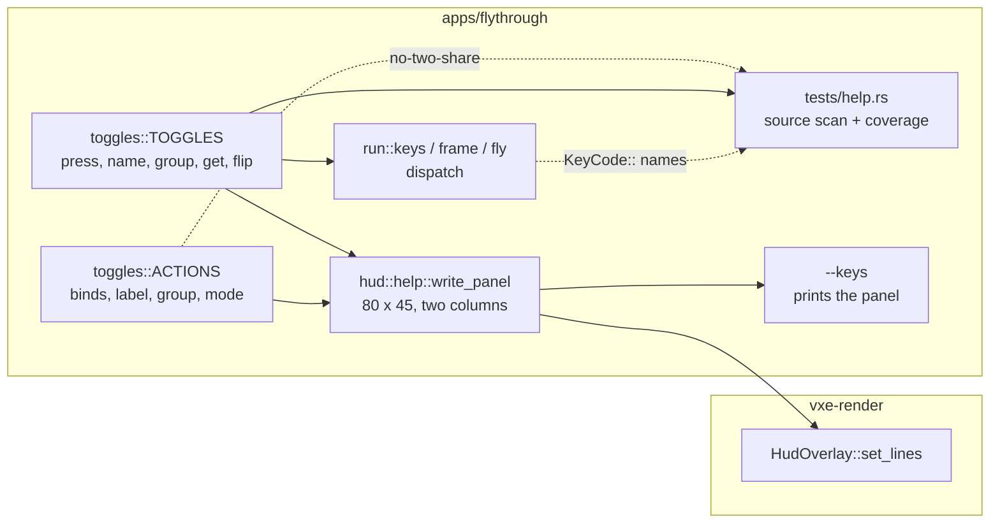

# 0076: A key help overlay for the fly-through, written from the key table

> **Status:** draft (2026-11-16), awaiting the owner's go
> **Created:** 2026-11-16
> **Milestone:** none of its own. The testbed (`apps/flythrough`); nothing under `crates/` changes.
> **Related ADRs:** none new. Rests on ADR-0009 (the text overlay, no UI library) and ADR-0054
> (the tester runs the fly-through as a child).
> **Starts after:** Plans 0062 and 0075 have merged. Both edit `apps/flythrough/src/toggles.rs`
> (0062 adds `` ` ``, `F11` and `F12` and gives `4` a second meaning; 0075 binds `Esc` while
> loading), so this lane branches from the main that holds both and lists their keys.

## TL;DR

`Enter` opens a key help panel over the fly-through's window: every key, button and pad input
the run binds, grouped as `docs/flythrough.md` groups them, each toggle with its current mode
beside it, read live, so a press while the panel is open changes its own row. The panel is
written each frame from the same tables the key dispatch reads (`toggles::TOGGLES` and a new
`toggles::ACTIONS` that replaces the bare `ACTION_KEYS` list), and a CPU test fails when the
source reads a key the help does not list. It fits 1280 x 720 at the HUD's scale (80 x 45 cells)
in two columns. While it is open it takes the overlay's place; closing it brings back whatever
`F2` had. `--tester` runs never show it (their `F1` panel stays theirs). The first thing seen:
`flythrough --keys` prints the panel at the start modes, and a test pins that every bound key is
in it.

## Context & problem

The owner, 2026-11-16, after the Plan 0062 window: "we need to have a help for keys inside the
app, its too many already". The fly-through binds every letter, every digit, `F1` to `F12`,
every punctuation key on the main block, `Tab`, `Backspace`, `Space`, `Esc`, `Shift`, both
mouse buttons, the wheel and a pad. The only list is `docs/flythrough.md`, outside the window.

What the tree has (main 50baf7be):

- **Toggles** are one table, `TOGGLES` in `apps/flythrough/src/toggles.rs`: press, name, HUD
  row, a `get` that names the mode in words, and a `flip`. `run::keys::toggle_keys` dispatches
  through it and `tests/toggles.rs` pins that every toggle shows its mode in its HUD row.
- **Actions** (keys with no mode of their own: the bench, the stamp, walk mode, the lights'
  drop, removal and shot, the audio's keys, the flight keys, `F1`, `F2`, `Esc`) are dispatched by
  hand in `run/keys.rs`, `run/frame.rs` and `fly.rs`. `ACTION_KEYS` lists their key codes only,
  with no words, for `no_two_inputs_share_a_key`. Nothing stops a key being read in the source
  and left out of `ACTION_KEYS`.
- **The overlay** is `vxe_render::HudOverlay`: a 256 x 128 cell grid of 8 x 8 glyphs at
  `HUD_SCALE` 2, coloured rows from the top-left, each glyph with a 0.75-alpha shadow. With the
  stats HUD (`F2`) on it draws the stats rows and the mode banner under them; off, the banner
  alone. At 1280 x 720 it shows 80 x 45 cells.
- **`F1`** is not the stats HUD: it samples frames and prints the frame-time line. Under
  `--tester` the frame loop maps `F1` to the tester's own help panel (`hud::write_help_panel`,
  a few hand-written rows) through `path::tester_action`, which drops every debug key.

The panel serves the owner's own testing; no `docs/nfr.md` figure is touched (Budgets).

## Decision

**Key: `Enter`.** It is the one large key no table or source line in the fly-through reads, on
main and on the `plan-0062` and `plan-0075` branches (checked by `KeyCode::` in
`apps/flythrough/src`; the tester launcher's menu reads `Enter`, but in its own window). The
arrows, `CapsLock`, the right `Shift`, `Ctrl`, `Alt` and `Insert` are free too; the arrows are
kept for a later camera or menu use, `CapsLock` toggles OS state, and the modifiers collide with
the compositor's chords. The owner's laptop has no `Home`, `End`, `Page` or `Delete` keys
(2026-11-13). We rejected moving `F1`'s frame readings elsewhere to make `F1` the help key (the
convention, and the tester's help key) because `F1` is named in the report, the docs and the
owner's habits; it is the first open question.

**One table per kind of input, the help written from both.** `TOGGLES` gains a `group`.
`ACTION_KEYS` becomes `ACTIONS`: each row its binds (keys, pad buttons, mouse buttons, the
wheel), a label and a group, and an optional mode over the run's state where one exists (walk
or fly, the stats overlay, the walkers' walk and eye lights). The no-two-share test and the
help both read these tables; the dispatch keeps its code, and a test that scans the fly-through's
source for `KeyCode::` names fails on a key the tables miss. We rejected a dispatch rewritten
to run from `ACTIONS` (each action a `fn(&mut Run)`): it moves every action's body for a guard
that the scan gives at a fraction of the change, and a plan that is to stay small.

**The panel replaces the overlay while open.** One flag, `help`, beside the HUD's `visible`:
open, the overlay draws the panel only (no stats rows, no strip, no banner, since each toggle's
row shows its mode live); closed, the overlay is what `F2` left. Every other key still acts
with the panel open, so the owner can press a key and read the change in its row. `Esc` still
quits. We rejected drawing the panel beside the stats rows: at 80 columns the stats rows already
take the left half and up to the full width, and the panel needs both columns.

**Tester children do not show it.** `tester_action(Key(Enter))` stays `None`, so the filter
drops it as it drops every debug key; the tester's `F1` panel already names the few keys a tester
has, and listing the debug keys there would name keys that do nothing.

No ADR: the key and the layout are testbed choices a later plan changes in a line, and the one
structural choice (tables plus a source scan, not a table-driven dispatch) is recorded here.

## Architecture diagram



## Implementation phases

The plan is not look-driven: the panel is text, and its tests are CPU tests of that text. No
phase writes a GPU test; the overlay's drawing is unchanged and `gpu_hud_golden` pins it.

### Phase 1: the tables and the panel, printed by `--keys`
- **Owner skill:** dev
- **What:** `ACTIONS` replaces `ACTION_KEYS`, `TOGGLES` rows gain a group, a new
  `hud::help` writes the panel from both at a `Modes` (and the few run flags the actions' modes
  read), and `flythrough --keys` prints it at the start modes and exits.
- **Files touched:** `apps/flythrough/src/toggles.rs`, `apps/flythrough/src/hud/help.rs` (new),
  `apps/flythrough/src/hud/mod.rs`, `apps/flythrough/src/cli/table.rs`,
  `apps/flythrough/src/cli/parse.rs`, `apps/flythrough/src/main.rs` or `app.rs` (the early exit,
  beside `--help`'s), `apps/flythrough/tests/toggles.rs` (reads `ACTIONS`),
  `apps/flythrough/tests/help.rs` (new).
- **Layout:** row 0 a title (`keys - Enter closes, Esc quits`), row 1 blank, then groups in the
  order of `docs/flythrough.md`'s key sections (moving and editing, readings and views, look and
  upscaler, lighting, dynamic lights and walkers, the light queue, audio, gamepad, the run),
  each a header row and its entries, filled down the left column (cols 0..39) and on down the
  right (cols 41..80), a group not split across columns. An entry is its binds (`F3`, `W A S D`,
  `[ ]`, `LMB / R2`) padded to a key field, then the toggle's `get` words (or `name: get` where
  `get` does not begin with the name), or the action's label and mode. Grouped binds (`W A S D`,
  the audio's trim pairs) are one entry. The audio group's header says `(with --audio)` when the
  run has none. A row longer than its column is cut with a `~` in the last cell.
- **Done when** (all CPU, in `tests/help.rs` unless named; each under 0.1 s):
  - `every_bound_key_is_in_the_help`: every `KeyCode` in `TOGGLES` and `ACTIONS` is a bind of
    exactly one help entry, and its label (`F3`, `Backspace`, `` ` ``) appears in the panel's
    text at the start modes; `Enter` is among them (as the help's own entry).
  - `the_source_reads_no_key_the_help_misses`: every `KeyCode::<Name>` token in the `.rs` files
    under `apps/flythrough/src/` (read from `CARGO_MANIFEST_DIR`, a plain token scan, no regex
    dependency) names a key bound in `TOGGLES` or `ACTIONS`. The scan is a function of the text,
    and a second assertion bites it: fed `input.pressed(KeyCode::ArrowUp)`, it reports
    `ArrowUp` as unlisted.
  - `the_panel_fits_1280_by_720`: the panel at the start modes, and after each toggle's `flip`,
    is at most 45 rows of at most 80 bytes, and no entry's binds or name is cut.
  - `a_press_changes_its_own_help_row`: for each toggle, flipping it once from the start modes
    changes the visible part (before any `~`) of that toggle's own row, and no other toggle's
    row except those sharing its HUD row's words (`F`, `Tab`, `/` share the queue order). This
    fails today for any toggle whose words would be cut; the fix is narrower words for that row,
    not a wider column.
  - `no_two_inputs_share_a_key` (`tests/toggles.rs`) reads `ACTIONS` and still passes, with
    `Enter` bound once.
  - `flythrough --keys` prints the panel and exits 0 without opening a device (a CPU test
    through the parser's early exit, as `--help`'s is tested in `cli/tests.rs`).

### Phase 2: `Enter` in the window
- **Owner skill:** dev
- **What:** `Enter` toggles the panel in a window run; the overlay draws the panel alone while
  it is open and returns to `F2`'s state after; the start banner names the key for
  `hud::BANNER_MS`; `--tester` runs drop the key; `docs/flythrough.md` and `--help` name it.
- **Files touched:** `apps/flythrough/src/run/frame.rs` (the key read, beside `F2`'s, on the
  non-tester branch; the overlay's text chosen by help, stats or banner),
  `apps/flythrough/src/run/hud_feed.rs` (the panel written into the HUD's reused buffers),
  `apps/flythrough/src/run/mod.rs` (the flag), `apps/flythrough/src/path.rs` (doc of the filter;
  no new arm), `apps/flythrough/src/run/tests.rs`, `apps/flythrough/tests/path.rs`,
  `docs/flythrough.md` (the `Enter` row, `--keys`, and a line that the panel is generated from
  the tables).
- **Done when** (CPU, each under 0.1 s):
  - The overlay's text is chosen by one function of (help open, stats visible): help open gives
    the panel's rows, all white, and no strip, whatever the stats state; closed gives today's two
    cases unchanged. A test in `run/tests.rs` covers the four combinations, and pressing `Enter`
    twice leaves the stats state as it was.
  - The banner at a run's start (time 0) holds a row `Enter shows the keys`, and at
    `BANNER_MS + 1` does not; under `--tester` it never does.
  - `tester_action(TesterInput::Key(KeyCode::Enter))` is `None` (`tests/path.rs`), and a
    `--tester` run's key step with `Enter` pressed leaves the panel closed.
  - The panel's formatting reuses the HUD's buffers: the `HudOverlay::allocations` count after
    the first open frame does not grow over the next 60 open frames (the overlay's own counter;
    the `get` words may allocate, the overlay's staging may not). Reading: the panel's format
    time on the RTX 3080 laptop, from the HUD's `format_us`, into `docs/plans/logs/0076.md`.

### Phase 3: the owner's window
- **Owner skill:** human
- **What:** On Linux only (Windows is checked periodically, not per plan; owner 2026-11-15), the
  owner runs `cargo run --release -p flythrough` in a 1280 x 720 window and at the laptop's own
  size, opens the panel with `Enter`, and judges: can every row be read over the cave and over a
  lit wall (the glyph shadow only, no backdrop); are the groups where the hand looks for them;
  does a press with the panel open read right in its row (`F3`, `F10`, `X`, `2`, `F11`); does
  `F2` come back as it was after `Enter` closes the panel; is `Enter` the key, or should `F1`
  move.
- **Done when:** the owner's verdict on each point is written to the plan's readings log, with
  any wording, grouping or key change named for Phase 4.

### Phase 4: the owner's picks, and the tip
- **Owner skill:** dev
- **What:** Apply the window's picks (wording, group order, the key if the owner moves it) and
  run the gate tier at the tip. If the owner finds rows unreadable over bright rock, the fix is
  a general overlay facility: a dim backdrop bit in `HudOverlay`'s cell word (bits 16..24 are
  unused) drawn behind a row's cells, with a `gpu_hud` golden case on lavapipe (`gpu_hud_golden`
  binary, under 10 s); otherwise nothing under `crates/` changes.
- **Files touched:** the Phase 1 and 2 files as the picks need; only with a backdrop,
  `crates/vxe-render/src/hud.rs`, `crates/vxe-render/src/shaders/hud.wgsl` and the golden.
- **Done when:** each pick from the readings log is in the panel and its Phase 1 and 2 tests
  still pass with the new wording; with a key move, `every_bound_key_is_in_the_help` and
  `no_two_inputs_share_a_key` pass on the new key and the tester filter test names it; the
  gate tier (`cargo nextest run --profile gate`), clippy, fmt and the doc gates exit 0 at the tip.

## Data shapes

```rust
// illustrative: toggles.rs
pub enum Group { Move, Readings, Look, Lighting, Lights, Queue, Audio, Pad, Run }
pub enum Bind { Key(KeyCode), Pad(PadButton), Mouse(MouseButton), Wheel, Trigger(Side) }
pub struct Action {
    pub binds: &'static [Bind],
    pub label: &'static str,
    pub group: Group,
    /// The mode in words where the run has one (`walk`/`fly`, `stats on`), else `None`.
    pub mode: Option<fn(&HelpState) -> String>,
}
pub static ACTIONS: &[Action] = &[/* B, P, G, K, R, I, F1, F2, Enter, 1, 4, 6, ... */];

// hud/help.rs
pub const HELP_COLS: usize = 80; // 1280 / (8 * HUD_SCALE)
pub const HELP_ROWS: usize = 45; //  720 / (8 * HUD_SCALE)
pub fn write_panel(out: &mut String, state: &HelpState); // rows joined by '\n'
```

`HelpState` borrows `Modes` and carries the few flags outside it (walking, the stats overlay,
whether audio runs). Plan 0062's walkers' modes live in `Modes`, so `F11` and `F12` read them
there.

## Budgets

No `docs/nfr.md` figure moves. With the panel closed the frame does no new work. Open, the run
formats about 70 rows a frame; a guess of under 0.1 ms CPU on the RTX 3080 laptop, read in
Phase 2 from the HUD's `format_us` and logged, not a gate. The overlay's buffers are unchanged
(the panel's 45 rows are within the 128-row grid), so VRAM does not move.

## Risks & open questions

- **The key (owner).** (a) `Enter`, free today, recommended: no key moves. (b) `F1` for help,
  as convention and the tester have it, and the frame readings move to `Enter`: one help key
  everywhere, at the cost of renaming "the `F1` line" in the report, the docs and tests.
- **Readability without a backdrop.** The glyph shadow carries the stats rows today, but a
  panel of 45 dense rows over a lit wall may not read. Phase 3 judges it; Phase 4 holds the
  bounded fix. Recommended: no backdrop until the window asks for one.
- **Long mode words.** The queue toggles share one `get` that names the whole order, longer
  than a 39-column half. `a_press_changes_its_own_help_row` forces a narrower phrase where a
  row's change would be cut; that touches the toggle's words in the help only, not the HUD row.
- **Windows narrower than 1280.** The panel is laid out for 80 x 45 cells from the top-left;
  a smaller window clips the right column and the bottom rows (the overlay clips, never wraps).
  Accepted for a testbed; no reflow.
- **Drift between plans.** A lane that adds a key after this plan fails
  `the_source_reads_no_key_the_help_misses` until it adds an `ACTIONS` or `TOGGLES` row, which is
  the point.
- **Drift found while drafting:** the request named the stats HUD as `F1`; it is `F2`, and
  `F1` prints the frame readings.

## What this plan does NOT do

- **No dispatch rewrite.** Actions keep their code in `run/keys.rs`, `run/frame.rs` and
  `fly.rs`; the source scan is the drift guard.
- **No help under `--tester`**, and no change to the tester's `F1` panel. The backlog's "tester
  mode's key filter is structural" item stays with Plan 0073's settings menu.
- **No rebinding, no key settings file, no menu.** Plan 0073 owns a settings menu and file.
- **No audio HUD row.** The audio keys are listed with their labels; their modes stay in
  stdout as today, and the group says `(with --audio)`.
- **No reflow for small windows, no scrolling, no search.**
- **No engine UI facility** unless Phase 3 asks for the backdrop; nothing under `crates/` names
  a key, a toggle or the fly-through, and `vxe-app`'s input is unchanged.
- **No Windows window check** for this plan.
- **No new GPU test** unless Phase 4 adds the backdrop.

## Implementation log

> Written by `dev`: one row per phase as its commit lands, then the close block. **The phases
> above are the contract. This section records what happened.** Observations, never conclusions:
> no pass list, no self-assessment. Deviations and unmet done-whens are **always** disclosed.
> Keep it shorter than `## Implementation phases`. Readings, gate counts, attempts and resume
> notes go to the plan's readings log, `docs/plans/logs/0076.md` (started from
> `templates/readings-log.md`), and this section links it once it exists.

| phase | owner | state | commit |
|---|---|---|---|
| 1: the tables and the panel, printed by `--keys` | dev | not started | |
| 2: `Enter` in the window | dev | not started | |
| 3: the owner's window | human | not started | |
| 4: the owner's picks, and the tip | dev | not started | |

### Notes

### Close triggers

- **What shipped:**
- **Public API changed:**
- **Budget readings:**
- **Gate at the tip:**
- **Outstanding `human` phases:**

## Followups
