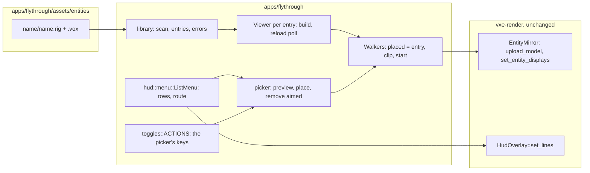

# 0077: An entity picker in the fly-through: choose a model from the entities library, see it at the crosshair, place it

> **Status:** in-progress (dev lane from 2026-11-17; Phases 1 to 4 done); approved (2026-11-16, the owner: all eight recommended answers under "Owner questions"); amended 2026-11-17 (orchestrator re-read against Plans 0078, 0069 and 0080 as landed; owner questions 9 to 11 answered 2026-11-17: the recommended option each, `Delete` removes, `Enter` places and stays open, a page like any other); **amended 2026-11-18 (the owner's window: a placement mode with a belt of slots, a chooser with a picture per entry, the ghost marked and stood further out; Phases 5 to 9 replace Phase 5; owner questions 12 to 18 await answers)**
> **Created:** 2026-11-16
> **Milestone:** M6 in [`docs/roadmap.md`](../roadmap.md), the testbed side. Apps only
> (`apps/flythrough`); nothing under `crates/` changes.
> **Related ADRs:** none new. Rests on
> [ADR-0009](../adrs/0009-testbed-hud-as-embedded-bitmap-font-overlay-pass.md) (the text overlay,
> no UI library), [ADR-0050](../adrs/0050-entities-are-posed-voxel-volumes-in-their-own-pool-traced-after-the-world-march.md)
> (models, the mirror's pool, the caps) and
> [ADR-0051](../adrs/0051-rigs-and-clips-are-text-files-sampled-in-fixed-point-by-tick.md)
> (`.rig` files, clips sampled by tick).
> **Source:** the owner, 2026-11-16: "We need some form of overlay menu in window so user can
> choose one of entities from predefined ones and place them"; and the same day, through the
> orchestrator: the walker and the spider go into an **entities library**, a directory of
> predefined models under `apps/flythrough/assets/` documented in a new `docs/entities.md`, and
> the picker's catalogue is that directory, every entry in it.
> **Starts after:** [Plan 0063](done/0063-rigs-and-clips-keyframe-animation-a-model-viewer-and-text-authoring.md)
> has closed (the viewer, `--model`, the clip keys), the clip-recorder chore stacked on it has
> merged (the library's layout, the spider, `docs/entities.md`), and
> [Plan 0076](0076-a-key-help-overlay-for-the-fly-through-from-the-key-table.md) has merged
> (`ACTIONS`, the help panel's groups and the source scan this plan's keys must pass). Plan 0076
> itself follows Plans 0062 and 0075, so all four edits to `toggles.rs` land before this lane
> branches. Before the lane starts the architect re-reads Phases 1 to 3 against that tip: the
> library's final layout and the names `walker.rs` and `viewer.rs` carry then.
> **Amended 2026-11-16 (architect; the owner approved it 2026-11-16 with Plan 0080):** the owner asked the same day for a menu
> system in place of a full keyboard. ADR-0061 and
> [Plan 0080](done/0080-the-fly-throughs-menu-one-overlay-a-palette-and-the-minimal-key-set.md) give
> the window one menu component, a palette and one input-capture rule, and this plan moves onto
> it: **Starts after** gains Plan 0080 in place of Plan 0076 (which 0080 folds in, pending the
> owner). **`ListMenu` is not written here**: Phase 3's picker is a **dynamic Entities page** of
> 0080's `Menu` (one row per library entry, built each frame; `Entry::on_select` moves the
> preview; `Value` rows for the clip; the page's footer names `Enter places, Backspace removes`;
> the page asks for the left click through its `captures_click` flag). `` ` `` stays the
> shortcut that opens the menu on that page (`Menu::open_at`), so `` ` `` `` ` `` still places
> the selected entry; `Esc` closes the page (never the run, 0080's rule); `ArrowLeft`,
> `ArrowRight` and `ArrowDown` keep acting on the aimed entity with the menu closed. The keys
> the picker read while open (`ArrowUp`, the wheel, both clicks, `Backspace`, `Escape`, `Enter`)
> are the menu's by 0080's one rule, so this plan adds no routing of its own and Phase 3's
> `the_picker_routes_its_keys` becomes a case of 0080's `the_route_is_one_function`. Phase 3's
> `hud/menu.rs` leaves its file list; `the_overlay_shows_one_panel` becomes "opening the
> Entities page from the Keys page and back", since both are pages of one menu. Owner question 8
> (the shared menu) is answered by 0080; Phase 4 (a) also asks whether `` ` `` keeps its key or
> the page is reached through `Tab` alone. The decision text and Phase 3 below are left as
> written; the lane reads this note first, then "Amended 2026-11-17" below.

## Amended 2026-11-17 (orchestrator re-read)

Read at `plan-0080` c8c1a8e9 (Plan 0080 implemented, about to merge), main 02fae523 (Plans
0078 and 0069 closed, v0.60.0) and `plan-0032` 70463c97. The lane branches from main once
0080 has merged; the tree's names win. The decision text and the phases below stand except
where this section says otherwise; the dev reads this section as the phases' errata.

### Name mapping (the plan's name, then the tree's)

| The plan says | The tree has |
|---|---|
| `ListMenu`, `hud/menu.rs`, `Routed`, `MenuInput` (this plan's) | `hud::menu::Menu` in `apps/flythrough/src/hud/menu/{mod,entries,page,route,write,filter}.rs`; `PageId { Root, Group(Group), Keys }`, `Row { Group, Entry, Fixed, Header }`, `MenuInput`, `Activated { Toggle, Action, Step, Refused }`, `route::step_at`, `Menu::open_at(PageId)`, `Menu::write_with(.., notice, ..)` |
| 0080's "Interface" (`Page::dynamic`, `Entry::on_select`, `Entry::Value`, `captures_click`) | **none landed.** `Entry` is `Copy` over the static tables. The dynamic page is this plan's to build (Phase 3) |
| `the_overlay_shows_one_panel`'s "(tester, help, picker, stats)" function | `Overlay::of(tester, menu_open, stats)` in `run/frame.rs`; unchanged by this plan |
| the picker's red banner, `println!` lines | `Run::say(line)`: the line printed and shown in the menu's notice row (`run/keys.rs`) |
| "an entry in error red" | 0080's convention: an unavailable row is `HudColour::Grey` with its reason on the row after its words (never colour alone) |
| `F11`, `Minus` (walk, eye lights) | menu-only entries `walkers walk`, `eye lights` (`toggles::ACTIONS`, group `Entities`); no key |
| `KEY_WALKER` `` ` `` places a walker | `Act::PlaceWalker`, the `place a walker` action, bind `KEY_WALKER` |
| `ArrowLeft`/`Right`/`Down` clip keys, "with `--model`" | `Act::ClipBack`/`ClipOn`/`ClipPause`, `needs: Needs::Model` (`RunView::model`); they act with the menu **closed** only (0080 Phase 3, owner 2026-11-17) |
| `Walkers.viewer: Option<Viewer>`, `Placed { id, feet, yaw, since, rig: bool }` | as named; `Viewer { handle, stale, loaded, clip, player, paused, ticks, error }`, `Viewer::{open, reload, build_pending, poll, cycle, toggle_pause}` |
| "the mirror has no free", `PoolFull` banner, "new `EntityId`" on reload | Plan 0078: `EntityMirror::free_model(handle)`, `clear()`, `pool_used_bytes()`, `volume_bytes(prefab)`; `EntitySet::replace(id, model, pose)` keeps the id; `walker::{ModelPool, MirrorPool, sync_models, POOL_RESET}` free the stale handle, retry, reset a fragmented pool and set the banner; the HUD entities row already reads `pool <used>/<total> KB` |
| `tests/library.rs` `the_committed_library_builds` | `tests/entities.rs` (the clip chore's) holds `every_library_entry_is_in_step_and_builds` and `the_spider_has_its_rows_parts_and_clips`; Phase 1 extends that file or adds beside it |
| `--library` early exit "beside `--keys`" | `cli/parse.rs` (`keys_flag`), `cli/flags.rs` (the Run section), `Args::keys` in `cli/mod.rs`; `--model` and `--clip` are `cli/model.rs` |
| `walker.rs` "about 830 lines" | **1154 lines** on `plan-0080` (cap 1200): the split under `apps/flythrough/src/entities/` is **mandatory**, in Phase 2 |

### Interface changes

- **Keys while the menu is open are 0080's rule**, with no routing of this plan's own:
  `route::taken` already makes the arrows, `Enter`, `Esc`, `Backspace`, the wheel and both
  clicks the menu's (left click `Activate`, right click `Back`, wheel `Scroll`). So `Enter` or
  the left click place, `Esc` or the right click close, `ArrowUp`/`ArrowDown` and the wheel
  move the selection, and `captures_click` is not needed. `` ` `` is punctuation to `taken`
  (the menu's, types nothing), so Phase 3 gives it one `MenuInput` of its own, as `F1` has
  `MenuInput::Keys`: closed, it opens the menu on the Entities page (`Menu::open_at`); on
  that page it places as `Enter` does and closes (so `` ` `` `` ` `` is the quick place); on
  any other page it switches to the Entities page. **`Backspace` is the filter's `Erase`**
  and cannot remove the aimed entity: owner question 9. `ArrowUp` needs no bind.
- **The Entities page is dynamic**: a `PageId` variant (or the dev's cut) whose rows are built
  each frame from run state: one row per library entry (`spider   14 parts  4.8 x 3.9 x 1.2 m`,
  figures illustrative), then the clip row, with the words and the page title from the run
  (`Menu::rows` and `write_with` take what they need beside `RunView`, which is `Copy`). The
  preview follows the selection without a callback: each frame the run reads
  `Menu::selected()` on that page and re-places the preview when it differs from the preview's
  entry or the aim's surface point moved. A row in error is grey with its reason after its
  words (`rig line 3: ...`, or the unknown material's name) and `Enter` on it is
  `Activated::Refused` (the reason in the notice row). The page's footer arm names its keys.
  Plan 0083 Phase 6 builds its Structures page on this variant, so the mechanism is a page
  kind, not an entities special case.
- **The clip row is a cycle**, not a `Value` with `Left`/`Right` (the owner struck in-place
  stepping on 0080, question 9 there): `Enter` on `clip  walk  (1/3)` gives the next clip and
  wraps; `Left` goes back to the root, `Right` into a group, as on every page. Outside the menu
  `ArrowLeft`/`ArrowRight`/`ArrowDown` keep cycling and pausing the aimed (else newest)
  entity's clip as owner question 4 says. Their `needs` becomes a new `Needs` variant, "a
  placed entity" (`RunView` gains it), since any entry places without `--model`.
- **`Enter` places and the page stays open** (0080: every activation answers in the window;
  the notice row reads `placed spider #3 (rear)`), `Esc` closes; `` ` `` on the page places
  **and** closes. Owner question 10 confirms or reverts to "both close" as the Decision wrote.
- **One placement function** takes the crosshair's world hit (`Run::surface_along_view`'s
  point; the hit face comes with it) for `` ` ``, `Enter`, `--entities N` and the preview, so
  Plan 0079 Phase 4 (a body on the aimed face) and Plan 0083 Phase 6 (a structure at the aim)
  extend one place.
- **The page's shape is 0080's panel**: 80 columns at the menu's glyph scale, centred, growing
  down from the top, a backdrop under the used rows. Not the left half of the overlay. With a
  few entries the panel's rows stop well above the centre row and the preview at the crosshair
  is clear; a long list dims it. Owner question 11; Phase 4 (c) judges it.
- **Phase 2's Library**: one `Viewer` per entry, each with its own `handle` and `stale`;
  `sync_models` iterates the entries in place of the one viewer, so the free-retry-reset path
  and `POOL_RESET` are reused, not rewritten. A refusal that stands is said through `Run::say`
  (`pool full: spider`), not a new banner. `Placed.rig: bool` becomes the entry index plus the
  entity's own clip and playback (its own `Player`); `a_reload_moves_only_its_own_entry` asserts
  the **same** `EntityId` through `EntitySet::replace` (0078's owner question 3), not a new one.
- **The pad**: `Start` opens the root, the `entities` group row opens the page, `South` places,
  `East` closes, the D-pad moves; no pad bind for `` ` ``. One line in Phase 3's done-when.
- **Tests that drive a `Run`** go in `apps/flythrough/src/run/` (`menu_tests.rs` pattern,
  `bare_run(carved_rock())`), since `Run` is crate-private; `tests/picker.rs` holds what the
  `Menu` and the library answer without a run.
- **Keys moving around this plan, none of them this plan's:** Plan 0032 binds `Home`,
  `PageUp` (`Shift` back), `End` and `CapsLock` on its branch and Plan 0069 the profile cycle
  on `PageDown`; all move into the menu (`F4` for the cycle) at 0080's merge as those plans'
  merge items. The free keys after that are 0080's Phase 3 list; this plan asks for `Delete`
  (question 9) and nothing else. Nothing under `crates/` changes, as before.

### Phases: what changes

- **Starts after:** Plan 0080 **merged into main** (not its lane tip), so the lane carries
  the moved keys and `F4`. The clip chore and Plan 0078 are on main.
- **Phase 1** files: `cli/{flags,parse,mod,model,tests}.rs` for `--library` (not `cli/table.rs`
  alone); `tests/entities.rs` extended (or `tests/library.rs` beside it). Done-whens stand;
  `the_committed_library_builds` builds the spider against the **showcase** table (its rows
  `crystal`, `amethyst`, `ember` are the showcase's, `docs/entities.md`), so under the
  streamed cave the spider is an entry in error until Plan 0083's material file; the test
  names both tables' outcomes.
- **Phase 2** splits `walker.rs` into `apps/flythrough/src/entities/{mod,library,placed,
  picker}.rs` (or the dev's cut; 0079 Phase 4 and 0083 Phase 6 name `entities/`). Files gain
  `hud/modes.rs` (`Modes::walkers`) and `run/menu_tests.rs`. `a_reload_moves_only_its_own_entry`
  reads "the same `EntityId`"; `a_full_pool_refuses_one_entry_and_keeps_the_rest` asserts the
  notice line and that `sync_models`'s reset path ran first when the pool was fragmented. The
  HUD row's `pool` figure is 0078's; Phase 2 adds the `spider #3 rear 12/40` words only.
- **Phase 3** files: `hud/menu/{page,route,write,mod}.rs` and `entities/picker.rs` in place
  of `hud/menu.rs`; `toggles.rs` for the `Entities` group's rows (`place a walker` becomes the
  page opener's entry; a `remove the aimed entity` action per question 9; the clip entries'
  `needs`); `run/{keys,frame,hud_feed,menu_tests}.rs`; `tests/{menu,toggles,path}.rs`.
  Done-when changes: `the_picker_routes_its_keys` is **dropped** (0080's
  `the_route_is_one_function` gains the `` ` `` case and `Delete`, if taken, among the keys
  that pass); `the_picker_draws_its_rows` reads `b`'s row **grey** with `rig line 3` and the
  clip row as a cycle, at 80 columns; `backspace_removes_the_aimed_entity` becomes
  `the_remove_key_takes_the_aimed_entity` on the key question 9 picks, closed and open;
  `the_overlay_shows_one_panel` reads: from the Keys page `` ` `` shows the Entities page with
  its preview, `F1` from it shows the Keys page and removes the preview, `Esc` from either
  leaves the stats as `F2` left them; `the_caps_hold_with_a_preview` puts `entities 64/64
  full` in the notice row; 0080's `every_toggle_and_action_is_an_entry`,
  `the_source_reads_no_key_the_tables_miss`, `every_live_entry_answers` and
  `the_fixed_set_is_the_table` pass with the new rows; `--keys` prints them under `entities`.
  Add: `the_pad_places_from_the_root` (`Start`, the group row, `South`, `East`).
- **Phase 4** adds to the script: reach the page through `Tab` and the `entities` row as well
  as `` ` ``; the pad if one is connected (0080 Phase 7's step 8 is still owed); and the
  spider under `--source showcase` (the script already runs it). Done-when (a) also asks
  whether `Enter` staying open is right (question 10) and (c) whether the panel over the
  preview is in the way (question 11).
- **Phase 5** unchanged.

### Owner questions added 2026-11-17 (each with a recommendation)

Answered 2026-11-17 (owner): the recommended option on all three.

9. **The remove key.** `Backspace` is the filter's while the menu is open (0080), so the
   plan's `Backspace` removes nothing. Recommended: **`Delete`**, free since 0080 Phase 3, as
   the shortcut of a new Entities action `remove the aimed entity`; it passes through the open
   menu (not a menu key, not typed), so it works on the page and closed, and `--keys` lists it.
   Alternative: no key; a `remove the aimed entity` row on the page and in the palette only.
10. **`Enter` on the page.** Recommended: places and stays open with the notice row naming
    what was placed (0080's convention; the next `Enter` places another where the aim is),
    `Esc` closes, `` ` `` on the page places and closes. Alternative: `Enter` and `` ` `` both
    place and close, as the Decision wrote.
11. **The page's width.** Recommended: a page like any other (0080's centred 80-column panel
    with its backdrop), judged in Phase 4 (c). Alternative: a per-page column count so the
    Entities page keeps the right half clear, one more mechanism before the window has asked.

Re-read items for other plans (not this plan's edits): Plan 0079 Phase 4 names `F11`, which
is the `walkers walk` entry now; Plan 0083 Phase 6 names `apps/flythrough/src/menu/` and
`Page::dynamic`, which are `hud/menu/` and this plan's page variant.

## Amended 2026-11-18 (the owner's window): a placement mode, a belt, a chooser with pictures, the marked ghost

Phase 4 ran 2026-11-18 (the orchestrator's `live/session77a.sh` at 6b29e621, the showcase
hall; `live/` is untracked, so the owner's words are quoted here and the lane copies them into
the readings log under Phase 4). The direction is right, and the hot reload moved only the
walker. The placing is wrong in four ways, in the
owner's words: a "separate menu just for entities" with "a small preview of the entity" per
entry; after `Enter` on one "the menu should be closed and then I go into placing mode, so I
can move around freely without the menu blocking the view"; the preview "should not be too
close, as it blocks the view and it is not possible to place correctly"; and the preview must
be told from a placed entity "with some form of border around". The owner asked for the UX
research first; it is
[`docs/references/entity-placement-ux.md`](../references/entity-placement-ux.md), and the
decisions below cite its sections in brackets. The same day the owner added: "if we look at
minecraft approach, how is placing handled there? I think there is a belt of things that is
possible to place, maybe we should do something similar", and, asked about the wheel, "dig
radius can stay in menu only". Phases 1 to 3 stand as landed; the picks under (a), (b) and (d)
of Phase 4 are: `` ` `` stays, the rows stay, a clip per entity stays.

### What the window showed, read against the code

| The owner saw | The code | The fix |
|---|---|---|
| the panel over the view while placing | the preview exists only while `PageId::Entities` is open (`Run::sync_preview`), so placing means the 80-column panel with its backdrop over the scene | Phase 5: a placement mode with the menu closed; the chooser only chooses |
| the preview too close to aim | `Run::aim_feet` stands the feet at the first world hit within the dig's `REACH` (10 m), else 2 m along the view (`lights::MISS_DROP`); looking down from eye height the floor is 2 to 3 m away and a 7 m spider fills the view | Phase 5: a stand rule with a minimum distance from the model's size, a floor drop under a wall hit, a longer reach |
| the preview and the placed read alike | the preview is "a normal instance in the set, drawn and lit as any other" (the Decision) | Phase 6: a per-instance mark in `vxe-render`, an outline and a tint |
| a list of words, no picture | "No thumbnails" (the Decision; owner question 2's alternative, deferred) | Phase 7: a still icon per entry, drawn as a tile in the overlay, in the chooser and in the belt |

### Decisions (the reference's sections in brackets)

- **Three states, one at a time.** The view (nothing of this plan's on screen); the
  **chooser** (the menu's Entities page, ADR-0061's one component; it only chooses and fills
  the belt); and **placement mode**, with the menu closed: the **belt** along the bottom edge,
  the **ghost** (the preview) standing at the aim, the camera free. Opening the menu ends
  placement mode; `Esc` in placement mode ends it and does not quit (the menu's innermost-first
  rule, Plan 0080 [Esc]); closed and out of the mode, `Esc` quits as before.
- **The belt** is nine slots, `1`..`9`, drawn centred along the bottom of the window only in
  placement mode, with a backdrop (0080's bit) under it, the selected slot framed in yellow
  (glyphs `+`, `-`, `|` around its tile: a shape, then a colour) and its name on the row above
  the belt for `hud::BANNER_MS` after the selection changes [The belt]. The belt starts filled
  with the library's entries in name order (slot 1 the first; `--model`'s rig first when
  given), the rest empty; a slot keeps its entry for the run. The **wheel** steps the slot
  (down is the next, wrapping at nine) and, with the mode off, enters it at the selected slot
  without moving it; a **digit** enters the mode at that slot; the pad's **D-pad left and
  right** step the slot. An empty slot shows the ghost of nothing and its name row reads
  `slot 5 empty  (choose with` `` ` `` `)`. The **dig radius leaves the wheel and the D-pad**
  (owner, 2026-11-18, "dig radius can stay in menu only"): its `moving` number row (0080 Phase
  6) is its one control; `Press::Scroll` leaves the tables with it.
- **The chooser** is `PageId::Entities` reached by `` ` `` (the `entity picker` action, as
  before), by `Tab` and the root's `entities` group page's first row `choose an entity`, and
  by the pad through the same rows. It lists the library's entries only: each entry takes four
  rows, its icon tile (4 x 4 cells, Phase 7; the words alone until then) at the left and, beside
  it, the row as today (`> spider  14 parts  7.0 x 4.0 x 2.3 m`, figures illustrative; grey with
  its error for an entry in error), then `clips walk* idle rear   slot 2` (its clips, the
  first marked, and the slot that holds it, or `no slot`). The clip row and the group's entries
  leave the page: `walkers walk`, `eye lights`, `remove aimed entity` and the clip entries are
  the `entities` group page's rows, as every other group's are. **`Enter` on an entry** puts it
  in the selected slot (or selects the slot that already holds it), closes the chooser and
  enters placement mode at that slot; a **digit on an entry** puts it in that slot and the
  chooser stays open (Minecraft's hover-and-digit, the one assignment path without a cursor)
  [The belt; The chooser]. The filter still types on the page. A list with pictures, not a
  grid: the menu is rows, the library is a few models, and `Left` and `Right` keep their page
  meaning (owner question 18).
- **The ghost** is the selected slot's entry standing at the aim, a real instance in the set
  as before (so it is lit and shadowed where it will stand), **marked**: an outline one output
  pixel wide at 1080p, two at 1440p and above, in the ghost colour, plus a tint of its shaded
  colour toward the same colour at 0.35 (owner question 12 keeps or drops the tint); the
  colour is blue (`[0.35, 0.65, 1.0]`, a render setting), the orange `[1.0, 0.55, 0.15]` is the
  second mark colour a consumer uses for "cannot place", with blue and orange the pair the
  colour-blind guidance names, never green and red [The ghost; Colour]. A refusal (an entry in
  error, a full set, a pool refusal) shows no ghost and says why in the notice row, as today.
  The mark is a **general `vxe-render` facility**: `EntityMirror::set_marks(queue, &[(EntityId,
  Mark)])` with `Mark { colour: [f32; 3], outline: bool, tint: f32 }`, kept by the mirror and
  written at each instances write as two words per **part** slot (the slot's owner, its run's
  first slot, and its mark; 4 KiB in a marks buffer of its own bound to the composite; ADR-0074
  as amended 2026-11-18: the hit record names a part, not an entity), read by `composite.wgsl`,
  which already binds `hit_info_in`: a pixel whose hit record is an entity hit of a marked slot
  mixes its colour by `tint`; a pixel whose owner differs from any of its four neighbours', on
  either side of the edge, with one side marked, is the mark colour (the edge is a change of
  entity, so two entities touching keep their edge, which a depth mask would lose, and a
  model's own part boundaries draw no line) [Outlines]. The line is drawn before the upscale,
  so FSR 2 at 1.5 widens and softens it
  by its factor and the entity's motion vectors keep it steady; if the window finds it smeared,
  the alternative is the same test in the present pass over the hit record sampled at the
  internal resolution with the frame's jitter removed. This needs an **ADR** (two rejected
  alternatives: a jump-flood outline, which buys a width we do not need for several passes; a
  translucent ghost, which needs translucent entity voxels in `entity.wgsl` that do not exist
  and would read through the world's own translucent layers): written as ADR-0074 (the next
  free number) when the owner answers question 12, before Phase 6 starts. Nothing in
  `vxe-render` names a ghost or a preview: a mark is a mark.
- **Where the ghost stands** [Where the ghost stands]: the camera ray's first world hit
  within `PLACE_REACH` = 30 m (a guess the window judges; the dig's 10 m cannot aim a 7 m
  model); the feet at the hit when its face is up; when the face is a wall's or a ceiling's,
  the stand point is the hit moved back along the view by half the model's footprint and
  **dropped to the floor** (a downward world ray of up to 10 m; none found, it stays at the
  hit); and never nearer than `near = max(NEAR_MIN, NEAR_SCALE x extent)` with `NEAR_MIN` =
  3 m and `NEAR_SCALE` = 1.5 over the model's longest rest-pose extent (the walker 1.5 m tall
  stands at least 3 m out, the spider 7 m long at least 10.5 m): when the hit is nearer than
  `near`, or there is no hit, the aim point is the view ray's point at `near`, dropped to the
  floor the same way. `Run::aim_feet` stays the one placement function (Plans 0079 Phase 4
  and 0083 Phase 6 extend it); `--entities N` and `4` are unchanged. The ghost **faces the
  camera** as before, turned by `R` in 45 degree steps about the up axis; the turn is kept for
  the next ghost until the mode ends (Satisfactory and Fortnite keep the rotation; owner
  question 16).
- **Placing** [The keys]: the **left click places** where the ghost stands and the mode
  **stays**, the ghost reappearing at the aim under a new id (the builders' convention; owner
  questions 14 and 15); the dig does not fire in the mode; the **right click leaves the mode**
  (so does `Esc`), and the fill does not fire. `Enter` with the menu closed stays the readings.
  The placed entity keeps the ghost's clip and turn; the notice reads `placed spider #3
  (rear)` as today. In the mode the clip keys (`Left`, `Right`, `Down`) act on the **ghost**
  (the thing about to be placed); out of it, on the aimed else newest placed entity as before.
  `Delete` and `4` remove as before, in the mode or out of it.
- **The pad** [The keys]: D-pad left and right step the slot (entering the mode from the
  view), `R2` places (the trigger that digs), `L2` or `East` leaves the mode, `West` turns the
  ghost (its cutaway toggle is the menu's while the mode is on). The chooser is `Start`, the
  `entities` row, `choose an entity`, `South` on an entry. `` ` `` has no pad bind. Not an
  owner question: the map mirrors the mouse (the trigger that digs places, the one that fills
  leaves) and Phase 8 judges it with a pad connected.
- **The icons** [The chooser]: a still picture per entry, 64 x 64 pixels, made **on the CPU**
  through `vxe_entity::EntitySet::raycast` over the entry's model in its rest pose in a
  scratch set: an orthographic view 30 degrees down and 225 degrees round (Minecraft's GUI
  transform), the model fitted to 5/8 of the tile, each pixel the hit voxel's material colour
  (the table's) shaded by a fixed Lambert from the entered face mapped through the part's rest
  rotation, in integer arithmetic, so the icon is a fixed vector on both CI arms. Made on a
  worker thread at the library's build and again when an entry reloads; a slot or a row shows
  its words until its tile arrives (Unity's and Godot's "poll and repaint"). Still, not live
  (owner question 17 [The chooser]): a live icon is a frame-pipeline render per entry per
  frame; the ghost in the world is the live view. The renderer-side facility is **image tiles
  in the overlay**, general: `HudOverlay::set_tile(queue, index, &rgba8 64 x 64)` into a tile
  atlas (`MAX_TILES` = 32, 512 KiB) and a cell word's free bits 17..31 naming a tile and the
  cell's position in it (a tile covers 4 x 4 cells at any glyph scale, nearest-sampled so the
  voxels stay crisp); `hud.wgsl` draws the tile's pixel where the cell has the tile bit and no
  glyph bit is set, above the backdrop. Nothing in `vxe-render` names an entity icon. This
  needs an **ADR** too (rejected: a `Frame` per icon through the whole pipeline, which couples
  an icon to the scene's lighting and costs the pipeline's targets per entry; a UI library for
  the picture panel, ADR-0009's negative): ADR-0075, written with ADR-0074.
- **Under `--tester`** there is no belt and no mode: the wheel and the digits map to nothing,
  as `` ` `` does.

The former Phase 5 ("the owner's picks, and the tip", under "Implementation phases" below) is
Phase 9 now; its header says so.

### Phase 5: placement mode and the belt (the new walking skeleton)
- **Owner skill:** dev
- **What:** the mode and the belt as the Decisions describe, in words only (no icons, no
  mark): `Run::placing: Option<Belt>` or the dev's cut; the belt's slots, the wheel and the
  digits, the chooser's `Enter` and digits, `Esc` and the right click, the left click placing
  and staying, `R`, the stand rule (`PLACE_REACH`, `NEAR_MIN`, `NEAR_SCALE`, the floor drop),
  the clip keys on the ghost, the pad binds, the `entities` group page with `choose an entity`,
  the dig radius off the wheel and the D-pad, `--keys` and `docs/flythrough.md` (the belt, the
  mode, the keys; the wheel row leaves `moving`). The ghost is unmarked in this phase.
- **Files touched:** `apps/flythrough/src/entities/{picker,placed,library}.rs` (`belt.rs`
  new), `apps/flythrough/src/hud/menu/{page,route,write,entries}.rs`, `toggles.rs` (`Press::
  Scroll` removed, the belt's actions under `Entities`), `run/{keys,frame,hud_feed,edit,
  picker_tests,menu_tests}.rs`, `pad.rs`, `apps/flythrough/tests/{picker,menu,toggles}.rs`,
  `docs/flythrough.md`, `docs/plans/logs/0077.md`.
- **Done when** (CPU, `run/picker_tests.rs` on `picker_run()` unless named, each under 0.5 s):
  - `the_wheel_and_the_digits_enter_the_mode`: closed, one wheel step enters the mode at slot
    1 with the ghost standing and `dig_radius` unchanged; a second step selects slot 2 (the
    spider, grey and ghostless under the cave's table, its reason in the notice); eight more
    wrap to slot 1; `3` selects the empty slot 3 (no ghost, the name row names it); `Esc` ends
    the mode (no ghost, no belt, the run still going); a second `Esc` is the quit as before.
  - `the_chooser_fills_the_belt_and_hands_over`: `` ` ``, `Down` to the spider, `2` with the
    page open puts the spider in slot 2 and the page stays; `Enter` on the walker selects the
    slot that holds it, closes the page and enters the mode with the walker's ghost; `` ` `` in
    the mode opens the chooser again (the belt and the ghost gone while it is open).
  - `the_ghost_stands_by_the_rule`: with the camera 1.7 m over the floor looking 40 degrees
    down (the floor hit about 2.6 m out), the walker's feet are on the floor at the view's
    3.0 m point dropped down, within one voxel; the spider's (showcase table) at 10.5 m; aimed
    at a wall 6 m out, the walker's feet are on the floor below the hit, moved back by half its
    footprint; aimed into the dark with no hit within 30 m, at 3.0 m along the view.
  - `a_click_places_and_the_mode_stays`: the left click leaves one placed walker where the
    ghost stood (same id, clip, yaw) and a new ghost; the dig count is unchanged; `R` twice
    then a click places a walker turned 90 degrees from facing and the next ghost keeps the
    turn; the right click ends the mode with no fill and no placement; `Right` in the mode
    changes the ghost's clip and the placed entity keeps it.
  - `the_belt_draws_its_slots` (`tests/picker.rs` or here): in the mode at 1280 x 720 the
    belt's rows are the last used rows of the overlay, centred, nine slots with their digits,
    slot 1 framed with yellow `+ - |` cells and backdrop bits under the belt; the name row
    reads `walker` for `BANNER_MS` after a wheel step and is blank after; out of the mode the
    overlay has no belt rows and the stats are as `F2` left them. *Amended 2026-11-18 at the
    Phase 5 checkpoint:* the `|` cells are white in this phase, since `HudOverlay` colours
    whole rows; their yellow is Phase 7's (the span colour there), where this bullet is
    re-asserted in full.
  - `the_pad_places_from_the_view`: `DpadRight` enters the mode at slot 2, `DpadLeft` back to
    1, `West` turns, `R2` places, `East` ends it; `Start`, `entities`, `choose an entity`,
    `South` on the spider reaches the mode too.
  - `the_dig_radius_is_menu_only` (`run/menu_tests.rs`): the wheel and `DpadUp` leave
    `dig_radius` unchanged with the menu closed; `Tab`, `dig`, `Enter`, `Up` still steps it;
    `--keys` lists `dig radius` under `moving` with no key.
  - `the_route_is_one_function` (0080's) gains the wheel, the digits, `R`, `Esc` and both
    clicks in the mode among the keys that pass; `the_tester_has_no_picker_and_an_entry_in_
    error_refuses` gains: under `--tester` the wheel and `2` enter nothing.
  - 0080's `every_toggle_and_action_is_an_entry`, `the_source_reads_no_key_the_tables_miss`,
    `every_live_entry_answers` and `the_fixed_set_is_the_table` pass with the group page and
    the belt's actions; `docs/flythrough.md`'s key table has the mode's keys and no wheel row
    under `moving`; `node scripts/check-doc-links.mjs` exits 0.
  - Reading: `format_us` with the belt shown (the reading of Phase 3, now with the belt rows),
    into the readings log.

### Phase 6: the mark: an outline and a tint for an instance (`vxe-render`), the ghost marked
- **Owner skill:** dev
- **What:** `EntityMirror::set_marks` and `Mark`, the marks buffer (two words per part slot,
  the owner and the mark, rewritten at each instances write; ADR-0074 as amended 2026-11-18),
  its binding in the composite's own group (the pass table in `frame/pipelines.rs` and
  `frame/compose.rs`, the `Res` list in `frame/encode.rs`), `composite.wgsl`'s edge test over
  the owners and its tint, the ghost colour and the second colour as render settings
  (`vxe_render::Settings`, every profile the same; ADR-0055), the ghost marked in the
  fly-through through `Walkers::refresh_displays` (one call per frame, no allocation once
  grown), and ADR-0074 cited in the code by number.
- **Files touched:** `crates/vxe-render/src/entities/{mod,instances,display}.rs`,
  `crates/vxe-render/src/frame/{mod,marcher,pipelines,compose,encode}.rs`,
  `crates/vxe-render/src/settings.rs`,
  `crates/vxe-render/src/shaders/{composite,hitrec,common}.wgsl`,
  `crates/vxe-render/tests/gpu_entities.rs` or `apps/flythrough/tests/gpu_entity_library.rs`,
  `apps/flythrough/src/entities/{placed,picker}.rs`, `apps/flythrough/src/run/frame.rs`,
  `docs/plans/logs/0077.md`.
- **Done when:**
  - `a_marked_instance_has_its_outline_and_tint` (`gpu_entity_library`, lavapipe, about 6 s,
    an estimate): two library walkers side by side on Plan 0062's lit box, the left one
    marked blue with outline and tint 0.35, in the albedo view: at the left walker's centre
    pixel the colour is `mix(unmarked, blue, 0.35)` within 2/255 of the right walker's centre
    pixel mixed the same; every pixel whose hit record is one of the left walker's parts and
    whose four neighbours include a non-entity hit or another entity's part is the blue within
    2/255, and no such pixel of the right walker is; a pixel of the left walker whose four
    neighbours are all its own parts (the walker has six: pick one on a part boundary, found
    from the records) is **not** the blue but the tinted colour, so no line is drawn inside a
    model; with the marks cleared both walkers read within 1/255 of each other at mirrored
    pixels.
  - `marks_hold_two_touching_instances_apart` (same binary): the two walkers moved to touch,
    one marked: the pixels on their shared edge are the mark colour (the edge is a change of
    entity, not of depth).
  - `the_ghost_is_marked_and_the_placed_are_not` (CPU, `run/picker_tests.rs`): in the mode the
    displays' marks list holds the ghost's id with the ghost colour and no placed id; after a
    click the placed entity's mark is gone and the new ghost's is set; out of the mode the list
    is empty; `refreshing_the_displays_allocates_nothing_per_entity` (Plan 0062's) still holds
    with the marks refreshed.
  - `the_mark_colours_are_settings` (`crates/vxe-render/tests/settings.rs` or beside it): the
    ghost colour and the second colour are fields of `Settings`, the same in every profile,
    printed by `--settings` (or the profile's dump, whichever the tree has) and taken from
    `--set ghost-colour=...` if the flag exists, else noted as menu-only in the readings log.
  - Reading: the composite pass's GPU time with no mark, with one marked instance, and with
    four, RTX 3080 Laptop at 1080p output (FSR 2 at 1.5) and lavapipe, into the readings log
    and `docs/nfr/02-frame-budget.md`'s headroom rows; the guess is under 0.1 ms on the RTX
    and under 0.6 ms on the RADV RENOIR (`docs/nfr.md` section 2, the headroom line).

### Phase 7: the icons: a still picture per entry, as tiles in the overlay, in the chooser and the belt
- **Owner skill:** dev
- **What:** `HudOverlay::set_tile` and the tile bits (`vxe-render`, general; ADR-0075 cited
  by number), a **span colour** in the overlay's CPU API (a list of `(HudBox, HudColour)`
  painted over the written rows the way `HudBox` paints the backdrop; the cell word's colour
  field is per cell already, so no bit is spent: ADR-0075 as amended 2026-11-18), the CPU icon
  renderer in the fly-through (`entities/icon.rs`: the fixed view, the fit, the integer
  Lambert, a worker thread with a channel), the icons in the chooser's rows and the belt's
  slots, the words until a tile arrives, a reload remaking its entry's icon, and the belt's
  frame yellow on every side (Phase 5's bullet, moved here).
- **Files touched:** `crates/vxe-render/src/hud.rs`, `crates/vxe-render/src/shaders/hud.wgsl`,
  `crates/vxe-render/tests/gpu_hud.rs`, `apps/flythrough/src/entities/{icon,library,belt,
  picker}.rs`, `apps/flythrough/src/hud/menu/write.rs`, `apps/flythrough/src/run/{frame,
  hud_feed}.rs`, `apps/flythrough/tests/{icon,picker}.rs` (`icon.rs` new),
  `apps/flythrough/tests/gpu_hud_golden.rs` and its golden, `docs/entities.md` (the icons'
  view), `docs/plans/logs/0077.md`.
- **Done when:**
  - `a_tile_draws_in_its_cells` (`gpu_hud.rs`, lavapipe, under 5 s): a 64 x 64 tile of a
    known pattern set at a 4 x 4 cell block at scale 2 reads pixel exact over a cleared target;
    a glyph on a cell of the block is the glyph's colour over the tile; a pixel outside the
    block is the clear colour; at scale 3 each tile pixel covers 1.5 output pixels by nearest
    sampling (the test checks the 96 x 96 block's corners and centre).
  - `the_walker_icon_is_fitted_and_fixed` (`tests/icon.rs`, CPU, under 0.5 s): the walker's
    icon's non-background pixels span at least 40 of 64 pixels on the longer axis and are
    centred within one pixel; its three visible face shades are three distinct colours derived
    from the `walker` row's colour; the icon's bytes hash to the fixed vector written into the
    test, bit-identical on both CI arms (integer arithmetic throughout); an entry in error has
    no icon; the spider's icon against the showcase table hashes to its vector.
  - `the_icon_arrives_after_the_words` (CPU, `run/picker_tests.rs`): on the first frame in the
    mode slot 1's tile is unset and the slot shows `walker`; after the worker's message is
    polled the cell words carry the tile bit for its 4 x 4 block; a reload of the walker's rig
    remakes its icon (the tile index reused).
  - `a_span_colours_its_cells` (`crates/vxe-render/src/hud.rs` tests or `gpu_hud.rs`, under
    1 s): rows written white with one span of three cells yellow read the yellow colour code
    in exactly those three cell words and white in the rest of the row; a span past the grid is
    clipped; the backdrop bit survives the paint.
  - `the_belt_draws_its_slots` (Phase 5's) asserts the whole frame: the `+ -` rows **and** the
    `|` cells of the selected slot are yellow, every other belt cell white.
  - `gpu_hud_golden` gains `the_belt_and_the_chooser_over_the_carved_view`: the chooser with
    both icons, and the belt in the mode with slot 1 framed, pixel exact, blessed on lavapipe,
    under 10 s each.
  - Reading: the icon's CPU time per entry at 64 x 64 (release, dev box) and the tile atlas's
    bytes, into the readings log; the guess is 5 to 50 ms per entry (4096 rays through a
    fourteen-part model), off the frame thread, so the start time of `docs/nfr.md` section 7
    does not move.

### Phase 8: the owner's window, run 2
- **Owner skill:** human
- **What:** `live/session77b.sh` rebuilt at Phase 7's tip, on Linux: `--source showcase --shot
  hall --exposure 8 --hud` at 1280 x 720 and the laptop's size: the wheel into the mode, the
  belt and its frame, the name row, the ghost's outline and tint over the dark hall and against
  a lit wall (`F7`), the distance of the walker and the spider as they stand, a wall aim and a
  ceiling aim (the floor drop), `R`, a click and the next ghost, the clip keys on the ghost,
  `Esc` and the right click out, `` ` `` into the chooser with the icons, a digit assigning a
  slot, `Enter` handing over; the pad if one is connected; a run with `--model` and a saved
  edit (the icon remade). Then the default cave (the spider grey, its slot ghostless). With the
  menu closed and out of the mode, press each digit once: `1` drops a light and `6` fires a
  shot (their binds from before), `4` removes the aimed entity, and only `2 3 5 7 8 9` enter
  the mode (question 19).
- **Done when:** the owner's words are in the readings log on: (a) the belt, its slots and
  its frame, and its order (the entries that build first, then those in error; Phase 5's
  deviation); (b) the ghost's mark: outline alone, tint alone, or both (question 12); (c) the
  stand rule's distances and the floor drop (question 13; the spider stands at 10.35 m, 1.5 x
  its measured 6.9 m); (d) the clicks (question 14), staying in the mode (15) and `R` (16);
  (e) the icons' size, view and lighting (17); (f) the digits outside the mode (question 19:
  keep `1`, `4` and `6` as they are, or move the lights' keys so every digit enters the mode);
  (g) anything to rename, reorder or drop, named for Phase 9.

### Phase 9: the owner's picks, and the tip
- **Owner skill:** dev
- **What:** the former Phase 5: the window's picks (words, distances, colours, keys), then the
  gate tier at the tip.
- **Files touched:** the Phase 1 to 7 files as the picks need; `docs/flythrough.md`.
- **Done when:** each pick in the readings log names its commit or the owner's "leave it";
  the Phase 1 to 7 tests hold the changed rows; `cargo nextest run --profile gate`, clippy,
  fmt, deny and the doc gates exit 0 at the tip; the Phase 6 and 7 readings are in the log
  with machine and commit.

### Budgets added 2026-11-18 (guesses until their phase reads them)

- **The mark** (Phase 6): four `hit_info_in` taps and one compare per internal pixel in
  `composite.wgsl`, about 0.9 M pixels at 1080p output under FSR 2 at 1.5: under 0.1 ms on the
  RTX 3080 Laptop, under 0.6 ms on the RADV RENOIR, on the headroom line (2.6 ms, `docs/nfr.md`
  section 2), plus up to five reads of the owner words from a 4 KiB buffer that stays in
  cache; 4 KiB of marks (two words per part slot, `MAX_ENTITY_PARTS` x 8 bytes; the first
  draft's 256 bytes assumed the record named an entity) in a buffer of their own, at most 4 KiB
  written per instances write beside the instances' 64 KiB. The outline is drawn before the
  upscale; its look under FSR 2 is Phase 8's to judge.
- **The icons** (Phase 7): 5 to 50 ms of CPU per entry, once, on a worker thread; the tile
  atlas 512 KiB of VRAM (32 tiles of 64 x 64 RGBA8); the overlay's cell words unchanged in
  size. The start time (`docs/nfr.md` section 7) does not move; the first frame in the mode
  shows words until the tiles arrive.
- **The belt** (Phase 5): six more overlay rows formatted a frame in the mode, under the
  Phase 3 reading's order (35 us debug); the overlay's buffers are unchanged.

### What this amendment reverses in the text above

The Decision's "No thumbnails" and "What this plan does NOT do"'s "No thumbnails, no image in
the overlay" are superseded: the owner asked for the picture per entry after seeing the list.
"No moving, turning or multi-selecting a placed entity" stands for placed entities; the ghost
turns with `R` before it is placed. Owner question 10's "`Enter` places and stays open" is
superseded: the chooser's `Enter` hands over to the mode, and the mode stays after a click.

### Owner questions added 2026-11-18 (each with a recommendation; answered by the window if not before)

**Answered 2026-11-18 (owner), with the go for Phases 5 to 9:** the recommended option for 12, 13, 14, 15, 17 and 18; 16 the alternative: `R` turns the ghost in **22.5 degree** steps about the up axis (Valheim's), the turn kept until the mode ends. Where this plan says 45 degrees for the ghost's turn, read 22.5.

12. **The ghost's mark.** Recommended: an outline **and** a tint toward the same blue at 0.35,
    so the ghost reads as a ghost at a distance where a one-pixel line vanishes, and as a
    border up close. Alternatives: the outline alone (the owner's words, "some form of border");
    the tint alone (cheapest, but colour alone, XAG 103).
13. **Where the ghost stands.** Recommended: the rule from the model's size (no nearer than
    `max(3 m, 1.5 x its longest extent)`, dropped to the floor), nothing to learn. Alternative:
    a distance the owner pushes in and out with two keys (`-` and `=`, free), kept per run, as
    Space Engineers' Ctrl + wheel; or a fixed 5 m for every model.
14. **Which click places.** Recommended: the left click places and the right click leaves the
    mode (Satisfactory, Valheim, The Sims, the editors); the dig and the fill rest while the
    mode is on. Alternative: the right click places and the left keeps digging (Minecraft's
    split, which the fly-through's dig and fill already follow).
15. **After a placement.** Recommended: the mode stays and the next ghost appears (every
    builder read; a row of spiders is clicks, not round trips). Alternative: the mode ends
    after one placement and the wheel or a digit re-enters it.
16. **Turning the ghost.** Recommended: `R` turns it 45 degrees about the up axis, the turn
    kept until the mode ends. Alternatives: no turn (it faces the camera, as today); 22.5
    degree steps (Valheim's).
17. **The pictures.** Recommended: a still icon per entry, made once on the CPU at the fixed
    three-quarter view, in the chooser and the belt. Alternative: a live icon (the frame
    pipeline rendering each slot's model every frame into its tile, a `Frame` per slot), which
    the ghost in the world already gives for the selected one.
18. **The chooser's shape.** Recommended: a list, four rows per entry with its icon at the
    left, on the menu's rows (`Up`/`Down` move, `Left`/`Right` keep their page meaning).
    Alternative: a grid of icons, Minecraft's creative inventory, which needs a grid page kind
    and two-axis navigation in the menu for a library of a few models.
19. **The digits outside the mode** (added 2026-11-18 at the Phase 5 checkpoint; Phase 8 asks
    it). Out of placement mode only `2 3 5 7 8 9` enter it: `1` keeps the lights' drop, `6`
    the lights' shot, and `4` removes the aimed entity (in the mode every digit but `4`
    selects its slot). Recommended: keep it. The three binds predate the belt and are in the
    owner's hands; in the mode, where the belt is on screen, the digits are the belt's, and
    the wheel or any free digit enters it from the view. Alternative: move the drop and the
    shot to two free keys (the tables name them) so every digit but `4` enters the mode from
    the view too, one rule in both states; Phase 9 does it if picked.

## TL;DR

The fly-through gains an **entity picker**: `` ` `` opens a list over the left half of the
window naming every model in the entities library (`apps/flythrough/assets/entities/`), each with
its parts, its clips and its size. The selected model stands at the crosshair as a live
**preview**, facing the camera and playing the selected clip; the arrows and the wheel pick the
model and the clip, and `Enter` (or the left click, or `` ` `` again) places it there and closes
the list. Placed entities keep their own model and clip, so a walker can walk beside a rearing
spider. The picker reuses the overlay as Plan 0076's help panel does and introduces the one
**list menu** (rows, a selection, keys routed to it while open) that Plan 0073's settings menu
then builds on, so the window has one way to draw a panel and one way to take its keys. The
first thing seen: `flythrough --library` prints the catalogue the picker would show and exits;
in the window, `` ` `` `` ` `` places the first model, as `` ` `` alone placed the walker before.

## Context & problem

What the tree will hold when the lane starts (read at `plan-0063` 6b343e72, `plan-0062`
54edd6f1 and main f3629648; the tree's names win when the lane starts):

- **Placing is one key, one model.** `` ` `` places a walker on the looked-at surface facing the
  camera (`Walkers::place` in `apps/flythrough/src/walker.rs`), `4` removes the newest thing
  placed (light or entity), `--entities N` places `N` on a 3 m ring, `F11` walks the built-in
  walkers, `Minus` toggles their eye lights.
- **The viewer holds one rig.** `--model x.rig [--clip NAME]` (`viewer.rs`) loads one rig and its
  `.vox`, reloads them when their modified times change, and makes `` ` `` place that model in
  place of the built-in walker. Every rig instance plays the viewer's one clip on its one clock;
  `ArrowLeft` / `ArrowRight` cycle it for all of them and `ArrowDown` pauses it. `Placed` knows
  only `rig: bool`.
- **The mirror holds any number of models** up to its pool (8 MiB by default,
  `DEFAULT_ENTITY_POOL_BYTES`), each part's volume once by prefab id. It has **no free**: a model
  uploaded stays until the frame is dropped, so each reload that changes a part adds that part's
  bytes again. The caps are 64 entities and 512 parts (`MAX_ENTITIES`, `MAX_ENTITY_PARTS`).
- **The overlay** is `vxe_render::HudOverlay`, 80 x 45 cells at 1280 x 720. Plan 0076's help
  panel replaces it while open and takes no input of its own; Plan 0073's settings menu (approved,
  after 0069 and 0071) will take keys while open (arrows, `Enter`, `Backspace`, `Esc`, the wheel,
  both clicks) and pause mouse look. The tester's launcher has a menu of its own
  (`apps/tester/src/menu.rs`): rows, a selection, `Menu::key` and `Menu::write`.
- **The input** (`vxe_app::Input`) reports keys, clicks, the wheel and mouse deltas; it reports
  no cursor position, so a menu cannot be pointed at.
- **Keys.** Every letter, every digit, `F1` to `F12`, `Insert`, `Delete`, `ArrowLeft`,
  `ArrowRight`, `ArrowDown`, `Tab`, `Backspace`, `Space`, `Escape`, `ShiftLeft` and the main
  block's punctuation are read by the fly-through on the lane branches today; after Plan 0076
  `Enter` is the readings. Free: `ArrowUp`, `Home`, `End`, `PageUp`, `PageDown`, the numpad and
  the control and alt keys.

The problem: placing a model other than the walker takes a restart with `--model`, only one
model can be in the world at a time, and its instances share one clip. The owner wants to choose
among the predefined models in the window and place several. No `docs/nfr.md` figure moves
(Budgets).

## Decision

**The catalogue is the entities library.** Every subdirectory `<name>/` of
`apps/flythrough/assets/entities/` that holds `<name>.rig` is one entry, named `<name>`, listed in
name order (the owner, 2026-11-16, through the orchestrator; discovery and display are the open
part, owner question 1). The rig names its `.vox` beside it as today; its material names resolve
against the fly-through's table as the viewer's do. An entry that fails to read, parse or build
stays in the list in red with its error (`rig line 9: ...`) and cannot be placed. `--library DIR`
points at another directory; `--model x.rig` adds that rig as an entry ahead of the library's
and selects it, so the viewer's authoring loop is unchanged. The built-in walker made in code is
the entry used when the library is missing or empty, so a run from an unpacked tester archive
still places something.

**One loaded model per entry, one playback per placed entity.** The viewer becomes one
`Viewer` per entry (each with its own reload poll), and `Placed` carries its entry's index and
its own clip and start time. The clip keys outside the picker act on the entity under the
crosshair, else the newest placed (owner question 4). A reload re-inserts that entry's instances
only. Each entry's model is uploaded on its first placement or preview, so a library of ten
models costs the pool only for the ones used.

**The picker.** `` ` `` opens it (owner question 3). While open:

- the overlay draws the picker's rows in cells 0..39 and nothing else (as Plan 0076's panel
  replaces the overlay); the crosshair at the window's centre stays clear;
- the selected entry stands at the crosshair's surface point as a real entity, facing the camera
  and playing the selected clip: the **preview**. It is a normal instance in the set (one of the
  64), drawn and lit as any other, and the place ray (a world ray, as `Walkers::place` casts
  today) ignores it;
- `ArrowUp` / `ArrowDown` and the wheel move the selection, `ArrowLeft` / `ArrowRight` change the
  clip, `Enter`, the left click or `` ` `` place the preview where it stands and close the picker,
  `Backspace` removes the placed entity under the crosshair, `Escape` and the right click close
  without placing;
- mouse look and movement keep working (the preview follows the aim); the left-click dig and the
  wheel's own use pause; every other key keeps its binding.

`` ` `` `` ` `` therefore places the selected entry at the crosshair, which keeps the old quick
placement at one more press. `4`, `--entities N` (now placing the selected entry, or the first),
`F11` and `Minus` keep their meaning; `F11` and `Minus` act on built-in walkers only, as now.
Under `--tester` there is no picker (the tester filter maps `` ` `` to nothing, as today).

**One list menu for the window.** `apps/flythrough/src/hud/menu.rs` holds a `ListMenu`: rows of
text and colour, a selection, a footer, `write(&mut String, &mut Vec<HudColour>)` into the HUD's
reused buffers, and `route(key or click or wheel) -> Routed` (the menu's, or pass through). The
picker is its first user. The overlay's text is chosen by one function of (tester, help open,
picker open, stats visible), extending Plan 0076's: opening the picker closes the help and the
reverse. Plan 0073's Phase 3 builds `SettingsMenu` on `ListMenu` (an amendment to 0073 the
architect writes when its lane is re-read; recorded under Followups). We rejected folding the
picker into Plan 0073's menu: 0073 waits behind Plans 0069 and 0071, and the owner asked for the
picker now. We rejected a picker with its own drawing and routing: it would be the third way the
window draws a panel.

**No thumbnails** (superseded 2026-11-18: the amendment's Phase 7 draws a still icon per entry
as a tile in the overlay). The overlay draws 8 x 8 glyphs (ADR-0009); a picture of each model in the list
would need a render-to-region facility in `vxe-render` and a pass per thumbnail. The preview at
the crosshair shows the selected model lit in the world at no new render cost (owner question 2).

No ADR: the catalogue's shape, the keys and the layout are testbed choices a later plan changes
in a few lines, and the one structural choice (a shared `ListMenu` rather than per-panel code) is
recorded here and in Plan 0073's amendment.

## Architecture diagram



## Implementation phases

Not a look-driven plan: the list is text and its tests are CPU tests of that text and of the
placement state. One GPU test (Phase 2) defends two models drawn from one mirror. Per phase:
`node scripts/test-changed.mjs --profile quick`, clippy, fmt; Phase 2 also
`--profile gpu --binaries gpu_entity_library` under the perf lock. At the tip: `cargo nextest run
--profile gate` under the perf lock, doctests, clippy, fmt, deny and the doc and tier gates.
Readings go to `docs/plans/logs/0077.md`. **Test times are estimates.** `walker.rs` is about 830
lines on `plan-0063`: the phases split it (`entities/{mod,library,placed,picker}.rs` or the dev's
cut) rather than pass the 1200-line cap.

### Phase 1: the library scanned and listed (walking skeleton)
- **Owner skill:** dev
- **What:** `library::scan(dir) -> Library` lists the entries (name, rig path, the parsed rig or
  its error), `Library::build(table)` builds each against the fly-through's table, and
  `flythrough --library [DIR]` prints one line per entry (name, parts, clips with the first
  marked, size in world voxels, the pool bytes `EntityMirror::volume_bytes` gives its distinct
  volumes, or the error) and exits 0 without a device. `--model` adds its rig ahead of the
  library's entries.
- **Files touched:** `apps/flythrough/src/entities/library.rs` (new; or beside `viewer.rs`),
  `apps/flythrough/src/viewer.rs` (an entry's load split from the one-rig viewer),
  `apps/flythrough/src/cli/{model,parse,table,tests}.rs`, `apps/flythrough/src/main.rs` (the early
  exit beside `--keys`), `apps/flythrough/tests/library.rs` (new), `docs/flythrough.md`,
  `docs/plans/logs/0077.md` (new).
- **Done when** (CPU, each under 0.5 s):
  - `the_library_lists_each_rig_directory_in_name_order`: a library under `CARGO_TARGET_TMPDIR`
    with `b/b.rig` broken on line 3, `a/a.rig` valid over its `.vox`, `c/` holding no `c.rig`, and
    `d/d.rig` naming a material the table lacks, scans to entries `a`, `b`, `d` in that order: `a`
    builds, `b` carries `rig line 3`, `d` an error that quotes the material's name; `c` is not an
    entry and the scan's notes name it.
  - `the_committed_library_builds`: every entry of `apps/flythrough/assets/entities/` builds
    against the fly-through's table with no error, and the walker and the spider are among them
    (their part counts read from the built models, not restated here).
  - `the_model_flag_comes_first`: `--model x.rig` with a library of `a` lists `x` then `a`, `x`
    selected; a `--library` that does not exist gives the built-in walker as the one entry and a
    note.
  - `flythrough --library DIR` prints the entries and exits 0 (through the parser's early exit,
    as `--keys` is tested), each line at most 80 bytes.

### Phase 2: several models at once, a clip per entity
- **Owner skill:** dev
- **What:** `Walkers` holds a `Viewer` per entry; `Placed` carries its entry and its own playback
  (clip index, start time); each entry's model is uploaded on first use; a reload of one entry
  re-inserts its instances only; `` ` `` (still a direct place in this phase) and `--entities N`
  place the selected entry; the clip keys act on the aimed entity (`EntitySet::raycast` along
  the crosshair with the world hit's distance as `max_t`), else the newest. The HUD row names the
  aimed or newest entity's entry and clip (`spider #3 rear 12/40`), and the pool's use
  (`pool 84 KB/8 MB`). A `PoolFull` on an upload or a reload is a red banner naming the entry; the
  run keeps going and that entry is not placed.
- **Files touched:** `apps/flythrough/src/walker.rs` (or its split), `viewer.rs`,
  `run/{keys,frame,tests}.rs`, `hud/modes.rs`, `apps/flythrough/tests/viewer.rs`,
  `apps/flythrough/tests/gpu_entity_library.rs` (new; `gpu_entities.rs` is 22 lines under its
  2000-line cap), `docs/flythrough.md`, `docs/plans/logs/0077.md`.
- **Done when:**
  - `each_entity_plays_its_own_clip` (CPU, under 0.5 s): two placed instances of the library's
    walker, one on `idle` and one on `walk`, started together; at 0.5 s each instance's pose in
    the set equals `sample(model, rest, its clip, tick)` placed at its feet, exactly, and the two
    legs' part poses differ.
  - `a_reload_moves_only_its_own_entry` (CPU, under 0.5 s): with a walker and a spider placed, a
    saved change to the walker's rig re-inserts the walker (new `EntityId`) and leaves the
    spider's `EntityId` and pose as they were.
  - `the_clip_keys_follow_the_aim` (CPU, under 0.5 s): with the crosshair's ray hitting the
    second of two placed entities, `ArrowRight` changes its clip and not the first's; with the
    ray hitting none, it changes the newest's.
  - `a_full_pool_refuses_one_entry_and_keeps_the_rest` (CPU over a pool-size rule, no device, or
    a GPU case in the binary below; under 0.5 s CPU): with a pool sized to hold the walker and
    not the spider, placing the spider leaves the set unchanged and yields the banner naming
    `spider`.
  - `two_models_draw_from_one_mirror` (`gpu_entity_library`, lavapipe, about 4 s, an estimate):
    the library's walker and spider stand side by side on Plan 0062's lit box in the albedo
    view; at the centre pixel of each the part the hit record names equals
    `EntitySet::raycast`'s for that pixel's ray, the two belong to different entities, and the
    mirror's `pool_used_bytes` equals the sum of the two models' distinct volume bytes.
  - Reading: the time to scan and build the committed library at start (release, dev box), and
    each entry's pool bytes, into the readings log.

### Phase 3: the picker
- **Owner skill:** dev
- **What:** `hud::menu::ListMenu` and the picker on it, as the Decision describes: `` ` `` opens
  and places, the preview at the crosshair, the selection and clip keys, `Backspace` removes the
  aimed entity, `Escape` and the right click close; the overlay function extended to (tester,
  help, picker, stats); the picker's keys added to `toggles::ACTIONS` under a group of their own,
  so Plan 0076's help lists them and its source scan passes (`ArrowUp` is new to the tables).
- **Layout** (cells 0..39, from row 0): a title `entities - Enter places, Esc closes`, a blank
  row, one row per entry (as `> spider   14 parts  4.8 x 3.9 x 1.2 m`, figures illustrative, the selected entry yellow,
  an entry in error red with its error cut to the column), a blank row, then the selected
  entry's clips (`clip  < walk >  idle rear`) and a footer of the in-picker keys. More entries
  than fit scroll with the selection; the title names `n/m` when they do.
- **Files touched:** `apps/flythrough/src/hud/menu.rs` (new), `apps/flythrough/src/entities/picker.rs`
  (new), `hud/mod.rs`, `toggles.rs`, `run/{keys,frame,hud_feed,tests}.rs`, `path.rs` (the tester
  filter's doc: `` ` `` maps to none), `apps/flythrough/tests/picker.rs` (new),
  `apps/flythrough/tests/help.rs` (Plan 0076's, if its fixtures list the groups),
  `docs/flythrough.md`, `docs/plans/logs/0077.md`.
- **Done when** (CPU, each under 0.5 s):
  - `the_picker_draws_its_rows`: for a library of `a`, `b` (in error) and `spider`, with `spider`
    selected on its second clip, the text and colours given to the overlay equal the test's
    fixture: `spider`'s row yellow, `b`'s red with `rig line 3`, the clip row naming the second
    clip between `<` `>`, no row past column 40 or row 45.
  - `the_picker_routes_its_keys`: while open, `ArrowUp`, `ArrowDown`, `ArrowLeft`, `ArrowRight`,
    `Enter`, `Backspace`, `Escape`, `` ` ``, the wheel and both clicks go to the picker; every
    other key in `TOGGLES` and `ACTIONS` goes where it goes closed; mouse deltas still turn the
    camera. Closed, `Escape` ends the run and `Enter` takes the readings, as after Plan 0076.
  - `the_preview_is_placed_where_it_stands`: opening the picker adds one entity (the preview) at
    the crosshair's surface point facing the camera; `Enter` leaves the same `EntityId` placed
    there with the selected clip and closes the picker; `Escape` removes the preview and leaves
    the placed list as it was; the place ray ignores the preview (the point is the world's hit,
    not the preview's face).
  - `backspace_removes_the_aimed_entity`: with three placed and the crosshair on the second,
    `Backspace` in the picker removes the second only, and `4` afterwards removes the third.
  - `the_overlay_shows_one_panel`: help open then `` ` `` shows the picker and closes the help;
    `F1` with the picker open shows the help and closes the picker (removing the preview); either
    closed returns the stats state `F2` left.
  - `the_caps_hold_with_a_preview`: with 64 entities placed, opening the picker shows a red row
    `entities 64/64 full` and adds no preview; `Enter` places nothing.
  - Plan 0076's `every_bound_key_is_in_the_help` and `the_source_reads_no_key_the_help_misses`
    pass with the picker's keys; under `--tester` `` ` `` maps to no action (`tests/path.rs`).
  - Reading: the picker's format time from the HUD's `format_us` while open (RTX 3080 laptop),
    and that `HudOverlay::allocations` does not grow over 60 open frames.

### Phase 4: the owner's window
- **Owner skill:** human
- **What:** On Linux, `cargo run --release -p flythrough -- --source showcase --shot hall
  --exposure 8 --hud` at 1280 x 720 and at the laptop's size: open the picker, read the list over
  the cave, walk the selection with the arrows and the wheel and watch the preview change, pick a
  clip, place a walker and two spiders on different clips, aim at one and change its clip with
  the arrows outside the picker, remove one with `Backspace` in the picker and the newest with
  `4`; then a run with `--model` pointing at a library rig, edit and save it, and watch only its
  instances reload.
- **Done when:** the owner's words are in the readings log on: (a) `` ` `` as the key and
  `` ` `` `` ` `` as the quick place; (b) the list's reading and what an entry shows; (c) the
  preview: helpful, or in the way (a moving preview marks its shadow's pixels fresh, Plan 0062
  Phase 4); (d) a clip per entity and the clip keys following the aim; (e) anything to rename,
  reorder or drop, named for Phase 5.

### Phase 5 (as approved 2026-11-16; replaced by Phases 5 to 9 of "Amended 2026-11-18" above, where it is Phase 9)
- **Owner skill:** dev
- **What:** the window's picks (words, layout, keys), then the gate tier at the tip.
- **Files touched:** the Phase 1 to 3 files as the picks need.
- **Done when:** each pick in the readings log names its commit or the owner's "leave it"; the
  Phase 1 to 3 tests hold the changed rows; `cargo nextest run --profile gate`, clippy, fmt,
  deny and the doc gates exit 0 at the tip.

## Data shapes

```rust
// illustrative: apps/flythrough
pub struct Entry {
    pub name: String,               // the directory's name, or the --model file's stem
    pub viewer: Result<Viewer, String>, // the rig loaded and polled, or its error
}
pub struct Library { pub entries: Vec<Entry>, pub notes: Vec<String> }

pub struct Placed {
    pub id: EntityId, pub feet: [f32; 3], pub yaw: f32,
    pub entry: Option<usize>,       // None: the built-in walker
    pub clip: usize, pub start: f64, // its own playback on the frame clock
}

// hud/menu.rs
pub struct ListMenu { pub rows: Vec<(String, HudColour)>, pub selected: usize, pub top: usize, pub footer: String }
pub enum Routed { Menu(MenuInput), Pass }
pub enum MenuInput { Up, Down, Left, Right, Activate, Remove, Close, Place }
```

## Budgets

No `docs/nfr.md` figure moves; every figure below is a **guess** until its phase reads it.

- **The overlay:** closed, no new work beyond one bool in the routing. Open, about 20 rows
  formatted a frame: under 0.05 ms CPU on the RTX 3080 laptop (Phase 3 reads `format_us`). The
  overlay's buffers and VRAM are unchanged (20 rows fit the 128-row grid).
- **Model load:** scanning and building a library of a few rigs at start: under 10 ms on the dev
  box, the parse and the `.vox` read dominating (Phase 2 reads it). A reload costs what the
  viewer's costs today.
- **The pool:** the walker's and the spider's volumes are a few KB to tens of KB against 8 MiB
  (Phase 1 prints each entry's bytes; the sizes are not restated here). The pool has no free, so
  repeated saves of a changed part grow it; the HUD row shows the use and `PoolFull` is a banner.
- **The frame:** the preview is one entity among the 64; its cost is Plan 0062's per-entity
  reading. A spider's 14 parts let 36 spiders fill the 512-part cap (`512 / 14` = 36.6) before
  the 64-entity cap binds; the HUD's `over` count already reports it.

## Risks & open questions

**Risks:**

- **The pool fills on long authoring sessions.** Each reload that changes a part re-uploads it,
  and `EntityMirror` frees nothing. Accepted for the testbed with the HUD's pool figure and the
  banner; a model reset in `EntityMirror` is owner question 6.
- **A moving preview.** The preview follows the aim, so it is a moved entity most frames: its own
  pixels and its shadow's are marked fresh (Plan 0062 Phase 4) and show the half tier's grain.
  The window judges it (Phase 4 c); the fallback is a preview that moves only when the aim's
  surface point moves by more than a voxel.
- **Key pressure.** The picker takes `ArrowUp`, one of the last free keys, and borrows keys only
  while open. Plan 0073 still needs a key of its own (its open question 4, reopened by 0076); the
  free set after this plan is `Home`, `End`, `PageUp`, `PageDown`, the numpad and the modifiers.
- **Library entries naming rows the fly-through lacks.** A rig's material names resolve against
  the fly-through's table; the clip-recorder chore decides how the spider's rows get there. An
  unknown name is an entry error, never a panic (Phase 1).
- **Drift with Plan 0073.** If 0073 starts before this plan, it writes its own routing and this
  plan adopts it instead of `ListMenu`; the architect's re-read of whichever starts second
  aligns them.

### Owner questions (each with a recommendation)

Answered 2026-11-16 (owner): every recommended option, 1 to 8.

1. **Discovery and display of the library.** Recommended: every subdirectory of
   `apps/flythrough/assets/entities/` holding `<name>.rig` is an entry named `<name>`, in name
   order; `--library DIR` points elsewhere; `--model x.rig` adds one entry first and selected; an
   entry in error stays in the list, red, unplaceable; the built-in walker only when the library
   is missing or empty. Alternative: a list file (`entities.txt`) giving order and display names,
   which adds a file to keep in step with the directory.
2. **What an entry shows.** Recommended: its name, part count, size in metres, and the selected
   entry's clips; the picture is the live preview at the crosshair. Alternative: a thumbnail per
   entry, rendered headlessly once at start into an overlay image region: needs a new image
   facility in `vxe-render`'s overlay (ADR-0009 has text only) and a render per model; a later
   plan if the preview is not enough.
3. **The key and the flow.** Recommended: `` ` `` opens the picker with the last pick selected
   and places on `Enter`, a left click or a second `` ` ``, so `` ` `` `` ` `` is the quick place.
   Alternative: `` ` `` keeps placing the last pick at once and the picker opens on a free key
   (`Home` or `PageUp`), one more key to learn and one fewer press per placement.
4. **The clip of a placed entity.** Recommended: each placed entity keeps the clip it was placed
   with; outside the picker `ArrowLeft` / `ArrowRight` / `ArrowDown` act on the entity under the
   crosshair, else on the newest. Alternative: they act on every instance of the newest entity's
   model, as the viewer does today for its one model.
5. **Removing and selecting.** Recommended: `4` keeps removing the newest thing placed;
   `Backspace` in the picker removes the entity under the crosshair; no multi-select, no moving a
   placed entity (remove and place again). Alternative: a "selected entity" with move and turn
   keys, a small editor this plan does not build.
6. **The pool across reloads.** Recommended: not now; the HUD shows the pool's use and a full pool
   is a banner, with a backlog entry for an `EntityMirror` model reset (a general mechanism in
   `vxe-render`: drop every model, re-upload the ones in use). Alternative: build the reset here,
   which puts this plan into `crates/`.
7. **Mouse or keyboard.** Recommended: keys, the wheel and the clicks, with mouse look kept live
   so the preview follows the aim; no pointing, since `vxe-app` reports no cursor position (as
   Plan 0073 decided). Alternative: a free cursor while the picker is open, which needs cursor
   positions from `vxe-app` and a hit test per row.
8. **Ordering and the shared menu.** Recommended: this plan after Plan 0063's close, the
   clip-recorder chore and Plan 0076; it builds `ListMenu`, and Plan 0073's Phase 3 is amended to
   build its settings menu on it. Alternative: fold the picker into Plan 0073 as a page of its
   menu, which waits for Plans 0069 and 0071.

## What this plan does NOT do

- **No engine change.** Nothing under `crates/` changes; the library, the picker and every name
  in them are the fly-through's (the engine knows no gameplay). A consumer builds its own picker,
  or none.
- **No thumbnails, no image in the overlay, no backdrop** (Plan 0076 Phase 4 owns the backdrop if
  its window asks for one). Superseded 2026-11-18 for the first two: the amendment's Phase 7
  draws a still icon per entry as an overlay tile; the backdrop is Plan 0080's.
- **No saved placements**, no level file, no undo beyond removal: placements end with the run,
  as Plan 0063 states.
- **No editing a model in the picker**: rigs are edited in a text editor and MagicaVoxel
  (Plan 0063); the picker reloads what is saved.
- **No moving, turning or multi-selecting a placed entity**; no scale.
- **No collision** between placed entities, the camera or the world beyond standing on the aimed
  surface.
- **No picker under `--tester`**, no picker in the tester's launcher.
- **No settings menu, no key rebinding**: Plan 0073.
- **No `EntityMirror` model reset** unless owner question 6 asks for it.
- **No Windows window check** for this plan.

## Implementation log

> Written by `dev`: one row per phase as its commit lands, then the close block. **The phases
> above are the contract. This section records what happened.** Observations, never conclusions:
> no pass list, no self-assessment. Deviations and unmet done-whens are **always** disclosed.
> Keep it shorter than `## Implementation phases`. Readings, gate counts, attempts and resume
> notes go to the plan's readings log, `docs/plans/logs/0077.md` (started from
> `templates/readings-log.md`), and this section links it once it exists.

| phase | owner | state | commit |
|---|---|---|---|
| 1: the library scanned and listed | dev | done; `walker.rs` split into `entities/{mod,walker,placed,pool,library}.rs` here (the amendment puts it in Phase 2); `--library` is a switch beside `--keys` and the directory is `--library-dir DIR` (the plan writes `--library [DIR]`); `Viewer`'s playback moved into `viewer::Play`; `examples/clip.rs`, `tests/gpu_entity_pool.rs` edited for the moved names. Readings: [logs/0077.md](logs/0077.md) | 5666f0e5 |
| 2: several models at once, a clip per entity | dev | done; `Walkers` holds the `Library` (a `Viewer` per rig entry) and `Placed` its `entry` and own `viewer::Play`; the clip keys act on the aimed (else newest) entity and need `Needs::Placed`; a pool refusal of a non-`--model` entry removes its unuploaded instances and names it (`spider: ...`); the HUD's target row is its own row (`walker #1 walk 0/30`), not appended to the entities row; `refreshing_the_displays_allocates_nothing_per_entity`'s rig half re-derived (`four == 4 * one`, logged); the gpu binaries were queued behind the lock at commit (Phase 3 records them); `src/run/{tests,menu_tests}.rs` and `tests/gpu_entity_pool.rs` edited for the moved names | a74a8454 |
| 3: the picker | dev | done; the page is `PageId::Entities` (rows `Row::Item`, `Row::Clip`, then the `entities` group's entries less the opener), opened by the root's `entities` row and by `` ` `` (the `entity picker` action, renamed from `place a walker`; `Act::Picker`); `Enter` on an entry is `Activated::Place { entry, close }` (the run answers an entry in error with its error, not `Activated::Refused`) and on the clip row `Activated::Clip`; the remove action is labelled `remove aimed entity` (the `--keys` tree's 22-column label); the run's tests are in a new `src/run/picker_tests.rs` (not `menu_tests.rs`, near its cap), the tester's `` ` `` case there too (not `tests/path.rs`, Plan 0088's); `the_route_is_one_function` is untouched and `tests/picker.rs` holds the `` ` `` and `Delete` route cases; `FORMER_KEYS` (`run/menu_tests.rs`) loses `Delete`; `HudOverlay::allocations` over 60 open frames not read (needs the window) | a20b5fe0 |
| 4: the owner's window | human | done 2026-11-18 (the orchestrator's session script at 6b29e621; the owner's words quoted under "Amended 2026-11-18" and copied into the readings log): the direction right, the hot reload moved only the walker; the placing UX replanned as Phases 5 to 9 | |
| 5 (as approved): the owner's picks, and the tip | dev | replaced by Phases 5 to 9 (amended 2026-11-18); its work is Phase 9's | |
| 5: placement mode and the belt | dev | done; `Walkers::belt` (`entities/belt.rs`) holds the slots, the mode and the turn, the ghost is `Walkers::preview`; the belt fills once from `Library::order` (`--model`'s, then the entries that build, then those in error, each in name order), not plain name order, which the done-whens' slot 1 walker and slot 2 spider under the cave need; the chooser lists the same order and opens on the selected slot's entry; `` ` `` on the chooser does what `Enter` does; a chooser digit moves the entry (out of any other slot); digits: in the mode every digit but `4` selects its slot (`4` removes, as the amendment says), out of it only `2 3 5 7 8 9` enter (`1` and `6` keep the lights' drop and shot); the action `entity picker` is renamed `choose an entity`, with new actions `placement mode` (the free digits), `belt next`, `belt before` (D-pad), `turn the ghost` (`R`); the frame's `|` cells are white, not yellow: `HudOverlay`'s CPU API colours whole rows, so only the frame's top and bottom rows are yellow (per-cell colour is a `vxe-render` change outside this phase's files); an entry in error is grey only in the name row; the turn test presses `R` four times for 90 degrees (22.5 degree steps); the spider's near distance is 10.35 m (1.5 x its 6.9 m); opening the chooser says `entities library: <n> entries`; a ghost refusal also shows in the banner; `run/tests.rs` (a removed D-pad test, the clip test placing through the chooser) and `edits.rs` (`scroll_dig_radius` removed) edited outside the phase's files; `pad.rs` unchanged | 78bde645 |
| 6: the mark (`vxe-render`), the ghost marked | dev | done; the mark settings are one `Live` field `mark_colours: [[f32; 3]; 2]` with `Frame::set_mark_colours` (no `--set` flag in the fly-through); the outline is drawn on both sides of the entity edge (ADR-0074's "either side"), two internal pixels across; marks apply in the shaded and albedo views, FSR 2's HDR variant mixing in pre-exposed radiance; the composite's FSR 2 layout is in `frame/upscale.rs` (edited; `frame/compose.rs`, `frame/marcher.rs`, `entities/display.rs`, `hitrec.wgsl` and `common.wgsl` unchanged); edited outside the phase's files: `frame/apply.rs` (the settings' round trip), `src/lib.rs` (exports), `src/layout_tests.rs` (the shader's `MARK_*` constants), `tests/entity_instances.rs` (`the_marks_follow_the_runs`), `apps/flythrough/src/cli/settings.rs` (the new field), `apps/flythrough/src/entities/pool.rs` (`feed` passes the marks), `docs/nfr/02-frame-budget.md`; `EntityMirror::bytes()` keeps the main buffer's figure and `frame_bytes` adds the 4 KiB; `the_mark_colours_are_settings` is in `crates/vxe-render/tests/settings.rs` (new); lavapipe has no timestamp queries, so the composite reading is RTX and RADV RENOIR only | 9abcd694 |
| 7: the icons as overlay tiles, in the chooser and the belt | dev | done; the overlay's API is `HudOverlay::set_lines_painted(text, colours, HudPaint { backdrop, spans, tiles })` and `set_tile`, with `HudPaint::apply`, `TILE_BIT` and `HUD_GRID_COLS` public for the cell-word tests; the atlas is a storage buffer; the icon is fitted to its silhouette, not its box (the box gave the walker 38 pixels); the tile index is the entry's index; `Menu::write_with` gains a `tiles` output; the belt's frame rows are white with yellow spans, and a slot with its icon drops its name; `tests/icon.rs` holds two tests (walker, spider) to keep each under 0.5 s in debug; edited outside the phase's files: `crates/vxe-render/src/{lib,settings,layout_tests}.rs`, `apps/flythrough/src/entities/{mod,placed}.rs`, `apps/flythrough/tests/picker.rs` (listed) for the new argument; `entities/picker.rs` unchanged | 0011560f |
| 8: the owner's window, run 2 | human | runner ready: `live/session77b.sh` (untracked), binary `live/bin/flythrough-77b` built at 0011560f | |
| 9: the owner's picks, and the tip | dev | not started | |

### Notes

### Close triggers

- **What shipped:**
- **Public API changed:**
- **Budget readings:**
- **Gate at the tip:**
- **Outstanding `human` phases:**

## Followups

- Plan 0073's Phase 3 builds its settings pages on Plan 0080's `hud::menu::Menu` (its own
  amendment of 2026-11-16); `ListMenu` is not written. Plan 0083 Phase 6 builds its Structures
  page on this plan's dynamic page variant (its re-read at this plan's close).
- Owner question 6's reset is Plan 0078, closed 2026-11-16 (`free_model`, `clear`, the
  fly-through's reset on a fragmented pool); no backlog entry is owed.
