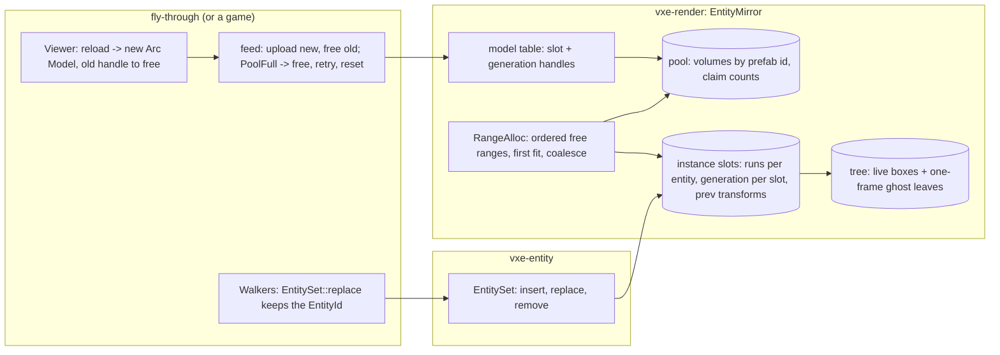

# 0078: The entity pool frees models: free by handle into a coalescing free list, stable instance slots with a generation, and a reset

> **Status:** approved (2026-11-16, the owner: every recommended answer under "Owner questions")
> **Created:** 2026-11-16
> **Milestone:** M6 in [`docs/roadmap.md`](../roadmap.md), the engine side (`vxe-render`,
> `vxe-entity`), with the fly-through's reload as its first consumer.
> **Related ADRs:** [ADR-0060](../adrs/0060-entity-volumes-are-freed-by-handle-into-a-coalescing-free-list-and-never-moved.md)
> (proposed; the free list and the ownership rule), accepted at this plan's close. Rests on
> [ADR-0050](../adrs/0050-entities-are-posed-voxel-volumes-in-their-own-pool-traced-after-the-world-march.md)
> (the pool, the instances, the tree) and
> [ADR-0014](../adrs/0014-prefab-identity-in-the-op-log.md) (a prefab's content id, the
> volume's key).
> **Source:** the owner, 2026-11-16: "proper reset should be drafted as a plan", on
> [Plan 0077](0077-an-entity-picker-in-the-fly-through-choose-a-model-from-the-library-and-place-it.md)'s
> owner question 6 (answered "not now" there, with a backlog entry promised; none exists on main
> at b4e72e35, so this plan is that entry).
> **Starts after:** [Plan 0062](done/0062-entities-voxel-models-on-rigid-parts-traced-lit-shadowed-and-queried.md)
> and [Plan 0063](done/0063-rigs-and-clips-keyframe-animation-a-model-viewer-and-text-authoring.md)
> have merged into main (both edit `crates/vxe-render/src/entities.rs`, `entity.wgsl`,
> `apps/flythrough/src/viewer.rs` and `walker.rs`). **Before Plan 0077's lane** (owner question
> 5): 0077's Phase 2 reloads and uploads per library entry, and is amended at its re-read to call
> this plan's `free_model` and `EntitySet::replace`. Read at `plan-0063` c5c655ad and `plan-0062`
> 54edd6f1; the tree's names win when the lane starts.

## TL;DR

The entity mirror's pool never frees a volume: every hot reload that changes a part and every
model loaded adds bytes until `PoolFull`. This plan gives the pool a **free**: the consumer that
uploaded a model frees it by handle, a volume nobody claims returns to a **coalescing free list
of word ranges**, a volume never moves, and a freed handle is refused by its generation
(ADR-0060). The fly-through's viewer frees the old model on every reload and the HUD row shows
the pool's use falling. Beside it, the **instances get stable slots**: an entity keeps its
instance indices until it is removed, the hit record's instance bits carry a generation, so the
temporal history and the motion vectors never cross from a removed entity to the one that took
its slot, and a removed entity leaves a one-frame ghost box so its shadow goes with it. A
reloaded model keeps its `EntityId` (`EntitySet::replace`) and its history. The first thing
seen: a headless test uploads, frees and re-uploads a model a thousand times and the pool's used
bytes never exceed the live model's; in the fly-through, save a rig twenty times and the HUD's
`pool` figure stays put.

## Context & problem

What the tree holds (read at `plan-0063` c5c655ad; `plan-0062` 54edd6f1 holds the same mirror):

- **The pool is a bump allocator.** `EntityMirror` (`crates/vxe-render/src/entities.rs`, 765
  lines) holds `used_words`, a `HashMap<u64, Volume>` keyed by `Prefab::id()`, and
  `models: Vec<Vec<Volume>>` indexed by `ModelHandle(pub u32)`. `upload_model` writes each
  distinct new volume at `POOL_WORD + used_words` through `queue.write_buffer` and appends the
  model. There is no free, no `clear`, and `models` grows by one entry per upload.
- **A reload re-uploads.** `Viewer::reload` swaps in a new `Arc<Model>` and sets `handle =
  None`; `walker::feed` uploads it on the next frame. A changed part is a new prefab id, so it
  is a new volume; the old one stays. `Walkers::poll_viewer` removes each placed rig instance
  and inserts it again under a **new `EntityId`**. Plan 0077 Phase 2 keeps that shape per
  library entry (`a_reload_moves_only_its_own_entry`: "new `EntityId`").
- **Instances are numbered by list position.** `EntityMirror::write` packs the listed
  entities' parts into instances 0, 1, 2, ... in list order each frame, and the hit record's
  `instance` is that index (`hitrec.wgsl`, `HIT_INSTANCE_SHIFT` 6, 26 bits). `same_thing(a, b)`
  in `entity.wgsl` compares `entity` and `instance`, so removing walker 2 renumbers walkers
  3..n and their pixels lose a frame of history (Plan 0062's close review, the numbering nit).
  An entity inserted into the position of one removed the same frame **inherits** its history.
- **`write` allocates per frame.** It builds `shown`, `inst`, `boxes`, `nodes`, `tree` and a
  `prev: HashMap<(EntityId, usize), _>` on every call (Plan 0062's close review, the per-frame
  scratch finding; `best-practices.md`, "No per-frame heap allocation in the frame path").
- **A removed entity leaves its shadow.** Its box is gone from the tree, so no shadow ray marks
  the floor under it `fresh`; the direct history fades the shadow out over the accumulation's
  frames instead of dropping it at once. Plan 0062's `a_moving_entity_leaves_no_ghost_and_no_stale_shadow`
  covers a move, not a removal.
- **What reads the pool.** The hit pass and the light pass's shadow rays (`entity_march`), and
  `prev_world`, `entity_moved`, `entity_shadow_scale` and `same_thing` read the instances; the
  temporal pass, the upscalers and the gradient pass call those. Probe rays and bake rays never
  see an entity (ADR-0050), and Plan 0062 Phase 6c's `world` light reads the baked store, not a
  volume. Every one of these runs inside the frame's own submission.
- **Sizes.** A 16-voxel cube is 5672 B; the largest part (64 a side) is
  `32 + 32 768 + 512 + 262 144 + 1024` = **296 480 B**; a one-voxel part is
  `32 + 4 + 4 + 4 + 1024` = **1068 B** (the palette dominates). The walker's three volumes are
  4156 B (torso 1708, head 1304, leg 1144; `docs/plans/logs/0062.md`). The default pool holds
  28 largest parts, or about 2000 walkers' worth of distinct volumes.

The problem: the pool's bytes grow with the number of uploads, not with the number of live
models, so a long authoring session or a consumer that loads level after level ends in
`PoolFull` and a restart. `docs/nfr.md` section 3 ("everything else in VRAM") is not moved: the
buffer's size is fixed at creation. What this plan bounds is the pool's **use**.

## Decision

**Ownership: the uploader frees.** `EntityMirror::free_model(handle) -> Result<FreedBytes,
UnknownModel>` is the consumer's call, paired with `upload_model`; `clear()` frees every model.
The mirror counts claims per volume (two models sharing a prefab share one volume; it is freed
when its last claimant is), so the consumer thinks in models and never in volumes. We rejected
freeing what the frame stopped listing and an `Arc` sweep (ADR-0060 D): a library model kept
for its next placement must stay resident without being drawn.

**The allocator: a coalescing free list, first fit from the lowest address, no moves**
(ADR-0060). A `RangeAlloc` of word ranges, ordered by address, serves both the pool and the
instance table. A refusal is `PoolFull { needed, free, largest }`. We rejected compaction (a
move rewrites instances and invalidates the frame before's hit records), fixed blocks and size
classes (volumes span 1068 to 296 480 B) and a buffer per model (one bound buffer, no binding
arrays on the baseline): ADR-0060 A to C.

**GPU safety: queue order is the rule.** Every write to the entity buffer is a
`queue.write_buffer`, which wgpu orders after every command buffer submitted before it and
before the next submit. A range freed and refilled between two frames is read with the old bytes
by the frame already submitted and with the new by the next; nothing in flight can see the
mix. So a freed range is allocatable at once: no deferred free list, no frame counter. The plan
records the rule in the module docs and defends it with a lavapipe test that renders, frees,
re-uploads into the same words and renders again without waiting in between, then reads both
frames back. Any future path that maps this buffer for writing breaks the rule and is refused
by that test's premise (a doc line, and the review).

**Handles carry a generation.** `ModelHandle` becomes opaque: a 16-bit slot in the mirror's
model table and a 16-bit generation. A freed handle is `UnknownModel` to `free_model` and is
counted (`entities_over_cap`) and not drawn by `set_entities`, as an unknown index is today.

**Instances get stable slots.** An entity's parts take a contiguous run of instance slots from a
`RangeAlloc` over the 512 slots when it is first listed, and keep them while it stays listed;
an entity that leaves the list frees its run. The hit record's 26 instance bits become `slot |
generation << 9`: the slot in bits 6..14 and a 17-bit per-slot generation above it, bumped each
time a slot is reallocated. `same_thing` compares the whole field; `prev_world`, `entity_moved`
and `entity_shadow_scale` mask the slot. A slot is reallocated at most once per frame (frees and
allocations happen in one `write`), so two consecutive frames' generations differ by at most
one and a wrap at 131 072 cannot alias. When no contiguous run fits a new entity although enough
slots are free, the table is **compacted** in that call: every moved slot's generation bumps,
so those pixels lose one frame of history (what every removal costs today) and nothing is
inherited. We rejected a one-frame quarantine of freed slots: under a full table a reload's
entities would vanish for a frame. We rejected leaving the renumbering: with Plan 0077's picker
removing and placing entities often, a history inherited from another entity is a visible flash.

**A removed entity takes its shadow with it.** In the frame after an entity leaves the list, the
tree carries a **ghost leaf** over its last box with `LEAF_MOVED` set and zero parts, so a shadow
ray that crosses it marks its pixel `fresh` and the floor reads this frame's lit sample. The
shader's leaf loop over zero parts does nothing more.

**A reload keeps the entity.** `vxe_entity::EntitySet::replace(entity, Arc<Model>, Pose)`
swaps an entity's model and pose under its `EntityId`. The mirror keeps the entity's slots when
the part count is unchanged (its generation, its history and its `prev` transforms stay; a part
whose volume changed fails the temporal pass's material check only where the material changed),
and reallocates the run when the count changed. The fly-through's reload uses it; Plan 0077's
`a_reload_moves_only_its_own_entry` is amended from "new `EntityId`" to "the same `EntityId`"
(owner question 3).

**No per-frame allocation.** `write` keeps its scratch (`inst`, `boxes`, `nodes`, the tree's
words) as reused members and the `prev` transforms in the slot table, written in place; the
frame's upload of the instance table covers slots 0 to the highest live one.

**The fly-through.** `Viewer` hands back the handle to free on a reload; `walker::feed` uploads
the new model, then frees the old. On `PoolFull` it frees first and retries once; if the retry
is refused and the pool is fragmented (`largest < needed <= free`), it **resets**: `clear()`,
re-upload of every model still placed, banner `entity pool reset`. A refusal that stands after
that (the pool is simply full) is the red banner Plan 0077 Phase 2 names. The entities HUD row
gains `pool <used>/<total> KB`, which Plan 0077's Phase 2 then reuses. No new key.

## Architecture diagram



## Implementation phases

Not a look-driven plan: the pool and the slots are data, and their tests are CPU tests of that
data plus a few lavapipe tests of what the shaders read. Per phase:
`node scripts/test-changed.mjs --profile quick`, `--clippy`, fmt; Phases 2 and 3 also
`--profile gpu --binaries gpu_entity_pool,gpu_entities` under the perf lock. At the tip:
`cargo nextest run --profile gate` under the perf lock, doctests, clippy, fmt, deny and the doc
and tier gates. Readings go to `docs/plans/logs/0078.md`. **Test times are estimates** (a lit-box
test with a few dozen frames at 192 x 108 renders in 2 to 4 s on lavapipe in Plan 0062's log).
`entities.rs` is 765 lines; the phases split it (`entities/{mod,alloc,pool,instances}.rs` or
the dev's cut) rather than approach the 1200-line cap. CPU tests of `vxe-render` go in a
`tests/` file not named `gpu_*` and open no device (`scripts/check-test-tiers.mjs`).

### Phase 1: the range allocator and the pool's free (walking skeleton)
- **Owner skill:** dev
- **What:** `RangeAlloc` (an ordered map of free ranges by start word; `alloc(len) ->
  Option<start>` first fit from the lowest address; `free(start, len)` coalescing both
  neighbours; `free_total()`, `largest()`; no `HashMap` iteration anywhere in a decision). The
  pool over it: claims per volume keyed by `Prefab::id()`, `free_model`, `clear`, the
  generation-tagged opaque `ModelHandle`, `pool_free_bytes()`, `pool_largest_free_bytes()`,
  `PoolFull { needed, free, largest }`, `EntityUploadError::UnknownModel`. The bookkeeping
  (`VolumePool`: which words a model's volumes take, what to write) is a plain struct with no
  device; `EntityMirror` wraps it and does the `write_buffer`. The module docs carry the
  queue-order rule from the Decision.
- **Files touched:** `crates/vxe-render/src/entities.rs` (split into `entities/`),
  `crates/vxe-render/src/lib.rs` (the re-exports), `crates/vxe-render/tests/entity_pool.rs`
  (new, CPU), `apps/flythrough` wherever `ModelHandle(n)` is built by hand (tests),
  `docs/plans/logs/0078.md` (new).
- **Done when** (CPU, no device, each under 0.5 s unless named):
  - `a_freed_model_returns_its_bytes_and_a_shared_volume_stays`: models A (torso, head, leg
    prefabs: 1708 + 1304 + 1144 = 4156 B) and B (A's leg prefab and a 16-voxel cube, 5672 B)
    uploaded into the bookkeeping: used 9828 B. Freeing A drops used to 6816 B (the leg stays,
    claimed by B); freeing B drops it to 0 and the free list is one range of the whole pool.
  - `reload_n_times_keeps_the_pool_bounded`: 1000 cycles of "upload a variant of the walker
    whose torso prefab differs each cycle, then free the cycle before's model": after every
    cycle used bytes equal 4156 B exactly, and the peak during a cycle is 4156 + 1708 = 5864 B.
    Under 1 s.
  - `a_stale_handle_is_refused_and_a_reused_index_differs`: `free_model` on a freed handle is
    `UnknownModel`; the next upload reuses the model table's index with a different
    generation, and the two handles compare unequal; `set_entities` with the stale handle
    counts the entity over and draws it nowhere (the instance count is unchanged).
  - `the_allocator_is_a_function_of_its_calls`: two `RangeAlloc`s fed the same seeded sequence
    of 10 000 alloc and free calls (sizes drawn from {1068, 1144, 1304, 1708, 5672, 296 480}
    words / 4) give identical start words at every step; and after `alloc a, b, c; free b;
    free a` the free list holds one range of `a + b` words at `a`'s start, which the next
    `alloc(a + b)` takes. Under 2 s.
  - `a_fragmented_pool_names_its_largest_hole`: a pool sized to hold exactly four 16-voxel
    cubes (4 x 5672 B), filled with four, the first and third freed: a model of two new 16-voxel
    cube prefabs is refused with `free` 11 344 B and `largest` 5672 B; a one-cube model lands at
    the pool's first word.
  - `clear_frees_everything_and_every_handle`: after `clear()` used bytes are 0 and each
    earlier handle is `UnknownModel`.
  - Plan 0062's `the_layout_constants_hold_the_plans_arithmetic` and
    `a_sixteen_voxel_cube_is_5672_bytes` pass unchanged; `EntityMirror::bytes()` is still
    8 458 240 at the defaults (`entity_bytes_are_in_the_inventory`).

### Phase 2: the fly-through frees on reload, and the pool on the HUD
- **Owner skill:** dev
- **What:** `Viewer::reload` keeps the old handle as `stale: Option<ModelHandle>` instead of
  dropping it; `walker::feed` uploads the new model, then frees `stale`. On `PoolFull`: free
  `stale`, retry once; if refused with `largest < needed <= free`, `clear()`, re-upload every
  model still placed (the built-in walker's and the viewer's), remap the handles, banner
  `entity pool reset`; a refusal after that is the existing red banner. The entities HUD row
  gains `pool <used>/<total> KB` (rounded up to whole KB). `docs/flythrough.md` names the row
  and the reset.
- **Files touched:** `apps/flythrough/src/viewer.rs`, `walker.rs`, `hud/modes.rs` (or where the
  entities row is formatted at the lane's start), `apps/flythrough/tests/viewer.rs`,
  `apps/flythrough/tests/gpu_entity_pool.rs` (new), `docs/flythrough.md`,
  `docs/plans/logs/0078.md`.
- **Done when:**
  - `a_reload_hands_back_the_old_handle` (`tests/viewer.rs`, CPU, under 0.5 s): with injected
    file contents, a valid reload after an upload leaves `stale` holding the old handle and
    `handle` `None`; a broken reload leaves both as they were; `feed`'s bookkeeping step frees
    `stale` after the new upload succeeds (asserted on the bookkeeping struct, no device).
  - `the_hud_row_shows_the_pool` (CPU, under 0.5 s): with the walker uploaded the row reads
    `pool 5/8192 KB` (4156 B rounds up to 5 KB) and `pool 0/8192 KB` after `clear`.
  - `twenty_reloads_hold_the_pool_at_one_model` (`gpu_entity_pool`, lavapipe, about 3 s):
    twenty reloads of the walker rig alternating two torso sizes, a frame rendered after each:
    `pool_used_bytes()` after every frame equals the live model's bytes (the two variants'
    figures, computed by `volume_bytes`), and at the twentieth frame the centre pixel of the
    albedo view reads the torso's albedo.
  - `a_fragmented_pool_resets_and_the_walkers_stay` (`gpu_entity_pool`, about 3 s): a mirror
    with a pool sized to hold the walker twice and a 16-voxel cube once, fragmented by a free in
    the middle so the cube is refused with `largest < needed <= free`: `feed` resets, every
    placed walker is drawn on the next frame (`entities_drawn` unchanged, `over` 0), the banner
    reads `entity pool reset`, and the cube is uploaded.
  - Reading: the CPU time of `free_model` plus `upload_model` for the walker on a reload (dev
    box, release), into the readings log.

### Phase 3: stable instance slots, generations in the hit record, ghost leaves, no scratch
- **Owner skill:** dev
- **What:** the instance table over a `RangeAlloc` of 512 slots with a run per listed entity,
  a 17-bit generation per slot in the instance word the hit record is packed from
  (`entity_info`: `slot | generation << 9`), `same_thing` on the whole field, the slot masked
  in `prev_world`, `entity_moved` and `entity_shadow_scale`; compaction with generation bumps
  when no run fits; `prev` transforms kept in the slot table; ghost leaves for entities that
  left since the call before; `write`'s scratch as reused members; `EntitySet::replace` in
  `vxe-entity`, and the fly-through's reload through it (`Walkers::poll_viewer` keeps each
  placed instance's `EntityId`). The instance upload covers slots 0 to the highest live slot.
- **Files touched:** `crates/vxe-render/src/entities/` (`instances.rs`, `mod.rs`),
  `crates/vxe-render/src/shaders/entity.wgsl`, `hitrec.wgsl` (the doc of the instance bits),
  `crates/vxe-entity/src/set.rs`, `crates/vxe-entity/tests/raycast.rs` (or a `set.rs` test
  file), `crates/vxe-render/tests/entity_instances.rs` (new, CPU),
  `apps/flythrough/src/walker.rs`, `apps/flythrough/tests/gpu_entity_pool.rs`,
  `apps/flythrough/tests/gpu_entities.rs` (its goldens unchanged), `docs/plans/logs/0078.md`.
- **Done when:**
  - `an_entity_keeps_its_slots_when_another_is_removed` (CPU, under 0.5 s): three four-part
    entities take slots 0..4, 4..8, 8..12; removing the first leaves the others at 4..8 and
    8..12 with their generations; the next four-part entity takes 0..4 at generation 1; a
    two-part entity after it takes 12..14.
  - `a_full_table_compacts_and_bumps_generations` (CPU, under 0.5 s): 64 entities alternating
    4 and 12 parts fill the 512 slots (`32 * 4 + 32 * 12`); the thirty-two four-part ones are
    removed (128 free slots in runs of 4); a sixteen-part entity is listed: nothing is over,
    every twelve-part entity's run moved and its slots' generations rose by one, the
    sixteen-part entity is drawn, and 33 entities hold 400 slots.
  - `replace_keeps_the_entity_and_its_slots` (CPU, under 0.5 s): `EntitySet::replace` with a
    model of the same part count keeps the `EntityId`, and the mirror keeps the run and the
    generations; with a different part count the run is reallocated and the generations bump.
    `replace` on an unknown entity is `PoseError::UnknownEntity`; a pose with the wrong part
    count is `PoseError::PartCount`.
  - `write_allocates_nothing_after_warm_up` (CPU, under 1 s): with the fly-through's counting
    allocator (`test_support`), 100 `set_entity_displays` calls over 64 walkers after the
    first allocate 0 bytes.
  - `a_removed_entity_leaves_a_ghost_leaf_once` (CPU, under 0.5 s): the frame after a removal
    the tree's node count is the live entities' plus one, the ghost leaf has `LEAF_MOVED` set
    and a count of 0 over the removed entity's last box; the frame after that it is gone.
  - `a_reused_pool_slot_shows_the_new_model_and_the_old_frame_the_old` (`gpu_entity_pool`,
    lavapipe, about 4 s): a red 8-voxel cube model 20 voxels before the camera on Plan 0062's
    box; frame 1 submitted with its readback encoded; without waiting, the model is freed and a
    green cube of the same size uploaded (asserted to take the same pool word) and frame 2
    submitted: frame 1's centre pixel reads red and frame 2's reads green, exactly the albedos
    within 1/255 a channel.
  - `history_does_not_cross_a_reused_instance_slot` (`gpu_entity_pool`, about 4 s): on the lit
    box an entity A whose top face reads 9.40 (Plan 0062's analytic value) is removed and an
    entity B of the same material placed the same frame where its unlit face fills A's pixels:
    B's face reads under 2 % of 9.40 on that very frame (nothing inherited); the hit record's
    instance field at that pixel differs from the frame before's in its generation bits.
  - `a_removed_entity_takes_its_shadow_with_it` (`gpu_entity_pool`, about 3 s): Plan 0062
    Phase 3's shadow rig (a 16 x 2 x 16 slab under the light, the floor pixel under it reading
    0); on the first frame after the slab is removed that pixel reads 9.40 within 2 % (the
    ghost leaf marked it fresh); the frame after, the tree holds no ghost.
  - `a_reload_keeps_the_picture_steady` (`gpu_entity_pool`, about 3 s): a still walker, no
    jitter; `replace` with a model of the same voxels: every pixel of frame N+1 equals frame N
    within 1/255; `replace` with the torso's material changed: the torso's pixels change and
    the legs' do not.
  - Plan 0062's goldens (`walker_albedo_golden`, `walker_shadow_golden`) and every other gate
    golden pass with no re-bless; `the_caps_count_what_they_drop` holds (compaction never draws
    more than 512 parts or 64 entities).
  - Readings: the instance upload's bytes per frame at 64 walkers after 200 random removals and
    placements (dev box); `set_entity_displays` CPU time at 64 walkers against Plan 0062
    Phase 5's reading.

### Phase 4: the waste reading, the docs and the tip
- **Owner skill:** dev
- **What:** the fragmentation reading (a `mod reading` test over a seeded 10 000-step sequence
  of uploads and frees with sizes from Phase 1's set, 25 % of them the largest, reporting the
  peak of `used + free - largest` over live bytes and the number of refusals a `clear` would
  have answered); `docs/nfr/03-memory.md` gains the pool's rows (the bound, the waste reading,
  machine and commit); `docs/flythrough.md`'s entities row; the gate at the tip.
- **Files touched:** `crates/vxe-render/tests/entity_pool.rs`, `docs/nfr/03-memory.md`,
  `docs/flythrough.md`, `docs/plans/logs/0078.md`.
- **Done when:** the readings log holds the waste figure and the Phase 2 and 3 readings;
  `cargo nextest run --profile gate` under the perf lock, doctests, clippy, fmt, deny,
  `check-doc-links`, `check-comment-hygiene`, `check-index-rows`, `check-plan-size`,
  `check-test-tiers` and `check-file-size` exit 0 at the tip.

## Data shapes

```rust
// illustrative: vxe-render, entities/alloc.rs
pub(crate) struct RangeAlloc { free: BTreeMap<u32, u32> /* start -> len */, total: u32 }
impl RangeAlloc {
    fn alloc(&mut self, len: u32) -> Option<u32>;   // first fit, lowest start
    fn free(&mut self, start: u32, len: u32);       // coalesces neighbours
    fn free_total(&self) -> u32; fn largest(&self) -> u32;
}

// entities/pool.rs
struct Claimed { word: u32, size: [u32; 3], len: u32, claims: u32 }
pub struct ModelHandle(u32);                        // slot 16 bits | generation << 16; opaque
pub struct FreedBytes(pub u64);
pub enum EntityUploadError {
    PoolFull { needed: u64, free: u64, largest: u64 },
    Palette { part: usize }, UnknownMaterial { part: usize, material: MaterialId },
    UnknownModel,
}

// entities/instances.rs
struct Run { first: u16, count: u16 }
struct Slot { generation: u32, part_to_world: [[f32; 4]; 3] }   // the frame before's
// the instance's flags word 25 carries `slot | generation << 9`, what entity_info packs

// vxe-entity, set.rs
impl EntitySet {
    pub fn replace(&mut self, entity: EntityId, model: Arc<Model>, pose: Pose)
        -> Result<(), PoseError>;
}
```

```wgsl
// illustrative: entity.wgsl
fn same_thing(a: HitRecord, b: HitRecord) -> bool {
    return a.entity == b.entity && a.instance == b.instance;   // slot and generation
}
fn entity_slot(rec: HitRecord) -> u32 { return rec.instance & 511u; }
```

## Budgets

No `docs/nfr.md` budget moves: the buffer stays 8 458 240 B at the defaults (section 3). The
figures below are **guesses** until their phase reads them; the first two are properties the
tests assert.

- **The pool's use** equals the live models' distinct volume bytes after every free, by
  construction (Phase 1, `reload_n_times_keeps_the_pool_bounded`).
- **The frame path allocates nothing** after warm-up (Phase 3, `write_allocates_nothing_after_warm_up`).
- **Waste from fragmentation:** under 25 % of live bytes at the peak of the seeded sequence
  (Phase 4's reading; a figure above it is a reading for the owner, not a failure, and the
  fly-through's reset covers it).
- **A reload's CPU cost** (`free_model` plus `upload_model` of the walker): under 0.2 ms on the
  dev box, release (Phase 2's reading); the `write_buffer` of 4156 B is the floor.
- **The instance upload per frame:** at most `(highest live slot + 1) * 128` B, 65 536 B at
  worst; at 64 walkers with first fit, 32 768 B (256 slots) after any number of removals and
  placements (Phase 3's reading checks it stays there).
- **`set_entity_displays` CPU at 64 walkers:** within Plan 0062 Phase 5's reading, since the
  per-frame allocations go and the slot lookups come (Phase 3's reading).
- **Gate wall time** (section 7): about + 20 s on lavapipe for the six GPU tests (an estimate);
  every CPU test under 2 s.

## Risks & open questions

**Risks:**

- **A consumer that never frees** keeps today's leak. Mitigation: the HUD row makes it visible,
  and `clear()` is one call. The engine cannot free for it (ADR-0060 D).
- **Fragmentation refusals.** First fit from the lowest address packs well when sizes repeat
  (a reload swaps same-sized volumes) and badly when a few large volumes sit between small ones.
  Phase 4 reads it; the fly-through's automatic reset answers it; a consumer reads `largest`.
- **The hit record's instance bits.** The generation takes bits 15..31 of the flags word; dev
  confirms at the start commit that no reader masks `instance` to fewer bits (the Context lists
  the four readers) and that FSR 2's input and the gradient pass take `same_thing` from
  `entity.wgsl` and not a copy.
- **Compaction in `write`.** It happens only when a run cannot be found with enough free
  slots: rare, bounded (512 slots), and it costs those entities one frame of history, as every
  removal does today. It never draws over the caps (Phase 3's done-when).
- **`EntitySet::replace` and Plan 0077.** 0077 Phase 2's test says "new `EntityId`"; owner
  question 3 decides, and the architect amends 0077 at its re-read either way.
- **Plans 0062 and 0063 are still open.** Both edit the files this plan splits. The lane starts
  after both merge, and the Context's line numbers and names are re-read then.
- **Queue order is a premise, not a proof.** The lavapipe test exercises it; a mapped-buffer
  path added later would pass the test on a fast driver by luck. The module doc and the review
  are the guard.

### Owner questions (each with a recommendation)

1. **Who frees a model.** Recommended: the consumer that uploaded it, by handle
   (`free_model`), with `clear()` for everything; the mirror counts claims per shared volume.
   Alternatives: the mirror frees a model not listed by `set_entities` for N frames (a library
   model kept for its next placement would be freed and re-uploaded at placement, a hitch); or
   an `Arc<Model>` sweep (VRAM tied to Rust lifetimes the mirror cannot see). ADR-0060 D.
2. **The allocator.** Recommended: a coalescing free list of word ranges, first fit from the
   lowest address, no volume ever moves; a refusal names `largest`. Alternatives: compaction
   (moves rewrite instances in-frame and invalidate the frame before's hit records; needs a CPU
   copy or a scratch buffer), or size classes as ADR-0028 (volumes span 1068 to 296 480 B, up
   to half wasted). ADR-0060 A and B.
3. **A reload's entity identity.** Recommended: `EntitySet::replace` keeps the `EntityId`, so
   a reloaded walker keeps its slots and its history where the voxels are unchanged; Plan 0077's
   `a_reload_moves_only_its_own_entry` is amended to "the same `EntityId`". Alternative: remove
   and insert under a new id as today (every reload flashes the whole model's pixels for a few
   frames, and 0077's text stands).
4. **Stable instance slots.** Recommended: slots per entity with a generation in the hit
   record, compaction only when no run fits. Alternatives: a one-frame quarantine of freed slots
   (exact too, but under a full table a reload's entities vanish for a frame), or leave the
   per-frame renumbering (Plan 0062's nit stays, and an entity placed into a removed one's
   position inherits its history: a flash the picker will show often).
5. **Order.** Recommended: its own short lane after Plans 0062 and 0063 merge and **before**
   Plan 0077's lane, which is then re-read to call `free_model`, `replace` and the HUD's pool
   row. Alternatives: inside 0077's lane as a Phase 0 (puts `crates/` changes into an apps-only
   plan and widens its review), or after 0077 (0077 ships the leak, and its reload test is
   rewritten later).
6. **The fly-through's automatic reset.** Recommended: on a `PoolFull` that a free and a retry
   do not clear and that `largest < needed <= free` names as fragmentation, `clear()` and
   re-upload what is placed, with the banner `entity pool reset`; no new key. Alternative:
   refuse only (the red banner), and let a restart be the reset.

## What this plan does NOT do

- **No change to the pool's size or layout**: 8 MiB by default, the same volume words
  (ADR-0050), `bytes()` unchanged. Growing or shrinking the buffer at runtime is a later plan
  if a consumer asks.
- **No compaction of the pool** (ADR-0060 A), and no moving volumes.
- **No automatic freeing** by the frame or by `Drop` (ADR-0060 D).
- **No change to `vxe-entity`'s ray query, poses or clips**; `replace` is the one addition.
- **No picker, library or entries**: Plan 0077. This plan's fly-through changes are the viewer's
  reload, `feed` and one HUD figure.
- **No new key** and no settings field: the reset is automatic and the free is an API.
- **No Windows check** and no owner window: nothing here is look-driven. Plan 0077's window
  shows the pool figure in passing.
- **No change to what the probes or the bake see** (ADR-0050: nothing).

## Implementation log

> Written by `dev`: one row per phase as its commit lands, then the close block. **The phases
> above are the contract. This section records what happened.** Observations, never conclusions:
> no pass list, no self-assessment. Deviations and unmet done-whens are **always** disclosed.
> Keep it shorter than `## Implementation phases`. Readings, gate counts, attempts and resume
> notes go to the plan's readings log, `docs/plans/logs/0078.md` (started from
> `templates/readings-log.md`), and this section links it once it exists.

| phase | owner | state | commit |
|---|---|---|---|
| 1: the range allocator and the pool's free | dev | not started | |
| 2: the fly-through frees on reload, and the pool on the HUD | dev | not started | |
| 3: stable instance slots, generations, ghost leaves, no scratch | dev | not started | |
| 4: the waste reading, the docs and the tip | dev | not started | |

### Notes

### Close triggers

- **What shipped:**
- **Public API changed:**
- **Budget readings:**
- **Gate at the tip:**
- **Outstanding `human` phases:**

## Followups

- Plan 0077's re-read (architect, before its lane): Phase 2 calls `free_model` on a reload and
  `EntitySet::replace` (owner question 3), its HUD pool figure is this plan's, and its Followup
  line about a backlog entry for an `EntityMirror` reset is struck (this plan is that entry).
- Plan 0062's close review findings this plan takes: the per-frame scratch in
  `EntityMirror::write` and the instance-numbering nit (Phase 3).
