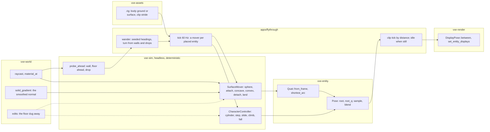

# 0079: Entities aware of the floor and the walls: a surface mover in `vxe-sim`, the smoothed normal, a body in the `.rig`, and a wandering demo

> **Status:** approved (2026-11-16, the owner: every recommended answer under "Owner questions")
> **Created:** 2026-11-16
> **Milestone:** M6 in [`docs/roadmap.md`](../roadmap.md) (entities), over M3's collision
> (`vxe-sim`, ADR-0005)
> **Related ADRs:** [ADR-0062](../adrs/0062-surface-locomotion-is-a-kinematic-sphere-attached-to-a-contact-normal-in-vxe-sim.md)
> (proposed; the surface mover, the smoothed normal, the frame to quaternion), accepted at this
> plan's close. Rests on [ADR-0005](../adrs/0005-vertical-cylinder-collision-by-integer-conservative-advancement.md)
> (the cylinder controller the ground mover is),
> [ADR-0008](../adrs/0008-collapse-as-capped-support-flood-and-rigid-vertical-drop.md) (no rigid
> bodies in the authoritative world; the mover is kinematic),
> [ADR-0050](../adrs/0050-entities-are-posed-voxel-volumes-in-their-own-pool-traced-after-the-world-march.md)
> (poses in fixed point) and
> [ADR-0051](../adrs/0051-rigs-and-clips-are-text-files-sampled-in-fixed-point-by-tick.md)
> (the `.rig` file, clips by tick).
> **Source:** the owner, 2026-11-16: "entities should be aware of where the floor and walls are,
> so for example we can have walkers walking and spiders crawling".
> **Starts after:** Phases 1 to 3 touch `crates/` and the library's two rig files only; they may
> start as a side lane once [Plan 0063](0063-rigs-and-clips-keyframe-animation-a-model-viewer-and-text-authoring.md)
> has merged (`Pose::compose`, Phase 3b) and the clip-recorder chore has merged (the spider's rig,
> `apps/flythrough/assets/entities/`). Phase 4 edits the fly-through's entities module and starts
> after [Plan 0077](0077-an-entity-picker-in-the-fly-through-choose-a-model-from-the-library-and-place-it.md)
> has merged, since 0077 splits `walker.rs`, gives `Placed` its entry and clip and makes the
> picker place on the aimed surface, and this plan builds on all three. Before Phase 4 starts the
> architect re-reads it against that tip (the names `walker.rs`, `Placed`, `Walkers::step` and
> `F11` carry then). Owner question 7 is the order.

## TL;DR

Today a placed entity stands where it was put, and the fly-through's walkers walk a scripted
circle in float with no idea where the floor is. This plan gives entities **feet that read the
world**: a ground body moves with the cylinder controller `vxe-sim` already has (step, slide,
climb, fall), and a new **surface mover** in `vxe-sim` moves a sphere attached to whatever it
touches, carrying its up across convex and concave edges, so a body crawls up a wall and across
a ceiling and falls when the surface is dug away. `vxe-world` answers the **smoothed normal** at
a body's scale (the solid-count gradient), so a crawler on a stepped slope leans with the slope
instead of flipping at each voxel. A `.rig` names its **body** (ground or surface, its size) and
a clip's **stride**, so the legs move as far as the body does. The fly-through's demo is a
**seeded wander**: walkers roam a cave floor turning from walls and drops, spiders crawl the
walls and the ceiling. All of it is integer arithmetic at the sim tick, pinned by course hashes
on both CI arms. The first thing seen: `` ` `` on a wall with the spider selected puts it on the
wall, and `F11` sends it climbing.

## Context & problem

`project-context.md` (Queries, P0): "character controller" for the player and for monsters;
(Determinism, P0 and P1): generation and edits replayable, the server authoritative. ADR-0005's
context names the controller's second user as monsters on the consumer's server. The roadmap's
M6 is entities; M3 built the collision they need; "navigation" is named as a purpose of the
spatial queries, with the walkable map (0.8 m cells) as its data and no pathfinding plan yet.

**What the tree gives** (read at `plan-0063` c5c655ad, `chore-clip-recorder` cbdafac8 and main
b4e72e35; names in the tree win when a lane starts):

- `vxe-sim`: `Body { foot: Fixed3, radius, height }`, `sweep(world, body, delta) -> Sweep`,
  `distance2`, `overlaps`, a `Contact { voxel, material, normal: [i64; 3] }` that reads as floor,
  wall or ceiling; `CharacterController::tick(world, &mut CharacterState, &MoveInput) ->
  MoveResult` with `grounded`, `blocked`, `stepped`, `climbed`, `climb_available`, `landed`,
  `embedded` and up to four contacts. A tick reads 1.8 to 2.6 us, a sweep 26.3 us in the F2 wall
  case (`docs/nfr.md` section 8). The course hash `0x0c80_8031_d14f_27eb` is pinned on both arms.
  Test fixtures F1 to F6 (`crates/vxe-sim/tests/support/mod.rs`): the floor `z < 0`, a wall at
  `x in [20, 22)` up to `z 40`, steps, a pit, a staircase `z < x - 60`.
- `vxe-world`: `World::raycast(origin, dir, max_t)` in integers with `Hit { voxel, face, t }`;
  `material_at`; `count_in_box` per material; `Fixed3` at 1/256 voxel; `CoarseGrid` and
  `WalkableMap`; edits through `EditOp` with `Shape::Sphere` and `Shape::Box_`; the bricks'
  solid masks (`census::solid_mask`).
- `vxe-entity`: `Pose { root: Fixed3, root_q: Quat, parts }`, `Pose::compose` (one pass, Plan
  0063 Phase 3b), `Quat([i16; 4])` in Q14 with the product and the normalised blend, `sample`,
  `blend`, `Playback { clip, start_tick, rate }`. No way to make a `Quat` from a direction
  without float: the fly-through's `walker::turn` uses `f32`.
- `vxe-assets`: `Rig::parse`, `Rig::build -> RigModel { model, part_names, rest, clips }`; the
  grammar `vox`, `rate`, `material`, `part ... at ... pivot ... detail`, `clip NAME ticks N
  [loop]`, `key`. Degrees become Q14 through a committed sine table.
- `vxe-render`: `DisplayPose::between(model, a, b, alpha)` and `Frame::set_entity_displays`.
- The fly-through: `Walkers` with `Placed { id, feet, yaw, since, rig }`, the scripted circle
  (`walk_pose`, `f32`, per frame), `F11` and `--entities-walk` (banner `walk on` / `walk off`),
  `` ` `` placing on the looked-at surface facing the camera, `--entities N` on a 3 m ring; the
  walk mode's controller at a fixed 60 Hz tick (`fly.rs`). After Plan 0077: `Placed` carries its
  library entry and its own clip, the picker places the selected entry on the aimed surface, and
  `walker.rs` is split under `entities/`.
- The entities library: `walker` (six parts; `idle` 60 ticks, `walk` 30 ticks, at rate 30) and
  `spider` (fourteen parts; `walk` 48 ticks, `idle` 120, `rear` 60), both z up facing `-y`, at
  detail 2.

**What is missing:** a body that stands on a wall; a normal a server tick can read that is not a
voxel face; a deterministic way from a direction to a `Quat`; a rig's say over what body moves
it and how far a stride carries; and a demo that walks and crawls instead of circling.

**The `nfr.md` figures touched:** section 8 (collision: new lines for the surface mover, the
gradient and the locomotion of 64 entities a tick), section 2's streaming and CPU line (the
fly-through's tick), section 6 (two new vectors) and section 7 (the gate's wall time).

## Decision

Build ADR-0062 in four dev phases, a window and a picks phase. **The surface mover** (Phase 1)
is a sphere in `vxe-sim` attached to a contact normal: it moves along the tangent, takes a
blocking contact's normal (the concave edge), re-attaches along its down each tick (which rounds
a convex edge), detaches and falls when nothing is within reach, and lands. A probe-ahead helper
reads walls and drops for any steering. **The smoothed normal and the frame** (Phase 2) add
`World::solid_gradient` to `vxe-world` and `Quat::from_frame` and `Quat::shortest_arc` to
`vxe-entity`, and the mover reports the smoothed normal beside the contact normal. **The body in
the rig** (Phase 3) adds `body ground|surface ...` and a clip's `stride` to the `.rig` grammar
and to the library's two rigs. **The demo** (Phase 4) ticks every placed entity's mover at the
fly-through's 60 Hz, steers it by a seeded wander, drives its walk clip by the distance it moved,
aligns a surface body to the smoothed normal, and draws it through `DisplayPose::between`. The
window and the picks follow.

We rejected a generalised controller with a gravity vector, locomotion in the app in float, a
rigid-body library and movement over the walkable map's cells (ADR-0062 A to D). We rejected
pathfinding here: it is a layer over the movers and the coarse grid, with its own plan when a
consumer asks (What this plan does NOT do). We rejected inverse kinematics for the feet: the
clips are authored strides and the stride length ties them to the ground; a foot that lands on a
voxel exactly is a later look plan if the window asks for it.

## Architecture diagram



## Implementation phases

Each phase ships as its own commit. `dev` implements all dev phases in one session with no
review between phases; the architect reviews once at the end, in a fresh session. Not a
look-driven plan: every mechanism is integer motion with CPU tests, and no image test is
added. Per phase: `node scripts/test-changed.mjs --profile quick`, `--clippy`, `cargo fmt
--all --check`. At the tip: `cargo nextest run --profile gate` under the perf lock, doctests,
clippy, fmt, deny and the doc and tier gates. Readings go to `docs/plans/logs/0079.md`, started
from the readings-log template. **Test times are estimates**, none measured; every test here is
CPU and under the 10 s line by a wide margin.

**Units and conventions.** Positions in 1/256 voxel (`Fixed3`); directions as integer vectors
whose length is about 256 after normalisation (`isqrt`), exact for axis directions; a normal
points from solid toward air; a heading step is a Q8 `(cos, sin)` pair about the body's up,
`(256, 0)` straight on. Speeds in fixed units per tick. The fixtures below are `vxe-sim`'s F1
to F6 unless stated; a "cube" is `[16, 32)^3` voxels of the solid material in an otherwise empty
world. Every figure in a done-when below is worked out; where the sweep's touching rule decides
between two ticks the done-when says so and the log states which.

### Phase 1: the surface mover in `vxe-sim` (walking skeleton)
- **Owner skill:** dev
- **What:** `vxe_sim::SurfaceMover` beside `CharacterController`, headless and deterministic
  as the crate is.
  - **The body.** A sphere: `centre: Fixed3`, `radius: i64`. `SolidBox::distance2_sphere` (or
    a sibling type, the dev's cut) gives `max(0, d - r)^2` with `d = isqrt(sum of per-axis
    squared gaps)`; the contact normal is the integer vector from the box's nearest point to
    the centre (axis-aligned on a face, diagonal on an edge or a corner). The sweep is the
    existing conservative advancement over the same collected boxes with the sphere's distance
    and `closes_on` rule.
  - **The state.** `SurfaceState { centre, normal: [i64; 3], forward: [i64; 3], attached:
    bool, vz: i64 }`; `SurfaceParams { radius, attach_reach, speed_max, gravity, max_fall }`;
    `SurfaceInput { heading: [i32; 2] /* Q8 cos, sin about the normal */, speed: i64 }`.
  - **The tick**, in a fixed order: (1) `forward` turned about `normal` by `heading`, projected
    onto the tangent plane and renormalised to 256; (2) when attached, a sweep along `forward`
    by `speed`; a contact that stops it makes the contact's normal the new `normal`, carries
    `forward` across by the rotation taking the old normal to the new one (`shortest_arc`'s
    integer rule, local to the crate until Phase 2 moves it), projects and renormalises it, and
    sweeps the remaining delta once more along the new forward (one slide, as the controller
    slides); (3) a sweep along `-normal` by `attach_reach`: a contact snaps the centre to it and
    takes its normal (the **convex** rounding falls out of this step); no contact detaches the
    body; (4) when detached, `vz` gains `gravity` (before the move, as the controller does),
    clamped to `max_fall`, and a sweep along `(0, 0, vz)`; any contact attaches the body with
    that contact's normal and reports `Landed(|vz|)`. A body that starts a tick overlapping
    solid is lifted by the controller's depenetration order (its candidate list reused over the
    sphere's overlap test) or reported `embedded` and left where it is.
  - **The result.** `SurfaceResult { moved: Fixed3, event: Option<SurfaceEvent>, contacts:
    Vec<Contact>, embedded: bool, lifted: Fixed3 }` with `SurfaceEvent::{Concave, Convex,
    Detached, Landed(i64)}` (`Convex` when the attach step's normal differs from the tick's
    starting normal with no blocking contact; one event a tick, the earliest in the order
    above).
  - **The probe.** `vxe_sim::probe_ahead(world, from: Fixed3, forward: [i64; 3], up: [i64; 3],
    reach: i64, drop: i64) -> Ahead { wall: Option<i64>, floor: Option<i64> }`: `wall` is the
    `t` of the first solid along `forward` within `reach` (`World::raycast`); `floor` is the
    `t` of the first solid along `-up` from the point `reach` ahead (or, when a wall is nearer,
    from the point one voxel short of the wall's hit, so the drop ray never starts on the wall's
    face plane) within `drop`, `None` for a drop deeper than `drop`. Two rays, no sweep.
  - **The dig test for the controller**, beside the mover's: the existing cylinder under a
    carve.
- **Files touched:** `crates/vxe-sim/src/surface.rs` (new), `body.rs` (the sphere distance and
  contact), `sweep.rs` (the sweep generic over the two bodies, or a sphere twin of its loop: the
  dev's cut, bit-identical for the cylinder, which the course hash defends), `lib.rs`,
  `probe.rs` (new), `tests/surface.rs` (new), `tests/course.rs` (a second pinned hash),
  `tests/controller.rs` (the dig), `benches/surface.rs` (new), `docs/nfr.md` section 8 (the
  proposed lines), `CLAUDE.md` (the crate's line), `docs/plans/logs/0079.md` (new).
- **Done when** (CPU, each under 1 s unless stated; `radius` 256, `attach_reach` 384,
  `gravity` -16, `max_fall` 1024 unless stated):
  1. `a_crawler_rounds_the_cube` (the walking skeleton): on the cube, a body at centre
     `(24, 24, 33)` voxels (`(6144, 6144, 8448)`), normal `(0, 0, 256)`, forward `(256, 0, 0)`,
     heading straight, speed 64 (a quarter voxel a tick): over 400 ticks the normal becomes
     `(256, 0, 0)`, then `(0, 0, -256)`, then `(-256, 0, 0)`, then `(0, 0, 256)` again, in that
     order, each axis normal held for at least 40 consecutive ticks (16 voxels of face at a
     quarter voxel a tick is about 56 ticks, less the ticks spent rounding); `y` stays 6144
     exactly throughout (no step ever introduces a `y` term); it is attached at every tick;
     the test prints the tick of each `Convex` event to the log. The loop is about 70 voxels
     (64 of face plus `2 pi` of edge at radius 1), so 400 ticks is one lap and a half.
  2. `a_crawler_climbs_the_wall_it_runs_into`: on F2 (floor `z < 0`, wall `x in [20, 22)`,
     `z in [0, 40)`), a body at `(2560, 2560, 256)` (centre one voxel up, resting on the
     floor), normal `(0, 0, 256)`, forward `+x`, speed 64: the `Concave` event fires on tick
     36 or 37 (the centre reaches `x = 19` voxels, `4864`, at the end of tick 36's sweep; the
     touching rule decides whether that tick or the next reports the contact; the log states
     which), after which the normal is `(-256, 0, 0)` and the forward `(0, 0, 256)` exactly
     (an axis transition is an exact permutation); 100 ticks after the event the centre is
     `(4864, 2560, 6656)` exactly (25 voxels up). By tick 600 the body has rounded the wall's
     top (normal `(0, 0, 256)` for at least 4 ticks, then `(256, 0, 0)`) and stands on the
     floor past it: normal `(0, 0, 256)`, `centre.z == 256`, `centre.x > 22 * 256 + 256`,
     attached.
  3. `a_crawler_falls_when_its_ceiling_is_dug_away`: the cube over the F1 floor, a body under
     it at `(6144, 6144, 3840)` (centre `z` 15, touching the cube's bottom at `z` 16), normal
     `(0, 0, -256)`, speed 0. A `Carve` of `Shape::Box_` over the cube's bottom layer
     (`z in [16, 17)`) is followed by one tick: the body is attached at `(6144, 6144, 4096)`
     (one voxel higher, within the 1.5-voxel reach), normal unchanged, no `Detached`. A second
     carve over the rest of the cube is followed by ticks: the first reports `Detached`; the
     body then falls from `z` 4096 (`gravity` -16 before each move: after `k` falling ticks it
     has dropped `8 k (k + 1)` units) and lands on the floor's top on the 22nd falling tick
     (`8 * 22 * 23 = 4048 >= 4096 - 256 = 3840 > 3696`) with `Landed(352)` (`16 * 22`), after
     which it is attached with normal `(0, 0, 256)` at `centre.z == 256` exactly, `x` and `y`
     unchanged.
  4. `a_walker_falls_into_the_hole_dug_under_it` (`tests/controller.rs`): on F1, the fixtures'
     body standing at foot `(10, 10, 0)` voxels, grounded after one tick; a `Carve` of
     `Shape::Sphere` of radius 768 centred at the centre of voxel `(10, 10, -1)` (`(2688, 2688,
     -128)`: the voxel centres within 3 voxels go to air, a crater four voxels deep under the
     body and one voxel wide at its bottom) is followed by ticks: the next tick's result reads
     `grounded == false`; within 30 ticks `landed` is `Some`, the foot's `z` is at most -256
     (inside the crater; how deep depends on the fixtures' body radius against the crater's
     taper, so the depth is read, not asserted) and the body overlaps nothing (the fixtures'
     `run` asserts it).
  5. `the_probe_reads_the_wall_and_the_drop`: on F2 from `(10.5, 10.5, 0.5)` voxels, forward
     `+x`, up `+z`, reach 15 voxels (3840), drop 10 voxels (2560): `wall == Some(2432)` (the
     wall's face at `x = 20` is 9.5 voxels on) and `floor == Some(128)` (the floor's top half a
     voxel under the point one voxel short of the wall, at `x` 19); on F5 (the pit
     `x, y in [50, 58)`, `z in [-8, 0)`) from `(45.5, 54.5, 0.5)`, reach 8 voxels: `wall ==
     None`, `floor == Some(2176)` (8.5 voxels down to the pit's floor); with drop 2048, `floor
     == None`.
  6. `the_surface_course_hashes_to_the_pinned_constant` (`tests/course.rs`): a 600-tick course
     over F1 to F6 with turning headings and a carve at tick 300, every tick's state and result
     hashed, pinned to a constant blessed on Linux; CI confirms it on Windows. About 1 s.
  7. `a_crawler_never_overlaps_solid`: the fixtures' `run` helper asserts no overlap after any
     tick of done-whens 1 to 3, and a body started inside the cube is lifted by the first free
     candidate (`lifted` non-zero) or reported `embedded` with `moved == 0`.
  8. The bench `cargo bench -p vxe-sim --bench surface` reads one tick attached on the F1 floor,
     one tick rounding the cube's edge, and one `probe_ahead`, into the log, with the machine
     and load; `docs/nfr.md` section 8 gains the proposed lines of the Budgets table.

### Phase 2: the smoothed normal in `vxe-world`, the frame in `vxe-entity`
- **Owner skill:** dev
- **What:**
  - **`World::solid_gradient(voxel: VoxelCoord, half: u32) -> [i64; 3]`** in `vxe-world`'s
    `query.rs`: over the cube of voxels `[v - half, v + half]` on each axis, per axis the count
    of solid voxels on the minus side less the count on the plus side (the voxel's own plane
    counts for neither), read through the bricks' masks (`Uniform` bricks by arithmetic, `Full`
    bricks by their mask bits), non-resident chunks as air. Refused as `count_in_box` is when
    the cube exceeds the world's limits. `solid_gradient_with_stats` beside it.
  - **`Quat::from_frame(forward: [i64; 3], up: [i64; 3]) -> Option<Quat>`** in `vxe-entity`:
    the rotation taking the model's rest frame (facing `-y`, `+z` up, the library's convention
    and `vxe-sim`'s) to a frame whose up is `up` and whose forward is `forward` made orthogonal
    to `up`; `None` when either is zero or they are parallel. Built as the integer rotation
    matrix's columns (`right = forward x up`, normalised) converted to a quaternion with the
    integer square root, renormalised to Q14. **`Quat::shortest_arc(a, b) -> Quat`**: the
    rotation taking direction `a` to `b` (`w = |a||b| + a . b`, `xyz = a x b`, normalised); for
    `a == -b` a half turn about the axis-aligned direction of lowest index not parallel to `a`,
    stated in the doc. Phase 1's crate-local rule moves here and `vxe-sim` calls it (adding
    `vxe-entity` as a dependency of `vxe-sim` is **not** done: the arc is a dozen lines of
    integer math, and `vxe-sim` keeps `vxe-world` as its only dependency; the two copies share
    one test vector so they cannot drift. The dev states the copy in both files' doc comments).
  - **The mover reports the smoothed normal.** `SurfaceState` gains `smooth_normal: [i64; 3]`,
    set each attached tick to `solid_gradient` at the air voxel holding the contact point pushed
    half a voxel along the normal (`centre - normal * (radius - 128) / |normal|`, so a point on
    a face plane lands on the air side), with `half = radius / 256` (at least 1), normalised to
    256; the contact normal when the gradient is zero. `SurfaceParams` gains `smooth: bool` (off
    skips the query).
- **Files touched:** `crates/vxe-world/src/query.rs`, `tests/query.rs` (or the file holding
  `count_in_box`'s tests), `benches/` (a `solid_gradient` case beside the coarse bench),
  `crates/vxe-entity/src/quat.rs`, `tests/quat.rs` (new), `crates/vxe-sim/src/surface.rs`,
  `tests/surface.rs`, `docs/plans/logs/0079.md`.
- **Done when** (CPU, each under 1 s):
  1. `a_flat_floor_reads_its_face_normal`: on F1 at voxel `(24, 24, 0)` (the air voxel on the
     floor), `half` 2: `(0, 0, 50)` (two solid layers of 25 voxels below, none above, the sides
     balanced).
  2. `a_staircase_reads_its_slope`: on F6 (`z < x - 60` for `60 <= x < 80`) at voxel
     `(70, 24, 10)`, `half` 2: `(-30, 0, 30)` (worked: solid counts by `x` column 0, 5, 10, 15,
     20 give `5 - 35`; by `z` layer 20, 15, 0, 5, 0 give `35 - 5`), which normalises to
     `(-181, 0, 181)` within 1 (`256 / sqrt 2` is 181.02): the slope's 45 degrees, where the
     face normal there is `(0, 0, 256)`.
  3. `a_wall_and_a_corner_read_outward`: on F2 at the air voxel `(19, 10, 5)` beside the wall,
     `half` 2: `(-50, 0, 0)`; at `(19, 10, 0)` in the corner of wall and floor: `x` negative,
     `z` positive, `y` zero (the figures worked in the test from the fixture).
  4. `a_uniform_brick_reads_without_a_voxel_read`: on a world of `Uniform` bricks the
     `_with_stats` variant reports zero voxel-array reads for a cube inside one brick.
  5. `the_rest_frame_is_the_identity`: `from_frame((0, -256, 0), (0, 0, 256)) ==
     Some((16384, 0, 0, 0))`; `from_frame((256, 0, 0), (0, 0, 256))` is `(11585, 0, 0, 11585)`
     within 1 per component (a quarter turn about `z`, `16384 / sqrt 2` is 11585.2);
     `from_frame((0, -256, 0), (256, 0, 0))` is `(11585, 0, 11585, 0)` within 1 (lying on the
     `+x` wall); `from_frame((256, 0, 256), (0, 0, 256))` equals the second case (the forward
     made orthogonal); `from_frame((0, 0, 256), (0, 0, 256))` and any zero vector give `None`.
  6. `the_shortest_arc_turns_z_to_x`: `shortest_arc((0, 0, 256), (256, 0, 0))` is
     `(11585, 0, 11585, 0)` within 1; `shortest_arc(a, a)` is the identity; `shortest_arc(a,
     -a)` is a half turn (`w == 0`) about the documented axis; applying each result to `a`
     through `Quat::matrix` gives `b` within 2 per component.
  7. `the_sim_and_entity_arcs_agree`: `vxe-sim`'s crate-local arc and `vxe-entity`'s give the
     same Q14 quaternion on a committed vector of 64 direction pairs (the vector lives in a
     test of each crate; one constant hash).
  8. `a_crawler_on_the_staircase_leans_with_it`: on F6, a body of radius 512 (`half` 2) placed
     on the step at `x` 70 and ticked once attached with `smooth` on: `smooth_normal` is
     `(-181, 0, 181)` within 3 (the gradient `(-30, 0, 30)` normalised with `isqrt(1800) = 42`
     reads `(-183, 0, 183)`; any air voxel on the slope's face gives the same gradient, since
     the staircase repeats along `(1, 0, 1)`) while the contact normal is `(0, 0, 256)`; with
     `smooth` off, `smooth_normal == normal`.
  9. The determinism vectors of `vxe-entity` and `vxe-sim` pass unchanged; the surface course
     hash of Phase 1 is re-pinned if `smooth_normal` joins the hash (the dev states which).
  10. The bench reads `solid_gradient` at `half` 2 and `half` 6 on a `Full`-brick world into
      the log.

### Phase 3: the body and the stride in the `.rig`
- **Owner skill:** dev
- **What:** two optional statements in the `.rig` grammar, parsed in `vxe-assets` and carried
  on `RigModel`; the library's rigs gain them.
  - **`body ground radius R height H [step S]`** and **`body surface radius R [reach A]`**, at
    most one per rig; lengths in the root part's model voxels (as `at` is for a root part),
    multiples of 1/256, turned into 1/256 world voxel by the root part's detail at build.
    `RigModel.body: Option<RigBody>` with `RigBody::Ground { radius, height, step }` and
    `RigBody::Surface { radius, reach }` in fixed units; `step` defaults to `radius`, `reach`
    to `radius / 2 + 256`. The engine attaches no meaning to the words beyond which `vxe-sim`
    mover fits the body; which one a consumer runs is its call.
  - **`clip NAME ticks N [loop] [stride D]`**: the distance one cycle of the clip carries the
    body, in the root part's model voxels; `Clip` gains `stride: i32` in 1/256 world voxel (0,
    the default, means in place). `Clip::new` keeps its signature; `Clip::with_stride` sets it.
  - **The library.** `walker.rig`: `body ground radius 4 height 26 step 4` (2 world voxels of
    radius, 13 tall: the torso's pivot is 8 model voxels up, the head's 12 above it, the head 6
    tall) and `clip walk ticks 30 loop stride 16` (8 world voxels a cycle, two strides of
    0.4 m). `spider.rig`: `body surface radius 12 reach 3` (6 world voxels, the body's
    clearance; 1.5 voxels of reach) and `clip walk ticks 48 loop stride 24` (12 world voxels a
    cycle). The figures are the architect's first cut; the window re-reads them.
  - `Rig::write` prints both statements; `the_parser_never_panics` covers them through the
    sample rig's prefixes.
- **Files touched:** `crates/vxe-assets/src/rig.rs`, `tests/rig.rs`, `crates/vxe-entity/src/clip.rs`,
  `tests/clip.rs`, `apps/flythrough/assets/entities/walker/walker.rig`,
  `apps/flythrough/assets/entities/spider/spider.rig`, `apps/flythrough/assets/entities/README.md`
  (the two columns), `docs/entities.md` if the chore added it, `docs/plans/logs/0079.md`.
- **Done when** (CPU, each under 1 s):
  1. `a_ground_body_builds_in_world_units`: a rig with `body ground radius 4 height 26` on a
     detail-2 root builds `RigBody::Ground { radius: 512, height: 3328, step: 512 }`; `body
     surface radius 12` builds `Surface { radius: 1536, reach: 1024 }`; a rig without a `body`
     builds `None`.
  2. `a_stride_lands_on_the_clip`: `clip walk ticks 30 loop stride 16` on a detail-2 root
     builds a clip with `stride == 2048`; a clip without one has `stride == 0`.
  3. `errors_name_their_line` grows three cases: two `body` lines, a `body` of an unknown kind
     (`body flying`), a `stride` of 0.3 (not a multiple of 1/256), each with its line number
     and the token quoted.
  4. `a_rig_round_trips` holds with both statements present.
  5. `the_committed_library_builds` (the chore's `tests/entities.rs`, or Plan 0077's) reads a
     `Ground` body on the walker and a `Surface` body on the spider, and a non-zero `walk`
     stride on each.

### Phase 4: the fly-through's demo: movers at the tick, a wander, clips by distance
- **Owner skill:** dev
- **What:** every placed entity whose rig has a body moves; the scripted circle goes.
  - **The tick.** `Walkers::step(dt)` becomes a 60 Hz accumulator (the walk mode's rate in
    `fly.rs`) that ticks each placed entity's mover against the world: a `Ground` body through
    `CharacterController` (params from the rig's body plus the fly-through's walk params for
    climb, gravity and fall), a `Surface` body through `SurfaceMover` (params from the body;
    `smooth` on). An entity with no body stands as today. The previous tick's `Pose` and the
    current are kept per entity, and `displays()` hands `DisplayPose::between(prev, now,
    alpha)` with the accumulator's fraction, so the picture is between sim ticks and never
    ahead of them.
  - **The pose from the state.** Ground: `root` is the foot, `root_q` is `Quat::from_frame`
    of the body's forward (the last non-zero wish, as an integer direction) and `+z`. Surface:
    `root` is the contact point `centre - normal * radius / |normal|`, `root_q` is `from_frame`
    of the forward and `smooth_normal`. The parts come from the clip (below) through `sample`
    over the rig's rest.
  - **Clips by distance.** A moving body's `walk` clip advances by the distance it moved:
    `clip_tick = (distance_accumulated * clip.ticks) / clip.stride`, wrapping when looped; a
    clip with stride 0 plays by time as today. A body that moved nothing for 8 ticks switches
    to `idle` when the rig has one (by time), blending from the last walk pose over 8 ticks
    with `blend`; a body that starts moving blends back. The picker's selected clip (Plan 0077)
    is what plays when the entity is not wandering; wandering plays `walk` and `idle`.
  - **The wander** (`apps/flythrough/src/entities/wander.rs`, new): a SplitMix64 stream per
    entity seeded from the run's seed and the placement index; a target heading picked every
    60 to 180 ticks; each tick turns toward it by one 5-degree step (`(255, 22)` in Q8, or its
    mirror) and moves at the body's speed: a ground body at 43 units a tick (1 m/s at 60 Hz:
    `2560 / 60 = 42.7`), a surface body at 64 (1.5 m/s). A ground body probes ahead each tick
    (`probe_ahead` from the foot lifted half a voxel, reach 20 voxels, drop the controller's
    `step_height`): a wall within 10 voxels or `floor == None` picks a new target between 90
    and 180 degrees away; `blocked` for 10 ticks turns it round; a `climb_available` is taken
    one time in eight (seeded). A surface body does not avoid: a wall ahead is a concave edge it
    climbs, a drop a convex edge it rounds. `F11` toggles the wander (banner `walk on` / `walk
    off`, as today; `--entities-walk on` starts it); a stopped wander leaves each body where it
    is, standing on its surface.
  - **Placing on a face.** `` ` `` (and Plan 0077's picker on `Enter`) places a `Ground` body
    with its foot at the aimed point and its forward toward the camera, projected level; a
    `Surface` body with its centre `radius` out from the aimed point along the hit face's
    normal, attached to that normal, its forward the camera's forward projected onto the face
    (the camera's up when that is zero). So aiming at a wall puts the spider on the wall.
    `--entities N`'s ring places on the floor below each point as today; a `Surface` body on
    the floor starts attached with normal `+z`.
  - **The HUD.** The entities row gains `tick <us>` (the movers' CPU a tick, p50 over the last
    second) and the banner reads `walk on` / `walk off`.
  - **Readings** into the log, release, dev box, perf lock: the movers' tick CPU at 64 walkers
    wandering (`--model .../walker.rig --entities 64 --entities-walk on --headless`) and at the
    part cap's spiders (`--model .../spider.rig --entities 64 ...` draws 36, `512 / 14`); the
    frame CPU p50 against Plan 0062's Phase 5 figures at the same counts.
- **Files touched:** `apps/flythrough/src/entities/{mod,placed,wander,tick}.rs` (the names
  after Plan 0077's split; `walker.rs` if it is not split), `run/{keys,frame,hud_feed}.rs`,
  `hud/modes.rs`, `cli/flags.rs` (`--entities-walk` kept), `apps/flythrough/tests/wander.rs`
  (new), `tests/viewer.rs` or `tests/entities.rs` (the clip-by-distance case),
  `docs/flythrough.md`, `docs/plans/logs/0079.md`.
- **Done when** (CPU, no device):
  1. `the_room_course_hashes_to_the_pinned_constant` (`tests/wander.rs`): a hand-built closed
     room (a `64^3` box of solid with its interior air, two pillars and a 4-voxel step), 8
     walkers and 8 spiders placed on seeded points, wandering 1500 ticks (25 s): every tick's
     poses hashed to a constant blessed on Linux; CI confirms it on Windows. Under 5 s (an
     estimate; 24 000 mover ticks).
  2. `the_wander_stays_in_the_room_and_never_embeds`: over the same course no tick reports
     `embedded`, every walker's foot stays inside the room's interior, every spider is attached
     on at least 95 % of ticks, and the spiders between them hold at least three distinct axis
     normals over the course (floor, a wall, the ceiling or a pillar's side).
  3. `the_walk_clip_follows_the_distance`: a walker that moves 2048 units (one stride cycle of
     the library's `walk`) is at `clip_tick` 0 again, exactly; after 1024 it is at tick 15; a
     body that stands still for 8 ticks plays `idle`, and its pose at the 8th tick equals
     `blend(last walk pose, idle at tick 0, 256)`.
  4. `a_spider_placed_on_a_wall_is_on_the_wall`: the place ray hitting a `-x` wall face at
     `(32, 10, 5)` voxels puts the spider's centre at `(32 - 6, 10, 5)` voxels plus the hit's
     in-face offset, attached with normal `(-256, 0, 0)`; its `root_q` applied to `+z` gives
     `-x` within 2 per component; a walker placed at the same hit has its foot at the hit point
     and `root_q` a yaw only (its up stays `+z`).
  5. `a_dig_under_a_wandering_walker_drops_it`: in the room, a carve of radius 1 m under a
     walker's foot is followed by a tick that reads `grounded == false` and within 60 ticks a
     `landed`; a carve of the ceiling patch a spider is on is followed by `Detached`, then
     `Landed`, then the spider attached with normal `+z`.
  6. The HUD row and banner tests cover `tick <us>` and `walk on` / `walk off` (under 1 s).
  7. The readings above are in the log with machine, load and commit, against the Budgets
     table's guesses.

### Phase 5: the owner's window
- **Owner skill:** human
- **What:** on Linux, `cargo run --release -p flythrough -- --source showcase --shot hall
  --exposure 8 --hud` at 1280 x 720: place four walkers on the floor and `F11`; place spiders
  on the floor, on a wall and on the ceiling (aim and `` ` ``), and watch them wander; dig the
  floor under a walker and the ceiling under a spider with the left click; stand where a
  walker approaches; watch a spider cross a convex edge (an ore row's lip) and a concave one
  (floor to wall); then `--entities 64 --entities-walk on` with the walker and with the spider
  for the cost.
- **Done when:** the owner's words are in the readings log on: (a) the walkers' walk: pace,
  turning, the legs against the ground (sliding or planted), what they do at walls and drops;
  (b) the spiders' crawl: the body's lean on steps and edges (the smoothed normal), the rounding
  of a convex edge, the climb of a concave one, the legs against the wall; (c) the fall when
  the surface is dug away and the landing; (d) the motion between ticks (smooth or stepped);
  (e) the frame at 64 walkers and at 36 spiders, and whether the wander's cost is noticed; (f)
  figures to change (speeds, the spider's radius, the walker's step, the stride lengths), named
  for Phase 6. **Stop rule:** a "no" on (b)'s lean goes to the architect with Phase 2's
  gradient at `half` 2 and 6 read on the showcase's walls, and the first amendment is a
  gradient over ticks (a running mean in fixed point) before any other mechanism.

### Phase 6: the owner's picks, and the tip
- **Owner skill:** dev
- **What:** the window's figures and words (speeds, radii, strides, the wander's intervals), the
  rig files re-cut, then the gate tier at the tip.
- **Files touched:** the Phase 1 to 4 files as the picks need; `docs/nfr.md` section 8 (the
  readings beside the proposals).
- **Done when:** each pick in the log names its commit or the owner's "leave it"; the course
  hashes are re-pinned where a figure changed, with the change named; `cargo nextest run
  --profile gate`, doctests, clippy, fmt, deny and the doc gates exit 0 at the tip.

## Data shapes

```rust
// illustrative: vxe-sim
pub struct SurfaceParams { pub radius: i64, pub attach_reach: i64, pub speed_max: i64,
                           pub gravity: i64, pub max_fall: i64, pub smooth: bool }
pub struct SurfaceState  { pub centre: Fixed3, pub normal: [i64; 3], pub smooth_normal: [i64; 3],
                           pub forward: [i64; 3], pub attached: bool, pub vz: i64 }
pub struct SurfaceInput  { pub heading: [i32; 2] /* Q8 cos, sin about the normal */, pub speed: i64 }
pub enum SurfaceEvent    { Concave, Convex, Detached, Landed(i64) }
pub struct SurfaceResult { pub moved: Fixed3, pub event: Option<SurfaceEvent>,
                           pub contacts: Vec<Contact>, pub embedded: bool, pub lifted: Fixed3 }
pub struct Ahead { pub wall: Option<i64>, pub floor: Option<i64> }

// illustrative: vxe-world
impl World { pub fn solid_gradient(&self, v: VoxelCoord, half: u32) -> Result<[i64; 3], EditError>; }

// illustrative: vxe-entity
impl Quat { pub fn from_frame(forward: [i64; 3], up: [i64; 3]) -> Option<Quat>;
            pub fn shortest_arc(a: [i64; 3], b: [i64; 3]) -> Quat; }
pub struct Clip { /* as today */ pub stride: i32 /* 1/256 world voxel a cycle; 0 in place */ }

// illustrative: vxe-assets
pub enum RigBody { Ground { radius: i64, height: i64, step: i64 }, Surface { radius: i64, reach: i64 } }
pub struct RigModel { /* as today */ pub body: Option<RigBody> }
```

```
# illustrative: the .rig statements
body ground radius 4 height 26 step 4
body surface radius 12 reach 3
clip walk ticks 30 loop stride 16
```

## Budgets

Every figure below is a **proposal or a guess** until its phase reads it; the readings go to
`docs/nfr.md` section 8 (and section 2 for the frame) at the close, with machine and commit.

| `nfr.md` figure | Base | Expected | How the close measures it |
|---|---|---|---|
| section 8, **new line:** surface mover tick, one body, attached on a flat face | none | **proposal: 20 us**, the controller's line (two sweeps and a gradient a tick; the controller reads 1.8 to 2.6 us, so the guess is wide) | `cargo bench -p vxe-sim --bench surface`, dev box, perf lock |
| section 8, **new line:** `solid_gradient` at `half` 6 (13^3 voxels, at most 27 bricks) | none | **proposal: 5 us** | the `vxe-world` bench case |
| section 8, **new line:** locomotion of 64 entities a tick in the fly-through (movers, probes, poses) | the scripted circle, unread | **guess: 1.5 ms a tick** (64 x about 20 us plus the probes); at 60 ticks a second that is about 1.5 ms a frame at 60 fps, drawn from section 2's 2.1 ms headroom line, which Plan 0062 and the outdoor plans already draw on | the HUD's `tick <us>`, `--entities 64 --entities-walk on --headless`, both rigs, release, perf lock |
| section 2, streaming and CPU line (the frame CPU) | Plan 0062 Phase 5's frame CPU p50 at 16 and 64 walkers | **guess: + 0.3 ms at 16, + 1.5 ms at 64** | the same runs' `frames:` line against Plan 0062's log |
| section 6, determinism | the controller course hash | two new vectors: the surface course (Phase 1) and the room course (Phase 4), equal on both arms | CI |
| section 7, gate wall time | the tip's gate | **estimate: + 15 s**, all CPU tests | `node scripts/test-times.mjs` on the tip's gate log |

No VRAM is added: the movers change poses, not volumes. The entity count and part caps are
unchanged (ADR-0050).

## Risks & open questions

- **Rounding a convex edge may take long or jitter.** At a diagonal contact normal the forward is
  transported through rounded integer frames and the attach sweep pulls the sphere to the edge
  each tick. If the body dwells on an edge (the normal flipping between the two faces), the fix
  is to take the face normal of the box's nearest *face* when the contact is on an edge within
  1/8 voxel of a face, stated in the log; the course test pins whichever rule ships.
- **Heading drift.** Each transition renormalises the forward with an integer square root; a
  long crawl over many edges drifts by a fraction of a degree each. Accepted for a demo and a
  server-side creature alike: the consumer re-aims every few ticks in any case. Not pinned as a
  property, only by the course hash.
- **The gradient's cost at a large radius.** The spider's radius 6 reads 13^3 voxels a tick;
  a radius of 12 would read 25^3. The gradient is read through brick masks, so the cost is in
  bricks (27 and 64), not voxels, but Phase 2's bench says so before Phase 4 relies on it.
- **The cylinder and the sphere do not collide with each other or with the camera.** Entities
  pass through one another and through the player (ADR-0050's scope cut, kept). The window may
  find this odd in a crowd; a sphere-sphere separation step in the app is a one-line follow-up.
- **The rig's `body` units.** Lengths are in the root part's model voxels because `at` is; a
  rig whose root has detail 1 and limbs at detail 4 states its body at detail 1. Stated in the
  grammar's doc.
- **Plan 0077's shape at its close.** This plan cites `Placed` with an entry and a clip, the
  picker's placement on the aimed surface, and the split of `walker.rs`; the header's re-read
  before Phase 4 is the guard. If 0077's lane slips, Phase 4 builds on `plan-0063`'s
  `Walkers::place` and the single viewer, and the picker adopts the mover state when it lands.
- **The 60 Hz tick under a slow frame.** A frame of 50 ms runs three ticks; the accumulator is
  capped at 4 ticks a frame (the walk mode's rule in `fly.rs`), after which the sim falls behind
  the clock rather than spiral. Stated in the tick's doc.
- **Open, for the owner:** the questions below.

### Owner questions (each with a recommendation)

1. **Where locomotion lives.** Recommended: ADR-0062, a sphere surface mover in `vxe-sim`
   beside the cylinder controller; walkers use the controller, crawlers the mover; the app
   chooses per entity from the rig's `body`. Alternative A: one generalised controller with a
   gravity vector (a rewrite of Plan 0004's pinned controller). Alternative B: locomotion in
   the app in float (the consumer's server could not use it).
2. **The body and the stride in the `.rig`.** Recommended: `body ground|surface ...` and a
   clip's `stride` as optional rig statements (a model's own file says what moves it and how
   far a cycle carries), parsed in `vxe-assets`, built into `RigModel.body` and `Clip.stride`.
   Alternative: an app-side table keyed by entry name, which keeps `crates/` untouched but
   leaves a consumer to invent the same table.
3. **Wandering, not pathfinding.** Recommended: a seeded random walk per entity with probes
   ahead (walls, drops) for ground bodies and none for surface bodies, in the fly-through only;
   pathfinding over the coarse grid and the walkable map is its own plan when a consumer asks
   (a backlog entry at this plan's close). Alternative: waypoint patrols set by the owner in
   the window (more keys, a small editor).
4. **The crawler's alignment.** Recommended: the body leans to the smoothed normal (the
   solid-count gradient at the body's radius, integer, in `vxe-world`), the motion follows the
   exact contact normal. Alternative A: the contact normal alone (ninety-degree flips on every
   voxel step). Alternative B: the contact normal smoothed over ticks in the app (a lag behind
   every edge, and float).
5. **Clips tied to the ground.** Recommended: the walk clip's tick is a function of the
   distance moved (`stride`), so the feet stop when the body stops and never slide at a
   different pace; `idle` after 8 still ticks with an 8-tick blend. Alternative: `Playback.rate`
   from the speed (feet keep moving for a tick after a stop; a speed change takes a cycle to
   show).
6. **Edits under an entity.** Recommended: no notification path; the movers read the world
   each tick, a one-voxel dig moves a crawler one voxel (the 1.5-voxel reach), a deeper one
   drops it, and a walker falls as the controller already does. Alternative: subscribe to
   region changes (M3's notifications) and re-place on an event, which adds a path and no
   behaviour.
7. **The order.** Recommended: Phases 1 to 3 as a side lane once Plan 0063 and the clip-recorder
   chore have merged (they touch `crates/` and the two rig files only), beside Plan 0077's lane;
   Phase 4 after Plan 0077 merges, with the architect's re-read; then the window. Alternative:
   the whole plan after Plan 0077, serial (simpler, about a week later by the lanes' pace).
8. **Keys and flags.** Recommended: no new key. `F11` and `--entities-walk` keep their names
   and their banner (`walk on` / `walk off`) and now mean the wander; placement on a wall is
   the aim. Alternative: a new key for "crawl", of which none is free after Plan 0077
   (`Home`, `End`, `PageUp`, `PageDown` and the numpad remain).

## What this plan does NOT do

- **Pathfinding, navigation meshes or goals.** The wander is a demo behaviour in the
  fly-through; a consumer steers its creatures itself with the movers and the probes. A
  pathfinding plan over the coarse grid and the walkable map waits for a consumer's ask.
- **No creature in `crates/`.** `vxe-sim` knows a ground body and a surface body; the walker
  and the spider are the fly-through's library entries.
- **Inverse kinematics, foot planting, procedural gait.** The clips are authored strides tied
  to the ground by their stride length. A foot that lands on a voxel exactly is a later look
  plan if the window asks for it.
- **Entity-entity and entity-player collision**, and the controller colliding with entities
  (ADR-0050's scope cut, kept). A sphere-sphere separation in the app is a one-line follow-up.
- **Swimming, flying, jumping creatures, swinging and jumping between surfaces.** The two
  movers are a floor body and a surface body; a flier is a consumer's pose with no mover.
- **An automatic hand-over between the two movers** (a creature that walks upright and then
  climbs). The state of each is public; the consumer switches when it wants.
- **A per-material climbable flag.** `Contact.material` is reported on every contact, so a
  consumer can detach a body on a material it deems unclimbable; the engine ships no such rule.
- **Gravity toward the nearest surface.** A detached body falls along `-z`.
- **Replication of movers or their inputs over the network** (M9); the movers are
  deterministic so that M5's replay and M9 can carry them.
- **Any image test or golden.** The plan changes motion; the pictures are Plan 0062's and
  0063's, and the window judges the motion by eye.
- **A Windows window check** for this plan.

## Implementation log

> Written by `dev`: one row per phase as its commit lands, then the close block. **The phases
> above are the contract. This section records what happened.** Observations, never conclusions:
> no pass list, no self-assessment. Deviations and unmet done-whens are **always** disclosed.
> Keep it shorter than `## Implementation phases`. Readings, gate counts, attempts, sweeps and
> resume notes go to the plan's readings log, `docs/plans/logs/0079.md` (started from
> `templates/readings-log.md`), and this section links it once it exists.

| phase | owner | state | commit |
|---|---|---|---|
| 1: the surface mover in `vxe-sim` | dev | not started | |
| 2: the smoothed normal in `vxe-world`, the frame in `vxe-entity` | dev | not started | |
| 3: the body and the stride in the `.rig` | dev | not started | |
| 4: the fly-through's demo | dev | not started | |
| 5: the owner's window | human | not started | |
| 6: the owner's picks, and the tip | dev | not started | |

### Notes

_(Deviations from the plan, with the commit, stated without justification. Done-whens not
satisfiable as stated, and what was done instead. Followups noticed and not acted on. One line
each. Empty is fine.)_

### Close triggers

- **What shipped:**
- **Public API changed:**
- **Budget readings:**
- **Gate at the tip:**
- **Outstanding `human` phases:**

## Followups

- A backlog entry for pathfinding over the coarse grid and the walkable map, written at the
  close if owner question 3 takes the recommendation.
- A backlog entry for a sphere-sphere separation between entities in the fly-through, if the
  window (Phase 5) finds the crowd passing through itself odd.
- Plan 0077's picker places a `Surface` body on the aimed face through this plan's Phase 4; if
  0077 closes first, its placement is the one this plan amends, not the reverse.
