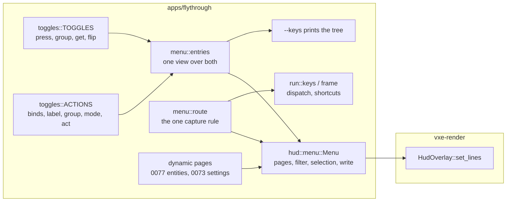

# 0080: The fly-through's menu: one overlay component, a search palette, and the minimal key set

> **Status:** implemented 2026-11-17, awaits the fresh-session close review (approved 2026-11-16, the owner: every recommended answer under "Owner questions"; amended 2026-11-17 (owner) after the window's run 1: Phases 5 to 8 replace the former Phase 5)
> **Created:** 2026-11-16
> **Milestone:** none of its own. The testbed (`apps/flythrough`) and, through Plan 0073, the
> tester; nothing under `crates/` changes unless Phase 5's window asks for the overlay backdrop.
> **Related ADRs:** [ADR-0061](../adrs/0061-the-apps-input-is-menu-first-a-minimal-fixed-key-set-one-overlay-menu-with-a-palette-from-one-key-table.md)
> (proposed): menu-first input, one component, one capture rule, the key table as the source.
> Rests on ADR-0009 (the text overlay, no UI library) and ADR-0054 (the tester runs the
> fly-through as a child).
> **Source:** the owner, 2026-11-16: "instead of filling all keyboard with everything we have in
> place - and I already can't remember what key does what - we should have a menu system,
> settings overlay etc - and keep using keys to miminal".
> **Starts after:** Plans 0062 and 0075 have merged (both edit `apps/flythrough/src/toggles.rs`;
> 0062 adds `` ` ``, `F11`, `F12` and a second meaning for `4`, 0075 reads `Esc` while loading).
> It does **not** wait for Plans 0069 or 0071: it wraps today's toggles and actions, and Plan 0073
> later moves the render settings' entries onto Plan 0069's `RenderSettings`. It runs **before**
> Plans 0076, 0077 and 0073, which are amended onto it (their notes of 2026-11-16).

## TL;DR

`Tab` opens one menu over the fly-through's window: a page per group of the key table
(Moving, Camera and paths, Look, Upscaler, Lighting, Lights, Light queue, Entities, Audio,
Readings, Debug), each entry with its live value beside it, read from the same getter its HUD
row uses, and its shortcut key where it keeps one. Typing on any page turns the tree into a
**palette**: the entries whose words match, flat, from every page, so `lam` finds `lamp on  F7`
and `lamp bounce on` and `missing light chain`. `F1` opens the same menu on a flat **Keys** page,
every entry and its binds, which is the help. A **fixed key set** stays bound and off the menu:
move, look, dig, fill, the wheel, `Tab`, `F1`, `F2`, `Esc`. Every other key either becomes a
shortcut shown beside its entry or is unbound, per the table under "The keys" (the owner's
picks). One routing function says what the menu takes while open, and one key table
(`toggles::TOGGLES` plus a new `toggles::ACTIONS`) generates the pages, the palette, the Keys
page and `flythrough --keys`. The first thing seen: `flythrough --keys` prints the tree with
every entry's start value and shortcut; in the window, `Tab`, `l`, `a`, `Enter` turns the lamp
off and its row reads `lamp off`.

## Context & problem

The owner's words above, on the day Plan 0076 (a key help panel) and Plan 0077 (an entity
picker with a `ListMenu`) were approved, and four days after Plan 0073 (a settings menu). Each
draws its own panel on the overlay and routes keys its own way; the tester's launcher has a
fourth (`apps/tester/src/menu.rs`). ADR-0061 records why one component replaces them and why
no UI library is added.

What the tree has (main b4e72e35; `plan-0062` 54edd6f1, `plan-0063` c5c655ad for the keys they
add):

- **Toggles** are one table, `TOGGLES` in `apps/flythrough/src/toggles.rs`: press (a key, an
  optional pad button, or the wheel), name, HUD row, a `get` in words and a `flip`.
  `run::keys::toggle_keys` dispatches through it; `tests/toggles.rs` pins that every toggle
  shows its mode in its row. `ACTION_KEYS` lists the action keys' codes only, for
  `no_two_inputs_share_a_key`.
- **Actions** (keys with no mode: the bench, the stamp, walking, the coarse print, the crumble,
  the castle shot, the readings, the lights' drop, removal and shot, the audio's keys, the
  flight keys, `F1`, `F2`, `Esc`; on `plan-0062` the walker's `` ` ``, `F11` and `F12`)
  are dispatched by hand in `run/keys.rs`, `run/frame.rs` and `fly.rs`.
- **The overlay** is `vxe_render::HudOverlay::set_lines(text, colours)`: 80 x 45 cells at
  1280 x 720 (`HUD_SCALE` 2), a colour per row, a glyph shadow, no backdrop. `run/frame.rs`
  chooses what it shows (the stats rows and the banner, or the banner alone; under `--tester`
  the tester's help panel behind `Run::help`).
- **Input** (`vxe_app::Input`): `pressed`, `held`, `clicked`, `scroll`, `mouse_delta`, the pad's
  buttons and axes. No cursor position, no text events. The cursor is locked for mouse look.
- **The pad** (`--pad on`): `Start` toggles the stats overlay, `West` the cutaway, `North`
  walking, `East` knocks, the D-pad steps the dig radius, `Select` is unused.
- **Under `--tester`** `path::tester_action` lets through movement, look, the left click, `F1`,
  `T` and `Esc`; the rest is dropped. Plans 0073 and 0077 keep the child menu-less; the backlog
  says the filter is structural, not tested in the frame loop (picked up here, Phase 3).
- **Plan 0069** names `F4` for cycling profiles; `F4` is the a-trous iteration key today. Under
  this plan the iteration toggle is menu-only, which frees `F4` (a note on Plan 0069).

No `docs/nfr.md` figure moves (Budgets).

## Decision

Build ADR-0061 in the fly-through's library, so the tester reuses it.

**The component.** `apps/flythrough/src/hud/menu/` holds `Menu`: a stack of pages, a filter
string, a selection and a scroll offset per page. A **page** is a list of **entries**; an entry
has a label, a getter for its value in words (or none for an action), its shortcut binds (or
none), its group, and what `Enter` does: flip a toggle (`TOGGLES`'s `flip`), run an action, step
a value, or open a page. The **root page** lists the groups; a group page lists its entries; the
**Keys page** (`F1`) lists every entry of every group flat with its binds, plus the fixed keys
as a header block. A page may be **dynamic**: its entries are built each frame from run state
(Plan 0077's entities library). The menu writes into the HUD's reused buffers through one
`write(&mut String, &mut Vec<HudColour>)`, with a title row (`menu  >  lighting`, the filter
after it when typing), the entries (the selected one yellow, an entry in error red), and a
footer naming the keys that act on this page. More entries than fit scroll with the selection
and the title names `n/m`.

**The palette.** Typing a printable key on any page (letters, digits, space and `-`, from the
`KeyCode`) appends to the filter; `Backspace` deletes; the page becomes the entries of the whole
tree whose label, value words or group contain every filter word, in tree order, each prefixed
with its group. `Enter` acts on the selected match; `Esc` clears the filter first and closes
the menu second. The match is a plain case-insensitive substring per word, no fuzzy scoring, so
the test fixture is exact. The palette is on by default (owner question 2).

**The routing rule** is one function, `menu::route(&Input, &Menu, pad) -> Routed`, that the
frame calls before anything else reads input. With the menu closed, everything passes. With it
open: the arrows, `Enter`, `Backspace`, `Esc`, the printable keys, the wheel and both clicks are
the menu's; the fixed movement and look keys, the function keys (`F1` to `F12`, so a kept
`F7` or `F9` shortcut flips its entry and the row updates in place) and the pad's sticks pass
through; the dig click and the wheel's dig-radius use pause; every other letter, digit and
punctuation key is the filter's and never a shortcut while open. On a pad with the menu open,
the D-pad moves, `South` activates, `East` goes back, `Start` closes; closed, `Start` opens it
and `Select` toggles the stats overlay (which `Start` did). `Esc` closed ends the run as today;
`Esc` open never ends it (owner question 8). Under `--tester` the child has no menu: `Tab` and
`Start` map to nothing in `tester_action`, and the frame loop routes every key through the
filter (the backlog's structural item).

**The key table is the source.** `ACTION_KEYS` becomes `ACTIONS` (Plan 0076's design: binds,
label, group, an optional mode getter), `TOGGLES` rows gain a group and an optional shortcut
distinct from today's `press` (the press is what the dispatch reads; after Phase 3 it is the
shortcut, or none). `menu::entries()` is the one view over both tables; the pages, the palette,
the Keys page, `--keys` and `docs/flythrough.md`'s key sections (regenerated by hand from
`--keys` at Phase 3) come from it. Three CPU tests hold it: every `KeyCode` read in the
fly-through's source is a fixed key or a bind in the tables; every toggle and action is an entry
reachable from the root in at most two `Enter`s; no two inputs share a key.

**Apps only.** `vxe-render` changes only if Phase 4's window asks for the backdrop (Plan 0076
Phase 4's facility: a dim-backdrop bit in the overlay's cell word, a general drawing feature,
with a `gpu_hud_golden` case). `vxe-app` is unchanged (no cursor position, no text events;
owner question 4).

**What this plan takes from the approved drafts.** Plan 0076's Phase 1 (the `ACTIONS` table, the
groups, `--keys`, the source scan) is this plan's Phase 1 as written there; its help panel
becomes the Keys page; its key decisions stand (`F1` help, `Enter` readings). Plan 0077's
`ListMenu` is this component; its picker becomes a dynamic Entities page with `` ` `` as the
shortcut that opens the menu on it. Plan 0073's `SettingsMenu` becomes the render groups' pages
over its layers, with the save and profile rows. Their amendment notes say so.

We rejected a dispatch rewritten to run from `ACTIONS` (each action a `fn(&mut Run)`): the
actions keep their code and the menu calls the same functions through the entry's `act`, which
is the same guard Plan 0076 chose at a fraction of the change. We rejected a fuzzy-matched
palette: the fixture test wants an exact answer and the entry count is about a hundred.

## The keys

Every key the fly-through binds on main and the lane branches, and what this plan proposes.
**Fixed**: stays bound, not an entry. **Shortcut**: an entry that keeps its key, shown beside
it. **Menu**: an entry with no key. The owner strikes or moves rows (owner question 3); Phase 3
implements the table as answered.

| Key | Does | Proposal |
|-----|------|----------|
| Mouse, `W` `A` `S` `D`, `Space`, `C`, `Shift` | Look, fly or walk, rise or sink or jump, boost | Fixed |
| Left click, right click, wheel | Dig, fill, dig radius | Fixed |
| `Tab` | **The menu** (was: halve the queue's angle weight) | Fixed |
| `F1` | The Keys page (help) (Plan 0076; was: the readings) | Fixed |
| `F2` | The stats overlay | Fixed |
| `Esc` | Close the page or the menu; closed, quit | Fixed |
| `Enter` | The frame readings (Plan 0076) | Shortcut (Readings) |
| `G` | Fly or walk | Shortcut (Moving) |
| `X` | Cutaway | Shortcut (Debug) |
| `F7` | Lamp | Shortcut (Lighting) |
| `F9` | View | Shortcut (Debug) |
| `F10` | Upscaler | Shortcut (Upscaler) |
| `1` `4` `6` | Drop, remove, fire a light | Shortcut (Lights) |
| `` ` `` | Open the menu on the Entities page (Plan 0077; `plan-0062`: place a walker) | Shortcut (Entities) |
| `T` | Resume a tour path (the tester's `T` stays) | Shortcut (Camera and paths) |
| `ArrowLeft` `ArrowRight` `ArrowDown` | The aimed entity's clip (Plan 0077, outside the menu) | Shortcut (Entities) |
| `B`, `P`, `R`, `K` | Bench, stamp, crumble mode, coarse print | Menu (Debug) |
| `I` | Next castle shot | Menu (Camera and paths) |
| `L` | Shadow ray | Menu (Debug) |
| `N`, `V` | Look preset, far normal | Menu (Look) |
| `Z`, `.` | Sharpen, pan | Menu (Upscaler) |
| `F3` `F4` `F5` `F6` `F8`, `M`, `Q`, `,`, `;` | Shadow walk, filter iterations, history, resolution, lamp bounce, ore pulse, exposure, store read, light weights | Menu (Lighting) |
| `2` `3` `5` | Carry, colour, bounce flag | Menu (Lights) |
| `F`, `/`, `'`, `Backspace`, `\`, `7`, `8` | Order, angle doubled, withdraw, budget, full-first, missing light, reach (and `Tab`'s halving) | Menu (Light queue) |
| `F11`, `F12` | Walkers walk, eye lights (`plan-0062`) | Menu (Entities) |
| `H` `J` `T` `E` `Y` `[` `]` `-` `=` `9` `0` `O` `U` | Knock, hum, pulse, echoes, tail, trims, pre-delay, glide, direct delay | Menu (Audio) |
| Pad `Start` | **The menu** (was: stats) | Fixed |
| Pad `Select` | The stats overlay (was unused) | Fixed |
| Pad `West`, `North`, `East`, D-pad, `L1` `R1` `R3` `R2` `L2` | Cutaway, walk, knock, dig radius (menu closed), sink/rise, boost, dig/fill | As today; D-pad, `South`, `East` navigate while open |

The recommendation keeps the Shortcut rows and frees every Menu row's key. Freed keys stay
free: a later plan that wants one names it in its plan and the owner says yes.

## Architecture diagram



## Implementation phases

Not a look-driven plan: the menu is text and its tests are CPU tests of that text and of the
routing. No phase writes a GPU test unless Phase 5 adds the backdrop. Per phase:
`node scripts/test-changed.mjs --profile quick`, clippy, fmt. At the tip: `cargo nextest run
--profile gate` under the perf lock, doctests, clippy, fmt, deny, the doc and tier gates.
Readings go to `docs/plans/logs/0080.md`. **Test times are estimates**, each under 0.5 s on
any machine unless named.

### Phase 1: the table and the tree, printed by `--keys` (walking skeleton)
- **Owner skill:** dev
- **What:** Plan 0076's Phase 1 as written there, plus the tree: `ACTIONS` replaces
  `ACTION_KEYS` (binds, label, group, optional mode getter, an `act` naming the run method),
  `TOGGLES` rows gain a group, `menu::entries()` lists every toggle and action as an `Entry`
  with its page, and `flythrough --keys` prints the tree at the start modes (a header per group,
  one row per entry: label, value, shortcut) and exits without a device. No key changes yet.
- **Files touched:** `apps/flythrough/src/toggles.rs`, `apps/flythrough/src/hud/menu/{mod,entries}.rs`
  (new), `apps/flythrough/src/hud/mod.rs`, `apps/flythrough/src/cli/{table,parse}.rs`,
  `apps/flythrough/src/main.rs` or `app.rs` (the early exit beside `--help`),
  `apps/flythrough/tests/toggles.rs`, `apps/flythrough/tests/menu.rs` (new),
  `docs/plans/logs/0080.md` (new).
- **Done when** (CPU, `tests/menu.rs` unless named):
  - `every_toggle_and_action_is_an_entry`: the entries' `(label, group)` pairs cover every
    `TOGGLES` row and every `ACTIONS` row once each, and no entry has an empty label or a group
    the root page does not list.
  - `the_source_reads_no_key_the_tables_miss` (Plan 0076's): every `KeyCode::<Name>` token in
    the `.rs` files under `apps/flythrough/src/` is a bind in `TOGGLES` or `ACTIONS` or a
    `FIXED_KEYS` member; fed `input.pressed(KeyCode::ArrowUp)` the scan reports `ArrowUp`.
  - `no_two_inputs_share_a_key` (`tests/toggles.rs`) reads `ACTIONS` and `FIXED_KEYS` and still
    passes.
  - `the_tree_prints_live_values`: `--keys` at the start modes prints `lamp on` under
    `lighting` with `F7` in its key column; with `--lamp off` it prints `lamp off`.
  - `flythrough --keys` exits 0 without opening a device (through the parser's early exit, as
    `--help` is tested in `cli/tests.rs`).

### Phase 2: the component, the palette and the Keys page
- **Owner skill:** dev
- **What:** `Menu` as the Decision describes: `Tab` opens the root, `Enter` opens a group or
  acts on an entry (a toggle's `flip`, an action's `act`), `Esc` goes back and closes, typing
  filters the whole tree, `F1` opens the menu on the Keys page, and the overlay's text is chosen
  by one function of (tester, menu open, stats visible). Opening the menu keeps every key's
  binding of today outside the capture rule (the shortcuts change in Phase 3). The pages' order
  and the groups' names are the table under "The keys".
- **Files touched:** `apps/flythrough/src/hud/menu/{mod,page,filter,route,write}.rs`,
  `apps/flythrough/src/run/{frame,keys,hud_feed,mod,tests}.rs`, `apps/flythrough/src/path.rs`
  (`Tab`, `Start` and the printable keys map to nothing under `--tester`),
  `apps/flythrough/tests/menu.rs`, `apps/flythrough/tests/path.rs`, `docs/plans/logs/0080.md`.
- **Done when** (CPU):
  - `the_root_and_a_group_draw_their_rows`: with the lamp off and `filter 2`, the root page's
    text and colours equal the fixture (title `menu`, one row per group, the selected group
    yellow, the footer naming `Enter Esc Tab` and `type to search`); `Enter` on `lighting` gives
    the fixture for that page with `lamp off` and `filter 2` in their rows and `F7` in the lamp's
    key column; no row past column 80 or row 45.
  - `typing_filters_the_whole_tree`: on the root page, typing `l`, `a`, `m` gives exactly the
    entries whose label, value or group contains `lam`, in tree order, each prefixed with its
    group (`lighting  lamp on  F7` and `lighting  lamp bounce on` are among them, `look face` is
    not); `Backspace` three times restores the root page; `Esc` with a filter clears it and
    leaves the menu open, a second `Esc` closes it.
  - `enter_acts_and_the_row_follows`: `Tab`, `l`, `a`, `Enter` from the start modes flips the
    lamp: `Modes::lighting.lamp` is false, the entry's row reads `lamp off`, and the lighting
    HUD row and the printed line are what a `F7` press gives today.
  - `the_route_is_one_function`: a table test over every key in `TOGGLES`, `ACTIONS` and
    `FIXED_KEYS`, the wheel, both clicks and every `PadButton`, with the menu closed and open:
    closed, everything passes; open, the arrows, `Enter`, `Backspace`, `Esc`, the printable
    keys, the wheel, both clicks, the D-pad, `South`, `East` and `Start` are the menu's and
    nothing else is; `W`, the mouse delta, `F7` and the left stick pass through; the left click
    does not dig and the wheel does not change the dig radius while open.
  - `f1_opens_the_keys_page`: `F1` opens the menu on a flat page whose rows include every entry
    of every group with its binds and a header block of the fixed keys; `F1` again closes it;
    `Tab` from the Keys page shows the root.
  - `esc_closed_ends_the_run_and_open_never_does`: a key step with `Esc` and the menu closed
    sets the run's exit; with it open it closes the menu and the run goes on (`tests/menu.rs`,
    through the frame's key step as `run/tests.rs` drives it).
  - `tester_action(TesterInput::Key(KeyCode::Tab))` is `None`, as are `Start` and `KeyL`
    (`tests/path.rs`); the frame loop under `--tester` reaches `handle_input` for no key the
    filter drops (a test that drives the loop's input step with the filter on, the backlog's
    item).
  - Reading: the menu's format time from the HUD's `format_us` while open on the root and on
    the palette with one letter (RTX 3080 laptop), and that `HudOverlay::allocations` does not
    grow over 60 open frames; into the readings log.

### Phase 3: the minimal key set and the pad
- **Owner skill:** dev
- **What:** the table under "The keys" as the owner answered it: the menu-only entries lose
  their press (the dispatch reads the shortcut column, which is `None` for them), `Tab` and
  `Start` open the menu, `Select` toggles the stats, `F1` is the Keys page and `Enter` the
  readings (Plan 0076's Phase 2 as written there, its `F1` renames included), the start banner
  names `Tab menu, F1 keys`, and `docs/flythrough.md`'s key sections become the fixed set, the
  shortcuts and "everything else: `Tab`", regenerated from `--keys`.
- **Files touched:** `apps/flythrough/src/toggles.rs`, `apps/flythrough/src/run/{keys,frame}.rs`,
  `apps/flythrough/src/pad.rs`, `apps/flythrough/src/hud/menu/route.rs`, the Plan 0076 Phase 2
  file list for the `F1` renames (`run/hud_feed.rs`, `report.rs`, `edits.rs`, `cli/mod.rs`,
  `docs/nfr.md`'s audio figure), `apps/flythrough/tests/{menu,toggles,path}.rs`,
  `docs/flythrough.md`, `docs/plans/logs/0080.md`.
- **Done when** (CPU):
  - `the_fixed_set_is_the_table`: `FIXED_KEYS` equals the Fixed rows of "The keys" as answered,
    and no `TOGGLES` or `ACTIONS` row binds a fixed key.
  - `a_menu_only_entry_has_no_key`: for every entry the answered table marks Menu, a key step
    with its former key pressed changes nothing (`Modes` equal before and after, no line
    printed), and `Tab` plus its words plus `Enter` changes it as the key did.
  - `a_shortcut_still_acts_and_shows`: for every Shortcut row, the key acts closed and open
    (function keys and the arrows) or closed only (letters and digits, which are the filter's
    while open), and the entry's row shows the new value; `--keys` prints the key in its column.
    **Amended 2026-11-17 (owner):** the arrows act as the clip keys with the menu closed only;
    open, the menu owns them, as Phase 2's key table ("outside the menu") and
    `the_route_is_one_function` say. Closed and open is the function keys' claim alone.
  - `the_pad_walks_the_menu`: `Start` opens the root; `DpadDown`, `South` opens the second
    group; `East` returns; `Start` closes; closed, `Select` toggles the stats overlay and
    `DpadUp` steps the dig radius as today.
  - `the_readings_moved_to_enter`: a key step with `Enter` sets `Run::samples` and one with
    `F1` opens the Keys page (Plan 0076's done-when).
  - `git grep -n "F1"` over `apps/flythrough` and `docs/flythrough.md` returns only the Keys
    page, the tester's help and `KeyCode::F1` (Plan 0076's).
  - `docs/flythrough.md`'s key tables list exactly the fixed keys and the shortcut rows, in the
    groups' order, and say the rest is the menu; `node scripts/check-doc-links.mjs` exits 0.

### Phase 4: the owner's window
- **Owner skill:** human
- **What:** On Linux (Windows is checked once in a while, not per plan; owner 2026-11-15), the
  owner runs `cargo run --release -p flythrough` at 1280 x 720 and at the laptop's size, and
  judges: `Tab` as the key and how the root reads; a group opened and a toggle flipped by
  `Enter`, the row following; the palette: `Tab`, three letters, `Enter` for the lamp, the
  missing-light mode and the upscaler; `F1`'s Keys page as the help; whether the rows read over
  the cave and over a lit wall (the glyph shadow only, no backdrop); `F7`, `F9`, `X` with the
  menu open and closed; `Esc` closing a page, then the menu, then the run; a pad through the
  same tree; and which freed keys the hand missed. One `--tester` run checks that `Tab` does
  nothing and `F1` still shows the tester's panel.
- **Done when:** the owner's verdict on each point is in the readings log, with the key table's
  final strikes and moves and any wording or grouping change named for Phase 5.

### Phase 5 (as approved 2026-11-16; replaced by Phases 5 to 8 below, amended 2026-11-17)
- The former Phase 5 ("the owner's picks, and the tip": the window's picks, the optional
  backdrop bit, the gate at the tip) is Phase 8 now; its backdrop moved to the new Phase 5.

## Amended 2026-11-17 (owner): the window's verdict, and Phases 5 to 8

Phase 4's run 1 (the streamed cave, no flags, 2530 x 1378) gave the verdict quoted in the
readings log: the direction is right; the panel is small and top-left with the scene showing
through; `Enter` on the dig radius only grows it; several entries do nothing with no sign why;
a number should be edited with the arrows after `Enter`; the frame rate should stay visible.
The owner asked for the UX research first; it is `docs/references/in-game-menu-ux.md`, and the
decisions below cite its sections in brackets. Runs 2 to 4 of the script were skipped and are
Phase 7's.

### The cause of each "does nothing" (read from the code)

| Entry | What `Enter` did (the code) | Why nothing showed | Fix |
|---|---|---|---|
| dig radius | `Toggle::flip` adds one `DIG_STEP` (0.1 m), capped at 3.0 m (`toggles.rs`, `edits::DIG_RANGE`); `Up` and `Down` move the selection and the wheel scrolls the page while open | a `Press::Scroll` toggle has one direction as an entry | Phase 6: a number, edited after `Enter` |
| resume the tour | `Run::resume_path` returns unless `player` is `Some` in `Drive::Free`: a `--path` run in free flight | silent return, no line | Phase 6: unavailable, `needs --path` |
| next castle shot | `Run::next_castle_shot` returns unless `castle_shot` is `Some`, which `--castle` sets (`app.rs`) | silent return | Phase 6: unavailable, `needs --castle` |
| pan | `flip` toggles `Modes::pan` only when it is `Some`, which `--pan DEG` sets; the row reads `pan none` | silent | Phase 6: unavailable, `needs --pan` |
| frame readings | `Act::Readings` sets `Run::samples`; 30 frames later `report` prints the `frame (...)` line to stdout (the log holds four) | acts; stdout only, and the stats HUD is not drawn while the menu is | Phase 5: the readout; Phase 6: the notice row |
| audio (all 13, not half) | `audio_act` returns at once when `Run::audio` is `None` (no `--audio`); the mix rows read `no audio`; knock, pulse and hum have no mode words | silent; with `--audio` the three sounds play and the rest print and their rows follow | Phase 6: unavailable, `needs --audio`; the group row grey on the root |
| stamp | sends `DigInput::Stamp`; the logic ray-casts 10 m (`REACH`) and answers `stamped: no surface within 10 m` (twice in the log) or stamps the vault | acts; the logic's line goes to stdout through `tick_server` | Phase 6: the logic's lines reach the notice row |
| coarse print, crumble | `Run::coarse` is `None` while streaming (`app.rs`, `Coarse::build` on a bounded world only): `coarse: not kept while streaming`, `collapse: not kept while streaming` | stdout only | Phase 6: unavailable, `needs --level` |
| walk (found reading) | `toggle_walk` refuses while streaming (`cli::walk_allowed`) and prints `walk: ... still flying` | stdout only | Phase 6: unavailable, `needs --level` |
| clip before, after, pause (found reading) | `light_act` returns `None` without `--model`'s viewer; nothing printed | silent | Phase 6: unavailable, `needs --model` |

Two more findings for Phase 6: `queue angle halved` and `queue angle doubled` are two entries
for one value, as are the `echo trim`, `tail trim` and `pre-delay` down/up pairs; `carry`,
`colour` and `bounce` show the whole lights row as their value.

### Decisions (the reference's sections in brackets)

- **The panel** is 80 columns by up to 45 rows at the **menu's glyph scale**: the largest
  integer scale at which 80 x 45 cells fit the window (`floor(min(w / 640, h / 360))`, at
  least 2): 2 at 1280 x 720 (the panel is the window), 3 at 1920 x 1080 and at the laptop's
  2530 x 1378 (a 1920 x 1080 panel with 305 px at each side), 4 at 2560 x 1440. At scale 3 a
  glyph is 24 px tall, over XAG 101's 18 px floor for PC at 1080p; scale 2 is 16 px, under
  it, which is why the panel grows with the window. The panel is centred horizontally; its top
  row is the top of the centred 80 x 45 box and it grows down with the page (a palette anchors
  at the top, like a command palette, so the rows do not jump as the matches change)
  [Placement] (owner question 11, answered 2026-11-17: "Fixed top, grows down"). The stats HUD and the loading screen keep `HUD_SCALE`; the overlay's scale is
  set when the menu opens and restored when it closes.
- **The backdrop** is a dim box behind the panel only: black at alpha 0.7 under the rows the
  page uses plus one row and one column of padding, drawn by a **backdrop bit** in the cell
  word (bit 16; bits 16..32 are unused) that `hud.wgsl` reads where no glyph bit is set. Not
  a whole-screen dim: the menu exists to watch the scene change as a row flips, and white on
  70 % black over any scene clears XAG 102's 4.5:1 measured against the brightest patch
  [Backdrop] (owner question 10, answered 2026-11-17: "Panel only").
- **Numbers are edited after `Enter`** (the owner's call, and the console "engagement" model):
  `Enter` on a number row enters an edit mode where `Up` and `Down` (the pad's D-pad) step the
  value, holding repeats after `REPEAT_DELAY_MS` with one step every `REPEAT_RATE_MS` (275
  and 50 ms, Dear ImGui's defaults), `Enter` or `Esc` leave the mode keeping the value, the
  value clamps at its range (no wrap), and the row reads `< 0.5 m >` with its range in grey
  after it; the footer reads `Up Down change  Enter Esc done`. Outside the mode the arrows
  only move the selection (`Left` back a page, `Right` into a group, as today): the owner
  struck the `Left`/`Right` stepping in place that controller menus and ImGui offer (owner
  question 9, answered 2026-11-17: "No, Enter-edit only") [Numbers].
- **Cycles** (a mode with three or more states: look, far normal, view, upscaler, exposure,
  store read, weights, young filter, entity light, history, shadow walk, resolution, queue
  order, bake budget, missing light, reach, colour, cutaway) keep `Enter` as the next state,
  with no edit mode and no arrow stepping: one press per state, as the keys always worked and
  as Phase 2's tests and Plan 0073 build on it; a cycle wraps, so the state before is at most
  `n - 1` presses away [Enums]. The edit mode is the numbers' alone: the owner's words were
  "up and down numbers", and `Enter`, `Up`, `Enter` for a three-state cycle would be slower
  than today's one `Enter`. Two-state toggles flip on `Enter`. A number row alone shows `<`
  and `>` around its value, while it is being edited.
- **An unavailable entry is grey with its reason, not hidden** [Unavailable]: `Entry::
  available(&Modes, &RunView) -> Result<(), &'static str>` (`needs --audio`, `needs --pan`,
  `needs --path`, `needs --castle`, `needs --model`, `needs --level`), the row grey
  (`HudColour::Grey`, new), the footer naming the reason while it is selected, `Enter` on it
  changing nothing but showing the reason in the notice row (grey plus words: never colour
  alone, XAG 103); a group whose entries are all unavailable is grey on the root with the
  shared reason; the palette lists them grey; `--keys` appends `  unavailable: <reason>` to the
  row. The owner learns the flag instead of wondering (owner question 12, answered
  2026-11-17: "Grey, with the reason").
- **Every activation answers in the window in the same frame** [Feedback]: a toggle, cycle or
  number by its row; an action by the **notice row**, the row above the footer, yellow for
  `hud::BANNER_MS`, holding the last line the action printed. One `Run::say(line)` prints the
  line and sets the notice, and every `println!` an `Act` reaches goes through it, the
  logic's lines from `tick_server` included (so `stamped: no surface within 10 m` is seen). The
  readings say `readings: sampling 30 frames` at once and `frame: cpu X ms, gpu Y ms (median
  of 30)` when the samples are in; the full line stays on stdout.
- **The readout**: one row, `fps 59.9  frame 16.7 ms p99 18.2`, at the top-right of the
  window (row 0, right-aligned to the last visible column), whenever the menu is open and
  whether or not `F2`'s stats show; it reads `hud.frames`, which the frame loop records every
  frame. With the menu closed nothing changes: `F2` is the stats [Readout].
- **The pad** in edit mode: D-pad up and down step, `South` enters and leaves the mode,
  `East` leaves it; D-pad left and right keep their page meaning, as the arrows do [Pad].
- **`Esc`** leaves the edit mode first, then clears a filter, then a page, then the menu, and
  quits only with it closed, as before [Esc].
- **In `vxe-render`** (general facilities, Plan 0076 Phase 4's bit as foreseen under
  "Apps only"): `HudOverlay::set_scale(queue, scale)` (the scale is already a uniform), the
  backdrop bit, and `HudColour::Grey` (palette index 3). Nothing names a menu.

### Phase 5: the panel: its scale and place, the backdrop, the grey and the readout
- **Owner skill:** dev
- **What:** the three `vxe-render` facilities above with their test; the menu's glyph scale
  rule and the centred panel; the backdrop under the used rows; the fps readout row while the
  menu is open.
- **Files touched:** `crates/vxe-render/src/hud.rs`, `crates/vxe-render/src/shaders/hud.wgsl`,
  `crates/vxe-render/tests/gpu_hud.rs`, `apps/flythrough/src/hud/menu/write.rs`,
  `apps/flythrough/src/run/{frame,hud_feed}.rs`, `apps/flythrough/tests/gpu_hud_golden.rs`
  and its golden, `apps/flythrough/tests/menu.rs`, `docs/plans/logs/0080.md`.
- **Done when:**
  - `a_backdrop_cell_dims_and_a_grey_row_reads` (`gpu_hud.rs`, lavapipe, under 5 s): over a
    target cleared to one colour, a 4 x 2 block of cells with the backdrop bit and `ab` in
    grey on its first row: a block pixel with no glyph bit is `mix(clear, black, 0.7)` within
    1/255, a glyph pixel is the grey palette entry, a pixel outside the block is the clear
    colour, and the same holds at scale 3 after `set_scale`.
  - `the_panel_scale_fits_the_window` (`tests/menu.rs`, CPU): the scale rule gives 2 at
    1280 x 720, 3 at 1920 x 1080 and 2530 x 1378, 4 at 2560 x 1440, 2 at 800 x 600 (the floor).
  - `the_panel_is_centred` (CPU): at 2530 x 1378 (105 x 57 visible cells at scale 3) the root
    page's title starts at column 12, row 6; the backdrop bits cover columns 11..92 of the
    title row through one row below the footer and no cell outside; at 1280 x 720 the panel
    starts at (0, 0) and the bits cover the used rows.
  - `the_readout_shows_with_the_menu_open` (CPU): with `hud.frames` fed sixty 16.7 ms frames
    and the menu open, row 0 of the overlay's text ends at the last visible column with
    `fps 59.9  frame 16.7 ms p99 16.7`, white, with the stats shown or hidden; with the menu
    closed and the stats off the text is the banner alone, as today.
  - `gpu_hud_golden` gains `menu_over_the_carved_view`: the root page with its backdrop over
    the existing golden's view, pixel exact, blessed on lavapipe, under 10 s.
  - Reading: the format time and the overlay's allocations as Phase 2 read them, now with the
    backdrop bits and the readout; into the readings log.

### Phase 6: stepped values, unavailable entries with their reason, every action answers
- **Owner skill:** dev
- **What:** the entry kinds (toggle, cycle, number, action, page) in the tables, the edit mode
  with its repeat, `available` with its reasons and the grey rows, the notice row and `Run::say`, the paired entries merged (`queue angle`; `echo trim`,
  `tail trim`, `pre-delay` as one number each), `--keys` and `docs/flythrough.md` updated.
- **Files touched:** `apps/flythrough/src/toggles.rs`, `apps/flythrough/src/hud/menu/{entries,page,route,write}.rs`,
  `apps/flythrough/src/run/{keys,edit,frame,hud_feed,menu_tests}.rs`, `apps/flythrough/src/audio.rs`
  (the mix's steps as one function of a sign), `apps/flythrough/tests/{menu,toggles}.rs`,
  `docs/flythrough.md`, `docs/plans/logs/0080.md`.
- **Done when** (CPU, `run/menu_tests.rs` on `bare_run(carved_rock())` unless named):
  - `enter_edits_a_number_and_the_arrows_step_it`: `Tab`, `dig`, `Enter` enters the edit mode:
    the row reads `> dig radius  < 0.5 m >  0.1..3.0 m`, the footer `Up Down change  Enter Esc
    done`; `Up` twice gives `0.7 m` and `Modes::dig_radius` of 7 voxels, `Down` gives `0.6 m`,
    `Esc` leaves the mode with `0.6 m` kept and the next `Down` moves the selection; at `3.0 m`
    `Up` holds; outside the mode `Right` on the row changes nothing and `Left` goes back to the
    root, as today; the wheel while open still scrolls the page.
  - `a_held_arrow_repeats`: in the edit mode, `Up` held from 0 to 600 ms in 60 Hz frames steps
    7 times (one at the press, then every 50 ms from 275 ms); released and pressed again it
    steps at once.
  - `a_cycle_keeps_enter_as_next`: on `missing light`, `Enter` gives the next of
    `MissingLight::ALL` and no edit mode opens (the footer is the page's); `Up`, `Down`, `Left`
    and `Right` leave the mode unchanged and act on the selection or the page as today; the
    row shows no `<` `>`; on `lamp`, `Enter` flips it.
  - `an_unavailable_entry_says_why`: `resume the tour`, `next castle shot`, `pan`, the
    thirteen audio entries, `clip before`, `clip after` and `clip pause` are unavailable with
    `needs --path`, `needs --castle`, `needs --pan`, `needs --audio` and `needs --model`; their
    rows are grey, the footer names the reason while one is selected, `Enter` leaves `state()`
    unchanged and sets the notice to the reason; the root's `audio` row is grey with
    `needs --audio`; `--keys` prints `unavailable: needs --pan` on the pan row. With `--pan 10`
    in the fixture's arguments `pan` is available and `Enter` gives `pan off`. On a run with
    `coarse: None` and a stream, `coarse print`, `crumble` and `walk` are unavailable with
    `needs --level`; on `bare_run` (bounded, no stream) `walk` is available.
  - `every_live_entry_answers` (the no-silent-no-op claim): for every entry of `entries()`,
    either `available` is `Err` and the clause above holds, or `Tab`, its words, `Enter`
    changes `state()` (the HUD rows, the lighting modes, the dig radius, `Run::samples`,
    `Run::walk`) or sets `Run::notice` to a non-empty line in the same key step (`stamp`,
    `bench`, `crumble`, `coarse print`, `frame readings` through the notice; the rest through
    the state).
  - `an_action_answers_in_the_window`: `frame readings` sets the notice to `readings: sampling
    30 frames`; after 30 `push_samples` calls with `gpu_ms` `None` it reads `frame: cpu 1.000
    ms, gpu n/a (median of 30)` and the full line is printed; `stamp` with no surface within
    10 m sets the notice to `stamped: no surface within 10 m` after one server tick (the
    logic's lines go through `Run::say`); `coarse print` on a run with `coarse` built sets it
    to the coarse line.
  - `the_pad_edits_a_number`: `Start`, `South` on `moving`, `South` on the dig radius enters
    the mode; `DpadUp` steps to `0.6 m`; `East` leaves it; `DpadRight` on the row outside the
    mode changes nothing.
  - `every_toggle_and_action_is_an_entry` holds with the pairs merged (four entries fewer) and
    `the_route_is_one_function` holds with `Left` and `Right` the menu's while open, as today.
  - `docs/flythrough.md`'s menu section says how a number is edited, what `<` `>` mean, what a
    grey row and the notice row are; `node scripts/check-doc-links.mjs` exits 0.

### Phase 7: the owner's window, run 2
- **Owner skill:** human
- **What:** `live/session80.sh` rebuilt at Phase 6's tip, on Linux: run 1 again at the window's
  default size and the laptop's, judging the panel's size and place, the backdrop over the dark
  cave and over a lit wall (`F7` lamp, near rock), the dig radius edited (`Enter`, `Up`, `Up`,
  `Esc`; `Up` held), `missing light` cycled by `Enter`, a grey entry and its reason (`pan`, the `audio` group), `stamp` looking at a wall within 10 m and then at the
  dark (the notice row), `frame readings` (the notice at once and 30 frames later), the fps
  readout top-right with `F2` on and off, and the Keys page's scale; then `--pan 10`,
  `--audio`, `--castle`, `--level` and `--model` runs to see the formerly grey entries act;
  the script's runs 2 (the showcase), 3 (the pad, including the edit mode) and 4 (`--tester`).
- **Done when:** the owner's verdict on each point is in the readings log, with the key
  table's final strikes and moves and any wording or grouping change named for Phase 8.

### Phase 8: the owner's picks, and the tip
- **Owner skill:** dev
- **What:** the former Phase 5: the window's picks (the key table's final rows, words, group
  order, the menu key if changed, the panel's alpha or anchor if the owner moves them), then
  the gate tier at the tip.
- **Files touched:** the Phase 1 to 6 files as the picks need; `docs/flythrough.md`.
- **Done when:** each pick in the readings log names its commit or the owner's "leave it";
  the Phase 1 to 6 tests hold the changed rows; `cargo nextest run --profile gate`, clippy,
  fmt, deny and the doc gates exit 0 at the tip.

### Owner questions added 2026-11-17 (answered the same day; the Decisions above carry them)

9. **`Left`/`Right` step a number or cycle in place**, beside the `Enter` edit mode?
   Recommended yes (the controller convention). **Owner: "No, Enter-edit only."** The arrows
   only move the selection outside the mode; cycles keep `Enter` as next, with no edit mode.
10. **The backdrop's extent.** Recommended the panel only, alpha 0.7. **Owner: "Panel only."**
11. **The panel's vertical anchor.** Recommended the top of the centred box, growing down.
    **Owner: "Fixed top, grows down."**
12. **Unavailable entries.** Recommended grey with the reason. **Owner: "Grey, with the
    reason."**

## Interface for Plans 0073 and 0077

What the component gives the plans amended onto it (names illustrative; the lane's are final):

- `Menu::open_at(PageId)`: a shortcut opens the menu on a page (`` ` `` on Entities).
- A **dynamic page**: `Page::dynamic(fn(&Run) -> Vec<Entry>)`, rebuilt each frame while shown,
  for the entities library (Plan 0077) and the settings' rows with their source and class
  (Plan 0073).
- `Entry::on_select(fn(&mut Run, usize))`: called when the selection moves, so Plan 0077's
  preview follows the selected model.
- `Entry` kinds: `Toggle`, `Action`, `Value { step_left, step_right }` (the arrows step a
  value in place; Plan 0073's fields and Plan 0077's clip row), `Page`.
- The footer is the page's: Plan 0077 names `Enter places, Backspace removes`, Plan 0073 the
  field's source, flag and the file's path.
- `route` is the only place keys split; a page adds no routing of its own. A page that needs a
  key the rule passes through (Plan 0077's left click to place) asks for it through a page
  flag (`captures_click`), tested in `the_route_is_one_function`.

## Data shapes

```rust
// illustrative: apps/flythrough/src/hud/menu
pub enum Group { Moving, Camera, Look, Upscaler, Lighting, Lights, Queue, Entities, Audio, Readings, Debug }
pub enum Bind { Key(KeyCode), Pad(PadButton), Mouse(MouseButton), Wheel, Trigger(Side) }
pub struct Entry {
    pub label: &'static str,
    pub group: Group,
    pub value: Option<fn(&Modes) -> String>,   // live words, the HUD row's getter
    pub shortcut: &'static [Bind],             // shown beside the entry; empty is menu-only
    pub act: Act,                              // Toggle(flip) | Action(fn(&mut Run)) | Value{..} | Page(PageId)
}
pub const FIXED_KEYS: &[KeyCode] = &[/* W A S D Space C ShiftLeft Tab F1 F2 Escape */];
pub struct Menu { pub stack: Vec<PageId>, pub filter: String, pub selected: usize, pub top: usize }
pub enum Routed { Menu(MenuInput), Pass }
pub enum MenuInput { Up, Down, Left, Right, Activate, Back, Close, Type(u8), Erase, Scroll(i32), Click(MouseButton) }
pub fn route(input: &Input, menu: &Menu) -> Vec<Routed>;
pub fn entries() -> impl Iterator<Item = Entry>;  // TOGGLES + ACTIONS, the one view
```

## Budgets

No `docs/nfr.md` figure moves; every figure here is a **guess** until Phase 2 reads it.

- **Closed:** one `bool` in the routing and nothing else; the frame's CPU does not move.
- **Open:** up to 45 rows formatted a frame (the entries' `get` words allocate, the overlay's
  staging may not): under 0.1 ms CPU on the RTX 3080 laptop, read from the HUD's `format_us`.
  The palette filters about a hundred entries by substring: microseconds.
- **VRAM:** unchanged; 45 rows fit the overlay's 128-row grid. A backdrop bit, if Phase 5 adds
  it, uses bits the cell word already has.

## Risks & open questions

**Risks:**

- **Habit.** Keys the hand knows (`N`, `Q`, `F3`) stop working the day Phase 3 lands. Mitigated
  by the palette's three letters and the Keys page; the window (Phase 4) is where the owner
  takes a key back, which is one table row.
- **The filter eats shortcuts while open.** A letter shortcut cannot act with the menu open,
  by the rule; only function keys and arrows do. Accepted: the owner closes the menu with `Esc`
  or `Tab` first, and the rows update live for the keys that do act.
- **`KeyCode` text.** The filter reads the physical key, so a non-QWERTY layout types the wrong
  letter. Accepted for the dev box; `vxe-app` text events are a backlog entry.
- **Drift with the lane branches.** `plan-0062` and `plan-0063` add `` ` ``, `F11`, `F12`
  and the arrows; this plan branches from the main that holds them (Starts after) and
  lists them as entries. Plan 0063's Phases 3-4 may still be open when this lane starts; if so,
  the Entities group's rows are whatever the tip binds, and Plan 0077 adds the rest.
- **The tester's launcher** keeps its own menu until Plan 0073 Phase 5 moves it onto the
  component: two menus in the apps for that interval, by design.
- **Windows narrower than 1280.** Pages are laid out for 80 x 45 cells; a smaller window clips
  the right and the bottom. Accepted for a testbed; the pages scroll, not reflow.

### Owner questions (each with a recommendation)

1. **The menu key.** Recommended: `Tab` opens and closes the menu; `Esc` closes a page, then the
   menu, and quits only when it is closed. `Tab` is the queue's angle key today, which goes
   menu-only, so it frees itself. Alternatives: `Esc` opens the menu and a `Quit` entry ends
   the run (game-like, but the path runs and the tester count on `Esc` to end a run and say
   so); `` ` `` (Plan 0077's picker key, which then needs another).
2. **The palette on by default.** Recommended: yes; typing on any page filters the whole tree,
   and an empty filter is the tree. Alternative: a separate palette key (`Shift+Tab` or `/`),
   which keeps letters as shortcuts while a page is open at the cost of one more key to learn.
3. **Which keys stay.** Recommended: the Shortcut rows of "The keys" stay; the Menu rows lose
   their key. Alternatives: every non-fixed key goes (the pure
   form of "minimal"); every key stays as a shortcut and the menu is only added (nothing is
   unlearned, the keyboard stays full).
4. **Mouse pointing.** Recommended: later. `vxe-app` reports no cursor position; the menu is
   keys, wheel and clicks. The cell grid makes a hit test one division once a position exists,
   so a later chore adds `Input::cursor` and an unlocked cursor while the menu is open (a
   backlog entry). Alternative: add it in this plan (touches `vxe-app` and the Wayland cursor
   lock, which the dev box has shown quirks with).
5. **Gamepad navigation.** Recommended: now, in Phase 3 (`Start` opens, the D-pad moves,
   `South` activates, `East` goes back, `Select` takes the stats), since it is the same routing
   function. A radial or hold menu for the pad is later (a backlog entry). Alternative: the pad
   keeps today's buttons and gains the menu later.
6. **Plan 0076.** Recommended: fold it into this plan (its Phase 1 is Phase 1 here, its Phase 2
   is in Phase 3, its panel is the Keys page) and mark it superseded. Alternative: run 0076
   first as approved and have this plan replace its panel, two lanes over the same files.
7. **The help's form.** Recommended: the Keys page of the menu, flat, every entry with its binds
   and the fixed keys on top; `F1` opens it, `F1` or `Esc` closes it. Alternative: Plan 0076's
   two-column panel as a separate overlay beside the menu, a second thing to draw.
8. **`Esc` with the menu open.** Recommended: closes a filter, a page, then the menu; never the
   run. Alternative: `Esc` always quits and only `Tab` closes the menu, which keeps today's
   reflex but makes a slip in a menu end the run.

## What this plan does NOT do

- **No engine change** beyond the overlay's three general facilities (Phase 5, amended
  2026-11-17: the backdrop bit, a run-time scale, a grey colour): nothing under `crates/` names
  a key, an entry or a menu; a game draws its own UI.
- **No UI library** (ADR-0061 Alternative B).
- **No settings file, no layers, no save**: Plan 0073, on this component.
- **No entities library, no picker page, no preview**: Plan 0077, on this component.
- **No key rebinding** in a file or a menu; a shortcut is a table row.
- **No mouse pointing, no cursor unlock, no text events** in `vxe-app` (owner question 4).
- **No radial or hold menu** for the pad (owner question 5).
- **No tester launcher change**: Plan 0073 Phase 5 moves its menu onto the component.
- **No menu in a `--tester` child** (Plans 0073 and 0077's answers stand).
- **No reflow for small windows**; pages scroll.
- **No Windows window check** for this plan.

## Implementation log

> Written by `dev`: one row per phase as its commit lands, then the close block. **The phases
> above are the contract. This section records what happened.** Observations, never conclusions:
> no pass list, no self-assessment. Deviations and unmet done-whens are **always** disclosed.
> Keep it shorter than `## Implementation phases`. Readings, gate counts, attempts and resume
> notes go to the plan's readings log, `docs/plans/logs/0080.md` (started from
> `templates/readings-log.md`), and this section links it once it exists.

Readings and gate counts: [`logs/0080.md`](logs/0080.md).

| phase | owner | state | commit |
|---|---|---|---|
| 1: the table and the tree, printed by `--keys` | dev | done | f432c14a |
| 2: the component, the palette and the Keys page | dev | done | 47b0bd28 |
| 3: the minimal key set and the pad | dev | done, one done-when clause unmet (Notes) | b80cd4d4 |
| 4: the owner's window | human | run 1 done 2026-11-17, verdict in the readings log; the rerun is Phase 7 | |
| 5: the panel: scale, place, backdrop, grey, readout (amended 2026-11-17) | dev | done | 295ed11e |
| 6: stepped values, unavailable entries, every action answers (amended 2026-11-17) | dev | done, one count differs (Notes) | 677fb8db |
| 7: the owner's window, run 2 (amended 2026-11-17) | human | done 2026-11-17, verdict in the readings log; the pad's step not run (no pad) | e210343b |
| 8: the owner's picks, and the tip (the former Phase 5) | dev | done | 4ff74bb6 |
| fix, owner window 80c run 2: the menu's rebuilds behind the loading screen | dev | done | committed with this row |

### Notes

- Phase 1: `--keys`' flag row is built in `cli/parse.rs` (`keys_flag`) and listed from
  `cli/flags.rs`' Run section (one line; the file is at the 1200-line cap, so `--check-args`'
  closure went to one line); `Args::keys` in `cli/mod.rs`. Both files are outside Phase 1's list.
- Phase 1: `Delete` (young filter) and `Insert` (entity light) are bound on main and missing
  from "The keys"; they are Lighting entries.
- Phase 1: `T` is both the tour's resume and, outside a path, the audio's pulse; the pulse
  entry names no bind, the resume entry names `T`.
- Phase 1: `parse_args_from` is `pub` (was `pub(crate)`) for `tests/menu.rs`.
- Phase 2: `Tab` and `F1` became the menu's keys here, so the queue angle's halving lost `Tab`
  (`Press::Menu`, menu-only) and the readings moved from `F1` to `Enter` in this phase.
- Phase 2: the action binds dispatch from `ACTIONS` through one `Run::act(Act)` match that
  holds each action's code (the menu calls the same); `T`'s pulse stays a hand-read line.
- Phase 2: the movement letters and `Space` do both while the menu is open: their press types
  into the filter, their hold moves (the done-whens name `W` passing and `a` typing).
- Phase 2: the source scan skips stretches marked `keys:typed-begin`/`-end` in
  `hud/menu/route.rs`: the typed keys and the open menu's navigation keys (`ArrowUp` is no bind).
- Phase 2: the tests that drive a `Run` (`esc_closed_ends_the_run_and_open_never_does`, the
  tester loop, the overlay's choice) are in `src/run/menu_tests.rs` (new; `Run` is
  crate-private and `run/tests.rs` is near the 1200-line cap). Outside the list also:
  `app.rs` and `test_support.rs` (`Run::menu`), `tests/toggles.rs` (the halving's key), and a
  `mod reading` in `tests/gpu_hud_golden.rs`.
- Phase 3, **unmet as written:** `a_shortcut_still_acts_and_shows` asks the arrows (the
  clip keys) to act with the menu open, while `the_route_is_one_function` and "The keys" ("outside
  the menu") make the arrows the menu's while open. The arrows act closed only; the test asserts
  the function keys open and closed and the letters and digits closed only. Owner question 1.
- Phase 3: the freed keys: `F3` `F4` `F5` `F6` `F8` `F11` `F12`, `M` `Q` `N` `V` `Z` `L` `I` `B`
  `P` `R` `K` `F` `H` `J` `E` `Y` `O` `U`, `2` `3` `5` `7` `8` `9` `0`, `,` `;` `.` `/` `'` `\`
  `[` `]` `-` `=`, `Backspace`, `Delete`, `Insert`. `F4` is free for Plan 0069's profile cycle.
  The audio's knock keeps the pad's `East` only.
- Phase 3: the banner's queue row names `(Tab: the light queue page)` in place of its key list.
- Phase 3: comments outside the phase's files still name freed keys (`hud/modes.rs`,
  `audio.rs`, `edits.rs`, `cli/parse.rs`); `cli/mod.rs`' module docs, `toggles.rs`,
  `cli/flags.rs`' rows and `docs/flythrough.md` name the menu's entries. Touched beyond the
  list: `walker.rs` and `hud/modes.rs` tests (the removed `KEY_WALK`, `KEY_EYE_LIGHTS` and the
  menu-only presses), `run/menu_tests.rs`, `cli/flags.rs`.
- Phase 3: "no line printed" for a former key is not asserted (stdout is not captured); the
  state it would change is.
- Phase 5: `vxe-render`'s `lib.rs` (the exports `HudBox`, `BACKDROP_ALPHA`) and
  `layout_tests.rs` (`BACKDROP_BIT` and `BACKDROP_ALPHA` listed as constants both sides name)
  are outside the list. The backdrop's API is `HudOverlay::set_lines_over(.., HudBox)`.
- Phase 5: "columns 11..92" read as 11 to 92 inclusive (one padding column each side of the
  80); the rows are the title row through one row below the footer, no row above the title.
- Phase 5: the readout's `frame` figure is the window's median; the placing is
  `hud::menu::place`, fed by `Run::place_menu` into new `Hud::overlay` buffers, so
  `Hud::text` keeps the page at the top-left as Phase 2's tests read it.
- Phase 5: `the_readout_shows_with_the_menu_open` is in `run/menu_tests.rs` (it drives a
  `Run`); the golden is `tests/golden/menu.png`, drawn at scale 1 on the 320 x 180 golden view
  (40 x 22 cells, the page cut at column 40), placed at (0, 0) with a fixed readout.
- Phase 6, **count differs:** `a_held_arrow_repeats` asserts 8 steps over 0 to 600 ms, not 7:
  the rule as written (one at the press, then every 50 ms from 275 ms) steps at the press and
  at 275, 325, ..., 575 ms. The test is in `tests/menu.rs` on `Menu` through `menu::step_at`
  (an explicit clock); the run calls `step_at` with its clock, `menu::step` is `step_at` at 0.
- Phase 6: the range after an edited number is in the row's colour, not grey (a colour is per
  row). An unavailable row is grey while selected too (`>` marks it). A group grey on the root
  shows its reason in the key column.
- Phase 6: the audio group has ten entries after the merge (thirteen before); the test names
  ten. `every_live_entry_answers` presses `Up` after `Enter` on a number (`Down` at its top).
- Phase 6: `Entry::words` puts the label's first words before a value that starts with its
  last (`queue angle 4`); `light weights: weights normal` reads `light weights normal`. The
  queue angle steps up to `QUEUE_ANGLE_MAX` (8, new) and down to 0 under 1/64.
- Phase 6: `stamp`, `bench` and `crumble` say `<name>: sent to the logic` at once; the logic's
  lines (`stamped: ...`) replace it after the tick. The dig, fill and bench result lines
  (`record_edit`, `bench_sync`) still print only. A menu flip that leaves its own words as they
  were (`bounce` with no light) says its line in the notice. `Audio::play` gives its line
  instead of printing it. "The full line is printed" is not asserted (stdout is not captured);
  `Run::file_samples` is split from `push_samples` for the test.
- Phase 6: `carry`, `colour` and `bounce` keep the lights row as their value
  (`every_toggle_shows_its_mode_in_the_hud_grid` reads each value in its HUD row, and the row
  shows `carry over 0`, not `carry on`).
- Phase 6: `RunView` gained `path`, `castle`, `model`, `streaming`, `coarse`, `AudioView` the
  trims' ranges; `walk` is unavailable on the streamed cave (`needs --level`). Outside the list:
  `app.rs`, `test_support.rs`, `run/mod.rs` (`Run::notice`), `run/tests.rs` (the queue angle's
  steps), `cli/mod.rs`' module docs, `tests/gpu_hud_golden.rs` and `menu.png` re-blessed (the
  audio row is grey).
- Phase 8: an unavailable entry's reason is on its own row after its words (its page, the
  palette, the Keys page), the words cut first; the footer no longer names it (the plan's
  Decisions had the footer name it while selected).
- Phase 2: `path::TesterInput` gained `Pad`; under `--tester` the triggers and the wheel are
  dropped by the filter (`R2` no longer frees a tour).
- Merge of main 8afce1bc (Plans 0069 and 0032), merge items in their own commit: Plan 0069's
  profile cycle is the `profile` action on the upscaler page with `F4` (was `PageDown`). Plan
  0032's keys are menu-only entries of a new root group, `world and sky` (`Group::World`,
  after `camera and paths`): `source` (was `Home`), `trees` (was `CapsLock`, grey `needs
  --source outdoor`), `time` (was `PageUp`, `Shift` back; a number, an hour a step, held at
  00:00 and 23:59, not wrapping as the key did), `day cycle` (was `End`); the two clock
  entries grey `needs --sky on`. Added beside them: `sky rays` (a number, 1 to 4, `needs --sky
  on`). `daylight::KEY_*` and `clock_keys` are gone; `Modes::sky` is `pub`. The menu and its
  notice are carried across the in-process switch, which says its line through `Run::say`.
  Left out of the menu: `--light-cap` (the profile cycle sets it), `--day-length`, `--sun`,
  `--sun-radius`, `--moon-radius`, `--leaf-fill`, `--spawn`, `--spawn-hash`, `--switch-at`,
  `--settings`, and the profile's restart-only fields. `menu.png` re-blessed (the root's new
  row); `tests/toggles.rs`' `row_of` also finds the lighting row after a comma (under a sky it
  starts `time ...`). `vxe-render`'s `RenderSettings::NOT_SETTINGS` lists `set_scale` and
  `set_lines_over` (0069's setter scan). Readings log, "Merge of main".
- Fix after window 80c run 2 (`source` and `trees` froze the window silently): under the
  screen a switch presents a loading frame naming the next world, then loads behind Plan
  0075's loading frames; teardown, the level's generation join and `rebuild_gfx` still block
  behind that first frame. The outdoor title reads the trees. Readings log, "Fix: the menu's
  rebuilds behind the loading screen".

### Close triggers

- **What shipped:** the fly-through's menu (`hud/menu/`: the tree from `TOGGLES` and
  `ACTIONS`, the palette, the Keys page, `route`, the edit mode, grey entries with their reason
  on the row, the notice row, the readout), the minimal key set and the pad, `--keys`.
- **Public API changed:** `vxe-render`: `HudOverlay::set_scale`, `HudOverlay::set_lines_over`,
  `HudBox`, `BACKDROP_ALPHA`, `HudColour::Grey`; the backdrop bit in `hud.wgsl`'s cell word.
  `flythrough`: `parse_args_from` is `pub`; `hud::menu` is new.
- **Budget readings:** the menu's format time and overlay allocations, Phases 2 and 5 of the
  readings log (lavapipe and RTX 3080 laptop, exclusive perf lock, loaded); no `docs/nfr.md`
  figure moved.
- **Gate at the tip (4ff74bb6):** `cargo nextest run --workspace --profile gate
  --test-threads 2` (exclusive perf lock, lavapipe, 1-minute load 8.87 at start) 1036 run,
  1036 passed, 105 skipped, 1042 s, exit 0; `cargo test --doc --workspace` 0 failed;
  `cargo clippy --workspace --all-targets -- -D warnings` 0; `cargo fmt --all --check` 0;
  `cargo deny check` 0; check-doc-links, check-comment-hygiene, check-test-tiers,
  check-file-size, check-index-rows, check-plan-size 0.
- **Outstanding `human` phases:** none; Phase 7's step 8 (the pad in a window) was not run (no
  pad connected) and is owed at a later window.

## Followups

- Plan 0077's Phase 3 builds its Entities page on this component (its amendment of 2026-11-16).
- Plan 0073's Phases 3 and 5 build the settings pages and the tester's launcher menu on it (its
  amendment of 2026-11-16).
- Backlog: mouse pointing (`Input::cursor`, the cursor unlocked while the menu is open), text
  events in `vxe-app`, a radial or hold menu for the pad.
