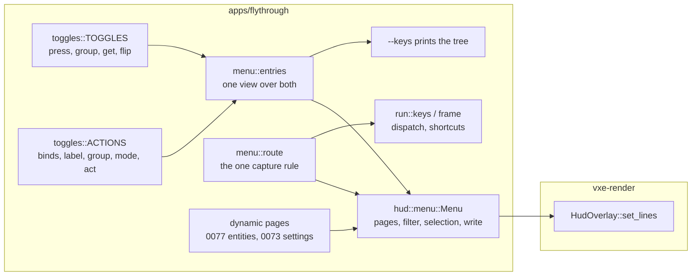

# 0080: The fly-through's menu: one overlay component, a search palette, and the minimal key set

> **Status:** draft (2026-11-16; awaits the owner's answers under "Owner questions")
> **Created:** 2026-11-16
> **Milestone:** none of its own. The testbed (`apps/flythrough`) and, through Plan 0073, the
> tester; nothing under `crates/` changes unless Phase 5's window asks for the overlay backdrop.
> **Related ADRs:** [ADR-0061](../adrs/0061-the-apps-input-is-menu-first-a-minimal-fixed-key-set-one-overlay-menu-with-a-palette-from-one-key-table.md)
> (proposed): menu-first input, one component, one capture rule, the key table as the source.
> Rests on ADR-0009 (the text overlay, no UI library) and ADR-0054 (the tester runs the
> fly-through as a child).
> **Source:** the owner, 2026-11-16: "instead of filling all keyboard with everything we have in
> place - and I already can't remember what key does what - we should have a menu system,
> settings overlay etc - and keep using keys to miminal".
> **Starts after:** Plans 0062 and 0075 have merged (both edit `apps/flythrough/src/toggles.rs`;
> 0062 adds `` ` ``, `F11`, `F12` and a second meaning for `4`, 0075 reads `Esc` while loading).
> It does **not** wait for Plans 0069 or 0071: it wraps today's toggles and actions, and Plan 0073
> later moves the render settings' entries onto Plan 0069's `RenderSettings`. It runs **before**
> Plans 0076, 0077 and 0073, which are amended onto it (their notes of 2026-11-16).

## TL;DR

`Tab` opens one menu over the fly-through's window: a page per group of the key table
(Moving, Camera and paths, Look, Upscaler, Lighting, Lights, Light queue, Entities, Audio,
Readings, Debug), each entry with its live value beside it, read from the same getter its HUD
row uses, and its shortcut key where it keeps one. Typing on any page turns the tree into a
**palette**: the entries whose words match, flat, from every page, so `lam` finds `lamp on  F7`
and `lamp bounce on` and `missing light chain`. `F1` opens the same menu on a flat **Keys** page,
every entry and its binds, which is the help. A **fixed key set** stays bound and off the menu:
move, look, dig, fill, the wheel, `Tab`, `F1`, `F2`, `Esc`. Every other key either becomes a
shortcut shown beside its entry or is unbound, per the table under "The keys" (the owner's
picks). One routing function says what the menu takes while open, and one key table
(`toggles::TOGGLES` plus a new `toggles::ACTIONS`) generates the pages, the palette, the Keys
page and `flythrough --keys`. The first thing seen: `flythrough --keys` prints the tree with
every entry's start value and shortcut; in the window, `Tab`, `l`, `a`, `Enter` turns the lamp
off and its row reads `lamp off`.

## Context & problem

The owner's words above, on the day Plan 0076 (a key help panel) and Plan 0077 (an entity
picker with a `ListMenu`) were approved, and four days after Plan 0073 (a settings menu). Each
draws its own panel on the overlay and routes keys its own way; the tester's launcher has a
fourth (`apps/tester/src/menu.rs`). ADR-0061 records why one component replaces them and why
no UI library is added.

What the tree has (main b4e72e35; `plan-0062` 54edd6f1, `plan-0063` c5c655ad for the keys they
add):

- **Toggles** are one table, `TOGGLES` in `apps/flythrough/src/toggles.rs`: press (a key, an
  optional pad button, or the wheel), name, HUD row, a `get` in words and a `flip`.
  `run::keys::toggle_keys` dispatches through it; `tests/toggles.rs` pins that every toggle
  shows its mode in its row. `ACTION_KEYS` lists the action keys' codes only, for
  `no_two_inputs_share_a_key`.
- **Actions** (keys with no mode: the bench, the stamp, walking, the coarse print, the crumble,
  the castle shot, the readings, the lights' drop, removal and shot, the audio's keys, the
  flight keys, `F1`, `F2`, `Esc`; on `plan-0062` the walker's `` ` ``, `F11` and `F12`)
  are dispatched by hand in `run/keys.rs`, `run/frame.rs` and `fly.rs`.
- **The overlay** is `vxe_render::HudOverlay::set_lines(text, colours)`: 80 x 45 cells at
  1280 x 720 (`HUD_SCALE` 2), a colour per row, a glyph shadow, no backdrop. `run/frame.rs`
  chooses what it shows (the stats rows and the banner, or the banner alone; under `--tester`
  the tester's help panel behind `Run::help`).
- **Input** (`vxe_app::Input`): `pressed`, `held`, `clicked`, `scroll`, `mouse_delta`, the pad's
  buttons and axes. No cursor position, no text events. The cursor is locked for mouse look.
- **The pad** (`--pad on`): `Start` toggles the stats overlay, `West` the cutaway, `North`
  walking, `East` knocks, the D-pad steps the dig radius, `Select` is unused.
- **Under `--tester`** `path::tester_action` lets through movement, look, the left click, `F1`,
  `T` and `Esc`; the rest is dropped. Plans 0073 and 0077 keep the child menu-less; the backlog
  says the filter is structural, not tested in the frame loop (picked up here, Phase 3).
- **Plan 0069** names `F4` for cycling profiles; `F4` is the a-trous iteration key today. Under
  this plan the iteration toggle is menu-only, which frees `F4` (a note on Plan 0069).

No `docs/nfr.md` figure moves (Budgets).

## Decision

Build ADR-0061 in the fly-through's library, so the tester reuses it.

**The component.** `apps/flythrough/src/hud/menu/` holds `Menu`: a stack of pages, a filter
string, a selection and a scroll offset per page. A **page** is a list of **entries**; an entry
has a label, a getter for its value in words (or none for an action), its shortcut binds (or
none), its group, and what `Enter` does: flip a toggle (`TOGGLES`'s `flip`), run an action, step
a value, or open a page. The **root page** lists the groups; a group page lists its entries; the
**Keys page** (`F1`) lists every entry of every group flat with its binds, plus the fixed keys
as a header block. A page may be **dynamic**: its entries are built each frame from run state
(Plan 0077's entities library). The menu writes into the HUD's reused buffers through one
`write(&mut String, &mut Vec<HudColour>)`, with a title row (`menu  >  lighting`, the filter
after it when typing), the entries (the selected one yellow, an entry in error red), and a
footer naming the keys that act on this page. More entries than fit scroll with the selection
and the title names `n/m`.

**The palette.** Typing a printable key on any page (letters, digits, space and `-`, from the
`KeyCode`) appends to the filter; `Backspace` deletes; the page becomes the entries of the whole
tree whose label, value words or group contain every filter word, in tree order, each prefixed
with its group. `Enter` acts on the selected match; `Esc` clears the filter first and closes
the menu second. The match is a plain case-insensitive substring per word, no fuzzy scoring, so
the test fixture is exact. The palette is on by default (owner question 2).

**The routing rule** is one function, `menu::route(&Input, &Menu, pad) -> Routed`, that the
frame calls before anything else reads input. With the menu closed, everything passes. With it
open: the arrows, `Enter`, `Backspace`, `Esc`, the printable keys, the wheel and both clicks are
the menu's; the fixed movement and look keys, the function keys (`F1` to `F12`, so a kept
`F7` or `F9` shortcut flips its entry and the row updates in place) and the pad's sticks pass
through; the dig click and the wheel's dig-radius use pause; every other letter, digit and
punctuation key is the filter's and never a shortcut while open. On a pad with the menu open,
the D-pad moves, `South` activates, `East` goes back, `Start` closes; closed, `Start` opens it
and `Select` toggles the stats overlay (which `Start` did). `Esc` closed ends the run as today;
`Esc` open never ends it (owner question 8). Under `--tester` the child has no menu: `Tab` and
`Start` map to nothing in `tester_action`, and the frame loop routes every key through the
filter (the backlog's structural item).

**The key table is the source.** `ACTION_KEYS` becomes `ACTIONS` (Plan 0076's design: binds,
label, group, an optional mode getter), `TOGGLES` rows gain a group and an optional shortcut
distinct from today's `press` (the press is what the dispatch reads; after Phase 3 it is the
shortcut, or none). `menu::entries()` is the one view over both tables; the pages, the palette,
the Keys page, `--keys` and `docs/flythrough.md`'s key sections (regenerated by hand from
`--keys` at Phase 3) come from it. Three CPU tests hold it: every `KeyCode` read in the
fly-through's source is a fixed key or a bind in the tables; every toggle and action is an entry
reachable from the root in at most two `Enter`s; no two inputs share a key.

**Apps only.** `vxe-render` changes only if Phase 4's window asks for the backdrop (Plan 0076
Phase 4's facility: a dim-backdrop bit in the overlay's cell word, a general drawing feature,
with a `gpu_hud_golden` case). `vxe-app` is unchanged (no cursor position, no text events;
owner question 4).

**What this plan takes from the approved drafts.** Plan 0076's Phase 1 (the `ACTIONS` table, the
groups, `--keys`, the source scan) is this plan's Phase 1 as written there; its help panel
becomes the Keys page; its key decisions stand (`F1` help, `Enter` readings). Plan 0077's
`ListMenu` is this component; its picker becomes a dynamic Entities page with `` ` `` as the
shortcut that opens the menu on it. Plan 0073's `SettingsMenu` becomes the render groups' pages
over its layers, with the save and profile rows. Their amendment notes say so.

We rejected a dispatch rewritten to run from `ACTIONS` (each action a `fn(&mut Run)`): the
actions keep their code and the menu calls the same functions through the entry's `act`, which
is the same guard Plan 0076 chose at a fraction of the change. We rejected a fuzzy-matched
palette: the fixture test wants an exact answer and the entry count is about a hundred.

## The keys

Every key the fly-through binds on main and the lane branches, and what this plan proposes.
**Fixed**: stays bound, not an entry. **Shortcut**: an entry that keeps its key, shown beside
it. **Menu**: an entry with no key. The owner strikes or moves rows (owner question 3); Phase 3
implements the table as answered.

| Key | Does | Proposal |
|-----|------|----------|
| Mouse, `W` `A` `S` `D`, `Space`, `C`, `Shift` | Look, fly or walk, rise or sink or jump, boost | Fixed |
| Left click, right click, wheel | Dig, fill, dig radius | Fixed |
| `Tab` | **The menu** (was: halve the queue's angle weight) | Fixed |
| `F1` | The Keys page (help) (Plan 0076; was: the readings) | Fixed |
| `F2` | The stats overlay | Fixed |
| `Esc` | Close the page or the menu; closed, quit | Fixed |
| `Enter` | The frame readings (Plan 0076) | Shortcut (Readings) |
| `G` | Fly or walk | Shortcut (Moving) |
| `X` | Cutaway | Shortcut (Debug) |
| `F7` | Lamp | Shortcut (Lighting) |
| `F9` | View | Shortcut (Debug) |
| `F10` | Upscaler | Shortcut (Upscaler) |
| `1` `4` `6` | Drop, remove, fire a light | Shortcut (Lights) |
| `` ` `` | Open the menu on the Entities page (Plan 0077; `plan-0062`: place a walker) | Shortcut (Entities) |
| `T` | Resume a tour path (the tester's `T` stays) | Shortcut (Camera and paths) |
| `ArrowLeft` `ArrowRight` `ArrowDown` | The aimed entity's clip (Plan 0077, outside the menu) | Shortcut (Entities) |
| `B`, `P`, `R`, `K` | Bench, stamp, crumble mode, coarse print | Menu (Debug) |
| `I` | Next castle shot | Menu (Camera and paths) |
| `L` | Shadow ray | Menu (Debug) |
| `N`, `V` | Look preset, far normal | Menu (Look) |
| `Z`, `.` | Sharpen, pan | Menu (Upscaler) |
| `F3` `F4` `F5` `F6` `F8`, `M`, `Q`, `,`, `;` | Shadow walk, filter iterations, history, resolution, lamp bounce, ore pulse, exposure, store read, light weights | Menu (Lighting) |
| `2` `3` `5` | Carry, colour, bounce flag | Menu (Lights) |
| `F`, `/`, `'`, `Backspace`, `\`, `7`, `8` | Order, angle doubled, withdraw, budget, full-first, missing light, reach (and `Tab`'s halving) | Menu (Light queue) |
| `F11`, `F12` | Walkers walk, eye lights (`plan-0062`) | Menu (Entities) |
| `H` `J` `T` `E` `Y` `[` `]` `-` `=` `9` `0` `O` `U` | Knock, hum, pulse, echoes, tail, trims, pre-delay, glide, direct delay | Menu (Audio) |
| Pad `Start` | **The menu** (was: stats) | Fixed |
| Pad `Select` | The stats overlay (was unused) | Fixed |
| Pad `West`, `North`, `East`, D-pad, `L1` `R1` `R3` `R2` `L2` | Cutaway, walk, knock, dig radius (menu closed), sink/rise, boost, dig/fill | As today; D-pad, `South`, `East` navigate while open |

The recommendation keeps the Shortcut rows and frees every Menu row's key. Freed keys stay
free: a later plan that wants one names it in its plan and the owner says yes.

## Architecture diagram



## Implementation phases

Not a look-driven plan: the menu is text and its tests are CPU tests of that text and of the
routing. No phase writes a GPU test unless Phase 5 adds the backdrop. Per phase:
`node scripts/test-changed.mjs --profile quick`, clippy, fmt. At the tip: `cargo nextest run
--profile gate` under the perf lock, doctests, clippy, fmt, deny, the doc and tier gates.
Readings go to `docs/plans/logs/0080.md`. **Test times are estimates**, each under 0.5 s on
any machine unless named.

### Phase 1: the table and the tree, printed by `--keys` (walking skeleton)
- **Owner skill:** dev
- **What:** Plan 0076's Phase 1 as written there, plus the tree: `ACTIONS` replaces
  `ACTION_KEYS` (binds, label, group, optional mode getter, an `act` naming the run method),
  `TOGGLES` rows gain a group, `menu::entries()` lists every toggle and action as an `Entry`
  with its page, and `flythrough --keys` prints the tree at the start modes (a header per group,
  one row per entry: label, value, shortcut) and exits without a device. No key changes yet.
- **Files touched:** `apps/flythrough/src/toggles.rs`, `apps/flythrough/src/hud/menu/{mod,entries}.rs`
  (new), `apps/flythrough/src/hud/mod.rs`, `apps/flythrough/src/cli/{table,parse}.rs`,
  `apps/flythrough/src/main.rs` or `app.rs` (the early exit beside `--help`),
  `apps/flythrough/tests/toggles.rs`, `apps/flythrough/tests/menu.rs` (new),
  `docs/plans/logs/0080.md` (new).
- **Done when** (CPU, `tests/menu.rs` unless named):
  - `every_toggle_and_action_is_an_entry`: the entries' `(label, group)` pairs cover every
    `TOGGLES` row and every `ACTIONS` row once each, and no entry has an empty label or a group
    the root page does not list.
  - `the_source_reads_no_key_the_tables_miss` (Plan 0076's): every `KeyCode::<Name>` token in
    the `.rs` files under `apps/flythrough/src/` is a bind in `TOGGLES` or `ACTIONS` or a
    `FIXED_KEYS` member; fed `input.pressed(KeyCode::ArrowUp)` the scan reports `ArrowUp`.
  - `no_two_inputs_share_a_key` (`tests/toggles.rs`) reads `ACTIONS` and `FIXED_KEYS` and still
    passes.
  - `the_tree_prints_live_values`: `--keys` at the start modes prints `lamp on` under
    `lighting` with `F7` in its key column; with `--lamp off` it prints `lamp off`.
  - `flythrough --keys` exits 0 without opening a device (through the parser's early exit, as
    `--help` is tested in `cli/tests.rs`).

### Phase 2: the component, the palette and the Keys page
- **Owner skill:** dev
- **What:** `Menu` as the Decision describes: `Tab` opens the root, `Enter` opens a group or
  acts on an entry (a toggle's `flip`, an action's `act`), `Esc` goes back and closes, typing
  filters the whole tree, `F1` opens the menu on the Keys page, and the overlay's text is chosen
  by one function of (tester, menu open, stats visible). Opening the menu keeps every key's
  binding of today outside the capture rule (the shortcuts change in Phase 3). The pages' order
  and the groups' names are the table under "The keys".
- **Files touched:** `apps/flythrough/src/hud/menu/{mod,page,filter,route,write}.rs`,
  `apps/flythrough/src/run/{frame,keys,hud_feed,mod,tests}.rs`, `apps/flythrough/src/path.rs`
  (`Tab`, `Start` and the printable keys map to nothing under `--tester`),
  `apps/flythrough/tests/menu.rs`, `apps/flythrough/tests/path.rs`, `docs/plans/logs/0080.md`.
- **Done when** (CPU):
  - `the_root_and_a_group_draw_their_rows`: with the lamp off and `filter 2`, the root page's
    text and colours equal the fixture (title `menu`, one row per group, the selected group
    yellow, the footer naming `Enter Esc Tab` and `type to search`); `Enter` on `lighting` gives
    the fixture for that page with `lamp off` and `filter 2` in their rows and `F7` in the lamp's
    key column; no row past column 80 or row 45.
  - `typing_filters_the_whole_tree`: on the root page, typing `l`, `a`, `m` gives exactly the
    entries whose label, value or group contains `lam`, in tree order, each prefixed with its
    group (`lighting  lamp on  F7` and `lighting  lamp bounce on` are among them, `look face` is
    not); `Backspace` three times restores the root page; `Esc` with a filter clears it and
    leaves the menu open, a second `Esc` closes it.
  - `enter_acts_and_the_row_follows`: `Tab`, `l`, `a`, `Enter` from the start modes flips the
    lamp: `Modes::lighting.lamp` is false, the entry's row reads `lamp off`, and the lighting
    HUD row and the printed line are what a `F7` press gives today.
  - `the_route_is_one_function`: a table test over every key in `TOGGLES`, `ACTIONS` and
    `FIXED_KEYS`, the wheel, both clicks and every `PadButton`, with the menu closed and open:
    closed, everything passes; open, the arrows, `Enter`, `Backspace`, `Esc`, the printable
    keys, the wheel, both clicks, the D-pad, `South`, `East` and `Start` are the menu's and
    nothing else is; `W`, the mouse delta, `F7` and the left stick pass through; the left click
    does not dig and the wheel does not change the dig radius while open.
  - `f1_opens_the_keys_page`: `F1` opens the menu on a flat page whose rows include every entry
    of every group with its binds and a header block of the fixed keys; `F1` again closes it;
    `Tab` from the Keys page shows the root.
  - `esc_closed_ends_the_run_and_open_never_does`: a key step with `Esc` and the menu closed
    sets the run's exit; with it open it closes the menu and the run goes on (`tests/menu.rs`,
    through the frame's key step as `run/tests.rs` drives it).
  - `tester_action(TesterInput::Key(KeyCode::Tab))` is `None`, as are `Start` and `KeyL`
    (`tests/path.rs`); the frame loop under `--tester` reaches `handle_input` for no key the
    filter drops (a test that drives the loop's input step with the filter on, the backlog's
    item).
  - Reading: the menu's format time from the HUD's `format_us` while open on the root and on
    the palette with one letter (RTX 3080 laptop), and that `HudOverlay::allocations` does not
    grow over 60 open frames; into the readings log.

### Phase 3: the minimal key set and the pad
- **Owner skill:** dev
- **What:** the table under "The keys" as the owner answered it: the menu-only entries lose
  their press (the dispatch reads the shortcut column, which is `None` for them), `Tab` and
  `Start` open the menu, `Select` toggles the stats, `F1` is the Keys page and `Enter` the
  readings (Plan 0076's Phase 2 as written there, its `F1` renames included), the start banner
  names `Tab menu, F1 keys`, and `docs/flythrough.md`'s key sections become the fixed set, the
  shortcuts and "everything else: `Tab`", regenerated from `--keys`.
- **Files touched:** `apps/flythrough/src/toggles.rs`, `apps/flythrough/src/run/{keys,frame}.rs`,
  `apps/flythrough/src/pad.rs`, `apps/flythrough/src/hud/menu/route.rs`, the Plan 0076 Phase 2
  file list for the `F1` renames (`run/hud_feed.rs`, `report.rs`, `edits.rs`, `cli/mod.rs`,
  `docs/nfr.md`'s audio figure), `apps/flythrough/tests/{menu,toggles,path}.rs`,
  `docs/flythrough.md`, `docs/plans/logs/0080.md`.
- **Done when** (CPU):
  - `the_fixed_set_is_the_table`: `FIXED_KEYS` equals the Fixed rows of "The keys" as answered,
    and no `TOGGLES` or `ACTIONS` row binds a fixed key.
  - `a_menu_only_entry_has_no_key`: for every entry the answered table marks Menu, a key step
    with its former key pressed changes nothing (`Modes` equal before and after, no line
    printed), and `Tab` plus its words plus `Enter` changes it as the key did.
  - `a_shortcut_still_acts_and_shows`: for every Shortcut row, the key acts closed and open
    (function keys and the arrows) or closed only (letters and digits, which are the filter's
    while open), and the entry's row shows the new value; `--keys` prints the key in its column.
  - `the_pad_walks_the_menu`: `Start` opens the root; `DpadDown`, `South` opens the second
    group; `East` returns; `Start` closes; closed, `Select` toggles the stats overlay and
    `DpadUp` steps the dig radius as today.
  - `the_readings_moved_to_enter`: a key step with `Enter` sets `Run::samples` and one with
    `F1` opens the Keys page (Plan 0076's done-when).
  - `git grep -n "F1"` over `apps/flythrough` and `docs/flythrough.md` returns only the Keys
    page, the tester's help and `KeyCode::F1` (Plan 0076's).
  - `docs/flythrough.md`'s key tables list exactly the fixed keys and the shortcut rows, in the
    groups' order, and say the rest is the menu; `node scripts/check-doc-links.mjs` exits 0.

### Phase 4: the owner's window
- **Owner skill:** human
- **What:** On Linux (Windows is checked once in a while, not per plan; owner 2026-11-15), the
  owner runs `cargo run --release -p flythrough` at 1280 x 720 and at the laptop's size, and
  judges: `Tab` as the key and how the root reads; a group opened and a toggle flipped by
  `Enter`, the row following; the palette: `Tab`, three letters, `Enter` for the lamp, the
  missing-light mode and the upscaler; `F1`'s Keys page as the help; whether the rows read over
  the cave and over a lit wall (the glyph shadow only, no backdrop); `F7`, `F9`, `X` with the
  menu open and closed; `Esc` closing a page, then the menu, then the run; a pad through the
  same tree; and which freed keys the hand missed. One `--tester` run checks that `Tab` does
  nothing and `F1` still shows the tester's panel.
- **Done when:** the owner's verdict on each point is in the readings log, with the key table's
  final strikes and moves and any wording or grouping change named for Phase 5.

### Phase 5: the owner's picks, and the tip
- **Owner skill:** dev
- **What:** the window's picks (the key table's final rows, words, group order, the menu key if
  changed), then the gate tier at the tip. If the owner finds rows unreadable over bright rock,
  the fix is the general overlay facility Plan 0076 Phase 4 described: a dim-backdrop bit in
  `HudOverlay`'s cell word (bits 16..24 are unused) drawn behind a row's cells, with a
  `gpu_hud_golden` case on lavapipe (under 10 s); otherwise nothing under `crates/` changes.
- **Files touched:** the Phase 1 to 3 files as the picks need; only with a backdrop,
  `crates/vxe-render/src/hud.rs`, `crates/vxe-render/src/shaders/hud.wgsl` and the golden.
- **Done when:** each pick in the readings log names its commit or the owner's "leave it"; the
  Phase 1 to 3 tests hold the changed rows; `cargo nextest run --profile gate`, clippy, fmt,
  deny and the doc gates exit 0 at the tip.

## Interface for Plans 0073 and 0077

What the component gives the plans amended onto it (names illustrative; the lane's are final):

- `Menu::open_at(PageId)`: a shortcut opens the menu on a page (`` ` `` on Entities).
- A **dynamic page**: `Page::dynamic(fn(&Run) -> Vec<Entry>)`, rebuilt each frame while shown,
  for the entities library (Plan 0077) and the settings' rows with their source and class
  (Plan 0073).
- `Entry::on_select(fn(&mut Run, usize))`: called when the selection moves, so Plan 0077's
  preview follows the selected model.
- `Entry` kinds: `Toggle`, `Action`, `Value { step_left, step_right }` (the arrows step a
  value in place; Plan 0073's fields and Plan 0077's clip row), `Page`.
- The footer is the page's: Plan 0077 names `Enter places, Backspace removes`, Plan 0073 the
  field's source, flag and the file's path.
- `route` is the only place keys split; a page adds no routing of its own. A page that needs a
  key the rule passes through (Plan 0077's left click to place) asks for it through a page
  flag (`captures_click`), tested in `the_route_is_one_function`.

## Data shapes

```rust
// illustrative: apps/flythrough/src/hud/menu
pub enum Group { Moving, Camera, Look, Upscaler, Lighting, Lights, Queue, Entities, Audio, Readings, Debug }
pub enum Bind { Key(KeyCode), Pad(PadButton), Mouse(MouseButton), Wheel, Trigger(Side) }
pub struct Entry {
    pub label: &'static str,
    pub group: Group,
    pub value: Option<fn(&Modes) -> String>,   // live words, the HUD row's getter
    pub shortcut: &'static [Bind],             // shown beside the entry; empty is menu-only
    pub act: Act,                              // Toggle(flip) | Action(fn(&mut Run)) | Value{..} | Page(PageId)
}
pub const FIXED_KEYS: &[KeyCode] = &[/* W A S D Space C ShiftLeft Tab F1 F2 Escape */];
pub struct Menu { pub stack: Vec<PageId>, pub filter: String, pub selected: usize, pub top: usize }
pub enum Routed { Menu(MenuInput), Pass }
pub enum MenuInput { Up, Down, Left, Right, Activate, Back, Close, Type(u8), Erase, Scroll(i32), Click(MouseButton) }
pub fn route(input: &Input, menu: &Menu) -> Vec<Routed>;
pub fn entries() -> impl Iterator<Item = Entry>;  // TOGGLES + ACTIONS, the one view
```

## Budgets

No `docs/nfr.md` figure moves; every figure here is a **guess** until Phase 2 reads it.

- **Closed:** one `bool` in the routing and nothing else; the frame's CPU does not move.
- **Open:** up to 45 rows formatted a frame (the entries' `get` words allocate, the overlay's
  staging may not): under 0.1 ms CPU on the RTX 3080 laptop, read from the HUD's `format_us`.
  The palette filters about a hundred entries by substring: microseconds.
- **VRAM:** unchanged; 45 rows fit the overlay's 128-row grid. A backdrop bit, if Phase 5 adds
  it, uses bits the cell word already has.

## Risks & open questions

**Risks:**

- **Habit.** Keys the hand knows (`N`, `Q`, `F3`) stop working the day Phase 3 lands. Mitigated
  by the palette's three letters and the Keys page; the window (Phase 4) is where the owner
  takes a key back, which is one table row.
- **The filter eats shortcuts while open.** A letter shortcut cannot act with the menu open,
  by the rule; only function keys and arrows do. Accepted: the owner closes the menu with `Esc`
  or `Tab` first, and the rows update live for the keys that do act.
- **`KeyCode` text.** The filter reads the physical key, so a non-QWERTY layout types the wrong
  letter. Accepted for the dev box; `vxe-app` text events are a backlog entry.
- **Drift with the lane branches.** `plan-0062` and `plan-0063` add `` ` ``, `F11`, `F12`
  and the arrows; this plan branches from the main that holds them (Starts after) and
  lists them as entries. Plan 0063's Phases 3-4 may still be open when this lane starts; if so,
  the Entities group's rows are whatever the tip binds, and Plan 0077 adds the rest.
- **The tester's launcher** keeps its own menu until Plan 0073 Phase 5 moves it onto the
  component: two menus in the apps for that interval, by design.
- **Windows narrower than 1280.** Pages are laid out for 80 x 45 cells; a smaller window clips
  the right and the bottom. Accepted for a testbed; the pages scroll, not reflow.

### Owner questions (each with a recommendation)

1. **The menu key.** Recommended: `Tab` opens and closes the menu; `Esc` closes a page, then the
   menu, and quits only when it is closed. `Tab` is the queue's angle key today, which goes
   menu-only, so it frees itself. Alternatives: `Esc` opens the menu and a `Quit` entry ends
   the run (game-like, but the path runs and the tester count on `Esc` to end a run and say
   so); `` ` `` (Plan 0077's picker key, which then needs another).
2. **The palette on by default.** Recommended: yes; typing on any page filters the whole tree,
   and an empty filter is the tree. Alternative: a separate palette key (`Shift+Tab` or `/`),
   which keeps letters as shortcuts while a page is open at the cost of one more key to learn.
3. **Which keys stay.** Recommended: the Shortcut rows of "The keys" stay; the Menu rows lose
   their key. Alternatives: every non-fixed key goes (the pure
   form of "minimal"); every key stays as a shortcut and the menu is only added (nothing is
   unlearned, the keyboard stays full).
4. **Mouse pointing.** Recommended: later. `vxe-app` reports no cursor position; the menu is
   keys, wheel and clicks. The cell grid makes a hit test one division once a position exists,
   so a later chore adds `Input::cursor` and an unlocked cursor while the menu is open (a
   backlog entry). Alternative: add it in this plan (touches `vxe-app` and the Wayland cursor
   lock, which the dev box has shown quirks with).
5. **Gamepad navigation.** Recommended: now, in Phase 3 (`Start` opens, the D-pad moves,
   `South` activates, `East` goes back, `Select` takes the stats), since it is the same routing
   function. A radial or hold menu for the pad is later (a backlog entry). Alternative: the pad
   keeps today's buttons and gains the menu later.
6. **Plan 0076.** Recommended: fold it into this plan (its Phase 1 is Phase 1 here, its Phase 2
   is in Phase 3, its panel is the Keys page) and mark it superseded. Alternative: run 0076
   first as approved and have this plan replace its panel, two lanes over the same files.
7. **The help's form.** Recommended: the Keys page of the menu, flat, every entry with its binds
   and the fixed keys on top; `F1` opens it, `F1` or `Esc` closes it. Alternative: Plan 0076's
   two-column panel as a separate overlay beside the menu, a second thing to draw.
8. **`Esc` with the menu open.** Recommended: closes a filter, a page, then the menu; never the
   run. Alternative: `Esc` always quits and only `Tab` closes the menu, which keeps today's
   reflex but makes a slip in a menu end the run.

## What this plan does NOT do

- **No engine change** beyond the optional backdrop bit (Phase 5): nothing under `crates/` names
  a key, an entry or a menu; a game draws its own UI.
- **No UI library** (ADR-0061 Alternative B).
- **No settings file, no layers, no save**: Plan 0073, on this component.
- **No entities library, no picker page, no preview**: Plan 0077, on this component.
- **No key rebinding** in a file or a menu; a shortcut is a table row.
- **No mouse pointing, no cursor unlock, no text events** in `vxe-app` (owner question 4).
- **No radial or hold menu** for the pad (owner question 5).
- **No tester launcher change**: Plan 0073 Phase 5 moves its menu onto the component.
- **No menu in a `--tester` child** (Plans 0073 and 0077's answers stand).
- **No reflow for small windows**; pages scroll.
- **No Windows window check** for this plan.

## Implementation log

> Written by `dev`: one row per phase as its commit lands, then the close block. **The phases
> above are the contract. This section records what happened.** Observations, never conclusions:
> no pass list, no self-assessment. Deviations and unmet done-whens are **always** disclosed.
> Keep it shorter than `## Implementation phases`. Readings, gate counts, attempts and resume
> notes go to the plan's readings log, `docs/plans/logs/0080.md` (started from
> `templates/readings-log.md`), and this section links it once it exists.

| phase | owner | state | commit |
|---|---|---|---|
| 1: the table and the tree, printed by `--keys` | dev | not started | |
| 2: the component, the palette and the Keys page | dev | not started | |
| 3: the minimal key set and the pad | dev | not started | |
| 4: the owner's window | human | not started | |
| 5: the owner's picks, and the tip | dev | not started | |

### Notes

### Close triggers

- **What shipped:**
- **Public API changed:**
- **Budget readings:**
- **Gate at the tip:**
- **Outstanding `human` phases:**

## Followups

- Plan 0077's Phase 3 builds its Entities page on this component (its amendment of 2026-11-16).
- Plan 0073's Phases 3 and 5 build the settings pages and the tester's launcher menu on it (its
  amendment of 2026-11-16).
- Backlog: mouse pointing (`Input::cursor`, the cursor unlocked while the menu is open), text
  events in `vxe-app`, a radial or hold menu for the pad.
