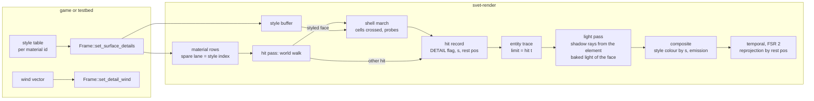

# 0081: A surface detail layer: blades, caps and pebbles marched above styled faces, lit as hits, faded by size on screen, swayed by a wind the game sets

> **Status:** approved (2026-11-16, the owner's go with every recommended answer); amended 2026-11-17 (architect re-read against main 3b3986d0 after Plan 0032's close, Plan 0069, Plan 0080's lane and Plan 0086: the section "Amended 2026-11-17 (re-read)" below is the phases' errata); **re-read 2026-11-26 (architect, against main 69d5ce97: the section "Re-read 2026-11-26 (architect)" is the errata of both, splits the phases into one brief each and carries four owner questions)**
> **Created:** 2026-11-16
> **Milestone:** M10: Outdoors in [`docs/roadmap.md`](../roadmap.md); the cave presets serve M6's consumer
> **Related ADRs:** [ADR-0063](../adrs/0063-surface-detail-is-a-procedural-shell-marched-at-the-hit-described-per-material-on-the-render-side.md)
> (proposed with this plan: the shell marched at the hit, the render-side style table, the
> alternatives rejected),
> [ADR-0041](../adrs/0041-the-surface-is-the-trilinear-zero-set-of-the-27-count-field.md)
> (honest cubes, the faces the layer stands on),
> [ADR-0042](../adrs/0042-the-far-shading-normal-blends-to-the-27-count-gradient-by-the-voxels-size-on-screen.md)
> (the fade by projected size this plan copies),
> [ADR-0044](../adrs/0044-direct-light-from-a-fixed-list-of-analytic-lights-one-shadow-ray-each.md)
> and [ADR-0027](../adrs/0027-the-sun-shadow-is-one-per-pixel-ray-in-the-light-pass.md) (the
> shadow rays a detail hit casts),
> [ADR-0046](../adrs/0046-static-emissive-light-is-baked-per-chunk-when-a-chunk-loads-or-changes.md)
> (the baked light a detail hit reads from its face),
> [ADR-0050](../adrs/0050-entities-are-posed-voxel-volumes-in-their-own-pool-traced-after-the-world-march.md)
> (entities take the detail hit as their limit),
> [ADR-0034](../adrs/0034-fsr-2-ported-to-wgsl-as-the-default-upscaler-candidate.md) (the
> upscaler the layer must hold still under),
> [ADR-0055](../adrs/0055-render-settings-are-one-struct-with-an-apply-class-per-field-and-profiles-are-named-values.md)
> (the settings and profiles the layer's knobs live in)
> **Source:** the owner's request of 2026-11-16 ("outdoors needs trees, grass and water";
> "draft grass plan - maybe this new layer can be used for something else as well"), of
> 2026-11-03 (a stable image without flicker or aliasing comes first) and of 2026-11-12
> (cheap unpicked arms stay as settings). The first consumer's needs are in
> `.claude/skills/architect/references/project-context.md`.
> **Starts after:** [Plan 0032](done/0032-sun-and-sky-hillaire-atmosphere-time-of-day-and-an-outdoor-testbed.md)
> closes and merges (the outdoor source with its `grass` row, the sun and the sky ray),
> which itself follows Plan 0069 (the settings surface this plan's knobs join). **Before Plan
> 0033** (the far field draws the face albedo this layer fades to; settling the near look first
> keeps 0033's seam reading honest). It does **not** wait for Plan 0036: the sway ships
> against a wind vector of its own, and Plan 0036 hands its `WeatherState.wind` to it when it
> lands (an amendment to 0036 owed at this plan's close). The names below were checked against
> main at b15c7731; `dev` re-reads paths at the base commit, and the tree's names win.
> **Exploration (lane rules 2b):** Phases 1 to 4 are exploration; the owner's window in Phase 5
> is their gate. Each lands its CPU tests of data, determinism and API; every image judgement
> is a reading in `docs/plans/logs/0081.md` until Phase 6 writes the tests against the picks.

## Amended 2026-11-17 (re-read)

Read at main 3b3986d0 (Plan 0032 closed, v0.61.0; Plan 0069 closed, v0.60.0) against the
`plan-0080` lane (the menu) and Plan 0086 (approved, its lane open). The lane branches from
main once Plan 0086 and Plan 0080 have merged; the tree's names win. The Decision, the
Interface and the phases stand except where this section says otherwise; `dev` reads it as
the phases' errata. Crate names here are `svet-*`; if Plan 0087 has merged first they read
`svet-*` through that plan's map.

### Name mapping (the plan's name, then the tree's)

| The plan says | The tree has |
|---|---|
| "`frame/marcher.rs` or the frame module that owns group 0" | `crates/svet-render/src/frame/pipelines.rs` (`world_layout`, `world_bind`; bindings 0 to 18 used, 5 and 6 unused, 19 the next); `frame/marcher.rs` is the hit pass's pipelines only |
| the style lane in the material row (`gpu_world/format.rs`) | **none.** The rows are `GpuWorld`'s (`gpu_world/stage.rs` `material_rows`, lanes 8, 9 and 11 to 15 spare) and `Frame` cannot mark them dirty. The per-material word is `Frame`-owned, as `emission_scale` is (binding 11, `Frame::set_emission_scales`): see "Interface changes" |
| `shaders/light.wgsl` (the light pass) | the light pass's entry is `shade.wgsl`; `light.wgsl` is the list lights' walk and `sky_light.wgsl` the key light and the sky ray. The shadow-ray origins are `light.wgsl` (`shadowed`), `emissive.wgsl` and `sky_light.wgsl` (`shadow_origin`, `hitrec.wgsl`) |
| "the baked emissive light is read for the face under the element" (in the light pass) | the store is read in the **temporal** pass: `store_voxel(rec.p, nf)` = `floor(p - 0.5 nf)` (`hitrec.wgsl`, called from `temporal.wgsl`). A detail hit up to 4 voxels above its face reads air there: Phase 1 makes the read find the face voxel for a `HIT_DETAIL` record (a step along `-n_face` to the first solid voxel, at most `DETAIL_HEIGHT_MAX + 1`, or the face cell's offset in the record's free bits; `dev` picks, the log says which) |
| "`info.w` has bits 6 to 15 free" | bits 6 to 15 are the entity instance when `HIT_ENTITY` (bit 5) is set, and `unpack_hit` decodes `instance = flags >> 6` on every record. A detail hit is never an entity hit, so `HIT_DETAIL` at bit 6 and `s` in bits 8 to 15 stand, and every reader of `rec.instance` is gated by `rec.entity` (`dev` greps; the log says which) |
| one writer of the hit record | three: `hit.wgsl` (the main walk and the split pixel's resume) and `field_walk.wgsl` (the field look). The layer is off under `--look field` (the field has no face); the two `hit.wgsl` writers take it |
| `Frame::set_dt` | exists (`frame/mod.rs`, in `NOT_SETTINGS`); the wind's phase advances there. `Params` is packed in `frame/encode.rs` (1193 of 1200 lines): the wind and phase take `Params`' free pads (`_pad3`, `_pad4`, `_pad8`, `_pad9`, `_pad10`) or the style uniform's tail, packed in a small new module, not in `encode.rs` |
| the style buffer, "storage" | a **uniform** buffer (4096 B fits): group 0 asserts `STORAGE_BUFFERS_NEEDED` = 13 (`lib.rs`, `gpu_world/format.rs`), so a storage buffer would raise the constants and the tests |
| `apps/flythrough/src/main.rs` (flags) | `cli/outdoor.rs` (`--detail`, `--detail-wind`, `--detail-cells`, `--detail-probes` beside `--trees`; `cli/flags.rs` is at 1190 lines), `cli/tests.rs` (the parse test), `docs/flythrough.md` (every key and flag; the root README only links it) |
| `apps/flythrough/src/lib.rs` (the presets beside `cave_materials()`) | `scene.rs` (`cave_materials`, `outdoor_materials`; `GRASS` 5, `SOIL` 6, `BARK` 7, `LEAF` 8 in `outdoor.rs`, so `grass2` is id 9; `rock` is `cave::ROCK` 1) |
| "the menu's table (Plan 0080's file)", `hud.rs` | `toggles.rs` (on `plan-0080`: a `Toggle { press: Press::Menu, name, group, row, get, flip, needs, number }`, group `Look`); the banner is `hud/modes.rs` (**1197 of 1200 lines**: the detail words go in a new `hud/modes_detail.rs` or a split `dev` makes first); the steps row is `hud/stats.rs` `StepsSample` fed by `run/hud_feed.rs` `steps_line`, the exit line `run/frame.rs` |
| "the camera has a vertical half-angle of 0.5 rad" | **35 degrees** (`vfov` 70 in `setup.rs` and `scene.rs`; the fly.rs unit tests alone use 1.0). At 1280 x 720 internal a voxel at `D` voxels spans `720 / (2 D tan 35) = 514 / D` pixels: six pixels a voxel is `D` = 86 (8.6 m), twelve is 43, two is 257, four is 129; a 0.15-voxel blade is one pixel wide at `D` = 77. Phase 3 bar 1 moves with it (below) |
| `tests/strip.rs` | `apps/flythrough/examples/strip.rs` (1554 lines), whose `--source` takes `showcase\|level` only: Phase 3 bar 4 adds an `outdoor` arm to it (a small addition, in Phase 3's files) |
| `apps/flythrough/tests/gpu_golden.rs` (the goldens) | at 1885 of 2000 lines: `outdoor_noon_detail` goes in `gpu_outdoor_golden.rs` (the outdoor goldens' file, `Hills` rig) and `cave_detail` in a new `gpu_detail_golden.rs` or beside it |
| "a cyan emission near the ore's" (the cave preset) | the cave's ore is orange (`ORE_EMISSION`, `--emissive-ore on`); cyan is the showcase's crystal. The cap's emission is `dev`'s pick near one of them; the log says which |
| `SurfaceDetailSettings` in `frame/settings.rs` | the struct may live in `detail.rs`; its `FIELDS` rows, `with_test_value` arms and `PROFILE_PICKS` are `crates/svet-render/src/settings.rs` (1146 lines), and the fly-through fills it in `cli/settings.rs` `render_settings()` |

### Interface changes

- **Starts after:** Plan 0086 closes and merges (the architect's recommendation at Plan
  0032's close, the owner's order owed), which follows Plan 0032; and Plan 0080 has merged
  (the menu entry). Still before Plan 0033.
- **One per-material style word, shared with Plan 0086.** Plan 0086 Phase 2 adds a
  `Frame`-owned `u32` per material id with a `SHADOW_AS_BRICK` bit, set through
  `Frame::set_material_styles(&[u32])`, and names this plan as the one that absorbs it. This
  plan's detail style index lives in that word (bits 0 to 7 the style index plus one, 0 none;
  bit 8 `SHADOW_AS_BRICK`, as 0086 lays it out), uploaded as `emission_scale` is, read in the
  hit pass where the walk has the material id. `Frame::set_surface_details` fills the style
  uniform and the index bits; the material rows and `GpuWorld` are untouched. If 0086 has
  not landed when this lane starts, this plan adds the word and 0086 takes it (the merge item
  both logs name). `set_surface_details` and `set_detail_wind` are per-frame inputs listed in
  `NOT_SETTINGS` (ADR-0055's rule: a `Frame::set_*` is a setting or a listed input, or
  `every_setter_is_a_setting_or_an_input` fails).
- **The sky term at a detail hit** is Plan 0086's: the store's visibility times `E_sky` for
  the face under the element (the same store read as the emissive part, through the fix
  above), with the element's shading normal; the sky ray only where the bake is stale. Plan
  0086's `SHADOW_AS_BRICK` applies to an element's shadow rays unchanged. 0086 Phase 3's
  lifted ray origin acts in the far-normal regime (`[2, 6]` pixels a voxel), where the layer
  at `[6, 12]` has faded out; at the `[2, 4]` candidate the two overlap, and Phase 5 sees it.
- **The menu, not a key** (ADR-0061, Plan 0080): the `detail` toggle is a `Press::Menu` entry
  of `toggles::TOGGLES` (group `Look`), no key; its `get` is the banner's word; `--keys` lists
  it; 0080's `every_toggle_and_action_is_an_entry` and `the_source_reads_no_key_the_tables_miss`
  pass. Bar 4 of Phase 1 reads: the entry's `flip` moves `Modes::line()` through `detail off`
  and `detail grass`.
- **The settings** (Plan 0069): `SurfaceDetailSettings` joins `RenderSettings` in Phase 1,
  not Phase 4, with its `FIELDS` rows (`on`, `fade_px`, `min_px`, `max_cells`, `probes`,
  `density_scale`: `Settle`, since each moves hits under the history; `dev` proves the class
  in `gpu_settings.rs`), `with_test_value` arms, a `PROFILE_PICKS` row (Portable `on: false`)
  and the fly-through's `render_settings()`; Phase 4 adds the fields it introduces. The HUD's
  profile row (`cli/settings.rs` `profile_row`) names a changed field as it does every other.
- **The tester (Plan 0088)** ships the outdoor scene at the fly-through's defaults. If Phase
  5 picks `grass` on by default, the tester's outdoor path shows it and its report's rows
  move: a disclosed change in this plan's log, and Plan 0088's path (computed from the
  heightfield) is unaffected.

### Phases: what changes

- **Phase 1** files: `frame/pipelines.rs` (the style uniform's binding), a small module for
  the `Params` words, `shade.wgsl` and `temporal.wgsl` (the store read for a detail record)
  in place of `light.wgsl`; `cli/outdoor.rs`, `cli/tests.rs`, `scene.rs`, `toggles.rs`,
  `hud/modes_detail.rs` (or the split), `docs/flythrough.md`; `settings.rs` and
  `cli/settings.rs` for the settings struct. Bar 1's "uploads `k + 1` in its first spare
  lane" reads "writes `k + 1` into the style word's index bits and leaves 0086's flag bit as
  it was". Bar 3's camera is 20 voxels up at 45 degrees as written.
- **Phase 2** unchanged but for the files: `cli/outdoor.rs`, `hud/stats.rs`, `run/hud_feed.rs`,
  `run/frame.rs` (the exit line).
- **Phase 3** bar 1 at `vfov` 70: no `HIT_DETAIL` pixel lies farther than **86** voxels from
  the camera within 5 % at `fade_px` `[6, 12]`, and the mean composite colour of the floor
  band **92 to 102** voxels out is within 10 % of the band **70 to 80** voxels out at
  `far_shade` 1.0. The candidates' distances in the Decision read 4.3 to 8.6 m for `[6, 12]`
  and 12.9 to 25.7 m for `[2, 4]`. Bar 4 adds the `outdoor` arm to `examples/strip.rs`. The
  wind's words are packed outside `encode.rs`.
- **Phase 4**: the settings struct already exists (Phase 1); this phase adds `density_scale`
  if Phase 1 left it out, and the Portable pick. The cave cap's emission colour is `dev`'s
  pick (above). Files: `scene.rs` for the presets, `cli/outdoor.rs` for `meadow` and `cave`.
- **Phase 5** also reaches the grass through the menu (`Tab`, the `Look` group, the `detail`
  row) and on the pad, and the owner's slow adapter run is one pose, as written.
- **Phase 6** goldens: `outdoor_noon_detail_golden` in `gpu_outdoor_golden.rs` (soak, as
  written), `cave_detail_golden` in a new golden file or beside it, never in `gpu_golden.rs`.
  Bar 6's ledger row is the "surface detail layer" row the architect added to table 2 of
  `docs/nfr/02-frame-budget.md` on 2026-11-17 (budgeted, this plan's Budgets figures); the
  close replaces it with the reading.

### Tiers and budgets, checked

The tiers paragraph is current (10 s soak line, `--binaries` per phase, the gate at the tip).
The Budgets table's base is main after Plan 0086 merges, not Plan 0032: the hit pass outdoors
reads inside a 5.1 to 5.6 ms RTX frame and a 37.5 to 45.8 ms RENOIR frame at 1080p (Plan 0032
Phase 7, `docs/nfr/02-frame-budget.md`), and Phase 1 bar 5 reads the base again. No owner
question is added by this re-read.

## Re-read 2026-11-26 (architect)

Read at main 69d5ce97 (v0.77.0) after Plans 0086, 0087, 0095 to 0100, 0102 and 0104 closed,
against the open lanes (0101, 0105, 0093, 0106) and Plans 0107 and 0108, which land before
this lane starts (owner, 2026-11-26). This section is the errata of the phases **and of the
2026-11-17 section**: where the two disagree, this one wins. No phase text was edited: every
stale name is mapped here. Crate names are `svet-*` (Plan 0087, merged). Four owner questions
at the end; three touch image stability.

### Drift (what the plan or the 2026-11-17 section says, then the tree)

| It says | The tree has |
|---|---|
| group 0's next free binding is 19 | 19 is the column map (`gpu_world/columns.rs`, an `r32sint` texture); **20** is the next, 5 and 6 are still unused (`frame/pipelines.rs` `world_layout`) |
| the style word: "bits 0 to 7 the style index plus one, bit 8 `SHADOW_AS_BRICK`" | Plan 0086 landed the word otherwise (`frame/settings.rs`): `SHADOW_AS_BRICK` is bit 0, `SHADOW_ABSORB` bit 1, the absorb sigma from bit 8 (`SHADOW_SIGMA_SHIFT`) on, and the word is uploaded **as an `f32`** (`Frame::set_material_styles`, the tail of `emission_scale`), so it is exact to 24 bits only. The detail index takes **bits 2 to 7** (index plus one, 0 none), so **`MAX_STYLES` is 63, not 64** (the style uniform is 63 rows, 4032 B), and bar 1's "the 65th is refused" reads "the 64th". `set_surface_details` writes those bits and leaves the rest of the word; `set_material_styles` leaves the index bits |
| "the bake is untouched" | true of its output, but the bake reads the style words (`SHADOW_ABSORB` is the bake's too) and since Plan 0099 it runs on the bake thread over its own copy of the mirror (`Shadow`, ADR-0083). A change of the index bits must queue no bake job and cross no thread: bar 1 of brief 1a asserts it in lockstep (below) |
| the baked light is read in the temporal pass, one site (`store_voxel(rec.p, nf)`) | four readers key by the face under the hit: `temporal.wgsl` (the store's sky and key visibility, the emissive read), `shade.wgsl`, `sky_light.wgsl` `key_cover_near` (the face's centre) and `key_horizon.wgsl` `key_horizon_at(p, nf)` (the column horizon, lifted along the face normal), plus the seeds of `pair.wgsl`. A `HIT_DETAIL` record's `p` is up to 4 voxels above its face and its normal is no axis, so brief 1b adds **one helper in `hitrec.wgsl`** that returns a record's face voxel and face normal (the face's for a detail hit, today's for every other) and every reader above calls it. `temporal.wgsl` is at 1171 of 1200 lines: the helper and anything else new go in `hitrec.wgsl` or `detail.wgsl` |
| "lit by the light pass like any hit, with the sun's shadow rays from the element" | the calm defaults (ADR-0082, Plan 0098) take no screen history in the light passes: a far face's key light is the column map's horizon, a near face's sky term is the store's record, and what a ray would need a history for is answered from a smooth source. See "The light at a detail hit" and question 1 |
| the far normal's band is `[2, 6]`, the layer at `[6, 12]` has faded where it acts | `DEFAULT_FAR_NORMAL` is `[4, 8]` pixels a voxel and the key light steps to its far source at the band's half, 6 px (`KeyFarMix::Step`). `[6, 12]` ends exactly there; `[2, 4]` runs the layer through the whole far band. See question 2 |
| `lighting.key_at`, `lighting.key_horizon`, `key_cover record`, the upscaler `own` | removed (Plans 0104 and 0102). FSR 2 is the only upscaler; "FSR 2 off" in a golden reads "the native scale" as `gpu_outdoor_golden.rs` renders it today |
| `hud/modes.rs` at 1197 lines, `frame/encode.rs` at 1193 | 1048 and 1122: both have room, the new-module advice stands. Now at their caps instead: `toggles.rs` (1171; the entry goes in `toggles/`), `cli/tests.rs` (1181; the parse test goes in `cli/tests/outdoor.rs`), `cli/flags.rs` (1179), `frame/settings.rs` (1162; `SurfaceDetailSettings` lives in `detail.rs`) |
| "byte-identical to the base commit's binary" (Phase 1 bar 2) | no test can run another commit's binary: the bar reads "with the table empty and `on` true, the hit buffer, the direct target and the composite equal those with `on` false, byte for byte, and the existing goldens hold" |
| the readings' command (`--frames 300`, the last 30, at `--render 1920x1080` on both adapters) | every start now runs the light pre-roll, and the view bakes for seconds after the first world frame (17.9 to 19.0 s on the RTX forest, `docs/nfr.md` section 2); a headless run steps the bake thread in lockstep. A reading names its regime and is taken **after the in-view landing** (the `bake queue:` line says when); the RTX reads at Floor 1920 x 1080 and the RENOIR at **Portable 1280 x 720** with the layer forced on, as `nfr.md` reads that adapter since Plan 0069. Plan 0108 may add `--pre-roll`; the runs keep its default |
| Plan 0090 "before 0081" (the index) | Plan 0090 is approved and not started, and the owner's order of 2026-11-26 does not name it. See question 4 |

### The light at a detail hit (replaces Phase 1's "Lit as a hit" where they differ)

A detail hit takes **its face's light**: the sky visibility, the key light's visibility
(record, column horizon or the near source, whichever the face would take at that size on
screen) and the emissive record are read for the face under the element through the helper
above, and the element's shading normal enters only the cosine and the root term. No ray
starts at a swayed position. The list lights' shadow rays (ADR-0044: one ray a light, no
random number) start at the element's **rest** position. The arm "a key ray from the
element's rest position" is a setting read in brief 3b beside the default, not the default.
ADR-0063 is revised to say so (2026-11-26; it is still proposed).

### Briefs (one phase per dev brief; a reading is its own brief)

The phases' text and bars stand; they run as these briefs, each one commit and one row of
the Implementation log.

| brief | from | takes | tier |
|---|---|---|---|
| 1a | Phase 1: the table, the style bits, the settings rows, the flags, the menu entry and banner | bars 1 and 4, plus `a_detail_table_queues_no_bake_job` (lockstep, `Frame::set_bake_queue`, stepped by count, under 5 s): setting and clearing a table leaves the queue's job count and the `Shadow`'s bytes as they were | quick; no shader |
| 1b | Phase 1: the shell at the hit cell, the face helper, lit and coloured | bars 2 and 3 | `gpu_detail`, `gpu_shader_portability` |
| 1c | Phase 1 bar 5: the first reading | the base and `grass`, both adapters, after the landing | runs under the lock |
| 2a | Phase 2: the run, the probes, the steps view | bars 1 and 2 | `gpu_detail` |
| 2b | Phase 2 bar 3: the cost of each arm | readings | runs |
| 3a | Phase 3: the fade, the minimum width, the rest position, the sway, the normal blend | bars 1 and 2 | `gpu_detail` |
| 3b | Phase 3 bars 3 and 4: the stillness reading with its stop rule, the slow pan, the key-ray arm | readings; the stop rule stops before 4a | `gpu_detail` (`mod reading`), `examples/strip.rs` |
| 4a | Phase 4: caps, pebbles, every face, emission, the presets, the settings it adds | bars 1 to 4 | `gpu_detail`, quick |
| 4b | Phase 4 bar 5: the readings for the window | readings | runs |
| 5 | the owner's window | as written | human |
| 6 | the picks as tests | as written | `gpu_detail`, the golden files |

Rules the briefs inherit since 2026-11-17: no test passes by a clock (Plan 0106: "0.5 s of
`dt` apart" is `set_dt`, a count, and stands); a gate test is under 10 s on lavapipe or born
soak; no run past about 20 minutes under the lock (brief 3b's five arms of 128 frames are
projected from the first arm before the rest run); in the window the camera is never held
and no `--pre-roll-drain` is passed; every toggle shows its mode on screen (bar 4); the runs
of 1c, 2b and 4b are taken headless before any window.

### Budgets and bars, checked against `docs/nfr.md` today

The lines stand: primary rays 3.0 ms and lighting **4.0 ms** at Floor (rebalanced at Plan
0069), Portable one 33.3 ms line. The base moved: the RTX forest's frame is 8.3 ms wall with
the bake thread on while the view bakes, the RENOIR's 24 ms at Portable; the 5.1 to 5.6 ms and
37.5 to 45.8 ms the 2026-11-17 section cites are Plan 0032's and are not the base. The
projections (0.3 to 0.8 ms RTX, 2 to 5 ms on the slow adapter) are still guesses. **Brief 1c
retakes:** the hit and light passes' GPU time by `FRAME_PASSES` with the layer off and on, at
the `outside` spawn and the forest, RTX at Floor and RENOIR at Portable, after the landing;
`Frame::frame_bytes` at the base. With the face's light as the default the light pass should
not move at all, and 1c says whether it does. The stillness reference of brief 3b is read
again on the bare floor under the calm defaults (light history off): Plan 0032's figure is
not carried.

### ADR-0063

Revised 2026-11-26 in place (proposed, so not append-only yet): the light at a detail hit is
the face's, the style index sits in Plan 0086's style word (63 styles), and the fade
candidates follow the far band. Its Decision otherwise stands.

### Order

Plan 0081 before Plan 0033's **render** phases still stands, for the files, not the look:
both write `hit.wgsl`, `hitrec.wgsl` (the kind-dependent bits), group 0's next binding,
`toggles/` and `cli/outdoor.rs`. The look no longer couples them: the layer ends 6.4 to
12.8 m out, the first far level starts at 83 m. Plan 0033's world-side briefs touch none of
this plan's files and need no GPU lock; they may run beside it (Plan 0033's re-read).

### Owner questions (each with a recommendation)

1. **The light at a detail hit** (image stability). Recommended: **the face's light, no ray
   from the element**, as above: a blade is lit as the ground it stands on, by sources that
   do not change frame to frame, and the root term and the cosine give it shape. Given up:
   a tall cap in a crevice is lit as its floor. Alternative: a key ray from the element's
   rest position each frame, which needs the history the calm defaults removed, or shows its
   noise.
2. **The fade candidates** (image stability). Recommended: **`[6, 12]` and `[4, 8]`** in
   place of `[2, 4]`: `[4, 8]` is the far normal's own band, so the layer leaves as the face
   turns far (6.4 to 12.8 m at 1080p Floor), and no element is drawn where the shading normal
   is the 27-count gradient. `[2, 4]` (12.8 to 25.7 m) puts sub-pixel blades in the band the
   owner's wobble clips are about; it stays reachable as a setting value, unread.
3. **The probes** (image stability, cost). Recommended: keep brief 2a's silhouette probes as
   written, default 0, and let the window pick; no change. Named because a probe hit is a
   new edge against the sky under FSR 2, which is where the parked "crowns sparkle" entry
   lives; brief 3b's stillness reading gains the horizon pose with probes 4.
4. **Plan 0090 before this plan?** Recommended: **no wait**. The pop counter is approved and
   unstarted; the batch runs in the owner's order of 2026-11-26, and 0090 takes its baseline
   whenever it runs. The index row is corrected.

## TL;DR

Faces of a styled material grow a procedural layer: blades on grass, strands and glowing caps
on cave rock, pebbles on a floor, each a few centimetres wide and up to a few voxels tall,
things no 10 cm voxel can be. The hit pass marches the layer where a primary ray meets such a
face (ADR-0063): the elements are placed by a hash of the world cell, tested analytically,
written as the pixel's hit record and lit by the light pass like any hit, with the sun's and
the list lights' shadow rays and the face's baked light. The layer fades to the face's own
albedo by the voxel's size on screen, so it is never thinner than a pixel, and a wind vector
the game sets bends the tips while the reprojection sees the rest position. The description
is a render-side table of styles bound to material ids; `svet-world`, the op log, the queries
and the bake are untouched, and nothing in `crates/` names grass. The first thing a reader
sees: Phase 1's blades on the outdoor source's grass at noon, in the window and in a reading's
screenshot. Then Phase 4's cave preset, strands and a few glowing caps on the cave's rock
floor, for the consumer the engine is built for.

## Context & problem

Plan 0032 gives the fly-through hills of `grass` over `soil` under a sun; the owner looked at
the outdoor batch and asked for trees, grass and water (2026-11-16). Trees are voxels and
need no mechanism (Plan 0032 Phase 8, amended 2026-11-16 to stamp tree prefabs). Water is Plan
0034. Grass has no plan, and no voxel answer: at 10 cm a blade cannot be a voxel, and a field
of `grass` cubes is the lumpy carpet the owner does not want. The owner asked for the
mechanism to be general. The first consumer is underground (`project-context.md`): moss and
lichen on walls, strands hanging from a ceiling, fungus and a glowing cap in a crevice, rubble
on a floor are its vocabulary, and each is the same thing as grass: many small elements
standing on a face, cosmetic, never collided with.

What the tree offers today: a hit record per pixel (`hitrec.wgsl`: position, `t`, an
octahedral normal, the material id, flags with ten free bits of sixteen), a material row on
the GPU with seven spare lanes (`gpu_world/format.rs`), a light pass that shades a record with
shadow rays and reads the baked store by the face (ADR-0046, ADR-0044), the a-trous and
temporal passes, FSR 2 at 1.5, a far normal faded by projected size (ADR-0042), and, once
Plan 0062 lands, an entity trace bounded by the world hit (ADR-0050). The frame has no raster
pass. Plan 0055 removed ADR-0011's per-material detail (a tilt and albedo noise) from the
world row and the shaders because it read as a blur; the GPU row kept the lanes.

`nfr.md` figures touched: section 2's primary-ray line (the hit pass grows the shell march),
section 2's lighting line (shadow rays from elements start higher and may cost differently),
section 3's everything-else VRAM (a style table of a few kilobytes; no new target), and the
stillness readings behind the owner's 2026-11-03 priority.

## Decision

We build ADR-0063: a style table on the render side, a shell marched at the hit in
`hit.wgsl`, a detail hit record the light pass and the composite understand, a fade by the
voxel's size on screen, and a sway from a wind vector and the frame's `dt`. In the
fly-through, presets style the outdoor `grass` row and the cave's `rock` floor, behind a flag
and a menu entry that shows its mode. The spike reads the cost of the hit-only shell and of
the silhouette probes on both adapters, and the stillness rig with the layer on and off,
before the owner's window picks the fade, the density, the sway and what stays.

We rejected rasterised instanced blades (a second pipeline kind, a second light path, a face
list the sync would maintain), layered shells as the design (they fall apart at grazing
angles; kept as the spike's cheap arm), finer voxels (64 times the data, still a staircase),
and grass as voxel content (the owner's eye). ADR-0063 holds the reasoning.

## Architecture diagram



## Interface

What the fly-through, Plan 0036 and a consumer may rely on. A name here is a contract; `dev`
may add to it and does not rename it without an architect amendment.

- **Rust, `svet_render::detail`.** `SurfaceDetail` (Data shapes), `Frame::set_surface_details(&[(MaterialId, SurfaceDetail)])`
  (at most `MAX_STYLES` = 64 entries; a second entry for the same material id is an error),
  `Frame::set_detail_wind([f32; 2])` in voxels per second along world x and y, and the
  `RenderSettings` field `surface_detail: SurfaceDetailSettings` (Data shapes). Setting an
  empty table restores every image byte for byte.
- **WGSL.** `HIT_DETAIL`, a flag bit of the hit record, with the root-to-tip parameter `s` in
  the record's free bits; `detail_colour(rec) -> vec3<f32>` and `detail_emission(rec)` in the
  composite's source; `detail_normal(rec)` in the light pass's source. The style buffer and
  the wind sit in frame group 0 at the next free bindings.
- **Plan 0036** passes `WeatherState.wind` (metres per second) to `set_detail_wind` scaled by
  `1 / metres_per_voxel`; the sway's response is the style's, not the weather's.
- **The testbed.** `--detail off|grass|meadow|cave`, a menu entry on Plan 0080's menu that
  cycles it and names the mode in the banner (`detail meadow`), and `--detail-wind X,Y`.

## Implementation phases

Each phase ships as its own commit. `dev` implements all phases in one session with no review
between phases. The architect reviews once at the end, in a fresh session.

**Tests and tiers.** A phase gates on `node scripts/test-changed.mjs --profile quick` and, for
a render phase, `--profile gpu --binaries <names>` under the perf lock with the `gpu_*`
binaries it names; the tip gates on `cargo nextest run --profile gate`. Every time below is an
estimate on lavapipe: nothing was run. A named test over 10 s there is born
`#[ignore = "soak"]` (`docs/nfr.md` section 7). A reading taken by running the fly-through is
not a test and is named as a run. The base commit of every reading is main after Plan 0032
merges.

**Arithmetic the phases lean on.** The fly-through's camera has a vertical half-angle of
0.5 rad (Plan 0032 Phase 8 bar 5; `dev` re-reads it in `camera.rs`); at 1080p output through
FSR 2 at 1.5 the internal grid is 1280 x 720, so a voxel at distance `D` voxels spans
`720 / (2 D tan 0.5) = 659 / D` pixels. Six pixels a voxel is `D` = 110 (11 m), twelve is 55
(5.5 m), two is 330 (33 m), four is 165 (16.5 m). A blade 0.15 voxel wide at the root is one
pixel wide at 6.7 pixels a voxel. A shell of height `h` met by a ray at elevation `e` to the
face spans `h / tan e` voxels of face: at `h` = 3 and `e` = 10 degrees, 17 cells; at 30
degrees, 5.2; at 60, 1.7.

### Phase 1: The walking skeleton: blades on the grass, the style table, the detail hit
- **Owner skill:** dev
- **What:**
  - **The table.** `detail.rs` with `SurfaceDetail`, `Primitive::{Stalk, Cap, Pebble}`,
    `FaceMask`, `SurfaceDetailSettings` and `Frame::set_surface_details`. The table is
    packed into a storage buffer of `MAX_STYLES` fixed-size rows (`Data shapes`), and each
    bound material's GPU row gets `style + 1` in its first spare lane at upload (`format.rs`),
    0 meaning none. `set_surface_details` marks the material rows dirty so the next sync
    re-uploads them.
  - **The shell, hit cell only.** In `hit.wgsl`, after the walk finds a face whose row's style
    lane is non-zero and the style's face mask holds the face's axis and sign, the ray is
    tested against the elements of that one face cell, placed by `detail_hash(cell, axis,
    seed)` (an integer hash of the world cell, the face axis and sign, and the style's seed;
    the same function every later phase uses): per element a root position jittered in the
    cell, a height drawn in the style's range, a lean direction and a bend. This phase
    implements `Stalk` only: a tapered segment of root width `w` to zero at the tip, bent as
    a quadratic curve by the style's bend, tested as a ray against a thin cone in two
    segments (illustrative; `dev` picks the test). The nearest element hit replaces the face
    hit: the record takes the element's position and `t`, `HIT_DETAIL`, `s` in 8 bits, and
    the face's material id. The shading normal is the element's cross-section normal blended
    half way to the face normal (a style field; Phase 3 reads the blend).
  - **Lit as a hit.** The light pass treats a `HIT_DETAIL` record as a hit with the shading
    normal above; its shadow rays start at the element's position pushed along the face
    normal by the usual epsilon; the baked emissive light is read for the face under the
    element (the face cell and axis, which the record's position and the face's material
    give). The direct term is multiplied by a root term `mix(ROOT_SHADE, 1, s)`, `ROOT_SHADE`
    0.4 as a start.
  - **Coloured by the style.** The composite replaces the row's albedo with `mix(root_colour,
    tip_colour, s)` and the row's emission with the style's emission where `HIT_DETAIL` is set.
  - **The testbed.** `--detail off|grass` (default `off`, so Plan 0032's goldens hold), the
    `grass` preset binding a `Stalk` style to Plan 0032's `grass` row (4 per cell, height 1.5
    to 3 voxels, root width 0.15, bend 0.3, root colour darker than the row's albedo and tip
    lighter so the mean is near it), a menu entry on Plan 0080's menu that cycles the preset
    and shows `detail grass` in the banner, and `--detail-wind X,Y` parsed now for Phase 3.
- **Files touched:** new `crates/svet-render/src/detail.rs`, `crates/svet-render/src/lib.rs`,
  `crates/svet-render/src/gpu_world/format.rs` (the style lane), `frame/settings.rs`
  (`SurfaceDetailSettings`), `frame/marcher.rs` or the frame module that owns group 0 (the
  style buffer and its binding), `shaders/hit.wgsl`, new `shaders/detail.wgsl` (the hash, the
  element placement and tests, shared by the hit pass, the light pass and the composite),
  `shaders/hitrec.wgsl` (`HIT_DETAIL`, `s`), `shaders/light.wgsl`, `shaders/composite.wgsl`,
  `crates/svet-render/tests/gpu_shader_portability.rs`, `apps/flythrough/src/main.rs` (flags),
  `apps/flythrough/src/lib.rs` (the presets beside `cave_materials()`), the menu's table
  (Plan 0080's file), `hud.rs`, new `apps/flythrough/tests/detail.rs` (CPU bars), new
  `apps/flythrough/tests/gpu_detail.rs` (readings now, tests in Phase 6), the root
  `README.md`, `docs/plans/logs/0081.md`.
- **Done when:**
  1. **The table packs and refuses** (unit tests in `detail.rs`, no adapter, under 1 s): 64
     styles pack into 64 rows and the 65th is refused; two entries for one material id are
     refused; a material bound to style `k` uploads `k + 1` in its first spare lane and an
     unbound one uploads 0 (the packing function is pure and tested without a device).
  2. **Nothing without a style.** `an_empty_table_changes_no_byte` in `gpu_detail.rs` (two
     frames of the level scene at 320 x 180; about 5 s): with the table empty, the hit buffer,
     the direct target and the composite are byte-identical to the base commit's binary on
     the same scene (the existing goldens stay byte-identical, asserted by their tests).
  3. **Blades exist and stand in the shell.** `a_styled_floor_grows_elements_in_its_shell`
     (about 6 s; a reading in this phase, a test in Phase 6): a level scene of a floor of a
     styled material, the camera 20 voxels up looking down at 45 degrees, lamp on, no sky; the
     share of floor pixels with `HIT_DETAIL` is printed and is at least 10 %; every such hit's
     position lies above the floor's face plane by less than the style's maximum height and
     inside the floor's footprint.
  4. **The banner and the flag** (no adapter, under 1 s): the parse test pins `--detail` (and
     refuses `--detail tall`) and `--detail-wind 6,0`; the menu entry moves the banner through
     `detail off` and `detail grass`.
  5. **The first reading.** A run of the fly-through at `--source outdoor --spawn outside
     --time 12:00 --headless --seed 1 --render 1920x1080 --frames 300`, `--detail off` and
     `grass`, both adapters (`--adapter`), quiet box, median of the last 30 frames, three runs
     each: the hit pass's and the light pass's GPU time, and a screenshot of each at frame
     300. The numbers and the images go in `docs/plans/logs/0081.md`. No bar: Phase 4 states
     them against section 2's lines.

### Phase 2: The run and the silhouette
- **Owner skill:** dev
- **What:**
  - **The run.** The shell test extends from the hit cell back along the ray through the
    face cells its projection crossed inside the slab `[face, face + h]`, nearest the camera
    first, at most `max_cells` (a setting, default 8) cells. A cell whose top is not the hit
    face's plane (a slope step) is tested against its own exposed face if the voxel under the
    slab there is solid and styled, read from the mirror; a cell with no styled face under it
    is skipped. The first element hit ends the run.
  - **The probes (the silhouette arm).** Behind the setting `probes` (default 0, so off): for
    a ray whose hit is not on a styled face, or that misses inside the near field, `probes`
    downward walks of at most `h_max` voxels from points spaced along the ray's last
    `PROBE_SPAN` = 16 voxels before its hit find a styled top face below; each found cell's
    shell is tested as in the run. So an element shows against a wall, an entity or the sky.
  - **A steps view.** The `--view steps` exit line and the HUD's steps row gain the detail
    march's element tests per pixel, mean and p99, and the probes' walks.
- **Files touched:** `shaders/hit.wgsl`, `shaders/detail.wgsl`, `frame/settings.rs`
  (`max_cells`, `probes`), `apps/flythrough/src/main.rs` (`--detail-cells`,
  `--detail-probes`), `hud.rs`, `gpu_detail.rs`, `docs/plans/logs/0081.md`.
- **Done when:**
  1. **The run finds what the hit cell misses** (a reading now, a test in Phase 6):
     `a_grazing_ray_meets_the_elements_of_the_cells_it_crosses` in `gpu_detail.rs` (about
     6 s): Phase 1 bar 3's floor seen from 3 voxels up at 10 degrees; the share of
     `HIT_DETAIL` pixels at `max_cells` 8 is above the share at `max_cells` 1 (printed, both),
     and no detail hit lies farther from the camera than its pixel's face hit would.
  2. **The probes draw a silhouette** (a reading now, a test in Phase 6):
     `elements_show_against_the_sky_with_probes_on` (about 8 s): the floor ends at a cliff
     with sky beyond; in the rows of pixels just above the cliff's edge, `HIT_DETAIL` pixels
     exist with `probes` 4 and none with `probes` 0 (printed counts).
  3. **The cost of each arm** (readings, both adapters, the Phase 1 bar 5 command): `grass`
     at `--detail-cells 1`, `8`, and `8` with `--detail-probes 4`, at the `outside` spawn and
     at a pose on a hill crest looking at the horizon (`--spawn forest --trees none`); the hit
     pass's GPU time and the steps view's element tests per pixel. The log states each against
     the base's hit pass.

### Phase 3: Still and swaying: the fade, the minimum width, the rest position, the wind
- **Owner skill:** dev
- **What:**
  - **The fade.** The style's count and height scale by `smoothstep(fade_px.x, fade_px.y, px)`
    where `px` is the hit voxel's projected size in pixels (ADR-0042's measure, read where the
    far normal reads it). `fade_px` is a setting; two candidates are read: `[6, 12]` (blades
    gone where thinner than a pixel; 5.5 to 11 m at the arithmetic above) and `[2, 4]` with
    the minimum width below (16.5 to 33 m). Where the scale is 0 the face shows its albedo
    times the style's `far_shade` (default 1.0; 0.85 read as the second candidate).
  - **The minimum width.** An element's cross-section is widened to at least `min_px`
    (default 1.0) pixels at its distance, so no element is thinner than a pixel.
  - **The rest position.** The record's position for reprojection (what the temporal pass and
    `fsr2/input.wgsl` read as last frame's hit) is the element's unswayed hit; the shading
    position and normal are the swayed ones. `dev` reads how the hit position reaches the
    reprojection and keeps one position in the record if the two cannot be separated without
    a new target, writing the rest position there and the sway into the normal and `s` alone.
    The log says which.
  - **The sway.** `Frame::set_detail_wind(v)` and a phase `detail_time` the frame advances by
    `dt` (Plan 0040's `set_dt`; nothing moves without it). An element's tip is displaced by
    `response x |v| x (0.6 + 0.4 sin(2 pi f t + hash phase + k . root))` along `v`, with `f`
    0.8 Hz and a gust wavelength of 24 voxels (a travelling wave over the field), clamped to
    `SWAY_MAX` = 0.4 voxel at the tip. The response is the style's `sway`.
  - **The normal blend** is a style field, default 0.5; 0.8 is read beside it.
- **Files touched:** `shaders/detail.wgsl`, `shaders/hit.wgsl`, `shaders/temporal.wgsl` and
  `shaders/fsr2/input.wgsl` (only if the rest position needs a read there), `frame/settings.rs`
  (`fade_px`, `min_px`), `frame/marcher.rs` (the wind and the phase), `detail.rs`,
  `apps/flythrough/src/main.rs`, `apps/flythrough/tests/support/stillness.rs` (a pose for the
  styled floor), `gpu_detail.rs`, `docs/plans/logs/0081.md`.
- **Done when:**
  1. **The fade ends the layer** (a reading now, a test in Phase 6):
     `the_layer_fades_to_the_face_by_distance` (about 6 s): the styled floor from 2 to 60 m,
     `fade_px` `[6, 12]`; no `HIT_DETAIL` pixel lies farther than 110 voxels from the camera
     within 5 %, and the mean composite colour of the floor band 115 to 125 voxels out is
     within 10 % of the band 95 to 105 voxels out at `far_shade` 1.0.
  2. **The tips move and the roots do not** (a reading now, a test in Phase 6):
     `the_sway_moves_the_tips_and_not_the_roots` (about 6 s): wind `(6, 0)`, two frames 0.5 s
     of `dt` apart at Phase 1 bar 3's pose; over detail pixels with `s` above 0.8 the mean
     change of the shading position is above 0.05 voxel, over those with `s` under 0.1 it is
     under 0.01, and the reprojection position of every detail pixel is unchanged. With wind
     `(0, 0)` and `dt` advanced, the hit buffer is byte-identical between the frames.
  3. **Stillness read before the window.** `reading::detail_stillness` in `gpu_detail.rs`
     runs the stillness rig (`apps/flythrough/tests/support/stillness.rs`) at Phase 1 bar 3's
     pose under FSR 2 at 1.5, 64 settle and 64 read frames, for: the layer off; `grass` at
     `[6, 12]` and at `[2, 4]`, wind 0; `grass` at each with wind `(6, 0)`. It prints the mean
     and the 99th percentile of the frame-to-frame change in display levels over the floor
     beside the lamp-lit floor's reference (Plan 0032 Phase 6's rule). **The stop rule:** if
     at wind 0 no fade candidate reads at or under the reference, `dev` stops before Phase 4
     and the architect amends the plan; the named candidates are a wider `min_px` and a
     layered shell (ADR-0063 Alternative B) behind the same table.
  4. **A slow-pan reading.** The fly-through's camera path at the `outside` spawn, panning 10
     degrees a second over the grass with wind `(6, 0)`, FSR 2 at 1.5: a 10-frame strip of the
     grass region (`tests/strip.rs`'s tool) goes in the log for the owner's eye on ghosting of
     the tips. No bar.

### Phase 4: Caps, pebbles, every face, emission, the cave presets and the settings
- **Owner skill:** dev
- **What:**
  - **`Cap`**: a stalk of the style's height with an ellipsoid of radius `cap_radius` (a style
    field, in voxels) at its tip; `s` runs root to the cap's top; the cap's colour is the tip
    colour. **`Pebble`**: a hemisphere of radius drawn from the height range, on the face, no
    sway. Both through the same hash and run.
  - **Every face.** `FaceMask` admits any of the six directions. An element on a side or
    bottom face grows along the face normal and is bent by a `gravity` style field toward
    -z (strands hang, moss stays short).
  - **Emission.** A style's emission is shown on the element's pixels (the composite's
    emission term) and nothing else; the log notes that no wall is lit by it.
  - **Presets.** `meadow`: the `grass` style plus a sparse `Cap` style (0.3 per cell, height
    1 to 2, cap radius 0.3, a warm tip colour) bound to a second row the outdoor source gives
    some grass cells (`dev` picks the simplest: a `grass2` row drawn by a hash in
    `outdoor.rs`, appended after `leaf` so earlier ids keep their meaning, behind `--detail
    meadow` only so Plan 0032's hashes hold). `cave`: on the cave source's `rock` row, short
    dark strands (`Stalk`, 3 per cell, height 0.3 to 0.8, up faces only) and a very sparse
    emissive `Cap` (0.02 per cell, height 0.6 to 1.2, a cyan emission near the ore's) on up
    faces, and strands on bottom faces with gravity 1.0 (hanging). The cave preset applies on
    every source; `--detail cave` with `--source cave` is the pose Phase 5 judges.
  - **The settings.** `SurfaceDetailSettings { on, density_scale, fade_px, min_px, max_cells,
    probes }` joins `RenderSettings` (Plan 0069) with its apply classes; the Portable profile
    sets `on` false; a profile may scale density. The HUD's settings row names `detail`.
- **Files touched:** `shaders/detail.wgsl`, `detail.rs`, `frame/settings.rs`, the profiles'
  file (Plan 0069's), `apps/flythrough/src/lib.rs` (the presets), `outdoor.rs` (the second
  row), `main.rs`, `hud.rs`, `apps/flythrough/tests/detail.rs`, `gpu_detail.rs`,
  `docs/plans/logs/0081.md`.
- **Done when:**
  1. **Primitives stand where they should** (a reading now, a test in Phase 6):
     `caps_and_pebbles_stand_on_their_faces` (about 6 s): a styled floor with a `Pebble` style
     and a `Cap` style on separate rows; every detail hit's position is within the style's
     height of its face; the cap style's pixels with `s` above 0.9 outnumber those with `s` in
     `[0.5, 0.9]` (the cap is wider than the stalk); the pebble pixels' mean shading position
     changes by under 0.001 voxel between two frames 0.5 s apart under wind `(6, 0)`.
  2. **A hanging strand hangs** (about 6 s): a ceiling of a styled material with a bottom-face
     `Stalk` style at gravity 1.0; the detail hits' positions lie below the ceiling's face
     plane and the tips (`s` above 0.8) have a lower mean `z` than the roots (`s` under 0.2).
  3. **Emission shows on the element alone** (about 6 s): the cave preset's cap on a floor,
     every material's emission 0, lamp off, no sky: the composite's luminance over the cap's
     pixels is above 0, and the direct target over the floor pixels not under a cap reads 0
     (the cap lit nothing).
  4. **Settings and profiles** (CPU, under 1 s): `SurfaceDetailSettings` has an apply class
     per field in Plan 0069's table, the Portable profile reads `on: false`, and the parse test
     pins `--detail meadow` and `cave`.
  5. **The readings for the window** (both adapters, the Phase 1 bar 5 command, with
     `--detail grass`, `meadow` and `cave` (the last at `--source cave`), at the picked-so-far
     settings and at `--detail off`): the hit pass, the light pass and the frame; each stated
     in the log against `nfr.md` section 2's primary-ray and lighting lines and against the
     base's reading, as under or over. An over is a close trigger for the architect, not an
     unmet done-when. Screenshots of each at frame 300 go in the log for the owner.

### Phase 5: The owner's windowed check
- **Owner skill:** human
- **What:** the owner stands on the outdoor source's grass at noon and at 17:45 with `--detail
  grass` and `meadow`, walks toward and away from a patch to see the fade at `[6, 12]` and
  `[2, 4]` (the menu switches them), watches a still patch for shimmer under FSR 2 at 1.5 with
  the wind off and at `(6, 0)`, pans slowly over it, looks at a hill's horizon with the probes
  at 0 and 4, digs a hole in the grass and watches the layer vanish over it, places an entity
  (Plan 0077's picker) in the grass; then switches to the cave with `--detail cave`, lamp on
  and off, and looks at the strands on the floor, the hanging strands and the glowing caps.
  A ping reaches the owner when the window is ready, and the fly-through's stdout stays
  visible. On the slow adapter the owner runs the grass pose once with the layer on.
- **Files touched:** this plan's log, then ADR-0063's Outcome at the close.
- **Done when:** the owner has recorded a verdict on: keep or drop the layer; the fade
  (`[6, 12]`, `[2, 4]`, or other) and `min_px`; the density and height to default for grass;
  the sway's amplitude and frequency; the normal blend (0.5 or 0.8); the probes (on at 4, off,
  or on in a profile only) after seeing the horizon and the cost; the root term; whether the
  layer holds still with the wind off and reads as wind, not noise, with it on; the cave
  preset (keep strands, hanging strands, the glowing caps, their density); and whether the
  layer stays on in the default profile on the slow adapter or only in the quality profiles.

### Phase 6: The picks as tests
- **Owner skill:** dev
- **What:** the readings of Phases 1 to 4 that the plan names as later tests are written as
  tests with the values the Phase 5 window settled; the goldens below are blessed; unpicked
  arms that cost nothing when off stay as settings with the picked defaults (owner,
  2026-11-12), and any that cost when off are listed for the close review.
- **Files touched:** `gpu_detail.rs`, `apps/flythrough/tests/gpu_golden.rs`, new goldens
  `outdoor_noon_detail.png` and `cave_detail.png`, `docs/plans/logs/0081.md`,
  `docs/nfr/02-frame-budget.md`, `docs/nfr/03-memory.md`.
- **Done when:**
  1. Every test Phases 1 to 4 name as "a test in Phase 6" exists, asserts the picked value or
     the bar the plan states (a bar the window moved says so in the log, with the owner's
     words), and passes in the gpu tier under the lock; each over 10 s on lavapipe is
     `#[ignore = "soak"]` and passes once by name. A test for a mechanism the window dropped
     is not written, and the log names it.
  2. **A dug face loses its layer.** `a_dug_voxel_loses_its_layer` in `gpu_detail.rs` (about
     8 s): Phase 1 bar 3's scene; after a sphere carve of radius 10 voxels at the floor's
     centre, no pixel whose hit lies inside the carve's box holds `HIT_DETAIL`, the pixels
     around it still do, and the server's op log grew by exactly that one op.
  3. **An element occludes an entity.** `an_element_in_front_occludes_an_entity` (about 8 s;
     needs Plan 0062's trace, in the tree by then): a one-voxel-thick entity slab stands on
     the styled floor two cells behind the nearest cell in view; the pixels that hit the
     entity with the table empty and hold `HIT_DETAIL` with the `grass` style number more
     than zero (printed), and no pixel hits the entity through an element nearer than it.
  4. **The goldens.** `outdoor_noon_detail_golden` (streamed, about 25 s, born
     `#[ignore = "soak"]`; `cave_detail_golden` at a level pose, about 8 s, gated): blessed on
     lavapipe at 320 x 180 under the harness's floor (at most 0.1 % of pixels differ by more
     than 2/255), wind 0, FSR 2 off for the still golden. Plan 0032's goldens stay
     byte-identical with `--detail off`.
  5. **The stillness bar.** Phase 3 bar 3's reading at the picked settings and wind 0 becomes
     `the_styled_floor_is_as_still_as_the_bare_one` (about 20 s, a soak candidate with a
     32-frame native variant in the gate): the 99th-percentile frame-to-frame change over the
     styled floor is at or under the lamp-lit bare floor's reference.
  6. **The ledger.** `docs/nfr/02-frame-budget.md` gains the Phase 4 bar 5 table with adapter,
     driver and commit; `docs/nfr/03-memory.md` the style buffer's bytes (`Frame::frame_bytes`
     at the base and the tip).

## Data shapes

```rust
// illustrative: crates/svet-render/src/detail.rs
pub enum Primitive { Stalk, Cap, Pebble }
bitflags! { pub struct FaceMask: u8 { PX, NX, PY, NY, PZ, NZ } }   // which faces grow it
pub struct SurfaceDetail {
    pub primitive: Primitive,
    pub faces: FaceMask,            // default PZ (up faces)
    pub count: f32,                 // elements per face cell, may be under 1 (sparse caps)
    pub height: [f32; 2],           // voxels, min and max; at most DETAIL_HEIGHT_MAX = 4
    pub width: f32,                 // root width in voxels
    pub cap_radius: f32,            // Cap only, voxels
    pub bend: f32,                  // 0 straight .. 1 strongly curved
    pub gravity: f32,               // bend toward -z on side and bottom faces
    pub sway: f32,                  // wind response, 0 none
    pub normal_blend: f32,          // 0 element normal .. 1 face normal; default 0.5
    pub root_colour: [f32; 3],
    pub tip_colour: [f32; 3],
    pub emission: [f32; 3],         // shown on the element, lights nothing
    pub far_shade: f32,             // the face albedo's factor where the layer has faded
    pub seed: u32,
}
pub struct SurfaceDetailSettings {
    pub on: bool,                   // default true; Portable false
    pub density_scale: f32,         // default 1
    pub fade_px: [f32; 2],          // pixels a voxel; the owner picks in Phase 5
    pub min_px: f32,                // minimum element width on screen; default 1
    pub max_cells: u32,             // the run's cap; default 8
    pub probes: u32,                // the silhouette arm; default 0 until Phase 5
}
pub const MAX_STYLES: usize = 64;
// Frame::set_surface_details(&[(MaterialId, SurfaceDetail)]) -> Result<(), DetailError>
// Frame::set_detail_wind([f32; 2])   voxels per second
```

GPU side, sizes worked out:

| resource | format | size | bytes |
|---|---|---|---|
| style buffer | storage, 64 B a row (16 f32 lanes) | 64 rows | 4 096 |
| wind and phase | in the frame's `Params` or the sky uniform's free words | 3 f32 | 12 |
| the hit record | unchanged formats; `HIT_DETAIL` one flag bit, `s` 8 bits of `info.w` | | 0 |
| the material row | the first spare lane of 16 f32 (`format.rs`) | | 0 |

**This plan adds no frame target.** If Phase 3 finds the rest position cannot share the hit
position's texel, the record keeps one position and the sway goes into the normal and `s`
alone; the log says so, and a separate rest-position target is a plan amendment, not `dev`'s
call.

## Budgets

Every projection is a guess: nothing here was measured. The base is `docs/nfr/02-frame-budget.md`
at main after Plan 0032 merges, and Phase 1 reads it again.

| `nfr.md` figure | projection (dev box, 1080p output at main's defaults) | how the close measures it |
|---|---|---|
| §2 Primary rays (the hit pass) | with the table empty, one lane read per hit, under 0.02 ms. With `grass` on half the screen: about 0.46 M styled pixels at up to `max_cells x count` = 32 element tests each, a few dozen flops a test, so 0.3 to 0.8 ms on the RTX 3080 Laptop at `[6, 12]` (the fade shrinks the styled share), more at `[2, 4]`; the probes add up to 4 short walks on the unstyled and miss pixels, 0.2 to 0.5 ms. The slow adapter has read about six times the RTX on the hit pass, so 2 to 5 ms there, over its share, which is why the Portable profile is off | Phase 1 bar 5, Phase 2 bar 3 and Phase 4 bar 5: the hit pass by `FRAME_PASSES`, both adapters, the steps view's element tests per pixel |
| §2 Lighting | unchanged ray counts; shadow rays start up to 4 voxels higher, a wash; the baked read moves to the face under the element, one more address computation | the same runs, the light pass with the layer on and off |
| §3 Everything else in VRAM | +4 096 B and the wind words, by arithmetic | `Frame::frame_bytes` at the base and the tip |
| §2 Denoise, upscale | no new pass; the a-trous sees more normal and depth edges on a styled floor, which may cost nothing in time and something in stillness | Phase 3 bar 3's stillness rig, on against off |

## Risks & open questions

- **Stillness.** A carpet of thin elements under FSR 2 at 1.5 is the hardest input the frame
  has had, and the owner's priority is a still image. The defences are structural (placement
  by hash, the fade before a pixel's width, the minimum width, the rest position for
  reprojection, the normal blend) and Phase 3 reads them before the window with a stop rule.
  If the layer cannot hold still at any fade, the layered shell is the named fallback, and
  dropping the layer is an honest verdict.
- **The sway has no motion vectors.** The rest-position trick makes the reprojection find the
  element, but the tips move under it, and FSR 2 may ghost or smear them. Phase 3's slow-pan
  strip is for the owner's eye; a per-pixel reactive mark where `s` is high is the followup
  if asked.
- **Cost on the slow adapter.** The projection says over. Phase 4's readings and the owner's
  Phase 5 run there decide whether the default profile keeps the layer or only the quality
  profiles do. The knobs are `density_scale`, `fade_px`, `max_cells` and `probes`, each a
  setting.
- **Silhouettes without probes** are a cube staircase against the sky where grass meets the
  horizon. The probes fix it at a cost; the owner picks.
- **The run on slopes.** A cell whose top is not the hit face's plane needs a mirror read to
  find its exposed face. On the outdoor hills most runs cross a step every few cells; the run
  reads the brick the hit pass already has in most cases. Phase 2 bar 3's element tests per
  pixel show whether the reads matter.
- **The baked light under an element.** The store has a value for the face, not for air a
  voxel above it; reading the face's value for every `s` lights the tip as the root. Right
  for a carpet; wrong for a tall cap in a dark crevice lit from above, which the sky ray and
  the list lights' direct terms cover in part. Phase 5 judges the cave preset.
- **No shadows from elements.** A field under a low sun has no blade shadows. The root term
  fakes the carpet's own shade and nothing else. A consumer that wants cast shadows wants
  voxels (Plan 0032's trees).
- **The hit record's free bits.** `info.w` has bits 6 to 15 free today (`hitrec.wgsl`);
  this plan takes bit 6 and bits 8 to 15. A plan that merged earlier may have taken some;
  `dev` reads the tree and the README says which bits.
- **Plan 0080's menu.** The toggle is a menu entry, not a key (ADR-0061); if Plan 0080 has not
  merged when this lane starts, the entry is a key `dev` picks and the README says which.
- **Determinism:** `svet-world`, the op log, the queries and the bake are untouched; the
  layer is a render-side function of the frame's state. The hash is integer in WGSL; the
  placement is a function of the world cell, so it does not depend on the camera, the frame
  or the adapter's rounding (the element tests do, as every float in the frame does).
- **Threading:** nothing new; the style table uploads as the material rows do.
- **Adapter features:** none beyond what the hit pass uses.
- **Out of scope by the owner's words:** fur or hair on entities (the entity trace is its own
  walk, ADR-0050; a style on an entity part's material would need the shell there, a plan of
  its own if asked); cobwebs (they span a corner between two faces, not a face: a sheet, not
  an element); elements bending under an entity's foot.

## What this plan does NOT do

- **World data.** No voxel, op, query, collision or bake change; `svet-world` is untouched.
  The server never knows an element exists.
- **Shadows cast by elements, or light from a glowing style on anything but itself.**
- **Fur on entities, cobwebs, pressed grass** (Risks).
- **Wind from the weather.** Plan 0036 wires `WeatherState.wind` to `set_detail_wind` when it
  lands; this plan ships a wind the game or the testbed sets.
- **Snow on the layer.** Plan 0036's snow cover may swap a face's style for a white `Cap` set
  at cover 1; that is 0036's phase to add, named here so its interface is ready.
- **The far field.** Plan 0033 draws the face albedo; the layer has faded by its first seam.
- **A `.vox` or `.rig` style mapping** in `svet-assets`: a consumer binds styles in code.
- **Baseline-GPU readings.** The card is not on hand.

## Implementation log

> Written by `dev`: one row per phase as its commit lands, then the close block. **The phases
> above are the contract. This section records what happened.** Observations, never conclusions:
> no pass list, no self-assessment. Deviations and unmet done-whens are **always** disclosed.
> Keep it shorter than `## Implementation phases`. Readings, gate counts, attempts, sweeps and
> resume notes go to the plan's readings log, `docs/plans/logs/0081.md` (started from
> `templates/readings-log.md`), and this section links it once it exists.

| phase | owner | state | commit |
|---|---|---|---|
| 1a: the table, the style bits, the settings, the flags and the menu entry | dev | not started | |
| 1b: the shell at the hit cell, the face helper, lit and coloured | dev | not started | |
| 1c: the first reading | dev | not started | |
| 2a: the run and the silhouette | dev | not started | |
| 2b: the cost of each arm | dev | not started | |
| 3a: the fade, the minimum width, the rest position, the wind | dev | not started | |
| 3b: the stillness reading and the slow pan | dev | not started | |
| 4a: caps, pebbles, every face, emission, the cave presets | dev | not started | |
| 4b: the readings for the window | dev | not started | |
| 5: The owner's windowed check | human | not started | |
| 6: The picks as tests | dev | not started | |

### Notes

_(Deviations from the plan, with the commit, stated without justification. Done-whens not
satisfiable as stated, and what was done instead. Followups noticed and not acted on. One line
each. Empty is fine.)_

### Close triggers

_(Facts for the architect. No recommendations, and no suggested version bump.)_

- **What shipped:** feature / fix-only / docs-chore-only
- **Public API changed:** types, traits, functions, shader interfaces, config (list them, or none)
- **Budget readings:** each `nfr.md` figure touched, with its measured value, machine and commit
- **Gate at the tip:** the commands run (build, nextest, doctests, clippy, fmt, deny), exit codes, test counts
- **Outstanding `human` phases:** which, or none

## Followups

- An amendment to Plan 0036 at this plan's close: `WeatherState.wind` into `set_detail_wind`,
  and snow cover swapping a face's style at cover 1.
- A per-pixel reactive mark for the upscaler where a swaying tip is, if Phase 5 sees ghosting.
- Fur on entity parts through the same style table, if a consumer asks (ADR-0050's trace).
