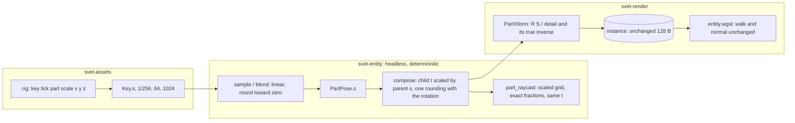

# 0082: Squash and stretch: a scale per axis per part in the pose and the clips, a slime in the library with a bounce

> **Status:** approved (2026-11-16, the owner's go with every recommended answer)
> **Created:** 2026-11-16
> **Milestone:** M6 in [`docs/roadmap.md`](../roadmap.md)
> **Related ADRs:** [ADR-0064](../adrs/0064-a-parts-scale-is-per-axis-in-its-own-frame-and-moves-its-childrens-pivots-not-their-shapes.md)
> (proposed; the inheritance rule), accepted at this plan's close. Rests on
> [ADR-0050](../adrs/0050-entities-are-posed-voxel-volumes-in-their-own-pool-traced-after-the-world-march.md)
> (poses in fixed point, the exact query, the instance's affine maps) and
> [ADR-0051](../adrs/0051-rigs-and-clips-are-text-files-sampled-in-fixed-point-by-tick.md)
> (the `.rig` file, keys sampled by tick).
> **Source:** the owner, 2026-11-16: "In case I want to see some entities that are jelly-like,
> slimes etc - will it be possible?" The answer agreed: today a slime is up to sixteen rigid
> parts in a clip, which reads stiff; the next step is a scale per part in the pose and the
> clips. See-through glowing jelly and true soft bodies are out of scope (below).
> **Starts after:** [Plan 0063](done/0063-rigs-and-clips-keyframe-animation-a-model-viewer-and-text-authoring.md)
> (the clips, `Pose::compose`, the viewer), the clip-recorder chore (the entities library under
> `apps/flythrough/assets/entities/`), [Plan 0078](done/0078-the-entity-pool-frees-models-by-handle-stable-instance-slots-and-a-reset.md)
> (it rewrites `entities.rs`'s instance write) and [Plan 0079](done/0079-entities-aware-of-floor-and-walls-a-surface-mover-the-smoothed-normal-and-a-wandering-demo.md)'s
> Phases 1 to 3 (they edit `clip.rs`, `rig.rs` and both library rigs) have merged into main; the
> owner's recommendation agreed 2026-11-16: "squash-and-stretch plan after 0079". It may run
> beside Plan 0079's Phase 4 and [Plan 0077](done/0077-an-entity-picker-in-the-fly-through-choose-a-model-from-the-library-and-place-it.md),
> which do not edit the pose, the clip keys or the rig's key grammar. Read against
> `plan-0063` c5c655ad and `plan-0062` 9e630854; the tree's names win when the lane starts.

## TL;DR

A part's pose gains a **scale per axis**, in fixed point like its translation, and a clip keys
it: `key 10 body scale 1.125 1.125 0.75` in a `.rig`. The scale acts in the part's own frame
about its pivot, so the ray the renderer and the query already carry into each part's space
meets a scaled grid and nothing else changes: no new pool bytes, no new instance word, the same
walk, the same normals, the same shadows. A parent's scale moves its children's pivots and
leaves their shapes alone (ADR-0064), so a squashed body carries its eyes down with it. The
library gains a **slime** of three parts with `bounce` and `idle` clips, and the owner watches it
bounce in the hall. The first thing anyone sees: `flythrough --source showcase --shot hall
--model apps/flythrough/assets/entities/slime/slime.rig --clip bounce`, press `` ` ``, and the
blob lands flat, stretches tall and leaves the floor.

## Context & problem

`project-context.md` (Rendering, P1: "entities lit consistently") and the roadmap's M6 give the
engine rigid-part models with clips. The owner wants creatures that read soft. In animation the
cheapest soft read is squash and stretch, and ADR-0050's representation is a step away from it:

- `PartPose` is a translation in 1/256 voxel and a Q14 quaternion; `Pose::compose` composes the
  tree once (Plan 0063 Phase 3b) into a `PartFrame` per part (`pose.rs`).
- The query, `part_raycast` (`raycast.rs`), carries the world ray into the part's grid with no
  rounding, in units of `1 / (256 * 16384)` model voxel, and compares crossings as fractions.
- The renderer's instance holds a 3 x 4 `world_to_part` and the frame before's `part_to_world`
  (`entities.rs`, `PartXform`); `entity.wgsl`'s `entity_part` transforms the ray by it and walks
  the grid; a face normal goes through the transposed linear part.
- `Key { tick, t, q }`, `sample`, `blend` and the `.rig` `key` line hold what a clip can change.

**What is missing:** a third quantity on the part pose, its exact treatment in the query, a true
inverse in the instance, a rule for what a parent's scale does to its children, the key and its
grammar, and a model that shows it.

**The `nfr.md` figures touched:** section 2's entity cost (Plan 0062 Phase 5's readings, the
backlog's "Hundreds or thousands of entities" quotes them: 64 walkers at +3.4 to 4.4 ms on the
RTX 3080 Laptop, +32 to 34 ms on the Radeon iGPU), section 3's "everything else in VRAM"
(unchanged, asserted), section 6 (new fixed vectors) and section 7 (the gate's wall time).

## Decision

A `PartPose` gains `s: [u16; 3]` in 1/256 (one is 256; 64 to 1024, a quarter to four times),
applied about the pivot in the part's frame before its rotation. It scales the part's own voxel
grid and the rest places (`t`) of its children; a child's volume, rotation and scale are its own
(ADR-0064). Every part's map stays a rotation times a diagonal over the detail, so the query
stays exact, the renderer's normal path is unchanged and the instance layout is unchanged. A
`Key` gains `s`, which **replaces** the rest scale as a key's rotation replaces the rest rotation
(Plan 0063's amendment); the rest scale is one on every part and the `.rig` writes a scale on a
`key` only. Between keys the scale is **linear** in 1/256 with rounding toward zero, as the
translation is; `blend` the same. At a scale of one every result is bit-identical to today's,
so Plan 0062's and 0063's committed vectors stand.

We rejected a scale that does not inherit (the eyes stay behind), full affine inheritance
(shear) and a deformation field (a soft body, not a scale): ADR-0064 A to C. We rejected a
geometric (log) interpolation of scale: it needs a committed exponential table for a difference
the window is unlikely to see across keys a few ticks apart, and linear is what `t` does; the
owner's window judges the bounce and a "stepped" verdict re-reads this. We rejected a rest scale
on the `part` line in this plan: a model's size is its `.voxtext` and its `detail`; if a rest
scale is wanted later, the replace rule is re-read with it (as the rotation note says).

## Architecture diagram



## Implementation phases

Each phase ships as its own commit; `dev` implements the dev phases in one session; the
architect reviews once at the end, in a fresh session. Per phase: `node
scripts/test-changed.mjs --profile quick`, clippy, fmt; Phases 2 and 3 also `--profile gpu
--binaries gpu_entities` under the perf lock. At the tip: the gate tier under the perf lock,
doctests, clippy, fmt, deny, the doc and tier gates. Readings go to `docs/plans/logs/0082.md`,
started from the readings-log template. **Test times are estimates**, none measured; the
GPU tests follow Plan 0062's: a hand-built box renders in 2 to 3 s for a few dozen frames at
192 x 108 on lavapipe.

**The lit box** the GPU tests share is Plan 0062's (from Plan 0058): a closed dark box of albedo
0.5, lamp off, `--lighting full`, manual exposure 1, no jitter, one white list light of
intensity 1200 (reach 109.5 voxels); its analytic term is `PI * intensity * max(n . l, 0) / d^2`
times `(1 - (d / r)^4)^2`: **9.40** at 20 voxels straight below the light, **3.30** on a level
surface 20 below and 20 to the side, and **5.92** on a level surface 20 below and 12 to the
side (`d^2` 544, `cos` 0.8575, window 0.9959).

### Phase 1: the scale in `svet-entity`: the pose, the composition, the exact query, the clips
- **Owner skill:** dev
- **What:**
  - **`PartPose.s: [u16; 3]`**, `SCALE_ONE` = 256, `SCALE_MIN` 64, `SCALE_MAX` 1024. `Default`
    and `Pose::rest` give `[256; 3]`. `Pose::check` (so `EntitySet::insert`, `set_pose` and
    `replace`) refuses a component outside the range with `PoseError::ScaleOutOfRange { part,
    s }`.
  - **Composition.** `PartFrame` gains `s`. A child's offset is `rotate(parent.m, parent.s *
    pp.t)` with the two divisions (by 16384 and by 256) done as one rounding, so at `s` 256 it
    equals today's `rotate(parent.m, pp.t)` bit for bit. `ComposedPose::part_point` scales
    `rel = local - pivot` by the part's own `s` inside the same division (`m * (s * rel) /
    (16384 * detail * 256)`): bit-identical at one. `ComposedPose` exposes the part's `s`.
  - **The query.** `part_raycast` carries the scale into the local frame: on axis `k` a model
    voxel is `LOCAL_ONE * s_k` local units (or the ray's `l0` and `d` are scaled by `s`; dev's
    call, exact either way), the crossings stay fractions compared by cross-multiplication and
    `t` stays the world parameter, so no hit distance maps back. The box test keeps the model's
    `reach` times the part's largest `s` over 256, rounded up. **The `i128` budget:** the scale
    adds up to 20 bits to the cross-multiplied products (`s` up to 2^10 on both sides). Dev
    either divides the shared factor out (`LOCAL_ONE` carries a 256 the scale can absorb) or
    narrows the documented domain (today: origins in the `i32` voxel range, `|dir|` components
    below 2^40), computes the bound, writes it in the module doc and `EntitySet::raycast`'s doc,
    and tests the corner (done-when 9).
  - **Clips.** `Key.s: [u16; 3]` (default `[256; 3]`); `Clip::new` refuses a key outside the
    range with `ClipError::ScaleOutOfRange`; `sample` and `blend` treat `s` as they treat `t`
    (linear, rounding toward zero, nearest key holding past the ends), and a key's `s`
    replaces the rest `s`; a part with no track copies its rest `PartPose`, scale included.
  - **Vectors.** The committed constants of `entity_hits_match_the_fixed_vectors` and
    `clip_poses_match_the_fixed_vectors` stand (their writers name their fields; nothing they
    hash changes at scale one). Two new vectors hash scaled poses and hits.
- **Files touched:** `crates/svet-entity/src/pose.rs`, `model.rs` (the scaled reach, or in
  `set.rs`), `raycast.rs`, `set.rs`, `clip.rs`, `lib.rs` (the constants), `tests/raycast.rs`,
  `tests/clip.rs`, `tests/determinism.rs`, `crates/svet-render/src/entities.rs` only if the
  build breaks on the new field (the real change is Phase 2), `docs/plans/logs/0082.md` (new).
- **Done when:**
  1. `a_scaled_part_is_hit_where_its_scale_puts_it`: Plan 0062's one-part model (an 8 x 8 x 8
     prefab of solid material 3, pivot at its centre, detail 1, at rest with its minimum corner
     at voxel (100, 50, 100), so the pivot at (104, 54, 104)) and its ray from (90.5, 54.25,
     104.25) along +x: with `s` (512, 256, 256) the part spans x in [96, 112) and the hit is
     model voxel (0, 4, 4), face -x, `t` 1408 (5.5 voxels); with `s` (64, 256, 256) it spans
     [103, 105) and the hit is voxel (0, 4, 4), face -x, `t` 3200 (12.5 voxels). Under 1 s.
  2. `the_walk_steps_by_the_scaled_voxel`: the same part with local x 0 to 5 air and 6 to 7
     solid: at `s` (512, 256, 256) the hit is voxel (6, 4, 4), face -x, at `t` 4480 (17.5
     voxels: `96 + 6 * 2`); at `s` (64, 256, 256) voxel (6, 4, 4) at `t` 3584 (14 voxels:
     `103 + 6 * 0.25`). Under 1 s.
  3. `a_child_rides_its_parents_scale_and_keeps_its_shape`: a two-part model, the child a
     4 x 4 x 4 solid cube with its pivot at its centre, rest `t` (2048, 0, 0) (8 voxels along
     +x of the parent's pivot): with the parent's `s` (512, 256, 256) the child's pivot
     (`part_point` at its pivot) is 16 voxels along +x of the parent's pivot, exactly, and a
     ray along +x through the child's centre enters it 2 voxels before that pivot (the child's
     volume is still 4 wide); with the parent's `s` (256, 256, 128) the child's pivot is still 8
     along +x (its `t` has no z); with the child's own `s` (256, 256, 512) a ray straight down
     onto the child enters it 4 voxels above its pivot. Under 1 s.
  4. `scale_one_is_what_there_was`: `PartPose::default().s` and every `Pose::rest` part are
     `[256; 3]`; `entity_hits_match_the_fixed_vectors` and `clip_poses_match_the_fixed_vectors`
     pass with their committed constants unchanged (no re-bless; the Notes say so). Under 2 s.
  5. `a_tilted_scaled_part_agrees_with_the_float_reference`: a part turned 45 degrees about z
     with `s` (512, 128, 256) and 256 seeded rays: the hit distance within 1/64 voxel of an
     `f64` reference computed in the test on every ray both agree is a hit; disagreements (the
     silhouette's grazes) counted, at most 2 of 256 (Plan 0062 done-when 5's bar). Under 2 s.
  6. `scaled_hits_match_the_fixed_vectors` and `scaled_clip_poses_match_the_fixed_vectors`
     (`tests/determinism.rs`): the posed three-part model with a seeded `s` per part (within
     64 to 1024) under 1024 seeded rays, and a three-part clip with scale keys over ticks 0 to
     96 (the writer hashes `s`), each to a committed constant on Linux and Windows in CI. Under
     2 s each.
  7. `a_scale_key_pair_is_linear`: keys `s` 256 at tick 0 and 512 at tick 40 on one axis sample
     to 320 at tick 10 and 384 at tick 20; a part with no track keeps 256; the nearest key holds
     before and after; `blend` at `w` 128 between 256 and 512 gives 384, and `w` 0 and 256
     return `a` and `b` bit for bit. Under 1 s.
  8. The refusals: `set_pose` with `s` 63 or 1025 on one component returns
     `ScaleOutOfRange` naming the part; `Clip::new` with such a key returns its typed error.
     Under 1 s.
  9. `the_walk_does_not_overflow_at_the_domains_corner`: at the documented domain's corner
     (the largest origin and `|dir|` the module doc states) with `s` 1024 and `s` 64 on every
     axis, the walk returns a hit or a miss in a debug build (overflow checks on), and the
     doc's bound is quoted in the test. Under 1 s.

### Phase 2: the renderer: the true inverse, the display blend, the picture against the query
- **Owner skill:** dev
- **What:**
  - **`PartXform`.** `of` probes the pivot and 256 model voxels along each axis as today; the
    columns of `m` are now `(s_k / detail) R e_k`. `from_parts` takes the scale (or recovers it
    from the column norms times the detail) and writes the true inverse: `w2p[r][c] = m[c][r] *
    detail^2 * 256^2 / s_r^2` (illustrative), which is today's `m[c][r] * detail^2` at a scale
    of one, exactly in `f32`.
  - **`DisplayPose::between`.** Per part: the scale from each pose's columns, blended linearly
    in `f32`; the rotation from the columns normalised, blended as today; the pivot's world
    point linear; rebuilt through `from_parts`.
  - **Nothing in `entity.wgsl` changes on purpose.** The walk transforms the ray by the
    instance's `world_to_part`, the normal by its transposed linear part (`R S^-1 e_k`, which
    normalises to `R e_k`), the box from `part_to_world`; `prev_world` and `entity_moved` see a
    scale change as a transform change. The phase proves these claims on the GPU; dev touches
    the shader only if a test shows one false and says so in the Notes.
  - **The shadow offset.** `entity_shadow_scale` stays `1 / detail` unless done-when 6 shows
    acne; then it becomes `min(s) / (256 * detail)` and the Notes say so.
- **Files touched:** `crates/svet-render/src/entities.rs`, `apps/flythrough/tests/gpu_entities.rs`
  (and its `reading.rs`), a baseline under `tests/golden/` only if a new golden is named here
  (none is), `docs/plans/logs/0082.md`.
- **Done when:**
  1. `a_scaled_part_round_trips_through_its_inverse` (no device): for 64 seeded poses with
     seeded scales on the sixteen-part test model, `world_to_part(part_to_world(c))` returns
     each volume corner `c` within 1e-3 model voxel. Under 1 s.
  2. `display_between_two_scales_is_between_them` (no device): a part at `s` 256 in pose `a`
     and 384 on x in pose `b`: at `alpha` 0.5 the x column's norm times the detail is 1.25
     within 1e-4; `alpha` 0 and 1 equal the two poses' transforms within 1e-6. Under 1 s.
  3. `scale_one_moves_no_pixel`: every gate golden passes against its baseline with no
     re-bless (the walker goldens of Plans 0062 and 0063 and the showcase hall included). No
     new test time.
  4. `a_stretched_bar_shows_its_stretched_silhouette` (`gpu_entities`): Plan 0062's 16 x 4 x 4
     bar facing the camera (it reads the bar 6 voxels right of centre and the wall 6 above): at
     `s` (256, 256, 1024) it reads the bar 6 above and the wall 10 above (half-height 8); at
     `s` (64, 256, 256) it reads the wall 6 right (half-width 2). About 3 s.
  5. `the_picture_and_the_query_name_the_same_scaled_part`: the walker in a tilted pose with a
     seeded `s` per part in 128 to 512, an 8 x 8 grid of pixels over it: the part the hit record
     names equals `EntitySet::raycast`'s on every pixel whose four neighbours agree (silhouette
     pixels skipped and counted), and at the centre pixel the hit distance agrees within 0.02
     voxel. About 4 s.
  6. `a_scaled_face_is_lit_by_its_rotated_normal`: Plan 0062's slab (top face 20 below the
     light reads 9.40) at `s` (512, 256, 128) reads 9.40 within 2 % at its top centre, and
     turned 45 degrees about a level axis through that centre reads 6.65 within 2 %: the
     normal is the rotated axis whatever the scale. Then a detail-4 part at `s` 64 on every
     axis (a voxel 1/16 world voxel thick) resting on the floor: its top centre reads its
     analytic value within 2 % over 16 frames (acne would read 0 or flicker). About 4 s.
  7. `a_squashed_slab_casts_a_squashed_shadow`: Plan 0062's 16 x 2 x 16 slab between heights 9
     and 11 centred under the light at `s` (128, 256, 128) (8 wide): the shadow's edge moves
     from 17.8 to `4 * 20 / 9` = 8.9 voxels; the floor pixel 6 voxels to the side reads 0 and
     the pixel 12 to the side reads 5.92 within 2 %. About 3 s.
  8. `a_scale_change_is_a_move`: a part still for 8 frames marks nothing fresh and
     `entities_moved()` is false; a frame in which only its `s` changes sets both, and the
     floor pixel under its grown shadow is `fresh`. About 3 s.

### Phase 3: the `.rig` grammar, a slime in the library, a golden and a reading
- **Owner skill:** dev
- **What:**
  - **Grammar.** On a `key` line, `scale x y z` or `scale u` (uniform), decimals that are whole
    multiples of 1/256 in 0.25 to 4; an error names the line and the token, and for a value
    that is not a multiple the two nearest multiples (`1.2` is refused with `1.19921875` and
    `1.203125`). `Rig::write` prints it (the uniform form when the three agree);
    `the_parser_never_panics` covers it through the sample's prefixes. The library README and
    `docs/entities.md`'s `.rig` section gain the statement and the inheritance rule in two
    sentences each.
  - **The slime.** `apps/flythrough/assets/entities/slime/slime.voxtext`, the generated
    `slime.vox` and `slime.rig`: a `body` of about 12 x 12 x 10 model voxels at detail 2 (a
    rounded blob, 0.6 m wide), its pivot at its **bottom centre** so a squash keeps it on the
    floor; two `eye` parts (2 x 2 x 2 each, `walker_eye`, children of the body with an `at` on
    its front). The body's material is a row of the showcase's table; dev may add a green
    non-emissive row to the fly-through's table for it, as `walker` was added. Clips:
    `bounce`, 30 ticks, loop: body `scale 1` at 0; `scale 1.125 1.125 0.75` at 6 (the landing;
    volume 0.95); `scale 0.875 0.875 1.25 move 0 0 1` at 12 (the take-off); `scale 1 move 0 0
    6` at 18 (the apex, 3 world voxels up); `scale 0.875 0.875 1.25 move 0 0 1` at 24; `scale 1`
    at 30. `idle`, 60 ticks, loop: `scale 1` at 0 and 60, `scale 1.03125 1.03125 0.9375` at 30.
    The eyes have no track in either clip: they ride the body's squash by ADR-0064 and keep
    their shape. The figures are the architect's first cut; the window re-reads them.
    `tests/entities.rs` (the chore's) covers the new directory as it covers the others.
  - **The ring.** If `--entities N` places the built-in walker regardless of `--model` at the
    start commit, it places the loaded model when one is given, so the crowd reading below runs.
- **Files touched:** `crates/svet-assets/src/rig.rs`, `tests/rig.rs`,
  `apps/flythrough/assets/entities/slime/` (new, three files), `entities/README.md`,
  `docs/entities.md`, `apps/flythrough/src/` (the ring, if needed; the showcase's table row,
  if added), `apps/flythrough/tests/entities.rs`, `tests/gpu_entities.rs`, a baseline under
  `tests/golden/`, `docs/plans/logs/0082.md`.
- **Done when:**
  1. `a_scale_key_parses`: `scale 1.125 1.125 0.75` builds a key with `s` (288, 288, 192);
     `scale 2` builds (512, 512, 512); a key without `scale` builds (256, 256, 256). Under 1 s.
  2. `errors_name_their_line` grows three cases: `scale 1.2` (the message quotes `1.2`,
     `1.19921875` and `1.203125`), `scale 5` and `scale 0.1` (out of range), each with its line
     number. Under 1 s.
  3. `a_rig_round_trips` holds with scale keys present, uniform and per axis. Under 1 s.
  4. `the_committed_library_builds` reads the slime: three parts, both eyes children of the
     body, a 30-tick looped `bounce` whose body track has six keys, the key at tick 6 with `s`
     (288, 288, 192), and `sample(bounce, 6)` placing each eye's pivot at `0.75` of its rest
     height above the body's pivot, exactly (its rest `at` has no x or y, so only z scales).
     Under 1 s.
  5. `slime_bounce_golden` (`gpu_entities`): the slime at tick 6 of `bounce` on the lit box,
     192 x 108, `--lighting half`, blessed once on lavapipe. About 3 s.
  6. The readings in the log: the frame and its hit and light passes at `--entities 64` with
     the slime bouncing against the walker walking (`--entities-walk on`), headless, 1920 x
     1080, both adapters, three quiet rounds under the perf lock and the memory cap; `sample`
     plus `compose` for 64 sixteen-part entities with scaled parts on the dev box (Plan 0063's
     `mod reading`), against its 0.146 ms and 0.50 ms; `EntityMirror::bytes()` at the defaults,
     expected 8 458 240 (unchanged).

### Phase 4: the owner's window
- **Owner skill:** human
- **What:** one sitting on the RTX with an editor beside the fly-through.

  ```
  cargo build --release -p flythrough
  target/release/flythrough --source showcase --shot hall --exposure 8 --hud \
      --model apps/flythrough/assets/entities/slime/slime.rig --clip bounce
  ```

  Place a slime (`` ` ``), watch it bounce from the side and from above; cycle to `idle`;
  change the landing's `scale 1.125 1.125 0.75` to `scale 1.5 1.5 0.5` and save; type `scale
  1.2` and read the error; add a `scale` key to an eye; then `--entities 16` and `--entities 64`
  bouncing for the cost on screen.
- **Files touched:** this plan's log.
- **Done when:** the log records the owner's words on: (a) does the squash read as jelly, or
  still as a block that changes size; (b) the motion between keys, linear in scale: smooth or
  stepped; (c) the eyes riding the squash while keeping their shape (ADR-0064's rule), right
  or wrong; (d) the range, a quarter to four times: enough; (e) the cost at 16 and 64 against
  the walkers. **Stop rule:** a "no" on (c) goes to the architect with ADR-0064 A and B
  re-read; a "stepped" on (b) re-reads the linear blend (a log blend with a committed table).
  The plan closes with that record.

## Data shapes

```rust
// illustrative: svet-entity
pub const SCALE_ONE: u16 = 256;             // 64..=1024: a quarter to four times
pub struct PartPose { pub t: [i32; 3], pub q: Quat, pub s: [u16; 3] }
pub struct Key { pub tick: u32, pub t: [i32; 3], pub q: Quat, pub s: [u16; 3] }
pub enum PoseError { PartCount { .. }, UnknownEntity { .. }, ScaleOutOfRange { part: u8, s: [u16; 3] } }
// a part's model-to-world map: pivot_w + R * (s * (local - pivot)) / (256 * detail)
// a child's pivot:              parent_pivot_w + R_parent * (s_parent * t_child) / 256
```

```text
# illustrative: .rig
clip bounce ticks 30 loop
key 0  body scale 1
key 6  body scale 1.125 1.125 0.75
key 12 body scale 0.875 0.875 1.25 move 0 0 1
```

The instance (128 B), the pool's volume layout and the tree node are unchanged.

## Budgets

| `nfr.md` figure | Base | Expected | How the close measures it |
|---|---|---|---|
| §2 entity cost (Plan 0062 Phase 5: 64 walkers +3.4 to 4.4 ms RTX 3080 Laptop, +32 to 34 ms Radeon iGPU) | the start commit's `--entities 64` walking | **guesses:** at a scale of one, within the round-to-round spread (the transforms are bit-identical); 64 bouncing slimes at or under the walkers' cost on both adapters (three parts against six; boxes up to 25 % taller when stretched) | Phase 3 done-when 6: `flythrough --source showcase --headless --render 1920x1080 --frames 2700 --adapter NVIDIA\|AMD --entities 64 --model .../slime.rig --clip bounce`, three quiet rounds, the perf lock, the memory cap |
| §2 CPU (Plan 0063's `sample` 0.146 ms, `between` 0.50 ms for 64 x 16 parts on the dev box) | those readings | **a guess:** + under 0.01 ms (three multiplies a part) | the same `mod reading`, the perf lock |
| §3 everything else in VRAM | 8 458 240 B (`EntityMirror::bytes()`) | **arithmetic:** + 0 B, asserted | Phase 3 done-when 6 |
| §6 determinism | Plan 0062's and 0063's vectors | the old constants unchanged; two new vectors equal on Linux and Windows | CI, Phase 1 done-whens 4 and 6 |
| §7 gate wall time | the start commit's gate | **an estimate:** + about 15 s on lavapipe (four GPU tests of 3 to 4 s, the CPU tests under 1 s each) | `node scripts/test-times.mjs` on the tip's gate log |

## Risks & open questions

- **The `i128` budget in the query.** The scale multiplies both sides of the walk's fractions.
  If the shared factor cannot be divided out, the documented domain narrows; the plan accepts a
  narrower domain (origins within 2^24 voxels and `|dir|` components below 2^32 would still be
  16 million voxels and a direction of four billion units) over a slower walk, and Phase 1
  done-when 9 pins whatever dev computes.
- **Self-shadow acne on thin scaled voxels.** A detail-4 voxel at a quarter scale is 1/16 of a
  world voxel; the shadow ray's offset along the normal may cross it. Phase 2 done-when 6 reads
  it and names the fix.
- **`PartXform::of` recovers the scale from probed points in `f32`.** At `s` 1024 on a detail-4
  part a column is 1 world voxel per model voxel; at `s` 64 on detail 1 it is 0.25: both far from
  `f32`'s edge. The round-trip test (Phase 2 done-when 1) guards it.
- **Linear scale between far-apart keys.** A squash from 1 to 0.25 in one key pair passes 0.625
  at the midpoint where a geometric blend gives 0.5. The sample's keys are 6 ticks apart; the
  window's (b) judges it.
- **A key's scale replaces, it does not add.** An author who wants "a bit more squash" edits
  the number; there is no relative scale key. Consistent with rotation; a "no" at the window
  is an amendment, not a stop.
- **Three lanes touch `clip.rs` and `rig.rs`** (Plans 0079 and this; 0078 the mirror). The
  "Starts after" line orders them; the lane re-reads the files at its start.
- **Open, for the owner:** the four questions under "Owner questions".

## What this plan does NOT do

- **See-through or glowing jelly.** An entity voxel is an opaque honest cube (Plan 0062); a
  translucent entity waits for [Plan 0034](0034-water-surface-waves-reflection-refraction-underwater-fog.md)'s
  translucent voxels and its own amendment. Emissive voxels already glow (a slime's eyes do).
- **True soft bodies**: a blob that bends round a corner, splits or merges, or any
  per-voxel deformation (ADR-0064 C). Parked in `docs/backlog.md` as a later ADR with a spike.
- **Inheriting a parent's scale into its children's volumes** (ADR-0064 B), or a rest `scale`
  on a `part` line.
- **Shear, mirroring (negative scale) or a scale outside a quarter to four times.** A mirrored
  part is a second `.vox` node.
- **Scale in `svet-sim`'s bodies** (Plan 0079's `body` is a fixed radius and height), in the
  entity's audio footprint, or in the hit record's instance bits.
- **A timeline or curve editor.** Keys are typed (ADR-0051).
- **Light from a scaled emissive part onto the world**: a list light the consumer attaches
  (ADR-0044), as before.

## Owner questions

Each with the recommended option first. An answer of "go" takes every first option.

1. **What a parent's scale does to its children** (ADR-0064): (a) moves their pivots and
   leaves their shapes alone, so a squashed body carries its eyes down and the eyes stay round;
   (b) nothing (the eyes hang where they were, every squash keys the eyes too); (c) scales them
   whole, as a scene graph does, with shear on rotated children and a general inverse per part.
2. **The range and the step**: (a) a quarter to four times in steps of 1/256, the translation's
   convention; (b) a sixteenth to sixteen times (costs 8 more bits in the query's `i128` budget
   and a narrower domain); (c) finer steps (1/4096) for the same range.
3. **How scale moves between keys**: (a) linear, as the translation does; (b) geometric (a
   committed exponential table), constant proportional speed, visible only across far-apart keys.
4. **Where a scale may be written**: (a) on `key` lines only, the rest scale one everywhere;
   (b) also on `part` lines as a rest size, a key then replacing it as a rotation does; (c) also
   on `part` lines, a key multiplying it.

## Implementation log

> Written by `dev`: one row per phase as its commit lands, then the close block. **The phases
> above are the contract. This section records what happened.** Observations, never conclusions:
> no pass list, no self-assessment. Deviations and unmet done-whens are **always** disclosed.
> Keep it shorter than `## Implementation phases`. Readings, gate counts, attempts, sweeps and
> resume notes go to the plan's readings log, `docs/plans/logs/0082.md` (started from
> `templates/readings-log.md`), and this section links it once it exists.

| phase | owner | state | commit |
|---|---|---|---|
| 1: the scale in `svet-entity` | dev | not started | |
| 2: the renderer | dev | not started | |
| 3: the `.rig` grammar, the slime, a golden and a reading | dev | not started | |
| 4: the owner's window | human | not started | |

### Notes

_(Deviations from the plan, with the commit, stated without justification. Done-whens not
satisfiable as stated, and what was done instead. Followups noticed and not acted on. One line
each. Empty is fine.)_

### Close triggers

_(Facts for the architect. No recommendations, and no suggested version bump.)_

- **What shipped:** feature / fix-only / docs-chore-only
- **Public API changed:** types, traits, functions, shader interfaces, config (list them, or none)
- **Budget readings:** each `nfr.md` figure touched, with its measured value, machine and commit
- **Gate at the tip:** the commands run (build, nextest, doctests, clippy, fmt, deny), exit codes, test counts
- **Outstanding `human` phases:** which, or none

## Followups
