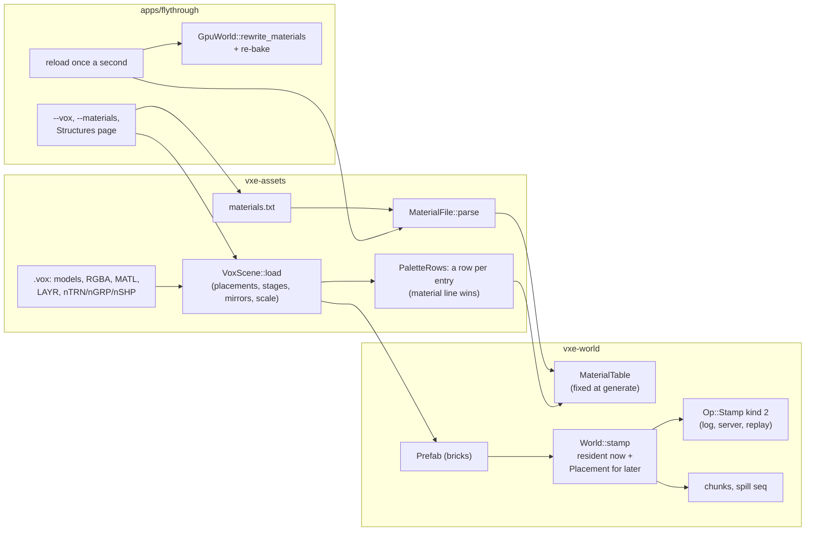

# 0083: Anything from a `.vox`: palette materials, a material file, and large scenes stamped into the world

> **Status:** in-progress (approved 2026-11-16, the owner's go with every recommended answer; .vox scale 1 world voxel); **amended 2026-11-18 (the Phase 6 re-read after Plans 0077 and 0080 merged): a structure is a belt item of Plan 0077's placement mode, its ghost a marked frame, the cleared box a stamp of written air, the settings a `structures` menu group; owner questions 5 to 8 await answers**
> **Created:** 2026-11-16
> **Milestone:** M7 in [`docs/roadmap.md`](../roadmap.md) (stamping at authored-building
> scale), with M6's `.vox` import; the engine side in `vxe-assets` and `vxe-world`, the testbed
> side in `apps/flythrough`.
> **Related ADRs:**
> [ADR-0065](../adrs/0065-materials-are-data-a-table-file-in-the-rig-grammar-and-every-vox-palette-entry-becomes-a-row.md)
> (proposed; the material file and palette rows) and
> [ADR-0066](../adrs/0066-a-large-prefab-is-stored-as-bricks-and-its-stamp-is-a-placement-the-world-finishes-as-chunks-arrive.md)
> (proposed; brick prefabs, placements past residency), both accepted at this plan's close.
> Rests on [ADR-0014](../adrs/0014-prefab-identity-in-the-op-log.md)
> (the stamp op and the save's prefab table),
> [ADR-0003](../adrs/0003-sphere-residency-with-lod-ring-and-edit-persistence.md) (residency
> and the spill), [ADR-0046](../adrs/0046-static-emissive-light-is-baked-per-chunk-when-a-chunk-loads-or-changes.md)
> (the bake follows a changed chunk) and
> [ADR-0051](../adrs/0051-rigs-and-clips-are-text-files-sampled-in-fixed-point-by-tick.md)
> (the `.rig` grammar and the viewer's reload).
> **Source:** the owner, 2026-11-16: "import nearly anything that can be created as a .vox
> file. Large architecture is something I'm particularly interested in"; materials from the
> `.vox` palette and the material table as a hot-reloaded data file, both approved the same day.
> **Starts after:** Plan 0063 and the clip-recorder chore merge (the viewer, `rig.rs`, the
> entities library), beside Plans 0078 and 0080; Phases 6 to 8 after Plans 0080 and 0077
> merge (the menu's dynamic page, the picker's placement at the crosshair). See "Order".
> **Amended 2026-11-18 (architect, the Phase 6 re-read at 99801643, which holds main 63e3695a
> with Plans 0077 and 0080 closed):** the section "Amended 2026-11-18" below replaces Phase 6's
> block and is Phase 7's errata; the dev reads it before the phases. Phases 1 to 5 and 8 stand.

## Amended 2026-11-18 (the Phase 6 re-read): a structure is a belt item

Phase 6 as approved names `apps/flythrough/src/menu/`, a `Page::dynamic`, `src/hud.rs` and a
`place` action on an open page. None of them is in the tree, and the flow it describes is the
one Plan 0077's first window struck (the panel over the view while placing). This section says
what the tree has, picks the flow, and rewrites Phase 6 against it.

### What the tree has (the plan's name, then the tree's)

| The plan says | The tree has |
|---|---|
| `apps/flythrough/src/menu/`, `Page::dynamic` | `apps/flythrough/src/hud/menu/{mod,entries,page,route,write,filter}.rs`; the one dynamic page is the hard-coded `PageId::Entities`, its rows `Row::Item(usize)` (four lines each beside an icon tile, `ITEM_LINES`) built each frame from `Modes::walkers.library`; `Enter` gives `Activated::Choose { entry }`, a digit `Activated::Assign { entry, slot }` |
| `src/hud.rs` (the banner) | `src/hud/mod.rs` with `hud/modes.rs` (`Modes`, `HudRow`, `BANNER_MS`); the notice row is `Run::say`, the lights' banner row `Modes::show_lights` |
| "the aim point from the crosshair's hit as Plan 0077's picker takes it" | `Run::aim_feet(extent)` over `belt::stand` (`entities/belt.rs`): the camera ray's first world hit within `PLACE_REACH` (300 voxels), never nearer than `max(NEAR_MIN 30, NEAR_SCALE 1.5 x the longest extent)`, dropped to the floor under a wall or ceiling hit |
| `place` from the open page | 0077's three states: the chooser only chooses and fills the belt (`Belt { slots: [Option<usize>; 9], selected, on, turn }`); placement mode with the menu closed stands the ghost (`Walkers::preview`, a marked instance, ADR-0074) at the aim; the left click places and the mode stays; `R` turns 22.5 degrees; the right click and `Esc` leave |
| `clear box on\|off`, `scale 1..4` as page actions | a setting is an entry of a menu `Group` (`toggles::TOGGLES`; a `Toggle` with `number: Some(Number)` for a stepped value and a `HudRow` that shows its mode), as `dig radius` is under `moving` (Plan 0080) |
| `src/structures.rs` "new" | there since Phase 4: `VoxArg`, `read`, `add_rows`, `scene`, `offset`, `ClearedSource`, `clear_box`, `ops` (a `VoxOps { prefabs, ops, chunks }`: a box carve, then a stamp per placement, submitted once the box's chunks are resident), `source`, `chapel_vox` |
| the castle "through `VoxScene`" | `castle::castle_vox()` gives the `VoxFile` (27 tiles of at most 256 a side, 21 kept) and `above_map()` its explicit `VoxMap`; `--castle` builds it on a thread (`Pending::StreamBuilding`, Plan 0075) and places it at generation through `HallSource` |

### Decision: (a) a structure joins Plan 0077's chooser, belt and placement mode

A structure is one more thing a belt slot holds; its chooser is a second page of items; the
click that places an entity places a structure. Reasons: the owner asked for the belt
(2026-11-18, "a belt of things that is possible to place") and for the chooser to close before
placing, and judges in the window, where a second grammar would show; one stand rule, one
click, one `R`, one `Esc` for everything placed, so `docs/flythrough.md`'s key table gains a
group and no new keys; and the chooser's mechanism (`Row::Item`, `Choose`, `Assign`)
generalises by giving the item a kind, which is the whole of option (c) that is needed.
Rejected: **(b)** a place-from-the-page action, 0077's Phase 3 flow the owner struck, and a
second placement path to keep in step with the first; **(c)** a general dynamic `Page` type
with an ADR: nothing needs it, two pages over one `Row::Item` kind is the generalisation, and
ADR-0061 already fixes the one-component rule. No ADR: the rejected options are plan-level and
recorded here.

### Mechanism

- **The item.** `belt::Item { Entity(usize), Structure(usize) }` (or the dev's name).
  `Belt.slots: [Option<Item>; SLOTS]`; `Row::Item(Item)`; `Activated::Choose { item }` and
  `Assign { item, slot }`. `Belt::fill` takes the entities' `Library::order` and then the
  structures' order into the slots left (the committed libraries: walker, spider, chapel,
  castle; owner question 8). The entity paths keep their `usize`.
- **The structures library.** `structures::Library { entries, notes }` on `Modes`
  (`hud/modes.rs`, beside `walkers`), scanned at start from `structures::LIBRARY`
  (`<name>/<name>.vox`, name order; `--structures-dir DIR` as `--library-dir`), plus the
  entry `castle` (generated) last. An entry holds its `VoxFile`, its `VoxScene` at scale 1,
  its bounds and the rows it added; a file that does not read or load is an entry in error
  (grey name, red reason, as 0077's). Every file's palette rows go into the world's table in
  `setup::world_table` before `World::generate` (ADR-0065; today `--vox`'s only), so the
  committed library adds the chapel's rows to every run; the start-up line says `structures: N
  entries, +R rows`. The castle adds no row (its indices map through `castle::above_map()` to
  the file's castle rows); its `VoxFile` is generated on a worker thread (the `--castle`
  build's `castle_vox_on`) the first time its slot is selected or its icon is asked, and until
  then its slot's name row and its chooser row read `castle: building` in grey, as an entry
  not built.
- **The chooser.** `PageId::Structures`, rows `Row::Item(Item::Structure(i))` at `ITEM_LINES`
  each: a blank line, `chapel   4 placements  4.8 x 3.2 x 4.0 m` (grey with its red reason for
  an entry in error), `rows +255   slot 3` (or `no slot`), a blank line. Reached by `Tab`, the
  `structures` group row and its first entry `choose a structure` (`Act::StructurePicker`, no
  key; owner question 6), and by the pad the same way. `Enter`, the left click, `South` and
  `` ` `` on an entry hand over as on the Entities page (`Menu::input`'s `Entities` arm serves
  both pages); a digit assigns and the page stays. `Menu::open_structures(selected)` beside
  `open_entities`. The Entities page lists entities only.
- **The settings.** `Group::Structures` after `Entities` in `Group::ALL` (13 groups), page
  title `structures`, three entries: `choose a structure` (the action), `clear box` (a toggle,
  `on|off`, default on) and `structure scale` (a number 1..4, step 1, default 1), the two
  toggles' modes on a row of their own, `HudRow::Structures` (or `Controls`, the dev's call),
  their state on `Modes` (`clear_box: bool`, `structure_scale: u32`). Both are read at the
  ghost and at the click; a scale change re-stands the ghost.
- **The ghost of a structure is a frame entity** (owner question 5): a `vxe_entity::Model` of
  the structure's box at the scale and turn, a real instance in the set as the entity ghost
  is, marked with the ghost colour (ADR-0074), touching no world voxel. For a box every side of
  which is at most `MAX_EDGE` (64) voxels, the frame is its twelve edges, one part each, one
  voxel thick, in the structure's most-used row (any opaque row: the mark's outline and tint
  carry the meaning). For a larger box (the castle's 600 x 600 x 500) the frame is its eight
  corners, each one part of three 32-voxel arms, one voxel thick, meeting at the corner. Both
  stay under `MAX_PARTS` (16) and `MAX_EDGE`; the model is made per entry, scale and turn and
  kept (`structures::frame_model`). The structure itself cannot be the ghost (ADR-0050's caps,
  the backlog's traced preview); the belt's name row names it beside the frame.
- **Where a structure stands** (owner question 7): `belt::stand_box(eye, fwd, size, cast) ->
  corner` beside `stand`, and `Run::aim_corner(size)` beside `aim_feet`, the one placement
  function of its kind. `p` is the camera ray's first world hit within `PLACE_REACH` on any
  face, else the view's point at `NEAR_MIN`; `p` is dropped to the floor as `stand` drops (the
  same code); `h` is `fwd` with z zeroed and normalised (`+x` when `fwd` is vertical); `s =
  (|h.x| size.x + |h.y| size.y) / 2` is the box's support along `h`; the footprint's centre is
  `c = p + h s`, so the box's near edge or corner is at `p` and the box grows away from the
  camera, never around it; the base is at `p.z`; the corner, to a voxel, is `[c.x - size.x /
  2, c.y - size.y / 2, p.z]`. `size` is the scene's at the scale, x and y swapped at an odd
  quarter turn. No `NEAR_SCALE` for a box: 1.5 x the castle's 600 voxels is 90 m, past
  `PLACE_REACH`, so `stand`'s rule would put every large structure 90 m along the view, in rock.
- **The turn.** A stamp has the 24 cube rotations, so `R` on a structure slot turns the box a
  **quarter turn** about z (`Rot::Z90` composed; 22.5 degrees is not a `Rot`): `Belt.turn`
  counts 22.5 degree steps, so `R` on a structure adds four and the stamp's `Rot` is `Z90` to
  the power of `turn / 4` (or the dev's cut); the turn is kept until the mode ends, as today.
  `VoxScene::placed_at` takes the quarter turns: each placement's origin and `Rot` composed
  about the box's minimum corner, in integers; the bounds swap x and y at an odd turn.
- **The click** submits through the server, as every edit does (`net.server.submit`, the
  tick's events print and say the lines): with `clear box` on, first a **stamp of written air**
  the size of `structures::clear_box` (a new `Prefab::uniform(size, material)`: every brick
  uniform and written, 4 B each after Phase 3, its id streamed as any prefab's, registered by
  id on the server and the client as the scene's prefabs are), then one `Op::Stamp` per
  placement of the scene at the scale and turn, in order. A stamp and not the box carve
  because a carve is an edit, which a non-resident chunk refuses, and a castle's box at
  `r_full` 6 is never fully resident (Phase 5's reading: 21 placements pending), so
  `--vox-op`'s wait would never end at runtime; a stamp past residency is a placement the world
  finishes as chunks arrive (ADR-0066), and air written by a stamp is air. `structures::ops`
  emits the air stamp for `--vox-op` too, `VoxOps.chunks` and the residency wait go (the ops
  go in on the first tick), so the two paths stay one and
  `the_chapel_as_ops_equals_the_chapel_from_the_source` keeps holding on the voxels. Forced
  residency was rejected in ADR-0066. After the click the mode stays, the frame ghost
  re-stands, and the notice reads `placed chapel 4.8 x 3.2 x 4.0 m: 5 ops, 4 chunks now, 0
  pending` (the chunks from the tick's results, the pending count from
  `ChunkStore::pending_placements`).
- **The words.** The structures row (`HudRow::Structures`) holds the two toggles' modes, as
  every toggle shows its mode in its row (`clear box on`, `structure scale 1`); the belt's
  name row names the selected structure and its size at the scale (`chapel  4.8 x 3.2 x 4.0 m`,
  at scale 2 `chapel  9.6 x 6.4 x 8.0 m  x2`); the frame shows the turn.
- **The icons.** A structure's tile is made through `icon::icon` over a model of the scene
  when the scene fits one (every prefab at most `MAX_EDGE` a side, at most `MAX_PARTS`
  placements: the chapel's four), on the icons' worker as an entity's is, its tile index after
  the entities' (`MAX_TILES` 32 holds both libraries); a structure that does not fit (the
  castle) keeps its words in its slot and its row, as an entry whose tile has not arrived.
- **`--castle`** keeps its path (the hall, the generation-time placement). The plan's "the
  castle through `VoxScene`" is met by the castle entry: its runtime placement goes through
  `VoxScene::load(castle_vox(), above_map(), ..)`, and the test asserts that the scene's
  prefabs are the tiles `HallSource` stamps, not that `--castle`'s start changes.
- **Under `--tester`** there is no belt and no chooser, as 0077 left it.

### Phase 6 (amended): a structure in the belt
- **Owner skill:** dev
- **What:** the mechanism above: the item kind, the structures library and its rows at start,
  the Structures chooser, the `structures` group, the frame ghost, the box rule, the quarter
  turn, the air stamp and the click, the icons, the words.
- **Files touched:** `apps/flythrough/src/entities/{belt,picker,placed,icon}.rs` (the item,
  `stand_box`, the frame ghost in the set and the marks, the tile index),
  `apps/flythrough/src/structures.rs` (the library scan and entry, `frame_model`, `ops` with
  the air stamp; split under `structures/` if it nears its cap),
  `apps/flythrough/src/hud/menu/{mod,page,route,write,entries}.rs` (`Group::Structures`,
  `PageId::Structures`, `Row::Item(Item)`, `Choose` and `Assign` by item, the title and
  footer), `apps/flythrough/src/hud/modes.rs` (`Modes::structures`, `clear_box`,
  `structure_scale`, `HudRow::Structures`), `apps/flythrough/src/toggles.rs` (the group's
  three entries, `Act::StructurePicker`), `apps/flythrough/src/run/{keys,frame,edit,
  hud_feed}.rs` (`aim_corner`, the structure's click, the prefabs registered, the notice),
  `apps/flythrough/src/setup.rs` (the library's rows in `world_table`, the start-up line,
  `vox_ops` without the wait), `apps/flythrough/src/cli/model.rs` (`--structures-dir`;
  `flags.rs` is at its cap), `apps/flythrough/src/app.rs`, `apps/flythrough/src/castle.rs`
  (the castle entry's scene), `crates/vxe-world/src/prefab.rs` (`Prefab::uniform`),
  `crates/vxe-assets/src/scene.rs` (`placed_at` with the quarter turns), new
  `apps/flythrough/src/run/structure_tests.rs` (`Run` is crate-private, as `picker_tests.rs`),
  `apps/flythrough/tests/{structures,castle,toggles,menu,picker}.rs`,
  `crates/vxe-world/tests/stamp.rs`, `crates/vxe-assets/tests/scene.rs`,
  `apps/flythrough/assets/structures/README.md`, `docs/flythrough.md` (the `structures`
  group, the belt's paragraph, `--structures-dir`, `--vox-op`'s row), `docs/plans/logs/0083.md`.
- **Done when** (CPU, no device; `run/structure_tests.rs` runs on a rock box large enough for
  the chapel's box, with the committed libraries and the castle entry left unbuilt; each
  under 1 s unless named):
  1. `the_library_lists_every_structure` (`tests/structures.rs`): the scan of
     `assets/structures/` gives one entry per directory holding `<name>/<name>.vox`, in name
     order, then `castle`; each file's palette resolves against the fly-through's table with
     the row count the README states (the chapel 255; a second file of the same palette 0); a
     directory without its `.vox` is a note; a file that does not parse is an entry in error
     with its reason.
  2. `a_uniform_prefab_is_written_air_one_word_a_brick` (`crates/vxe-world/tests/stamp.rs`,
     under 0.5 s): `Prefab::uniform([620, 620, 510], AIR)` holds 78 x 78 x 64 bricks, every one
     uniform and written, `bytes()` under 2 MB and `written_count` 196 044 000; stamped at the
     corner of a solid 64³ chunk it leaves every voxel of the overlap air and the result counts
     the rock row at the overlap's size; two constructions give one id.
  3. `a_quarter_turn_turns_the_scene` (`crates/vxe-assets/tests/scene.rs`): the chapel's
     scene `placed_at` with one quarter turn has every placement's origin and `Rot` equal to
     the hand-rotated values about the box's minimum corner, its bounds' x and y swapped, and
     its stamped voxels equal the unturned stamp's rotated voxel by voxel; four quarter turns
     are the identity.
  4. `the_belt_holds_a_structure` (`run/structure_tests.rs`): the belt fills walker, spider,
     chapel, castle, slot 5 empty; the wheel to slot 3 enters the mode with the chapel's frame
     ghost in the set (twelve parts, marked with the ghost colour) and nothing placed; `Tab`,
     `structures`, `choose a structure`, `Down` to the castle, `7` puts it in slot 7 and the
     page stays; `Enter` on the chapel selects slot 3, closes the menu and enters the mode;
     `` ` `` on the Structures page does the same; the Entities page lists no structure.
  5. `a_structure_stands_by_the_box_rule` (`run/structure_tests.rs`): with the camera 1.7 m
     over the floor looking 40 degrees down along +x (the floor hit about 2.6 m out) the
     chapel's corner has its minimum x at the hit's voxel, its y centre within one voxel of the
     hit's y and its base on the floor's top, so the eye is outside the box; after `R` once
     the box's x and y extents swap and the corner follows; at `structure scale` 2 the box
     doubles and the corner stays at the hit; aimed into the dark with no hit within 30 m the
     corner's x is the view's 3 m point's; a 600-wide box starts at the hit too and never holds
     the eye.
  6. `a_placed_structure_is_logged_stamps` (`run/structure_tests.rs`, under 5 s): the left
     click on the chapel's slot submits in one tick one stamp of a `Prefab::uniform` the size
     of `clear_box` and four stamps of the scene's prefabs, all kind 2 in the run's op log,
     the air stamp first; after the tick the world holds Phase 4's per-row counts of the chapel
     inside air with the 1 m margin; the mode stays and a new frame ghost stands; with `clear
     box` off there are four stamps and no air; a replay of the log on a fresh world hashes
     equal; `the_chapel_as_ops_equals_the_chapel_from_the_source` (`tests/structures.rs`) holds
     with `ops` emitting the air stamp.
  7. `the_castle_loads_through_the_scene` (`tests/castle.rs`): `VoxScene::load` of
     `castle_vox()` under `above_map()` gives 21 placements whose prefab ids are the ids
     `HallSource` stamps, in order; `--castle`'s world hash is unchanged; a castle entry before
     its build is grey with `castle: building`.
  8. The words: `every_toggle_shows_its_mode_in_the_hud_grid` (`tests/toggles.rs`) passes with
     `clear box on` and `structure scale 1` in their row; 0080's
     `every_toggle_and_action_is_an_entry`, `the_source_reads_no_key_the_tables_miss`,
     `every_live_entry_answers`, `the_fixed_set_is_the_table` and `the_route_is_one_function`
     pass with the group and the page; `--keys` lists `structures` with its three entries;
     0077's `the_belt_draws_its_slots` holds with `chapel` in slot 3 (its icon once made) and
     `castle` in slot 4; the belt's name row on slot 3 reads `chapel  4.8 x 3.2 x 4.0 m` and at
     scale 2 `chapel  9.6 x 6.4 x 8.0 m  x2`; after a click the notice reads `placed chapel 4.8
     x 3.2 x 4.0 m: 5 ops, N chunks now, 0 pending`; `docs/flythrough.md` has the group and the
     belt's structures; `node scripts/check-doc-links.mjs` exits 0.
  9. Readings (`docs/plans/logs/0083.md`): the frame models' pool bytes (the chapel's edges,
     the castle's corners; guesses 150 KiB and 1 MiB of the 8 MiB pool); the chapel's icon
     time; `Prefab::uniform` of the castle's box, its construction with the id (guess under
     100 ms, the hash over 196 M bytes) and its stamp call; the structures' scan and rows at
     start against Phase 4's start-up line.

### Phase 7 (errata): the owner's window gains the belt
The owner reaches a structure through the belt, not a page: (a) and (b) read "finds it in the
belt (the wheel, or the Structures chooser) and places it with the click". Added checks, with
the owner's words into the readings log: the chapel's frame ghost in the cave (question 5),
`R`'s quarter turn, `structure scale` 2 from the menu, `clear box` off then on, where the box
stands against the crosshair (question 7); the castle's corners frame, its click and the fly
to its far side as (b) says; whether structures belong in the belt beside the entities
(question 8). The picks the phase names (the emission factor `k`, the default scale, `clear
box` on) stand.

### Phase 8 (addition)
`gpu_hud_golden` gains `the_structures_chooser` (the page with the chapel's icon and the
castle's words, pixel exact on lavapipe, under 10 s). The rest stands.

### Budgets added 2026-11-18 (guesses until Phase 6 reads them)

- **The frame ghost:** 12 parts of at most 64 x 1 x 1 voxels (the chapel) or 8 parts of
  32 x 32 x 32 (the castle's corners) in the 8 MiB entity pool while a structure slot is
  selected in the mode; freed when the slot or the mode changes; the mark's cost is 0077's.
- **The air stamp:** the castle's box as a uniform prefab is 389 376 bricks x 4 B, about 1.6 MB
  in RAM and in the log per castle placement; the chapel's about 3 KB. Section 3's prefab RAM
  line reads it with the castle's prefabs.
- **Rows at start:** the committed library adds the chapel's 255 rows to every run (64 B a row
  on the GPU, 16 KB), under the "1000 rows 64 KB" line of the Budgets table.

### What this amendment reverses in the text above

Phase 6's "places the selected `.vox` at the crosshair" from the open page, and the Decision's
"from a Structures page of Plan 0080's menu, at the crosshair at runtime", read: from the
belt, in placement mode, with the click. "The preview is the box's footprint on the HUD" (the
Decision, "What this plan does NOT do") is superseded by the frame ghost under question 5; a
traced preview of the structure itself stays out (backlog). The Decision's `clear box` "carved
clear first" is a stamp of written air, not a carve op. Phase 6's aim rule ("the footprint
centred on the hit") is the box rule under question 7.

### Owner questions added 2026-11-18 (each with a recommendation)

**Answered 2026-11-18 (owner, "all recommended, go ahead"):** 5 the marked frame, 6 no new key,
7 the box grows away from the aim, 8 the belt starts with the entities then the structures.

5. **The ghost of a structure.** Recommended: a marked frame entity (its twelve edges, or
   its eight corners for a box over 64 voxels a side) standing where the structure will stand,
   blue as the entity ghost is, with the name and size in the belt's name row. Alternative:
   the words alone, no frame (the plan's original "the HUD shows its box"): cheaper, but
   nothing in the world shows where a 5 m chapel lands before the click.
6. **Reaching the Structures chooser.** Recommended: through the menu (`Tab`, `structures`,
   `choose a structure`) and through the belt (a structure's slot by the wheel or a digit), no
   new key; `` ` `` stays the entities'. Alternative: a key for the structures chooser, one
   more bind of the kind Plan 0080 removed.
7. **Where a structure stands.** Recommended: the box grows away from the aim: its near edge
   at the crosshair's hit (dropped to the floor under a wall or a ceiling), its base on the
   floor, so the camera is never inside it and a castle starts where you look. Alternative:
   the footprint centred on the hit, as the plan wrote: a castle then surrounds the camera and
   its stamp may bury it.
8. **The belt's fill.** Recommended: the belt starts with the entities (walker, spider), then
   the structures (chapel, castle) in the free slots, so the wheel reaches a structure at once.
   Alternative: a structure enters the belt only from its chooser.

## TL;DR

Today a `.vox` reaches the world only through Rust: its colours are thrown away, every
palette index needs a `material` line naming a row some Rust wrote, a 256³ model costs 36 MB
of dense prefab, and a runtime stamp fails as soon as its box touches a chunk the camera's
residency sphere does not hold. This plan makes a `.vox` **load as painted**: every palette
entry becomes a material row carrying its colour and MagicaVoxel material (glass, glow,
metal), the fly-through's material table moves to a **text file** in the `.rig` grammar,
reloaded while the window is open, prefabs become **brick-sparse**, a stamp larger than the
residency window becomes a **placement the world finishes as chunks arrive**, the scene graph's
hidden layers and reflected frames load, and the fly-through gets a **Structures page** in Plan
0080's menu that places any `.vox` of `apps/flythrough/assets/structures/` at the crosshair,
diggable, lit by the bake, collided with, as a logged op. The first thing anyone sees:
`flythrough --vox apps/flythrough/assets/structures/chapel/chapel.vox` and a chapel with blue
glass and glowing lamps stands ahead of the spawn in its own colours, with no rig and no Rust
touched; later, the Plan 0042 castle placed from the menu in the running world, its far towers
filling in as you fly toward them.

## Context & problem

- **Colours.** `VoxMap::to_prefab` refuses any used palette index the map leaves `Unset`
  (`crates/vxe-assets/src/map.rs`); the `.rig`'s `material <idx> <name>` resolves against a
  table written in Rust (`apps/flythrough/src/scene.rs`, about fifteen rows). The `.vox`'s
  `RGBA` is parsed and ignored; `MATL` (glass, emit, metal) is skipped with every other chunk.
- **The table.** `MaterialTable` rows are Rust (`cave_materials`, `castle_materials`,
  `showcase_materials`); the consumer's requirement is a data-driven table
  (`project-context.md`, Materials P0), and the owner wants artists to define materials in a
  file hot-reloaded like the `.rig`. `GpuWorld::rewrite_materials` already rewrites a row's
  render fields at runtime for a table of the same rows.
- **Size.** `Prefab` is dense: Plan 0042's castle held 343 566 464 B for 21 tiles, 92 % air;
  "nearly anything" at a hundred tiles is 3.6 GB against the 4 GB world-in-RAM budget
  (`docs/nfr.md` section 3).
- **Reach.** `World::stamp` fails with the first non-resident chunk its box meets
  (`crates/vxe-world/src/stamp.rs`), so a castle at runtime is limited to the camera's
  `r_full` sphere (about 100 m) and placed only near the camera. Plan 0042 placed its castle at
  generation time through `StampedSource`, which is not an op and is not saved.
- **The scene graph.** `VoxFile::placements` composes `nTRN`/`nGRP`/`nSHP` with the 24
  rotations (the `voxtext.rs` note on rotation is about the text export only); a reflected
  `_r` (determinant -1) is a load error; `_hidden` nodes and `LAYR` are not read, so a hidden
  layer is placed. Scale is fixed at one `.vox` voxel per 10 cm world voxel.
- **The testbed.** `--castle` is the only `.vox` scene path; it is generated, mapped by hand
  (`castle.rs`'s `above_map`, `dungeon_map`) and placed at generation. There is no way to drop
  a MagicaVoxel file in and see it. Plan 0080's menu and Plan 0077's picker (approved) give a
  dynamic page and a place-at-the-crosshair pattern to reuse.
- **Figures touched:** `docs/nfr.md` section 3 (prefab RAM, world in RAM), section 4 (stamp
  cost), section 7 (first frame with a scene, the gate's wall time), section 6 (the stamp
  vector `0x7ee7_eeb7_0956_d069` must hold through the storage change).

## Decision

We load a `.vox` as data end to end. `vxe-assets` reads `MATL`, `LAYR`, `_hidden` and
`_layer_id`, resolves every palette entry to a material row (a `material` line wins, else a
row named by colour and material, shared across files; ADR-0065), parses a material table
file in the `.rig` grammar and writes it back canonically, materialises a reflected frame as a
mirrored model with a proper rotation, and scales a model by an integer factor. `vxe-world`
stores a `Prefab` as 8³ bricks with uniform bricks collapsed, keeps the content id as the dense
content's hash, and turns a stamp that reaches non-resident chunks into a placement applied as
chunks are generated or reloaded (ADR-0066); the op, the log and the server are unchanged. The
fly-through reads its table from `apps/flythrough/assets/materials.txt` (`--materials` for
another), reloads it once a second like the viewer reloads the rig, places `--vox` scenes at
start and, from a Structures page of Plan 0080's menu, at the crosshair at runtime, with the
structure's box carved clear first by default so it stands in rock. We rejected TOML for the
file, used-only palette rows and nearest-row mapping (ADR-0065), and dense prefabs, forced
residency, voxel lists and octrees (ADR-0066). We rejected a traced preview of a structure
before it is placed: the entity pool's parts are capped at 64 voxels, so the preview is the
box's footprint on the HUD (backlog).

## Architecture diagram



## Implementation phases

Each phase ships as its own commit. `dev` implements the dev phases in one session, Phase 7 is
the owner's window, and Phase 8 follows it. Phases 1 to 5 touch `crates/` and the `--vox` flag
only and may run before Plans 0080 and 0077 merge; Phase 6 needs both.

### Phase 1: palette rows, and the `MATL` chunk (walking skeleton)
- **Owner skill:** dev
- **What:** `vxe-assets` parses `MATL` into `VoxFile.materials` and resolves every palette entry
  of a `.vox` to a row of a `MaterialTable` under construction, so a `.rig` with no `material`
  lines builds, and its model shows its painted colours in the viewer.
- **Files touched:** `crates/vxe-assets/src/vox.rs` (`MATL`: `_type`, `_rough`, `_emit`,
  `_flux`, `_alpha`/`_trans`, `_metal` into `VoxMaterial`), new `crates/vxe-assets/src/rows.rs`
  (`PaletteRows`: a table being built, a `BTreeMap<RowKey, MaterialId>` of rows already added by
  colour and material; `resolve(file, explicit: &VoxMap) -> VoxMap`), `src/rig.rs` (`material
  <idx> auto|air|skip` arms; `Rig::build` takes a `PaletteRows`), `src/lib.rs`,
  `crates/vxe-assets/tests/vox.rs`, `tests/rig.rs`, `apps/flythrough/src/viewer.rs` (resolve
  the viewer's `.vox` at start), `apps/flythrough/src/setup.rs`.
- **Done when:**
  1. `a_matl_chunk_reads_glass_emit_and_metal` (`tests/vox.rs`, under 0.1 s): a hand-built file
     with `MATL` entries for indices 1 (`_glass`, `_trans 0.5`), 2 (`_emit 1`, `_flux 2`) and
     3 (`_metal`, `_rough 0.2`) parses to those values; an index with no `MATL` is `Diffuse`.
  2. `every_palette_entry_becomes_a_row_once` (`tests/vox.rs`, under 0.1 s): a file whose
     `RGBA` holds 255 entries resolved into an empty table adds exactly 255 rows (a palette
     where two entries share a colour and material adds 254); index 1 `#ff0000` gives albedo
     `[1, 0, 0]`, index 2 `#808080` gives `0.2158605` on each channel (the exact sRGB decode of
     128/255, to 1e-6); glass gives `TRANSLUCENT` with opacity 0.5; emit gives emission
     `albedo * 1 * 100 * k` at the default `k`; a second file with the same palette adds no
     row, and a row named `vox #ff0000` is found by name.
  3. `a_material_line_wins_over_the_palette` (`tests/rig.rs`, under 0.1 s): a rig with
     `material 7 glow_amber` over a `.vox` whose index 7 is `#ff0000` maps 7 to the table's
     `glow_amber` row and adds no `vox #ff0000` row; `material 8 air` writes air; a rig with no
     `material` lines builds with every used index mapped.
  4. In the fly-through, `--model` of `walker.rig` with its `material` lines removed shows the
     walker in its `.voxtext` colours; the HUD's entity row names the rows added
     (`rows +N`). A test over the viewer's reload step (`a_rig_without_material_lines_builds`,
     `apps/flythrough/tests/..`, no device, under 1 s) asserts the model's part voxels carry
     the palette rows' ids.

### Phase 2: the material table as a file, hot-reloaded
- **Owner skill:** dev
- **What:** `vxe-assets` parses and writes a material table file in the `.rig` grammar; the
  fly-through's table comes from `apps/flythrough/assets/materials.txt`, and a change to the
  file while the window is open rewrites the rows' render fields and re-bakes what the change
  moves.
- **Files touched:** new `crates/vxe-assets/src/materials.rs` (`MaterialFile::parse`,
  `canonical`, `MaterialFileError` with its line), `src/lib.rs`, new
  `crates/vxe-assets/tests/materials.rs`, new `apps/flythrough/assets/materials.txt` (the cave,
  castle, showcase and rig-wood rows in today's order; `scene.rs`'s constants assert the
  file's names), `apps/flythrough/src/scene.rs` (the Rust rows become a test that the file
  reproduces them), `src/setup.rs` (`--materials <path>`), `src/run/` (the reload step beside
  the viewer's: modified time once a second, `rewrite_materials`, the queue re-baking the
  resident chunks whose census holds a row whose emission changed, else nothing), `src/hud.rs`
  (the banner: `materials reloaded`, or the error with its line, or `materials: shape changed,
  restart`), `docs/flythrough.md`.
- **Done when:**
  1. `a_table_file_round_trips` (`tests/materials.rs`, under 0.1 s): the fly-through's
     `materials.txt` parses to a table equal to `showcase_materials()` row for row (id, name,
     every field), and `canonical` of that table parses back equal.
  2. `a_bad_line_names_itself` (same file): a `color #12` line fails with its line number and
     "6 hex digits"; a `flags glow` line names the unknown flag; two rows of one name fail.
  3. `a_field_change_reloads_and_a_shape_change_waits` (`apps/flythrough/tests/..`, no device,
     under 1 s): the reload step given a file with rock's albedo changed yields a rewrite of the
     same row count and marks the rock row changed; given a file with a row added, or with the
     glass row's `translucent` flag removed, yields no rewrite and the banner's `restart` words.
  4. In the window: edit `materials.txt`'s `castle glass` colour, save, see the glass change
     within two seconds; edit `ore`'s emission, see the ore's light re-bake; the banner shows
     `materials reloaded`. Reading: the re-bake's chunks and wall time to settle after an
     emission change in the showcase (`docs/plans/logs/0083.md`).

### Phase 3: prefabs as bricks
- **Owner skill:** dev
- **What:** `Prefab` stores 8³ bricks with uniform bricks collapsed; ids, rotations, stamps
  and the wire are unchanged in meaning; the castle's prefab bytes fall.
- **Files touched:** `crates/vxe-world/src/prefab.rs` (the brick grid; `get`, `rotated`,
  `encode`/`decode` of the brick form as `LOG_FORMAT` 3 with format 2 decoding; `id` streamed
  from bricks in dense canonical order; `written_count`; `encoded_len`), `src/stamp.rs` (`blit`
  per brick: a uniform written brick into a chunk brick-aligned is one `set_brick`; otherwise
  voxels), `src/wire.rs`, `src/log.rs` (`LOG_FORMAT`), `crates/vxe-world/tests/stamp.rs`,
  `tests/log.rs`, `benches/stamp.rs` (a `prefab256_castle_tile` case from a generated tile),
  `apps/flythrough/src/castle.rs` (`prefab_bytes` reads `Prefab::bytes`), `docs/nfr/03-memory.md`,
  `docs/nfr/04-edits.md`.
- **Done when:**
  1. `ids_do_not_change_with_the_storage` (`tests/stamp.rs`, under 1 s): the 16³ vault's id
     and a 64³ mixed prefab's id equal their values pinned from the dense form (the test pins
     them before the change, in the same commit's first half); the generation-time stamp
     vector still reads `0x7ee7_eeb7_0956_d069` on Linux and Windows.
  2. `a_uniform_brick_is_one_word` (`tests/stamp.rs`): a 64³ all-rock prefab holds 512 uniform
     bricks and `Prefab::bytes()` under 4 KB; a 64³ prefab with one odd voxel per brick holds
     512 full bricks and about 557 KB (512 x 1088 B); `get` agrees with the dense form on 10 000
     seeded coordinates for a seeded 24³ prefab under every `Rot`.
  3. `a_format_2_save_still_replays` (`tests/log.rs`): a log file encoded under format 2
     (bytes committed as a fixture) decodes and replays to the same hash as its format 3
     re-encoding.
  4. Readings: the castle's kept prefabs (`--castle`, printed as today) in bytes against
     343 566 464 (guess: under a third); `prefab64_mixed` within 10 % of 2.07 ms,
     `prefab64_uniform` under 1.455 ms, `prefab256_castle_tile` read, no proposal.
     **Amended 2026-11-17 (owner):** the `prefab64_mixed` bar is within 10 % of the pre-change
     base on the same box under the same lock (today 3.80 ms on the Ryzen 9 5900HS at
     26a76ef7; the tip read +1.4 % quiet at dbb59413), not of the 2.07 ms the bench read on the
     earlier tree.

### Phase 4: the scene: layers, hidden nodes, mirrors, scale, and `--vox` at start
- **Owner skill:** dev
- **What:** `VoxScene::load` turns a `.vox` into prefabs and placements honouring `LAYR`,
  `_hidden`, reflections and an integer scale; the fly-through places a scene at start through
  `StampedSource`, its box carved clear first.
- **Files touched:** `crates/vxe-assets/src/vox.rs` (`LAYR`; `_hidden` and `_layer_id` on
  transforms; `names` for layers), new `crates/vxe-assets/src/scene.rs` (`VoxScene { prefabs,
  placements, layers, bounds }`; a reflected frame mirrors the model's voxels along the
  reflected axis and composes a proper `Rot`; `scale k` repeats each voxel k³ times, k in 1..=4
  so a 256 model stays within `edit_axis_max` 1024), `src/lib.rs`, `tests/vox.rs`, new
  `tests/scene.rs`, `apps/flythrough/src/cli/flags.rs` (`--vox <path>[@x,y,z][*k]`,
  `--vox-clear on|off`, default on), `src/setup.rs` (a `StampedSource` over the cave with the
  box plus a 1 m margin carved to air when clear is on, as `HallSource` does for the castle),
  new `apps/flythrough/assets/structures/README.md` and `chapel/chapel.voxtext` + `chapel.vox`
  (three models: nave, a mirrored transept pair through one reflected frame, a tower; blue
  glass windows, two `_emit` lamps, a hidden `scaffold` layer; about 48 x 32 x 40 voxels),
  `apps/flythrough/tests/structures.rs`, `docs/flythrough.md`.
- **Done when:**
  1. `hidden_layers_and_nodes_are_not_placed` (`tests/scene.rs`, under 0.1 s): a file with
     a model on a hidden layer and one under a `_hidden 1` transform places neither; the same
     file with the flags off places both.
  2. `a_reflected_frame_loads_as_a_mirrored_model` (`tests/scene.rs`): an `_r` byte with
     determinant -1 over an L-shaped model yields a placement whose `Rot` has determinant +1
     and whose voxels, stamped, land where the reflection puts them (asserted voxel by voxel
     against a hand-mirrored copy); `VoxFile::placements` still refuses it, `VoxScene` does not.
  3. `scale_repeats_voxels` (`tests/scene.rs`): a 2 x 1 x 1 model at `*3` is a 6 x 3 x 3
     prefab whose `written_count` is 54; `*5` is refused naming the range.
  4. `the_chapel_stands_at_the_spawn` (`apps/flythrough/tests/structures.rs`, headless, no
     device, under 5 s): `--vox` of the chapel generates a world whose voxel hash equals a
     pinned value on both CI arms, with the glass row translucent and the lamp rows emissive
     in the table; the model voxels in the world are counted per row and match the `.vox`'s
     per-index counts.
  5. In the window: `flythrough --vox apps/flythrough/assets/structures/chapel/chapel.vox`
     shows the chapel ahead of the spawn in its colours, lamps lighting the nave, glass seen
     through; a carve into its wall removes voxels of `vox #...` rows and the HUD's edit result
     names them.

### Phase 5: placements that outlive residency
- **Owner skill:** dev
- **What:** `World::stamp` writes the resident chunks now and keeps a placement for the rest;
  generation and spill reload apply pending placements; `StampedSource` reads the same list.
- **Files touched:** `crates/vxe-world/src/stamp.rs` (`Placement`, the pending list on the
  store under the map's lock, `seq`; `stamp` no longer fails on a non-resident chunk;
  `StampedSource` wraps the list), `src/store.rs` (`pending_placements()`), `src/stream/`
  (the generated chunk's blit of placements meeting it), `src/persist.rs` (the spill carries
  `seq`; a spill without it reads 0), `src/source.rs`, `crates/vxe-world/tests/stamp.rs`,
  `tests/stream.rs`, `tests/persist.rs`, `crates/vxe-net/tests/` (a stamp through the server
  over a non-resident chunk is logged once and replays equal), `apps/flythrough/src/setup.rs`
  (`--vox` at start becomes a stamp op on the first tick when `--vox-op` is given, so the two
  paths can be compared), `docs/nfr/04-edits.md`.
- **Done when:**
  1. `a_stamp_past_residency_finishes_when_the_chunk_arrives` (`tests/stream.rs`, under 2 s):
     a 3-chunk-wide prefab stamped with the middle chunk not resident returns `Ok` with the
     two resident chunks' counts and one pending placement; after the streamer makes the
     middle chunk resident, the world's voxel hash equals a world where every chunk was
     resident at the stamp, and the pending count is 0.
  2. `a_spilled_chunk_reloads_with_the_placements_it_missed` (`tests/persist.rs`): a chunk
     edited, evicted (spilled), then covered by a stamp, reloads holding both the edit and the
     stamp's voxels; a chunk spilled after the stamp reloads without a second write (the
     stamp's voxels are counted once in a tally over the reload).
  3. `the_source_path_and_the_op_path_agree` (`tests/stamp.rs`): the chapel placed through
     `StampedSource` and the chapel stamped as an op on a resident world hash equal once both
     are fully resident (Plan 0008's vault test, at scene scale).
  4. `a_replayed_placement_is_one_op` (`crates/vxe-net/tests/`): a stamp over a half-resident
     world appears once in the log at kind 2, and a client replaying it with a different
     residency ends with the same hash once resident.
  5. Readings (`docs/plans/logs/0083.md`, dev reference): the castle (`--castle`'s prefabs,
     through the op path at the spawn) stamped at runtime: wall time of the call, chunks
     written now, pending placements, and the live queue's time to settle the castle's light
     after it (guess: the call under 500 ms with 92 % air skipped as uniform bricks, from 7.8
     ns a voxel in `prefab64_mixed`; the settle is the queue's budget, read, no proposal).

### Phase 6: the Structures page in the fly-through (as approved; replaced by "Phase 6 (amended)" under "Amended 2026-11-18" above)
- **Owner skill:** dev
- **What:** a dynamic Structures page of Plan 0080's menu lists the structures library and
  places the selected `.vox` at the crosshair as a logged stamp, the box cleared first by
  default; the generated castle is an entry.
- **Files touched:** `apps/flythrough/src/menu/` (the page, `Page::dynamic` as Plan 0077's
  Entities page; entries: the library's files, `castle (generated)`; actions `place`,
  `clear box on|off`, `scale 1..4`), `src/structures.rs` (the library scan at start, its
  palette rows resolved before `World::generate`; the aim point from the crosshair's hit as
  Plan 0077's picker takes it, the origin the model's minimum corner at the hit with the
  footprint centred on it and the base on the hit voxel's top), `src/hud.rs` (the banner:
  name, size in metres, rows, chunks written now, pending), `src/setup.rs`, `src/castle.rs`
  (the castle's prefabs through `VoxScene` and the palette rows instead of `above_map`, so
  `--castle` is the same path; the hall stays), `apps/flythrough/tests/structures.rs`,
  `tests/toggles.rs`, `apps/flythrough/assets/structures/README.md`, `docs/flythrough.md`.
- **Done when:**
  1. `the_library_lists_every_structure` (`tests/structures.rs`, no device, under 1 s): the
     page's entries name every directory of `assets/structures/` plus the castle; each file's
     palette resolves against the fly-through's table with the row count the README states.
  2. `a_placed_structure_is_a_logged_stamp` (`tests/structures.rs`, headless, under 5 s): the
     chapel placed at a chosen aim point appears in the run's op log as one kind 2 op whose
     origin puts the model's base on the aimed voxel's top; a replay of the log reproduces the
     world hash; with `clear box` on, a box carve precedes it in the log.
  3. `the_castle_loads_through_the_scene` (`tests/castle.rs`): `--castle`'s world hash equals
     its value before this phase (the hand maps and `VoxScene` give the same prefabs; if the
     palette rows reorder ids, the test pins the new hash and the Implementation log says so).
  4. The page shows its mode: the title `menu > structures`, the selected entry, `clear box`
     and `scale` with their values, and after a place the banner's line; `tests/toggles.rs`
     asserts the words.

### Phase 7: the owner's window
- **Owner skill:** human
- **What:** the owner makes a scene in MagicaVoxel and places it, then the castle, and judges
  colour, glow, glass, scale and the fill-in.
- **Files touched:** `docs/plans/logs/0083.md` (the owner's words, the picks under "Risks &
  open questions" answered).
- **Done when:** on Linux, the owner (a) makes anything in MagicaVoxel with a glass material, an
  emit material, a metal material, a mirrored copy of a group, a hidden layer and a rotated
  group, saves it under `assets/structures/<name>/`, restarts, finds it on the Structures page
  and places it, digs into it, looks through its glass and at its glow; (b) places the castle
  from the page in the running world and flies to its far side; (c) reloads `materials.txt`
  with a colour change while looking at it. The owner says whether the colours match
  MagicaVoxel's, picks the emission factor `k` (Phase 1's default is a guess), the default
  scale (1), whether `clear box` stays on by default, and whether the fill-in of a far
  placement reads as acceptable; the frame time and the settle after the castle's placement
  are read from the HUD.

### Phase 8: the owner's picks, the goldens, the readings, and the tip
- **Owner skill:** dev
- **What:** the window's picks become defaults, the chapel gets a golden, the readings go to
  `nfr`, the docs follow, and the gate runs at the tip.
- **Files touched:** the defaults the picks name; new `apps/flythrough/tests/gpu_structures.rs`
  (the chapel placed in the dark cave, a fixed pose, 64 frames, baked as `gpu_golden.rs`'s
  `showcase_hall` bakes; its golden under `tests/golden/`), `docs/nfr.md` sections 3 and 4
  (the castle's prefab bytes replace 343 566 464; the stamp readings), `docs/nfr/03-memory.md`,
  `docs/nfr/04-edits.md`, `docs/flythrough.md`, `CLAUDE.md` (the `vxe-assets` line: the
  material file and the scene), `apps/flythrough/assets/structures/README.md`.
- **Done when:**
  1. `chapel_golden` (`gpu_structures.rs`, lavapipe, guess 8 s; born `#[ignore = "soak"]` if
     it reads over 10 s): the pose's image within SSIM 0.98 of its blessed golden, the glass
     pixels' mean blue over red, and the lamps' pixels over 0.5 luma.
  2. The castle's prefab bytes, the stamp bench, the runtime castle's wall time and the
     settle time are in `nfr` with machine and commit; `node scripts/check-doc-links.mjs`,
     `check-comment-hygiene.mjs`, `check-index-rows.mjs` and `check-plan-size.mjs` exit 0;
     `cargo nextest run --profile gate` is green at the tip, with its wall time read.

## Data shapes

```rust
// illustrative, vxe-assets
pub enum VoxMaterialKind { Diffuse, Metal { rough: f32 }, Glass { trans: f32, rough: f32 },
                           Emit { emit: f32, flux: u8 }, Media }
pub struct VoxMaterial { pub kind: VoxMaterialKind }      // one per palette index, from MATL

pub struct PaletteRows<'t> { table: &'t mut MaterialTable, by_key: BTreeMap<RowKey, MaterialId>,
                             pub emission_factor: f32 }
impl PaletteRows<'_> {
    /// Every entry of `file`'s palette as a row; `explicit` entries kept as they are.
    pub fn resolve(&mut self, file: &VoxFile, explicit: &VoxMap) -> VoxMap;
}

pub struct MaterialFile { pub rows: Vec<Material> }         // ids 1.. in file order
impl MaterialFile { pub fn parse(text: &str) -> Result<Self, MaterialFileError>;
                    pub fn canonical(&self) -> String; }

pub struct VoxScene { pub prefabs: Vec<Arc<Prefab>>,
                      pub placements: Vec<(usize, VoxelCoord, Rot)>,  // prefab, min corner, rot
                      pub layers: Vec<(String, Vec<usize>)>,          // name, placement indices
                      pub bounds: ([i32; 3], [i32; 3]) }
```

```rust
// illustrative, vxe-world
pub struct Prefab { size: [u32; 3], bricks: Vec<PrefabBrick> }       // ceil(size/8)^3, x fastest
enum PrefabBrick { Uniform { material: MaterialId, written: bool }, Full(Box<FullBrick>) }
struct FullBrick { voxels: [MaterialId; 512], mask: [u64; 8] }      // 1088 B

pub struct Placement { prefab: Arc<Prefab>, origin: VoxelCoord, rot: Rot, seq: u64,
                       remaining: u32 }                               // chunks not yet written
```

A material file (the grammar of `rig.rs`; `#` to the end of a line is a comment):

```text
material rock
  color #6b615a
  roughness 0.9
  acoustic 0.1 0.6 0
material castle glass
  color #4059d9
  flags translucent
  opacity 0.4
material ore
  color #b87333
  emission 2.0 1.2 0.5
```

## Budgets

| Figure | `nfr.md` | Expected | How the close reads it |
|---|---|---|---|
| Prefab RAM, the castle's kept tiles | section 3 | 343 566 464 B dense; brick form a guess under a third | Printed by `--castle`, asserted in Phase 3's log, Phase 8 writes it |
| World in RAM with the castle | section 3, 4 GB | down by the prefab saving; otherwise as Plan 0042 read (+0.3 GB RSS) | `VmHWM` at `--frames 3000`, with and without `--castle`, as Plan 0042 |
| Stamp cost | section 4 | `prefab64_mixed` within 10 % of the pre-change base on the same box (amended 2026-11-17, owner; 3.80 ms today); `prefab64_uniform` under 1.455 ms; a 256³ tile read, no proposal | `cargo bench -p vxe-world --bench stamp`, dev reference, perf lock, base and tip alternated |
| Runtime castle placement | section 4 (new line) | the call under 500 ms on the dev box, a guess; pending placements, settle time read | Phase 5's rig, `docs/plans/logs/0083.md` |
| First frame with `--vox chapel` | section 7 | within 100 ms of the plain cave's | the start-up lines, three runs |
| Material rows on the GPU | section 3, everything else | 64 B a row; 1000 rows 64 KB | `GpuWorld::mirror_bytes`'s material term |
| `Wide` bricks from many-colour structures | section 3 | a reading on the castle and the owner's scene, no proposal | `--census` with and without the structure |
| Gate wall time | section 7 | plus the new CPU tests (under 15 s together) and one golden | the tip's gate log through `scripts/test-times.mjs` |

## Risks & open questions

- **The table is fixed after generate.** Every structure the fly-through may place must have
  its palette resolved before `World::generate`; the library is scanned at start, and a file
  dropped in later is listed as `new at restart`. A consumer that loads `.vox` files during
  play reserves rows ahead or restarts the world; the plan does not lift the rule (backlog: a
  row's class changed live by re-packing its bricks).
- **Emission scale.** MagicaVoxel's `_emit` and `_flux` are renderer-relative; the default
  factor is a guess the window sets. Until then the chapel's lamps may blow out or vanish under
  the auto exposure.
- **Determinism.** The storage change must keep every content id and the stamp vector; the
  brick-order hash streams the dense canonical bytes, and the test pins the ids before the
  change in the same commit. The mirror, scale and placement paths are integer; the colour
  decode is float but feeds the table, not the voxels.
- **Spill ordering.** A spill without `seq` is read as 0 and receives every placement; a chunk
  that was spilled after a placement wrote it carries `seq` past it and is not written twice.
  The test in Phase 5 covers both. A placement list that grows without bound (a game placing
  thousands of far structures) is a memory risk the pending count exposes; no cap here.
- **The far fill-in.** A placement's far chunks appear as they are generated, so a castle's
  towers pop in with the streaming edge, and their light bakes on arrival, as any chunk does.
  The owner judges it in Phase 7; a preload of a placement's chunks ahead of the view is a
  followup if it reads badly.
- **Many colours, `Wide` bricks.** A structure painted in dozens of colours per brick makes
  `Wide` bricks (16 units); Phase 8 reads the census. If the mirror grows notably, the backlog's
  per-row dedup by colour quantisation is the lever.
- **Merge seams.** `rig.rs` is edited by Plan 0079's Phase 3 (`body`, `stride`) and here
  (`material ... auto|air|skip`); `viewer.rs` by Plan 0078's Phase 2 (free on reload) and here
  (palette rows at start). Small, additive, and the "Order" below keeps them sequential.

### Owner questions (each with a recommendation)

1. **Which palette entries become rows.** Recommended: every entry of a loaded `.vox`, deduped
   by colour and material across files (ADR-0065), so a repaint shows on reload. Alternative:
   only the used entries (fewer rows, a fresh colour waits for a restart).
2. **The material file's grammar.** Recommended: the `.rig` line grammar, one parser style, no
   dependency (ADR-0065). Alternative: TOML, as the apps' settings file (a `toml` dependency in
   `vxe-assets`, a second grammar beside the rig).
3. **A large stamp past residency.** Recommended: write the resident chunks now and keep a
   placement the world finishes as chunks arrive (ADR-0066). Alternative: force the chunks
   resident, write and spill them (whole counts, a stall of seconds for a castle).
4. **Scale and the cleared box.** Recommended: one `.vox` voxel is one world voxel (10 cm) by
   default, integer up-scale 2 to 4 per placement; the fly-through carves the structure's box
   clear before placing it (`clear box` on), since the cave is rock. Alternative: a default scale
   of 2 (a MagicaVoxel voxel as 20 cm; coarser detail, half the models for a given size).

## Order

Phases 1 to 5 start once Plan 0063 and the clip-recorder chore have merged (the viewer and the
entities library this plan builds on) and run beside Plans 0078 and 0080; Phase 6 waited for
Plans 0080 and 0077 to merge (both closed 2026-11-18, merged into this lane at bab3cfca) and
was re-read against them in "Amended 2026-11-18" above; it starts on the owner's answers to
questions 5 to 8. Phase 7 can share the owner's window with Plan 0079's Phase 5. Plan 0084 (staged structures)
starts after this plan closes. The plan holds nothing of M10: Plan 0069 and then 0032 run as
the owner set them (after Plans 0062 and 0063), beside this one. Plan 0082 (entity part scale,
in a parallel draft) scales an entity's parts finer than a world voxel; this plan's scale is an
integer up-scale of a world structure; neither reads the other's code.

## What this plan does NOT do

- **Staged structures**, a stamp with a write policy and a region, a reveal over ticks and a
  demolish: [Plan 0084](0084-staged-structures-stages-from-a-vox-a-stamp-with-a-write-policy-and-a-region-a-reveal-and-a-demolish.md)
  and ADR-0067. This plan reads layers and keeps them on `VoxScene` for it.
- **Down-scaling** a model (a majority vote per 2³) and a non-integer scale (backlog).
- **A traced preview** of a structure before placing it (backlog); the HUD shows its box.
- **A row's class changed live** (stone to glass without a restart) (backlog).
- **MagicaVoxel animation frames** (`nTRN` frames past 0), cameras (`rCAM`), render objects
  (`rOBJ`) and palette notes (`NOTE`): skipped as today.
- **A general asset pipeline** or an editor: the library is a directory, the file is text.
- **The consumer's material file**: the fly-through's `materials.txt` is the testbed's; a
  game writes its own and loads it through `MaterialFile::parse` (the render example of Plan
  0071 may show it later).

## Implementation log

> Written by `dev`: one row per phase as its commit lands, then the close block. **The phases
> above are the contract. This section records what happened.** Observations, never conclusions:
> no pass list, no self-assessment. Deviations and unmet done-whens are **always** disclosed.
> Keep it shorter than `## Implementation phases`. Readings, gate counts, attempts, sweeps and
> resume notes go to the plan's readings log, `docs/plans/logs/0083.md` (started from
> `templates/readings-log.md`), and this section links it once it exists.

Readings, gate counts and attempts: [`logs/0083.md`](logs/0083.md).

| phase | owner | state | commit |
|---|---|---|---|
| 1: palette rows and `MATL` | dev | done | d853afc3 |
| 2: the material file, hot-reloaded | dev | done | 26a76ef7 |
| 3: prefabs as bricks | dev | done; `prefab64_mixed` +1.4 % over the base, met under the 2026-11-17 amendment (Notes) | a8a53e7a |
| 4: the scene: layers, mirrors, scale, `--vox` | dev | done | a221e764 |
| 5: placements past residency | dev | done | 7a7a6f19 |
| 6: the Structures page | dev | not started | |
| 7: the owner's window | human | not started | |
| 8: picks, goldens, readings, tip | dev | not started | |

### Notes

- Phase 1: `Rig::build` takes `&mut PaletteRows`; `Rig::build_mapped` (a palette closure) and
  `Rig::explicit_map` are added beside it, and the viewer's reload resolves against the fixed
  table through `resolve_existing` (by row name).
- Phase 1: a glass row's name carries its roughness too (`vox #rrggbb glass 0.5 0.1`), a metal
  row's its roughness (`metal 0.2`); `_media`/`_cloud` rows are `media <trans>`.
- Phase 1: `VoxFile` drops `Eq` (its `materials` hold `f32`) and gains `Default`; `encode` writes
  `MATL` (`write.rs`, outside the phase's list) so the round trip holds.
- Phase 1: `DEFAULT_EMISSION_FACTOR` is 0.3 (a guess for Phase 7). The palette rows of `--model`'s
  `.vox` are added in `setup.rs` (`world_table`) and `app.rs` sets the viewer's `rows +N`.
- Phase 1 done-when 4's window half (the walker in its colours on screen) waits for Phase 7.
- Phase 2: each scene takes the file's rows by name in its own order (`materials::Selection`):
  the castle's, the showcase's and the rigs' rows all follow the cave's at id 5, so one table
  of the whole file would move ids. `materials.txt` holds the showcase's table as its first seven
  rows (done-when 1 compares those), then the castle's and `rig wood`.
- Phase 2: the composition, the reload step and the watch are a new
  `apps/flythrough/src/materials.rs`; the run's poll is in `run/frame.rs`; `--materials` is in
  `cli/model.rs` (`flags.rs` is at its 1200-line cap); the banner is the lights' banner row, not
  `hud.rs`. The Rust table functions in `scene.rs` stay (tests use them) and a unit test asserts
  the file reproduces each. A missing default file falls back to a built-in copy, not watched.
- Phase 2: a row's class for the reload is its flags and whether it emits; a `crisp` change
  also waits for a restart.
- Phase 2 done-when 4 (the window, and the reading of the re-bake after an emission change)
  waits for Phase 7.
- Phase 3: a brick is a `u32` word (a material and a written bit, or the index of a stored
  1088-byte brick) rather than the plan's `PrefabBrick` enum, so a uniform brick is 4 B; the id
  is computed once and kept. `Prefab::from_fn`, `grid`, `brick_counts`, `bytes` and
  `decode_dense` (format 2) are new. `wire.rs` is unchanged (the wire names prefabs by id).
- Phase 3: `castle::prefab_bytes` reads `Prefab::bytes`; `dense_prefab_bytes` keeps the old sum
  for the soak test and the start-up line. `prefab256_castle_tile` is a castle-shaped 256³
  tile built in the bench (vxe-world cannot reach the fly-through's generator).
- Phase 4: `VoxFile` gains `reflected` (a reflected frame's `_r` byte; the node's `rot` holds the
  reflection times a mirror of x), `hidden`, `node_layers` and `layers`; `parse` accepts a
  reflection, `try_placements` refuses it (`placements` stops before it), `decode_frame` is new
  and `decode_rotation` still refuses. `encode` writes the new fields; files without them encode
  byte for byte as before.
- Phase 4: `VoxScene::load(file, map, SceneOptions { scale, honour_hidden })`; the plan's
  "flags off" is `honour_hidden: false`. A reflected placement mirrors its model along x and
  composes the proper `Rot`. `VoxScene::placed_at` and `size` are added.
- Phase 4: `--vox` and `--vox-clear` are in `cli/model.rs`, not `cli/flags.rs` (at its cap); the
  structure code is a new `apps/flythrough/src/structures.rs` (the plan names it in Phase 6).
  `--vox` places in the streamed cave only. The carve covers the box and 1 m on its sides and
  above, not below, so the base stands on what is under it; the default corner is 3 m ahead of
  the spawn (+x), centred in y, the base 1.6 m below the spawn. Index 0 (empty cells) is `skip`.
- Phase 4: `chapel.vox` is `chapel.voxtext` (models only) plus `structures::chapel_vox` (`MATL`,
  layers, the reflected transept); `the_chapel_assets_are_in_step` keeps the two equal.
- Phase 4 done-when 5 (the chapel in the window) waits for Phase 7.
- Phase 5: a placement keeps the set of chunks it still has to write, not a `seq`; an inserted
  chunk takes every pending placement that lists it, in stamp order, under the store's write
  lock (the stamp keeps its placement under the map's read lock). The spill format is unchanged
  (no `seq` word): a placement lists a spilled chunk until it is reloaded and written once.
  `persist.rs`, `source.rs` and `StampedSource` are unchanged.
- Phase 5: a chunk a placement writes into is marked edited, so it is persisted, not
  regenerated, when it leaves; a LOD-only load builds its mips without the placement (the far
  ring shows the structure once the chunk is full). `EditResult::aabb` stays the bounds of the
  voxels changed now, not the whole box. The worker's `Prepared` result of a chunk a placement
  changed is dropped from the poll's events.
- Phase 5: `ChunkStore::pending_placements` and `placement_writes` are new. A bounded world's
  stamp past its extent now writes the resident part and keeps the rest pending; the vxe-world
  test `stamp_outside_the_extent_...` and the fly-through's `p_stamps_the_vault_at_the_aim_point`
  (`edits.rs`, outside the phase's list) assert that now.
- Phase 5: `--vox-op` submits the box carve and the stamps on the first tick every chunk of the
  carved box is resident (the carve is an edit, which a missing chunk refuses);
  `the_chapel_as_ops_equals_the_chapel_from_the_source` (`tests/structures.rs`) checks the
  chapel's two paths, and the vxe-world `the_source_path_and_the_op_path_agree` a synthetic
  scene (vxe-world's tests cannot read the fly-through's assets).

- Fix dbb59413: `prefab64_mixed` read 15 % over the dense-form base (quiet A/B at 764f0d18); the
  stamp now reads a prefab brick once per sub-box instead of `Prefab::cell` per voxel (+1.4 %
  in the quiet A/B at dbb59413). Under the 2026-11-17 amendment (0ef2b8fe, owner: within 10 %
  of the pre-change base on the same box and lock, 3.80 ms) that reading meets Phase 3's bar.

### Close triggers

_(Facts for the architect. No recommendations, and no suggested version bump.)_

- **What shipped:** feature / fix-only / docs-chore-only
- **Public API changed:** types, traits, functions, shader interfaces, config (list them, or none)
- **Budget readings:** each `nfr.md` figure touched, with its measured value, machine and commit
- **Gate at the tip:** the commands run (build, nextest, doctests, clippy, fmt, deny), exit codes, test counts
- **Outstanding `human` phases:** which, or none

## Followups

- A preload of a placement's chunks ahead of the view, if the far fill-in reads badly in Phase 7.
