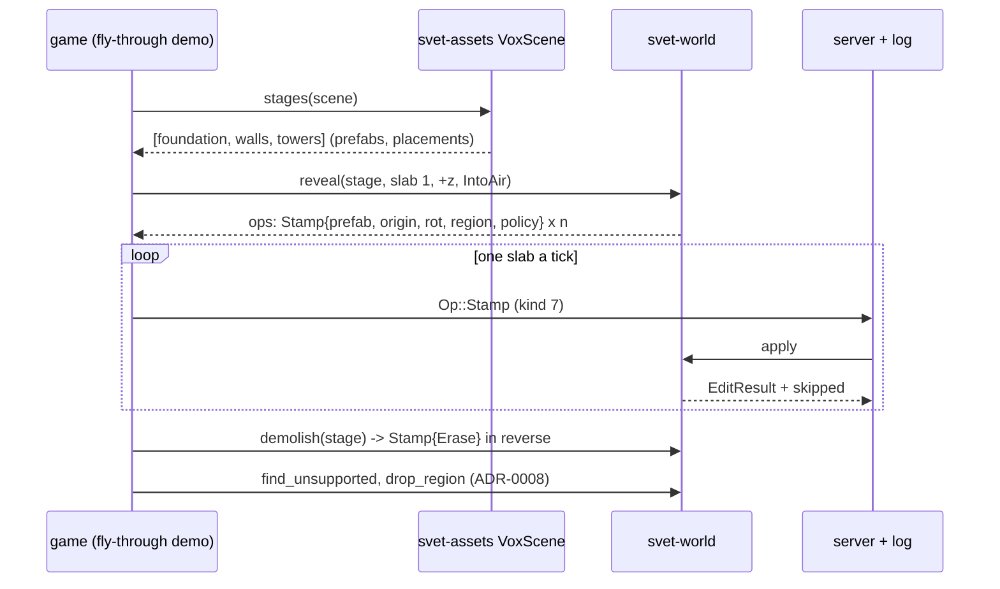

# 0084: Staged structures: stages from a `.vox`, a stamp with a write policy and a region, a reveal over ticks, and a demolish

> **Status:** approved (2026-11-16, the owner's go with every recommended answer)
> **Created:** 2026-11-16
> **Milestone:** M7 in [`docs/roadmap.md`](../roadmap.md) (stamping at authored-building
> scale), beside M8's collapse ops (what falls after a demolish).
> **Related ADRs:**
> [ADR-0067](../adrs/0067-a-staged-structure-is-a-sequence-of-logged-stamps-over-the-map-with-a-write-policy-not-an-entity.md)
> (proposed; a staged structure is logged stamps over the map with a write policy, not an
> entity), accepted at this plan's close. Rests on
> [ADR-0066](../adrs/0066-a-large-prefab-is-stored-as-bricks-and-its-stamp-is-a-placement-the-world-finishes-as-chunks-arrive.md)
> (brick prefabs, placements past residency),
> [ADR-0014](../adrs/0014-prefab-identity-in-the-op-log.md) (the
> stamp op), [ADR-0007](../adrs/0007-server-op-log-byte-channel-shared-and-owned-clients.md) (the game's
> tick drives ops) and
> [ADR-0008](../adrs/0008-collapse-as-capped-support-flood-and-rigid-vertical-drop.md) (what
> falls is the support query and drop ops).
> **Source:** the owner, 2026-11-16: "model entities with several different levels, e.g. a
> castle being built: first the foundation, then walls, then a tower in progress... all of that
> we should be able to destroy live, so this maybe not an entity by itself but part of the map.
> What do you think?"
> **Starts after:** Plan 0083 closes (its `VoxScene` carries the layers, its brick prefabs and
> placements carry a stage of any size, its Structures page is where the demo lives).

## TL;DR

A building under construction is **part of the map**, not an entity: the owner's reading is
right, and this plan builds it that way. A structure's `.vox` holds its **stages** as
MagicaVoxel layers (foundation, walls, towers, keep); `svet-assets` reads them in order, and
each stage is applied to the world as **stamps with a write policy**: `IntoAir` writes only
where the world holds air, so a player's hole and their rubble survive the next stage,
`Overwrite` is today's authoring stamp, `Erase` removes only what the structure put there. A
stamp also takes a **region** of its prefab, so a stage can be **revealed** a slab at a time
over ticks, every slab a logged op the server orders and every client replays; a pure
planner turns a stage into those ops, and the game decides when to send them. Demolition is
the same ops with `Erase`, in reverse, and what the support query then finds unsupported
falls through Plan 0009's drop ops. The fly-through's Structures page gets `build`,
`next stage`, `demolish` and a `reveal` speed, so the owner watches the castle rise layer by
layer, digs into its walls while it does, and knocks it down. The first thing anyone sees:
the chapel's foundation appears at the crosshair, then its walls climb a voxel layer a tick,
and a carve into them leaves a hole the tower stage does not fill.

## Context & problem

- The owner's request is a structure that changes over time and is destructible live. Entities
  (ADR-0050) are rigid, undiggable, uncollided but for the ray query, unlit by the bake and
  capped at 16 parts of 64 voxels; a castle fits none of that. World voxels are dug, collided
  with, baked, collapsed and logged. The structure belongs to the world.
- A stamp today writes every masked voxel whatever stands there (`crates/svet-world/src/stamp.rs`:
  "an authoring operation"). A stage applied over a damaged earlier stage, over the player's
  rubble or over a wall the player built, must decide per voxel, and the engine should not
  decide that for the game.
- A stamp writes its whole prefab at once. A stage appearing over ticks needs the stamp of a
  part of a prefab, as an op, so that the server's tick order and the log carry it (ADR-0007).
- Plan 0083 reads `LAYR` and keeps layers on `VoxScene` but does nothing with them; the stamp op
  is kind 2 (prefab, origin, rotation; ADR-0014); the result is per-material counts and a box.
- `project-context.md`: Edits P2 "scripted collapse", World P1 "prefab stamping with
  rotation"; the game that builds a castle is the consumer's, the engine offers the stamp.
- Figures touched: `docs/nfr.md` section 4 (stamp cost, the policy branch; the log's bytes per
  op), section 6 (determinism of the reveal's ops across platforms).

## Decision

We give the stamp a write policy (`Overwrite`, `IntoAir`, `Erase`) and an optional region in
the prefab's rotated frame, as wire kind 7 beside kind 2, and the result a `skipped` count.
`svet-assets` turns a `VoxScene`'s layers into ordered stages, each a list of prefabs and
placements; `svet-world` offers `reveal`, a pure function from a stage, a slab thickness, an
axis and a policy to the ops that stamp it slab by slab, and `demolish`, the same with
`Erase` in reverse. The engine keeps no structure state: the game holds the cursor. The
fly-through's Structures page drives a structure's stages and reveal at its tick, and runs
the support query after a demolish so the unsupported parts drop (ADR-0067). We rejected an
entity with several models, snapshots and diffs, and an engine-side construction scheduler
(ADR-0067). We rejected a `Repair` policy that rewrites an earlier stage's own materials only:
no consumer asks for it yet, and `Overwrite` of the earlier stage restores the design.

## Architecture diagram



## Implementation phases

Each phase ships as its own commit. `dev` implements the dev phases in one session; Phase 4 is
the owner's window and Phase 5 follows it.

### Phase 1: a stamp with a write policy and a region (walking skeleton)
- **Owner skill:** dev
- **What:** `Op::Stamp` gains `policy` and `region`, applied in the blit, logged as kind 7,
  reported with a `skipped` count.
- **Files touched:** `crates/svet-world/src/stamp.rs` (`StampPolicy`, the per-voxel branch in
  `blit`, a `region` clip of the rotated box), `src/log.rs` (`Op::Stamp { policy, region }`,
  kind 2 when `Overwrite` and no region, kind 7 otherwise), `src/wire.rs`, `src/edit.rs`
  (`EditResult::skipped`), `crates/svet-world/tests/stamp.rs`, `tests/log.rs`,
  `benches/stamp.rs` (`prefab64_mixed_into_air`), `crates/svet-net/tests/` (kind 7 through the
  server), `docs/nfr/04-edits.md`.
- **Done when:**
  1. `into_air_leaves_what_stands_there` (`tests/stamp.rs`, under 1 s): the 16³ vault stamped
     `IntoAir` into air with one rock voxel inside its shell's footprint writes 4095 voxels,
     skips 1, and the rock voxel is still rock; the same stamp `Overwrite` writes 4096.
  2. `erase_removes_only_its_own` (`tests/stamp.rs`): after the vault is stamped and one shell
     voxel replaced by rock, `Erase` of the vault sets 1351 shell voxels to air, skips 1, and
     leaves the rock and the 2744 interior air voxels (already air: changed 0, not skipped).
  3. `a_region_writes_its_slab` (`tests/stamp.rs`): the vault with region `z in 3..=3` writes
     exactly the 16 x 16 shell ring minus its interior: 60 voxels of shell and 196 of air at
     z = 3 (256 in all), and nothing elsewhere; under `Rot::Z90` the region is in the rotated
     frame (the same 256 voxels at z = 3).
  4. `kind_7_round_trips_and_kind_2_is_unchanged` (`tests/log.rs`): an `Overwrite` stamp with
     no region encodes to the same 34 bytes as before; a kind 7 op encodes to 34 + 1 + 24 bytes
     (policy, then `lo` and `hi` as six `i32`) and decodes equal; a format 2 fixture replays.
  5. Readings: `prefab64_mixed_into_air` against `prefab64_mixed` (guess: within 15 %).

### Phase 2: stages from a `.vox`, and the planner
- **Owner skill:** dev
- **What:** `VoxScene::stages` orders a scene's layers (or `stage <n>` groups) into stages;
  `svet_world::reveal` and `demolish` plan a stage's ops.
- **Files touched:** `crates/svet-assets/src/scene.rs` (`Stage { name, placements }`;
  `stages()`: layers in `LAYR` order, hidden layers skipped, a file without layers one stage;
  a top-level group named `stage <n> <name>` makes a stage when the file has no layers),
  `crates/svet-assets/tests/scene.rs`, `crates/svet-world/src/stamp.rs` (`reveal(stage: &[(Arc<Prefab>,
  VoxelCoord, Rot)], slab: u32, axis: Axis, policy) -> Vec<Op>`: per placement, regions of
  `slab` voxels from the rotated box's low end up, placements interleaved by world height so the
  structure rises as one; `demolish` the reverse with `Erase`), `crates/svet-world/tests/stamp.rs`,
  `apps/flythrough/assets/structures/chapel/chapel.voxtext` and `.vox` (three layers:
  `1 foundation`, `2 walls`, `3 tower`), `apps/flythrough/src/castle.rs` (the generated castle's
  tiles on four layers: foundation and curtain, towers, gatehouse, keep and dungeon).
- **Done when:**
  1. `layers_are_stages_in_order` (`tests/scene.rs`, under 0.1 s): a file with layers named
     `2 walls`, `1 base`, `3 roof` (ids in that order) yields stages `[base, walls, roof]` with
     the right placements; a hidden layer is left out; a file with no layers is one stage.
  2. `a_reveal_covers_the_stage_once` (`tests/stamp.rs`, under 2 s): the chapel's walls stage
     revealed at slab 1 along +z yields as many ops as the stage's rotated height in voxels per
     placement, their regions disjoint and covering every voxel; applying them in order
     `IntoAir` gives the same world hash as the whole stage stamped once `IntoAir`, and the same
     hash on both CI arms (a pinned vector).
  3. `demolish_is_the_reverse` (`tests/stamp.rs`): the chapel built in three stages then
     demolished with `demolish` ends with the voxel hash of the world before the build; with a
     player's rock column stamped through the footprint between the stages, the column stands
     after the demolish.

### Phase 3: the fly-through builds and demolishes
- **Owner skill:** dev
- **What:** the Structures page gains `build in stages`, `next stage`, `demolish last`,
  `reveal` (voxel layers a tick, 0 for whole stages); a demolish runs the support query and
  drops what is unsupported; the banner shows stage and slab.
- **Files touched:** `apps/flythrough/src/structures.rs` (the cursor: structure, stage, the
  planned ops left, ops sent per tick), `src/menu/` (the entries and their values),
  `src/hud.rs` (the banner `chapel  stage 2/3 walls  slab 17/40`), `src/logic`'s dig path
  unchanged (digging a rising wall is today's carve), `apps/flythrough/tests/structures.rs`,
  `tests/toggles.rs`, `tests/replay.rs` (a session with a staged build replays to its hash),
  `docs/flythrough.md`.
- **Done when:**
  1. `a_staged_build_replays` (`tests/structures.rs`, headless, under 5 s): the chapel built
     at `reveal 1` over its ticks, with a carve into the walls stage at a chosen tick, gives a
     world hash a replay of the log reproduces; the carve's hole is air after the tower stage.
  2. `a_demolish_drops_the_unsupported` (`tests/structures.rs`): after `demolish last` on the
     chapel's tower over a wall the player carved thin, the op log holds the `Erase` ops, then
     a drop op from `find_unsupported` where a part lost its support, and the world hash is the
     same on both arms.
  3. The page shows its mode: `reveal 1`, `stage 2/3`, and the banner's words; `tests/toggles.rs`
     asserts them.

### Phase 4: the owner's window
- **Owner skill:** human
- **What:** the owner builds the castle in stages, digs it while it rises, demolishes it.
- **Files touched:** `docs/plans/logs/0084.md`.
- **Done when:** on Linux, the owner places the castle from the Structures page with `build in
  stages` at `reveal 1`, then at `reveal 0` (whole stages); digs into the curtain wall while the
  towers rise; demolishes the keep and watches what falls; answers whether the layer-by-layer
  reveal reads well (speed, the slab's direction), whether `IntoAir` is the default a game
  wants, and whether a `Repair` policy is wanted now.

### Phase 5: the owner's picks and the tip
- **Owner skill:** dev
- **What:** the picks become defaults, the docs follow, the readings land, the gate runs.
- **Files touched:** the defaults the picks name, `docs/nfr/04-edits.md`, `docs/flythrough.md`,
  `apps/flythrough/assets/structures/README.md` (how layers are stages), the gate at the tip.
- **Done when:** the policy bench reading and the log bytes per op are in `nfr`; the four doc
  gates exit 0; the gate tier is green at the tip with its wall time read.

## Data shapes

```rust
// illustrative, svet-world
pub enum StampPolicy { Overwrite, IntoAir, Erase }
pub struct Op::Stamp { prefab: u64, origin: VoxelCoord, rot: Rot,
                       policy: StampPolicy, region: Option<([i32; 3], [i32; 3])> }  // rotated local
pub struct EditResult { changed_from: .., touched: .., aabb: .., skipped: u32 }

pub fn reveal(stage: &[(Arc<Prefab>, VoxelCoord, Rot)], slab: u32, axis: Axis,
              policy: StampPolicy) -> Vec<Op>;
pub fn demolish(stage: &[(Arc<Prefab>, VoxelCoord, Rot)], slab: u32, axis: Axis) -> Vec<Op>;
```

```rust
// illustrative, svet-assets
pub struct Stage { pub name: String, pub placements: Vec<(usize, VoxelCoord, Rot)> }
impl VoxScene { pub fn stages(&self) -> Vec<Stage>; }
```

## Budgets

| Figure | `nfr.md` | Expected | How the close reads it |
|---|---|---|---|
| Stamp cost with a policy | section 4 | `prefab64_mixed_into_air` within 15 % of `prefab64_mixed` (guess) | `cargo bench -p svet-world --bench stamp`, dev reference |
| Log bytes per op | section 4 | kind 2 stays 34; kind 7 is 59 | `tests/log.rs` asserts the counts |
| A reveal's ops per tick | section 4's per-frame edit line (2.0 ms for 100 carves) | one slab op a tick, far under it; a reading at `reveal 1` on the castle | the HUD's tick line in Phase 4 |
| Determinism | section 6 | a pinned vector for the staged chapel on both arms | `a_reveal_covers_the_stage_once` |

## Risks & open questions

- **`IntoAir` and the stage's own design.** A stage's voxel over an earlier stage's voxel (a
  wall standing on its foundation's top row) is skipped, since that voxel is not air. Stages
  authored as layers do not overlap, so this is right; a stage authored to overwrite its
  predecessor needs `Overwrite`. The README says so.
- **Rubble in the footprint.** `IntoAir` leaves a rubble pile where the next stage's wall goes,
  a wall with a hole. That is the policy's point; a game that wants the design restored uses
  `Overwrite`.
- **A slab across placements.** `reveal` interleaves placements by world height so a structure
  of several models rises as one; a model placed higher starts later. The order is a function
  of the placements, so it is deterministic.
- **The log grows by a slab op per tick.** 59 bytes a slab; a castle of 400 voxel layers over
  four stages is about 100 KB. Acceptable.
- **What falls.** A demolish of a lower stage under a higher one leaves the higher one
  unsupported; the fly-through runs `find_unsupported` and `drop_region` after an `Erase`,
  as Plan 0022's logic does after a carve. The drop's cost is Plan 0009's reading.

### Owner questions (each with a recommendation)

1. **The engine's part.** Recommended: a stamp with a policy and a region, plus pure planners,
   and no structure state in the engine (ADR-0067); the game holds the cursor. Alternative: a
   `Structure` object in `svet-world` with a cursor and `advance()`, which puts a construction
   clock in the engine.
2. **The default policy for a stage.** Recommended: `IntoAir` (a player's hole and rubble
   survive the next stage). Alternative: `Overwrite` (the design wins; today's stamp).
3. **Stages in the file.** Recommended: MagicaVoxel layers in layer order, one stage each;
   `stage <n>` groups when a file has no layers. Alternative: a `.structure` text file beside
   the `.vox` naming the stages' models (a second file to maintain).

## Order

After Plan 0083 closes. It does not hold M10 (Plans 0069 and 0032 run as the owner set them).
Phase 4 can share a window with whichever entity plan is at its window then.

## What this plan does NOT do

- A `Repair` policy (`IntoAirOrOwn`): added if the owner asks in Phase 4.
- Construction entities (a crane, a drawbridge): Plans 0062, 0063 and 0079's entities.
- An engine-side scheduler that reveals over ticks on its own (ADR-0067 rejects it); the
  backlog's chunk-scale event scheduler is a separate idea.
- A structure's state in the save beyond the ops: the log is the state.
- Blueprints, costs or the game's rules for when a stage advances.

## Implementation log

> Written by `dev`: one row per phase as its commit lands, then the close block. **The phases
> above are the contract. This section records what happened.** Observations, never conclusions:
> no pass list, no self-assessment. Deviations and unmet done-whens are **always** disclosed.
> Keep it shorter than `## Implementation phases`. Readings, gate counts, attempts, sweeps and
> resume notes go to the plan's readings log, `docs/plans/logs/0084.md` (started from
> `templates/readings-log.md`), and this section links it once it exists.

| phase | owner | state | commit |
|---|---|---|---|
| 1: a stamp with a policy and a region | dev | not started | |
| 2: stages from a `.vox`, the planner | dev | not started | |
| 3: the fly-through builds and demolishes | dev | not started | |
| 4: the owner's window | human | not started | |
| 5: picks and the tip | dev | not started | |

### Notes

_(Deviations from the plan, with the commit, stated without justification. Done-whens not
satisfiable as stated, and what was done instead. Followups noticed and not acted on. One line
each. Empty is fine.)_

### Close triggers

_(Facts for the architect. No recommendations, and no suggested version bump.)_

- **What shipped:** feature / fix-only / docs-chore-only
- **Public API changed:** types, traits, functions, shader interfaces, config (list them, or none)
- **Budget readings:** each `nfr.md` figure touched, with its measured value, machine and commit
- **Gate at the tip:** the commands run (build, nextest, doctests, clippy, fmt, deny), exit codes, test counts
- **Outstanding `human` phases:** which, or none

## Followups

_(Empty at draft time.)_
