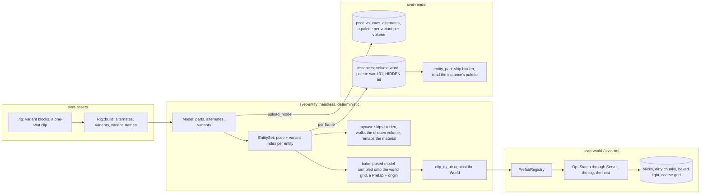

# 0085: Entity variants: hide, swap and remap per instance from the `.rig`, a one-shot clip that holds, and a posed entity stamped into the world

> **Status:** approved (2026-11-16, the owner's go with every recommended answer)
> **Created:** 2026-11-16
> **Milestone:** M6 in [`docs/roadmap.md`](../roadmap.md)
> **Related ADRs:** [ADR-0068](../adrs/0068-an-entitys-variants-are-recipes-in-its-model-a-volume-per-part-and-a-palette-per-variant-picked-per-instance.md)
> (proposed; variants as recipes in the model) and
> [ADR-0069](../adrs/0069-a-posed-entity-enters-the-world-as-a-baked-prefab-clipped-to-air-through-the-stamp-op.md)
> (proposed; the bake and the stamp), both accepted at this plan's close. Rests on
> [ADR-0050](../adrs/0050-entities-are-posed-voxel-volumes-in-their-own-pool-traced-after-the-world-march.md)
> (parts, the pool, the instances, the exact query),
> [ADR-0051](../adrs/0051-rigs-and-clips-are-text-files-sampled-in-fixed-point-by-tick.md)
> (the `.rig`, clips by tick),
> [ADR-0060](../adrs/0060-entity-volumes-are-freed-by-handle-into-a-coalescing-free-list-and-never-moved.md)
> (the pool's free, the stable slots) and
> [ADR-0014](../adrs/0014-prefab-identity-in-the-op-log.md) (a stamp names its prefab by
> content id; a save carries the prefabs it names).
> **Source:** the owner, 2026-11-16: "For entities we should also have modes - e.g. the spider
> is healthy, then damaged, then dead - is it 3 separate entities or one with modes?" The
> answer agreed: **one entity with modes**, the engine knowing no gameplay: it offers clips that
> hold, variants declared in the `.rig` (hide, swap, remap), a model swap, and an entity that
> becomes world voxels; the game names the modes and combines the mechanisms.
> **Starts after:** [Plan 0063](done/0063-rigs-and-clips-keyframe-animation-a-model-viewer-and-text-authoring.md)
> (the clips, `Pose::compose`, the viewer), the clip-recorder chore (the entities library under
> `apps/flythrough/assets/entities/`, `docs/entities.md`) and
> [Plan 0078](done/0078-the-entity-pool-frees-models-by-handle-stable-instance-slots-and-a-reset.md)
> (it rewrites `entities.rs`'s instance write and gives the handle its generation) have merged
> into main. It edits the files [Plan 0079](done/0079-entities-aware-of-floor-and-walls-a-surface-mover-the-smoothed-normal-and-a-wandering-demo.md)'s
> Phase 3 and [Plan 0082](0082-squash-and-stretch-a-scale-per-part-in-the-pose-and-the-clips.md)
> edit (`clip.rs`, `rig.rs`, `entities.rs`, `entity.wgsl`, `spider.rig`), so the recommended
> slot is **after Plan 0082 merges** (owner question 1); it may run beside
> [Plan 0077](done/0077-an-entity-picker-in-the-fly-through-choose-a-model-from-the-library-and-place-it.md)
> and 0079's Phase 4 (apps only). Before the lane starts the architect re-reads Phases 1 to 3
> against the tip. Read against `plan-0063` c5c655ad, `plan-0062` 9e630854 and the
> `chore-clip-recorder` branch; the tree's names win when the lane starts.

## TL;DR

One spider, three looks, one `EntityId`. A `.rig` gains **variants**: named recipes that hide a
part, swap a part's volume for another `.vox` node, or remap a material on every voxel that
carries it; a game picks one per instance at runtime (`set_variant`), and the picture and the
server's ray query both honour it (a hidden part is not hit, a remapped material is what the
hit reports). A one-shot clip already **holds** its last pose; this plan names it, tests it and
lets a playback say it has **ended**. A whole-model change is Plan 0078's `replace` and
`free_model`, documented here as the third route. And a posed entity can be **stamped into the
world**: `svet-entity` resamples it onto the world grid in integers, the server clips it to air
and stamps it through the op log as any prefab, so a corpse is dug, stood on and lit by the
baked light at no entity cost. The sample: the spider gains `damaged` (one leg hidden, one
swapped for a broken stump, its shell charred) and `dead` (a `death` clip that folds it and
holds, its eyes gone dull), and the fly-through stamps the dead spider into the floor. The
first thing anyone sees: `flythrough --source showcase --shot hall --model
apps/flythrough/assets/entities/spider/spider.rig --variant damaged`, press `` ` ``, and a
seven-legged spider with a stump and a blackened shell stands in the hall.

## Context & problem

`project-context.md` (Rendering, P1: "entities lit consistently"; World, P1: prefab stamping;
Edits: every edit returns what it changed) and the roadmap's M6 give the engine rigid-part
models with clips, a pool of their volumes, a headless ray query and a stamp op. A creature in
the first consumer is hurt, loses limbs, dies and lies there. What the tree holds (read at
`plan-0063` c5c655ad, `plan-0062` 9e630854, the `chore-clip-recorder` branch):

- **The model has no state but the pose.** `EntitySet`'s entry is `model`, `pose`, the
  composed `frames` and a box (`set.rs`); `raycast` walks every part with no skip and reads the
  material from the prefab. `Model::id()` hashes the parts' prefab ids, parents, pivots and
  details (`model.rs`).
- **The instance is full but for one word.** 32 words: the two transforms (0 to 23), the volume
  word (24), the entity index (25, which Plan 0078 takes for the slot and its generation), flags
  with only bit 0 defined (26), `1 / detail` (27), the volume size (28 to 30), and 31 spare.
  `entity_part` (`entity.wgsl`) reads the palette's address from the **volume's header**, so a
  palette is shared by every instance that draws that prefab.
- **A one-shot clip holds.** `Clip::clip_tick` clamps a tick to the length when not looped
  (`clip.rs`), and `sample_track` holds the last key; Plan 0063's `a_loop_wraps_and_a_one_shot_holds`
  asserts it. Nothing reports that a playback has reached its end.
- **The `.rig` has six statements** (`vox`, `rate`, `material`, `part`, `clip`, `key`); a part
  names its voxels by `node` or `model`; a `.vox` model no part names is ignored, so there is
  no way to declare a volume for a swap. Palette indices are resolved to material ids at build
  through a `VoxMap`, whose index 0 is `Air`: a rig-built part writes air with its mask set, so
  stamping such a prefab directly would carve its whole box.
- **The stamp op** (`World::stamp`, kind 2) writes every masked voxel of a prefab at a
  whole-voxel origin in one of 24 rotations, with no overlap mode; it names the prefab by
  content id, resolved in a `PrefabRegistry` the application fills (`Server::register_prefab`),
  and the save's header carries the prefabs the log names (ADR-0014). The fly-through already
  registers and submits one (`edits.rs`, the vault).
- **The library** (`apps/flythrough/assets/entities/`): the spider (fourteen parts at detail 2:
  `body`, `abdomen`, eight legs `leg_l1..4` and `leg_r1..4`, two palps, two fangs; materials
  `shell`, `rubble`, `rock`, `ore`, `crystal`, `amethyst`, `ember`, `walker`, `walker_eye`;
  looped clips `walk`, `idle`, `rear`) and the walker (six parts). No clip in the library is a
  one-shot.

**What is missing:** any per-instance state beyond the pose; a volume a part can swap to; a
palette an instance can choose; a hidden flag the walk and the query both respect; a sign that
a clip has ended; a resampling of a posed model onto the world grid; a clip of the result to
the air it may fill; and the sample that shows it all.

**The `nfr.md` figures touched:** section 2's entity cost (Plan 0062 Phase 5: 64 walkers at
+3.4 to 4.4 ms on the RTX 3080 Laptop, +32 to 34 ms on the Radeon iGPU) and CPU line, section
3's "everything else in VRAM" (unchanged, asserted; the pool's **use** grows by the variants),
section 4's stamp cost (a 64 cubed all-written prefab under 5 ms, a proposal), section 6 (new
fixed vectors) and section 7 (the gate's wall time).

## Decision

**Variants are recipes in the model** (ADR-0068). `Model` gains `alternates` (extra volumes
with a pivot, at the part's detail) and `variants`; a `Variant` is a hidden mask over the parts,
a volume index per part (0 the part's own, k the k-th alternate) and a sorted remap list of
`(from, to)` material ids. An entity carries a `u8` variant index, 0 the base. The mirror
uploads alternates as volumes and, per variant, one 256-word palette for each volume whose
palette holds a remapped material; the instance's word 31 names the palette it reads and bit 1
of word 26 marks a hidden part, which the walk skips and whose box leaves the entity's. The
query skips hidden parts, walks the chosen volume and maps the hit's material through the
remap. We rejected a model per state, a palette per instance, remaps resolved at the pixel and
hiding by not writing the instance (ADR-0068 A to D).

**A clip that holds is what a one-shot clip already does.** `Playback::ended(now)` says so
(`!looped && tick_at(now) >= length`), `docs/entities.md` states it, and the spider's `death`
is the library's first one-shot. We rejected an "end event" or a state machine: the consumer
polls `ended` on its tick, as it owns the playback (ADR-0051).

**A model swap is Plan 0078's `EntitySet::replace` plus `free_model`**, documented in
`docs/entities.md`'s new section as the route for a change that is a different model.

**A posed entity enters the world as a baked prefab, clipped to air, through the stamp op**
(ADR-0069). `svet_entity::bake(model, pose, variant, rule) -> Baked { prefab, origin }` samples
each drawn part's chosen volume at the sub-centres of every world voxel in the part's world box
(detail cubed samples a voxel), in the integer map `part_raycast` already uses; `Coverage::Half`
makes a voxel solid when at least half the samples are (1 of 1, 4 of 8, 32 of 64),
`Coverage::Any` when one is; the material is the plurality of the solid samples' remapped
materials, ties to the lower id; a lower part writes first and a later part fills only what is
still empty; the mask holds solid voxels only. `Baked::clip_to_air(&World)` drops every voxel
whose cell is solid. The consumer registers the prefab and submits `Op::Stamp` at the origin
with `Rot::IDENTITY`, then removes the entity. We rejected a new op kind that re-bakes from the
model and pose, an "only into air" stamp mode on the wire, overwriting rock, and keeping the
corpse an entity (ADR-0069 A to D).

## Architecture diagram



## Implementation phases

Each phase ships as its own commit; `dev` implements the dev phases in one session; the
architect reviews once at the end, in a fresh session. Per phase: `node
scripts/test-changed.mjs --profile quick`, clippy, fmt; `--profile gpu --binaries
gpu_entity_variants` under the perf lock for Phases 2, 3 and 5. At the tip: the gate tier under
the perf lock, doctests, clippy, fmt, deny, the doc and tier gates. Readings go to
`docs/plans/logs/0085.md`. GPU tests go in a new binary, `apps/flythrough/tests/gpu_entity_variants.rs`
(`gpu_entities.rs` is near its 2000-line cap). **Test times are estimates**, none measured;
Plan 0062's lit box renders in 2 to 4 s on lavapipe.

Phases 2 and 3 carry goldens because they draw a declared recipe, not a look the window may
drop; the window (Phase 4) judges the authored spider and the solid rule, and Phase 5 re-blesses
what its picks change.

### Phase 1: variants in `svet-entity` and the `.rig`, and a playback that says it ended (walking skeleton)
- **Owner skill:** dev
- **What:**
  - **`svet-entity`.** `Alternate { volume: Arc<Prefab>, pivot: [i32; 3] }` (at most 64 voxels
    a side, like a part); `Variant { hidden: u16, volume: [u8; MAX_PARTS], remap: Vec<(MaterialId,
    MaterialId)> }` with `remap` sorted by `from`, no duplicate `from`; `Model::with_variants(parts,
    alternates, variants)` validates them (`MAX_ALTERNATES` 16, `MAX_VARIANTS` 16, an unknown
    alternate index, an oversized alternate, a duplicate remap, each a typed `ModelError`);
    `Model::new` is `with_variants` with none, and **a model with no variants keeps its `id()`
    bit for bit** (the variant data is hashed only when present). A part's `reach` covers its
    alternates. `EntitySet::set_variant(entity, index) -> Result<(), PoseError>`
    (`UnknownVariant` past the model's count) and `variant(entity) -> u8`. `raycast` skips a
    hidden part, walks the part's chosen volume about the alternate's pivot at the part's
    detail, and maps the hit's material through the remap. `Playback::ended(now) -> bool`.
  - **`.rig` grammar**, three statements that belong to the last `variant` line, as `key`
    belongs to the last `clip` (a `key` after a variant block still goes to the last clip):

    ```
    # illustrative
    variant damaged
      hide leg_l3
      swap leg_r4 node leg_broken
      remap shell charred_shell
    variant dead
      remap ember shell
    ```

    `swap PART node NAME | model INDEX [pivot x y z]` (the pivot defaults to the part's, in the
    alternate's model voxels); `remap FROM TO` names two material names resolved by the same
    lookup as `material` lines (so `TO` need not appear in the `.vox`). Errors name the line
    and quote the token: a `hide`, `swap` or `remap` before any `variant`; an unknown part,
    node or material; a variant named twice; a part hidden and swapped in one variant; more
    than sixteen. `RigModel` gains `variant_names: Vec<String>`; `Rig::build` turns the blocks
    into `Variant`s and the swap targets into `Alternate`s (deduplicated by node);
    `Rig::write` prints them; `the_parser_never_panics` covers them through the sample's
    prefixes. `docs/entities.md`'s grammar section gains the block in four sentences.
- **Files touched:** `crates/svet-entity/src/model.rs`, `set.rs`, `raycast.rs`, `clip.rs`,
  `lib.rs`, `tests/raycast.rs`, `tests/clip.rs`, `tests/determinism.rs`,
  `crates/svet-assets/src/rig.rs`, `tests/rig.rs`, `docs/entities.md`,
  `docs/plans/logs/0085.md` (new).
- **Done when** (CPU, each under 1 s unless stated):
  1. `a_hidden_part_is_not_hit`: a two-part model of Plan 0062's 8 cubed cube of material 3
     (pivot at its centre, detail 1), part 1 the child of part 0 with rest `t` (2048, 0, 0),
     the root at (104, 54, 104) so part 0's minimum corner is (100, 50, 100) and part 1's
     (108, 50, 100); the ray from (90.5, 54.25, 104.25) along +x hits part 0 at distance 9.5
     under variant 0, and under a variant hiding part 0 it hits part 1, model voxel (0, 4, 4),
     face -x, at distance 17.5.
  2. `a_swapped_part_walks_its_alternate`: the same model with an alternate 8 cubed volume
     whose voxels at model x < 4 are air and the rest material 3; under a variant swapping
     part 0 to it the ray hits part 0 at distance 13.5, model voxel (4, 4, 4).
  3. `a_remap_changes_the_reported_material`: part 0 holds material 3 in its lower half and
     5 in its upper half; under a variant remapping 3 to 7 the ray through the lower half
     reports material 7 and a ray through the upper half still reports 5.
  4. `the_base_variant_is_bit_identical`: Plan 0062's `entity_hits_match_the_fixed_vectors`
     constant is unchanged, and `Model::new(parts).id()` equals `Model::with_variants(parts,
     [], []).id()`; a model with a variant has a different id.
  5. `variant_hits_match_the_fixed_vectors` (`tests/determinism.rs`): 1024 seeded rays
     against Plan 0062's posed three-part model under a variant that hides one part, swaps
     one and remaps one material hash to a committed constant, on Linux and Windows in CI.
     Under 2 s.
  6. `a_one_shot_playback_ends_and_a_loop_never_does`: on a 40-tick one-shot at rate 256
     started at tick 0, `ended(39)` is false and `ended(40)` and `ended(400)` true; the looped
     clip's `ended` is false at every one of those ticks.
  7. `Model::with_variants`'s refusals and `set_variant`'s `UnknownVariant` each return their
     typed error.
  8. `a_variant_block_builds` (`tests/rig.rs`): the block above against a `.vox` holding the
     spider's nodes and a `leg_broken` node builds two variants named `damaged` and `dead`, the
     first hiding `leg_l3`'s index, swapping `leg_r4`'s to alternate 1 with the part's pivot,
     and remapping the lookup's id for `shell` to its id for `charred_shell`; the alternate's
     prefab equals `VoxMap::to_prefab` of the `leg_broken` model.
  9. `errors_name_their_line` grows the six cases above; `a_rig_round_trips` holds with two
     variant blocks; `the_parser_never_panics` passes over the new prefixes (under 5 s).

### Phase 2: the renderer draws the variant, and the spider is damaged
- **Owner skill:** dev
- **What:**
  - **The mirror.** `upload_model` uploads each alternate as a volume (deduplicated by prefab
    id, claimed and freed with the model under ADR-0060) and, for each variant, one 256-word
    palette per volume whose palette holds a `from` of that variant's remap, with the `to`
    substituted; `PoolFull` counts them. The per-frame write reads each entity's variant from
    the set: a hidden part's instance carries `INSTANCE_HIDDEN` (bit 1 of word 26) and its
    box leaves the entity's box; a swapped part's word 24 names the alternate's volume and
    words 28 to 30 its size, its transform about the alternate's pivot; word 31 names the
    palette (the volume's own under variant 0 or where the variant touches nothing in it).
    A variant that changed since the frame before marks every part of the entity moved
    (`INSTANCE_MOVED`, `LEAF_MOVED`) that frame, so the fresh rule and the history's
    `same_thing` do what they do for a moved part. `pool_used_bytes` includes the variant bytes.
  - **The shader.** `entity_part` reads word 26 first and returns a miss on `INSTANCE_HIDDEN`;
    it reads the palette's address from word 31 instead of the volume header. No other shader
    changes.
  - **The fly-through.** `--variant NAME` beside `--model`; an action `entity variant: next`
    on the aimed entity (else the newest), in the key table and the palette (a key only if one
    is free under Plan 0080's set); the entities HUD row names the variant (`spider #3 damaged
    idle 12/120`) and the banner reads `variant damaged`; a reload keeps each instance's
    variant by name (index 0 when the name is gone). If Plan 0077 has merged, the picker's
    clip row gains `variant < base >` (otherwise 0077's re-read adds it).
  - **The library.** `spider.voxtext` gains a `leg_broken` model (the right rear leg cut at a
    third of its length, the stump's end ragged); `spider.rig` gains `variant damaged` as in
    Phase 1's block; the fly-through's material table gains a `charred_shell` row (dark, rough,
    not emissive; the engine's table knows no spider). The library README and
    `docs/entities.md` gain a **Modes** section: clips that hold, variants, the model swap
    through `replace` and `free_model`, and (after Phase 3) the stamp.
- **Files touched:** `crates/svet-render/src/entities.rs` (or its split after Plan 0078),
  `src/shaders/entity.wgsl`, `frame/compose.rs` (the new constant), `apps/flythrough/src/`
  (the viewer, the walkers, `cli/`, `hud/modes.rs`, `toggles.rs`, the material table),
  `apps/flythrough/assets/entities/spider/spider.voxtext`, `spider.vox`, `spider.rig`,
  `entities/README.md`, `apps/flythrough/tests/entities.rs`, `tests/viewer.rs`,
  `tests/gpu_entity_variants.rs` (new), a baseline under `tests/golden/`, `docs/entities.md`,
  `docs/flythrough.md`, `docs/plans/logs/0085.md`.
- **Done when:**
  1. `a_hidden_part_shows_the_wall_behind_it` (`gpu_entity_variants`, lavapipe): Plan 0062's
     `an_entity_hides_the_wall_behind_it` rig (an 8-voxel cube 20 voxels before the camera, the
     wall at 40) with the part hidden: the centre pixel reads the wall's albedo and a hit
     distance of 40 within 0.01; on the lit box with the slab of `an_entity_casts_a_hard_shadow_on_the_floor`
     hidden, the floor pixel under the light reads its analytic 9.40 within 2 %. About 4 s.
  2. `a_swapped_part_shows_its_alternate_silhouette`: the 16 x 4 x 4 bar of
     `a_turned_bar_shows_its_turned_silhouette` swapped for an 8 x 4 x 4 alternate sharing its
     pivot: the pixel 6 voxels right of centre reads the wall and the pixel 2 voxels right
     reads the bar. About 3 s.
  3. `a_remapped_part_reads_the_new_albedo`: the cube's material (albedo (0.8, 0.2, 0.2))
     remapped to a row of albedo (0.2, 0.8, 0.2): the centre pixel reads (0.2, 0.8, 0.2)
     within 1/255 a channel in the albedo view; a second material in the cube is unchanged.
     About 3 s.
  4. `the_picture_and_the_query_agree_under_a_variant`: Plan 0062's done-when 4 over the
     spider under `damaged`: on every pixel whose four neighbours name the same part, the hit
     record's part equals `EntitySet::raycast`'s, and no pixel names `leg_l3`. About 4 s.
  5. `a_variant_change_marks_its_pixels_fresh`: the cube still for 32 frames, hidden at frame
     33: that frame the pixels it covered and its shadow's floor pixels carry the fresh bit and
     a floor pixel 40 voxels away does not; over the 32 still frames no pixel does. About 3 s.
  6. `the_pool_holds_the_variant_bytes`: after `upload_model` of the spider,
     `pool_used_bytes` equals the sum of its distinct volumes' bytes (the fourteen parts and
     `leg_broken`) plus 1024 times the number of distinct volumes whose palette holds `shell`;
     dev prints both figures to the log. `free_model` returns every byte. Under 3 s.
  7. `spider_damaged_golden`: the damaged spider at tick 0 of `idle` on the lit box, 192 x
     108, `--lighting half`, blessed once on lavapipe. About 3 s.
  8. `the_committed_library_builds` (`tests/entities.rs`) reads the spider's `damaged`: one
     alternate, `leg_l3` hidden, `leg_r4` swapped, `shell` remapped to `charred_shell`; the
     `.voxtext` still converts to the committed `.vox` byte for byte. Under 1 s.
  9. The HUD, banner and action tests (no device, under 1 s): the row and banner above; the
     action cycles the aimed entity's variant and wraps to `base`; `--variant` parses and an
     unknown name is a startup error naming it and the names the rig has; under `--tester` the
     action maps to none.
  10. The readings in the log: the frame and its hit and light passes at `--entities 64`
      with the spider under `base` and under `damaged`, headless, 1920 x 1080, both adapters,
      three quiet rounds under the perf lock and the memory cap; `EntityMirror::bytes()` at
      the defaults, expected 8 458 240 (unchanged).

### Phase 3: the death clip, the bake, and a dead spider in the floor
- **Owner skill:** dev
- **What:**
  - **The clip and the variant.** `spider.rig` gains `clip death ticks 36` (no `loop`): the
    legs fold under the body over the first 24 ticks, the body drops and tilts, the palps close;
    it holds at tick 36. `variant dead` remaps the eyes' emissive material (dev reads which row
    the `.voxtext` uses) to `shell`, so a dead spider's eyes stop glowing. The architect's
    first cut; the window re-reads it.
  - **The bake** (`svet-entity`, `bake.rs`): `pub fn bake(model, pose, variant: u8, rule:
    Coverage) -> Result<Baked, BakeError>`; `Baked { pub prefab: Prefab, pub origin:
    VoxelCoord }`; `Coverage::{Half, Any}`; `BakeError::{UnknownVariant, TooLarge { size },
    Pose(PoseError)}`, `TooLarge` past 256 voxels an axis (ADR-0014's largest model). The rule
    in the Decision, in the integer map `part_raycast` carries a ray origin with (if Plan 0082
    has landed, the composed frame's scale divides it, and a scaled part is a test case).
    `Baked::clip_to_air(&World) -> Result<u32, EditError>` clears the mask where the world
    cell is not `AIR` and returns the count dropped (`NotResident` where a chunk is out).
  - **The fly-through.** An action `entity: into the world` on the aimed entity (else the
    newest): bake with its variant and the fly-through's `Coverage` setting (`--bake-rule
    half|any`, shown in the HUD row while an entity is aimed), `clip_to_air`, register through
    `net.server.register_prefab`, submit `Op::Stamp` as `edits.rs` submits the vault's, and
    remove the entity (and `free_model` when it was the last instance of a library entry that
    is not kept) once the op has applied; the banner reads `into the world: <n> voxels, <m>
    clipped`; a `NotResident` or `TooLarge` is a red banner and the entity stays. Under
    `--tester` the action maps to none.
- **Files touched:** `crates/svet-entity/src/bake.rs` (new), `lib.rs`, `tests/bake.rs` (new),
  `tests/determinism.rs`, `apps/flythrough/src/` (the action, `edits.rs`, `cli/`,
  `hud/modes.rs`, `toggles.rs`), `apps/flythrough/assets/entities/spider/spider.rig`,
  `apps/flythrough/tests/entities.rs`, `tests/edits.rs` (or where the vault stamp's test
  lives), `tests/gpu_entity_variants.rs`, a baseline under `tests/golden/`,
  `docs/entities.md`, `docs/flythrough.md`, `docs/plans/logs/0085.md`.
- **Done when** (CPU under 1 s unless stated):
  1. `an_axis_aligned_part_bakes_to_itself`: the 8 cubed cube of material 3 at rest with its
     minimum corner at (100, 50, 100), detail 1, under either rule: `origin` (100, 50, 100),
     size (8, 8, 8), 512 written voxels, every one material 3, and `prefab.id()` equals that
     of `Prefab::new([8; 3], vec![3; 512], None)`.
  2. `a_half_turn_bakes_the_mirrored_set`: the cube with only its model x < 4 half solid,
     turned 180 degrees about z through its centre (quaternion (0, 0, 0, 16384), exact):
     the written voxels are exactly the x >= 4 half, 256 voxels.
  3. `detail_two_bakes_on_the_world_grid`: a 16 cubed part at detail 2, all solid, bakes to
     8 cubed, 512 voxels, under both rules; a 16 cubed part holding only a 1 x 1 x 16
     model-voxel post along one edge bakes to 8 voxels under `Any` (2 of 8 samples) and to
     none under `Half`; a one-model-voxel plate (x = 0) bakes to 64 voxels under both (4 of 8).
  4. `a_tilted_bake_matches_the_float_reference`: a 16 x 4 x 4 bar turned 45 degrees about z
     at detail 1 under `Half`: the written count is within 2 % of an `f64` reference applying
     the same rule in the test, and every voxel the two disagree on has an empty face
     neighbour in both (a boundary voxel). Under 2 s.
  5. `a_hidden_part_is_not_baked_and_a_remap_is`: Phase 1's two-part model under its variant
     (part 0 hidden, material 3 remapped to 7): the bake holds 512 voxels, all from part 1's
     box, all material 7, and the origin is (108, 50, 100).
  6. `overlapping_parts_follow_part_order`: two parts of materials 3 and 5 posed over the same
     world voxels bake to material 3 everywhere they overlap.
  7. `clip_to_air_drops_the_voxels_in_rock`: a bounded world solid below z = 50, the cube
     baked at minimum corner (100, 100, 46): `clip_to_air` returns 256 and the stamp of the
     result at its origin reports `changed_from` `{0: 256}` and an `aabb` from (100, 100, 50)
     to (107, 107, 53); the rock's count in the world is unchanged.
  8. `bakes_match_the_fixed_vectors` (`tests/determinism.rs`): Plan 0062's posed three-part
     model at detail 2 under a tilted pose and Phase 1's variant bakes to a committed
     `prefab.id()` under each rule, on Linux and Windows in CI.
  9. `a_baked_entity_stamps_through_the_server_and_replays` (the fly-through's `tests/edits.rs`
     or beside the vault stamp's test): register, submit, apply: the op's `EditResult` counts
     equal the clipped prefab's written voxels under `AIR`; the saved log decodes with the
     prefab in its table and replays to the same world hash.
  10. `a_stamped_entity_is_a_world_hit` (`gpu_entity_variants`, lavapipe): the 8-voxel cube
      20 voxels before the camera; after the bake, the stamp, the entity's removal and the
      mirror's sync, the centre pixel's record is a world hit (no `HIT_ENTITY`) at distance 20
      within 0.01 with the material's albedo; a sphere carve of radius 6 through it then reads
      the wall at 40. The number of frames between the removal and the first frame the pixel
      reads the stamped voxel is a reading in the log. About 5 s.
  11. `spider_death_golden`: the spider at the last tick of `death` on the lit box (an entity,
      not stamped), 192 x 108, `--lighting half`, blessed once on lavapipe; and
      `spider_corpse_golden`: the same pose stamped under `Half` and the entity removed, after
      32 frames so the baked light settles, blessed once. About 4 s each.
  12. `the_committed_library_builds` reads a 36-tick one-shot `death` whose `Playback::ended`
      is true at tick 36, and a `dead` variant with one remap.
  13. The banner, HUD and action tests (no device, under 1 s): `into the world: 1234 voxels,
      56 clipped` (figures from a fixture), the red banners, `--bake-rule` parses and shows in
      the row, the tester filter.
  14. The readings in the log: the spider's bake time under each rule and its prefab's
      encoded bytes (release, dev box, the perf lock), against the guesses of under 20 ms and
      about 200 KB; `World::stamp` of that prefab; the frames between removal and the corpse's
      first drawn frame (done-when 10).

### Phase 4: the owner's window
- **Owner skill:** human
- **What:** one sitting in the hall.

  ```
  cargo build --release -p flythrough
  target/release/flythrough --source showcase --shot hall --exposure 8 --hud \
      --model apps/flythrough/assets/entities/spider/spider.rig --clip idle

  # 1. Place a spider; cycle its variant: base, damaged, dead. Look at the stump, the charred
  #    shell, the dull eyes; walk round it. Cycle the clip to `death`, watch it fold and hold.
  # 2. Stamp it into the world (the action). Look at the blink, the stepped legs, the light on
  #    it; dig into it; stand on it. Place another, tilt the camera, stamp with `--bake-rule any`
  #    on a second run and compare the legs' thickness.
  # 3. Sixteen spiders under `damaged`, walking (F11), for the cost on screen.
  target/release/flythrough --level --seed 1 --entities 16 --hud \
      --model apps/flythrough/assets/entities/spider/spider.rig --variant damaged
  ```
- **Files touched:** this plan's log.
- **Done when:** the log records the owner's words on: (a) the damaged spider: does one entity
  with a recipe read as the owner meant by "modes"; (b) the `death` clip and its hold; (c) the
  corpse: the blink at the stamp, the stepped resampling, `Half` against `Any`, the light on it;
  (d) digging and standing on it; (e) the cost at sixteen. **Stop rule:** a "no" on (c)'s
  blink goes to the architect with Phase 3's frame reading (the first amendment holds the
  entity drawn until the stamp's chunks have synced); a "no" on the resampling goes to the
  architect with the two rules' readings. The plan closes with that record.

### Phase 5: the owner's picks, and the tip
- **Owner skill:** dev
- **What:** the `Coverage` default follows the window; the authored `death`, `leg_broken` and
  `dead` take the owner's words; the goldens the picks changed are re-blessed, once;
  `docs/entities.md`'s Modes section and `docs/flythrough.md` are final; the backlog entry
  for per-entity voxel damage points at this plan; the tip's gate and the readings log's
  close block.
- **Files touched:** the library's spider files, `tests/golden/`, `docs/entities.md`,
  `docs/flythrough.md`, `docs/backlog.md`, `docs/plans/logs/0085.md`.
- **Done when:** every test above passes at the tip with the picked default; the gate tier,
  doctests, clippy, fmt, deny and the doc gates exit 0; the readings log holds the frame at
  `--entities 64` under `base` and `damaged` on both adapters, the bake and stamp times and
  bytes, and the removal-to-corpse frame count.

## Data shapes

```rust
// illustrative: svet-entity
pub const MAX_ALTERNATES: usize = 16;
pub const MAX_VARIANTS: usize = 16;
pub struct Alternate { pub volume: Arc<Prefab>, pub pivot: [i32; 3] }   // at the part's detail
pub struct Variant {
    pub hidden: u16,                       // bit i: part i is not drawn and not hit
    pub volume: [u8; MAX_PARTS],           // 0: the part's own; k: alternates[k - 1]
    pub remap: Vec<(MaterialId, MaterialId)>, // sorted by from, unique from
}
impl Model { pub fn with_variants(parts, alternates, variants) -> Result<Model, ModelError>; }
impl EntitySet { pub fn set_variant(&mut self, e: EntityId, v: u8) -> Result<(), PoseError>; }
impl Playback { pub fn ended(&self, now: u64) -> bool; }

pub enum Coverage { Half, Any }
pub struct Baked { pub prefab: Prefab, pub origin: VoxelCoord }
pub fn bake(model: &Model, pose: &Pose, variant: u8, rule: Coverage) -> Result<Baked, BakeError>;
impl Baked { pub fn clip_to_air(&mut self, world: &World) -> Result<u32, EditError>; }
```

```wgsl
// illustrative: entity.wgsl; the record stays 32 words
// word 26: bit 0 ENTITY_MOVED, bit 1 ENTITY_HIDDEN
// word 31: the palette's absolute word (the volume's own, or a variant's copy)
if ((entity_data[base + 26u] & ENTITY_HIDDEN) != 0u) { return miss; }
let pal = entity_data[base + 31u];
```

The pool's volume layout and the tree node are unchanged; a variant palette is 256 words
written where a volume would be, claimed and freed with its model.

## Budgets

| `nfr.md` figure | Base | Expected | How the close measures it |
|---|---|---|---|
| §2 entity cost (Plan 0062 Phase 5: 64 walkers +3.4 to 4.4 ms RTX 3080 Laptop, +32 to 34 ms Radeon iGPU) | the start commit's `--entities 64` | **guesses:** under `base` within the round-to-round spread (one more word read per part visited); under `damaged` at or under `base` (a hidden leg is skipped early) | Phase 2 done-when 10: `flythrough --source showcase --headless --render 1920x1080 --frames 2700 --adapter NVIDIA\|AMD --entities 64 --model .../spider.rig [--variant damaged]`, three quiet rounds, the perf lock, the memory cap |
| §2 CPU (Plan 0063: `sample` 0.146 ms, `between` 0.50 ms for 64 x 16 parts) | those readings | **a guess:** + under 0.01 ms (a variant lookup per part); the bake **10 to 20 ms once per stamped spider, a guess** | Plan 0063's `mod reading`; Phase 3 done-when 14 |
| §3 everything else in VRAM | 8 458 240 B (`EntityMirror::bytes()`) | **arithmetic:** + 0 B reserved, asserted; the pool's **use** + about 20 KiB for `leg_broken` and + 1024 B per remapped volume per variant (about 12 KiB a variant for the spider, a guess until Phase 2 prints the count) | Phase 2 done-whens 6 and 10 |
| §4 stamp cost (a 64 cubed all-written prefab under 5 ms, a proposal) | that proposal | **a guess:** the spider's corpse (a box of about 100 000 voxels, 10 to 20 % written) under 5 ms | Phase 3 done-when 14 |
| §6 determinism | Plan 0062's and 0063's vectors | the old constants unchanged; three new vectors equal on Linux and Windows | CI; Phase 1 done-whens 4 and 5, Phase 3 done-when 8 |
| §7 gate wall time | the start commit's gate | **an estimate:** + about 40 s on lavapipe (nine GPU tests of 3 to 5 s; CPU tests under 2 s each) | `node scripts/test-times.mjs` on the tip's gate log |

Not an `nfr.md` figure, read anyway: **save growth per stamped entity**, the corpse prefab's
encoded bytes (about 200 KB for the spider, a guess; ADR-0069's first negative).

## Risks & open questions

- **The blink at the stamp.** The entity leaves the set on the tick the op applies; the
  corpse reaches the GPU when the mirror's sync uploads the dirty chunks, a frame or more
  later, so the floor shows for a frame or the two overlap for one. Phase 3 reads the frame
  count; the window judges; the stop rule's amendment holds the entity drawn until the sync
  has run.
- **The solid rule.** `Half` keeps a tilted leg at its thickness and drops features under half
  a world voxel; `Any` keeps them and fattens everything by up to a voxel. Both are built, the
  window picks, the loser stays a setting (owner, 2026-11-12).
- **The instance record is full.** Word 31 was the last spare; Plan 0078 took word 25. The next
  per-instance need packs into word 26's bits or grows the record (and the pool's reserved
  bytes).
- **`Model::id()` with variants.** Hashing the variant data only when present keeps every
  committed vector; the fly-through's reload compares ids, so adding a variant to a rig is a
  model change there (a re-upload), which is right.
- **Plan 0082's scale in the bake.** If 0082 lands first, the composed frame carries a scale
  and the bake's inverse divides by it in the same fraction arithmetic; done-when 1's cube at
  a scale of one is unchanged, and a scaled case is added to done-when 3. If 0082 lands after,
  its re-read adds the case to this plan's tests.
- **Plan 0078's slot runs.** A hidden part keeps its slot (ADR-0068 D), so a variant change
  reallocates nothing; `same_thing` sees the moved flag for one frame.
- **The remote client** (ADR-0014): until M9, an owned client that did not bake the prefab
  refuses the stamp as a desync. The shared client of solo play is fine. Stated in
  `docs/entities.md`.
- **Authoring.** `leg_broken`, `death` and the `charred_shell` row are the agent's first cut;
  the window may want them redrawn, which is Phase 5's work, not a design change.
- **Open, for the owner:** the slot in the order (after 0082, or beside it with a merge); the
  `Half` default; whether `--bake-rule` deserves a settings field (Plan 0073) or stays a flag.

## What this plan does NOT do

- **Per-entity voxel damage**: real holes carved into one instance's parts (copy-on-write
  volumes per instance, a per-instance pool budget, an edit op on an entity that reports what
  it removed and keeps the query exact). Parked in `docs/backlog.md` with what it takes.
- **World to entity**: a stamped corpse does not come back as an entity; a structure cut from
  the map does not become a model. The same bake in reverse is a later plan if a consumer asks.
- **Ragdolls, physics on the dying entity, debris**: the `death` clip is authored; ADR-0008
  stands.
- **A stamp mode in the op log** (ADR-0069 B) or a new op kind (ADR-0069 A).
- **Variants over the network** (M9), variants that change the body (Plan 0079's `body` is
  per rig), per-variant clips (clips are per model; a clip may key a hidden part harmlessly)
  or per-variant pivots and details on the drawn parts.
- **Transitions**: no blend between variants, no particle at the swap; a game that wants a
  flash does it with its lights.
- **Hundreds of corpses as a strategy.** The save grows per corpse (ADR-0069); a consumer
  that stamps many reads the figure and asks for Alternative A.
- **A Windows window check** (owner, 2026-11-15).

## Owner questions

Asked at the draft, 2026-11-16; the recommended answer first.

1. **The slot.** Recommended: after Plan 0082 merges (it edits the same five files), beside
   0077 and 0079's Phase 4. Or: beside 0082 with a merge at the end.
2. **The solid rule's default before the window.** Recommended: `Half` (a leg keeps its
   thickness). Or: `Any` (nothing thin vanishes).
3. **Where the actions live.** Recommended: two entries in the key table reachable from Plan
   0080's palette, keys only if free. Or: two fixed keys.
4. **The dead variant's remap.** Recommended: the eyes go dull (an emissive row remapped to
   `shell`). Or: no `dead` variant, only the clip and the stamp.

## Implementation log

> Written by `dev`: one row per phase as its commit lands, then the close block. **The phases
> above are the contract. This section records what happened.** Observations, never conclusions:
> no pass list, no self-assessment. Deviations and unmet done-whens are **always** disclosed.
> Keep it shorter than `## Implementation phases`. Readings, gate counts, attempts, sweeps and
> resume notes go to the plan's readings log, `docs/plans/logs/0085.md` (started from
> `templates/readings-log.md`), and this section links it once it exists.

| phase | owner | state | commit |
|---|---|---|---|
| 1: variants in `svet-entity` and the `.rig`, a playback that ends | dev | not started | |
| 2: the renderer draws the variant, the spider is damaged | dev | not started | |
| 3: the death clip, the bake, a dead spider in the floor | dev | not started | |
| 4: the owner's window | human | not started | |
| 5: the owner's picks, and the tip | dev | not started | |

### Notes

_(Deviations from the plan, with the commit, stated without justification. Done-whens not
satisfiable as stated, and what was done instead. Followups noticed and not acted on. One line
each. Empty is fine.)_

### Close triggers

- **What shipped:**
- **Public API changed:**
- **Budget readings:**
- **Gate at the tip:**
- **Outstanding `human` phases:**

## Followups

- Plan 0077's re-read (architect, before its lane or at this plan's): the picker's clip row
  gains a `variant < base >` row, whichever lane is later.
- Plan 0082's re-read against this plan: the bake's inverse under a scale, and a scaled case
  in `detail_two_bakes_on_the_world_grid`.
- If the save-growth reading is large for the first consumer: ADR-0069's Alternative A as an
  M9 plan.
