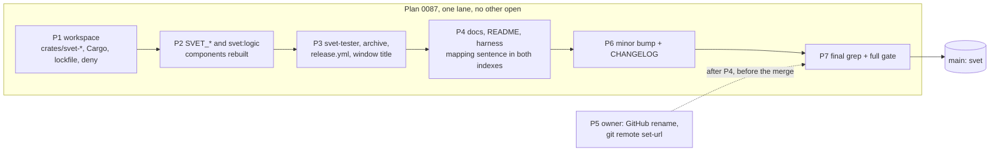

# 0087: The rename to `svet`: the crates, the environment variables and the WIT package, the tester archive, the documents and the harness, the repository, one minor bump, one final grep

> **Status:** in-progress (the owner's go, 2026-11-17: "Approve rename"; order confirmed 2026-11-24)
> **Created:** 2026-11-17
> **Milestone:** cross-cutting; no milestone in [`docs/roadmap.md`](../roadmap.md) owns it
> **Related ADRs:** [ADR-0071](../adrs/0071-the-engine-takes-a-name-one-word-for-the-project-the-crate-prefix-the-repository-and-the-archive.md)
> (accepted 2026-11-17: the engine is `svet`; its four smaller choices, recommended and taken
> here as written, are the owner's to overturn)
> **Source:** the owner, 2026-11-17: "for renaming, I think svet is the best".
> **Starts after:** **every open lane has merged into main and no new one has started.** The
> plan touches every crate directory and most tracked files, so a lane rebased across it pays
> the whole rename in conflicts. Today that means after
> [Plan 0069](done/0069-render-settings-one-surface-an-apply-class-per-field-and-named-quality-profiles.md),
> [Plan 0032](done/0032-sun-and-sky-hillaire-atmosphere-time-of-day-and-an-outdoor-testbed.md) and
> [Plan 0080](done/0080-the-fly-throughs-menu-one-overlay-a-palette-and-the-minimal-key-set.md)
> merge (and whichever of Plans 0079 and 0083 has a worktree at the time: `git worktree list`
> is the source, not this line). **Amended 2026-11-17 (owner):** "lets finish everything that is
> in progress, then rename" and "86 finish before": it runs after Plans 0032, 0080, 0077, 0079,
> 0083 and 0086 have all merged, not before 0086 as drafted. The rename is one lane, run alone, a day's work; its gate is the full one at the tip.
> **Pre-flight 2026-11-19 (main 8c6948f1):** of those, only Plan 0086 is still open (its
> worktree `plan-0086`); 0032, 0077, 0079, 0080, 0083 and 0088 are in `done/`. A docs-only
> worktree (`plan-0094-draft`) may be open at the time; it touches `docs/plans/` only and
> rebases over Phase 4 in minutes. The lane starts when `git worktree list` shows no code lane.

## TL;DR

The engine takes the name ADR-0071 gave it. `crates/vxe-*` becomes `crates/svet-*` and
`vxe_world::` becomes `svet_world::`; every `VXE_*` environment variable in the live tree
becomes `SVET_*` with no aliases (21 names on 2026-11-19, 18 of them in code; the rest of the
87 the whole tree spells live only in the records); the WIT package becomes `svet:logic@0.1.0` and the logic components are
rebuilt; the tester launcher becomes `svet-tester` and its archive
`svet-tester-<version>-<os>-x86_64`; the window title reads `svet`; the README, the active
plans, the proposed ADRs, the roadmap, the NFR and the harness say `svet`, while accepted
ADRs, closed plans, their readings logs, the dated reviews and the CHANGELOG's past entries
keep `vxe` as the prefix the engine had when they were written, with one mapping sentence at
the top of each index; the owner renames the GitHub repository to `svet` and the checkout's
remote follows; the version takes a minor bump, since a crate rename is a breaking change in
`0.x`; and a final grep proves `vxe` survives only in the records. The first thing anyone sees:
`cargo run --release -p svet-tester` opens a window titled `svet`, and `git grep -i vxe --
crates apps` prints nothing.

## Context & problem

ADR-0071 records why the project is renamed (1394 repositories share `voxel-engine`; `vxe` is a
Vue table library in every search index) and what the name is. This plan is the mechanics. The
scope was measured on `main` at 778fac63 on 2026-11-17 (case-insensitive `vxe`): 5130
occurrences in 466 tracked files, of which 2820 in 329 files are the live tree this plan
substitutes and 2310 in 137 files are records it keeps (every file under `docs/adrs/`,
`docs/plans/done/`, `docs/plans/logs/` and `CHANGELOG.md`; the proposed ADRs among them, about
55 occurrences in 10 files, are rewritten as live). By kind, the live tree is 257 `.rs` files,
the active plans and the rest of `docs/`, 22 `.toml` manifests and the lockfile (53 lines),
three workflows, the scripts (`build-guests.sh`, `check-test-tiers.mjs`, `package-tester.sh`,
`record-clip.sh`, `test-changed.mjs` and its test, the `test-times` fixture log), `dist/`
(the tester README and the notices template), two `.voxtext` headers that quote a `cargo run`
line, the WIT file and one WGSL comment. `VXE_*` names: 84 distinct, in 76 files (333
occurrences). The harness repository under `.claude/` (its own git repository, which tracks
`CLAUDE.md`) carries 41 more in 9 files. One proposed ADR's file name carries the prefix
(`docs/adrs/0062-...-in-vxe-sim.md`). The first consumer's checkout, `~/Work/voxel-roguelite`,
holds no `vxe` today (checked 2026-11-17), so nothing there changes.

**Pre-flight 2026-11-19 (main 8c6948f1, after Plans 0077, 0079, 0080, 0083 and 0088 and the
0090 to 0093 drafts landed).** The same greps read: 6080 occurrences in 553 files, of which
3325 in 393 files are the live tree (317 `.rs` files, 22 manifests, 53 lockfile lines) and
2755 in 160 files are records; the proposed ADRs among the records are 45 occurrences in 11
files (ADR-0029 to 0032, 0063, 0064, 0067, 0069, 0072, 0073, 0076). ADR-0062 was accepted on
2026-11-18, so its file name keeps `vxe-sim` (Phase 4 already allows it). `VXE_*` names: 87
distinct over the whole tree, but only 21 in the live tree (33 files), 18 of them in code
(`crates apps scripts .github dist`); the other 66 live only in the records (the strip and
preload readings of Plans 0055 to 0059), so the plan's "84" was the whole-tree count and
Phase 2's done-when now compares live counts. New since approval: `VXE_BLESS_CHAPEL`,
`VXE_CASTLE_VOX`, `VXE_ICON_DIR` (Plans 0077 and 0083), the test-tiers fixtures' `VXE_ONE` to
`VXE_FIVE` and `VXE_IN_A_COMMENT` under `scripts/fixtures/test-tiers/` (live, renamed with the
gate's regex), `scripts/record-screen.sh` (no prefix in it), `crates/vxe-sim/src/{surface,arc}.rs`
and `crates/vxe-net/tests/placement.rs` (covered by the generic substitution). The harness
repository holds 44 in 10 files; the tenth is `skills/orchestrate/references/live-runner-lib.sh`,
which names the GPU lock `.git/vxe-perf.lock`, as `scripts/record-clip.sh` and the lane rules do
(see Phase 1). The version is 0.66.0. The first consumer's checkout still holds no `vxe`.
**After Plan 0086 merges, also cover:** its nine readings variables (`VXE_DIAG_PRE`,
`VXE_HELD_FRAMES`, `VXE_HELD_PNG`, `VXE_HELD_REACH`, `VXE_HELD_WAIT`, `VXE_SPLIT_SETTLE`,
`VXE_SPLIT_TIME`, `VXE_UNDER_R`, `VXE_UNDER_RAYS`) in `apps/flythrough/tests/gpu_outdoor*` and
`tests/support/streamed.rs`, its new render files (`gpu_world/columns.rs`, `sky_irradiance.wgsl`,
neither spells the prefix today) and its `docs/flythrough.md` flags (none carries the prefix);
its plan and readings log are records by then. Plans 0091 (the `profiler` feature,
`--profiler-dump`, the `profiling` facade and puffin), 0092 (`--watch-shaders`) and 0093 (the
shot manifest, `shoot-images.mjs`, `check-images.mjs`, `docs/development.md`) run after this
plan and are born with the new names; their plan texts are active plans Phase 4 rewrites.
**The lane re-runs every count in this paragraph at its start and records them in the readings
log before Phase 1 moves a file**; the numbers here are the re-read's baseline, not its target.

Three facts bound the mechanics (ADR-0071, Context): crates.io forbids a placeholder, so the
name is held by publishing real crates or not at all, and this plan publishes nothing; GitHub
redirects a renamed repository's clone, fetch and push URLs for as long as no new repository
takes the old name; and the engine has one consumer, no published crate and no docs site, so
the rename is a day's work and nobody else's. The plan touches no `docs/nfr.md` figure: it
moves no byte of the frame, the storage or an edit.

## Decision

One lane, seven phases, each a commit: the workspace, the environment variables and the WIT
package, the tester and its archive, the documents and the harness, the owner's GitHub rename,
the version, the final grep. Every substitution is mechanical (`vxe` to `svet`, `vxe_` to
`svet_`, `VXE_` to `SVET_`, `Vxe` to `Svet` where a type carries it) and every phase ends with
the build and the tests of what it touched green, so a reader of `git log` finds the rename as
seven readable commits, not one 466-file blob.

We rejected one commit for everything (unreviewable, and a failure half-way leaves the tree
broken). We rejected `VXE_*` aliases beside `SVET_*` (ADR-0071, choice 2: every reader of a
variable would read two names for a handful of testers' scripts). We rejected rewriting the
accepted ADRs and closed plans (ADR-0071, choice 3: they are records; `git blame` on a decision
would lie about its date). We rejected publishing to crates.io to hold the name (ADR-0071,
choice 1). We rejected renaming `flythrough`: the testbed keeps its own name, and `vxe-tester`
becomes `svet-tester` because the launcher's name is the project's.

## Architecture diagram



## Implementation phases

Each phase ships as its own commit. `dev` implements all phases in one session with no review
between phases, except Phase 5, which the owner does. The architect reviews once at the end,
in a fresh session. The substitution rule for every phase: `vxe-` to `svet-`, `vxe_` to
`svet_`, bare `vxe` to `svet`, `VXE_` to `SVET_`, `Vxe` to `Svet`, `vxe:logic` to
`svet:logic`; a line in a record (Phase 4 names them) is left alone.

### Phase 1: The workspace
- **Owner skill:** dev
- **What:** Before a file moves, re-run ADR-0071's crates.io check for `svet` and its nine
  prefix forms (`https://crates.io/api/v1/crates/<name>`, 404 is free) and write the result
  into the readings log; a form taken since 2026-11-17 stops the lane and goes to the owner.
  Then `git mv crates/vxe-<x> crates/svet-<x>` for all nine crates, the `[package] name` of
  each, the workspace members and the `[workspace.dependencies]` table in the root
  `Cargo.toml`, every path and `workspace = true` dependency (apps, guests, benches,
  examples), every `use vxe_*::` and `vxe_*::` path in `.rs` files, doc comments and the one
  WGSL comment, `scripts/build-guests.sh`'s guest path, `scripts/test-changed.mjs` and its
  test, `scripts/record-clip.sh`, the `test-times` fixture log and `scripts/fixtures/README.md`
  where it names a binary, the two `.voxtext` headers, `.gitattributes`'s comment, and the
  `-p vxe-*` names in `.github/workflows/ci.yml`, `soak.yml` and `release.yml` (the `VXE_*`
  variables in those files wait for Phase 2). `cargo build` regenerates `Cargo.lock`; `cargo
  deny check` runs against the new names (the deny config names no crate today, so it is a
  check, not an edit). **The GPU lock's path** (`.git/vxe-perf.lock`, untracked, named in
  `scripts/record-clip.sh`, in the harness's `skills/orchestrate/references/lane-rules.md` and
  `live-runner-lib.sh`, and in Plan 0093's text) becomes `.git/svet-perf.lock` **in the tree and
  the nested `.claude/` repository in this same phase**, one nested commit, so no two sessions
  ever lock different files; Phase 4's nested commit carries the rest of the harness.
- **Files touched:** `crates/*` (moved), `Cargo.toml`, `Cargo.lock`, `apps/*/Cargo.toml`,
  `apps/flythrough/logic/Cargo.toml`, `crates/svet-script-wasm/guests/*/Cargo.toml`, every
  `.rs` that names a sibling crate, `crates/svet-render/src/shaders/composite.wgsl`,
  `scripts/build-guests.sh`, `scripts/record-clip.sh`, `scripts/test-changed.mjs`,
  `scripts/test-changed.test.mjs`, `scripts/fixtures/test-times/seeded.log`,
  `scripts/fixtures/README.md`, `apps/flythrough/assets/entities/*/*.voxtext`,
  `.gitattributes`, `.github/workflows/*.yml` (crate names only), `docs/plans/logs/0087.md`;
  in the nested repository `.claude/skills/orchestrate/references/{lane-rules.md,live-runner-lib.sh}`
  (the lock path only).
- **Done when:** the readings log holds the day's crates.io result for the ten names, each
  free; `ls crates/` lists exactly `svet-app svet-assets svet-audio svet-entity svet-net
  svet-render svet-script-wasm svet-sim svet-world`; `git log --follow --oneline
  crates/svet-world/src/lib.rs` reaches commits from before the rename; `cargo build
  --workspace --all-targets` and `cargo build -p svet-script-wasm` are green with the
  regenerated lockfile, `cargo clippy --workspace --all-targets -- -D warnings`, `cargo fmt
  --all --check` and `cargo deny check` exit 0; `node scripts/test-changed.mjs --profile
  quick` (every crate changed) is green, and `node --test scripts/test-changed.test.mjs`
  passes with the new names; `git grep -I -i vxe -- crates apps Cargo.toml Cargo.lock scripts
  .gitattributes` prints only lines carrying a `VXE_` name or `vxe:logic` (Phase 2's);
  `git grep -F perf.lock -- scripts` and `git -C .claude grep -F perf.lock` both print only
  `svet-perf.lock`.

### Phase 2: The environment variables and the WIT package
- **Owner skill:** dev
- **What:** Every `VXE_*` name becomes `SVET_*`: the string literals in `.rs` (the fly-through,
  the tester, the render and world crates' readings switches, the tests' knobs), the
  `check-test-tiers.mjs` gate's regex and its messages, `VXE_REQUIRE_SOFTWARE_ADAPTER` and
  `VXE_COMMIT` in `ci.yml` and `release.yml`, `VXE_COMMIT` in `scripts/package-tester.sh`, and
  the names in `docs/flythrough.md`, `docs/nfr.md`, `docs/nfr/*.md`, `docs/backlog.md` and the
  active plans where they are documented (the records keep theirs). No alias: a `VXE_*`
  variable set in the environment is ignored. The WIT package line becomes `package
  svet:logic@0.1.0;` and `HOST_INTERFACE` in `crates/svet-script-wasm/src/host.rs` becomes
  `svet:logic/host@0.1.0`; the version stays `0.1.0`, since the namespace change is itself the
  break; `scripts/build-guests.sh` rebuilds every guest and the `flythrough-logic` component
  into `target/guests/`.
- **Files touched:** every `.rs` with a `VXE_` literal (33 live files on `main` at 8c6948f1,
  more after Plan 0086), `scripts/check-test-tiers.mjs` and its fixtures
  `scripts/fixtures/test-tiers/apps/app/tests/env_{four,five}.rs` with their line in
  `scripts/fixtures/README.md`, `.github/workflows/ci.yml`,
  `.github/workflows/release.yml`, `scripts/package-tester.sh`,
  `crates/svet-script-wasm/wit/logic.wit`, `crates/svet-script-wasm/src/host.rs`,
  `docs/flythrough.md`, `docs/nfr.md`, `docs/nfr/*.md`, `docs/backlog.md`, the active plans
  that name a variable.
- **Done when:** `git grep -E '\bVXE_[A-Z0-9_]+'` lists no line outside `docs/adrs/`,
  `docs/plans/done/`, `docs/plans/logs/`, `docs/reviews/`, `CHANGELOG.md` and this plan's own
  file (the record of the substitution; it moves to `done/` at the close); `git grep -h -o -E
  '\bSVET_[A-Z0-9_]+' | sort -u | wc -l` prints the count of distinct `VXE_` names **the live
  tree** had at the lane's start, that is with the same paths excluded (21 on `main` at
  8c6948f1, 2026-11-19; the whole-tree count is larger because the records keep theirs; the
  lane re-reads both at its tip before Phase 2 and records them); `node
  scripts/check-test-tiers.mjs` exits 0 and its summary line counts `SVET_*`
  files; `scripts/build-guests.sh` builds every component under
  `crates/svet-script-wasm/guests/` and `flythrough-logic`, and the `svet-script-wasm` test
  binaries that load them are green (`node scripts/test-changed.mjs --profile quick`); a
  component built before the rename (keep one `vxe:logic` guest `.wasm` from the previous
  `target/guests/` for this) is refused by the host with an error that names the package
  `svet:logic`, asserted by a test in `crates/svet-script-wasm/tests/` (CPU, under a second
  on lavapipe since no device is opened); `VXE_REQUIRE_SOFTWARE_ADAPTER=1` set beside no
  `SVET_` variable has no effect on a GPU test's adapter choice (one test in a `gpu_*` binary
  the phase names, or a reading in the log if the existing adapter test already proves the
  variable is read by its new name only).

### Phase 3: The tester, its archive and the names a user sees
- **Owner skill:** dev
- **What:** `apps/tester`'s package and binary become `svet-tester`; the archive name in
  `scripts/package-tester.sh` becomes `svet-tester-<version>-<os>-x86_64`, the report folder
  `svet-report-<version>-<os>-<utc>`; `dist/README-TESTER.txt` and `dist/about.hbs` say
  `svet-tester`; `release.yml`'s artifact names, the `cd`/`./` lines of its smoke steps, the
  `--title` and `--notes` of the Release say `svet-tester`; the window title in
  `crates/svet-app/src/shell.rs` reads `svet`; `ci.yml`'s `target/debug/vxe-tester` smoke
  line follows. Old releases keep their `vxe-tester-*` files and are not re-published
  (ADR-0071, choice 4).
- **Files touched:** `apps/tester/Cargo.toml`, `apps/tester/src/*.rs` where the name is a
  string, `scripts/package-tester.sh`, `dist/README-TESTER.txt`, `dist/about.hbs`,
  `.github/workflows/release.yml`, `.github/workflows/ci.yml`, `crates/svet-app/src/shell.rs`,
  `README.md` (the tester paragraph), `docs/flythrough.md` if it names the launcher.
- **Done when:** `cargo build --release -p svet-tester -p flythrough` followed by
  `scripts/package-tester.sh` writes `svet-tester-<version>-linux-x86_64.tar.gz`, the archive
  unpacks to a folder of that name holding `svet-tester`, `flythrough`, `README-TESTER.txt`
  (whose first line reads `svet-tester <version> (commit <sha>)`) and the notices; from that
  folder `./svet-tester --system-json system.json` exits 0 and writes the file; a manual run
  of `release.yml` (`gh workflow run release.yml`, artifacts only) uploads artifacts named
  `svet-tester-linux-x86_64` and `svet-tester-windows-x86_64`, both smoke steps green
  (`gh run view`); the headless fly-through's window title string is `svet` (the existing
  shell test or a one-line assertion in `crates/svet-app/tests/`; `git grep '"vxe"' --
  crates apps` prints nothing).

### Phase 4: The documents, the orientation map and the harness
- **Owner skill:** dev
- **What:** `README.md` (the crates table, the badge, the `repository` URL in `Cargo.toml` and
  every `github.com/IgorKonovalov/voxel-engine` link, the regenerate commands under the hero
  image, the clone line), `docs/roadmap.md`, `docs/nfr.md` and `docs/nfr/*.md`,
  `docs/flythrough.md`, `docs/entities.md`, `docs/backlog.md`, `docs/references/*.md`, every
  active plan under `docs/plans/` **except this one** (its text is the record of what was
  substituted and keeps the old spellings; it moves to `done/` at the close) and every
  **proposed** ADR under `docs/adrs/` (ADR-0062 was accepted on 2026-11-18, so its file keeps
  `vxe-sim` in its name and the ADR index's link to it stays as it is), the two index READMEs.
  **Left alone**: accepted ADRs,
  `docs/plans/done/`, `docs/plans/logs/`, `docs/reviews/` and the CHANGELOG's existing
  entries. One sentence goes at the top of `docs/adrs/README.md` and of
  `docs/plans/README.md`, after the opening paragraph: that the engine was `voxel-engine` with
  crates `vxe-*` and variables `VXE_*` until Plan 0087 (version named), that records from
  before keep those names, and that `vxe-<x>` reads as `svet-<x>`. `CLAUDE.md`'s "Where things
  live" and every `vxe` under `.claude/` (skills, their references, hooks and their tests,
  settings) are edited and **committed in the nested `.claude/` repository**, since the outer
  repository ignores them; the plan's Implementation log names that commit's SHA beside the
  phase's.
- **Files touched:** `README.md`, `Cargo.toml` (`repository`), `docs/roadmap.md`,
  `docs/nfr.md`, `docs/nfr/*.md`, `docs/flythrough.md`, `docs/entities.md`,
  `docs/backlog.md`, `docs/references/*.md`, `docs/plans/0*.md` (active),
  `docs/adrs/0*.md` (proposed only; one moved), `docs/adrs/README.md`,
  `docs/plans/README.md`; in the nested repository `.claude/CLAUDE.md`, `.claude/skills/**`,
  `.claude/hooks/**`, `.claude/settings.json` where they name the prefix.
- **Done when:** `git grep -I -i -l vxe -- README.md Cargo.toml docs ':!docs/adrs' ':!docs/plans/done'
  ':!docs/plans/logs' ':!docs/reviews' ':!docs/plans/0087-*' ':!docs/plans/README.md'` prints
  nothing; `git grep -I -i -n vxe -- docs/plans/README.md` prints only the mapping sentence's
  lines; over `docs/adrs/` the only files the `-l` form lists carry `> **Status:** accepted`
  or `superseded`, plus `docs/adrs/README.md` whose hits are the mapping sentence and the link
  to ADR-0062's file (a shell loop in the readings log, run and pasted); no tracked path under
  `docs/adrs/` carries `vxe` except by an accepted ADR's own name; both indexes carry the
  mapping sentence and `node
  scripts/check-doc-links.mjs`, `node scripts/check-index-rows.mjs`, `node
  scripts/check-comment-hygiene.mjs` and `node scripts/check-plan-size.mjs` exit 0; `git -C
  .claude grep -I -i vxe` prints nothing (41 occurrences in 9 files on 2026-11-17) and
  `node --test ".claude/hooks/*.test.mjs"` passes (44 occurrences in 10 files on 2026-11-19,
  less the lock path Phase 1 already flipped); `CLAUDE.md`'s tree lists `svet-world` through
  `svet-entity` and `svet-tester`.

### Phase 5: The repository takes the name
- **Owner skill:** human
- **What:** The owner renames `IgorKonovalov/voxel-engine` to `IgorKonovalov/svet` in the
  repository's GitHub Settings (General, Repository name), any time after Phase 4 and before
  the lane merges and is pushed. Then, in the main checkout (the worktrees share its
  `.git`): `git remote set-url origin https://github.com/IgorKonovalov/svet.git`. GitHub
  redirects the old URL (ADR-0071, Context) for as long as no new repository takes the old
  name, so nothing else of ours needs a touch; the owner makes no repository under the old
  name.
- **Files touched:** none in the tree; `.git/config` of the checkout.
- **Done when:** `gh repo view IgorKonovalov/svet --json name,url` prints the new name and
  URL; `git remote -v` shows `IgorKonovalov/svet.git` and `git fetch origin` succeeds; `curl
  -sI https://github.com/IgorKonovalov/voxel-engine` answers `301` with a `location:` on
  `/IgorKonovalov/svet`; the readings log records the three outputs and the date.

### Phase 6: The version
- **Owner skill:** dev
- **What:** A minor bump of `workspace.package.version` in `Cargo.toml` from whatever `main`
  carries when the lane starts (0.59.0 on 2026-11-17, 0.66.0 on 2026-11-19, and Plan 0086's
  close bumps it once more; the number is read at the lane, not copied from here), and a CHANGELOG entry under that version that names the old and new
  prefixes once (`vxe-*` to `svet-*`, `VXE_*` to `SVET_*`, `vxe:logic` to `svet:logic`,
  `vxe-tester` to `svet-tester`, the repository URL) and says that earlier entries keep their
  names. A crate rename is a breaking change in `0.x`, so the bump is this plan's, done here
  so the archive of Phase 3's manual run and the release after the merge carry it; the close
  ceremony bumps nothing further for this plan.
- **Files touched:** `Cargo.toml`, `Cargo.lock`, `CHANGELOG.md`.
- **Done when:** `cargo metadata --format-version 1 | jq -r '.workspace_members[0]'` and
  `cargo pkgid -p svet-world` print the bumped minor; `CHANGELOG.md` has the entry under
  `## [<bumped>]` dated the day, and `## [Unreleased]` is empty; `cargo build --workspace
  --locked` is green.

### Phase 7: The final check
- **Owner skill:** dev
- **What:** The one grep that proves the rename, and the full gate at the tip. `git grep -I
  -i -n vxe` over the whole tree, filtered to drop the records (`docs/adrs/` files whose
  status is `accepted` or `superseded`, `docs/plans/done/`, `docs/plans/logs/`,
  `docs/reviews/`, `CHANGELOG.md` lines below the new entry's heading and the new entry's
  one mapping line, this plan's own file, the two indexes' mapping sentences and the ADR
  index's link to ADR-0062's file), must print nothing; the command and its empty output go to
  the readings log, with the count of record lines it dropped. Then the plan's gate: `cargo build`, `cargo nextest run --profile gate`
  under the perf lock, doctests, clippy, fmt, deny, the four doc gates, the hooks' bite
  tests, and `cargo doc --workspace --no-deps` (its warning count compared with the count
  before the rename, so a broken intra-doc link from a renamed path is caught).
- **Files touched:** `docs/plans/logs/0087.md`; whatever the grep or the gate finds.
- **Done when:** the filtered grep prints nothing, and the unfiltered one lists only lines in
  the records named above; `cargo nextest run --profile gate` passes with the same test count
  as `main` at the lane's start (read from the two logs; a test renamed by the substitution
  still counts), its wall time within `docs/nfr.md` section 7's budget; clippy, fmt, deny,
  `node scripts/check-doc-links.mjs`, `check-comment-hygiene.mjs`, `check-index-rows.mjs`,
  `check-plan-size.mjs`, `check-test-tiers.mjs`, `check-file-size.mjs` and `node --test
  ".claude/hooks/*.test.mjs"` exit 0; `cargo doc --workspace --no-deps` emits no more
  warnings than before the rename (the number from `main` at the lane's start, recorded first).

## Data shapes

None new. The names that change, as the consumer sees them:

```text
# illustrative
crates/svet-world            svet_world::World, svet_world::ops::Carve
crates/svet-render           svet_render::Renderer
SVET_COMMIT, SVET_REQUIRE_SOFTWARE_ADAPTER, SVET_* (every live name, one for one)
package svet:logic@0.1.0;    svet:logic/host@0.1.0
svet-tester-0.68.0-linux-x86_64.tar.gz    (the minor is Phase 6's, not this number)
https://github.com/IgorKonovalov/svet
```

## Budgets

None moved. The plan changes no byte of a brick, a buffer or a pass; the frame, VRAM and edit
figures in `docs/nfr.md` are untouched, and every golden image is expected unchanged (the
gate's image tests are the check). The one budget it reads is the gate tier's wall time
(`docs/nfr.md` section 7): Phase 7 records it at the tip and it must stay within budget; the
close compares it with the figure the lane read from `main` at its start.

## Risks & open questions

- **A lane open across the rename.** Every file a lane touches conflicts with Phase 1. The
  "Starts after" line is the guard; if a lane cannot wait, it merges first, and the rename
  waits.
- **`git blame` and `git log` on moved files** need `--follow`; the skills' reviewers and
  `scripts/velocity.mjs` (which counts commits and lines, not paths) are unaffected; a reader
  who forgets the flag sees history start at Phase 1. The CHANGELOG entry says so once.
- **A `svet-*` crate registered between the check and the lane.** Phase 1's first step
  re-runs the check; a hit stops the lane for the owner's call (another word, or the name
  anyway since nothing is published). Low: every `-world`/`-render` form checked across three
  sweeps was free.
- **Testers' scripts.** A tester who set `VXE_*` variables finds them ignored; the release
  notes and `README-TESTER.txt`'s first lines carry the one line. The clean cut is ADR-0071's
  choice 2; the owner can ask for aliases, which adds a read of the old name in the
  fly-through's and tester's variable readers (one function each) and a deprecation line.
- **The GitHub redirect** dies the day a repository named `voxel-engine` appears under the
  owner's account; Phase 5 says none is made. Project-site URLs and `uses:` actions are not
  redirected; the project has neither.
- **The GPU lock's path.** `.git/vxe-perf.lock` is named in a tracked script and in the
  harness; a session that reads the old name while another reads the new one runs two GPU jobs
  at once. Phase 1 flips both in one step, and the lane runs alone, so the window is the few
  minutes of that step. (Pre-flight 2026-11-19.)
- **The nested `.claude/` repository.** Its commits (Phase 1's lock path, Phase 4's rest) are
  separate and not pushed anywhere; the plan's log names their SHAs so the review finds them. A skill that names `vxe-world` by path
  (the architect's `project-context.md`, the lane rules) must be edited or an agent reads a
  path that no longer exists.
- **A test named by substitution** (`vxe_world_...` in a test function) changes its nextest
  id; the soak and gate tiers select by `#[ignore]` marks and binary names, not by test ids
  (the tiers-by-marks chore of 2026-11-10), so no filter in `.config/nextest.toml` breaks;
  Phase 7 compares test counts, not names.
- **`cargo doc` intra-doc links** that spell a crate name (`vxe_render::...` in a doc comment)
  are caught by the substitution; one that spells it in a way the regex misses shows as a new
  warning, which Phase 7's warning-count comparison catches.
- **Open question for the owner (none blocking):** the four ADR-0071 choices are taken as
  recommended. Say so to overturn any: a crates.io publish (adds a `cargo publish` phase and
  docs.rs), aliases for `VXE_*`, rewriting the records, re-publishing old archives.

## What this plan does NOT do

- Publish to crates.io, or reserve the name in any registry (ADR-0071, choice 1).
- Register or claim a domain: every `svet.*` checked is taken (ADR-0071).
- Set up a docs site; that is a backlog entry with its own ADR after the `cargo doc`
  warnings chore.
- Rename `flythrough`, the testbed; or rename any type, module or function whose name does
  not carry the prefix.
- Rewrite accepted ADRs, closed plans, readings logs, dated reviews or past CHANGELOG entries,
  or rewrite git history (the hooks deny it anyway).
- Re-publish the `vxe-tester-*` archives on existing releases, or cut a tag; the next tag
  after the merge ships the first `svet-tester-*` archive.
- Touch `~/Work/voxel-roguelite`: it holds no `vxe` today; if it gains code before the lane,
  its path dependencies change on its side, not in this plan.

## Implementation log

> Written by `dev`: one row per phase as its commit lands, then the close block. **The phases
> above are the contract. This section records what happened.** Observations, never conclusions:
> no pass list, no self-assessment. Deviations and unmet done-whens are **always** disclosed.
> Keep it shorter than `## Implementation phases`. Readings, gate counts, attempts, sweeps and
> resume notes go to the plan's readings log, `docs/plans/logs/0087.md` (started from
> `templates/readings-log.md`), and this section links it once it exists.

Readings log: [`logs/0087.md`](logs/0087.md). Nested `.claude/` repository commits: Phase 1 `d0bf832` (the GPU lock path), Phase 4 `122d89d` (the rest of the harness).

| phase | owner | state | commit |
|---|---|---|---|
| 1: the workspace | dev | done | b2759d75 |
| 2: the environment variables and the WIT package | dev | done | 5f2a321d |
| 3: the tester, its archive and the names a user sees | dev | done, except the manual `release.yml` run | 865469be |
| 4: the documents, the orientation map and the harness | dev | done (nested `122d89d`) | cbe9c6bf |
| 5: the repository takes the name | human | not started (the owner's) | |
| 6: the version | dev | done | 27cb1c65 |
| 7: the final check | dev | done, with three named grep exceptions | committed with this row |

### Notes

- Tree since pre-flight (lane start cfd2f97c, v0.72.0): the counts re-read at the start are in the readings log; the tree's names win over the plan's.
- Phase 1: the tester's own names (`vxe-tester`, `vxe_tester`, `vxe-report`, the window title `"vxe"`, the zip test's `vxe` home folder) are left for Phase 3, so Phase 1's grep also lists those lines; the file-format magics `VXEL`, `VXECHNK` and `VXEH` (and the binary fixtures carrying them) are not renamed in any phase, and the case-insensitive grep lists them.
- Phase 2: the `VXE_*` substitution also reached `README.md` (one line), one row of `docs/plans/README.md` and Plans 0090 and 0093's texts, outside the phase's Files touched, since its done-when grep covers the whole live tree; the host's load error gained a context line naming the served interface (`crates/svet-script-wasm/src/host.rs`), and the refusal test's pre-rename component is committed as `crates/svet-script-wasm/tests/fixtures/pre-rename-greedy.wasm` (68 KB).
- Phase 3: the manual run of `release.yml` (`gh workflow run release.yml`, artifacts `svet-tester-linux-x86_64` and `svet-tester-windows-x86_64`) is not done: it needs the branch on the remote; owed after the merge and push, the owner's call. The local archive, unpack and `--system-json` steps are done (readings log).
- Phase 3: the fly-through sets its own window title (`"flythrough"`, `apps/flythrough/src/setup.rs`) and keeps it; the shell's default title is `svet`, asserted by the new `crates/svet-app/tests/shell.rs`. `scripts/test-changed.test.mjs` and `scripts/fixtures/README.md` took `svet-tester` (outside the phase's Files touched); the `vxe-tester` mentions in `docs/backlog.md`, `docs/nfr.md` and Plan 0073 are left for Phase 4.
- Phase 4: the three live comments outside every phase's Files touched (`.config/nextest.toml`, `clippy.toml`, `assets/architecture/README.md`) took `svet` here. `~/Work/vxe-live-archive` (a directory on disk, in `docs/backlog.md` and Plan 0102) is kept, so Phase 4's first grep lists those two files. Two sentences needing the old prefix were reworded to "the old prefix" (Plan 0087's index row, Plan 0093's naming note); `README.md`'s title became `# svet`.
- Phase 6: the two `wasmtime` security entries under `## [Unreleased]` moved under `## [0.73.0]`, which the done-when's empty `Unreleased` needs; the workspace dependency pins moved with the version.
- Phase 7: the filtered grep drops three named exceptions beyond the plan's record list, so its done-when is met only with them: the file-format magics `VXEL`, `VXECHNK`, `VXEH` (renaming them changes the file formats; the binary fixtures carrying them are kept too), the refusal test's `vxe:logic` lines, and the on-disk path `~/Work/vxe-live-archive`; counts in the readings log.
- Phase 7: the gate's 849.9 s is the first gate reading at the dev box's full CPU clock; main's 1133.2 s was read at the 3.3 GHz cap, so the times do not compare the rename.

### Close triggers

_(Facts for the architect. No recommendations, and no suggested version bump.)_

- **What shipped:** a rename (crates, environment variables, WIT package, tester and archive, documents, harness) and v0.73.0; no behaviour change beyond the names, the old package's refusal and the window title.
- **Public API changed:** every crate and path `vxe-*`/`vxe_*` to `svet-*`/`svet_*`; every `VXE_*` variable to `SVET_*` (no aliases); the WIT package `vxe:logic@0.1.0` to `svet:logic@0.1.0` (`HOST_INTERFACE` `svet:logic/host@0.1.0`); the binary `vxe-tester` to `svet-tester`, its archive `svet-tester-<version>-<os>-x86_64`, its report folder `svet-report-...`; the shell's default window title `svet`; `Cargo.toml`'s `repository` `https://github.com/IgorKonovalov/svet`; the GPU lock `.git/svet-perf.lock`. File-format magics unchanged.
- **Budget readings:** `docs/nfr.md` section 7, the gate tier's wall time: 849.9 s at 27cb1c65, RTX 3080 Laptop dev box at full CPU clock (cap lifted 2026-11-24), exclusive perf lock, 1-minute load 1.89; main's 1133.2 s was at the 3.3 GHz cap. No frame, VRAM or edit figure touched.
- **Gate at the tip (27cb1c65, the Phase 7 commit adds only docs):** `cargo build --workspace --locked` 0; `cargo nextest run --workspace --profile gate` 0, 1363 run, 1363 passed, 242 skipped (main 1361 + 2 new); `--sole --since main` selects none; doctests 0 (10 passed, 1 ignored); clippy 0; fmt 0; deny 0; `cargo doc` 109 warnings (109 before); the six doc and test-file gates 0; hooks 88 of 88.
- **Outstanding `human` phases:** Phase 5 (the GitHub rename and `git remote set-url`); also owed, Phase 3's manual `release.yml` run, which needs the branch on the remote.

## Followups

- The rustdoc-to-GitHub-Pages entry in `docs/backlog.md` can start once this plan merges: no
  URL is then published under the old name.
