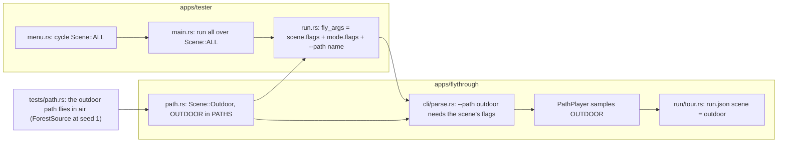

# 0088: The outdoor scene in the tester: a camera path over the hills, through the trees and down the tunnel, a fourth row in the menu and the report

> **Status:** approved (the owner's go, 2026-11-17: "go 88"; questions 1 to 5 answered 2026-11-17, the recommended option each: the sun 10,180, sparse trees, the full 60 to 75 s route, the 2 s warm-up, a computed path)
> **Created:** 2026-11-17
> **Milestone:** M7 in [`docs/roadmap.md`](../roadmap.md) (the benchmark lane, whose first form
> was Plan 0068)
> **Related ADRs:** [ADR-0054](../adrs/0054-the-tester-build-is-a-launcher-that-runs-the-flythrough-per-scene.md)
> (accepted; the tester is a launcher that runs the fly-through per scene, so a scene is a row
> in `Scene::ALL`, a path in `PATHS` and nothing in `apps/tester`). No new ADR: the one choice
> with a named alternative (a path laid by computation or recorded in a window) is a method, not
> an architecture, and the Decision names what it rejects.
> **Source:** the owner, 2026-11-17: "plan it now", on the tester running only the three
> underground scenes while the outdoor hills ([Plan 0032](done/0032-sun-and-sky-hillaire-atmosphere-time-of-day-and-an-outdoor-testbed.md),
> v0.61.0) ship in the archive without a path or a report.
> **Starts after:** [Plan 0080](done/0080-the-fly-throughs-menu-one-overlay-a-palette-and-the-minimal-key-set.md)
> merges: its Phases 2 and 3 edit `apps/flythrough/src/path.rs` (the tester filter),
> `apps/flythrough/tests/path.rs`, `cli/parse.rs` and `docs/flythrough.md`, the files this plan
> adds to. It does **not** wait for
> [Plan 0086](0086-still-outdoor-light-baked-sky-visibility-a-long-history-solid-canopy-shadows-and-stair-history.md):
> the two share no file but `cli/parse.rs` (0086's Phase 7 adds a flag; this plan changes the
> scene derivation, a different hunk), and an outdoor tester reading taken before 0086 lands is
> the baseline its close compares against. This plan is a day's lane and merges before
> [Plan 0087](0087-the-rename-to-svet-crates-env-vars-wit-package-archives-docs-and-the-repository.md)
> (the rename) starts; 0087's "Starts after" reads `git worktree list`, so this lane counts.

## TL;DR

The tester build gains a fourth scene, `outdoor`: the hills of `--source outdoor` with the
default sparse trees under a fixed sun, flown by a recorded camera path of about a minute that
starts at the `outside` spawn, sweeps north over the hills and through the trees to the forest
spawn, turns back south into the sun, enters the cave mouth and flies the tunnel down to the
chamber. The path is a `CameraPath` in `flythrough::path` like the three before it, laid by
computation from the heightfield and the trees' placements and guarded by the headless air test;
the tester's menu, "run all benchmarks", `--auto` and the report take it from `Scene::ALL` and
`PATHS` with no new code in `apps/tester`. The first thing the owner sees: `vxe-tester` shows
`scene < outdoor >`, the run's window flies the hills, and `runs/04-outdoor-bench/run.json`
reads `"scene": "outdoor"` with the streaming block the CPU-spike question needs. Why now: an
outside Linux report (RTX 3060, v0.54.0; `docs/backlog.md`, "The streamed benches on Windows")
read CPU spikes in the sync and light stages of the streamed scenes; the outdoor frame streams
too, Plan 0032's window read a 7 to 10 s CPU settle after every outdoor load, and Plan 0086 is
changing the outdoor light, so testers' outdoor numbers are worth having before and after it.

## Context & problem

ADR-0054's tester runs the fly-through once per scene with `--path NAME`; the scenes are
`flythrough::path::Scene` (`Cave`, `Showcase`, `Castle`) and the paths `PATHS`
(`apps/flythrough/src/path.rs`). `apps/tester/src/menu.rs` cycles `Scene::ALL`, `main.rs`'s
"run all benchmarks" iterates it, `run.rs`'s `fly_args` finds the scene's path in `PATHS`, and
`cli/parse.rs` refuses `--path` unless the flags build the path's scene and the seed is
`PATH_SEED`. Plan 0032 added `--source outdoor` with `--spawn`, `--trees`, `--sun` and `--time`,
three spawns (`outside`, `inside`, `forest`), the tunnel to a roofed chamber and sparse or
forest trees, but no `Scene` row and no path: today `parse.rs` derives `None` for an outdoor
world, so `--path` cannot name it, and a tester's archive runs three underground scenes under
the headlamp or the ores while the sky never appears in a report.

What the owner wants from the tester outdoors is numbers, not a look: the backlog's
streamed-bench entries read, on a tester's RTX 3060 under Linux, `sync_us` p99 9.5 ms and
`light_us` p99 2.6 ms in the cave and 38 of 12 887 frames over 33 ms, and Plan 0032's own
window read the outdoor frame's CPU p50 at 10 to 17.6 ms for 7 to 10 s after every load (the
bake queue's step on an emitter-free world, `docs/backlog.md` "The CPU settle outdoors") and a
forest sync p99 of 11.0 ms at leaf fill 128. `run.json` already carries the sync's stages
(`streaming`), the load stages and the percentiles; the outdoor scene needs only to exist as a
path for those fields to fill on testers' machines.

The budget figures this touches are readings, not lines: `docs/nfr.md` section 2 (the outdoor
frame total and the light pass on the slow adapter, read by Plan 0032 headless at 1080p),
section 5 (the streaming line, read in the tester's cave and castle benches) and section 7 (the
gate's wall time, which the new tests add to).

## Decision

We add `Scene::Outdoor` with the flags `--source outdoor --spawn outside --trees sparse --sun
EL,AZ` (the sun of question 1), one `CameraPath` named `outdoor` of 60 to 75 s laid against
seed 1, and the parse rule that `--path outdoor` needs those flags except the sun. The path's
keys are computed, not recorded: the surface height is a pure integer function
(`OutdoorSource::height`), the tunnel's axis is a line from `mouth` to `chamber`, and the trees'
placements are a pure function of the seed, so Plan 0068's lattice search (a scratch BFS at
2.2 m clearance, smoothed and thinned, timed at 30 voxels a second) lays the route the same
way it laid the cave's, and `tests/path.rs`'s air test guards it at 1 m. The tester changes
nothing but its flag table test and its README: the menu, "run all", `--auto`, the run folder's
name and the report's `scene` all follow `Scene::ALL`. We rejected a path recorded by the owner
in a window because it needs a pose recorder the fly-through does not have (a key, a file and
a replay check), costs the owner a session before the lane can test anything, and a hand-flown
path wobbles where a computed one holds its line; the owner still judges the route in the
window (Phase 3) and names the moves. We rejected a running day cycle for the benchmark because
the clock is paused unless `End` runs it, so starting it needs a flag and makes two runs' light
differ by their frame rate; a fixed sun reads the same light on every machine. We rejected a
second outdoor scene (the forest at `--trees forest`) in the menu because it doubles a tester's
outdoor time for a stress case the owner did not pick by eye; the dev takes it as a headless
reading in Phase 2 instead.

## Architecture diagram



## Implementation phases

Each phase ships as its own commit. `dev` implements all phases in one session with no review
between phases. The architect reviews once at the end, in a fresh session. Phase 1 is the
walking skeleton: the scene exists and a first path flies headless.

### Phase 1: `Scene::Outdoor`, the parse rule and a first path
- **Owner skill:** dev
- **What:** `Scene::Outdoor` (`name` `outdoor`, `flags` as the Decision says, `ALL` of four) and
  `OUTDOOR: CameraPath` in `PATHS` with a provisional route: the `outside` spawn's eye, a key
  over the mouth and keys on the tunnel's axis to the chamber's centre, so the scene flies end
  to end before the full route is laid. `cli/parse.rs` derives `Some(Scene::Outdoor)` from
  `is_outdoor()` and refuses `--path outdoor` beside a `--spawn` other than `outside` or a
  `--trees` other than `sparse` (the trees are the path's rock; `--sun` and `--time` move no
  voxel and stay free, as `--lamp on` does on a cave bench). The flag's help and
  `docs/flythrough.md`'s `--path` row name the fourth value. The HUD's path row, the loading
  screen's `outdoor - benchmark` and the lamp's per-scene default need no change: they read the
  scene's name and `Scene::ALL`.
- **Files touched:** `apps/flythrough/src/path.rs`, `apps/flythrough/src/cli/parse.rs`,
  `apps/flythrough/src/cli/mod.rs` (the module doc's flag list), `apps/flythrough/tests/path.rs`,
  `apps/flythrough/src/cli/tests.rs` (the parse test), `docs/flythrough.md`,
  `docs/plans/logs/0088.md` (new, from the readings-log template).
- **Done when:**
  1. `the_outdoor_path_flies_in_air` in `tests/path.rs` (CPU): `rock_on(&OUTDOOR, ..)` over
     `ForestSource::new(OutdoorSource::new(PATH_SEED), TreeDensity::Sparse, LEAF_FILL)` read
     chunk by chunk as the castle test reads its stamped source returns no sample in rock, at
     every key and every quarter second with 1 m of clearance on six axes. Expected 5 to 20 s
     in the test profile (the castle's reads 15 to 19 s under load); a CPU test, it stays in the
     gate over the 10 s line, and the readings log names its time.
  2. `every_scene_has_one_path_and_a_cut_holds_the_pose_before_it` passes with `Scene::ALL` of
     four, unchanged (it iterates the array): exactly one path names `outdoor`, and
     `CameraPath::named("outdoor")` has `Scene::Outdoor`.
  3. The parse test (CPU, under 1 s): `--source outdoor --spawn outside --trees sparse --sun
     EL,AZ --path outdoor` parses; `--path outdoor` alone, `--source cave --path outdoor`,
     `--source outdoor --trees forest --path outdoor` and `--source outdoor --spawn forest
     --path outdoor` are refused, each error naming the flags `--path outdoor` needs; `--source
     outdoor --path outdoor --time 12:00` (no `--sun`) parses; `--source outdoor --path cave` is
     refused as today.
  4. The lamp test in `run/tests.rs` (iterates `Scene::ALL`) holds for the fourth scene: the
     bench's lamp is off, the tour's on (the fly-through's default, as in the cave and the
     castle; a headlamp under the sun adds nothing visible and helps in the tunnel).

### Phase 2: The route, the tester's rows, the README and the readings
- **Owner skill:** dev
- **What:**
  - **The route.** Plan 0068's lattice search, rewritten from its description in
    `docs/plans/logs/0068.md` (Phase 1) as a scratch binary or an ignored test under
    `apps/flythrough/tests/support/` (the lane's call; it is not a gate), lays `OUTDOOR` through
    these waypoints in order: the `outside` spawn's eye (`OutdoorSource::spawn(Spawn::Outside)`,
    300 voxels west of the mouth, 2 m up, facing the mouth); a rise to about 4 m over the ground
    and a sweep north-east over the hills toward `FOREST` (0, 640), passing through the sparse
    trees at head height between trunks where the search finds 2.2 m of clearance and over the
    canopies where it does not; the forest spawn's eye; a turn back south toward the mouth, the
    sun ahead; the mouth's opening (`OutdoorSource::tunnel()[0]`, the axis's start over the
    surface); keys on the tunnel's axis, spaced about 150 voxels, which the centripetal spline
    through collinear points keeps on the line (the straight-path test); the chamber's centre,
    where the last 3 s turn the yaw a half circle. Timed at 30 voxels a second (the fly speed,
    as the three paths are), yaw toward the chain ahead, pitch 0.6 of the slope clamped to
    25 degrees. About 2000 to 2200 voxels: 60 to 75 s, some 33 chunk borders along the way (the
    cave's path crosses about twenty). The air test of Phase 1 guards the result, and the scratch
    is not committed unless it fits as a support module under the file-size gate.
  - **The tester.** `apps/tester/tests/run.rs`'s `each_choice_gives_its_exact_flag_list` gains
    the outdoor row with the flags exactly; `the_flythrough_accepts_every_choice` and the menu
    test pass with four scenes unchanged (they iterate `Scene::ALL`; 96 `--check-args` runs,
    from 72). `dist/README-TESTER.txt`: the scene row names `outdoor (hills and trees under the
    sky, then a cave)`, "run all benchmarks" reads `the four scenes one after the other (about
    4 minutes)` (the paths sum to about 3.5 minutes plus four loads), and the tour line names
    where the headlamp is on. The archive ships nothing new: the hills, the trees and the sky
    are procedural, and `scripts/package-tester.sh` and `release.yml` name no scene.
  - **The readings** (dev box, release, exclusive perf lock, `vxe-tester`'s exact command line
    from `fly_args`, both adapters where the run completes): the outdoor bench headless at
    1280 x 720 in the Floor profile on the RTX 3080 Laptop and on RADV RENOIR (`--adapter AMD`),
    `run.json`'s wall, CPU and GPU p50/p95/p99, `over_33ms`, `load_ms`, and the `streaming`
    block's `sync_us` and `light_us` p99; one windowed run on the RTX (the owner sees stdout);
    and one headless stress run at `--trees forest` (not a tester scene) for the forest's sync
    p99 beside sparse. Into the readings log and `docs/nfr/02-frame-budget.md` (a paragraph
    under the outdoor tables) and section 5's streaming readings.
- **Files touched:** `apps/flythrough/src/path.rs` (the keys), `apps/tester/tests/run.rs`,
  `dist/README-TESTER.txt`, `docs/nfr/02-frame-budget.md`, `docs/nfr.md` (section 5's reading
  paragraph), `docs/plans/logs/0088.md`; a support module only if the search is kept.
- **Done when:**
  1. The air test of Phase 1 holds on the final keys, and `OUTDOOR.duration_s()` is between
     60 and 75 (asserted in `every_scene_has_one_path_and_a_cut_holds_the_pose_before_it` or a
     test beside it; the three paths are 71.0, 37.4 and 31.5 s).
  2. `each_choice_gives_its_exact_flag_list` (CPU, under 1 s) pins the outdoor bench's argument
     vector: the scene's flags, `--lamp off`, `--tester`, `--path outdoor`, `--path-mode bench`,
     `--render WxH`, `--profile P`, `--report R`, in that order.
  3. `the_flythrough_accepts_every_choice` (CPU, runs the built fly-through with
     `--check-args` 96 times; about 3 to 6 s) prints `flythrough: arguments ok` for every
     outdoor choice.
  4. `a_path_run_writes_its_report` in a new `apps/flythrough/tests/gpu_path.rs` (binary
     `gpu_path`): the fly-through run headless on `llvmpipe` with the outdoor bench's flags,
     `--frames 130 --render 64x36 --residency 6,8` (the backlog notes `3,4` hangs) and
     `--report DIR` exits 0, and `DIR/run.json` reads `"scene": "outdoor"`, `"path":
     "outdoor"`, `"mode": "bench"`, `"lamp": "off"`, a non-null `streaming` object, and
     `frames + warmup_frames` equal to the world frames after frame 0, as `gpu_loading.rs`'s
     showcase run does. Expected 10 to 25 s on lavapipe (the outdoor source's chunks generate on
     the workers while the frames run), so it is born `#[ignore = "soak"]`, run once by name in
     the lane (`test-changed.mjs --profile soak --binaries gpu_path`) and at the close; if it
     reads under 10 s the mark comes off.
  5. `node scripts/check-doc-links.mjs` exits 0 and `dist/README-TESTER.txt` names four scenes
     and no count of three.
  6. The readings are in the log with machine, adapter, resolution, commit and load, and the
     NFR paragraphs cite them.

### Phase 3: The owner's window
- **Owner skill:** human
- **What:** On Linux, from a release build, the owner runs `cargo run --release -p vxe-tester`,
  picks `outdoor`, and watches the benchmark once and a tour once (moving off the path and `T`
  back onto it; `F1` for the panel), then `vxe-tester --auto` once end to end and opens the
  report folder. The owner judges: the route (does it show the hills, the trees, the sun in the
  eye on the way back, the mouth and the tunnel; is any leg dull or too fast), the sun of
  question 1 as seen, whether the four-scene "run all" is still a reasonable ask of a tester,
  and whether the outdoor row in the launcher's window (`ok: wall p50 .. ms, p95 .. ms, lamp off,
  load .. s`) reads as the others do.
- **Files touched:** `docs/plans/logs/0088.md`.
- **Done when:** the owner's verdict on each point is in the readings log, with any key moves
  (a waypoint to add or drop, a leg to slow) and wording changes named for Phase 4.

### Phase 4: The picks and the tip
- **Owner skill:** dev
- **What:** the window's key moves and wording, the air test re-run on the moved keys, the
  README's time estimate from the final duration, and the gate at the tip.
- **Files touched:** `apps/flythrough/src/path.rs`, `dist/README-TESTER.txt`, the Phase 1 and 2
  tests as the moves need, `docs/plans/logs/0088.md`.
- **Done when:** each pick in the readings log names its commit or the owner's "leave it"; the
  air test and the duration bar hold on the final keys; `node scripts/test-changed.mjs --profile
  soak --binaries gpu_path` passes once by name; `cargo nextest run --profile gate`, clippy, fmt,
  deny and the four doc gates exit 0 at the tip.

## Data shapes

No new type. The scene and the path are rows in the tables that exist:

```rust
// illustrative: apps/flythrough/src/path.rs
pub enum Scene { Cave, Showcase, Castle, Outdoor }
impl Scene {
    pub const ALL: [Self; 4] = [Self::Cave, Self::Showcase, Self::Castle, Self::Outdoor];
    pub fn flags(self) -> &'static [&'static str] {
        match self {
            // ...
            Self::Outdoor => &["--source", "outdoor", "--spawn", "outside",
                               "--trees", "sparse", "--sun", "10,180"], // question 1
        }
    }
}
pub const OUTDOOR: CameraPath = CameraPath { name: "outdoor", scene: Scene::Outdoor, keys: OUTDOOR_KEYS };
pub const PATHS: [CameraPath; 4] = [CAVE, SHOWCASE, CASTLE, OUTDOOR];
```

`run.json` gains no field and its schema stays 2: `scene` reads `outdoor`, which names the
pinned flags, and `tester.log` keeps the whole command line. The run folder is
`runs/NN-outdoor-bench` or `-tour` by `ReportDir::next_run`.

## Budgets

This plan moves no budget line; it adds readings.

- **Section 2, the frame budget:** the outdoor bench's wall, CPU and GPU percentiles at
  1280 x 720 in the Floor profile on both adapters, beside Plan 0032's 1080p headless readings
  (RTX GPU frame 5.1 to 5.6 ms, RADV 37.5 to 45.8); a paragraph in
  `docs/nfr/02-frame-budget.md`. The close checks the paragraph names machine, adapter,
  resolution, commit and load.
- **Section 5, streaming:** the outdoor bench's `update + poll + sync` p99 and `sync_us`,
  `light_us` p99 from `run.json`'s `streaming` block, sparse and forest, against the 16.6 ms
  line and the cave's 18.0 to 23.7 ms tester readings; and the CPU p50 of the first 10 s after
  the load (the backlog's settle), read from the run's HUD lines, so the backlog's chore has a
  before figure. The warm-up stays `WARMUP_S` 2 s for every scene (question 4), so the outdoor
  percentiles include the settle on purpose.
- **Section 7, the gate's wall time:** the air test (5 to 20 s, CPU, in the gate) and
  `the_flythrough_accepts_every_choice`'s 24 extra `--check-args` runs (about 1 to 2 s); the
  headless run test is soak. The close's `test-times.mjs` names them.

## Risks & open questions

- **The air test's cost.** Chunk-by-chunk generation of the outdoor source along 2000 voxels
  with 1 m probes touches some 40 to 70 chunks; `the_mouth_leads_in_and_the_chamber_is_roofed`
  read 15.8 s with a flood. If the test reads over 20 s, probe `OutdoorSource::material` (pure,
  per voxel) for the ground and the tunnel and `ForestSource` chunks only where the eye is within
  `MAX_CANOPY + CLEARANCE` of a placement's axis; the claim is unchanged.
- **The search finds no way through the trees at 2.2 m.** Then the route goes over the
  canopies (the search's lattice reaches up), and the plan's "through the trees" becomes "over
  and between"; the owner sees it in Phase 3. Trees are kept `PATH_CLEAR` 60 voxels off the
  spawn-to-mouth segment, so the final approach is always clear.
- **The headless run test's time.** The outdoor source generates thousands of chunks at the
  default residency; `--residency 6,8` bounds it, and the test is born soak. If `6,8` proves
  slow on lavapipe too, `--workers` and a smaller `--frames` are the knobs, not the claim.
- **The settle dominates the numbers.** With `WARMUP_S` at 2 s and a 7 to 10 s CPU settle, the
  outdoor p95 and p99 read the bake queue's step until the backlog's chore lands. That is the
  reading the owner asked for; the README does not promise a smooth outdoor benchmark.
- **The sun in the eye on the way back.** The auto exposure (Plan 0040) adapts over seconds;
  a leg that turns into a 10-degree sun then enters the tunnel swings the exposure twice. The
  owner judges it in Phase 3; the fix, if any, is a waypoint, not a mechanism.
- **Plan 0086 changes the light under the path's feet.** Its canopy shadows and sky bake alter
  no voxel, so the air test and the path hold; the readings differ before and after, which is
  the point.
- **Determinism:** the path is a constant table; the world is seed 1's; the air test is a CPU
  test on both CI arms. No GPU feature, no threading, no new memory.

### Owner questions (each with a recommendation)

Answered 2026-11-17 (owner): the recommended option on all five.

1. **The sun.** The clock is paused unless `End` runs it, so both choices are repeatable; the
   question is which fixed sun the benchmark reads. (a) **Recommended:** `--sun 10,180`, the
   low southern sun of Plan 0032 Phase 8's forest reading: long canopy and hill shadows, the key
   ray's longer walk (the costlier light pass: RTX 1.33 ms against 1.04 at noon), the sun in the
   eye on the way back, and the configuration Plan 0086's shadow work changes most. (b) `--sun
   45,180`, noon: Plan 0032 Phase 7's reading and the sun of its noon goldens, a brighter
   scene, short shadows. (c) no `--sun`, the `--time 12:00` default: the same
   light as (b) today but moving if the default or the latitude changes, so not recommended.
2. **The trees.** (a) **Recommended:** `sparse` pinned (`--trees sparse`), the default the
   owner picked by eye, with the forest as a dev reading only (Phase 2). (b) `forest` for the
   stress case (the backlog's sync p99 11 ms at fill 128; 3.1 at the default fill 64): a longer
   light pass on every tester's machine and a route that must go over the canopies. (c) both as
   two menu rows, `outdoor` and `forest`: doubles the outdoor share of "run all".
3. **The route and its length.** (a) **Recommended:** spawn, north over the hills and through
   the trees to the forest spawn, back south into the sun, the mouth, the tunnel to the chamber:
   60 to 75 s, the cave path's scale. (b) spawn, a short loop over the hills, the mouth and the
   tunnel: about 45 s, no forest spawn. (c) hills only, no tunnel: the sky term in the tunnel
   (Plan 0086's C) goes unmeasured on testers' machines.
4. **The warm-up.** (a) **Recommended:** `WARMUP_S` stays 2 s for every scene, so the outdoor
   percentiles include the 7 to 10 s bake-queue settle the backlog's chore targets, and the four
   scenes stay comparable. (b) a per-scene warm-up (10 s outdoors): cleaner steady-state
   numbers, the settle unread, and a scene-specific rule in `report.rs`.
5. **How the path is laid.** (a) **Recommended:** by computation from the source (the lattice
   search, the air test as the gate), the owner judging the result in the window and naming
   moves. (b) recorded by the owner in a window: needs a pose recorder (a key and a file) first,
   a session of the owner's time before the lane can test, and a smoothing pass anyway.

## What this plan does NOT do

- No pose recorder or path editor in the fly-through (question 5b; a backlog entry if the owner
  wants it later).
- No change to the bake queue's settle, the sync's `alloc` or the light stages: the readings
  feed the backlog's chores (`docs/backlog.md`, "The CPU settle outdoors" and "The sync's
  `alloc` stage"), which stay there.
- No new `run.json` field, no schema bump, no change to `system.json` or the zip.
- No `--trees forest` scene, no night or sunset scene, no running day cycle in a benchmark.
- No Windows run (owner, 2026-11-15: Windows is checked once in a while, not per plan).
- Nothing in `crates/`: the engine gains no camera path.
- No change to the three existing paths or to the menu's default scene (the showcase).

## Implementation log

> Written by `dev`: one row per phase as its commit lands, then the close block. **The phases
> above are the contract. This section records what happened.** Observations, never conclusions:
> no pass list, no self-assessment. Deviations and unmet done-whens are **always** disclosed.
> Keep it shorter than `## Implementation phases`. Readings, gate counts, attempts, sweeps and
> resume notes go to the plan's readings log, `docs/plans/logs/0088.md` (started from
> `templates/readings-log.md`), and this section links it once it exists.

| phase | owner | state | commit |
|---|---|---|---|
| 1: `Scene::Outdoor`, the parse rule and a first path | dev | not started | |
| 2: The route, the tester's rows, the README and the readings | dev | not started | |
| 3: The owner's window | human | not started | |
| 4: The picks and the tip | dev | not started | |

### Notes

_(Deviations from the plan, with the commit, stated without justification. Done-whens not
satisfiable as stated, and what was done instead. Followups noticed and not acted on. One line
each. Empty is fine.)_

### Close triggers

_(Facts for the architect. No recommendations, and no suggested version bump.)_

- **What shipped:** feature / fix-only / docs-chore-only
- **Public API changed:** types, traits, functions, shader interfaces, config (list them, or none)
- **Budget readings:** each `nfr.md` figure touched, with its measured value, machine and commit
- **Gate at the tip:** the commands run (build, nextest, doctests, clippy, fmt, deny), exit codes, test counts
- **Outstanding `human` phases:** which, or none

## Followups

- The backlog's "The CPU settle outdoors" chore reads this plan's before figure.
- A pose recorder for hand-laid paths, if the owner's Phase 3 moves are many.
