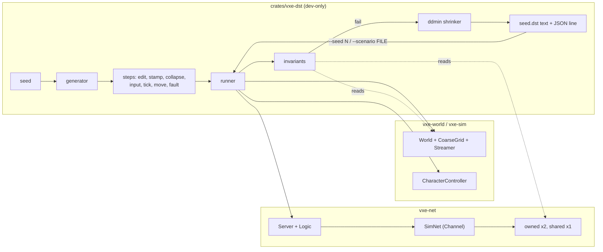

# 0089: Deterministic simulation testing: a seeded scenario harness with invariants and a shrinker, a simulated channel, a mirror oracle, a simulated disk, and determinism gates

> **Status:** draft, awaiting the owner's go (drafted 2026-11-17 from the owner's "yes draft it"
> on the architect's proposal after the "Deterministic Simulation Testing" article)
> **Created:** 2026-11-17
> **Milestone:** cross-cutting in [`docs/roadmap.md`](../roadmap.md): M5's simulation split
> (the seams it uses), the road to M9 (the simulated channel precedes the transport), and the
> test tiers of Plans 0043 and 0066
> **Related ADRs:** [ADR-0073](../adrs/0073-deterministic-simulation-testing-is-an-in-tree-seeded-harness-at-the-seams-the-engine-has.md)
> (proposed: in-tree, message-level channel, a delta-debugging shrinker, no framework);
> builds on [ADR-0007](../adrs/0007-server-op-log-byte-channel-shared-and-owned-clients.md)
> (the op log, the channel, the owned client's check),
> [ADR-0010](../adrs/0010-game-logic-as-a-component-behind-a-logic-trait.md),
> [ADR-0003](../adrs/0003-sphere-residency-with-lod-ring-and-edit-persistence.md) (the spill) and
> [ADR-0008](../adrs/0008-collapse-as-capped-support-flood-and-rigid-vertical-drop.md) (the support query).
> **Sources:** [Deterministic simulation testing: external sources](../references/deterministic-simulation-testing.md).
> **Starts after:** see "Where it sits" below; the recommendation is Phases 1 to 3 now as a
> side lane (they add a crate and touch no engine source), Phases 4 to 7 after
> [Plan 0087](0087-the-rename-to-svet-crates-env-vars-wit-package-archives-docs-and-the-repository.md)
> (the rename) merges, since they edit four engine crates. Paths below are pre-rename
> (`vxe-*`); a phase that runs after 0087 reads them as `svet-*`, and a crate born before it is
> renamed by 0087's final grep.

## TL;DR

A dev-only crate, `crates/vxe-dst`, draws a scenario from one seed (edits of every shape and
mode, stamps, collapses, logic inputs, controller moves, channel faults) and checks invariants
after every step: an edit's per-material counts equal the actual voxel diff and nothing outside
its reported region changed, the support query equals a brute-force flood over the coarse
grid, the log replays to the same hash, owned clients equal the server, the walker never ends
inside rock, the GPU mirror after an incremental schedule equals a fresh upload, an edited
chunk survives the spill under disk faults. A failure prints its seed and step, shrinks the
scenario to a minimal step list by delta debugging, and writes it as a text file plus one JSON
line, so `cargo run -p vxe-dst -- --seed N` or `--scenario FILE` reproduces it for a person
or an agent. A short batch of seeds runs in the gate on both CI arms (its combined hash is one
more cross-platform vector), a long batch weekly in the soak tier. `vxe-net` gains a simulated
channel with seeded drops, delays, duplicates, partitions and clogs, and the owned client the
smallest fail-safe rule against them. The determinism rules become gates: `iter_over_hash_type`
denied in the deterministic crates, a script that scans them for thread spawns, environment
reads and floating point in the integer paths. The first thing the owner sees: a planted fault
in the harness is caught at its step and shrunk to one line, and the batch is green.

## Context & problem

The article's prerequisites are this engine's rules already (ADR-0073's Context lists them with
their types), and every one is tested by a fixed vector: 24 ops in
`apps/flythrough/tests/determinism.rs`, one collapse course, one hundred seeded carves in
`crates/vxe-net/tests/owned.rs`, one incremental-versus-rebuild walk in
`crates/vxe-world/tests/stream.rs`. A vector defends one path. The classes of bug the engine
has actually had are schedule-shaped: a mirror that misses a dirty chunk under one order of
edits and focus moves, a result that disagrees with the voxels for one shape at one boundary,
a persistence race (`no_ok_edit_is_lost_to_a_racing_eviction` was written after one). Those are
found by many random schedules with an oracle, and reported as a seed.

Two of the article's pieces have no counterpart: a simulated network and a simulated disk.
`MemChannel` is the only `Channel` and delivers everything whole and in order, so nothing has
ever asked what an owned client does when an `Applied` goes missing (today: nothing, until an
overlapping op's result differs, which is silent divergence). The spill writes through a
temporary file and a rename with no `sync_all`, and the fly-through's save is a bare
`File::create` and `write_to` (`apps/flythrough/src/run/edit.rs`); both read fail-safe (a
trailer, truncation at an entry), neither has been run under injected faults.

The consumer's needs it serves: Determinism P0 and P1 (edits as compact ops for replay and
networking), Networking P0 and P1 (deterministic edit application; prediction and late join
rest on an owned client that is known to converge), from `project-context.md`. The roadmap's
"Two workflows, both first class" asks for machine-readable output an agent can act on; a
failing seed with a minimal scenario file is that for correctness bugs. `docs/nfr.md` figures
touched: section 6 (a seeded batch joins the vectors) and section 7 (the gate's wall time, the
10 s line per test).

## Decision

We build the harness in-tree, in a dev-only crate over the public APIs of `vxe-world`,
`vxe-net`, `vxe-sim` and `vxe-entity`, with the engine's `SplitMix64` as its only randomness
and a `ddmin` shrinker of our own (ADR-0073). The simulated channel is an implementation of the
existing `Channel` trait at the message level; the byte-level seam is owed to M9's transport
plan. We rejected a byte-level simulator now because there is no framing code to run; an
external framework (turmoil, madsim, Antithesis, loom, shuttle) because the server is
synchronous and clock-free already and the one hosted option runs nothing in our CI; and
`proptest` because the scenario is a seed and a step list that shrinks in a hundred lines
without ten new crates. The streaming worker pool stays nondeterministic; its results are what
the harness checks. Renderer and audio determinism are out of scope.

## Architecture diagram



## Implementation phases

Each phase ships as its own commit. `dev` implements the phases in order; the architect reviews
once at the end, in a fresh session. Phases 1 to 3 touch only the new crate and `docs/nfr.md`
and can run beside any lane; Phases 4 to 7 edit engine crates and wait for the rename.

**A finding against the engine** (a seed that fails an invariant because the engine is wrong,
not the harness) is handled in the lane when the fix is local (a line or a function, under a
day); otherwise it becomes a `docs/backlog.md` entry with the seed, the minimal scenario file
committed under `crates/vxe-dst/scenarios/`, and the gate batch's seed range moved past the
seed, the entry named in the test. Every finding is a line in the Implementation log's Notes.

### Phase 1: The walking skeleton: a seeded op scenario over one world, three invariants, a seed on failure
- **Owner skill:** dev
- **What:** The crate, the generator for world ops, the per-step invariants, a gate batch and
  the `--seed` command.
- **Files touched:** `crates/vxe-dst/Cargo.toml` (depends on `vxe-world`, and `vxe-net` with
  its `test-logic` feature for `test_table` and `SplitMix64`; no new external dependency),
  `crates/vxe-dst/src/{lib,scenario,world_steps,invariants,report}.rs`,
  `crates/vxe-dst/src/main.rs` (the `vxe-dst` binary), `crates/vxe-dst/tests/batch.rs`,
  `Cargo.toml` (the `crates/*` glob already lists it; it is not a default member),
  `docs/nfr.md` section 6 (the batch as a vector, a proposal until the close reads it).
- **The world:** `ChunkExtent::new([-1, -1, -1], [1, 1, 1])`, 8 chunks of 64^3 (2 097 152
  voxels), generated from a seeded value-noise source of the harness's own (`ValueNoise` in
  `vxe_world::hash`; rock below a threshold, air above, a band of material 4 (indestructible in
  `test_table`) and a vein of 5), so bricks of every packed class occur; boundary anchors on.
- **The steps** (`Step::Edit`, `Step::Stamp`, `Step::Collapse`), drawn by `SplitMix64`:
  sphere, box, capsule and tool-along-ray shapes with radii 1 to 12 voxels in fixed point,
  centres anywhere in the extent plus one chunk outside it (so `OutOfRange` and `NotResident`
  refusals occur); `Carve`, `Fill(m)` and `Replace { from, to }` over materials 1 to 5 with air
  as a `to`; a stamp of one of four seeded prefabs (a box with holes, 8 to 24 voxels a side) at
  a random `Rot`; after every carve, `find_unsupported` on the result's changed cells with the
  cap above the world's 4096 cells, and per region a seeded choice of `drop_region` (repeated
  until the result says landed), `drop_region_through` then `pile_rubble`, or `remove_region`.
- **The invariants, checked after every step:**
  1. **Counts equal the diff.** Over the step's snapshot box (the shape's bounds grown by one
     voxel; for a collapse, the regions' `aabb` grown by the drop's reach), the voxels whose
     material changed, grouped by their old material, equal `changed_from` exactly, ascending,
     with no zero count; a `Fill` or `Replace` adds exactly that many voxels of the new
     material.
  2. **Locality and canon.** Every changed voxel lies inside the result's `aabb`; every chunk
     not in `touched` keeps its hash (`World::write_hash` per chunk); `touched` is ascending; an
     `Err` leaves every chunk's hash unchanged; no voxel of material 4 ever changes under a
     `Carve`, a drop-through or a remove.
  3. **The support oracle.** Before the collapse ops, the union of the query's regions' cells
     equals a brute-force breadth-first flood's set of load-bearing cells unreachable from any
     anchor over the whole coarse grid (the induction: the world holds no unsupported cell after
     each step, so every unsupported cell was made by this step); after them, the brute force
     finds none.
  4. **Replay.** At the scenario's end the op log, encoded as a `LogFile` with the prefabs it
     names, decodes and replays on a fresh world from the same source and seed to the same
     `voxel_hash` and the same per-op results.
- **The command:** `cargo run -p vxe-dst -- --seed N [--steps K] [--plant counts|locality|support]`
  prints one line per step (`step 37 edit sphere c=(12,-40,7) r=9 carve -> {1: 1203, 5: 44}`)
  and the invariant results; `--plant` corrupts the named check's input at a seeded step (a
  count off by one, a changed voxel outside the box, a region cell dropped) so the check is
  shown not to be a tautology. A failure prints `seed 0x... step 37 counts: material 5 result
  44, diff 45` and exits 1.
- **Done when:** eight seeds (`0..8`) of 256 steps each pass as eight gate tests (one per seed,
  a macro or eight one-liners), each estimated under 3 s on the dev reference (a guess until
  read; a seed over the 10 s line shrinks `K`, not the claims), on both CI arms; a ninth test
  pins the batch's combined hash (FNV over each seed's final `voxel_hash` and op log bytes) as
  a cross-platform vector, blessed on Linux; `--plant counts` on seed 0 fails at its planted
  step naming material and both counts, and `--plant locality` and `--plant support` fail
  naming the voxel and the cell; a soak test `#[ignore = "soak"]` runs seeds `8..1008` of 1024
  steps.

### Phase 2: The shrinker and the report: a failing seed becomes a minimal scenario file and a JSON line
- **Owner skill:** dev
- **What:** `ddmin` over the step list, then a parameter shrink per step; the text and JSON
  report; `--scenario FILE`.
- **Files touched:** `crates/vxe-dst/src/{shrink,scenario_text,report}.rs`, `src/main.rs`,
  `tests/shrink.rs`, `crates/vxe-dst/scenarios/README.md` (where committed findings live).
- **The shrink:** a trial regenerates the world (8 uniform-ish chunks, milliseconds) and
  applies a subset of the steps; `ddmin` removes halves, quarters and so on while the same
  invariant still fails at the same kind of step; then each surviving step's parameters move
  toward smaller (radius down by halving, centre toward the origin by halving, a prefab to its
  smallest) while the failure holds. Bounded at 2000 trials.
- **The report:** `target/dst/<seed>.dst`, one step per line in the command's grammar
  (`edit sphere 12 -40 7 r 9 carve`, `stamp 2 rot 3 at 0 8 0`, `collapse drop`), plus a header
  (`world noise seed 0x..`, `extent -1 -1 -1 1 1 1`); and one JSON line on stdout:
  `{"seed":"0x..","step":37,"invariant":"counts","detail":"material 5 result 44 diff 45","steps":256,"minimal":1,"file":"target/dst/0x...dst"}`.
  `--scenario FILE` runs a file instead of a seed, with the same checks and output.
- **Done when:** `--plant counts` on seed 0 shrinks to a scenario of exactly one step (the
  planted fault depends on no other step), in under 5 s, and the written file rerun with
  `--scenario` fails at step 1 with the same invariant and detail; a test plants a fault whose
  trigger is two steps (a carve under a slab, then the collapse) and the shrink keeps both and
  no third; the JSON line parses and names the file that exists.

### Phase 3: The server, three clients and a walker in the loop
- **Owner skill:** dev
- **What:** The scenario drives a `Server` with a logic, two owned and one shared client over
  `MemChannel`, and a `CharacterController` walking the world.
- **Files touched:** `crates/vxe-dst/src/{net_steps,sim_steps}.rs`, `src/scenario.rs`,
  `tests/net.rs`, `tests/walker.rs`; `crates/vxe-dst/Cargo.toml` (`vxe-sim`).
- **The steps:** `Step::Input(client, bytes)` for `SeededLogic` (and the harness's own
  `DstLogic`, which turns an input into one of the Phase 1 ops through `Host::apply` and asks
  `Host::unsupported` after a carve), `Step::Tick`, `Step::Submit(op)` (the host-side path with
  its boundary entry), `Step::Move(MoveInput)` for a walker whose start cavity is step 0 (a
  box carve of 4 x 4 x 3 m at the origin).
- **The invariants:** after every tick both owned clients' `voxel_hash` equal the server's and
  no `Desync` was raised; the shared client's events equal the server's `TickReport`; at the
  end `Server::resimulate(seed, ops, inputs)` returns a byte-equal op log and the `LogFile`
  with both logs round-trips; after every `Move`, `vxe_sim::overlaps(world, body)` is false and
  the walker's `CharacterState` after replaying the same world and inputs hashes equal.
- **Done when:** four seeds of 64 ticks with up to 4 inputs a tick and a 64-move walk pass as
  four gate tests, each estimated under 3 s; the Phase 2 shrink works over these steps too (a
  planted desync, one owned client's op applied with the wrong mode, shrinks to the two steps
  that make it visible: the input and its tick); the combined-hash vector of Phase 1 gains these
  seeds; a soak test runs 200 seeds of 512 ticks.

### Phase 4: Fitness functions: hash iteration, thread spawns, environment reads and floats as gates
- **Owner skill:** dev
- **What:** `#![deny(clippy::iter_over_hash_type)]` in the four deterministic crates and a
  script gate over their sources.
- **Files touched:** `crates/vxe-world/src/lib.rs`, `crates/vxe-net/src/lib.rs`,
  `crates/vxe-sim/src/lib.rs`, `crates/vxe-entity/src/lib.rs` (the attribute, and an
  `#[expect(clippy::iter_over_hash_type, reason = "...")]` at each iteration whose order is
  proven not to leak, such as `ChunkStore::coords` and `take_dirty`, which sort),
  `scripts/check-determinism.mjs`, `scripts/check-determinism.test.mjs`,
  `scripts/fixtures/determinism/` and `scripts/fixtures/README.md`, `.github/workflows/ci.yml`
  (a step beside the other doc gates), `apps/flythrough/tests/determinism.rs` (the
  `generation_sources_contain_no_floating_point` test's file list moves to the script and the
  test goes), `CLAUDE.md`'s scripts tree (one line).
- **The script:** over the tracked `.rs` files of `crates/vxe-world/src`, `crates/vxe-net/src`,
  `crates/vxe-sim/src` and `crates/vxe-entity/src`, comments and string literals blanked:
  `thread::spawn`, `Builder::new().spawn`, `thread::scope` and `rayon` are findings except in
  `vxe-world/src/stream/workers.rs` and the scoped generation in `store.rs`, each carrying
  the grep-able `#[allow(clippy::disallowed_methods, reason = "...")]`-style marker line the
  script looks for (`// determinism: results independent of thread order, asserted by ...`);
  `std::env::` is a finding everywhere; `f32`, `f64`, a float literal, `sin`, `cos`, `exp`,
  `powf` and `sqrt` are findings in `vxe-world`'s `edit.rs`, `shape.rs`, `collapse/`,
  `support.rs`, `stamp.rs`, `coarse.rs`, `raycast.rs`, `query.rs`, `fixed.rs`, `hash.rs`,
  `log.rs`, `wire.rs`, and in all of `vxe-sim` and `vxe-entity` (`material.rs`, `census.rs` and
  `stream/` are not scanned for floats: albedo, statistics and ratios are not edit math), plus
  the fly-through's generation sources the old test named. Exit 1 with `file:line -> what`.
- **Done when:** `cargo clippy --workspace --all-targets -- -D warnings` passes with the four
  attributes in place and every `#[expect]` carrying a reason (an `#[expect]` that no longer
  fires is itself a clippy error, so the list cannot rot); the fixture tree holds a spawn, an
  `env::var` and an `f32` in an edit-path file, and the script names all three with their
  lines and nothing else; the real tree passes; CI runs the step; the hook-style test
  `node --test scripts/check-determinism.test.mjs` passes.

### Phase 5: The simulated channel, and the owned client's fail-safe rule
- **Owner skill:** dev
- **What:** `SimNet` in `vxe-net` behind a `sim` feature, the `Channel` trait used
  polymorphically, and the client's gap and duplicate rules; scenarios with faults.
- **Files touched:** `crates/vxe-net/Cargo.toml` (feature `sim`), `crates/vxe-net/src/sim.rs`
  (new), `src/channel.rs`, `src/client.rs`, `src/server.rs` (`attach` and `Client::{shared,
  owned}` take `Box<dyn Channel + Send>`; `broadcast` over them), `src/lib.rs`,
  `crates/vxe-net/tests/sim.rs`, `crates/vxe-dst/src/fault_steps.rs`, `tests/faults.rs`,
  `crates/vxe-dst/Cargo.toml` (`vxe-net/sim`), `docs/nfr.md` section 6.
- **The channel:** `SimNet { tick, rng: SplitMix64, links, faults }` behind an `Arc<Mutex<_>>`
  the endpoints share; `SimNet::pair()` returns two `SimEndpoint`s; `send` draws the message's
  fate from the link's `Faults`: a delay in ticks from `[min, max]`, a drop with `drop_ppm`, a
  duplicate with `dup_ppm` (a second copy at a second delay), a partition that starts every
  `every` ticks and holds `hold` ticks (messages sent into it are dropped), a clog that holds
  every message of a link for `clog` ticks; with `ordered: true` a message's delivery tick is at
  least the previous one's, so delays never reorder. All integers, parts per million.
  `advance(tick)` releases what is due; `try_recv` pops in delivery order, ties by send order.
- **The client's rule** (a public API change, named at the close): the owned client tracks
  the next seq; an `Applied` or `Refused` whose seq is below it is a duplicate, dropped and
  counted (`Client::duplicates()`); one above it raises a new `Event::Lost { expected, got }`
  and the client applies nothing after (`desynced()` reads true). The shared client reports
  `Lost` the same way and keeps reading (its world is the server's). Ordering and
  retransmission are M9's.
- **The invariants, in two modes:** **R (reliable):** `ordered: true`, `drop_ppm: 0`, delays
  0 to 8 ticks, partitions every 16 ticks holding 4, duplicates at 20 000 ppm: after the last
  tick plus 16 ticks of `advance` and `poll`, both owned clients equal the server, no `Lost`,
  at least one duplicate counted. **L (lossy):** `drop_ppm: 50_000` or `ordered: false`: the
  first owned client to miss a seq raises `Lost` with the right `expected` at that step, applies
  nothing after, and its `voxel_hash` equals the server's log replayed to `expected - 1` (no
  silent divergence); the server's input log holds exactly the inputs that arrived and
  `resimulate` on it still equals the live log.
- **Done when:** `an_owned_client_stays_in_step_over_100_seeded_carves` and the rest of
  `tests/owned.rs` and `tests/shared.rs` pass unchanged over `MemChannel` through the boxed
  trait; `tests/sim.rs` pins the fates of 32 messages on one seed (a vector: which tick each is
  delivered, dropped or duplicated); four R seeds and four L seeds of 64 ticks pass as eight
  gate tests, each estimated under 3 s; in mode L at 5 % drop over about 256 server-to-client
  messages the chance of zero drops is 0.95^256 (about 2e-6), so every L seed raises `Lost` and
  the test asserts it; a soak test runs 200 seeds in each mode.

### Phase 6: The mirror oracle: an incremental edit-and-stream schedule equals a fresh upload
- **Owner skill:** dev
- **What:** A gpu test that drives `GpuWorld::sync` with a small byte budget over a seeded
  schedule of edits, focus moves and polls, then compares the mirror's logical content with a
  fresh unbudgeted upload of the same world.
- **Files touched:** `crates/vxe-render/tests/gpu_mirror_schedule.rs` (new gpu binary),
  `crates/vxe-render/tests/support/` (a readback of records, table and slots into per-brick
  logical words, if the mirror tests' support lacks one), `crates/vxe-render/Cargo.toml`
  (`vxe-dst` as a dev-dependency for the generator; `vxe-dst` depends on no GPU crate),
  `crates/vxe-dst/src/stream_steps.rs` (`Step::Focus(delta)`, `Step::Poll`, `Step::Sync`).
- **The schedule:** a following window of side 3 (27 chunks) over a `Streamer` with two
  workers on the Phase 1 noise source at `r_full` 1 and `r_lod` 2; 64 steps of edits, one-chunk
  focus moves, `poll` and `sync` with a 256 KiB byte budget (a noisy chunk's bricks run to about
  0.5 MB, so one chunk spans several syncs and the deferral path runs) and the fixed-step sync
  clock; field off; then a drain (`sync` until nothing is pending). The oracle: a second
  `GpuWorld` built from the same `World` with one unbudgeted `sync`. Compared per chunk in the
  window: the table entry's `EMPTY_BIT` and kind, the LOD record for a LOD-only chunk, and per
  brick the slot's logical words (mask unit, header palette and class, payload units, the
  translucent unit), not slot addresses, which legitimately differ by allocation history.
- **Done when:** three seeds pass as three gate tests, each estimated under 8 s on lavapipe
  (device creation, about 100 small syncs, two readbacks of at most 14 MB); a planted fault (a
  chunk edited through `write_lock` without `mark_dirty`) fails naming the chunk and the first
  differing brick; a soak test runs 30 seeds of 256 steps; the test is a reading of the mirror
  only: the baked light store is not compared (see "does NOT do").

### Phase 7: The simulated disk: the spill and the save under injected faults
- **Owner skill:** dev
- **What:** A `SpillIo` seam in `vxe-world`'s persistence with a `std` implementation that
  syncs before the rename, a `SimDisk` in the harness with visible and durable bytes and
  seeded failures, and the fly-through's save through the same write rule.
- **Files touched:** `crates/vxe-world/src/persist.rs` (`pub trait SpillIo { write, read,
  remove }`, `StdIo` as today plus `File::sync_all` before the rename), `src/stream/mod.rs`
  (`Streamer::set_spill_io(Arc<dyn SpillIo + Send + Sync>)`), `src/stream/workers.rs`,
  `crates/vxe-world/tests/persist.rs`, `crates/vxe-dst/src/disk.rs`, `tests/disk.rs`,
  `apps/flythrough/src/run/edit.rs` (the save written to `<path>.tmp`, synced, renamed),
  `apps/flythrough/tests/` (the save leaves no `.tmp` and a cut file still replays its whole
  entries, the existing claim).
- **The disk:** `SimDisk { visible, durable: BTreeMap<PathBuf, Vec<u8>>, rng, faults }` with
  `fail_write_ppm`, `fail_rename_ppm`, `fail_read_ppm`, `truncate_on_crash: bool`; `sync`
  copies visible to durable; `crash()` discards the unsynced part (and truncates a file at a
  seeded byte when `truncate_on_crash`).
- **The invariants:** over a schedule of edits and focus moves far enough to evict (`r_full` 1,
  hysteresis 0, the RAM cap at one chunk so the spill runs), an edited chunk that comes back is
  byte-equal to its evicted bricks, or the streamer reports `StreamError::Spill` for it and the
  coordinate stays non-resident; a chunk never returns as the source's clean generation after
  an edit. After `crash()` and a new `Streamer` over the same `SimDisk` and world key, every
  durable file decodes to its chunk or is reported `Corrupt`; none decodes to another chunk.
- **Done when:** four seeds of 128 steps pass as four gate tests, each estimated under 3 s;
  a planted fault (a `SimDisk` that keeps a truncated file as visible and durable without a
  write error) is caught by the trailer and reported for its coordinate; the fly-through's save
  test shows no `.tmp` after success and a truncated save replays its complete entries; a soak
  test runs 200 seeds.

## Data shapes

```rust
// illustrative, crates/vxe-dst
pub struct Scenario { pub seed: u64, pub world: WorldSpec, pub steps: Vec<Step> }
pub enum Step {
    Edit(EditOp), Stamp { prefab: u8, rot: Rot, at: VoxelCoord }, Collapse(CollapseChoice),
    Input { client: u32, bytes: Vec<u8> }, Submit(Op), Tick, Move(MoveInput),
    Fault(Faults), Focus([i32; 3]), Poll, Sync,
}
pub enum Invariant { Counts, Locality, Support, Replay, Clients, Resim, Walker, Mirror, Spill }
pub struct Failure { pub seed: u64, pub step: usize, pub invariant: Invariant, pub detail: String }
// crates/vxe-net/src/sim.rs, all integers
pub struct Faults {
    pub delay: (u32, u32), pub drop_ppm: u32, pub dup_ppm: u32,
    pub partition: Option<(u32, u32)>, pub clog: u32, pub ordered: bool,
}
pub enum Event { /* as today, plus */ Lost { expected: u32, got: u32 } }
// crates/vxe-world/src/persist.rs
pub trait SpillIo { fn write(&self, p: &Path, b: &[u8]) -> Result<(), SpillError>;
                    fn read(&self, p: &Path) -> Result<Vec<u8>, SpillError>;
                    fn remove(&self, p: &Path) -> Result<(), SpillError>; }
```

The scenario file is text, one step per line in the command's grammar, so a person edits it
and an agent writes it; the JSON line is for the agent's loop.

## Budgets

- **`docs/nfr.md` section 7, the gate.** Added CPU tests: 8 (Phase 1) + 4 (Phase 3) + 8
  (Phase 5) + 4 (Phase 7) = 24 tests, each estimated under 3 s, run in parallel beside the
  lavapipe group, so a few seconds of wall at most; none may read over the 10 s line on the
  dev reference, and a CPU test over it stays in the gate on both arms by the owner's rule.
  Added gpu tests: 3 (Phase 6) at under 8 s each, about 24 s of the lavapipe group's serial
  wall. The close reads the gate with and without the new tests (`node scripts/test-times.mjs`)
  and records the delta; CI's Linux arm is accepted at about 15 min and should move by under a
  minute. These are guesses until read.
- **`docs/nfr.md` section 6.** Gains a line: the seeded batch (its seeds and step counts) and
  its combined hash, asserted on both arms, with the fates vector of `tests/sim.rs`.
- **The soak tier** (`soak.yml`, 300 min cap): the long batches are estimated at 15 to 25 min
  CPU and about 10 min lavapipe in total; the first weekly run reads them.
- **Memory:** harness worlds are 8 to 27 chunks; nothing persistent grows. No frame-time
  figure moves: the renderer is not in the loop except Phase 6's mirror test.
- **Dependencies:** none added. `proptest` was considered and rejected (ADR-0073).

## Where it sits

The open lanes are Plan 0080 (closing), 0086, 0077, 0088 and then 0087 (the rename, alone).
Phases 1 to 3 add `crates/vxe-dst` and edit `docs/nfr.md` only, so they can run now as a side
lane; Phases 4 to 7 edit `vxe-world`, `vxe-net`, `vxe-sim`, `vxe-entity`, `vxe-render`'s tests,
the fly-through's save and `ci.yml`, and are best run after 0087 merges (every crate directory
moves under it). Recommended: one lane that runs Phases 1 to 3 now, checkpoints with resume
notes in `docs/plans/logs/0089.md`, and resumes at Phase 4 after the rename; the owner may
instead run the whole plan after 0087 (owner question 1).

## Risks & open questions

- **The harness finds engine bugs in its own lane.** That is its value and its schedule risk;
  the rule above (local fix in the lane, otherwise a backlog entry with the seed and a committed
  scenario file, the batch's seeds moved past it) keeps the lane bounded. A seed range moved
  past a finding is named in the test so nothing is hidden.
- **The support oracle's induction.** Invariant 3 holds only if the harness resolves every
  region each step; a drop that cannot land (over a missing chunk) leaves an unsupported region,
  which the brute force then reports at the next step. The harness uses a bounded world with
  every chunk resident in Phases 1 to 5, so no drop scans into a missing chunk; the streamed
  world of Phases 6 and 7 runs no collapse steps.
- **`iter_over_hash_type` bites widely.** `vxe-world` iterates `HashMap`s in the store, the
  residency, the persistence map, the support flood and the coarse grid; most collect and sort
  or feed a set, not a result. Each site gets an `#[expect]` with its reason, perhaps a dozen (a
  guess); one that cannot justify its order is a finding the lane fixes (a `BTreeMap` or a sort).
- **The channel's API change** (boxed `Channel` in `attach` and the clients) touches the
  fly-through's server setup; `Endpoint` stays the in-memory type and `MemChannel::pair` is
  unchanged, so the edit is at the call sites only.
- **The mirror oracle's "logical words".** The comparison must ignore slot addresses and the
  band; if the header's band slot word differs with field off, the compare masks it. If a
  legitimate difference appears (two canonical encodings of one brick), that is a finding on the
  mirror's canon, not a reason to loosen the oracle.
- **Determinism:** the harness is CPU, integer and seeded; the one nondeterministic piece it
  drives (the worker pool) is checked by result. No GPU feature beyond what the mirror tests
  use; no new threading; the harness's worlds are small.

### Owner questions (each with a recommendation)

1. **When.** (a) **Recommended:** Phases 1 to 3 now as a side lane beside the open lanes (a new
   crate and `docs/nfr.md`, no engine source), checkpoint, Phases 4 to 7 after Plan 0087
   merges. (b) The whole plan after 0087. (c) The whole plan now, accepting merge work in four
   crates against 0086, 0077 and 0088 and a rename of the lane's files under 0087.
2. **The harness's home.** (a) **Recommended:** a dev-only crate `crates/vxe-dst`, not a default
   member, with its binary; `vxe-render`'s mirror test takes it as a dev-dependency. (b)
   Test-support modules behind features in each crate (as `vxe-net`'s `test-logic`): no new
   crate, but the cross-crate invariants (clients, walker) need one crate's tests to see the
   others, and there is no command. (c) A tool under `apps/`: a binary, but the tests live there
   too, away from the crates they check.
3. **The shrinker.** (a) **Recommended:** hand-rolled `ddmin` on `SplitMix64`, no dependency.
   (b) `proptest` as a dev-dependency (about ten crates), its strategies and regressions file.
4. **The client's fail-safe rule** (`Event::Lost`, duplicates dropped). (a) **Recommended:** in
   this plan, Phase 5: a few lines, and without it mode L asserts nothing. (b) Leave the client
   as it is and let mode L record silent divergence as a reading for M9.
5. **Phase 7, the simulated disk.** (a) **Recommended:** keep it, last and a day's work: the
   save's bare `File::create` is a real gap and the seam is three methods. (b) Drop it to the
   backlog with this plan's design, since both paths already read fail-safe.
6. **Findings against the engine.** (a) **Recommended:** fixed in the lane when local (under a
   day), otherwise a backlog entry with the seed, the minimal scenario committed, the batch's
   seeds moved past it and named in the test. (b) Every finding goes to the architect before
   any fix (slower, cleaner record).

## What this plan does NOT do

- **No byte-level simulated channel.** It belongs under the framing code M9's transport plan
  writes, as a second `Channel` implementation beside `SimNet` (ADR-0073, Alternative A).
- **No reordering buffer or retransmission** in the client; `Lost` is a fail-safe, M9 builds
  reliable ordered delivery on QUIC streams.
- **No baked-light oracle.** The same schedule harness could run the bake queue and compare the
  store with a fresh bake, but the bake re-bakes dependents under a budget, so equality is not
  the contract; a followup reads the difference as a reading first.
- **No renderer or audio determinism**, no golden images: the mirror test compares words, not
  pixels.
- **The worker pool stays nondeterministic**; its results are checked, its schedule is not
  explored. A loom or shuttle pass over the store lock and the eviction race is a later chore.
- **The logic component is not driven by the generator.** `equality.rs` holds native and
  component equal on fixed inputs; running the generator's inputs through `vxe-script-wasm` is
  a followup (it would pull `wasmtime` into the dev-only crate's build).
- **No stress or load figures**: the harness measures nothing, it checks.

## Implementation log

> Written by `dev`: one row per phase as its commit lands, then the close block. **The phases
> above are the contract. This section records what happened.** Observations, never conclusions:
> no pass list, no self-assessment. Deviations and unmet done-whens are **always** disclosed.
> Keep it shorter than `## Implementation phases`. Readings, gate counts, attempts, sweeps and
> resume notes go to the plan's readings log, `docs/plans/logs/0089.md` (started from
> `templates/readings-log.md`), and this section links it once it exists.

| phase | owner | state | commit |
|---|---|---|---|
| 1: the walking skeleton | dev | not started | |
| 2: the shrinker and the report | dev | not started | |
| 3: the server, three clients and a walker | dev | not started | |
| 4: fitness functions | dev | not started | |
| 5: the simulated channel and the client's rule | dev | not started | |
| 6: the mirror oracle | dev | not started | |
| 7: the simulated disk | dev | not started | |

### Notes

_(Deviations from the plan, with the commit, stated without justification. Done-whens not
satisfiable as stated, and what was done instead. Findings against the engine, each with its
seed. Followups noticed and not acted on. One line each. Empty is fine.)_

### Close triggers

_(Facts for the architect. No recommendations, and no suggested version bump.)_

- **What shipped:** feature / fix-only / docs-chore-only
- **Public API changed:** types, traits, functions, config (list them, or none)
- **Budget readings:** each `nfr.md` figure touched, with its measured value, machine and commit
- **Gate at the tip:** the commands run (build, nextest, doctests, clippy, fmt, deny), exit codes, test counts
- **Outstanding `human` phases:** none planned

## Followups

- The byte-level channel seam, with M9's transport plan.
- The baked-light store under the Phase 6 schedule, as a reading.
- The generator's inputs through the logic component (`vxe-script-wasm`).
- A loom or shuttle pass over the store write lock and the eviction race.
