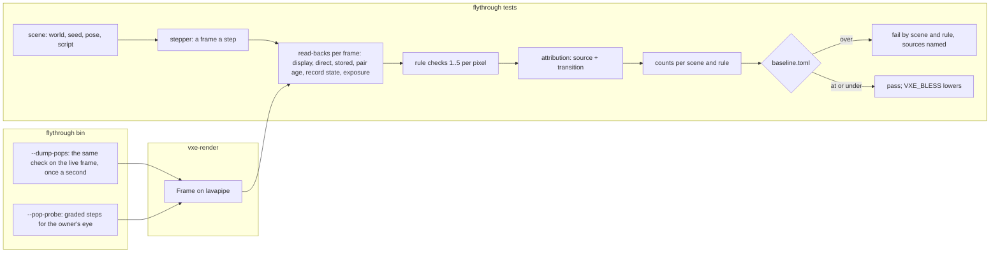

# 0090: The pop counter: fixed scenes on lavapipe count the pixels that break each light-stability rule, by source; a baseline that only falls

> **Status:** draft
> **Created:** 2026-11-18
> **Milestone:** cross-cutting (M2's lighting base and M10's outdoor light) in `docs/roadmap.md`
> **Related ADRs:** [ADR-0076](../adrs/0076-light-stability-rules-world-history-per-source-a-fade-per-transition-and-a-ratcheted-pop-counter.md)
> (proposed: the five rules, the counter and the ratchet); builds on
> [ADR-0046](../adrs/0046-static-emissive-light-is-baked-per-chunk-when-a-chunk-loads-or-changes.md),
> [ADR-0070](../adrs/0070-sky-light-is-baked-visibility-coloured-at-read-with-a-long-history-ray-where-stale.md),
> [ADR-0033](../adrs/0033-eye-adaptation-as-an-asymmetric-two-stage-exposure-on-the-gpu.md)

## TL;DR

A headless harness, `apps/flythrough/tests/gpu_pops.rs`, renders fixed scenes with fixed
seeds at 160 x 90 lighting pixels on lavapipe, reads back the display and the per-source
targets every frame, and counts the pixels that break each of ADR-0076's five rules (still,
view-independent, one monotonic fade, local, exposure bounded). Every counted pixel is
attributed to a source (baked store, fallback chain, sky bake, sky ray, sun ray, list light,
exposure) and a transition (a cache-state switch, a young history, a reset, an exposure step).
The counts per scene and rule are a committed baseline; a run over its baseline fails, a bless
only lowers. The first thing the reader sees: `pops tunnel still rule 1: 412 px (sky ray 301,
sun ray 88, exposure 23), baseline 412`, and a fly-through flag, `--dump-pops`, that names the
chunks and sources of the pixels popping on screen right now. The owner calibrates the
thresholds once, by eye, on graded pops the fly-through injects. The plan fixes no pop: it
makes every later light plan a step down.

## Context & problem

ADR-0076's context: the light is a sum of sources with their own estimates, histories and
switches, and Plan 0086 Phase 16 (`docs/plans/logs/0086.md`) attributed the window's pops to
single-frame handovers (the dig flash's stored/direct switch at the stale bit), screen-space
histories that reset (the sky ray's young samples, the key light's reset pixels, the forest's
grain after a turn, the fired lights' in-flight sample), and the exposure scaling both. The
owner's rule: "a flame may flicker, nothing else may".

Today's defences are owner windows and per-mechanism statistical bars
(`fsr2_adds_little_flicker_on_a_still_vein` in `gpu_fsr2.rs`, the patch bars in
`gpu_emissive_stillness.rs` over `tests/support/stillness.rs`, Plan 0086's p99 bars). A p99
passes hundreds of popping pixels; a window reads one build an hour. Nothing counts the
pixels, names their source, or stops the next light plan (0081, 0033 to 0037, 0084's reveal)
from reintroducing the class.

Figures touched: `docs/nfr.md` section 7 (the gate's 19 min wall, read 1107 s on 2026-11-18,
so about 30 s of headroom; the 10 s soak line per lavapipe test), section 6 (headless
operation; a new determinism claim: the counts are bit-stable across runs on one lavapipe),
and a new light-stability line in section 2 that this plan proposes and its close reads.

## Decision

We build the counter as a `gpu_*` test binary in the fly-through's test tree, over the rigs
and read-backs Plan 0086 already built (`tests/support/defects.rs`'s stepper and per-frame
shots, `support/rigs.rs`, `support/stillness.rs`), with a per-pixel rule check and a source
classifier, a TOML baseline the test reads and `VXE_BLESS=1` lowers, and the scenes split by
measured wall time between the gate tier and soak. The thresholds start as named guesses and
are fixed after one owner window on graded pops. We rejected a statistical bar per scene
(ADR-0076 D: it hides "here and there"), a zero gate from day one (C: every scene is non-zero
today), and a counter inside `vxe-render`'s own tests (the scenes are the fly-through's worlds,
lights and camera paths, and `vxe-render` must not grow a world generator).

## Architecture diagram



## Implementation phases

Each phase ships as its own commit. `dev` implements all phases in one session with no review
between phases. The architect reviews once at the end, in a fresh session. Every phase carries
exactly one `**Owner skill:**`.

The scenes, named once here and referred to by letter. All at 160 x 90 lighting pixels, FSR 2
at 1.5 (the default upscaler, so the display is 240 x 135), the queue drained before the first
counted frame unless the scene says otherwise, wind 0, the testbed's defaults otherwise, seed 1.
"Settle" is 64 frames (the sky history's cap, 64 frames in Plan 0086 Phase 5, is the longest
history; `FADE` 16 the longest fade), "read" is the 32 frames after.

| scene | world and pose | rules read |
|---|---|---|
| A, tunnel still | the `inside` spawn looking out of the tunnel, noon, lamp off, a sky set (Plan 0086 Phase 1's pose) | 1, 5 |
| B, hall still | the castle's hall (`--castle`, `the_castle_stands_in_the_hall_with_its_gate_facing_the_spawn`'s pose), the lamp on, the emissive store baked, no sky | 1, 5 |
| C, forest still | `--trees forest`, `--sun 60,180`, voxel leaves, the forest floor in view (Phase 1's forest pose) | 1, 5 |
| D, turn and return | A's and C's poses: settle, yaw 90 degrees over 10 frames, hold 64, yaw back over 10 frames; the return frame and frame 8 after it against the settled image | 2, then 1 |
| E, dig | the hills at noon, 30 degrees down, a 10-voxel carve 35 voxels ahead at frame 64 (Plan 0086's `the_dig_flash` rig), the live queue stepped at a fixed job count a frame, 64 frames after | 3, 4, 5 |
| F, fired light | A's tunnel, one light fired along the view at frame 64 (`fire_five`'s path, one shot), 64 frames after it lands | 3, 4, 5 |
| G, light on and off | A's tunnel: the headlamp off at frame 64 and on at 128; B's hall: a list light (slot 1) on at 64, off at 128; 192 frames | 3, 4, 5 |
| H, sun sweep | the hills, the time of day from 10:00 to 14:00 over 240 frames (one degree of the sun a frame, no settle between) | 5, and a stepping count ratcheted |

The thresholds' starting guesses, until Phase 5: `T_still` 4 levels of 255 (the line
`fsr2_adds_little_flicker_on_a_still_vein` already reads "over 4/255" against), `T_return` 8,
`T_fade` 4, `F` 16 frames (ADR-0046's `FADE`), `R` 0.5 EV a frame (ADR-0033's defaults close
10.5 % of the gap a frame at 60 Hz, so a 4 EV light-on steps 0.42 EV on its first frame),
`T_sweep` 32 levels.

### Phase 1: The walking skeleton: scene A, rule 1, the baseline and the ratchet
- **Owner skill:** dev
- **What:** `apps/flythrough/tests/gpu_pops.rs` with `tests/support/pops/` (the scenes' table,
  the rule check, the baseline file's read and write). Scene A rendered through
  `defects::Stepper` (the display read back per frame); rule 1 as a per-pixel maximum of the
  frame-to-frame change over the read window; the `FLICKERS` mask applied from the hit
  material (no material carries the flag yet, so the mask is empty and the code path is
  exercised by a unit test on a constructed table). The baseline file
  `apps/flythrough/tests/pops/baseline.toml`: one `[scene.rule]` entry per count, the bless
  commit and the adapter name in its header. The ratchet: the test fails when a count is over
  its entry; `VXE_BLESS=1` rewrites entries whose count fell and leaves the others, printing
  a line for each count over its entry (a rise is a hand edit with a dated `raised = "..."`
  line in the file, which the test prints when present). The counts, the p99 and mean of the
  window's change (the old statistics, printed beside, not asserted), and the wall time per
  frame on lavapipe in the log.
- **Files touched:** `apps/flythrough/tests/gpu_pops.rs`, `tests/support/pops/mod.rs`,
  `tests/support/pops/baseline.rs`, `tests/pops/baseline.toml`, `crates/vxe-world/src/material.rs`
  (`MaterialFlags::FLICKERS`, bit 8, with its doc line), `crates/vxe-world/tests/` (the flag's
  unit test), `docs/plans/logs/0090.md`.
- **Done when:**
  1. **The count is a committed number.** `the_tunnel_at_rest_pops_no_more_than_its_baseline`
     in `gpu_pops.rs` (scene A, 96 frames; expected about 6 s on lavapipe, a guess from Plan
     0086 Phase 25's 20 s for 128 frames at 320 x 180, read in the log and the test moved to
     soak if over 10 s): the rule-1 count over the read window is at or under
     `baseline.toml`'s `A.still`, and the baseline it commits is the count read on this phase's
     tree (the expectation: hundreds of pixels; Plan 0086 Phase 1 read p99 7 to 15 levels at
     this pose at the defaults).
  2. **The counts are bit-stable.** `the_count_is_the_same_on_three_runs` (scene A three times
     in one process, about 18 s, `#[ignore = "soak"]`): the three counts are equal. If they are
     not, the log says by how much they differ and the plan stops for the architect (the slack
     is an owner question, not `dev`'s).
  3. **A bless only lowers.** A unit test of the baseline writer (CPU, under 1 s): given counts
     `{A.still: 400}` against an entry 412 the file reads 412 then 400 after the bless; given
     420 against 412 the bless leaves 412 and the writer reports the rise; an entry with a
     `raised` line is reported with its text.
  4. **The flag is a flag.** `MaterialFlags::FLICKERS` is bit 8, `contains` and the table's
     round trip hold it (CPU, under 1 s); the mask of a lighting grid against a constructed
     table with one flagged material marks exactly that material's hit pixels.
  5. `node scripts/check-test-tiers.mjs` passes (the file names at most four `VXE_*`
     variables: `VXE_BLESS`, `VXE_TEST_ADAPTER` and no more).

### Phase 2: Attribution per pixel, and `--dump-pops` in the fly-through
- **Owner skill:** dev
- **What:** the per-source read-backs per frame, each a target the frame already holds or a
  word the store already keeps: the direct target (`Frame::direct`: the sun and list lights'
  sample), the accumulated and stored parts (`Frame::accumulated`), the pair's age and the
  sky term's source (baked, chained, pair; Plan 0086 Phase 20's per-pixel source), the hit's
  brick record state (no value, fallback level, baked, `SKY_STALE`, fading, from the queue's
  words at the hit chunk), the sky-ray and shadow-ray counts (the `COUNT_STORE` counters), and
  the exposure state (`Frame::exposure_state`). **The classifier:** a counted pixel's source
  is the term whose own change between the two frames is largest in the display's units (the
  exposure's share is the display change explained by the exposure step alone, applied first);
  its transition is the record-state switch between the frames if there was one (named as
  `unbaked>fallback`, `fallback>baked`, `stale>rebaked`, `ray>bake`, `tier`), else `young`
  (history age under 8), else `reset` (age 0 after an accepted history), else `steady` (a
  jittered sample on a full history: the estimator's own noise). The table per scene and rule:
  count by source and by transition, and the ten hit chunks with the most counted pixels, each
  with its record state. **The fly-through's `--dump-pops`** (off by default; the banner names
  `dump pops`): once a second while any pixel broke rule 1 in the last frame, the same table
  for the live frame to stdout, as `--dump-black` (Plan 0086 Phase 18) prints black cells; the
  read-back runs only under the flag.
- **Files touched:** `tests/support/pops/attribute.rs`, `tests/support/defects.rs` (the
  record-state read-back), `crates/vxe-render/src/frame/mod.rs` (a read-back of the hit
  chunks' record words under a flag, if the store's words are not already reachable),
  `apps/flythrough/src/cli/`, `run/hud_feed.rs` (the dump), `hud/modes.rs` (the banner),
  `docs/flythrough.md`, `docs/plans/logs/0090.md`.
- **Done when:**
  1. **The classifier names a planted source.** `a_planted_sky_ray_pop_is_attributed_to_the_sky_ray`
     (scene A with `sky_rays` forced on over the whole frame through Plan 0086's `LightHooks`, 96
     frames,
     about 6 s): over 90 % of the rule-1 pixels are attributed to `sky ray`; the same scene
     with the sky off and the sun jittered at a wide disc attributes over 90 % to `sun ray`.
     The shares are printed; the 90 is a guess, pinned from the first reading before the
     assertion is written.
  2. **A switch is a transition.** `a_rebake_is_a_stale_to_rebaked_transition` (a 3 x 3 chunk
     floor baked whole, one brick's `SKY_STALE` set and re-baked at frame 64, about 5 s): the
     pixels on that brick that break rule 3 carry `stale>rebaked`, none `steady`.
  3. The table for scene A is in the log, and `--dump-pops` on the fly-through's headless run
     at scene A's pose prints the same top chunks as the harness (within the top ten).
  4. The banner test pins `dump pops` on and nothing when off (CPU, under 1 s).

### Phase 3: The event scenes: the dig, the fired light, the light on and off (rules 3, 4, 5)
- **Owner skill:** dev
- **What:** scenes E, F and G. **Rule 3's trace classifier:** per pixel, `old` is the mean of
  the 8 frames before the event, `new` the mean of frames `F + 8` to `F + 16` after it; the
  pixel breaks the rule when any frame between leaves `[min - T_fade, max + T_fade]` (classed
  `flash` above, `dip` below) or when the trace is not within `T_fade` of `new` by frame `F`
  (`slow`), or reverses by more than `T_fade` after first reaching `new` (`overshoot`). **Rule
  4's region:** scene E's is the carve box dilated by the bake's ring reach (ADR-0046's
  re-bake rings), scenes F and G's the light's reach as the light list carries it (ADR-0044);
  the hit position
  per pixel decides inside or outside; outside, rule 1's test runs across the event frames.
  **Rule 5:** the exposure state's log2 per frame: the step at most `R`, monotone toward its
  target across the event, and still within 1/64 EV over the settle window. The dig scene steps
  the live queue by a fixed job count a frame (not ADR-0052's time budget, which reads the wall
  clock), so the re-bake lands on the same frame every run.
- **Files touched:** `tests/support/pops/trace.rs`, `tests/support/pops/scenes.rs`,
  `tests/support/defects.rs` (`queue_step` by job count), `tests/pops/baseline.toml`,
  `docs/plans/logs/0090.md`.
- **Done when:**
  1. **The dig's flash is counted and classed.** `a_dig_pops_no_more_than_its_baseline`
     (scene E, 128 frames, about 8 s, soak if over): rule 3's count at or under `E.fade`, rule
     4's at or under `E.local`, rule 5 holds (asserted, not ratcheted: the exposure is one
     scalar and ADR-0033's model is monotone by construction; a break is a defect). The
     classes' split is printed (the expectation from Plan 0086 Phase 16: `flash` on the ring's
     stored/direct switch, `young` dots on the hole's faces).
  2. **The fired light fades in.** `a_fired_light_pops_no_more_than_its_baseline` (scene F,
     128 frames, about 8 s): rules 3 and 4 ratcheted, rule 5 asserted; the share of pixels in
     the lit patch classed `slow` or `flash` printed.
  3. **On and off are mirror fades.** `a_light_toggle_pops_no_more_than_its_baseline` (scene
     G, 192 frames, about 12 s, `#[ignore = "soak"]`): rules 3 and 4 ratcheted for each of the
     four events, rule 5 asserted; the frames each event's traces take to reach `new` printed
     against `F`.
  4. **The queue step is deterministic.** `the_dig_rebake_lands_on_the_same_frame` (scene E
     twice, about 16 s, soak): the frame the carve's ring re-bake lands is equal on both runs,
     and the rule-3 counts are equal.

### Phase 4: The view scenes, the other stills, the sun sweep, and the pop probe for the window
- **Owner skill:** dev
- **What:** scenes B, C, D and H, each tiered by its measured wall time; and the fly-through's
  `--pop-probe` for Phase 5: a listed frame input (not a settings field; it is a probe, and
  Plan 0069 Phase 2's setter test lists it as an input) that the composite adds to a 64 x 64
  patch at the view's centre: a **step** of `n` display levels for one frame every 2 s, `n`
  cycling 1, 2, 4, 8, 16, 32 (`--pop-probe step`), or a **fade** of 64 levels over `f` frames
  every 3 s, `f` cycling 1, 2, 4, 8, 16, 32 (`--pop-probe fade`); the HUD shows the mode and the
  current `n` or `f`, so the owner reads the value as they see it. A uniform branch, nothing
  when off.
- **Files touched:** `tests/support/pops/scenes.rs`, `apps/flythrough/tests/gpu_pops.rs`,
  `tests/pops/baseline.toml`, `crates/vxe-render/src/shaders/composite.wgsl`,
  `crates/vxe-render/src/frame/` (the probe's uniform and input), `apps/flythrough/src/cli/`,
  `hud/modes.rs`, `docs/flythrough.md`, `docs/plans/logs/0090.md`.
- **Done when:**
  1. **Turning away loses nothing, or the baseline says how much.**
     `a_turn_and_return_pops_no_more_than_its_baseline` (scene D at both poses, about 148
     frames each, about 20 s, `#[ignore = "soak"]`): rule 2's count at the return frame at or
     under `D.return` for each pose, the count at frame 8 after printed beside it; rule 1 over
     the 32 frames after the return at or under `D.still`. The expectation: large (every
     disoccluded pixel's direct history restarts); the baseline records it.
  2. **The hall and the forest hold still, or the baseline says how much.**
     `the_hall_at_rest_pops_no_more_than_its_baseline` and
     `the_forest_at_rest_pops_no_more_than_its_baseline` (scenes B and C, 96 frames each,
     about 6 s each): rule 1 at or under `B.still` and `C.still`, rule 5 asserted.
  3. **The sun sweeps without steps.** `a_sun_sweep_pops_no_more_than_its_baseline` (scene H,
     240 frames, about 15 s, `#[ignore = "soak"]`): rule 5 asserted (bounded by `R`, monotone
     while the scene brightens to noon and darkens after); the count of pixels stepping over
     `T_sweep` in any frame at or under `H.sweep`, its source split printed.
  4. **The probe shows what it does.** The banner test pins `pop probe step` and `pop probe
     fade` with the current value (CPU, under 1 s); a `gpu_pops.rs` test at 64 x 36 (about 2 s)
     reads the patch's mean at the step frame as the frame before plus `n` within 1 level, and
     the frame's bytes outside the patch unchanged; with the probe off the composite is
     byte-identical to a tree without it (the `cave_mouth` golden unchanged).
  5. The tier split by measured wall time is in the log: every test over 10 s on lavapipe is
     `#[ignore = "soak"]`, and the gate share (the sum of the gate-tier tests' wall) is read
     against the 30 s of headroom (`docs/nfr.md` section 7, 1107 of 1140 s). If the gate share
     is over it, the tests stay in the gate and the log names the stillness tests the counter
     subsumes (`fsr2_adds_little_flicker_on_a_still_vein`, the `gpu_emissive_stillness` patch
     bars, Plan 0086 Phase 25's `the_tunnel_is_as_still_as_the_lamp_lit_floor` if it landed)
     with their wall times, for the owner's call at Phase 5.

### Phase 5: The owner's calibration window
- **Owner skill:** human
- **What:** the fly-through windowed on Linux at the owner's usual display, stdout visible, a
  ping when ready. (1) Scene A's pose with `--pop-probe step`: the owner says the smallest `n`
  they see, in the tunnel's dark end and on its lit rim (`T_still`; `T_fade` is the same
  number, `T_return` twice it, both stated here as derivations the owner may override).
  (2) `--pop-probe fade`: the smallest `f` at which a 64-level change reads as a fade and not a
  pop (`F`). (3) `--dump-pops` on at scenes A, C and E's poses, the owner naming by eye where
  the pops are while the dump names the chunks and sources; the two are compared aloud.
  (4) The owner's call on the gate share: retire the subsumed stillness tests Phase 4 listed,
  or keep the counter's stills in soak only. (5) If Phase 1 bar 2 read unequal counts, the
  slack. Each answer goes to the readings log verbatim.
- **Files touched:** `docs/plans/logs/0090.md`.
- **Done when:** the log holds `T_still`, `F`, the gate-share call and (if asked) the slack, in
  the owner's words, or a no-go that names the run.

### Phase 6: The thresholds fixed, the baseline re-blessed, the budget line
- **Owner skill:** dev
- **What:** the thresholds from Phase 5 as constants in `tests/support/pops/mod.rs` with the
  window's date; every baseline re-blessed at them on the plan's tip (the tree holds Plan 0086,
  which merged before this plan started); the tier split re-read; the subsumed tests retired if
  the owner said so (each removal named in the log with its last reading, and the bars it
  carried restated as the counter's scenes); `docs/nfr.md` section 2 gains a light-stability
  line (the baseline file is the figure; the line says "the pop counts of
  `apps/flythrough/tests/pops/baseline.toml` fall and never rise, read at every close") and
  section 7 the counter's gate share; `docs/nfr/02-frame-budget.md` the reading.
- **Files touched:** `tests/support/pops/mod.rs`, `tests/pops/baseline.toml`, the retired test
  files, `docs/nfr.md`, the section's readings file under `docs/nfr/`, `docs/plans/logs/0090.md`.
- **Done when:**
  1. Every `gpu_pops.rs` test passes at the fixed thresholds against the re-blessed baseline,
     in the gate or soak tier as the log's split says, under the perf lock.
  2. The gate tier's wall (`cargo nextest run --profile gate --status-level pass`, under the
     lock, `node scripts/test-times.mjs` on the log) is under 1140 s, and the counter's gate
     tests' sum is in the log.
  3. The per-scene attribution tables are in the log, each naming its top three sources: the
     close turns them into backlog entries or the next light plan's phases.
  4. `docs/nfr.md` carries the line and the reading.

## Data shapes

```toml
# illustrative: apps/flythrough/tests/pops/baseline.toml
# blessed = "2026-11-2x", commit = "<sha>", adapter = "llvmpipe (LLVM 19)", lighting = [160, 90]
[A]            # tunnel still
still = 412
[D]            # turn and return
return = 18233
still = 1507
[E]            # dig
fade = 2210
local = 0
# raised = "2026-12-01: Plan 00xx widened the ring reach; owner accepted +120 on E.fade"
```

```rust
// illustrative: tests/support/pops/attribute.rs
pub enum Source { Store, Chain, SkyBake, SkyRay, SunRay, ListLight, Exposure }
pub enum Transition { UnbakedToFallback, FallbackToBaked, StaleToRebaked, RayToBake, Tier, Young, Reset, Steady }
pub struct Pop { pub px: u32, pub rule: u8, pub levels: u8, pub source: Source, pub transition: Transition, pub chunk: [i32; 3] }
// crates/vxe-world/src/material.rs: MaterialFlags::FLICKERS = Self(1 << 8), a material whose
// emission may vary in time; the renderer's stability rule excludes its pixels.
```

Sizes: 160 x 90 lighting pixels is 14 400 traces; at 240 frames of `u8` levels plus the
per-frame sources that is under 10 MB a scene on the CPU, freed per scene. Nothing is added to
the frame's VRAM: the read-backs copy targets the frame already holds, under the harness or
the flag only.

## Budgets

| `docs/nfr.md` figure | expected effect (a guess unless marked read) | how the close measures it |
|---|---|---|
| section 7, the gate's 19 min wall (1107 s read 2026-11-18) | the gate-tier scenes about 20 s in all (A, B, C, E, F at about 6 to 8 s each is 32 s, so at least one moves to soak or a subsumed test retires; Phase 4 bar 5 and Phase 5 (4) decide) | the gate run at the tip with `--status-level pass`, `test-times.mjs` |
| section 7, the 10 s soak line | D, G, H and the three-run and two-run tests are born soak; A, B, C, E, F read against the line in Phase 1 and 4 | per-test times in the gate log |
| section 6, headless and deterministic | a new claim: the counts are bit-stable across runs on one lavapipe (Phase 1 bar 2, Phase 3 bar 4) | the soak tests by name at the close |
| section 2, light stability (new line) | the baseline file is the figure; no frame cost (a uniform branch for the probe, read-backs under a flag) | the frame-time goldens unchanged; `cave_mouth` byte-identical with the probe off |

## Risks & open questions

- **Lavapipe's run-to-run stability.** The counts must be equal across runs for an exact
  ratchet. The rigs are seeded, the queue is drained or stepped by job count, and lavapipe is
  deterministic for one binary in the goldens' experience; a Mesa upgrade may move counts, as
  it moves goldens, and is handled the same way (a re-bless with the counts in the log). If
  Phase 1 bar 2 reads unequal counts the plan stops for the owner's slack call.
- **The queue's time budget** (ADR-0052) reads wall time; the harness steps it by job count,
  so the dig scene's frames are not the fly-through's. The counts stand for the mechanism, not
  the live frame's timing; `--dump-pops` is the live instrument.
- **Thresholds by eye at one display.** The owner calibrates at their display and resolution;
  the counter runs at 160 x 90. A level threshold is resolution-independent; a pop's visibility
  by size is not, and the counter counts pixels without grouping them. Accepted for the first
  baseline; a grouping (connected components over `T_still`) is a follow-up if the owner's
  "here and there" and the counts disagree at Phase 5 (3).
- **A plan may trade one large pop for many small ones under `T_still`.** The ratchet passes
  that; the attribution table and the printed p99 beside it are what the review reads.
- **Plan 0081's detail layer** moves geometry by wind. The scenes set wind 0; a swaying blade
  is motion, not a light pop, and Plan 0081 states its history and fade under ADR-0076's
  clause for the light it adds, not for the sway.
- **Rule 2 as written is strict**, and today's rays break it on every disoccluded pixel. The
  baseline records that; nothing in this plan fixes it.
- **The `FLICKERS` flag is reserved unused.** `vxe-world` gains a bit for a renderer's rule
  with no material carrying it; the first consumer's torch is the first user.
- **Gate headroom.** 30 s is what the budget allows; if Phase 4's reading says the five cheap
  scenes do not fit, the owner's call at Phase 5 (4) is either retiring the subsumed tests or a
  counter that runs at closes only (soak), which weakens the ratchet to once per plan.

## What this plan does NOT do

- **Fix a pop.** Each light plan's work, against this counter; the top sources per scene go to
  the backlog or the next light plan at the close.
- **The unified light cache** (ADR-0076 Alternative E): read the ratchet first.
- **Plan 0058's fired-light grain** (Plan 0086 Phase 22's backlog entry): the counter counts it.
- **A Windows or RTX baseline.** Lavapipe only; a run on the RTX is a reading in the log.
- **A pop grouping by size on screen**: a follow-up if Phase 5 asks.
- **A material that flickers.** The flag only; the flame's emission model is a look plan's.

## Implementation log

> Written by `dev`: one row per phase as its commit lands, then the close block. **The phases
> above are the contract. This section records what happened.** Observations, never conclusions:
> no pass list, no self-assessment. Deviations and unmet done-whens are **always** disclosed.
> Keep it shorter than `## Implementation phases`. Readings, gate counts, attempts, sweeps and
> resume notes go to the plan's readings log, `docs/plans/logs/0090.md` (started from
> `templates/readings-log.md`), and this section links it once it exists.

| phase | owner | state | commit |
|---|---|---|---|
| 1: The walking skeleton | dev | not started | |
| 2: Attribution and `--dump-pops` | dev | not started | |
| 3: The event scenes | dev | not started | |
| 4: The view scenes, the stills, the sweep, the probe | dev | not started | |
| 5: The owner's calibration window | human | not started | |
| 6: Thresholds fixed, baseline re-blessed, the budget line | dev | not started | |

### Notes

_(Deviations from the plan, with the commit, stated without justification. Done-whens not
satisfiable as stated, and what was done instead. Followups noticed and not acted on. One line
each. Empty is fine.)_

### Close triggers

- **What shipped:** feature / fix-only / docs-chore-only
- **Public API changed:** types, traits, functions, shader interfaces, config (list them, or none)
- **Budget readings:** each `nfr.md` figure touched, with its measured value, machine and commit
- **Gate at the tip:** the commands run (build, nextest, doctests, clippy, fmt, deny), exit codes, test counts
- **Outstanding `human` phases:** which, or none

## Followups

- A pop grouping by connected size on screen, if the owner's eye and the counts disagree.
- The counter's scenes on the RTX as readings beside lavapipe's, once per release.
