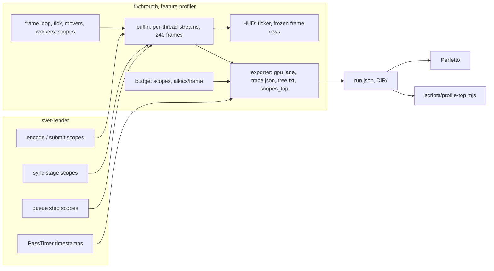

# 0091: The frame profiler: scopes across the threads, a GPU lane, a dump the agent ranks, budget scopes and a HUD ticker with a frozen frame

> **Status:** approved 2026-11-19 (the owner: "all recommended": questions answered on their recommendations; slot after Plans 0087 and 0089, before Plan 0090)
> **Created:** 2026-11-19
> **Milestone:** M7 in `docs/roadmap.md` ("an in-app profiler overlay with GPU timestamps")
> **Related ADRs:** [ADR-0077](../adrs/0077-frame-profiling-through-the-profiling-facade-with-puffin-behind-an-app-feature.md)
> (proposed: the `profiling` facade, puffin behind an app feature); builds on
> [ADR-0009](../adrs/0009-testbed-hud-as-embedded-bitmap-font-overlay-pass.md) (the overlay
> draws the view) and [ADR-0061](../adrs/0061-the-apps-input-is-menu-first-a-minimal-fixed-key-set-one-overlay-menu-with-a-palette-from-one-key-table.md)
> (a menu entry, not a key)

## TL;DR

The engine's threads get `profiling::scope!`s (the frame's encode and submit, the sync's
stages, the queue step, the bake loop, the tick, the movers, the workers), collected by puffin
only when the fly-through is built with `--features profiler`. A run with `--profiler-dump
DIR` writes the last 240 frames as a Chrome trace (`trace.json`, opened in Perfetto), a text
tree (`tree.txt`: self and total ms, calls, max, per scope) and `scopes_top` in `run.json`;
`node scripts/profile-top.mjs DIR` ranks a dump and diffs two, which is how an agent reads a
stall. `PassTimer`'s 23 passes join as a `gpu` lane. A `budget_scope!` carries its `nfr.md`
line and counts overruns into `run.json`. A counting allocator under the feature puts
`allocs/frame` on the HUD and defends Plan 0016's allocation-free HUD claim with a test. Last,
the stats overlay gains a frame ticker: 240 bars with 16.6 and 33.3 ms guides, a menu entry
freezes it, `Left`/`Right` pick a frame, and the frozen frame's top scopes per thread are rows
on the grid. The first thing the reader sees: `tree.txt`'s head on a `--glide 300` cave run,
`sync 11.9 ms (self 0.1)  light place 11.2 ms  scan 10.8 ms  ...`. Without the feature the
fly-through, the tester and every `crates/` build carry no collector and no scope code.

## Context & problem

Roadmap M7 owes "an in-app profiler overlay with GPU timestamps"; the GPU half exists
(`crates/svet-render/src/frame/timer.rs`, `PassTimer`, 23 passes of `FRAME_PASSES`, read
without waiting through a readback ring) and the HUD prints its rows against `nfr.md`
section 2 (`apps/flythrough/src/hud/stats.rs`). The CPU half is a set of lap tables written
one stall at a time: `StageClock` in `gpu_world/window.rs`, `StepStages` in
`bake/stages.rs`, the `sync:` line's `SYNC_FIELDS` in `report.rs`, the `frames:` line in
`run/hud_feed.rs`. None of them sees a thread other than the one it was written for, none can
be frozen at the frame the owner saw stutter, and each new question has needed a new table.

The backlog (`docs/backlog.md`) holds the questions this unblocks, each waiting on "a profile
of X": the light placement's eviction scan in a windowed glide (the owner's staggers at 30 to
40 s; why the window's light buffer fills and the headless glides' does not), the CPU settle
outdoors (a `step CPU p50` of 7.9 to 15.0 ms on a world with no emitter for 7 to 10 s after
every load), the sync's `alloc` stage (p99 7.4 to 8.8 ms, a perf profile named `fill_slot` and
`BufferViewMut::drop` at about 3 % each), the RTX's submits under their slice (a lap on the
dispatch), the first-block fade's CPU under `chain`, the queue step's `filter` cost, the loading
frames' stutter (a pre-roll bake step of 70 to 140 ms), and the spider mover's tick at twice
its guess (a profile of `Walkers::tick` at 64 spiders). The Bonsai comparison of 2026-11-19
(`docs/backlog.md`, "Ideas from Bonsai") showed the shape that answers them: per-thread scope
trees per frame, a frame ticker with click-to-freeze, a hot-function list, a jobs view, an
allocation count on the status bar, and `WARN_TIMED_FUNCTION` for a scope with a budget.

The figures it touches: `nfr.md` section 2 (the frame's CPU, which must not move with the
feature off and moves by a stated amount with it on) and section 7 (the build; the feature adds
two crates to one build). The dependency rule: `svet-world` takes nothing; the engine is a
library, so a consumer pays nothing unless it enables a collector (ADR-0077).

## Decision

We instrument with the `profiling` facade at the lockfile's `=1.0.18`, in `svet-render` and the
apps, and collect with puffin 0.20.0 behind the fly-through's `profiler` feature (ADR-0077).
Our exporter owns the GPU lane, the Chrome trace, the text tree and `scopes_top`; the HUD owns
the in-app view on the overlay's text grid. We rejected `tracing` plus Tracy (two facades, a
C++ client, a cost that cannot compile out) and our own collector (re-writing what puffin does
well; the parts we need to own are the same under either choice). We take puffin's live TCP
server (`puffin_http`) and its viewer binary off the table for now: Perfetto reads the dump and
the HUD is the live view; `puffin_http` is a one-line addition if the owner wants puffin's own
viewer (it adds `crossbeam-channel` and puffin's `packing` features).

## Architecture diagram



`svet-world` is absent from the diagram on purpose: its ops and its streaming workers are timed
from outside, by the scopes around the calls that enter it.

## Implementation phases

Every phase carries exactly one `**Owner skill:**`: `dev` or `human`. The phases before the
owner's window (Phase 8) are exploration for the HUD's look only; the data, the exporter and the
script are asserted by tests as each phase names.

### Phase 1: The walking skeleton: scopes on the frame loop, puffin behind `profiler`, `--profiler-dump` writes a Chrome trace
- **Owner skill:** dev
- **What:** `profiling = { version = "=1.0.18", default-features = false }` in the workspace
  table, a dependency of `svet-render` and `flythrough`; the fly-through gains the feature
  `profiler = ["dep:puffin", "profiling/profile-with-puffin"]` with `puffin = { version =
  "=0.20.0", default-features = false, optional = true }`. Scopes on the frame loop (`frame`,
  `update`, `poll`, `sync`, `queue step`, `encode`, `submit`, `present`) and
  `profiling::finish_frame!()` once per frame; `svet-render`'s `Frame::encode` and the sync's
  entry get a `profiling::scope!`. A new module `apps/flythrough/src/profiler/` (`mod.rs`,
  `chrome.rs`) holds the collector's on/off, the frame view of the last 240 frames (the HUD's
  `RING`) and the Chrome trace writer: one `X` event per scope (`name`, `ts` and `dur` in
  microseconds, `pid` the process, `tid` the thread's index, `args.thread` its name), written
  by `--profiler-dump DIR` at exit, or at the moment a frozen frame is taken (Phase 7). Under
  the feature off, `--profiler-dump` prints `profiler: built without the feature` and exits 2.
- **Files touched:** `Cargo.toml`, `Cargo.lock`, `crates/svet-render/Cargo.toml`,
  `crates/svet-render/src/frame/encode.rs` (one line; the file is at 1194 of 1200, so the scope
  goes in `Frame::encode`'s caller in `frame/mod.rs` if it does not fit),
  `crates/svet-render/src/gpu_world/mod.rs`, `apps/flythrough/Cargo.toml`,
  `apps/flythrough/src/profiler/{mod.rs,chrome.rs}`, `apps/flythrough/src/run/frame.rs`,
  `apps/flythrough/src/cli/flags.rs`, `apps/flythrough/src/cli/mod.rs`, `docs/flythrough.md`,
  `.github/workflows/ci.yml` (one `cargo check -p flythrough --features profiler` beside the
  `wasm` check, so the instrumented path compiles in CI), `deny.toml` (nothing expected: puffin
  and byteorder are MIT OR Apache-2.0; the phase records `cargo deny check`'s exit).
- **Done when:** `cargo tree -p flythrough -e normal | grep -c puffin` prints 0 without the
  feature and `cargo tree -p flythrough --features profiler -e normal` lists `puffin v0.20.0`
  and `byteorder` as the only crates not in the tree before (asserted by hand in the readings
  log, with `cargo deny check` exit 0). A headless test under the feature,
  `apps/flythrough/tests/profiler.rs` (CPU-only, lavapipe not needed: it drives the exporter on
  frames puffin recorded from a loop of scopes, about 1 s), reads a `trace.json` whose events
  are valid Chrome trace events (every event has `ph: "X"`, `ts`, `dur`, `pid`, `tid`, `name`),
  whose `frame` scopes number exactly the frames run, and whose `encode`-named child lies
  within its `frame` parent's `[ts, ts + dur]`. A headless fly-through run on the level
  (`--frames 120 --profiler-dump DIR`) on the RTX writes the file and Perfetto opens it (a
  reading in the log: file size and frames). The gate's `cargo clippy --workspace --all-targets
  -- -D warnings` passes with and without the feature.

### Phase 2: Scopes across the engine's threads, checked against the stage clocks
- **Owner skill:** dev
- **What:** the sync's stages (`gpu_world/window.rs` `StageClock`'s lap sites, each a scope
  with the stage's `SYNC_FIELDS` name), the queue step's stages (`bake/stages.rs` `Laps`' lap
  sites, each a scope with the `STEP_STAGES` name), the bake loop's submit and wait, the
  belt's copy; in the fly-through, `server.tick` (the tick's scope wraps `svet-net`'s call,
  which stays unscoped inside), `Walkers::tick` (wraps `svet-sim`'s movers from outside), the
  audio feed's call, the entities' pose work; every thread the fly-through spawns registers a
  name (`profiling::register_thread!`): `loading`, `gen <n>`, `icons`. `svet-world`'s streaming
  workers (`stream/mod.rs`) stay uninstrumented: their work shows as the gap between a chunk's
  request and its arrival, which the backlog's per-job tracking entry takes later. The
  `wgpu-core` scopes that light up under the feature are folded by the exporter under the
  engine scope that called them (a `fold` list of prefixes: `wgpu_core::`, `wgpu_hal::`), so
  the tree and the HUD show engine scopes, and the Chrome trace keeps them all.
- **Files touched:** `crates/svet-render/src/gpu_world/window.rs`,
  `crates/svet-render/src/gpu_world/stage.rs`, `crates/svet-render/src/bake/stages.rs`,
  `crates/svet-render/src/bake/queue/step.rs`, `crates/svet-render/src/bake/*.rs` (the loop's
  submit), `apps/flythrough/src/run/frame.rs`, `apps/flythrough/src/run/loading.rs`,
  `apps/flythrough/src/setup.rs`, `apps/flythrough/src/entities/icon.rs`,
  `apps/flythrough/src/profiler/chrome.rs`.
- **Done when:** on a headless `--glide 300` cave run of 600 frames with the feature on (RTX,
  quiet), the dump's per-frame sum of the sync's stage scopes agrees with the same frames'
  `sync:` stage totals (the existing `StageClock`, the oracle) within 5 % over the run, and
  the queue step's scopes agree with `StepStages::sum` within 5 %; both written to the readings
  log with the clocksource named (the TSC entry in `docs/backlog.md`). The `profiler.rs` test
  gains a case: a trace built from two named threads lists both `tid`s with their names, and a
  scope whose name starts with `wgpu_core::` is absent from the tree while present in the
  trace. Nothing in `crates/svet-world/`, `crates/svet-net/`, `crates/svet-sim/` or
  `crates/svet-audio/` changes (`git diff --stat` of the phase).

### Phase 3: The text tree, `scopes_top` in `run.json`, and the ranking script
- **Owner skill:** dev
- **What:** `--profiler-dump DIR` also writes `tree.txt`: one row per scope path (`main /
  frame / sync / light place`), aggregated over the dump's frames: calls, total ms, self ms,
  max ms, per-frame self p50 and p99, sorted by self total, indented as a tree, with a flat
  "hot list" of the 25 scopes by self below it. `run.json` gains `scopes_top`: the 20 scopes
  by self p50 with `{name, thread, self_p50_ms, self_p99_ms, calls_per_frame}` (written only
  when the feature and the flag are on; `null` otherwise, like `peak_rss_bytes`). `scripts/
  profile-top.mjs DIR [--against DIR2] [--top n] [--thread name]` prints the hot list, and with
  `--against` the per-scope delta of self p50 sorted by its size, exit 0; it is the agent's way
  to read a stall and to compare a fix against its base. `report.rs` is at 1140 lines: the field
  and its writer live in `apps/flythrough/src/profiler/report.rs`, and `report.rs` gains the
  call only.
- **Files touched:** `apps/flythrough/src/profiler/{tree.rs,report.rs,mod.rs}`,
  `apps/flythrough/src/report.rs`, `apps/flythrough/tests/profiler.rs`,
  `scripts/profile-top.mjs`, `scripts/profile-top.test.mjs`, `docs/flythrough.md`, `CLAUDE.md`
  (the scripts roster).
- **Done when:** the `profiler.rs` test feeds a fixed frame set (built in the test: 100 frames,
  `encode` 2.0 ms a frame, `sync` 1.0 ms with a 20 ms spike on frame 50) and reads `tree.txt`'s
  first hot row as `encode` with self p50 2.0 and `sync`'s p99 as 20 ms, and the same two rows
  in `run.json`'s `scopes_top` (the two writers read one aggregate). `node --test
  scripts/profile-top.test.mjs` passes on a fixture dump under `scripts/fixtures/` (the two
  rows above, and `--against` a copy with `sync` halved prints `sync` first with a negative
  delta). A test of the ignored-feature path: `run.json`'s `scopes_top` is `null` on a run
  without the flag.

### Phase 4: The GPU lane from `PassTimer`
- **Owner skill:** dev
- **What:** each frame's 23 pass durations (`Frame`'s `PassTimer`, read without waiting
  through `try_read_all_ms`, so they arrive one to three frames late) are written by the
  exporter as spans on a `gpu` lane (`tid` after the CPU threads, name `gpu`), placed end to end
  from their own frame's `submit` scope's start, in `FRAME_PASSES` order, each labelled
  `gpu:<pass>`; the bake loop's submits appear the same way on `gpu bake` when the bake's
  timer has a reading. The Chrome trace carries `args.placement: "approximate: at the frame's
  submit"`. `tree.txt` and `scopes_top` include the `gpu:` scopes (their "self" is their
  duration). No new timestamps are written: the lane is a view of what the HUD already reads.
- **Files touched:** `apps/flythrough/src/profiler/{chrome.rs,tree.rs,gpu.rs}`,
  `apps/flythrough/src/run/hud_feed.rs` (hands the per-frame pass times to the profiler; the
  file is at 973 lines, so the hand-over is one call), `apps/flythrough/tests/profiler.rs`.
- **Done when:** the `profiler.rs` test feeds 23 pass durations for 10 frames and reads a `gpu`
  lane whose spans per frame are contiguous, in `FRAME_PASSES` order, and sum to the frame's
  given total exactly (the same `f64`s). On lavapipe the `PassTimer` is `None`
  (`TIMESTAMP_QUERY` absent), so a headless run there writes a trace with no `gpu` lane and no
  error (asserted by a run of `flythrough --frames 16 --profiler-dump` on lavapipe in the gate
  test `gpu_profiler.rs`, about 4 s: a `Frame::new` at 2.4 to 2.8 s plus 16 frames). On the RTX
  a `--frames 120` level run's `gpu:` scopes sum per frame to the HUD's GPU frame total within
  0.01 ms (same source; a reading in the log).

### Phase 5: Budget scopes: a scope that carries its `nfr.md` line and counts its overruns
- **Owner skill:** dev
- **What:** `budget_scope!(name, line_ms)` in the fly-through: a `profiling::scope!` plus a
  duration read (an `Instant` pair with the clippy allow and its reason, as the shell's pacing
  reads carry) compared with the line; an overrun increments the scope's counter and, with the
  feature on, writes an instant event (`ph: "i"`) named `over: <name>` into the trace. The lines
  are the HUD's constants (`hud/stats.rs` `FRAME_LINE_MS`, `MARCH_LINE_MS`, `UPLOAD_LINE_MS`,
  the lighting, denoise and upscale lines; one table both read), applied to `frame`, `sync`
  (the streaming line, 1.0 ms), the `queue step` (no line in `nfr.md` yet: the backlog's "The
  bake's slice and the queue's step have no line"; the scope carries a provisional 1.0 ms,
  labelled so) and the GPU passes' groups through the HUD's existing comparison. `run.json`
  gains `budget_overruns: [{scope, line_ms, frames, over}]`, always written (the counters cost
  one compare a scope, feature or not; the owner may ask for them under the feature instead),
  and the HUD's stats page gains a row `over: frame 3/240  sync 12/240  step 0/240`.
- **Files touched:** `apps/flythrough/src/profiler/budget.rs`, `apps/flythrough/src/hud/stats.rs`
  (the constants move to one table the budget scopes and the rows share; the file is at 949),
  `apps/flythrough/src/run/frame.rs`, `apps/flythrough/src/profiler/report.rs`,
  `apps/flythrough/tests/profiler.rs`, `docs/flythrough.md`.
- **Done when:** a test drives a budget scope with a 1.0 ms line over 100 frames whose fed
  durations exceed it on 7 and reads `{frames: 100, over: 7}`; a table test asserts each budget
  scope's line equals the HUD row's constant for the same stage (one source). The HUD row shows
  on the stats page (the overlay test that reads rows, `hud/stats/tests.rs`, gains the row).
  `run.json` of a headless level run carries `budget_overruns` with the five scopes.

### Phase 6: Allocation counting per frame under the feature
- **Owner skill:** dev
- **What:** a counting `#[global_allocator]` wrapper over `System` in the fly-through, compiled
  only under `profiler`: relaxed atomic counts of allocations and bytes, read and reset by the
  frame loop each frame, so the HUD's stats page gains `allocs/frame <n> (<bytes>)` and the
  trace gains a counter event (`ph: "C"`, `allocs`) per frame; `run.json`'s `scopes_top` block
  gains `allocs_per_frame_p50` and `_max`. The tester build does not enable the feature, so its
  allocator stays `System`.
- **Files touched:** `apps/flythrough/src/profiler/alloc.rs`, `apps/flythrough/src/main.rs` (the
  attribute under `cfg(feature = "profiler")`), `apps/flythrough/src/hud/stats.rs`,
  `apps/flythrough/src/profiler/{chrome.rs,report.rs}`, `apps/flythrough/tests/profiler.rs`.
- **Done when:** a test under the feature records the counter, runs `FrameStats::record` and
  the `HudStats` refresh of a shown page for 240 frames with unchanged inputs, and reads zero
  allocations between the two readings: Plan 0016's "allocation-free refresh" as an assertion.
  A second case allocates a `Vec` of 10 and reads exactly 1 allocation. A headless level run
  with the feature on prints `allocs/frame` p50 and max in the readings log (a figure, not a
  bar: the frame path's allocation count has no line yet; the close proposes one from it).

### Phase 7: The HUD ticker and the frozen frame
- **Owner skill:** dev (exploration: the look is the owner's in Phase 8; the data is tested)
- **What:** the stats overlay's frame strip becomes the ticker: 240 bars (`RING`), one a
  frame, with 16.6 and 33.3 ms guides, the newest at the right. A menu entry `profiler freeze`
  (Debug page; shortcut none, per ADR-0061's minimal set; the owner may bind one) stops the
  ring and the collector, marks the frozen state in the entry's row and a banner (`profiler:
  frozen at frame 1842`), and `Left`/`Right` move the pick over the bars (the picked bar
  highlighted). Under the pick, per thread, the frozen frame's rows: the thread's name, then
  its top 8 scopes by self (`name  self ms  total ms  calls`), engine scopes only; a bar per
  scope drawn in the row with the overlay's box tiles (ADR-0075's tiles) proportional to the
  frame. `profiler dump` (a second entry) writes the dump of the frozen 240 frames to the
  `--profiler-dump` directory or `./profile-<time>` at once. Without the feature the entries
  read `profiler: built without the feature` and are grey. Mouse click on a bar is not in this
  phase: `svet_app::Input` reports no cursor position (the backlog's "Mouse pointing and text
  events" entry), and the cursor is locked in flight; the keyboard pick does the same job.
- **Files touched:** `apps/flythrough/src/hud/stats.rs`, `apps/flythrough/src/hud/stats/` (a
  new `ticker.rs` and `frozen.rs`; `stats.rs` is at 949 lines), `apps/flythrough/src/hud/menu/
  entries.rs`, `apps/flythrough/src/toggles.rs`, `apps/flythrough/src/hud/modes.rs` (the banner;
  at its cap, so the text comes from `profiler/`), `apps/flythrough/src/profiler/freeze.rs`,
  `apps/flythrough/src/run/keys.rs`, `docs/flythrough.md`.
- **Done when:** a headless overlay test freezes on a fed ring of 240 frames with one 30 ms
  frame at index 100, picks it with `Left` presses, and reads the rows under it: the frame's
  time, the thread `main`, and its top scope `sync` first with its self ms; a second test
  reads the menu row's three states (`off`, `frozen at frame N`, `built without the feature`)
  and the banner text. A still of the frozen overlay on the RTX (the level, a dig) is in the
  readings log for Phase 8. The HUD refresh with the ticker shown still allocates nothing per
  frame (Phase 6's test gains the ticker page).

### Phase 8: The owner's window: does the profile place a known stutter?
- **Owner skill:** human
- **What:** two runs on the RTX laptop (Linux, Hyprland), the feature on. (a) The streamed
  cave at `--glide 300` for 60 s: the backlog's eviction-scan staggers at 30 to 40 s; freeze at
  one, read the frozen frame's rows, then open the dump in Perfetto and `tree.txt`. (b) The
  outdoor scene for the 10 s after load (the CPU settle entry: `step CPU p50` 7.9 to 15.0 ms on
  a world with no emitter); freeze within the settle. For each, the owner says whether the
  profile places the fault (which scope, which thread) and which of the three views told them
  (HUD rows, Perfetto, the tree), and what the ticker should show that it does not.
- **Files touched:** `docs/plans/logs/0091.md` (the owner's words, the stills, the dumps'
  hot lists).
- **Done when:** the owner has named, for (a) and (b), the scope they believe is the fault or
  said the profile does not place it; and has picked the HUD's shape (rows per thread as drawn,
  or fewer rows and a flame row) for Phase 9.

### Phase 9: The window's fixes, the overhead readings and the budget lines
- **Owner skill:** dev
- **What:** the HUD changes the owner asked for in Phase 8; the overhead readings against
  `nfr.md` section 2: the frame CPU p50 and p99 on the level and the `--glide 300` cave,
  headless, RTX, quiet, (i) at the base commit, (ii) at the tip with the feature off, (iii) at
  the tip with the feature on, 600 frames each, three runs each; the scope count per frame on
  each scene; the dump's write time for 240 frames. `nfr.md` section 2 gains a line, "the
  profiler's overhead": feature off, within the run-to-run noise of the base (a reading, and
  the mechanism: the facade's macros expand to nothing); feature on, a figure in ms a frame at
  the scope count read, proposed under 0.2 ms at about 300 scopes a frame (a guess until read:
  puffin quotes its scope cost in the tens of nanoseconds, which the phase reads here). The
  `queue step` budget scope's provisional 1.0 ms line is replaced by the reading's p50 times
  1.5 or left provisional, stated in `nfr.md` either way. Section 7 records the feature build's
  added compile time. `docs/roadmap.md` M7's profiler item points here.
- **Files touched:** the files Phase 8 names, `docs/nfr.md`, `docs/nfr/02-frame-budget.md`,
  `docs/roadmap.md`, `docs/flythrough.md`, `docs/plans/logs/0091.md`.
- **Done when:** the three readings and the scope counts are in `docs/nfr/02-frame-budget.md`
  with machine, commit and clocksource; the feature-off frame CPU p50 at the tip is within the
  base's three-run spread; `cargo build -p flythrough` without the feature at the tip and at
  the base list the same crates (`cargo tree -e normal` diff empty); the gate tier passes at the
  tip with and without the feature (`cargo nextest run --profile gate` once, and
  `-p flythrough --features profiler -E 'binary(profiler)'` once).

## Data shapes

```rust
// illustrative
/// What `--profiler-dump` writes; the frames are puffin's, the gpu lane and the counters ours.
pub struct Dump {
    pub frames: Vec<FrameRecord>,      // the last RING frames, oldest first
    pub threads: Vec<ThreadName>,      // tid -> name, "gpu" last
    pub budget_overruns: Vec<Overrun>, // {scope, line_ms, frames, over}
}
pub struct FrameRecord {
    pub index: u64,
    pub start_ns: i64,
    pub end_ns: i64,
    pub scopes: Vec<ScopeRecord>,     // {tid, name, start_ns, end_ns, depth}
    pub gpu_ms: Option<[f64; 23]>,    // FRAME_PASSES order, None where no timer
    pub allocs: Option<(u64, u64)>,   // (count, bytes), feature profiler only
}
/// run.json's `scopes_top` row.
pub struct ScopeTop { pub name: String, pub thread: String,
    pub self_p50_ms: f64, pub self_p99_ms: f64, pub calls_per_frame: f64 }
```

The Chrome trace is the Trace Event Format's JSON array: `X` events for scopes (`ts`, `dur` in
microseconds, `pid`, `tid`, `name`, `cat` one of `engine`, `wgpu`, `gpu`, `app`), `M` metadata
events for thread names, `i` instant events for overruns, `C` counter events for allocations.

## Budgets

- `nfr.md` section 2, the frame's CPU: feature off, no change (the mechanism and a reading;
  Phase 9); feature on, a new "profiler overhead" line, proposed under 0.2 ms a frame at about
  300 scopes, read in Phase 9 on the level and the `--glide 300` cave, RTX 3080 Laptop,
  headless, quiet, `cargo run --release -p flythrough --features profiler -- --frames 600`.
- `nfr.md` section 2, the queue step's line: the budget scope carries a provisional 1.0 ms;
  Phase 9 states it or replaces it from the reading.
- `nfr.md` section 7, the build: the feature build's added time, read once (`cargo build
  --release -p flythrough --features profiler` against without, warm).
- Dependencies: `puffin =0.20.0` and `byteorder` under the feature only; `profiling =1.0.18`
  already in the lockfile; `cargo deny check` exit 0 at every phase (the licences are MIT OR
  Apache-2.0, in `deny.toml`'s allow list).
- The HUD's allocation-free refresh (Plan 0016): kept, asserted by Phase 6's test.

## Risks & open questions

- **puffin's clock and the unstable TSC.** puffin reads its clock inside its crate, per scope
  enter and exit; on the RTX laptop a `CLOCK_MONOTONIC` read costs about 1.7 us under `hpet`
  (the backlog's TSC entry), so 300 scopes a frame could read about 1 ms on that box, far over
  the proposed line. Phase 9 reads it with the clocksource named; if it binds, the scopes inside
  hot loops (per brick, per sample) come out, and the line is stated per clocksource.
- **`wgpu-core`'s scopes.** Under the feature every `wgpu-core` and `wgpu-hal` scope lights up
  (144 and 60 at 30.0.1), on every command and resource call, which is the bulk of the scope
  count. Phase 2 folds them; if their cost dominates Phase 9's reading, the plan asks the owner
  whether to keep them (they show wgpu's own validation cost) or scope the facade off for wgpu
  (not possible per crate through the facade; the alternative is our own thin macro that
  compiles to `profiling::scope!` only in our crates, an S amendment).
- **The GPU lane is approximate.** A pass's timestamps are read one to three frames after its
  submit, and the lane is placed at its own frame's submit, not on the GPU's clock; the trace
  says so in its `args`. Aligning the two clocks needs a calibration (wgpu has no timestamp
  calibration API), a followup if the owner needs it.
- **Click-to-freeze.** The owner asked for a click; `Input` has no cursor position and the
  cursor is locked in flight. Phase 7 freezes by a menu entry and picks by keys. **Owner
  question 1:** take it as drafted (recommended: the pointing entry's Wayland grab quirks are
  their own plan), or add `Input::cursor` and an unlocked cursor while frozen in Phase 7 (S to
  M, and the first consumer of the backlog's pointing entry).
- **Audio.** The device callback runs inside `svet-audio` on cpal's thread; a scope there needs
  `profiling` as a dependency of `svet-audio` (no-op by default, no new crate). **Owner question
  2:** leave `svet-audio` unscoped and time the app's feed call only (recommended: the crate's
  "depends on `svet-world` only" stays true, and the callback's cost has a figure already in
  `nfr.md` section 9), or add the facade there.
- **The flag's name.** `--profile NAME` is the render profile (ADR-0055); the plan names the
  feature `profiler` and the flag `--profiler-dump` to keep the words apart. **Owner question
  3:** `--profiler-dump` (recommended) or the owner's `--profile-dump`.
- **Budget overruns always counted.** Phase 5 counts overruns feature or not (one compare a
  scope, so the tester's report carries them). If Phase 9's feature-off reading moves, the
  counters move under the feature.
- **File caps.** `encode.rs` (1194), `report.rs` (1140), `frame.rs` (1009), `hud_feed.rs`
  (973) and `hud/modes.rs` sit near 1200; every phase puts its code in `profiler/` and
  `hud/stats/` and leaves one call in each capped file. `scripts/check-file-size.mjs` gates it.

## What this plan does NOT do

- No `puffin_http` server or `puffin_viewer`: Perfetto reads the dump, the HUD is the live
  view; one line and two crates if the owner asks.
- No Tracy backend: a later `profiler-tracy` feature through the same facade (ADR-0077).
- No scopes in `svet-world`, `svet-net`, `svet-sim` or `svet-audio` (question 2 aside): the callers
  time them. No per-job tracking of the streaming and bake jobs (reserve and retire frames):
  the backlog's entry, S on top of this plan.
- No sampling profiler: `perf` stays the tool for a hot loop with no scope.
- No fixes to the stalls it profiles: the eviction scan, the settle, `alloc`, the fades, the
  dispatch lap and `Walkers::tick` keep their backlog entries, each now "read with Plan 0091's
  dump first".
- No mouse pointing on the overlay (question 1).
- No world-space debug lines (the backlog's entry; M7's debug views).

## Implementation log

> Written by `dev`: one row per phase as its commit lands, then the close block. **The phases
> above are the contract. This section records what happened.** Observations, never conclusions:
> no pass list, no self-assessment. Deviations and unmet done-whens are **always** disclosed.
> Keep it shorter than `## Implementation phases`. Readings, gate counts, attempts, sweeps and
> resume notes go to the plan's readings log, `docs/plans/logs/0091.md` (started from
> `templates/readings-log.md`), and this section links it once it exists.

| phase | owner | state | commit |
|---|---|---|---|
| 1: the walking skeleton | dev | not started | |
| 2: scopes across the threads | dev | not started | |
| 3: tree, `scopes_top`, script | dev | not started | |
| 4: the GPU lane | dev | not started | |
| 5: budget scopes | dev | not started | |
| 6: allocation counting | dev | not started | |
| 7: the ticker and the frozen frame | dev | not started | |
| 8: the owner's window | human | not started | |
| 9: fixes, readings, lines | dev | not started | |

### Notes

_(empty)_

### Close triggers

- **What shipped:**
- **Public API changed:**
- **Budget readings:**
- **Gate at the tip:**
- **Outstanding `human` phases:**

## Followups

- Per-job tracking of streaming and bake jobs (`docs/backlog.md`, "Per-job performance
  tracking"), on this plan's lanes.
- A GPU-to-CPU clock alignment for the `gpu` lane, if the approximate placement misleads.
