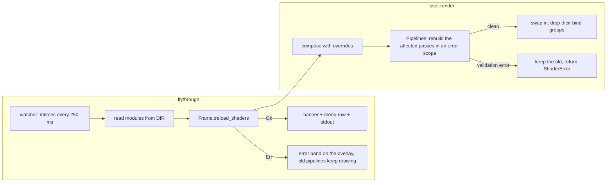

# 0092: WGSL hot reload in the fly-through: an mtime poll, the frame's pipelines rebuilt from disk, the old ones kept and the error shown on a compile failure

> **Status:** approved 2026-11-19 (the owner: "all recommended": questions answered on their recommendations; slot right after Plan 0091, in its lane, before Plan 0090)
> **Created:** 2026-11-19
> **Milestone:** M7 in `docs/roadmap.md` (tooling)
> **Related ADRs:** none (no rejected alternative worth a record: the poll, the rebuild and the
> kept pipeline are the only shapes that fit; the pipeline cache's ADR, if one comes, is the
> backlog's). Builds on [ADR-0061](../adrs/0061-the-apps-input-is-menu-first-a-minimal-fixed-key-set-one-overlay-menu-with-a-palette-from-one-key-table.md)
> (the mode shown as a menu row and a banner) and [ADR-0009](../adrs/0009-testbed-hud-as-embedded-bitmap-font-overlay-pass.md)
> (the error drawn by the overlay).

## TL;DR

`flythrough --watch-shaders [DIR]` polls the mtimes of the WGSL modules under
`crates/svet-render/src/shaders/` four times a second; when one changes, the fly-through reads
the modules from disk and asks the renderer to rebuild the frame passes that join the changed
module (`Frame::reload_shaders`, new in `svet-render`), inside a wgpu error scope. A clean
compile swaps the pipelines in and prints and shows `shaders: reloaded composite.wgsl, 3
pipelines, 412 ms`; a compile error leaves the old pipelines drawing, prints naga's message to
stdout and draws its first lines as a red band on the window until the next clean reload. Off by
default, no feature, no new dependency, nothing changes for a consumer or the tester. The first
thing the owner sees: a tint typed into `composite.wgsl` appears in the open window a second
after the save, and a missing semicolon shows its line on the window instead of a crash.

## Context & problem

Every pipeline's WGSL is compiled in at build time: `crates/svet-render/src/lib.rs` holds the
modules as `include_str!` constants, `frame/compose.rs` joins a pass's modules behind a prelude
of Rust-defined constants, and `frame/pipelines.rs` builds the 15 frame passes of `PASSES` from
that (`Pipelines::new`, the lazy ones on first use). A change to a shader is a `cargo build`
(incremental, seconds), a restart (device, mirror, pre-roll: seconds to a minute on the
streamed worlds) and a flight back to the spot, for every tint, weight or clamp the owner
wants to see. The look plans (0086's fixes, 0081's detail layer, 0090's calibration, the
M10 sky and water plans) are judged by the owner's eye in the window, so that loop is the
plans' pace.

Bonsai registers each shader for hot reload (`external/bonsai_stdlib/src/shader.cpp`,
`RegisterShaderForHotReload`) and recompiles it when its file changes. Our fly-through already
has the pattern for a different file: the model viewer polls the `.rig` and the `.vox` mtimes
and rebuilds on a change, keeping the last error until one succeeds (`apps/flythrough/src/
viewer.rs`, `stamps`, `polled_at`, `error`), and Plan 0083 (approved) reloads the materials
file the same way. Two backlog entries border this one: "Shader toolchain spike" (another
compiler on the same WGSL, both adapters) is the loop this plan shortens, and the two pipeline
cache entries ("A wgpu pipeline cache owned by the engine", "A pipeline cache for the
renderer's shaders") ask what a second start costs; a reloaded pipeline is a compile the cache
has not seen, so the reload's time read here is a figure those entries use.

The figures: `nfr.md` section 7 holds the pipelines' cold creation (1396 ms RTX, 458 ms RADV,
299 ms lavapipe for eleven at Plan 0046; 15 passes now); a reload costs that for the passes it
rebuilds, as a stall of the frame. Section 2 is untouched: the poll is one `metadata` call per
file every 250 ms off the frame's hot path.

## Decision

The renderer gains one method, `Frame::reload_shaders(&mut self, modules: &ModuleOverrides) ->
Result<Reloaded, ShaderError>`: `compose` learns to take a module's text from an override map
keyed by the module's file name, falling back to the built-in constant; the method rebuilds,
inside `push_error_scope(Validation)` / `pop_error_scope`, the `PASSES` entries whose module list
names an overridden module (and the hit pass), and only on a clean result swaps them into
`Pipelines` and drops the bind-group cache entries those passes own. The fly-through owns the
poll, the file reads, the stdout line, the banner, the menu row and the error band. The device
is never asked to compile without an error scope, so a bad shader is an `Err`, not a panic. GPU
code stays in `svet-render`; nothing branches on the backend: naga's error text is what wgpu
returns on any backend.

We rejected a file watcher crate (`notify`): a dependency for a 250 ms poll over about twenty
files. We rejected compiling the WGSL on a worker to hide the stall: the pipelines are created
on the device, the stall is the driver's, and a dev-time stall of under a second is acceptable;
Plan 0075's loading worker shows how it would be done if a later reading says otherwise.

## Architecture diagram



## Implementation phases

Every phase carries exactly one `**Owner skill:**`: `dev` or `human`.

### Phase 1: The walking skeleton: `Frame::reload_shaders` swaps a clean compile in and keeps the old on an error
- **Owner skill:** dev
- **What:** `frame/compose.rs` gains `MODULES`, a table of `(file name, built-in text)` for every
  module `include_str!` names (the frame's, the bake's, FSR 2's, the sky's, the field's and the
  exposure's, so a later phase can widen the reload without another table), and
  `compose_with(modules, overrides)`, which substitutes a module whose built-in text is one of
  the table's by the override of the same name. `frame/pipelines.rs` gains `Pipelines::rebuild(
  &self, device, overrides) -> Result<Pipelines, ShaderError>` for the `PASSES` whose module
  lists hold an overridden module, built inside `device.push_error_scope(wgpu::ErrorFilter::
  Validation)` and read with `pop_error_scope` (polled to completion; `pollster` is already a
  dependency under `test-support`, and the device's `poll(Maintain::Wait)` serves the release
  build), the untouched passes cloned from the old set (`wgpu` objects are `Arc`s). The hit pass
  (`frame/marcher.rs`) joins the same way. `Frame::reload_shaders` swaps on `Ok`, drops the
  `BindCache` entries of the rebuilt passes, and returns `Reloaded { passes: Vec<&'static str>,
  ms: f64 }`; on `Err` nothing in `Frame` changes. `ShaderError` carries naga's message as wgpu
  gives it (the `Validation` error's `Display`) and the module names tried.
- **Files touched:** `crates/svet-render/src/frame/compose.rs`,
  `crates/svet-render/src/frame/pipelines.rs`, `crates/svet-render/src/frame/marcher.rs`,
  `crates/svet-render/src/frame/mod.rs`, `crates/svet-render/src/lib.rs` (the exports),
  `crates/svet-render/tests/gpu_reload.rs` (new).
- **Done when:** `gpu_reload.rs`, on lavapipe, builds a `Frame` on the level fixture and
  renders 16 frames (the mean of the display read); then `reload_shaders` with an override of
  `composite.wgsl` whose last line writes a constant colour returns `Ok` naming `composite` (and
  the FSR 2 composite variant) and the next frame's display is that colour at every pixel; then
  an override of `composite.wgsl` with a missing semicolon returns `Err` whose message names
  `composite.wgsl` and a line number, and the next frame is byte-identical to the frame before
  the error (the old pipeline kept); then the clean override again returns `Ok`, so the frame
  recovers. About 5 s on lavapipe (a `Frame::new` at 2.4 to 2.8 s, three partial rebuilds under
  0.5 s each), in the gate. `internals::shader_sources()` lists the same sources as before
  (the layout tests that read it are unchanged).

### Phase 2: The watcher, the mode on screen and the error band
- **Owner skill:** dev
- **What:** `--watch-shaders [DIR]`: off by default; with no `DIR`, the shaders directory
  resolved from the fly-through's `CARGO_MANIFEST_DIR` at build time (a `cargo run` from the
  tree; the tester archive has no sources and prints `shaders: no directory` if the flag is
  given). A `ShaderWatch` in a new `apps/flythrough/src/shaders.rs` keeps the mtimes of
  `MODULES`' files, polls every 250 ms from the frame loop (the viewer's `polled_at` pattern),
  reads every module into the override map on a change, and calls `Frame::reload_shaders`. On
  `Ok`: stdout `shaders: reloaded composite.wgsl, 3 pipelines, 412 ms`, the 3 s banner with the
  same text. On `Err`: stdout the full message, and the overlay draws a red band of up to three
  rows at the window's top (`composite.wgsl:214: expected ';'` and naga's next lines) until the
  next clean reload clears it. The menu's Debug page gains the row `shaders: off | watching
  <dir> | error (<file>:<line>)`, and the stats page's rows carry the same mode (the house
  rule: every toggle shows its mode in the window). The flag is in `--help`'s table and
  `docs/flythrough.md`.
- **Files touched:** `apps/flythrough/src/shaders.rs` (new), `apps/flythrough/src/cli/flags.rs`,
  `apps/flythrough/src/cli/mod.rs`, `apps/flythrough/src/run/frame.rs` (the poll's call),
  `apps/flythrough/src/hud/menu/entries.rs`, `apps/flythrough/src/hud/modes.rs` (the row; the
  file is at its cap, so the text comes from `shaders.rs`), `apps/flythrough/src/hud/stats.rs`
  (the band's rows), `docs/flythrough.md`.
- **Done when:** a CPU test in `apps/flythrough/src/shaders.rs` drives `ShaderWatch` on a temp
  directory with a fake reload closure: no change in 2 s of fed time calls nothing; a touched
  file calls the reload once with that file in the overrides and the state reads `watching`; a
  closure returning `Err("composite.wgsl:214: expected ';'")` sets the state `error
  (composite.wgsl:214)` and the band's rows; a later `Ok` clears both. An overlay test reads the
  Debug page's row in its three states and the band's text. A windowed check is Phase 3.

### Phase 3: The owner's window: edit, see, break, fix
- **Owner skill:** human
- **What:** on the RTX laptop, `cargo run --release -p flythrough -- --source showcase
  --watch-shaders`; the owner edits `composite.wgsl` (a tint on the output) and saves, sees the
  change, breaks the file, sees the band and the picture holding, fixes it, sees it clear; then
  edits `light.wgsl` (which five passes join, so the reload is larger) and reads the banner's
  pipeline count and time. The owner says whether the delay is acceptable and whether the band
  reads well.
- **Files touched:** `docs/plans/logs/0092.md`.
- **Done when:** the owner has seen a change land without a restart and an error without a
  crash, and has said what should change (the poll rate, the band's place, a key).

### Phase 4: The reload's time read, the widening decided, the docs
- **Owner skill:** dev
- **What:** the fixes Phase 3 asked for. The reload times on the RTX and the Radeon (RADV) for
  `composite.wgsl` (one module, few passes) and `light.wgsl` (five passes), three each, into
  `docs/nfr.md` section 7 beside the pipelines' cold creation, with the note that a reload is
  a cache miss for the driver and for any future `wgpu::PipelineCache` (the two backlog
  entries). If the owner asked in Phase 3 for the bake, FSR 2, sky, field or exposure pipelines
  to reload too, this phase takes the ones whose owner struct can swap its pipeline through the
  same `MODULES` table (each is a `compose` caller: `bake/pipeline.rs`, `fsr2/pipelines.rs`,
  `frame/sky.rs`, `field.rs`, `exposure.rs`), or the plan names them as the followup.
- **Files touched:** the files Phase 3 names, `docs/nfr.md`, `docs/flythrough.md`,
  `docs/backlog.md` (the "Shader toolchain spike" entry's "run after Plan 0092" line becomes a
  pointer), `docs/plans/logs/0092.md`.
- **Done when:** the six readings are in `nfr.md` section 7 with machine and commit; the gate
  tier passes at the tip; `flythrough --help` and `docs/flythrough.md` agree on the flag.

## Data shapes

```rust
// illustrative, svet-render
/// A module's text read from disk, keyed by its file name (`composite.wgsl`).
pub type ModuleOverrides = std::collections::BTreeMap<String, String>;
pub struct Reloaded { pub passes: Vec<&'static str>, pub ms: f64 }
pub struct ShaderError { pub modules: Vec<String>, pub message: String }
impl Frame {
    pub fn reload_shaders(&mut self, m: &ModuleOverrides) -> Result<Reloaded, ShaderError>;
}
```

## Budgets

- `nfr.md` section 7: the reload's time per module changed, RTX and RADV, read in Phase 4 beside
  the pipelines' cold creation; a stall of the frame while it runs, by design.
- `nfr.md` section 2: no change; the poll is one `metadata` read per module file every 250 ms,
  off by default. Phase 2's readings log records the poll's cost once (about twenty files, a
  few microseconds each, a guess until read).
- Dependencies: none. `cargo tree -e normal` at the tip equals the base's.

## Risks & open questions

- **The error scope's shape in wgpu 30.** `pop_error_scope` returns a future; the release build
  polls the device to drive it. If wgpu 30 reports a shader compile error through the module's
  `get_compilation_info` instead of the scope, the dev reads that too; either way the rule
  holds: no compile without a scope, so no panic from the uncaptured-error handler.
- **Bind groups and new layouts.** A rebuilt pass has a new `BindGroupLayout`; wgpu
  deduplicates identical layouts, but the plan does not rely on it: the rebuilt passes' bind
  groups are dropped from `BindCache` and made again on the next frame (Plan 0044's identity
  cache makes that one rebuild).
- **The prelude's constants.** `compose`'s prelude (`PRELUDE`, the Rust-defined constants) is
  not reloadable: a change to a Rust constant is a rebuild, as today, and `docs/flythrough.md`
  says which names come from Rust.
- **Pipeline-overridable constants.** `PassSpec::constants` are set per pass in Rust; a
  reloaded module keeps them. Fine for a tint or a weight; a new `override` declaration in WGSL
  needs its Rust entry, as today.
- **The lazy passes.** `PASSES` entries marked `lazy` are built on first use; a rebuild of a
  lazy pass not yet built stays lazy (nothing to swap) and compiles the new source on its first
  use, inside the same error scope rule.
- **Owner question 1:** the poll's default directory from `CARGO_MANIFEST_DIR` (recommended: a
  `cargo run` from the tree needs no argument) or always explicit.
- **Owner question 2:** widen to the bake, FSR 2, sky, field and exposure pipelines in Phase 4
  (recommended: only if Phase 3 asks; the frame passes are where the eye iterates).

## What this plan does NOT do

- No `wgpu::PipelineCache`: the backlog's two entries; this plan gives them a reload figure.
- No shader toolchain comparison (`spirv-opt`, subgroups, `shader-f16`): the backlog's spike,
  which runs after this plan lands.
- No reload of the Rust-side prelude constants or pipeline constants.
- No reload in the tester archive (no sources ship), and no feature flag: the code is small and
  off by default.
- No one-watcher-for-everything: the materials file (Plan 0083) and the `.rig` (the viewer) keep
  their polls; the backlog's "Hot-reload a logic component" entry says a shared watcher comes
  with the third reloadable file.

## Implementation log

> Written by `dev`: one row per phase as its commit lands, then the close block. **The phases
> above are the contract. This section records what happened.** Observations, never conclusions:
> no pass list, no self-assessment. Deviations and unmet done-whens are **always** disclosed.
> Keep it shorter than `## Implementation phases`. Readings, gate counts, attempts, sweeps and
> resume notes go to the plan's readings log, `docs/plans/logs/0092.md` (started from
> `templates/readings-log.md`), and this section links it once it exists.

| phase | owner | state | commit |
|---|---|---|---|
| 1: `Frame::reload_shaders` | dev | not started | |
| 2: the watcher and the band | dev | not started | |
| 3: the owner's window | human | not started | |
| 4: readings, widening, docs | dev | not started | |

### Notes

_(empty)_

### Close triggers

- **What shipped:**
- **Public API changed:**
- **Budget readings:**
- **Gate at the tip:**
- **Outstanding `human` phases:**

## Followups

- The bake, FSR 2, sky, field and exposure pipelines on the same table (question 2).
- A shared watcher for the WGSL, the materials file and the logic component (the backlog's
  "Hot-reload a logic component" entry).
