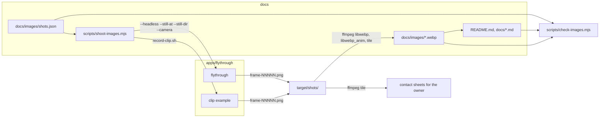

# 0093: The README rewrite with reproducible screenshots: a shot manifest, a shoot script that re-renders every image in one command, an image gate, and the owner's pick from contact sheets

> **Status:** approved 2026-11-19 (drafted from the Bonsai second pass, section 2, and the
> owner's "more screenshots through the doc"; the owner: "all recommended", every owner question
> on its recommendation: after 0087, beside 0089, before 0091; canopy shot now; one caption line;
> the frame-time figure; the hero from the sheet)
> **Created:** 2026-11-19
> **Milestone:** M7 in `docs/roadmap.md` (tooling); a docs plan: no engine crate changes
> **Related ADRs:** none. The one choice with a rejected alternative (the README's images come
> from the fly-through binary and the clip example, not from a grown `hero` example) is a
> testbed flag, cheap to revisit, and is recorded in Decision below. Builds on
> [ADR-0054](../adrs/0054-the-tester-build-is-a-launcher-that-runs-the-flythrough-per-scene.md) (the
> scenes and camera paths the shots reuse) and
> [ADR-0009](../adrs/0009-testbed-hud-as-embedded-bitmap-font-overlay-pass.md) (the HUD the
> pass-list shot shows).

## TL;DR

The README is rewritten after Bonsai's: an identity line with one measured figure, the
quickstart in the first screen, the features in eight groups of 3 to 5 bullets with a still
after each, a gallery, a wishlist, and everything about layout, checks and process moved to
`docs/development.md`. Every image in it is engine output with the HUD off (the HUD shot
excepted), described by one row of a manifest beside the images (`docs/images/shots.json`:
scene, seed, pose, clock, flags, frames, output size, format, tolerance) and re-rendered by one
command, `node scripts/shoot-images.mjs`, headless under the perf lock. The fly-through gains
`--still-at F,..`, `--still-dir DIR` and `--camera X,Y,Z,YAW,PITCH`, so a still of any scene it
can show (the castle, a `--vox` chapel, walkers wandering, a dig, the HUD) is one command, and
the clip example keeps making the entity loops. A gate, `scripts/check-images.mjs`, holds the
budget (a still at or under 300 KB, a loop at or under 700 KB, the README's images at or under
5 MB together), the manifest's completeness and every image's reference and alt text, and
`check-doc-links.mjs` learns to validate `#fragment` links so the wishlist's backlog anchors
cannot rot. The owner picks every shot's pose and clock from a contact sheet. After a look
change, refreshing the README is `node scripts/shoot-images.mjs` and a commit.

## Context & problem

The README today (main 901a9e26) opens on one good GIF and honest figures, then fifteen dense
bullets without an image, a crates table, a checks list and process. Bonsai's
(`scallyw4g/bonsai`, read 2026-11-19) puts an image every ten lines, groups its features, puts
the binaries first and keeps process out. The owner wants ours shot through with images in that
shape, and the second-pass report's section 2 lists what to borrow.

The images we have were each made by hand: `docs/images/hero.png` by the `hero` example at
whatever flags its caption remembers (re-shot five times across Plans 0024 to 0055, the caption
rewritten each time), the two GIFs by `scripts/record-clip.sh` with the command in the caption.
Nothing re-renders them together, nothing says when they went stale (the hero predates Plans
0058, 0062 and 0083 and shows none of their work), and nothing bounds their size: the three
files are 3.8 MB, the spider GIF alone 2.0 MB at 800 px. Git keeps every version of every
image, so an unbounded README is a cost the clone pays forever.

Three facts shape the mechanism:

- The fly-through can already stand in every scene the shot list names (`--source
  showcase|outdoor|cave`, `--castle --castle-shot`, `--vox`, `--entities N --entities-walk
  on`, `--dig-at F`, `--time HH:MM`, `--hud`) and renders headless (`--headless --frames N
  --render WxH`), but it writes no image: its only frame readbacks are the `steps` view's
  (`apps/flythrough/src/run/frame.rs`, `vxe_render::debug::read_rgba8` of `frame.target()`),
  and it has no free camera flag. The `hero` example writes a PNG but knows the showcase, the
  level and the hills only, and the `clip` example knows a rig's clip. Growing the examples to
  the castle, structures, entities and the HUD would copy the fly-through's scene set-up a
  third time (`examples/shared/still.rs` is already a second).
- The frame is not bit-stable across runs by construction: the live bake queue spends a wall
  time slice a frame (`frame:1.5`, `docs/nfr.md` section 2), so what is baked by frame `F`
  depends on the GPU's speed, and FSR 2 carries history. A settled still (the queue drained,
  the history converged) should repeat; a still mid-dig may not. Idempotence is therefore a
  reading first and a tolerance second, never an assumption.
- GitHub renders PNG, GIF, SVG and WebP (static and animated) from repository paths and plays
  MP4 only as an uploaded attachment, never from a path in the tree. The clip recorder makes
  GIF and MP4; the dev box's ffmpeg has `libwebp` and `libwebp_anim`, and no `cwebp`,
  `gifsicle`, `oxipng` or `pngquant`. A rendered 1280 x 720 PNG of ours is about 1.4 MB
  (`hero.png`); a 1600 px lossy WebP of the same kind of frame is expected at 150 to 300 KB
  (a guess until Phase 2 reads it).

Requirement served: `project-context.md`, the dual workflow (the owner's "best in class, human
and agent", 2026-11-17): a person reads a README with pictures; an agent regenerates them from a
manifest and a script with a machine-readable check. `docs/nfr.md` figures touched: none of the
frame or memory lines; the plan adds a repository-size check that lives in the gate, not in
`nfr.md`.

## Decision

The README's images are shot by the fly-through binary through three new flags and by the
clip example through `scripts/record-clip.sh`, both driven by `node scripts/shoot-images.mjs`
from `docs/images/shots.json`. Stills are lossy WebP at 1600 px wide; loops are animated WebP
at 800 px, a GIF fallback named per entry if GitHub fails to play one. The gate is pure Node,
reads the manifest and the tracked markdown, and runs in CI's doc-gates step. The owner picks
poses and clocks from contact sheets the script tiles with ffmpeg.

We rejected growing the `hero` example into a general still tool: it would carry a third copy
of the scene set-up and lag the fly-through's flags forever; the fly-through already owns every
scene and every toggle. We rejected a stills-only budget without a gate: the hero's caption
history shows a rule nobody re-runs is not followed. We rejected PNG stills at 1600 px: five
times the budget per image for a lossless copy of a frame that FSR 2 already resampled. We
rejected MP4 loops: GitHub does not play them from a tree path. The `hero` example stays as the
light write-ups' review tool (`--shot all`); nothing here removes it.

## Architecture diagram



## Implementation phases

Each phase ships as its own commit. `dev` implements the dev phases in order; Phase 5 and
Phase 7 are the owner's. The lane starts after Plan 0087 (the rename) merges, since 0087
rewrites `README.md`, every `docs/*.md`, `scripts/record-clip.sh` and the `VXE_*` names a new
script would otherwise be born with; it may run beside Plan 0089 (no file in common but
`.github/workflows/ci.yml`, where each adds one step). It runs before Plan 0091, which edits
`run/frame.rs`, the HUD and the report that Phase 1 touches. Names below are the tree's at
901a9e26; after 0087 they read `svet` for `vxe`.

### Phase 1: The fly-through writes a still: `--still-at`, `--still-dir`, `--camera`, and the idempotence reading
- **Owner skill:** dev
- **What:** `--still-at F,..` writes the frame's output target as `DIR/<stem>-<F:05>.png` for
  each listed frame, `DIR` from `--still-dir` (default `target/stills/`) and `<stem>` from the
  scene (`showcase-hall`, `outdoor-15-00`, `castle-nave`, `cave`), headless or in a window,
  after the overlay pass when `--hud` is on, so the pass-list shot is the HUD as drawn. A frame
  past `--frames` is refused at parse. `--camera X,Y,Z,YAW,PITCH` (voxels, degrees) overrides
  the scene's spawn, shot or castle shot, refused on `--path` (the path owns the camera). The
  stdout line `still: DIR/<file> 1920x1080 frame F` says what was written. Then the readings:
  the hall still at frame 63 of 64 rendered twice in two processes, the hills at `--time 15:00`
  twice, and a cave still 30 frames after `--dig-at 20` twice, each pair compared by pixel
  (`compare` of ImageMagick if present, else a 40-line Node reader of the PNGs: the fraction of
  pixels where any channel differs by more than 2 of 255), on the RTX 3080 Laptop; and `--vox`
  of the castle's `.vox` (`--castle-out`) placed on `--source outdoor`, tried once: either a
  still of the castle on a hill or the refusal, recorded.
- **Files touched:** `apps/flythrough/src/cli/parse.rs`, `apps/flythrough/src/cli/*.rs` (the
  flag table), `apps/flythrough/src/run/frame.rs` (the readback after the overlay; if the
  overlay draws onto the surface only, the still reads the texture the overlay composes into,
  named in the readings log), `apps/flythrough/src/run/mod.rs`, `apps/flythrough/tests/gpu_still.rs`
  (new), `apps/flythrough/src/cli/tests.rs`, `docs/flythrough.md` (three rows),
  `docs/plans/logs/0093.md` (new, from the template).
- **Done when:** `cargo run --release -p flythrough -- --headless --source showcase --frames 64
  --still-at 63 --still-dir target/stills` writes `target/stills/showcase-hall-00063.png` at
  1920 x 1080 (the Floor profile's output) and prints the `still:` line; `--still-at 64` with
  `--frames 64` is refused naming both flags; `--camera 100,100,40,90,-10` on the showcase puts
  the eye there (the HUD's position row, headless stdout). `tests/gpu_still.rs` runs `--room 4
  --render 320x180 --frames 2 --still-at 1 --still-dir <tmp>` on lavapipe and asserts the PNG
  exists, decodes to 320 x 180 and is not uniform (about 5 s on lavapipe; born `#[ignore =
  "soak"]` if it reads over 10 s). The CLI tests assert the two refusals and the camera parse
  (milliseconds). The readings log carries the three difference fractions and the castle-on-
  a-hill result.

### Phase 2: The manifest and the shoot script
- **Owner skill:** dev
- **What:** `docs/images/shots.json`: one entry per image under `docs/images/` (schema under
  Data shapes), the three existing images among them (`hero` by the fly-through's flags, the
  two GIFs by `record-clip.sh`, re-encoded as WebP), and a `frozen` list for
  `docs/images/light/*` (figures of closed light write-ups whose mechanism is gone; kept, never
  re-rendered). `scripts/shoot-images.mjs`: builds `flythrough` and the `clip` example once in
  release (memory-capped through `systemd-run` as `record-clip.sh` does), then per entry runs
  the source under `flock .git/vxe-perf.lock`, keeps the PNG frames under `target/shots/<id>/`,
  encodes a still with ffmpeg `libwebp` (`-quality Q`, Q from the entry, 80 by default; the
  frame scaled to the entry's width with lanczos) or a loop with `libwebp_anim` (`-loop 0`,
  the entry's fps) into the file the entry names, and prints each file's bytes. Options:
  `--only ID,..`, `--print ID` (the exact command lines, copy-pasteable), `--check` (renders
  and encodes to `target/shots/check/`, decodes both the new and the committed file with ffmpeg
  to raw RGB, and prints each entry's difference fraction against its `tolerance`, exit 1 over
  it), `--no-build`. Tolerances are set from Phase 1's readings: `0` where the pair read `0`,
  else the reading rounded up to one significant figure, each with the reading's date in the
  entry's `note`.
- **Files touched:** `docs/images/shots.json` (new), `scripts/shoot-images.mjs` (new),
  `scripts/shoot-images.test.mjs` (new: the manifest parses, every entry has the required
  fields, `--print` output for a fixture entry), `docs/flythrough.md` (a "Shooting the
  README's images" section beside "Recording clips"), `docs/plans/logs/0093.md` (the wall time
  of a full shoot and the byte count per image on the RTX 3080 Laptop).
- **Done when:** `node scripts/shoot-images.mjs` renders and encodes every non-frozen entry and
  the files it writes are the ones the manifest names, nothing else under `docs/images/`
  changes; `node scripts/shoot-images.mjs --check` run right after exits 0 and prints a
  fraction per entry at or under its tolerance; `--print hero` prints the `flythrough` command
  whose still, run by hand, is the frame the script encoded (same bytes, PNG to PNG, or within
  the entry's tolerance); `node --test scripts/shoot-images.test.mjs` passes in under a
  second. The log records the shoot's wall time (expected 5 to 15 minutes for the full set on
  the RTX; a guess) and each image's bytes.

### Phase 3: The image gate, fragment links, and the CI step
- **Owner skill:** dev
- **What:** `scripts/check-images.mjs`, a doc gate in the shape of the others (an optional
  `root`, the fixtures skipped by path, `git ls-files` for the file set): every image file
  under `docs/images/` is a manifest entry or in its `frozen` list, every entry's file exists
  and is referenced by at least one tracked markdown file, every image reference in tracked
  markdown has non-empty alt text, each still is at or under 300 KB and each loop at or under
  700 KB (per-entry caps the manifest may lower, never raise), and the images `README.md`
  references total at or under 5 MB. `check-doc-links.mjs` validates `#fragment` targets
  (same-file and cross-file) against the target file's headings by GitHub's slug rule
  (lowercase, punctuation dropped, spaces to hyphens, `-N` for repeats), since the wishlist
  links backlog headings that leave when a plan takes them. Both gain fixture trees and rows
  in `scripts/fixtures/README.md`; `ci.yml` runs `check-images.mjs` in the doc-gates step.
- **Files touched:** `scripts/check-images.mjs` (new), `scripts/check-doc-links.mjs`,
  `scripts/fixtures/images/**` (new), `scripts/fixtures/doc-links/**` (new, if the existing
  gate has none), `scripts/fixtures/README.md`, `.github/workflows/ci.yml`, `README.md` (only
  if the new gate needs a line; the full list moves in Phase 6), `docs/development.md` is
  Phase 6's.
- **Done when:** `node scripts/check-images.mjs` exits 0 on the tree after Phase 2; on
  `scripts/fixtures/images` it exits 1 with exactly five findings, one per line, each seeded
  and listed in `fixtures/README.md`: an image not in the manifest, an entry no markdown
  references, a still of 301 KB, an image reference with empty alt text, and a README total
  over 5 MB (small files and a lowered per-fixture total cap, so the fixture stays under 50 KB);
  `node scripts/check-doc-links.mjs` exits 0 on the tree and names a seeded `backlog.md#gone`
  fragment in its fixture; both run in under 2 s; `node --test "scripts/*.test.mjs"` stays
  green; the CI step is in `ci.yml` and the workflow lints (`gh workflow view` or a push to the
  lane's branch is not asked for; `node --check` on the scripts and a YAML parse suffice).

### Phase 4: Candidates and contact sheets
- **Owner skill:** dev
- **What:** Each shot entry may carry `candidates`: a list of flag sets (poses and clocks, 2 to
  9 each). `node scripts/shoot-images.mjs --candidates [--only ID]` renders every candidate's
  frame to `target/shots/candidates/<id>/<n>.png` and tiles them into
  `target/shots/candidates/<id>.png` (ffmpeg `tile`, 3 columns, each tile 640 px wide) with a
  `<id>.txt` legend that numbers the tiles and prints each one's flags; a loop entry's
  candidates are rendered as 2-second WebPs beside the sheet. The shot list's first candidates
  (under Shot list below) are written into the manifest here, canopy shots included with a
  pose sweep. The script prints the sheets' paths at the end.
- **Files touched:** `scripts/shoot-images.mjs`, `docs/images/shots.json`,
  `docs/plans/logs/0093.md` (the candidate shoot's wall time).
- **Done when:** `--candidates` writes one sheet and one legend per shot entry that has
  candidates, the sheet's tile count equals the legend's line count, and a tile index named in
  the legend maps to the flags that re-render that tile alone (`--print ID --candidate N`); the
  loops' candidates play in a browser (`xdg-open` of the WebP, by the dev once).

### Phase 5: The owner picks
- **Owner skill:** human
- **What:** The owner opens the contact sheets (or runs a shot's command without `--headless`
  to look around; `--camera` and the HUD's position row give the pose back) and names, per
  shot, the tile that goes in, or a re-shoot with new flags, or a drop; names the hero; says
  whether the canopy shot goes in now or waits for Plan 0094 (the grain follow-up); and
  answers the Owner questions below where they are still open. Taste is the owner's; the dev
  writes the picks verbatim into the readings log and re-shoots once if asked.
- **Files touched:** `docs/plans/logs/0093.md` (the picks, dated).
- **Done when:** every shot entry has a pick, a re-shoot request or a drop in the log, the
  hero is named, and the canopy call is made.

### Phase 6: The picks into the manifest, the final shoot, and the rewrite
- **Owner skill:** dev
- **What:** The picked candidate becomes each entry's flags (`candidates` kept for the next
  pick), `node scripts/shoot-images.mjs` renders the final set, and the README is rewritten in
  this order: the badges; an identity line (one sentence, no "game-agnostic" jargon run-on) with
  one measured figure from `docs/nfr.md` naming its machine (recommended: the frame's GPU time
  at Floor on the RTX 3080 Laptop, 2.9 to 4.3 ms over the vein, the hall and the castle, from
  section 2) and the hero under it; the quickstart in the first screen (the release archive
  from the releases page first, then `cargo build`, three `cargo run` lines and one line of
  keys pointing at `docs/flythrough.md`); the features in eight groups, each 3 to 5 bullets and
  one still after it: World and edits, Rendering, Lighting, Entities, Structures, Simulation
  and determinism, Audio, Tooling (the HUD shot); a gallery of the remaining stills and the
  loops; a wishlist of 8 to 10 lines, each a link to a backlog heading, a `docs/references/`
  file or a roadmap milestone (the far field and liquids, clouds and weather, the night sky,
  volumetrics, networking, Lua, chunk-scale dynamics, hundreds of entities, the authoring
  direction, deterministic simulation testing); a one-line pointer to `docs/development.md`;
  the licence. `docs/development.md` (new) takes the Layout table, Building's dependency
  paragraph, the examples and benches, Checks with the full gate list, "How the project is
  run", and a section on shooting the images that points at the manifest and the script. Each
  image gets a one-line `<sub>` caption of what it shows; the regenerate command is stated once,
  at the gallery's end. `docs/entities.md` points at the manifest for its two loops.
  `CHANGELOG.md` gets its entry under Unreleased. Old image files the manifest no longer names
  are `git rm`'d.
- **Files touched:** `README.md`, `docs/development.md` (new), `docs/images/shots.json`,
  `docs/images/*.webp` (the set), `docs/images/hero.png`, `docs/images/*.gif` (removed),
  `docs/entities.md`, `docs/flythrough.md` (the keys table stays its source), `CHANGELOG.md`,
  `docs/roadmap.md` (its line that names `hero.png`).
- **Done when:** `README.md` holds the sections above in that order (headings `Quickstart`,
  `Features` with the eight `###`, `Gallery`, `Wishlist`, `Development`, `License`); it names
  no ADR or plan number and no `docs/plans/` or `docs/adrs/` path (they live in
  `docs/development.md`); `git grep -i -E 'roguelite|horror|delve' README.md docs/development.md`
  prints nothing; every `###` feature group is followed by an image before the next heading
  (a Node one-liner in the readings log); the identity figure quotes `docs/nfr.md` with the
  machine; `node scripts/check-images.mjs`, `check-doc-links.mjs`, `check-index-rows.mjs`,
  `check-comment-hygiene.mjs` and `check-plan-size.mjs` exit 0; `node scripts/shoot-images.mjs
  --check` exits 0 on the committed set; the README's images total at or under 5 MB (the gate's
  line, pasted into the log with each file's bytes).

### Phase 7: The README on GitHub
- **Owner skill:** human
- **What:** After the lane merges and the owner pushes, the owner opens the repository page
  once on GitHub: every image shows at a sensible width on a desktop browser and on a phone,
  and each loop plays. A loop that shows as a still is re-encoded as GIF (the entry's
  `fallback`, the recorder's two-pass palette at 640 px, under the same 700 KB cap, or
  dropped) in a fix pass by `dev`.
- **Files touched:** none, or `docs/images/shots.json` and the loop's file in the fix pass.
- **Done when:** the owner says the page reads right, or the fix pass has landed and the gate
  still exits 0.

## Data shapes

```json
// illustrative: one still, one loop, the frozen list
{
  "stills": {
    "hero": {
      "kind": "still", "file": "hero.webp", "width": 1600, "quality": 82,
      "source": "flythrough", "seed": 1,
      "flags": ["--headless", "--source", "outdoor", "--spawn", "forest",
                "--time", "18:10", "--render", "1920x1080", "--frames", "96"],
      "still_at": 95, "tolerance": 0.0, "cap_bytes": 300000,
      "candidates": [["--time", "17:40"], ["--time", "18:10"], ["--time", "18:40"]],
      "note": "pair read 0 differing pixels, 2026-11-xx, RTX 3080 Laptop"
    },
    "dig": {
      "kind": "loop", "file": "dig.webp", "width": 800, "fps": 20, "quality": 70,
      "source": "flythrough", "seed": 1,
      "flags": ["--headless", "--source", "cave", "--dig-at", "40", "--frames", "100"],
      "still_at": "36..96", "tolerance": 0.004, "cap_bytes": 700000, "fallback": "gif"
    },
    "spider-walk": {
      "kind": "loop", "file": "spider-walk.webp", "width": 800, "fps": 25,
      "source": "clip", "flags": ["--clip", "walk"], "tolerance": 0.0, "cap_bytes": 700000
    }
  },
  "frozen": { "light/hall-settled-8192-frames.png": "Plan 0024's write-up; the mechanism is gone" }
}
```

A `source` of `flythrough` runs the binary with `flags` plus `--still-at` and `--still-dir`;
`clip` runs `scripts/record-clip.sh --input` on frames the `clip` example renders with
`flags`. `still_at` is one frame or a range for a loop. The script derives every command from
the entry, so `--print` and the shoot cannot disagree.

## Shot list

The first candidates, written into the manifest in Phase 4; the owner picks in Phase 5. Every
shot is unretouched engine output with the HUD off, except the HUD shot. Never the owner's
local terrace or anything Monument-Valley-derived: the castle and the chapel are ours.

| Id | Shows | Source and first candidates |
|---|---|---|
| `hero` | The hills at sunset from the forest spawn, or the castle on a hill if Phase 1's `--vox` try places it, or the chapel | `--source outdoor --spawn forest --time 17:40 / 18:10 / 18:40`; `--vox <castle> --source outdoor --time 18:10` |
| `dig` (loop) | A dig in the cave: the sphere opens, the light re-bakes | `--source cave --dig-at 40`, frames 36 to 96, radius 1.0 and 1.5 m |
| `canopy` | The canopy at 15:00 from under the trees | `--source outdoor --spawn forest --time 15:00`, three `--camera` poses looking up and along; may wait for Plan 0094 |
| `lamp-cave` | A lamp-lit cave, the headlamp's bounce on wet rock | `--source cave --lamp on`, the spawn and two `--camera` poses, exposure auto and fixed |
| `skylight` | The skylight dig: the tunnel's roof opened to the sky | `--source outdoor --spawn inside --camera ... pitch 60 --dig-at 30`, still at frame 90; radius 1.5 and 2.5 m |
| `walkers` (loop) | Walkers wandering the showcase hall | `--source showcase --entities 6 --entities-walk on`, frames 60 to 120, `--shot hall / chasm` |
| `spider-walk` (loop) | The spider's walk clip, the entities library's own | `record-clip.sh -- --clip walk` (as today, re-encoded) |
| `chapel` | The chapel's glass and lamps in the cave | `--vox apps/flythrough/assets/structures/chapel/chapel.vox`, two `--camera` poses, `--lamp off / on` |
| `castle` | The castle: the gate, or the nave under its vault | `--castle --castle-shot gate / nave / window` |
| `day-cycle` (loop) | A day over the hills as a time lapse of settled stills | `--source outdoor` at 24 `--time` values an hour apart, each a settled still, encoded at 6 fps; the loop that is dropped first if the total is over 5 MB |
| `hud` | The stats overlay with its pass list over the hall | `--source showcase --hud --shot hall`, exposure as the hero's |
| `profiler` | The profiler's frame bars, after Plan 0091 | not shot here; a manifest entry Plan 0091's close adds |

Budget arithmetic: eleven stills and loops at the caps would be 7 x 300 KB + 4 x 700 KB =
4.9 MB; the day cycle goes first if the gate's 5 MB line is crossed, then a still's `quality`
drops before its width. The two entity loops serve `docs/entities.md` too and count in the
README total only if the README references them.

## Budgets

No `docs/nfr.md` figure moves. The plan's own lines live in the gate: a still at or under
300 KB, a loop at or under 700 KB, the README's images at or under 5 MB together, read by
`node scripts/check-images.mjs` on every CI run; its cost is under 2 s of CI. The shoot's wall
time and the idempotence fractions are readings in `docs/plans/logs/0093.md` on the RTX 3080
Laptop, not budgets.

## Risks & open questions

- **The frame is not bit-stable mid-dig.** Phase 1 reads it before Phase 2 sets a tolerance;
  if a loop's fraction is large (over 1 %), its frames move later (more settle) or the loop
  becomes a time lapse of settled stills like the day cycle.
- **The HUD may draw onto the surface, not into the target.** Then the still reads the texture
  the overlay composes into; if there is none headless, the HUD shot is taken from a window
  (`--still-at` works there) and its entry says `window: true`, the one exception to headless.
- **Animated WebP on GitHub.** Expected to play (served as `image/webp`); Phase 7 is the check
  and `fallback: gif` the way out, at the same cap.
- **The castle on a hill** depends on `--vox` of the castle's `.vox` on the outdoor source,
  not refused by `cli/parse.rs` today but never tried; a prefab of 343 MB (Plan 0042) may be
  too large to place through `--vox`. Phase 1 reads it once; the hills at sunset stand if not.
- **Fragment validation may flag existing links.** Any that break are fixed in Phase 3, not
  exempted.
- **Determinism and layering:** nothing in `crates/` changes; the flags are the testbed's.

## What this plan does NOT do

- No profiler shot: Plan 0091 adds the entry at its close.
- No new scenes, lights or materials for the camera; a shot that needs one is dropped or waits.
- No mixed entity shot (walkers and spiders together) unless `--entities` already allows it;
  `--entities N` places the selected entry only, so the walkers loop and the spider loop are
  two images.
- No retouching, cropping to hide a fault, or colour grading; a visible fault in a pick is a
  backlog entry, not an edit.
- No `hero` or `clip` example removal; no change to `record-clip.sh` beyond what 0087 renames.
- No documentation site; `docs/development.md` is a file, not a build.
- No MP4 anywhere in the tree.

## Owner questions

1. **Order.** Recommended: the lane starts after Plan 0087 merges and runs beside Plan 0089
   (files disjoint but `ci.yml`), before Plan 0091. Alternative: beside 0087 with a rename
   sweep at the merge; not recommended, 0087 rewrites the README and every doc the plan edits.
2. **The hero.** Recommended: decide at Phase 5 from the sheet, with the hills at sunset, the
   castle on a hill (if it places) and the chapel as candidates; no answer needed now.
3. **The canopy.** Recommended: shoot it now with a pose sweep and pick one where the grain does
   not read; a re-shoot after Plan 0094 is one command. Alternative: leave the slot empty until
   0094 closes.
4. **Captions.** Recommended: one `<sub>` line per image saying what it shows, and the
   regenerate command once at the gallery's end. Alternative: today's per-image command and
   machine line under each.
5. **The identity figure.** Recommended: the frame's GPU at Floor on the RTX 3080 Laptop (2.9 to
   4.3 ms, `docs/nfr.md` section 2). Alternative: the determinism claim (a session replays from
   seed plus log to the same hash on Linux and Windows).

## Implementation log

> Written by `dev`: one row per phase as its commit lands, then the close block. **The phases
> above are the contract. This section records what happened.** Observations, never conclusions:
> no pass list, no self-assessment. Deviations and unmet done-whens are **always** disclosed.
> Keep it shorter than `## Implementation phases`. Readings, gate counts, attempts, sweeps and
> resume notes go to the plan's readings log, `docs/plans/logs/0093.md` (started from
> `templates/readings-log.md`), and this section links it once it exists.

| phase | owner | state | commit |
|---|---|---|---|
| 1: the still flags and the idempotence reading | dev | not started | |
| 2: the manifest and the shoot script | dev | not started | |
| 3: the image gate, fragments, CI | dev | not started | |
| 4: candidates and contact sheets | dev | not started | |
| 5: the owner picks | human | not started | |
| 6: the picks, the final shoot, the rewrite | dev | not started | |
| 7: the README on GitHub | human | not started | |

### Notes

_(Deviations from the plan, with the commit, stated without justification. Done-whens not
satisfiable as stated, and what was done instead. Followups noticed and not acted on. One line
each. Empty is fine.)_

### Close triggers

_(Facts for the architect. No recommendations, and no suggested version bump.)_

- **What shipped:** docs-chore-only (the testbed's three flags and two scripts)
- **Public API changed:** none in `crates/`; the fly-through's flags
- **Budget readings:** none in `nfr.md`; the gate's line and the shoot's wall time in the log
- **Gate at the tip:** the commands run (build, nextest, doctests, clippy, fmt, deny), exit codes, test counts
- **Outstanding `human` phases:** which, or none

## Followups

- Plan 0091's close adds the `profiler` entry to the manifest and the HUD group's second image.
- Plan 0094 (Plan 0086's grain follow-up) re-shoots `canopy` and `hero` with one command.
