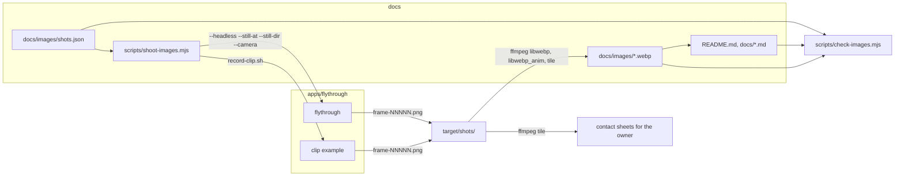

# 0093: The README rewrite with reproducible screenshots: a shot manifest, a shoot script that re-renders every image in one command, an image gate, and the owner's pick from contact sheets

> **Status:** in-progress (lane started 2026-11-26; Phase 1 landed). Approved 2026-11-19 (drafted from the Bonsai second pass, section 2, and the
> owner's "more screenshots through the doc"; the owner: "all recommended", every owner question
> on its recommendation: after 0087, beside 0089, before 0091; canopy shot now; one caption line;
> the frame-time figure; the hero from the sheet). **Refreshed 2026-11-26** against main
> `aa8a76a3` (v0.76.0): see "Amended 2026-11-26" below, which wins where it differs (a wording
> standard, the examples, the first screen, `--eye` for `--camera`, nine feature groups, the
> scrub at the close). The lane started after Plan 0104 closed, beside 0101 and 0105. **Phase 5
> picked 2026-11-26**; next is Phase 5b, the re-shoot round (the last amendment)
> **Created:** 2026-11-19
> **Milestone:** M7 in `docs/roadmap.md` (tooling); a docs plan: no engine crate changes
> **Related ADRs:** none. The one choice with a rejected alternative (the README's images come
> from the fly-through binary and the clip example, not from a grown `hero` example) is a
> testbed flag, cheap to revisit, and is recorded in Decision below. Builds on
> [ADR-0054](../adrs/0054-the-tester-build-is-a-launcher-that-runs-the-flythrough-per-scene.md) (the
> scenes and camera paths the shots reuse) and
> [ADR-0009](../adrs/0009-testbed-hud-as-embedded-bitmap-font-overlay-pass.md) (the HUD the
> pass-list shot shows).

## TL;DR

The README is rewritten after Bonsai's: an identity line with one measured figure, the
quickstart in the first screen, the features in eight groups of 3 to 5 bullets with a still
after each, a gallery, a wishlist, and everything about layout, checks and process moved to
`docs/development.md`. Every image in it is engine output with the HUD off (the HUD shot
excepted), described by one row of a manifest beside the images (`docs/images/shots.json`:
scene, seed, pose, clock, flags, frames, output size, format, tolerance) and re-rendered by one
command, `node scripts/shoot-images.mjs`, headless under the perf lock. The fly-through gains
`--still-at F,..`, `--still-dir DIR` and `--camera X,Y,Z,YAW,PITCH`, so a still of any scene it
can show (the castle, a `--vox` chapel, walkers wandering, a dig, the HUD) is one command, and
the clip example keeps making the entity loops. A gate, `scripts/check-images.mjs`, holds the
budget (a still at or under 300 KB, a loop at or under 700 KB, the README's images at or under
5 MB together), the manifest's completeness and every image's reference and alt text, and
`check-doc-links.mjs` learns to validate `#fragment` links so the wishlist's backlog anchors
cannot rot. The owner picks every shot's pose and clock from a contact sheet. After a look
change, refreshing the README is `node scripts/shoot-images.mjs` and a commit.

## Context & problem

The README today (main 901a9e26) opens on one good GIF and honest figures, then fifteen dense
bullets without an image, a crates table, a checks list and process. Bonsai's
(`scallyw4g/bonsai`, read 2026-11-19) puts an image every ten lines, groups its features, puts
the binaries first and keeps process out. The owner wants ours shot through with images in that
shape, and the second-pass report's section 2 lists what to borrow.

The images we have were each made by hand: `docs/images/hero.png` by the `hero` example at
whatever flags its caption remembers (re-shot five times across Plans 0024 to 0055, the caption
rewritten each time), the two GIFs by `scripts/record-clip.sh` with the command in the caption.
Nothing re-renders them together, nothing says when they went stale (the hero predates Plans
0058, 0062 and 0083 and shows none of their work), and nothing bounds their size: the three
files are 3.8 MB, the spider GIF alone 2.0 MB at 800 px. Git keeps every version of every
image, so an unbounded README is a cost the clone pays forever.

Three facts shape the mechanism:

- The fly-through can already stand in every scene the shot list names (`--source
  showcase|outdoor|cave`, `--castle --castle-shot`, `--vox`, `--entities N --entities-walk
  on`, `--dig-at F`, `--time HH:MM`, `--hud`) and renders headless (`--headless --frames N
  --render WxH`), but it writes no image: its only frame readbacks are the `steps` view's
  (`apps/flythrough/src/run/frame.rs`, `svet_render::debug::read_rgba8` of `frame.target()`),
  and it has no free camera flag. The `hero` example writes a PNG but knows the showcase, the
  level and the hills only, and the `clip` example knows a rig's clip. Growing the examples to
  the castle, structures, entities and the HUD would copy the fly-through's scene set-up a
  third time (`examples/shared/still.rs` is already a second).
- The frame is not bit-stable across runs by construction: the live bake queue spends a wall
  time slice a frame (`frame:1.5`, `docs/nfr.md` section 2), so what is baked by frame `F`
  depends on the GPU's speed, and FSR 2 carries history. A settled still (the queue drained,
  the history converged) should repeat; a still mid-dig may not. Idempotence is therefore a
  reading first and a tolerance second, never an assumption.
- GitHub renders PNG, GIF, SVG and WebP (static and animated) from repository paths and plays
  MP4 only as an uploaded attachment, never from a path in the tree. The clip recorder makes
  GIF and MP4; the dev box's ffmpeg has `libwebp` and `libwebp_anim`, and no `cwebp`,
  `gifsicle`, `oxipng` or `pngquant`. A rendered 1280 x 720 PNG of ours is about 1.4 MB
  (`hero.png`); a 1600 px lossy WebP of the same kind of frame is expected at 150 to 300 KB
  (a guess until Phase 2 reads it).

Requirement served: `project-context.md`, the dual workflow (the owner's "best in class, human
and agent", 2026-11-17): a person reads a README with pictures; an agent regenerates them from a
manifest and a script with a machine-readable check. `docs/nfr.md` figures touched: none of the
frame or memory lines; the plan adds a repository-size check that lives in the gate, not in
`nfr.md`.

## Decision

The README's images are shot by the fly-through binary through three new flags and by the
clip example through `scripts/record-clip.sh`, both driven by `node scripts/shoot-images.mjs`
from `docs/images/shots.json`. Stills are lossy WebP at 1600 px wide; loops are animated WebP
at 800 px, a GIF fallback named per entry if GitHub fails to play one. The gate is pure Node,
reads the manifest and the tracked markdown, and runs in CI's doc-gates step. The owner picks
poses and clocks from contact sheets the script tiles with ffmpeg.

We rejected growing the `hero` example into a general still tool: it would carry a third copy
of the scene set-up and lag the fly-through's flags forever; the fly-through already owns every
scene and every toggle. We rejected a stills-only budget without a gate: the hero's caption
history shows a rule nobody re-runs is not followed. We rejected PNG stills at 1600 px: five
times the budget per image for a lossless copy of a frame that FSR 2 already resampled. We
rejected MP4 loops: GitHub does not play them from a tree path. The `hero` example stays as the
light write-ups' review tool (`--shot all`); nothing here removes it.

## Architecture diagram



## Implementation phases

Each phase ships as its own commit. `dev` implements the dev phases in order; Phase 5 and
Phase 7 are the owner's. The lane starts after Plan 0087 (the rename) merges, since 0087
rewrites `README.md`, every `docs/*.md`, `scripts/record-clip.sh` and the `SVET_*` names a new
script would otherwise be born with; it may run beside Plan 0089 (no file in common but
`.github/workflows/ci.yml`, where each adds one step). It runs before Plan 0091, which edits
`run/frame.rs`, the HUD and the report that Phase 1 touches. Names below are the tree's at
901a9e26; after 0087 they read `svet` for the old prefix.

### Phase 1: The fly-through writes a still: `--still-at`, `--still-dir`, `--camera`, and the idempotence reading
- **Owner skill:** dev
- **What:** `--still-at F,..` writes the frame's output target as `DIR/<stem>-<F:05>.png` for
  each listed frame, `DIR` from `--still-dir` (default `target/stills/`) and `<stem>` from the
  scene (`showcase-hall`, `outdoor-15-00`, `castle-nave`, `cave`), headless or in a window,
  after the overlay pass when `--hud` is on, so the pass-list shot is the HUD as drawn. A frame
  past `--frames` is refused at parse. `--camera X,Y,Z,YAW,PITCH` (voxels, degrees) overrides
  the scene's spawn, shot or castle shot, refused on `--path` (the path owns the camera). The
  stdout line `still: DIR/<file> 1920x1080 frame F` says what was written. Then the readings:
  the hall still at frame 63 of 64 rendered twice in two processes, the hills at `--time 15:00`
  twice, and a cave still 30 frames after `--dig-at 20` twice, each pair compared by pixel
  (`compare` of ImageMagick if present, else a 40-line Node reader of the PNGs: the fraction of
  pixels where any channel differs by more than 2 of 255), on the RTX 3080 Laptop; and `--vox`
  of the castle's `.vox` (`--castle-out`) placed on `--source outdoor`, tried once: either a
  still of the castle on a hill or the refusal, recorded.
- **Files touched:** `apps/flythrough/src/cli/parse.rs`, `apps/flythrough/src/cli/*.rs` (the
  flag table), `apps/flythrough/src/run/frame.rs` (the readback after the overlay; if the
  overlay draws onto the surface only, the still reads the texture the overlay composes into,
  named in the readings log), `apps/flythrough/src/run/mod.rs`, `apps/flythrough/tests/gpu_still.rs`
  (new), `apps/flythrough/src/cli/tests.rs`, `docs/flythrough.md` (three rows),
  `docs/plans/logs/0093.md` (new, from the template).
- **Done when:** `cargo run --release -p flythrough -- --headless --source showcase --frames 64
  --still-at 63 --still-dir target/stills` writes `target/stills/showcase-hall-00063.png` at
  1920 x 1080 (the Floor profile's output) and prints the `still:` line; `--still-at 64` with
  `--frames 64` is refused naming both flags; `--camera 100,100,40,90,-10` on the showcase puts
  the eye there (the HUD's position row, headless stdout). `tests/gpu_still.rs` runs `--room 4
  --render 320x180 --frames 2 --still-at 1 --still-dir <tmp>` on lavapipe and asserts the PNG
  exists, decodes to 320 x 180 and is not uniform (about 5 s on lavapipe; born `#[ignore =
  "soak"]` if it reads over 10 s). The CLI tests assert the two refusals and the camera parse
  (milliseconds). The readings log carries the three difference fractions and the castle-on-
  a-hill result.

### Phase 2: The manifest and the shoot script
- **Owner skill:** dev
- **What:** `docs/images/shots.json`: one entry per image under `docs/images/` (schema under
  Data shapes), the three existing images among them (`hero` by the fly-through's flags, the
  two GIFs by `record-clip.sh`, re-encoded as WebP), and a `frozen` list for
  `docs/images/light/*` (figures of closed light write-ups whose mechanism is gone; kept, never
  re-rendered). `scripts/shoot-images.mjs`: builds `flythrough` and the `clip` example once in
  release (memory-capped through `systemd-run` as `record-clip.sh` does), then per entry runs
  the source under `flock .git/svet-perf.lock`, keeps the PNG frames under `target/shots/<id>/`,
  encodes a still with ffmpeg `libwebp` (`-quality Q`, Q from the entry, 80 by default; the
  frame scaled to the entry's width with lanczos) or a loop with `libwebp_anim` (`-loop 0`,
  the entry's fps) into the file the entry names, and prints each file's bytes. Options:
  `--only ID,..`, `--print ID` (the exact command lines, copy-pasteable), `--check` (renders
  and encodes to `target/shots/check/`, decodes both the new and the committed file with ffmpeg
  to raw RGB, and prints each entry's difference fraction against its `tolerance`, exit 1 over
  it), `--no-build`. Tolerances are set from Phase 1's readings: `0` where the pair read `0`,
  else the reading rounded up to one significant figure, each with the reading's date in the
  entry's `note`.
- **Files touched:** `docs/images/shots.json` (new), `scripts/shoot-images.mjs` (new),
  `scripts/shoot-images.test.mjs` (new: the manifest parses, every entry has the required
  fields, `--print` output for a fixture entry), `docs/flythrough.md` (a "Shooting the
  README's images" section beside "Recording clips"), `docs/plans/logs/0093.md` (the wall time
  of a full shoot and the byte count per image on the RTX 3080 Laptop).
- **Done when:** `node scripts/shoot-images.mjs` renders and encodes every non-frozen entry and
  the files it writes are the ones the manifest names, nothing else under `docs/images/`
  changes; `node scripts/shoot-images.mjs --check` run right after exits 0 and prints a
  fraction per entry at or under its tolerance; `--print hero` prints the `flythrough` command
  whose still, run by hand, is the frame the script encoded (same bytes, PNG to PNG, or within
  the entry's tolerance); `node --test scripts/shoot-images.test.mjs` passes in under a
  second. The log records the shoot's wall time (expected 5 to 15 minutes for the full set on
  the RTX; a guess) and each image's bytes.

### Phase 3: The image gate, fragment links, and the CI step
- **Owner skill:** dev
- **What:** `scripts/check-images.mjs`, a doc gate in the shape of the others (an optional
  `root`, the fixtures skipped by path, `git ls-files` for the file set): every image file
  under `docs/images/` is a manifest entry or in its `frozen` list, every entry's file exists
  and is referenced by at least one tracked markdown file, every image reference in tracked
  markdown has non-empty alt text, each still is at or under 300 KB and each loop at or under
  700 KB (per-entry caps the manifest may lower, never raise), and the images `README.md`
  references total at or under 5 MB. `check-doc-links.mjs` validates `#fragment` targets
  (same-file and cross-file) against the target file's headings by GitHub's slug rule
  (lowercase, punctuation dropped, spaces to hyphens, `-N` for repeats), since the wishlist
  links backlog headings that leave when a plan takes them. Both gain fixture trees and rows
  in `scripts/fixtures/README.md`; `ci.yml` runs `check-images.mjs` in the doc-gates step.
- **Files touched:** `scripts/check-images.mjs` (new), `scripts/check-doc-links.mjs`,
  `scripts/fixtures/images/**` (new), `scripts/fixtures/doc-links/**` (new, if the existing
  gate has none), `scripts/fixtures/README.md`, `.github/workflows/ci.yml`, `README.md` (only
  if the new gate needs a line; the full list moves in Phase 6), `docs/development.md` is
  Phase 6's.
- **Done when:** `node scripts/check-images.mjs` exits 0 on the tree after Phase 2; on
  `scripts/fixtures/images` it exits 1 with exactly five findings, one per line, each seeded
  and listed in `fixtures/README.md`: an image not in the manifest, an entry no markdown
  references, a still of 301 KB, an image reference with empty alt text, and a README total
  over 5 MB (small files and a lowered per-fixture total cap, so the fixture stays under 50 KB);
  `node scripts/check-doc-links.mjs` exits 0 on the tree and names a seeded `backlog.md#gone`
  fragment in its fixture; both run in under 2 s; `node --test "scripts/*.test.mjs"` stays
  green; the CI step is in `ci.yml` and the workflow lints (`gh workflow view` or a push to the
  lane's branch is not asked for; `node --check` on the scripts and a YAML parse suffice).

### Phase 4: Candidates and contact sheets
- **Owner skill:** dev
- **What:** Each shot entry may carry `candidates`: a list of flag sets (poses and clocks, 2 to
  9 each). `node scripts/shoot-images.mjs --candidates [--only ID]` renders every candidate's
  frame to `target/shots/candidates/<id>/<n>.png` and tiles them into
  `target/shots/candidates/<id>.png` (ffmpeg `tile`, 3 columns, each tile 640 px wide) with a
  `<id>.txt` legend that numbers the tiles and prints each one's flags; a loop entry's
  candidates are rendered as 2-second WebPs beside the sheet. The shot list's first candidates
  (under Shot list below) are written into the manifest here, canopy shots included with a
  pose sweep. The script prints the sheets' paths at the end.
- **Files touched:** `scripts/shoot-images.mjs`, `docs/images/shots.json`,
  `docs/plans/logs/0093.md` (the candidate shoot's wall time).
- **Done when:** `--candidates` writes one sheet and one legend per shot entry that has
  candidates, the sheet's tile count equals the legend's line count, and a tile index named in
  the legend maps to the flags that re-render that tile alone (`--print ID --candidate N`); the
  loops' candidates play in a browser (`xdg-open` of the WebP, by the dev once).

### Phase 5: The owner picks
- **Owner skill:** human
- **What:** The owner opens the contact sheets (or runs a shot's command without `--headless`
  to look around; `--camera` and the HUD's position row give the pose back) and names, per
  shot, the tile that goes in, or a re-shoot with new flags, or a drop; names the hero; says
  whether the canopy shot goes in now or waits for Plan 0094 (the grain follow-up); and
  answers the Owner questions below where they are still open. Taste is the owner's; the dev
  writes the picks verbatim into the readings log and re-shoots once if asked.
- **Files touched:** `docs/plans/logs/0093.md` (the picks, dated).
- **Done when:** every shot entry has a pick, a re-shoot request or a drop in the log, the
  hero is named, and the canopy call is made.

### Phase 6: The picks into the manifest, the final shoot, and the rewrite
- **Owner skill:** dev
- **What:** The picked candidate becomes each entry's flags (`candidates` kept for the next
  pick), `node scripts/shoot-images.mjs` renders the final set, and the README is rewritten in
  this order: the badges; an identity line (one sentence, no "game-agnostic" jargon run-on) with
  one measured figure from `docs/nfr.md` naming its machine (recommended: the frame's GPU time
  at Floor on the RTX 3080 Laptop, 2.9 to 4.3 ms over the vein, the hall and the castle, from
  section 2) and the hero under it; the quickstart in the first screen (the release archive
  from the releases page first, then `cargo build`, three `cargo run` lines and one line of
  keys pointing at `docs/flythrough.md`); the features in eight groups, each 3 to 5 bullets and
  one still after it: World and edits, Rendering, Lighting, Entities, Structures, Simulation
  and determinism, Audio, Tooling (the HUD shot); a gallery of the remaining stills and the
  loops; a wishlist of 8 to 10 lines, each a link to a backlog heading, a `docs/references/`
  file or a roadmap milestone (the far field and liquids, clouds and weather, the night sky,
  volumetrics, networking, Lua, chunk-scale dynamics, hundreds of entities, the authoring
  direction, deterministic simulation testing); a one-line pointer to `docs/development.md`;
  the licence. `docs/development.md` (new) takes the Layout table, Building's dependency
  paragraph, the examples and benches, Checks with the full gate list, "How the project is
  run", and a section on shooting the images that points at the manifest and the script. Each
  image gets a one-line `<sub>` caption of what it shows; the regenerate command is stated once,
  at the gallery's end. `docs/entities.md` points at the manifest for its two loops.
  `CHANGELOG.md` gets its entry under Unreleased. Old image files the manifest no longer names
  are `git rm`'d.
- **Files touched:** `README.md`, `docs/development.md` (new), `docs/images/shots.json`,
  `docs/images/*.webp` (the set), `docs/images/hero.png`, `docs/images/*.gif` (removed),
  `docs/entities.md`, `docs/flythrough.md` (the keys table stays its source), `CHANGELOG.md`,
  `docs/roadmap.md` (its line that names `hero.png`).
- **Done when:** `README.md` holds the sections above in that order (headings `Quickstart`,
  `Features` with the eight `###`, `Gallery`, `Wishlist`, `Development`, `License`); it names
  no ADR or plan number and no `docs/plans/` or `docs/adrs/` path (they live in
  `docs/development.md`); `git grep -i -E 'roguelite|horror|delve' README.md docs/development.md`
  prints nothing; every `###` feature group is followed by an image before the next heading
  (a Node one-liner in the readings log); the identity figure quotes `docs/nfr.md` with the
  machine; `node scripts/check-images.mjs`, `check-doc-links.mjs`, `check-index-rows.mjs`,
  `check-comment-hygiene.mjs` and `check-plan-size.mjs` exit 0; `node scripts/shoot-images.mjs
  --check` exits 0 on the committed set; the README's images total at or under 5 MB (the gate's
  line, pasted into the log with each file's bytes).

### Phase 7: The README on GitHub
- **Owner skill:** human
- **What:** After the lane merges and the owner pushes, the owner opens the repository page
  once on GitHub: every image shows at a sensible width on a desktop browser and on a phone,
  and each loop plays. A loop that shows as a still is re-encoded as GIF (the entry's
  `fallback`, the recorder's two-pass palette at 640 px, under the same 700 KB cap, or
  dropped) in a fix pass by `dev`.
- **Files touched:** none, or `docs/images/shots.json` and the loop's file in the fix pass.
- **Done when:** the owner says the page reads right, or the fix pass has landed and the gate
  still exits 0.

## Data shapes

```json
// illustrative: one still, one loop, the frozen list
{
  "stills": {
    "hero": {
      "kind": "still", "file": "hero.webp", "width": 1600, "quality": 82,
      "source": "flythrough", "seed": 1,
      "flags": ["--headless", "--source", "outdoor", "--spawn", "forest",
                "--time", "18:10", "--render", "1920x1080", "--frames", "96"],
      "still_at": 95, "tolerance": 0.0, "cap_bytes": 300000,
      "candidates": [["--time", "17:40"], ["--time", "18:10"], ["--time", "18:40"]],
      "note": "pair read 0 differing pixels, 2026-11-xx, RTX 3080 Laptop"
    },
    "dig": {
      "kind": "loop", "file": "dig.webp", "width": 800, "fps": 20, "quality": 70,
      "source": "flythrough", "seed": 1,
      "flags": ["--headless", "--source", "cave", "--dig-at", "40", "--frames", "100"],
      "still_at": "36..96", "tolerance": 0.004, "cap_bytes": 700000, "fallback": "gif"
    },
    "spider-walk": {
      "kind": "loop", "file": "spider-walk.webp", "width": 800, "fps": 25,
      "source": "clip", "flags": ["--clip", "walk"], "tolerance": 0.0, "cap_bytes": 700000
    }
  },
  "frozen": { "light/hall-settled-8192-frames.png": "Plan 0024's write-up; the mechanism is gone" }
}
```

A `source` of `flythrough` runs the binary with `flags` plus `--still-at` and `--still-dir`;
`clip` runs `scripts/record-clip.sh --input` on frames the `clip` example renders with
`flags`. `still_at` is one frame or a range for a loop. The script derives every command from
the entry, so `--print` and the shoot cannot disagree.

## Shot list

The first candidates, written into the manifest in Phase 4; the owner picks in Phase 5. Every
shot is unretouched engine output with the HUD off, except the HUD shot. Never the owner's
local terrace or anything Monument-Valley-derived: the castle and the chapel are ours.

| Id | Shows | Source and first candidates |
|---|---|---|
| `hero` | The hills at sunset from the forest spawn, or the castle on a hill if Phase 1's `--vox` try places it, or the chapel | `--source outdoor --spawn forest --time 17:40 / 18:10 / 18:40`; `--vox <castle> --source outdoor --time 18:10` |
| `dig` (loop) | A dig in the cave: the sphere opens, the light re-bakes | `--source cave --dig-at 40`, frames 36 to 96, radius 1.0 and 1.5 m |
| `canopy` | The canopy at 15:00 from under the trees | `--source outdoor --spawn forest --time 15:00`, three `--camera` poses looking up and along; may wait for Plan 0094 |
| `lamp-cave` | A lamp-lit cave, the headlamp's bounce on wet rock | `--source cave --lamp on`, the spawn and two `--camera` poses, exposure auto and fixed |
| `skylight` | The skylight dig: the tunnel's roof opened to the sky | `--source outdoor --spawn inside --camera ... pitch 60 --dig-at 30`, still at frame 90; radius 1.5 and 2.5 m |
| `walkers` (loop) | Walkers wandering the showcase hall | `--source showcase --entities 6 --entities-walk on`, frames 60 to 120, `--shot hall / chasm` |
| `spider-walk` (loop) | The spider's walk clip, the entities library's own | `record-clip.sh -- --clip walk` (as today, re-encoded) |
| `chapel` | The chapel's glass and lamps in the cave | `--vox apps/flythrough/assets/structures/chapel/chapel.vox`, two `--camera` poses, `--lamp off / on` |
| `castle` | The castle: the gate, or the nave under its vault | `--castle --castle-shot gate / nave / window` |
| `day-cycle` (loop) | A day over the hills as a time lapse of settled stills | `--source outdoor` at 24 `--time` values an hour apart, each a settled still, encoded at 6 fps; the loop that is dropped first if the total is over 5 MB |
| `hud` | The stats overlay with its pass list over the hall | `--source showcase --hud --shot hall`, exposure as the hero's |
| `profiler` | The profiler's frame bars, after Plan 0091 | not shot here; a manifest entry Plan 0091's close adds |

Budget arithmetic: eleven stills and loops at the caps would be 7 x 300 KB + 4 x 700 KB =
4.9 MB; the day cycle goes first if the gate's 5 MB line is crossed, then a still's `quality`
drops before its width. The two entity loops serve `docs/entities.md` too and count in the
README total only if the README references them.

## Budgets

No `docs/nfr.md` figure moves. The plan's own lines live in the gate: a still at or under
300 KB, a loop at or under 700 KB, the README's images at or under 5 MB together, read by
`node scripts/check-images.mjs` on every CI run; its cost is under 2 s of CI. The shoot's wall
time and the idempotence fractions are readings in `docs/plans/logs/0093.md` on the RTX 3080
Laptop, not budgets.

## Risks & open questions

- **The frame is not bit-stable mid-dig.** Phase 1 reads it before Phase 2 sets a tolerance;
  if a loop's fraction is large (over 1 %), its frames move later (more settle) or the loop
  becomes a time lapse of settled stills like the day cycle.
- **The HUD may draw onto the surface, not into the target.** Then the still reads the texture
  the overlay composes into; if there is none headless, the HUD shot is taken from a window
  (`--still-at` works there) and its entry says `window: true`, the one exception to headless.
- **Animated WebP on GitHub.** Expected to play (served as `image/webp`); Phase 7 is the check
  and `fallback: gif` the way out, at the same cap.
- **The castle on a hill** depends on `--vox` of the castle's `.vox` on the outdoor source,
  not refused by `cli/parse.rs` today but never tried; a prefab of 343 MB (Plan 0042) may be
  too large to place through `--vox`. Phase 1 reads it once; the hills at sunset stand if not.
- **Fragment validation may flag existing links.** Any that break are fixed in Phase 3, not
  exempted.
- **Determinism and layering:** nothing in `crates/` changes; the flags are the testbed's.

## What this plan does NOT do

- No profiler shot: Plan 0091 adds the entry at its close.
- No new scenes, lights or materials for the camera; a shot that needs one is dropped or waits.
- No mixed entity shot (walkers and spiders together) unless `--entities` already allows it;
  `--entities N` places the selected entry only, so the walkers loop and the spider loop are
  two images.
- No retouching, cropping to hide a fault, or colour grading; a visible fault in a pick is a
  backlog entry, not an edit.
- No `hero` or `clip` example removal; no change to `record-clip.sh` beyond what 0087 renames.
- No documentation site; `docs/development.md` is a file, not a build.
- No MP4 anywhere in the tree.

## Owner questions

1. **Order.** Recommended: the lane starts after Plan 0087 merges and runs beside Plan 0089
   (files disjoint but `ci.yml`), before Plan 0091. Alternative: beside 0087 with a rename
   sweep at the merge; not recommended, 0087 rewrites the README and every doc the plan edits.
2. **The hero.** Recommended: decide at Phase 5 from the sheet, with the hills at sunset, the
   castle on a hill (if it places) and the chapel as candidates; no answer needed now.
3. **The canopy.** Recommended: shoot it now with a pose sweep and pick one where the grain does
   not read; a re-shoot after Plan 0094 is one command. Alternative: leave the slot empty until
   0094 closes.
4. **Captions.** Recommended: one `<sub>` line per image saying what it shows, and the
   regenerate command once at the gallery's end. Alternative: today's per-image command and
   machine line under each.
5. **The identity figure.** Recommended: the frame's GPU at Floor on the RTX 3080 Laptop (2.9 to
   4.3 ms, `docs/nfr.md` section 2). Alternative: the determinism claim (a session replays from
   seed plus log to the same hash on Linux and Windows).

## Amended 2026-11-26 (architect, the owner's note on the README's model)

The owner, 2026-11-26, on the README this plan models ours on: "an example of a very good
readme. Good texting, sections, examples, images. It looks pretty and I want to give a star
right away." The plan had the structure and the images; it said little about the wording, the
examples and the first screen, and a week of merges made parts of it stale. This section adds
the rules and restates every Done when it changes. Where it and the text above differ, this
section wins; the phases, their owners and their order stand. Main at `aa8a76a3`, v0.76.0.

### A1. What the model does (read today)

The model is Bonsai's README (`scallyw4g/bonsai`, `readme.md` on `master`, 246 lines, fetched
2026-11-26 through the GitHub API). This sentence is the amendment's only use of the name; the
rules below stand without it (A9).

- **Wording.** First person, warm, short: most sentences under 20 words. The opening is three
  short paragraphs: what it is, the one remarkable claim with a number and a comparison a
  reader can picture, and what a user can do with it. Quoted: "The view distance is the entire
  world, all the time." and "Yes, you read that right." Feature bullets are noun phrases of two
  to six words in the field's own terms (quoted: "Hot Shader & Game-code Reloading",
  "Procedural sky with a smooth horizon and directional sun"); one bullet in thirty explains a
  mechanism. No process, no decision records, no internal vocabulary.
- **Sections.** A welcome with the opening; a version note; Getting Started (what a build
  needs) holding Quickstart (the release binaries first, then four linked headings: getting
  started, build from source, controls, the chat server); quoted praise; Feature Sets in six
  groups; Gallery; Wishlist in six groups.
- **Examples.** None inline: no code fence, no command line, no keys table. The first screen
  links to the releases and to three guides. It is an application; a download is its example.
- **Images.** Seventeen: a 256 px logo floated right of the opening and sixteen full-width
  stills, no loop, no caption, every alt text the same word. One still closes every block:
  after the version note, the quickstart, each feature group, each wishlist group; four in the
  gallery. The longest run of text between two images is twelve short lines.
- **The first screen.** A title, the logo, three short paragraphs, then a full-width still. No
  badge. Much whitespace, since every line is short.

### A2. Where the plan matched and where it was short

Matched: the quickstart first with the release archive leading; grouped features with an image
after each; a gallery; a wishlist; process moved out (`docs/development.md`); no ADR or plan
number in the README. Ours is stricter on images, rightly: a manifest, a gate, real alt text,
one caption line.

Short: (1) no wording standard, so today's dense sentences would move over unchanged; (2) no
named examples: a library workspace needs a code example and a keys table, where the model
needs neither; (3) the first screen was a list of parts, not a specification; (4) no rule for
how much text may sit between two images outside the feature groups; (5) nothing in the
feature groups for the outdoor work, and two groups (Simulation, Audio) with no shot that
could follow them.

### A3. The wording standard (binding on Phase 6; the reviewer checks each)

W1. **Sentences.** No sentence of README prose is over 25 words; the opening's (A5) are at
    most 20. Prose is every line outside code fences, tables, headings and image lines.
W2. **The opening** is at most three paragraphs of at most three sentences: what `svet` is;
    the one measured claim with its hardware; what a game does with it (composes crates, owns
    its loop). The name's meaning ("light", and "the world") stays: it is our one warm line.
W3. **A feature bullet says what the reader gets**, in at most 12 words, starting with the
    thing or the verb: "Dig, fill and stamp at runtime; every edit reports what it changed."
    No "through", "via" or "by" clause that explains the build, no parenthesis, no type or
    field name. One bullet a group may run to 25 words. Detail lives behind at most one link
    line at the group's end.
W4. **Terms.** The field's names stand (ray marching, FSR 2, HRTF, WGSL, WebAssembly, `.vox`).
    A term coined in this repository is replaced by plain words or explained in its sentence:
    the store, the record, a landing, the key light, calm light, honest cubes, the far normal,
    the bake queue, the mirror, the belt, a profile's name used bare.
W5. **No internal numbering anywhere in the README:** no ADR, plan or milestone code (`M7`),
    no `docs/plans/` or `docs/adrs/` path. A wishlist line's link text says the thing.
W6. **A number names its machine.** Every speed or size figure states the hardware and the
    output size in its sentence and is quoted from `docs/nfr.md` or `docs/nfr/` as they read
    at Phase 6's tip. At most five such figures in the README.
W7. **Voice.** Active, present tense; "you" is allowed. No hedge ("aims to", "is designed
    to"), no adjective of praise without a figure beside it, no project history, no emoji.
W8. **Status is one line:** pre-alpha, with links to the changelog and the roadmap. A miss is
    not hidden: the line links `docs/nfr.md`, "met and missed".
W9. **Rhythm.** From `## Features` to the end of `## Gallery`, no more than 120 words of
    prose separate two images.

### A4. The examples the README carries

E1. **The first commands** (Quickstart): the release archive from the releases page and the
    binary to start, then from source `cargo run --release -p flythrough` and two scene lines
    (the showcase, the outdoor hills with `--trees forest`), each with a trailing comment of
    what the reader sees. At most six command lines in the section.
E2. **The keys**: a table of at most eight rows (look and fly, dig and fill, the menu, the
    keys page, the overlay, the headlamp, walk, quit), then the link to `docs/flythrough.md`.
    This replaces "one line of keys".
E3. **The code example**, under `## Use it as a library`, after Quickstart: one sentence that
    a game composes the crates it needs; the dependency lines as the tree allows them (the
    crates are not on a registry today, so a git dependency, said in one line); one `rust`
    fence of at most 25 lines on `svet-world` alone: a material table, a generated world, one
    carve, the edit's result asserted, one query. No hidden lines: the fence compiles as
    shown. Then one line pointing at `apps/flythrough` as the worked example of the render
    loop. **How it is checked:** `crates/svet-world/src/lib.rs` gains a `#[cfg(doctest)]` item
    whose doc is `include_str!` of the README, so `cargo test --doc -p svet-world` (already in
    CI as `cargo test --workspace --doc`) compiles and runs the fence. This is the plan's one
    line in `crates/`; it adds no public item.
E4. **Try it**: each feature group whose image is a fly-through shot ends with that shot's
    scene as a windowed command (the manifest entry's flags without `--headless`, `--frames`
    and the still flags).
E5. **The regenerate command**, once, at the gallery's end (as approved).

Every flag in E1, E2 and E4 is a row of `docs/flythrough.md`; every key is the table's there.

### A5. The first screen

In this order, nothing else before `## Quickstart`: the `# svet` title; a tagline of at most
12 words; at most three badges on one line (CI, licence, latest release); the hero, full
width, with its one `<sub>` caption line; the opening (W2), at most 120 words; the status line
(W8). No table, no list, no second image. On GitHub at a 1080p desktop width the title, the
tagline and the whole hero show without scrolling (Phase 7 checks it).

### A6. What was stale, and the tree's names

- **`--camera` is not added.** The tree has `--eye X,Y,Z,YAW,PITCH` (outdoor only; yaw
  counter-clockwise from +x, 90 north; `cli/outdoor.rs`). Phase 1 extends `--eye` to every
  source and refuses it on `--path`. Read `--eye` for `--camera` throughout.
- **The fly-through already writes an image.** `--still PATH` (with `--mode-text`,
  `cli/still.rs`, `run/still.rs`) writes a headless run's last frame, without the HUD, as a
  PPM, for `scripts/rehearse-window.mjs`. `--still-at` and `--still-dir` build on that
  readback; `--still` keeps its behaviour. `rehearse-window.mjs` already holds the perf lock
  and memory cap wrapper and a PPM to PNG writer; `shoot-images.mjs` imports what it can.
- **A headless run bakes in lockstep** (`--bake-thread` is off under `--headless`), which is
  what the idempotence reading wants; no shot passes `--bake-thread on`.
- **The outdoors moved:** `--trees none|sparse|forest` (sparse by default; the canopy and the
  hero pass `forest`), `--sun EL,AZ` fixes the sun beside `--time`. `--vox` places "in the
  streamed cave"; the castle on a hill stays one try in Phase 1.
- **Plan 0094 has closed**, so "may wait for Plan 0094" and the second Followup are moot: the
  canopy is shot now. Owner question 3 is answered by events.
- **A shot shows the default look.** An entry's flags are scene, pose, clock, trees,
  entities, lamp, exposure, frames and size; never a lighting-mode flag. So nothing here
  names the rows Plan 0104 removes (`--key-at`, `--key-horizon`, `--key-cover record`).
- **No flag for the dig's radius exists**; the `dig` and `skylight` candidates vary pose and
  frame, not radius. Every other flag the shot list names is a row of `docs/flythrough.md`
  today (`--source`, `--spawn`, `--shot`, `--castle`, `--castle-shot`, `--castle-out`,
  `--vox`, `--entities`, `--entities-walk`, `--dig-at`, `--time`, `--lamp`, `--hud`, `--room`,
  `--render`, `--frames`, `--headless`).
- **The identity figure.** `docs/nfr.md` section 2 still reads 2.9 to 4.3 ms of GPU at Floor,
  from Plan 0069's tip, before the outdoors. Since v0.76.0 it also reads the forest: a frame
  of 8.3 ms at 1080p on the RTX 3080 Laptop while the view bakes. Owner question 5 reopens
  (below); either way Phase 6 quotes the file as it reads at its tip.
- **The README itself changed** (refreshed to v0.74.0, the spider loop as its hero); Phase 6
  rewrites whatever it finds.

### A7. Feature groups and shots, refreshed

Nine groups, since the outdoors is now a body of work with the hero in it: World and edits,
Rendering, Lighting, Outdoors, Entities, Structures, Simulation and determinism, Audio,
Tooling. The image after each:

| Group | Image |
|---|---|
| World and edits | `dig` (loop) |
| Rendering | `hall` (new: `--source showcase --shot hall / chasm / crystals`, the lamp off) |
| Lighting | `lamp-cave` |
| Outdoors | `canopy`; `skylight` beside it or in the gallery |
| Entities | `walkers` (loop) or `spider-walk` (loop) |
| Structures | `chapel` or `castle`, the other in the gallery |
| Simulation and determinism, Audio | no shot illustrates them: the owner assigns a gallery still to each at Phase 5; no diagram is drawn for the slot |
| Tooling | `hud` |

Shot list changes: `hero` candidates are `--source outdoor --trees forest --spawn forest` at
`--time 17:40 / 18:10 / 18:40` and two `--eye` poses; `canopy` is `--trees forest --time
15:00` at three `--eye` poses; `skylight` uses `--eye` for its pose; `hall` is added. Twelve
shot entries at the caps would be 8 x 300 KB + 4 x 700 KB = 5.2 MB, over the 5 MB line: the
day cycle drops first, as approved (then 4.5 MB). Plans 0101 and 0105 change how a dig and an
opening look; after either merges, `node scripts/shoot-images.mjs --check` names the entries
that moved and one shoot refreshes them.

### A8. Done whens restated

- **Phase 1** as written, with `--eye` for `--camera`: `--eye 100,100,40,90,-10` on the
  showcase puts the eye there; `--eye` with `--path` is refused naming both; `--still PATH`
  still writes its PPM (`rehearse-window.test.mjs` stays green). Files touched add
  `apps/flythrough/src/cli/still.rs`, `cli/outdoor.rs` and `run/still.rs`.
- **Phase 5** adds: the owner assigns the images after Simulation and Audio, and answers the
  owner questions below that are still open.
- **Phase 6**, replacing its Done when: `README.md` holds, in order, the first screen (A5),
  `Quickstart`, `Use it as a library`, `Features` with the nine `###`, `Gallery`, `Wishlist`,
  `Development`, `License`; every `###` group is followed by an image before the next
  heading; `git grep -n -E 'ADR|Plan [0-9]|\bM[0-9]+\b|docs/(plans|adrs)/' README.md` prints
  nothing; `git grep -i -E 'roguelite|horror|delve' README.md docs/development.md` prints
  nothing; a Node one-liner in the readings log prints the longest sentence (at most 25
  words), the opening's word count (at most 120), the longest feature bullet per group (W3)
  and the most words between two images from Features to the Gallery's end (at most 120);
  the reviewer reads the README against W2 to W8 and names any line that fails;
  `cargo test --doc -p svet-world` runs the README's fence and fails when the fence is
  broken (tried once: a typo in the fence turns it red; logged); every flag and key in E1,
  E2 and E4 is in `docs/flythrough.md`, and each E1 and E4 command starts and draws 2 frames
  with `--headless --frames 2` added (under the perf lock, logged); the identity figure
  quotes `docs/nfr.md` with its machine; the five doc gates and `check-images.mjs` exit 0;
  `node scripts/shoot-images.mjs --check` exits 0; the README's images total at most 5 MB.
  Files touched add `crates/svet-world/src/lib.rs` (the doctest item only).
- **Phase 7** adds: at a 1080p desktop width the title, the tagline and the whole hero show
  without scrolling; the owner reads the opening aloud once and says it reads right.

### A9. The model is not named (owner, 2026-11-26)

The owner: "after plan implementation I want to amend it and remove mention of [the model] as
a source of inspiration. let it be abstract", then: "scrub all, and don't mention in commit
messages". Three rules:

1. **Nothing this plan produces names the model or links to it:** not `README.md`,
   `docs/development.md`, the manifest, the scripts, their tests and fixtures, the readings
   log or the CHANGELOG entry. The rules of A3 to A5 are the standard; they need no source.
2. **From now on no commit message, branch name or tag names it.** Binding on the lane's dev
   agents and on the close review. Earlier commits stay as they are; history is not rewritten.
3. **The scrub, at the close, after the owner's Phase 7.** The close review's ceremony, as a
   doc edit by the architect, rewrites every tracked file that names the model so that it
   describes it abstractly ("a README with an image every ten lines, grouped features and
   the quickstart first"; "another voxel engine's source" for a borrowed idea), with no
   project name, repository path or link, and no exception by file. Today `git grep -i -c`
   of the name lists: this plan (the Status line, the TL;DR, Context, A1), `docs/plans/README.md`,
   Plans 0091 and 0092, `docs/backlog.md` (a section heading and its entries, the heading
   reworded and every fragment link to it fixed), `docs/reviews/2026-11-20-crystal-islands-look.md`,
   `docs/reviews/2026-11-22-backlog-review.md`, and ADR-0071 and ADR-0077. The second-pass
   report was delivered in conversation and is no file. The grep is run again at the close;
   its list then is the work. **Done when:** `git grep -i` of the name prints nothing in the
   tracked tree, and the doc gates exit 0. The check is run by hand at the close: a script
   that holds the word would fail itself. Not before the close: the mentions stay until then.

### A10. Lane start and order

The lane starts after Plan 0104 closes (0104 removes rows from `apps/flythrough/src/cli/` and
`run/`, which Phase 1 edits). It may run beside Plans 0101 and 0105: both work in
`svet-render`'s bake code and neither touches the still path. Expected conflicts are textual
only: rows of `docs/flythrough.md`, the flag table under `apps/flythrough/src/cli/`, and
`CHANGELOG.md`; the lane merges main before Phase 6's final shoot so the images carry the
look main has. "Before Plan 0091" stands (0091 edits `run/frame.rs` and the HUD); Plans 0089
and 0091 have not started. Phases 1, 2, 4 and 6 render on the GPU under the perf lock.

### A11. Owner questions (none blocks the lane; Phase 5 takes the answers)

1. **The identity figure** (reopens question 5). Recommended: the forest's frame, 8.3 ms at
   1080p on the RTX 3080 Laptop while the view bakes, since the hero is the forest.
   Alternative: the older GPU figure, 2.9 to 4.3 ms, on three indoor scenes.
2. **Badges.** Recommended: three on one line under the tagline (CI, licence, release). The
   model has none; alternative: none, the licence and CI named in Development.
3. **A second code example**, a minimal window on `svet-app` and `svet-render`. Recommended:
   not in this plan; the README points at `apps/flythrough`, and a small `examples/` window is
   a backlog entry. Alternative: a new example file the README quotes, a phase added here.
4. **Nine groups** with Outdoors its own. Recommended: yes. Alternative: eight, the outdoors
   folded into Lighting.
5. **The scrub and accepted ADRs.** ADR-0071 and ADR-0077 are append-only once accepted; the
   scrub rewords a name in them and changes no decision. Recommended: reword them like every
   other file, as the owner ruled. Alternative: leave the two ADRs and accept that the grep
   prints them.

## Amended 2026-11-26 (owner)

The owner answered A11's questions (2026-11-26): "all recommended except 3 - in this plan".

1. **The identity figure:** the forest frame, 8.3 ms at 1080p on the RTX 3080 Laptop while
   the view bakes (Plan 0099's pin in `docs/nfr.md` section 2), named with its machine.
2. **Badges:** three on one line (CI, licence, release).
3. **A second code example is in this plan**, not the backlog: Phase 6b below.
4. **Nine feature groups**, Outdoors its own.
5. **The scrub covers the two accepted ADRs** (his "scrub all"): they are reworded at the
   close like every other file, a name only, no decision changed, each with a dated line
   saying the wording was edited on the owner's word.

### Phase 6b: A minimal window as the second example

- **Owner skill:** dev
- **What:** one example a reader can copy to open a window on their own world:
  `crates/svet-app/examples/minimal_window.rs` (or the crate the tree shows owns the frame
  loop; the tree's names win), at most 60 lines without comments: a small world from
  `svet-world` with a floor and a few carved shapes, the renderer from `svet-render`, the
  window and loop from `svet-app`, the defaults of a named profile, Escape to quit. No
  fly-through code is copied into it and no new public API is added for it; if it cannot be
  written in 60 lines against today's API, that is the finding (see the stop). The README's
  `Use it as a library` section shows it after the `svet-world` example (A4 E3) as a second
  `rust` fence quoted from the file between two marker comments, at most 30 lines, with the
  command that runs it (`cargo run --release -p svet-app --example minimal_window`) and one
  line of what the reader sees. A headless path (`--frames N` or the example's own test) lets
  CI and the shoot script run it without a window; its still is a candidate for the
  section's image at Phase 5 if the phase lands before the contact sheets, else for the
  gallery.
- **Order:** after Phase 1, before Phase 4 where it can be (so the owner sees its still on a
  sheet); it does not block Phase 4.
- **Done when:** the example builds in CI's ordinary build (`--all-targets`) and under
  clippy with `-D warnings`; a headless run of it renders at least one frame that is not one
  colour (asserted by a test in the `gpu_` tier or by the example's own headless exit code,
  named in the log); a doc gate or test asserts the README's fence is byte-equal to the
  marked span of the file, so the two cannot drift; the wording rules W1 to W9 hold for its
  two lines of text.
- **Stop, reported:** the example needs a public API the crates do not have, or more than
  60 lines of set-up. The gap is reported with the lines that had to be copied, the
  architect rules (a small API addition as its own phase, or the example trimmed to what
  the API gives), and the README does not ship a fence that does not compile.

Phase 6's Done when gains: the README holds the two `rust` fences in `Use it as a library`,
in that order. The Implementation log gains a row for Phase 6b.

## Amended 2026-11-26 (architect, the image check)

Phase 2 stopped on "`--check` right after the shoot exits 0". Three rulings: `--check`
compares cell means of the decoded files, not pixels; a shot is taken of a settled world, by a
headless start the fly-through gains here; the script holds the GPU lock per batch of renders,
not per entry. Phase 2's remainder is Phases 2b to 2d below; Phase 3 changes in two places.

### B1. What Phase 2 read (RTX 3080 Laptop, [the log](logs/0093.md), Phase 2)

- The shoot works and re-encoding its frames gives the same bytes. `--check` after it: `hero`
  0.117263 against 0.007, the two clips 0 against 0.
- The tolerance was read from PNG pairs; `--check` compares two lossy files. One metric, the
  same pairs: shoot and check 0.000815 as PNG, 0.117263 as WebP (0.003365 at level 8, 0.000396
  at 16); `hero-a` and `hero-b` 0.031967 as PNG, 0.244797 as WebP. The encoder turns a frame
  that moved in 0.08 % of its pixels into one that moved in 11 %.
- **No hero run shot a loaded world.** `hero-a`, the run the log calls the outlier, is the one
  complete run: its pipelines built for 40.9 s, the workers streamed meanwhile, and frame 0
  saw `full residency: 17077 full, 40700 LOD-only chunks` and 0 provisional chunks. The warm
  runs drew frame 95 with 12172, 24937 and 26720 LOD chunks and 1171 to 1947 chunks baked
  provisional. They agree with each other (0.0007) on a world still loading, and the committed
  hero would show a far field cut short by how fast the machine was that minute.
- A later frame does not converge: two 240-frame runs differ by 0.000655 at frame 95, 0.000928
  at 191 and 0.001160 at 239.
- Three renders of 10 to 18 s in the lock took 2327 s; the check 1151 s. The rest is the wait
  for the lock, once per entry.

### B2. Ruling 1: `--check` compares cell means, and the tolerance is read in that quantity

`--check` renders and encodes as today, decodes the new and the committed file, cuts every
frame into cells of C x C pixels (the right and bottom cells smaller), takes each cell's mean
per channel, and reads **the share of cells whose largest channel mean differs by more than L
levels**; it prints the share and the largest cell difference, and exits 1 when the share is
over the entry's `tolerance`. C and L are two constants of the script, picked by Phase 2c's
reading. Encoder noise and a leaf that moved one pixel under the jitter average out inside a
cell (expected, not read: the reading is 2c); a changed scene, a missing pass or another hour
moves whole cells. Nothing new is committed: the reference is the WebP the README shows.
The 0.007 is void: it was a reading of PNG pixels, and no tolerance stands on a reading of
another quantity. Reading a new one is not loosening the old one.

Rejected: **a committed PNG frame as the reference** (0.4 to 0.8 MB a still at 720p, more at
1080p, twice the README's whole image budget for files no reader sees); **the pixel share at
level 8 or 16 on the decoded files** (two noise readings and no reading of a wrong picture;
it moves with `quality` and the encoder's version; 2c reads it beside the cells, as the
fallback its stop names); **a perceptual metric (SSIM)** (a new dependency or an ffmpeg
filter whose score has no reading here, and one number for the whole image hides a local
change); **a hash of the reference frame in the manifest** (only bit-identical renders pass).

**CI renders nothing.** Phase 3's gate stays static (files, sizes, references, alt text).
The rendered check is local, on the adapter each entry's `note` names: Phase 6's Done when,
and A7's use after a plan that changes the look. A render of the hero on lavapipe is a
different picture and far over the soak line (a guess, not read); it is not asked for.

### B3. Ruling 2: a shot is taken of a settled world; the fly-through gains the start here

The fly-through gains a headless-only settled start (Phase 2b). With it, frame 0 is drawn
once the streamer holds every chunk of its radii and the light queue has no job and no chunk
left to refine, ended by that state and by no wall time. Every `flythrough` entry carries
it, so `still_at` counts frames of a world that no longer changes. This is the stable-image
rule applied to the shot: the scene is not simplified and no bar moves.

Rejected: **accept it inside the tolerance** (3.2 % of pixels is a bar loosened to pass, and
the picture stays a matter of the machine's speed); **a warm-up run in the script** (the
warm runs are the incomplete ones; warming makes them agree on a part-loaded world); **a
later still frame** (B1: no convergence, and residency is paced by the wall, not by frames);
**`--pre-roll-drain SECONDS` as it is** (it drains the light queue from the first drawn frame
against a wall-clock idle time, so the frame it lands on differs per run, and it does not
wait for residency); **waiting for Plan 0106's `--pre-roll-stepped`** (it ends the pre-roll
by its coarse pass and not its 5 s box, which is one of the three waits; it is on another
lane and not in this tree). A note, not a dependency: if 2c's settled pairs still differ and
the logs show the pre-roll's box ending at different chunk counts, the entries take that
flag when the lane merges main before Phase 6's final shoot, and 2c's table is read again.

### B4. Ruling 3: one hold of the lock per batch, never past 15 minutes

The script takes the lock once and renders entry after entry inside the hold. It starts no
render once the hold is 600 s old; it then releases, takes the lock again and goes on. A
render's timeout drops from 900 s to 300 s, so the longest hold is 900 s, under the
20-minute line. The unit is one render: a time lapse's 24 stills and Phase 4's candidates
split across holds. Encoding and the comparison run after the hold, on the CPU. The
live-runner check runs before every hold, not once. Rejected: **a hold per entry** (B1: 38
minutes for 45 s of rendering; the final set and Phase 4's sweep would wait for hours);
**one hold for the whole shoot** (Phase 4's sweep is about a hundred renders, unbounded).

### Phase 2b: The settled start in the fly-through (a fix)
- **Owner skill:** dev
- **What:** a flag (the name is the dev's; `--settled-start` below), refused without
  `--headless` naming both, so no window holds its camera and no on-screen mode is owed. On:
  before frame 0 the start-up waits for full residency (the state `autopilot.rs`'s settle leg
  and the `full residency after` line already read) and then steps the light queue in
  lockstep until it holds no job and no chunk to refine (`run/queue.rs`'s idle predicate),
  with no wall-clock idle time and no box. It prints `settled: F full, L lod chunks, 0 jobs,
  0 to refine after S steps`. A cap in steps ends it with a message and a non-zero exit: an
  unsettled frame is never shot. Off, every path is as today.
- **Files touched:** `apps/flythrough/src/cli/*.rs` and `cli/tests/still.rs`,
  `apps/flythrough/src/run/` (the start-up and the queue; the tree's names win),
  `apps/flythrough/tests/gpu_still.rs`, `docs/flythrough.md` (one row),
  `docs/plans/logs/0093.md`.
- **Done when:** the CLI tests assert the refusal in a window and the parse (milliseconds).
  `gpu_still` gains a test: a small streamed outdoor run (`--residency` at its smallest,
  `--render 320x180 --frames 2`) with the flag prints the `settled:` line whose full count
  equals the run's closing `world N full` count and whose jobs and to-refine are 0 (expected
  10 to 30 s on lavapipe, a guess; born `#[ignore = "soak"]` if it reads over 10 s, and then
  the phase's proof is the reading below). On the RTX, the hero's flags with the flag, twice,
  one hold: both print `17077 full, 40700 lod` (or the same two counts as each other), 0
  provisional chunks at the pre-roll's line or at `settled:`, and the log records the wait's
  steps and seconds. `test-changed.mjs --profile quick` and `--clippy` are green.
- **Stop, reported:** the queue never empties (jobs that wait on reach or tier stay), or the
  wait passes 120 s in the lock for the hero. Report the queue's row at the stop; no cap is
  raised and no predicate weakened to land it.

### Phase 2c: The check's quantity, read (a reading; no tracked file but the log)
- **Owner skill:** dev
- **What:** seven renders of the hero entry at 1920 x 1080 in one hold of the lock (a rig
  under `live/`), all with the settled start: four as the entry stands (the noise set, six
  pairs) and three wrong pictures: `--time 17:40`; `--trees` at another of its values; one
  render setting that removes a pass or a light term (the dev's choice from `--settings`,
  named). Each frame is encoded as the entry encodes. For every noise pair and for each wrong
  frame against noise frame 1 the log tabulates: the PNG pixel share at level 2; the decoded
  WebP pixel share at 8 and 16; and the cell share for C in 8, 16, 32 and L in 2, 4, 8, with
  the largest cell difference. The same table for the hall pair and the hall against its HUD
  still (Phase 1's frames, on disk) and for one clip pair.
- **Files touched:** `docs/plans/logs/0093.md`.
- **Done when:** the table is in the log with each run's lock time, load and `settled:` line,
  and one line names the pick by this rule: of the (C, L) whose largest noise share is at
  most a third of the smallest wrong share, the smallest C, then the smallest L. The hero's
  tolerance is its largest noise share at the pick, rounded up to one significant figure
  (0 stays 0).
- **Stop, reported:** no (C, L) passes the rule (the table goes to the architect, with the
  pixel shares at 8 and 16 beside it); or the settled noise pairs read over 0.001 as PNG
  (the settled start did not settle the picture: the logs' differing lines are reported).

### Phase 2d: The check, the batches and the shoot (a fix; closes Phase 2)
- **Owner skill:** dev
- **What:** `scripts/shoot-images.mjs`: `--check` reads B2's cell share at 2c's C and L
  (`diffFraction` stays exported for the PNG reading; the check no longer calls it); the
  lock per batch as B4, the encode after the hold; `validate` refuses a `flythrough` entry
  without the settled start, as it refuses one without `--headless`. `docs/images/shots.json`:
  the hero's flags gain it; each `tolerance` is 2c's, its `note` naming the quantity (C, L),
  the pairs, the date and the adapter; the clips' is read from a pair under the same metric.
  The three WebP files are committed with the phase. Phase 2's "Tolerances are set from
  Phase 1's readings" is replaced by this.
- **Files touched:** `scripts/shoot-images.mjs`, `scripts/shoot-images.test.mjs` (the cell
  share on built buffers: equal buffers read 0, one cell moved by L + 1 reads 1 over the
  cell count, the same cell moved by L reads 0, an edge cell counts once; the batch split on
  a faked clock), `docs/images/shots.json`, `docs/images/hero.webp`, `spider-walk.webp`,
  `walker-walk.webp`, `docs/flythrough.md` (the shooting section), `docs/plans/logs/0093.md`.
- **Done when:** Phase 2's Done when, restated: `node scripts/shoot-images.mjs` shoots every
  entry and writes only the files the manifest names; `--check` run right after exits 0 and
  prints, per entry, a cell share at or under its tolerance; a second `--check`, later the
  same day behind other lanes' load, exits 0 too; `--print hero`'s commands run by hand give
  a file within the entry's tolerance of the shoot's; the log shows one `flock` per batch
  and no hold over 900 s, with the shoot's wall time split into lock wait and render; the
  script's tests pass in under a second. The resume notes leave the log.
- **Stop, reported:** a `--check` over its tolerance. The tolerance is not edited; the two
  frames, their logs and the cell table go to the architect.

### B5. Phase 3, changed in two places

1. **The gate renders and decodes nothing**; `--check` is not in `ci.yml` (B2).
2. **An entry may carry `"draft": true`.** The three WebP files are in the tree from Phase
   2d and no markdown references them until Phase 6, and Phase 4 writes entries whose files
   do not exist yet; as written, the gate would fail CI from Phase 3 to Phase 6. A draft
   entry's file need not exist nor be referenced; if it exists, its cap holds and it counts
   in no README total. The gate prints the drafts' count. Phase 2d's three entries and Phase
   4's new ones are born drafts (Phase 3 marks the three). The fixture gains one draft entry
   that yields no finding; the five seeded findings stand. Phase 6's Done when gains: no
   entry is a draft, and `git grep -n '"draft"' docs/images/shots.json` prints nothing.

The Implementation log gains rows for Phases 2b, 2c and 2d; Phase 2's row stays as it reads.

## Amended 2026-11-26 (architect, a loop's tolerance)

Phase 2d stopped on "`--check` right after the shoot exits 0": `spider-walk` read 0.002066
against a tolerance of 0. Three rulings: a tolerance is fixed from a noise set of at least
six renders, never from one pair; a loop is judged by its cell share over every frame, the
worst frame printed beside it and not judged; the clip example's run-to-run difference is
noise this check carries and a finding for [the backlog](../backlog.md), not for this plan.
Phase 2d's remainder is Phases 2e and 2f below; 2d's row stays as it reads.

### C1. What Phase 2d read (RTX 3080 Laptop, [the log](logs/0093.md), Phase 2d)

- The cell share, the batches and the settled start work: a shoot of 317 s with one hold of
  56 s; the hero 0.002478 against 0.004; `walker-walk` 0 against 0.
- `spider-walk`'s PNG frames are the same for frames 0 to 11 and differ from frame 12 on in
  about a hundred pixels of 921600, scattered over the whole frame and not at the model
  (frame 12: 112 pixels, largest channel difference 4; frame 27: 204, largest 14). Phase 2's
  pair of the same command was bit-identical. As PNG this is 0.000011 of the pixels at its
  worst; the settled hero's noise is 0.0004 to 0.0008.
- The animated encoder turns it into spikes: frame 13 reads 0.017 of its cells, frame 28
  0.0095, frame 33 0.025, and the moved cells stay moved in the frames after (the encoder
  builds a frame on the one before). One frame's noise, 0.025, is as large as the hero's
  smallest wrong picture (0.022832); over the 40 frames it is 0.002066.

### C2. Ruling 1: a tolerance stands on a noise set of six renders or more, and a loop is judged over the loop

- **The set.** An entry's tolerance is fixed from at least six renders of the entry as it
  stands (15 pairs), by the binaries that shoot it, every pair read as `--check` reads it
  (encoded as the entry encodes, decoded, the cell share at C 8, L 4, over every frame). The
  tolerance is the largest pair, rounded up to one significant figure; 0 stays 0 when all
  15 pairs read 0. The entry's `note` names the renders, the pairs and the largest pair.
- **The wrong pictures beside it.** The tolerance must be at most a third of the smallest
  wrong share read for that entry (2c's rule, kept). The hero's wrong pictures are 2c's, so
  its ceiling is 0.0076. A loop's are read in Phase 2e.
- **The loops' 0 is void, both of them.** A tolerance of 0 from one pair passes only
  bit-identical encodes, which is B2's rejected hash of the frame. `spider-walk`'s is
  refuted; `walker-walk`'s has the same weakness (two pairs read 0 by now, from the example
  that diverged for the other rig) and is read again from six renders. If its 15 pairs read
  0, 0 stands and its note says so.
- **The hero's 0.004 is provisional until its set is eight.** Four renders gave six pairs
  that share four frames: 0.001549 to 0.003186, and the seventh pair read 0.002478. The
  rounding leaves a quarter of headroom over a largest value taken from four frames; the
  ceiling leaves room up to 0.0076. Six of the eight renders exist (2c's four encoded files,
  2d's shoot and check); Phase 2e renders two more and reads the 28 pairs. The tolerance is
  then fixed by the rule above, whether that keeps 0.004 or not.
- **A loop is judged over the loop.** The share over every frame's cells is the judged
  quantity, as the script computes it today. A wrong loop (another pass, light, pose or
  scene) is wrong in every frame, where the noise is spikes in a few (C1), so the loop's
  share separates them and the worst frame's does not (expected from C1; Phase 2e reads it).
  `--check` prints a loop's worst frame and its share beside the loop's, as a reading.
  Not asked of the check: a loop wrong in one or two frames only. 2e reads a loop started
  one frame late beside the noise, and the log says whether the check sees it.
- **A tolerance is never read again from the pair that failed it.** Today's is the one
  case allowed: the set was under the minimum, so the number was void, as B2's 0.007 was.
  From Phase 2f on, a `--check` over a tolerance that stands on a full set is a finding
  (the frames and logs go to the architect); a new set is read only after a named change
  of the look or of the encoder.

Rejected: **the worst frame as the judged quantity** (its noise equals a wrong picture's
share, C1); **PNG frames compared for loops** (the reference is the file the README shows,
B2); **a still encoded per frame for the comparison** (the check would no longer measure the
committed file, and the carry between frames is part of that file); **0.003 for the spider
from the one pair that failed** (one pair again); **one tolerance for every `clip` entry**
(the widths and the models differ; each entry's set is its own).

### C3. Ruling 2: the clip example's difference is carried as noise here and parked as a finding

Read in `apps/flythrough/examples/clip.rs` and `examples/shared/still.rs`: the recorded loop
calls `Frame::set_entity_displays`, `Frame::step` a fixed number of times (64 once, 16 per
frame) and `debug::read_rgba8`, a staged copy read once it is mapped. Frame `n`'s pose is a
function of `n`; the one clock read is the stopwatch for the closing line. The example
starts no live queue and no bake thread (the light is one `bake_until` before the loop), and
it calls none of the non-waiting reads (`Frame`'s exposure read-out, the store's statistics,
the pass timer). So nothing on the CPU side of the example is paced by the wall, by a
worker's arrival or by when a read-back maps. `Frame::step`'s passes were not read past its
body, and the cause is **not attributed**: what the frames say is a difference in scattered
single pixels over the whole image that starts between the 257th and the 272nd step (frame
12's) and stays small, in one of two pairs.

- **Not Plan 0106's:** that plan removes wall-paced waits from tests; no wait here is paced
  by the wall.
- **For this plan it is noise**, some 70 times under the settled hero's as PNG pixels, and
  Ruling 1 reads it into the loops' tolerances. No scene, flag or setting changes to hide it.
- **For the engine it is a finding** (two runs of a fixed-step tool on one adapter should
  give the same frames, and a golden image test leans on that): a backlog entry of this
  date, under "Tooling and process", with the reading that would attribute it. Phase 2e adds
  what falls out for free: each loop pair's first differing PNG frame and its pixel count.

### Phase 2e: The loops' noise sets and the hero's, read (a reading; no tracked file but the log)
- **Owner skill:** dev
- **What:** one hold of the lock, a rig under `live/`, the release binaries the script
  builds: two more renders of `hero` as the entry stands; six renders each of `spider-walk`
  and `walker-walk` as their entries stand; for each loop two wrong renders: `--filter off`
  (or, if the example refuses it, another lighting flag that removes a pass, named) and
  `--facing` 15 degrees off the facing the run's first line prints. About 270 s of renders
  (2 x 30 s, 8 x 15 s, 8 x 11 s by 2d's times). After the hold, on the CPU, each render is
  encoded as its entry encodes, and the log tabulates: the hero's 28 pairs (2c's four, 2d's
  two, the two new); for each loop its 15 noise pairs, each wrong loop against noise render
  1, and noise render 1 against itself started one frame late (frame 1 first, frame 0
  last; no render). Per loop pair: the share over the loop, the worst frame with its share,
  the largest cell, the first PNG frame that differs and its count of differing pixels.
- **Files touched:** `docs/plans/logs/0093.md`.
- **Done when:** the tables are in the log with the hold's lock time and load, and one line
  per entry names its tolerance by C2 (the largest pair rounded up, the smallest wrong share
  beside it, the ratio) and says whether the loop started late reads over it.
- **Stop, reported:** an entry's largest noise pair is over a third of its smallest wrong
  share (for the hero, over 0.0076; the frame shifted in time is not a wrong share for this
  rule); or the hold would pass 900 s. The tables go to the architect; no wrong picture is
  swapped for a grosser one to make the ratio.

### Phase 2f: The tolerances, the worst frame and the shoot (a fix; closes Phase 2)
- **Owner skill:** dev
- **What:** `docs/images/shots.json`: each entry's `tolerance` and `note` from 2e, by C2.
  `scripts/shoot-images.mjs`: `cellShare` also returns the worst frame and its share, and
  `--check` prints them for a loop, unjudged. Then the remainder of 2d: the shoot, `--check`
  right after, a second `--check` later the same day, the `--print hero` commands by hand,
  and the three WebP files committed with the phase.
- **Files touched:** `scripts/shoot-images.mjs`, `scripts/shoot-images.test.mjs` (two frames
  built in memory, one cell moved by L + 1 in the second: the share is 1 over the cells of
  both, the worst frame is frame 1 and its share 1 over one frame's cells; equal buffers
  name no worst frame), `docs/images/shots.json`, `docs/images/hero.webp`,
  `spider-walk.webp`, `walker-walk.webp`, `docs/flythrough.md` (the shooting section, if a
  line of it changes), `docs/plans/logs/0093.md`.
- **Done when:** Phase 2d's Done when in full, with this added: `--check` prints for each
  loop its worst frame and that frame's share; every `note` names six renders or more and
  its largest pair. No hold passes 900 s. The script's tests pass in under a second, and
  `node scripts/test-changed.mjs --profile quick` is green. The resume notes leave the log.
- **Stop, reported:** a `--check` over its tolerance. The tolerance is not edited and no
  render is added to a set; the frames, logs and the per-frame table go to the architect.

The Implementation log gains rows for Phases 2e and 2f.

## Amended 2026-11-26 (architect, a loop's wrong pictures)

Phase 2e stopped for both loops: `--filter off` read 0, so the smallest wrong share was 0.
Three rulings: a render whose frames are the noise set's frames is not a wrong picture, and
the loops' wrong set is the loop started one frame late and `--facing` 15 degrees off; a
loop's tolerance is twice its largest pair; the hero's patch is most likely one far crown's
light, inside the tolerance, read once more for free in Phase 2f and parked in
[the backlog](../backlog.md). No reading is owed first; Phase 2f runs as amended in D4.

### D1. Ruling 1: what a loop's wrong pictures are

- **`--filter off` leaves both loops' wrong sets.** A wrong picture is a render that
  differs from the entry's; this one does not. The spider's 40 PNG frames are byte for byte
  those of noise renders s1, s3, s5 and s6; the walker's differ from k1 in 42 pixels of one
  frame, less than k1 from k3 (59). `Lighting::filter`'s own comment in
  `crates/svet-render/src/frame/settings.rs` says why: the filter runs over the direct part,
  and the clip's scene has the lamp off and no list light, its cube faces reading the store.
  The flag was picked in C2 from the hero, where it is visible (0.022832). Dropping it is
  not a swap for a grosser picture: no picture is taken out, and the set gains a milder
  member than the one it kept.
- **The wrong set, both read in 2e:** the loop started one frame late (spider 0.079202,
  walker 0.038882: every frame shows its neighbour's pose, and only the model's pixels
  move) and `--facing` 15 degrees off (0.760395, 0.822569). 2e's stop excluded the late
  loop because nobody knew whether the check would see it; it does, and it is the mildest
  wrong loop named, so it is the smallest wrong share.
- **No further render.** A tolerance is fixed by the noise; a wrong render only says what
  the check sees, and none could move a number here. Not claimed for the loops: that the
  check sees a change of the light smaller than the tolerance. Rejected: **a render at
  `--exposure 9`** (the example's own flag, visible in every lit pixel; it costs a hold and
  changes no tolerance).

### D2. Ruling 2: a loop's tolerance is twice its largest pair

The loops' noise is not a spread: a render either keeps the common frames or leaves them
at some frame and stays apart (C1). Two renders that left at different frames differ by
the sum: s2 s4 reads 0.002925, which is s1 s2 (0.001627) plus s1 s4 (0.001298). Six
renders hold three such states for the spider and two for the walker, whose set therefore
holds no pair of two departed states; the committed file may be one. So a loop's tolerance
is twice the largest pair, rounded up to one significant figure, and still at most a third
of the smallest wrong share. The hero's noise is a spread over 28 pairs and keeps C2's rule.

| entry | renders, pairs | largest pair | tolerance | smallest wrong share | wrong over tolerance |
|---|---|---|---|---|---|
| `hero` | 8, 28 | 0.003363 | 0.004 | 0.022832 (`--filter off`, 2c) | 5.7 |
| `spider-walk` | 6, 15 | 0.002925 | 0.006 | 0.079202 (one frame late) | 13 |
| `walker-walk` | 6, 15 | 0.000667 | 0.002 | 0.038882 (one frame late) | 19 |

Rejected: **0.003 and 0.0007 by C2's rounding** (2.5 % and 5 % over one set's largest
pair, one cell of headroom for the walker, with a fourth state unread); **more renders
until the states are counted** (holds spent on the [backlog's](../backlog.md) clip finding,
which this plan carries and does not chase).

### D3. Ruling 3: the hero's patch does not block; one free reading, and B3's note applies

Read from the eight PNGs and logs: the patch (x 211 to 239, y 336 to 364 of the 1920 x 1080
still) is a far tree crown seen between two trunks at the left edge. Its outline is the same
in the four looked at (n1, n3, h7, h8); its shading is yellow in n1 and n3 and pale in h7
and h8, and 2e's table puts the other four with n1. So the chunks are the same and the
light on them is not. The `settled:` line counts chunks and
jobs, not the light store: every run's first `bake queue:` line after it prints a depth of
7552 to 7719 and `in view 134 waiting`, and the pre-roll's coarse pass, ended by its 5 s
wall box, left 1675 to 1807 coarse chunks in the six earlier runs against 1489 and 1311 in
the two loaded ones. Most likely the crown's chunk holds a light record in the fast runs and
another, or none, in the loaded ones. **Not attributed past that:** no reading names the
chunk or its record.

- It does not block: the hero's 0.004 stands on pairs that include it (largest 0.003363).
- B3's note names this case (the box ending at different chunk counts). It applies: when
  the lane merges main before Phase 6's final shoot and Plan 0106's stepped pre-roll is in
  the tree, the `flythrough` entries take it and the hero's set is read again.
- A backlog entry of this date records it under "Tooling and process": a settled start
  whose picture depends on the machine's load in one patch is a stable-image finding.

### D4. Phase 2f, amended (the rest of its text stands)
- **Owner skill:** dev
- **What:** the tolerances are D2's table. Each `note` names the renders, the pairs, the
  largest pair, the rule (C2's for the hero, twice the largest pair for a loop) and the
  smallest wrong share. For every hero render the phase makes, the log gains one line: the
  coarse count its pre-roll's box ended at, and which state the patch is in
  (`live/p2e-where.mjs` against n1 at 20 levels: no cell, or the six).
- **Done when:** as written, with the tolerances above and the hero's lines in the log.
- **Stop, reported:** as written (a `--check` over its tolerance; nothing edited, no render
  added). A hero render in the patch's pale state inside the tolerance is a line, not a stop.

## Amended 2026-11-26 (owner, the picks; architect, the re-shoot round and the final shoot)

Phase 5 is done: the owner picked from the candidate sheet. Three shots get a re-shoot round
he confirms (Phases 5b and 5c below), and Phase 6 splits into the final shoot (6a) and the
rewrite (6, as written). Two thin margins of Phase 2f are ruled on in F4; no tolerance is
edited.

### F1. The owner's picks (2026-11-26, verbatim, from `target/shots/candidates/index.html`)

> hero 8
> for dig dig 3 but no lamp
> hall 3
> lamp-cave 4
> canppy 2
> skylight 1
> walkers needs redone, so full spider is visible (single)
> chapel 5
> castle 2, maybe its better under sunlight
> hud 2

**The reading (the orchestrator's; the owner corrects it if wrong).** Each number is the tile
of that shot's legend (`target/shots/candidates/<id>.txt`); the flags are the legend's, over
the entry's.

| Shot | Pick | The candidate's flags over the entry's |
|---|---|---|
| `hero` | 8 | `--eye 0,640,579,180,15 --lamp off` (the forest spawn's point, south, 15 degrees up, 18:10) |
| `hall` | 3 | `--shot crystals` |
| `lamp-cave` | 4 | `--eye 32,32,32,180,0` (auto exposure) |
| `canopy` | 2 | `--eye 0,640,579,270,30` |
| `skylight` | 1 | the entry's flags (`--eye 96,0,535,180,60`, frame 90) |
| `chapel` | 5 | `--eye 32,32,32,0,15 --lamp off` |
| `hud` | 2 | `--shot crystals` |
| `dig` | re-shoot | candidate 3's framing (`--eye 32,32,32,180,-10`) with no lamp in the shot |
| `walkers` | re-shoot | one body, the whole of it in the frame |
| `castle` | 2, and a variant | `--castle-shot nave`; a sunlit variant beside it ("maybe": both are shown, he chooses) |

No shot is dropped. The hero is named (8). The canopy goes in now (2). Phase 5's Done when is
met for the picks. A8's two additions were not answered and take the recommended option,
recorded here and shown to him again at Phase 5c:

- **The images after the groups without a shot of their own:** Structures takes `chapel`;
  Audio takes `castle` (the vaulted nave is a room whose reflections are heard); Entities
  takes `walkers`; Simulation and determinism takes `spider-walk` (the body that crawls on
  any face); Outdoors takes `canopy`, and `skylight` and `walker-walk` go to the gallery.
- **Which body "spider" names** is not settled by his line: `--entities N` places the
  library's selected entry, which is the walker unless `--model` names another rig, so the
  bodies he saw were walkers. Phase 5b shows both bodies; he chooses.

### F2. The dig and Plan 0105's default

The owner picked `--dig-estimate depth` as the default for digs the same day (Plan 0105; the
flip is its Phase 7a, not built). This lane's tree has no `--dig-estimate` row (`git grep` at
`19603a3f`: nothing), so Phase 5b's dig candidates show the tree's present dig. They settle
the framing and the light without the lamp, which the estimate does not change; the sheet
says so beside them. The README's `dig` loop is shot in Phase 6a on a tree whose default is
`depth`, and the entry names no dig-estimate flag (A6: a shot shows the default look).
Rejected: **holding the re-shoot round until Plan 0105 merges** (the owner's confirmation of
a framing would wait on a lane that does not change the framing).

### F3. What a re-shoot may change

A pose (`--eye`), a clock (`--time`, `--sun`), the lamp, the exposure, the entity count and
the selected rig (`--model`), the frames: all rows of `docs/flythrough.md`. Nothing else: no
scene, asset, material or generator is edited, no light is added, and no lighting-mode flag
is passed (A6). A shot these cannot make is reported on the sheet and goes to the owner.

### Phase 5b: The re-shoot round for `dig`, `walkers` and `castle`
- **Owner skill:** dev
- **What:** in `docs/images/shots.json`, the entries `hero`, `hall`, `lamp-cave`, `canopy`,
  `skylight`, `chapel` and `hud` take their pick's flags as the entry's flags (F1's table;
  `candidates` kept, the numbers unchanged). `hero`'s tolerance becomes `null`: 0.004 was
  read for other flags, and its `note` says so. The three re-shot entries gain candidates,
  numbered on from Phase 4's so his next numbers cannot be misread:
  - **`dig`** (the loop, the entry's frames): candidate 3's pose with `--lamp off`, at auto
    exposure, and the same with `--exposure-comp 1`. No other pose. The cave is then lit by
    its ore alone; a frame in which no rock reads is reported on the sheet, never lit.
  - **`walkers`** (the loop): `--entities 1`, the lamp off as the showcase has it, once for
    each body: the walker (the default selection) and the spider (`--model
    apps/flythrough/assets/entities/spider/spider.rig`), each from two poses, near the
    `hall` shot and near the `crystals` shot. The dev scouts where the body stands and
    wanders (low-resolution runs, the first line's position) and sets `--eye` so the whole
    body, legs included, stays in the frame over the loop's frames with air on every side.
    If the wander leaves the frame, the loop's frames move to a stretch where it does not.
  - **`castle`** (the still): the nave as picked (candidate 2, unchanged); the nave with
    `--lamp off` (its own lamps); and the sunlit try: `--castle-shot nave --sky on` with a
    `--sun EL,AZ` or `--time` the dev scouts for direct sun on the nave's floor or walls,
    lamp off and lamp on. The castle stands in the streamed cave's hall, so it is not known
    that any sun reaches it. If `--sky on` is refused with the castle, or no sun position
    lights it, that is the round's finding, in one line on the sheet with the scout's
    stills; the castle is not moved, opened or placed outdoors here (`--vox` is ignored on
    `--source outdoor`, Phase 1; a castle outdoors is code and scene work, F5 question 3).

  Then `node scripts/shoot-images.mjs --candidates --only dig,walkers,castle`, and one page
  for the owner (the script's `index.html`, or a page beside it) that shows the new tiles and
  loops with their numbers and flags, the three earlier picks they are compared against (dig
  3, walkers 2, castle 2), and the tiles of the picked entries from Phase 4's sheet, marked
  picked and not rendered again. The page states F2's line beside the dig and lists F1's
  group assignments and the two bodies as the questions he answers. Every render is under
  the perf lock by B4 (no render starts in a hold older than 600 s). Expected, from Phase
  4's times: one hold, two at most (a guess).
- **Files touched:** `docs/images/shots.json`, `scripts/shoot-images.mjs` and
  `scripts/shoot-images.test.mjs` (only if the page needs it), `docs/plans/logs/0093.md`.
- **Done when:** the manifest's picked entries print the picked tiles' commands
  (`--print ID` equals the legend line of F1's number but for the still directory). The page
  opens from one path, named in the log, and shows every new candidate with its number and
  flags. For each `walkers` candidate the log holds the body's box: the pixels that differ
  from a render of the same pose with `--entities 0`, at the loop's first, middle and last
  frame; the box touches no edge of the frame and is at least a quarter of the frame's
  height. For each `dig` candidate the log holds the count of pixels that differ between
  the frame before the dig and the loop's last frame, over zero, and where they lie. The
  castle's sunlit try has either a candidate on the page in which sun lies on a surface of
  the nave, or the finding's line with the refusal or the scout's stills. `node --test
  scripts/shoot-images.test.mjs` and `node scripts/check-images.mjs` pass; no hold is over
  900 s; nothing under `apps/` or `crates/` changes.
- **Stop, reported:** a candidate that can only be made by a change F3 excludes. It is
  left off, with the reason on the page.

### Phase 5c: The owner confirms the three
- **Owner skill:** human
- **What:** the owner opens Phase 5b's page and names the tile for `dig`, `walkers` and
  `castle` (or a drop, or the earlier pick), and corrects F1's reading, the group
  assignments and the body if they are wrong. The orchestrator writes his words verbatim
  into the readings log, dated.
- **Files touched:** `docs/plans/logs/0093.md`.
- **Done when:** each of the three entries has a tile, the earlier pick or a drop in the log.

Phase 6b does not wait: the dev runs it after Phase 5b, while the owner looks.

### F4. Rulings on the two thin margins, and the noise sets

Phase 2f's second check read `walker-walk` 0.001980 against 0.002 and `hero` 0.003142
against 0.004. Both are passes as read and are recorded as that, with their margins; neither
is restated, and neither tolerance is edited.

- **`walker-walk`.** The reading is three times its set's largest pair (0.000667) and over
  twice it (0.001334), so D2's bound did not hold: the set of six missed a state, and the
  check passed on the rounding alone. The pass stands; the set is refuted as a description
  of the loop's noise. D2 rejected more renders to count the states; with this reading that
  rejection no longer holds for this entry. Its next set is eight renders.
- **`hero`.** The reading is under its set's largest pair (0.003363) and its largest cell
  (57.97 levels) is D3's patch in its pale state. The margin is the one C2 expected. The
  pass stands. Its flags changed with the pick, so its set is void and is read again anyway.
- **Every set is read again in Phase 6a, once.** The merged tree is a named change of the
  look (Plans 0101 and 0105 in the bake, Plan 0106's stepped pre-roll on every `flythrough`
  entry), which is C2's condition for a new set. No number of Phase 2f carries over, in
  either direction: a set that reads tighter gives a tighter tolerance. The rules are C2's
  for a still and D2's for a loop, with the ceiling of a third of the smallest wrong share.
  A set whose largest pair breaks its ceiling is a stop for the architect; a tolerance is
  never widened to pass a `--check`.
- **The sets and their wrong pictures.** `hero` and `walker-walk`: eight renders. Every
  other entry: six. A still's wrong picture is the entry with its yaw turned 2 degrees (one
  render); a `flythrough` loop's are that and the loop started one frame late (no render);
  the `clip` loops keep D1's. A wrong render whose frames are the noise set's is no wrong
  picture (D1).
- **The schedule.** About eighty renders, some forty minutes held by Phase 4's times (a
  guess). They run as B4's batches: no render starts in a hold older than 600 s, no hold
  passes 900 s, and the lock is released between holds so other lanes run. An entry's
  renders and its wrong render share a hold where they fit. The order is by scene, so a
  stop names one scene: the hero and the two `clip` loops; the cave's entries (`lamp-cave`,
  `chapel`, `dig`); the outdoor ones (`canopy`, `skylight`); the showcase's and the
  castle's (`hall`, `hud`, `walkers`, `castle`). If the first hold projects the whole over
  an hour held, the dev stops and reports the projection before the second.

### Phase 6a: The merged tree, the noise sets and the final shoot
- **Owner skill:** dev
- **Waits on:** Phase 5c; Plan 0105 closed and in main, with `depth` the dig's default;
  Plan 0106's `--pre-roll-stepped` in main. If either plan is not in main when the rest is
  ready, the lane waits: a README image is not shot twice to save a day.
- **What:** main is merged into the lane. Phase 5c's tiles become the three entries' flags.
  Every `flythrough` entry takes `--pre-roll-stepped`, and `validate` refuses one without
  it, as it does the settled start. The noise sets are read by F4 and each `tolerance` and
  `note` written from them; for every hero render the log keeps D4's line (the pre-roll's
  end and the patch's state). Then `node scripts/shoot-images.mjs`, `--check` right after,
  and a second `--check` later the same day. The orchestrator shows the owner the final
  `dig` loop beside Phase 5c's tile before the lane merges, since its dig is Plan 0105's.
- **Files touched:** `docs/images/shots.json`, `docs/images/*.webp`,
  `scripts/shoot-images.mjs` and its test, `docs/flythrough.md` (the shooting section),
  `docs/plans/logs/0093.md`.
- **Done when:** every entry's `note` names its renders, pairs, largest pair, rule and
  smallest wrong share, and no tolerance is `null`; both checks exit 0 with each entry at
  or under its tolerance; the log holds each hold's wait and length, none over 900 s; the
  hero's lines say whether the patch still has two states under the stepped pre-roll.
- **Stop, reported:** a set over its ceiling; a `--check` over its tolerance; the hero's
  patch in two states with the stepped pre-roll on (a stable-image finding: the renders and
  logs go to the architect, and the hero is not committed on a tolerance that hides it).

Phase 6, as written and amended, is then the rewrite alone: its first two clauses (the picks
into the manifest, the final shoot) are Phases 5b and 6a's. Its Done when stands.

### F5. Owner questions (none blocks Phase 5b)

1. **F1's reading** of the ten lines: right as written?
2. **The group assignments** of F1. Recommended: as listed.
3. **A castle under the sun**, if Phase 5b finds no flag that lights it. Recommended: keep
   the nave as picked and park the castle on a hill in [the backlog](../backlog.md), since
   it needs the castle placed outdoors, which this plan excludes. Alternative: a plan for it
   and the `castle` slot left out of the README until then.

## Implementation log

> Written by `dev`: one row per phase as its commit lands, then the close block. **The phases
> above are the contract. This section records what happened.** Observations, never conclusions:
> no pass list, no self-assessment. Deviations and unmet done-whens are **always** disclosed.
> Keep it shorter than `## Implementation phases`. Readings, gate counts, attempts, sweeps and
> resume notes go to the plan's readings log, `docs/plans/logs/0093.md` (started from
> `templates/readings-log.md`), and this section links it once it exists.

| phase | owner | state | commit |
|---|---|---|---|
| 1: the still flags and the idempotence reading | dev | done; readings in [the log](logs/0093.md) | `420bcf16` |
| 2: the manifest and the shoot script | dev | stopped: `--check` after the shoot over tolerance on `hero` (log) | `5bc46942` (wip) |
| 2b: the settled start | dev | done; readings in [the log](logs/0093.md) | `66f3bd66` |
| 2c: the check's quantity, read | dev | done: C 8, L 4; the hero 0.004; readings in [the log](logs/0093.md) | `f5f3632c` |
| 2d: the check, the batches, the shoot | dev | stopped: `--check` after the shoot over tolerance on `spider-walk` (log) | `3ece99fb` (wip) |
| 2e: the noise sets, read | dev | stopped: both loops' `--filter off` reads 0, under their noise; the hero 0.004 (log) | `bceef9a9` |
| 2f: the tolerances, the worst frame, the shoot | dev | done; readings in [the log](logs/0093.md) | `30213ffa` |
| 3: the image gate, fragments, CI | dev | done; readings in [the log](logs/0093.md) | `5b3fdd71` |
| 4: candidates and contact sheets | dev | done; sheets under `target/shots/candidates/`; readings in [the log](logs/0093.md) | committed with this row |
| 5: the owner picks | human | done 2026-11-26: seven picks, three re-shoots, no drop (F1, verbatim) | recorded by the architect |
| 5b: the re-shoot round (dig, walkers, castle) | dev | done but walkers 4 (settled start fails near the crystals); no sun reaches the nave; the default body is the spider; page and readings in [the log](logs/0093.md) | committed with this row |
| 5c: the owner confirms the three | human | not started | |
| 6a: the merged tree, the noise sets, the final shoot | dev | not started; waits on 5c, Plans 0105 and 0106 in main | |
| 6: the rewrite | dev | not started | |
| 6b: a minimal window as the second example | dev | not started | |
| 7: the README on GitHub | human | not started | |

### Notes

_(Deviations from the plan, with the commit, stated without justification. Done-whens not
satisfiable as stated, and what was done instead. Followups noticed and not acted on. One line
each. Empty is fine.)_

- Phase 1: `tests/gpu_still.rs` existed (the `--still` test); the new test is added to it.
- Phase 1: the CLI tests are in `src/cli/tests/still.rs` (new), since `src/cli/tests.rs` is at
  1181 of the 1200-line cap.
- Phase 1: files touched beyond the list: `apps/flythrough/Cargo.toml` (`png` from
  dev-dependencies to dependencies, the same pin), `src/setup.rs` (`--eye` on every source's
  camera and streamed centre), `src/run/switch.rs` (a source switch drops `--eye` and counts
  `--still-at` on), `src/cli/tests/outdoor.rs` (the field's new place, `Args::eye`).
- Phase 1: the still is written after `draw` returns (`run/frame.rs`, `frame`); the overlay
  case draws the presenter and the overlay again in a submit of their own (`run/still.rs`).
- Phase 1: without `--profile` or `--render` the done-when's command writes 1280 x 720 (the
  tree's default surface); with `--profile floor` it writes 1920 x 1080 (log).
- Phase 1: `--vox` on `--source outdoor` parses and is ignored: no castle is placed (log).
- Phase 2: the manifest's map is `shots`, not `stills`; `hero.png`, `spider-walk.gif` and
  `walker-walk.gif` are in `frozen` until the rewrite replaces them.
- Phase 2: a `clip` entry runs the example and encodes WebP itself, not through
  `record-clip.sh --input` (which writes GIF and MP4 only).
- Phase 2: the hero's tolerance is the largest of six pairs of four hills stills (Phase 1's
  two runs and two more), 0.006305 to 0.007; the clips' 0 is from pairs read in Phase 2.
- Phase 2: `--check` right after the shoot exits 1: hero 0.117263 against 0.007, the clips 0
  (log). Not met; stopped for the architect.
- Phase 2b: the flag is `--settled-start`; it lives in `src/cli/still.rs` (the still flags)
  and the stage in `src/run/settle.rs` (new), entered from `src/run/loading.rs` after the
  pre-roll; `src/run/queue.rs` gains `QueueRun::settling` (no per-60-frames queue line while
  it steps at frame 0); `src/run/mod.rs` names the module.
- Phase 2b: the queue steps at the drain's 40 ms a step while it settles, and the settle ends
  on 3 idle queue steps in a row (`IDLE_STEPS`), residency full on each.
- Phase 2b: the `settled:` line also carries the provisional chunks and the steps to
  residency and of the queue: `settled: F full, L lod chunks, J jobs, C to refine, P
  provisional after S steps (R to residency, Q of the queue), T ms`.
- Phase 2b: the `gpu_still` test runs `--residency 2,2`, not 1,1: with a full radius of 1 the
  start's near residency (33 chunks within squared distance 4) never ends, flag or not (log).
- Phase 2b: the `gpu_still` test reads 148 s on lavapipe (release; 120 s of it the pre-roll's
  cap, which bakes none of its 125 near chunks at a full radius of 2) and is born `#[ignore =
  "soak"]`; at that radius the settle ends after 3 queue steps with no chunk baked (log).
- Phase 2d: the lock per batch is the script running itself under `flock` with a hidden
  `--batch ID,..`; it prints one result line the parent reads. `--print` keeps a `flock` on
  its render line (a by-hand run takes the lock itself).
- Phase 2d: walker-walk's tolerance is read from Phase 2's pair on disk, not a new pair; the
  spider-walk's 0 is 2c's reading of Phase 2's pair.
- Phase 2d: `--check` right after the shoot exits 1: spider-walk 0.002066 against 0, hero
  0.002478 against 0.004, walker-walk 0 (log). Not met; stopped for the architect. The second
  `--check` and the `--print hero` run were not run; the WebP files are not committed.
- Phase 2e: `--filter off` in the `clip` example gives the same PNG frames as the spider's
  noise renders 1, 3, 5, 6 and reads 0 against the walker's render 1; the smallest wrong share
  of each loop is 0, under its noise (spider 0.002925, walker 0.000667). Stopped for the
  architect; no other wrong render was made (log).
- Phase 2e: the hero's 2c renders (n1 to n4) were made by `live/p2b-final/flythrough`, the
  other four by the script's `target/release/flythrough` (a release build of 15:24; the two files differ).
- Phase 2e: h7 and h8 differ from the six earlier hero renders in one patch of 6 cells by up
  to 60 levels (not between each other); within the share (log). Not attributed.
- Phase 2f: the shoot and both checks ran with `--no-build`, after the script's own build
  command run by hand (CARGO_BUILD_JOBS=4) rebuilt nothing (log).
- Phase 2f: the `--print hero` lines were run as printed, so the by-hand encode wrote
  `docs/images/hero.webp`; it was copied to `live/` and the shoot's file put back (`cmp`).
- Phase 2f: the patch is in the pale state in the by-hand hero render (the six cells, pre-roll
  box at 1343 coarse) and in check 2's (five of the six over 20, at 1613); both within the
  tolerance (log).
- Phase 2f: `--check` prints a loop's worst frame as `worst frame F at S (unjudged)`, or
  `worst frame none` when no cell is over.
- Phase 3: the settled start's module doc reworded (`apps/flythrough/src/run/settle.rs`, a
  file outside Phase 3's list) so `check-comment-hygiene.mjs` exits 0; its own commit `45e8dd67`.
- Phase 3: the fixture's 301 KB still is 301 000 zero bytes: the fixture is 304 672 bytes on
  disk and about 3.7 KB as git objects (log).
- Phase 3: rules beyond the phase's list: a `cap_bytes` above the kind's cap is a finding, an
  entry's `kind` other than `still` or `loop` is a finding, a `frozen` file that is missing is a
  finding; the manifest's top-level `readme_cap_bytes` is the fixture's lowered total cap.
- Phase 3: `check-images.mjs` has a `--self-test` (the five lines, the one draft, the
  repository clean); `ci.yml` runs it beside the plain gate.
- Phase 3: `check-doc-links.mjs` gained the optional `root`, skips the seeded subtrees of
  `scripts/fixtures` on an ordinary run, compares fragments lowercased, and reads a link whose
  label holds an image (`[](#license)`); the fixture seeds two fragment findings
  (`backlog.md#gone` and a same-file `#nowhere`).
- Phase 4: a candidate is a list of flags or `{ "flags": [..], "still_at": .. }`, merged over
  the entry's flags (a flag the entry has takes the candidate's value, a new one is appended).
- Phase 4: a loop candidate renders its first 2 seconds of frames only; its tile is that
  window's middle frame.
- Phase 4: beside the sheets the script writes `target/shots/candidates/index.html` (every
  tile with its flags and its bare command) and labels each tile with its number and flags
  (ffmpeg `drawtext`); a failed candidate is a dark tile marked failed. Neither is in the plan.
- Phase 4: new entries carry `"tolerance": null` (validate allows it on a draft only;
  `--check` fails it) and a `shows` line; a tolerance of a draft entry is not read.
  `validate` now refuses a non-number tolerance (it passed `null` before).
- Phase 4: `scripts/shoot-images.test.mjs` gained six tests (a file outside the phase's list).
- Phase 4: the `day-cycle` entry is not written (A7: it drops first at the 5 MB line); no
  `profiler` entry (Plan 0091); no `minimal_window` still (Phase 6b has not landed).
- Phase 4: the shot list asks what the fly-through cannot show: the dig's radius (no flag,
  A6), the castle on a hill (`--vox` is ignored outdoors, Phase 1), wet rock (no surface reads
  wet in the cave), a dig in the cave away from the lamp's clipped pool from the spawn.
- Phase 4: two rounds added candidates after one look at the tiles: hero 6-9 (lamp off, lifted
  `--eye`) and lamp-cave 6-7 (`--exposure 0.5`, `0.25`).
- Phase 4: the loops' WebPs were not opened in a browser (lane rule 10); they were decoded
  frame by frame with ffmpeg (log).
- Phase 4: hero 9 shows a black band between the canopy and the sky across the frame (log);
  not filed in the backlog here.

### Close triggers

_(Facts for the architect. No recommendations, and no suggested version bump.)_

- **What shipped:** docs-chore-only (the testbed's three flags and two scripts)
- **Public API changed:** none in `crates/`; the fly-through's flags
- **Budget readings:** none in `nfr.md`; the gate's line and the shoot's wall time in the log
- **Gate at the tip:** the commands run (build, nextest, doctests, clippy, fmt, deny), exit codes, test counts
- **Outstanding `human` phases:** which, or none
- **Owed at the close (architect, not dev):** the scrub of A9 rule 3, after Phase 7

## Followups

- Plan 0091's close adds the `profiler` entry to the manifest and the HUD group's second image.
- Plan 0094 (Plan 0086's grain follow-up) re-shoots `canopy` and `hero` with one command.
