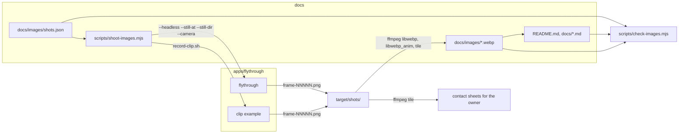

# 0093: The README rewrite with reproducible screenshots: a shot manifest, a shoot script that re-renders every image in one command, an image gate, and the owner's pick from contact sheets

> **Status:** in-progress (lane started 2026-11-26; Phase 1 landed). Approved 2026-11-19 (drafted from the Bonsai second pass, section 2, and the
> owner's "more screenshots through the doc"; the owner: "all recommended", every owner question
> on its recommendation: after 0087, beside 0089, before 0091; canopy shot now; one caption line;
> the frame-time figure; the hero from the sheet). **Refreshed 2026-11-26** against main
> `aa8a76a3` (v0.76.0): see "Amended 2026-11-26" below, which wins where it differs (a wording
> standard, the examples, the first screen, `--eye` for `--camera`, nine feature groups, the
> scrub at the close). Not started; the lane starts after Plan 0104 closes, beside 0101 and 0105
> **Created:** 2026-11-19
> **Milestone:** M7 in `docs/roadmap.md` (tooling); a docs plan: no engine crate changes
> **Related ADRs:** none. The one choice with a rejected alternative (the README's images come
> from the fly-through binary and the clip example, not from a grown `hero` example) is a
> testbed flag, cheap to revisit, and is recorded in Decision below. Builds on
> [ADR-0054](../adrs/0054-the-tester-build-is-a-launcher-that-runs-the-flythrough-per-scene.md) (the
> scenes and camera paths the shots reuse) and
> [ADR-0009](../adrs/0009-testbed-hud-as-embedded-bitmap-font-overlay-pass.md) (the HUD the
> pass-list shot shows).

## TL;DR

The README is rewritten after Bonsai's: an identity line with one measured figure, the
quickstart in the first screen, the features in eight groups of 3 to 5 bullets with a still
after each, a gallery, a wishlist, and everything about layout, checks and process moved to
`docs/development.md`. Every image in it is engine output with the HUD off (the HUD shot
excepted), described by one row of a manifest beside the images (`docs/images/shots.json`:
scene, seed, pose, clock, flags, frames, output size, format, tolerance) and re-rendered by one
command, `node scripts/shoot-images.mjs`, headless under the perf lock. The fly-through gains
`--still-at F,..`, `--still-dir DIR` and `--camera X,Y,Z,YAW,PITCH`, so a still of any scene it
can show (the castle, a `--vox` chapel, walkers wandering, a dig, the HUD) is one command, and
the clip example keeps making the entity loops. A gate, `scripts/check-images.mjs`, holds the
budget (a still at or under 300 KB, a loop at or under 700 KB, the README's images at or under
5 MB together), the manifest's completeness and every image's reference and alt text, and
`check-doc-links.mjs` learns to validate `#fragment` links so the wishlist's backlog anchors
cannot rot. The owner picks every shot's pose and clock from a contact sheet. After a look
change, refreshing the README is `node scripts/shoot-images.mjs` and a commit.

## Context & problem

The README today (main 901a9e26) opens on one good GIF and honest figures, then fifteen dense
bullets without an image, a crates table, a checks list and process. Bonsai's
(`scallyw4g/bonsai`, read 2026-11-19) puts an image every ten lines, groups its features, puts
the binaries first and keeps process out. The owner wants ours shot through with images in that
shape, and the second-pass report's section 2 lists what to borrow.

The images we have were each made by hand: `docs/images/hero.png` by the `hero` example at
whatever flags its caption remembers (re-shot five times across Plans 0024 to 0055, the caption
rewritten each time), the two GIFs by `scripts/record-clip.sh` with the command in the caption.
Nothing re-renders them together, nothing says when they went stale (the hero predates Plans
0058, 0062 and 0083 and shows none of their work), and nothing bounds their size: the three
files are 3.8 MB, the spider GIF alone 2.0 MB at 800 px. Git keeps every version of every
image, so an unbounded README is a cost the clone pays forever.

Three facts shape the mechanism:

- The fly-through can already stand in every scene the shot list names (`--source
  showcase|outdoor|cave`, `--castle --castle-shot`, `--vox`, `--entities N --entities-walk
  on`, `--dig-at F`, `--time HH:MM`, `--hud`) and renders headless (`--headless --frames N
  --render WxH`), but it writes no image: its only frame readbacks are the `steps` view's
  (`apps/flythrough/src/run/frame.rs`, `svet_render::debug::read_rgba8` of `frame.target()`),
  and it has no free camera flag. The `hero` example writes a PNG but knows the showcase, the
  level and the hills only, and the `clip` example knows a rig's clip. Growing the examples to
  the castle, structures, entities and the HUD would copy the fly-through's scene set-up a
  third time (`examples/shared/still.rs` is already a second).
- The frame is not bit-stable across runs by construction: the live bake queue spends a wall
  time slice a frame (`frame:1.5`, `docs/nfr.md` section 2), so what is baked by frame `F`
  depends on the GPU's speed, and FSR 2 carries history. A settled still (the queue drained,
  the history converged) should repeat; a still mid-dig may not. Idempotence is therefore a
  reading first and a tolerance second, never an assumption.
- GitHub renders PNG, GIF, SVG and WebP (static and animated) from repository paths and plays
  MP4 only as an uploaded attachment, never from a path in the tree. The clip recorder makes
  GIF and MP4; the dev box's ffmpeg has `libwebp` and `libwebp_anim`, and no `cwebp`,
  `gifsicle`, `oxipng` or `pngquant`. A rendered 1280 x 720 PNG of ours is about 1.4 MB
  (`hero.png`); a 1600 px lossy WebP of the same kind of frame is expected at 150 to 300 KB
  (a guess until Phase 2 reads it).

Requirement served: `project-context.md`, the dual workflow (the owner's "best in class, human
and agent", 2026-11-17): a person reads a README with pictures; an agent regenerates them from a
manifest and a script with a machine-readable check. `docs/nfr.md` figures touched: none of the
frame or memory lines; the plan adds a repository-size check that lives in the gate, not in
`nfr.md`.

## Decision

The README's images are shot by the fly-through binary through three new flags and by the
clip example through `scripts/record-clip.sh`, both driven by `node scripts/shoot-images.mjs`
from `docs/images/shots.json`. Stills are lossy WebP at 1600 px wide; loops are animated WebP
at 800 px, a GIF fallback named per entry if GitHub fails to play one. The gate is pure Node,
reads the manifest and the tracked markdown, and runs in CI's doc-gates step. The owner picks
poses and clocks from contact sheets the script tiles with ffmpeg.

We rejected growing the `hero` example into a general still tool: it would carry a third copy
of the scene set-up and lag the fly-through's flags forever; the fly-through already owns every
scene and every toggle. We rejected a stills-only budget without a gate: the hero's caption
history shows a rule nobody re-runs is not followed. We rejected PNG stills at 1600 px: five
times the budget per image for a lossless copy of a frame that FSR 2 already resampled. We
rejected MP4 loops: GitHub does not play them from a tree path. The `hero` example stays as the
light write-ups' review tool (`--shot all`); nothing here removes it.

## Architecture diagram



## Implementation phases

Each phase ships as its own commit. `dev` implements the dev phases in order; Phase 5 and
Phase 7 are the owner's. The lane starts after Plan 0087 (the rename) merges, since 0087
rewrites `README.md`, every `docs/*.md`, `scripts/record-clip.sh` and the `SVET_*` names a new
script would otherwise be born with; it may run beside Plan 0089 (no file in common but
`.github/workflows/ci.yml`, where each adds one step). It runs before Plan 0091, which edits
`run/frame.rs`, the HUD and the report that Phase 1 touches. Names below are the tree's at
901a9e26; after 0087 they read `svet` for the old prefix.

### Phase 1: The fly-through writes a still: `--still-at`, `--still-dir`, `--camera`, and the idempotence reading
- **Owner skill:** dev
- **What:** `--still-at F,..` writes the frame's output target as `DIR/<stem>-<F:05>.png` for
  each listed frame, `DIR` from `--still-dir` (default `target/stills/`) and `<stem>` from the
  scene (`showcase-hall`, `outdoor-15-00`, `castle-nave`, `cave`), headless or in a window,
  after the overlay pass when `--hud` is on, so the pass-list shot is the HUD as drawn. A frame
  past `--frames` is refused at parse. `--camera X,Y,Z,YAW,PITCH` (voxels, degrees) overrides
  the scene's spawn, shot or castle shot, refused on `--path` (the path owns the camera). The
  stdout line `still: DIR/<file> 1920x1080 frame F` says what was written. Then the readings:
  the hall still at frame 63 of 64 rendered twice in two processes, the hills at `--time 15:00`
  twice, and a cave still 30 frames after `--dig-at 20` twice, each pair compared by pixel
  (`compare` of ImageMagick if present, else a 40-line Node reader of the PNGs: the fraction of
  pixels where any channel differs by more than 2 of 255), on the RTX 3080 Laptop; and `--vox`
  of the castle's `.vox` (`--castle-out`) placed on `--source outdoor`, tried once: either a
  still of the castle on a hill or the refusal, recorded.
- **Files touched:** `apps/flythrough/src/cli/parse.rs`, `apps/flythrough/src/cli/*.rs` (the
  flag table), `apps/flythrough/src/run/frame.rs` (the readback after the overlay; if the
  overlay draws onto the surface only, the still reads the texture the overlay composes into,
  named in the readings log), `apps/flythrough/src/run/mod.rs`, `apps/flythrough/tests/gpu_still.rs`
  (new), `apps/flythrough/src/cli/tests.rs`, `docs/flythrough.md` (three rows),
  `docs/plans/logs/0093.md` (new, from the template).
- **Done when:** `cargo run --release -p flythrough -- --headless --source showcase --frames 64
  --still-at 63 --still-dir target/stills` writes `target/stills/showcase-hall-00063.png` at
  1920 x 1080 (the Floor profile's output) and prints the `still:` line; `--still-at 64` with
  `--frames 64` is refused naming both flags; `--camera 100,100,40,90,-10` on the showcase puts
  the eye there (the HUD's position row, headless stdout). `tests/gpu_still.rs` runs `--room 4
  --render 320x180 --frames 2 --still-at 1 --still-dir <tmp>` on lavapipe and asserts the PNG
  exists, decodes to 320 x 180 and is not uniform (about 5 s on lavapipe; born `#[ignore =
  "soak"]` if it reads over 10 s). The CLI tests assert the two refusals and the camera parse
  (milliseconds). The readings log carries the three difference fractions and the castle-on-
  a-hill result.

### Phase 2: The manifest and the shoot script
- **Owner skill:** dev
- **What:** `docs/images/shots.json`: one entry per image under `docs/images/` (schema under
  Data shapes), the three existing images among them (`hero` by the fly-through's flags, the
  two GIFs by `record-clip.sh`, re-encoded as WebP), and a `frozen` list for
  `docs/images/light/*` (figures of closed light write-ups whose mechanism is gone; kept, never
  re-rendered). `scripts/shoot-images.mjs`: builds `flythrough` and the `clip` example once in
  release (memory-capped through `systemd-run` as `record-clip.sh` does), then per entry runs
  the source under `flock .git/svet-perf.lock`, keeps the PNG frames under `target/shots/<id>/`,
  encodes a still with ffmpeg `libwebp` (`-quality Q`, Q from the entry, 80 by default; the
  frame scaled to the entry's width with lanczos) or a loop with `libwebp_anim` (`-loop 0`,
  the entry's fps) into the file the entry names, and prints each file's bytes. Options:
  `--only ID,..`, `--print ID` (the exact command lines, copy-pasteable), `--check` (renders
  and encodes to `target/shots/check/`, decodes both the new and the committed file with ffmpeg
  to raw RGB, and prints each entry's difference fraction against its `tolerance`, exit 1 over
  it), `--no-build`. Tolerances are set from Phase 1's readings: `0` where the pair read `0`,
  else the reading rounded up to one significant figure, each with the reading's date in the
  entry's `note`.
- **Files touched:** `docs/images/shots.json` (new), `scripts/shoot-images.mjs` (new),
  `scripts/shoot-images.test.mjs` (new: the manifest parses, every entry has the required
  fields, `--print` output for a fixture entry), `docs/flythrough.md` (a "Shooting the
  README's images" section beside "Recording clips"), `docs/plans/logs/0093.md` (the wall time
  of a full shoot and the byte count per image on the RTX 3080 Laptop).
- **Done when:** `node scripts/shoot-images.mjs` renders and encodes every non-frozen entry and
  the files it writes are the ones the manifest names, nothing else under `docs/images/`
  changes; `node scripts/shoot-images.mjs --check` run right after exits 0 and prints a
  fraction per entry at or under its tolerance; `--print hero` prints the `flythrough` command
  whose still, run by hand, is the frame the script encoded (same bytes, PNG to PNG, or within
  the entry's tolerance); `node --test scripts/shoot-images.test.mjs` passes in under a
  second. The log records the shoot's wall time (expected 5 to 15 minutes for the full set on
  the RTX; a guess) and each image's bytes.

### Phase 3: The image gate, fragment links, and the CI step
- **Owner skill:** dev
- **What:** `scripts/check-images.mjs`, a doc gate in the shape of the others (an optional
  `root`, the fixtures skipped by path, `git ls-files` for the file set): every image file
  under `docs/images/` is a manifest entry or in its `frozen` list, every entry's file exists
  and is referenced by at least one tracked markdown file, every image reference in tracked
  markdown has non-empty alt text, each still is at or under 300 KB and each loop at or under
  700 KB (per-entry caps the manifest may lower, never raise), and the images `README.md`
  references total at or under 5 MB. `check-doc-links.mjs` validates `#fragment` targets
  (same-file and cross-file) against the target file's headings by GitHub's slug rule
  (lowercase, punctuation dropped, spaces to hyphens, `-N` for repeats), since the wishlist
  links backlog headings that leave when a plan takes them. Both gain fixture trees and rows
  in `scripts/fixtures/README.md`; `ci.yml` runs `check-images.mjs` in the doc-gates step.
- **Files touched:** `scripts/check-images.mjs` (new), `scripts/check-doc-links.mjs`,
  `scripts/fixtures/images/**` (new), `scripts/fixtures/doc-links/**` (new, if the existing
  gate has none), `scripts/fixtures/README.md`, `.github/workflows/ci.yml`, `README.md` (only
  if the new gate needs a line; the full list moves in Phase 6), `docs/development.md` is
  Phase 6's.
- **Done when:** `node scripts/check-images.mjs` exits 0 on the tree after Phase 2; on
  `scripts/fixtures/images` it exits 1 with exactly five findings, one per line, each seeded
  and listed in `fixtures/README.md`: an image not in the manifest, an entry no markdown
  references, a still of 301 KB, an image reference with empty alt text, and a README total
  over 5 MB (small files and a lowered per-fixture total cap, so the fixture stays under 50 KB);
  `node scripts/check-doc-links.mjs` exits 0 on the tree and names a seeded `backlog.md#gone`
  fragment in its fixture; both run in under 2 s; `node --test "scripts/*.test.mjs"` stays
  green; the CI step is in `ci.yml` and the workflow lints (`gh workflow view` or a push to the
  lane's branch is not asked for; `node --check` on the scripts and a YAML parse suffice).

### Phase 4: Candidates and contact sheets
- **Owner skill:** dev
- **What:** Each shot entry may carry `candidates`: a list of flag sets (poses and clocks, 2 to
  9 each). `node scripts/shoot-images.mjs --candidates [--only ID]` renders every candidate's
  frame to `target/shots/candidates/<id>/<n>.png` and tiles them into
  `target/shots/candidates/<id>.png` (ffmpeg `tile`, 3 columns, each tile 640 px wide) with a
  `<id>.txt` legend that numbers the tiles and prints each one's flags; a loop entry's
  candidates are rendered as 2-second WebPs beside the sheet. The shot list's first candidates
  (under Shot list below) are written into the manifest here, canopy shots included with a
  pose sweep. The script prints the sheets' paths at the end.
- **Files touched:** `scripts/shoot-images.mjs`, `docs/images/shots.json`,
  `docs/plans/logs/0093.md` (the candidate shoot's wall time).
- **Done when:** `--candidates` writes one sheet and one legend per shot entry that has
  candidates, the sheet's tile count equals the legend's line count, and a tile index named in
  the legend maps to the flags that re-render that tile alone (`--print ID --candidate N`); the
  loops' candidates play in a browser (`xdg-open` of the WebP, by the dev once).

### Phase 5: The owner picks
- **Owner skill:** human
- **What:** The owner opens the contact sheets (or runs a shot's command without `--headless`
  to look around; `--camera` and the HUD's position row give the pose back) and names, per
  shot, the tile that goes in, or a re-shoot with new flags, or a drop; names the hero; says
  whether the canopy shot goes in now or waits for Plan 0094 (the grain follow-up); and
  answers the Owner questions below where they are still open. Taste is the owner's; the dev
  writes the picks verbatim into the readings log and re-shoots once if asked.
- **Files touched:** `docs/plans/logs/0093.md` (the picks, dated).
- **Done when:** every shot entry has a pick, a re-shoot request or a drop in the log, the
  hero is named, and the canopy call is made.

### Phase 6: The picks into the manifest, the final shoot, and the rewrite
- **Owner skill:** dev
- **What:** The picked candidate becomes each entry's flags (`candidates` kept for the next
  pick), `node scripts/shoot-images.mjs` renders the final set, and the README is rewritten in
  this order: the badges; an identity line (one sentence, no "game-agnostic" jargon run-on) with
  one measured figure from `docs/nfr.md` naming its machine (recommended: the frame's GPU time
  at Floor on the RTX 3080 Laptop, 2.9 to 4.3 ms over the vein, the hall and the castle, from
  section 2) and the hero under it; the quickstart in the first screen (the release archive
  from the releases page first, then `cargo build`, three `cargo run` lines and one line of
  keys pointing at `docs/flythrough.md`); the features in eight groups, each 3 to 5 bullets and
  one still after it: World and edits, Rendering, Lighting, Entities, Structures, Simulation
  and determinism, Audio, Tooling (the HUD shot); a gallery of the remaining stills and the
  loops; a wishlist of 8 to 10 lines, each a link to a backlog heading, a `docs/references/`
  file or a roadmap milestone (the far field and liquids, clouds and weather, the night sky,
  volumetrics, networking, Lua, chunk-scale dynamics, hundreds of entities, the authoring
  direction, deterministic simulation testing); a one-line pointer to `docs/development.md`;
  the licence. `docs/development.md` (new) takes the Layout table, Building's dependency
  paragraph, the examples and benches, Checks with the full gate list, "How the project is
  run", and a section on shooting the images that points at the manifest and the script. Each
  image gets a one-line `<sub>` caption of what it shows; the regenerate command is stated once,
  at the gallery's end. `docs/entities.md` points at the manifest for its two loops.
  `CHANGELOG.md` gets its entry under Unreleased. Old image files the manifest no longer names
  are `git rm`'d.
- **Files touched:** `README.md`, `docs/development.md` (new), `docs/images/shots.json`,
  `docs/images/*.webp` (the set), `docs/images/hero.png`, `docs/images/*.gif` (removed),
  `docs/entities.md`, `docs/flythrough.md` (the keys table stays its source), `CHANGELOG.md`,
  `docs/roadmap.md` (its line that names `hero.png`).
- **Done when:** `README.md` holds the sections above in that order (headings `Quickstart`,
  `Features` with the eight `###`, `Gallery`, `Wishlist`, `Development`, `License`); it names
  no ADR or plan number and no `docs/plans/` or `docs/adrs/` path (they live in
  `docs/development.md`); `git grep -i -E 'roguelite|horror|delve' README.md docs/development.md`
  prints nothing; every `###` feature group is followed by an image before the next heading
  (a Node one-liner in the readings log); the identity figure quotes `docs/nfr.md` with the
  machine; `node scripts/check-images.mjs`, `check-doc-links.mjs`, `check-index-rows.mjs`,
  `check-comment-hygiene.mjs` and `check-plan-size.mjs` exit 0; `node scripts/shoot-images.mjs
  --check` exits 0 on the committed set; the README's images total at or under 5 MB (the gate's
  line, pasted into the log with each file's bytes).

### Phase 7: The README on GitHub
- **Owner skill:** human
- **What:** After the lane merges and the owner pushes, the owner opens the repository page
  once on GitHub: every image shows at a sensible width on a desktop browser and on a phone,
  and each loop plays. A loop that shows as a still is re-encoded as GIF (the entry's
  `fallback`, the recorder's two-pass palette at 640 px, under the same 700 KB cap, or
  dropped) in a fix pass by `dev`.
- **Files touched:** none, or `docs/images/shots.json` and the loop's file in the fix pass.
- **Done when:** the owner says the page reads right, or the fix pass has landed and the gate
  still exits 0.

## Data shapes

```json
// illustrative: one still, one loop, the frozen list
{
  "stills": {
    "hero": {
      "kind": "still", "file": "hero.webp", "width": 1600, "quality": 82,
      "source": "flythrough", "seed": 1,
      "flags": ["--headless", "--source", "outdoor", "--spawn", "forest",
                "--time", "18:10", "--render", "1920x1080", "--frames", "96"],
      "still_at": 95, "tolerance": 0.0, "cap_bytes": 300000,
      "candidates": [["--time", "17:40"], ["--time", "18:10"], ["--time", "18:40"]],
      "note": "pair read 0 differing pixels, 2026-11-xx, RTX 3080 Laptop"
    },
    "dig": {
      "kind": "loop", "file": "dig.webp", "width": 800, "fps": 20, "quality": 70,
      "source": "flythrough", "seed": 1,
      "flags": ["--headless", "--source", "cave", "--dig-at", "40", "--frames", "100"],
      "still_at": "36..96", "tolerance": 0.004, "cap_bytes": 700000, "fallback": "gif"
    },
    "spider-walk": {
      "kind": "loop", "file": "spider-walk.webp", "width": 800, "fps": 25,
      "source": "clip", "flags": ["--clip", "walk"], "tolerance": 0.0, "cap_bytes": 700000
    }
  },
  "frozen": { "light/hall-settled-8192-frames.png": "Plan 0024's write-up; the mechanism is gone" }
}
```

A `source` of `flythrough` runs the binary with `flags` plus `--still-at` and `--still-dir`;
`clip` runs `scripts/record-clip.sh --input` on frames the `clip` example renders with
`flags`. `still_at` is one frame or a range for a loop. The script derives every command from
the entry, so `--print` and the shoot cannot disagree.

## Shot list

The first candidates, written into the manifest in Phase 4; the owner picks in Phase 5. Every
shot is unretouched engine output with the HUD off, except the HUD shot. Never the owner's
local terrace or anything Monument-Valley-derived: the castle and the chapel are ours.

| Id | Shows | Source and first candidates |
|---|---|---|
| `hero` | The hills at sunset from the forest spawn, or the castle on a hill if Phase 1's `--vox` try places it, or the chapel | `--source outdoor --spawn forest --time 17:40 / 18:10 / 18:40`; `--vox <castle> --source outdoor --time 18:10` |
| `dig` (loop) | A dig in the cave: the sphere opens, the light re-bakes | `--source cave --dig-at 40`, frames 36 to 96, radius 1.0 and 1.5 m |
| `canopy` | The canopy at 15:00 from under the trees | `--source outdoor --spawn forest --time 15:00`, three `--camera` poses looking up and along; may wait for Plan 0094 |
| `lamp-cave` | A lamp-lit cave, the headlamp's bounce on wet rock | `--source cave --lamp on`, the spawn and two `--camera` poses, exposure auto and fixed |
| `skylight` | The skylight dig: the tunnel's roof opened to the sky | `--source outdoor --spawn inside --camera ... pitch 60 --dig-at 30`, still at frame 90; radius 1.5 and 2.5 m |
| `walkers` (loop) | Walkers wandering the showcase hall | `--source showcase --entities 6 --entities-walk on`, frames 60 to 120, `--shot hall / chasm` |
| `spider-walk` (loop) | The spider's walk clip, the entities library's own | `record-clip.sh -- --clip walk` (as today, re-encoded) |
| `chapel` | The chapel's glass and lamps in the cave | `--vox apps/flythrough/assets/structures/chapel/chapel.vox`, two `--camera` poses, `--lamp off / on` |
| `castle` | The castle: the gate, or the nave under its vault | `--castle --castle-shot gate / nave / window` |
| `day-cycle` (loop) | A day over the hills as a time lapse of settled stills | `--source outdoor` at 24 `--time` values an hour apart, each a settled still, encoded at 6 fps; the loop that is dropped first if the total is over 5 MB |
| `hud` | The stats overlay with its pass list over the hall | `--source showcase --hud --shot hall`, exposure as the hero's |
| `profiler` | The profiler's frame bars, after Plan 0091 | not shot here; a manifest entry Plan 0091's close adds |

Budget arithmetic: eleven stills and loops at the caps would be 7 x 300 KB + 4 x 700 KB =
4.9 MB; the day cycle goes first if the gate's 5 MB line is crossed, then a still's `quality`
drops before its width. The two entity loops serve `docs/entities.md` too and count in the
README total only if the README references them.

## Budgets

No `docs/nfr.md` figure moves. The plan's own lines live in the gate: a still at or under
300 KB, a loop at or under 700 KB, the README's images at or under 5 MB together, read by
`node scripts/check-images.mjs` on every CI run; its cost is under 2 s of CI. The shoot's wall
time and the idempotence fractions are readings in `docs/plans/logs/0093.md` on the RTX 3080
Laptop, not budgets.

## Risks & open questions

- **The frame is not bit-stable mid-dig.** Phase 1 reads it before Phase 2 sets a tolerance;
  if a loop's fraction is large (over 1 %), its frames move later (more settle) or the loop
  becomes a time lapse of settled stills like the day cycle.
- **The HUD may draw onto the surface, not into the target.** Then the still reads the texture
  the overlay composes into; if there is none headless, the HUD shot is taken from a window
  (`--still-at` works there) and its entry says `window: true`, the one exception to headless.
- **Animated WebP on GitHub.** Expected to play (served as `image/webp`); Phase 7 is the check
  and `fallback: gif` the way out, at the same cap.
- **The castle on a hill** depends on `--vox` of the castle's `.vox` on the outdoor source,
  not refused by `cli/parse.rs` today but never tried; a prefab of 343 MB (Plan 0042) may be
  too large to place through `--vox`. Phase 1 reads it once; the hills at sunset stand if not.
- **Fragment validation may flag existing links.** Any that break are fixed in Phase 3, not
  exempted.
- **Determinism and layering:** nothing in `crates/` changes; the flags are the testbed's.

## What this plan does NOT do

- No profiler shot: Plan 0091 adds the entry at its close.
- No new scenes, lights or materials for the camera; a shot that needs one is dropped or waits.
- No mixed entity shot (walkers and spiders together) unless `--entities` already allows it;
  `--entities N` places the selected entry only, so the walkers loop and the spider loop are
  two images.
- No retouching, cropping to hide a fault, or colour grading; a visible fault in a pick is a
  backlog entry, not an edit.
- No `hero` or `clip` example removal; no change to `record-clip.sh` beyond what 0087 renames.
- No documentation site; `docs/development.md` is a file, not a build.
- No MP4 anywhere in the tree.

## Owner questions

1. **Order.** Recommended: the lane starts after Plan 0087 merges and runs beside Plan 0089
   (files disjoint but `ci.yml`), before Plan 0091. Alternative: beside 0087 with a rename
   sweep at the merge; not recommended, 0087 rewrites the README and every doc the plan edits.
2. **The hero.** Recommended: decide at Phase 5 from the sheet, with the hills at sunset, the
   castle on a hill (if it places) and the chapel as candidates; no answer needed now.
3. **The canopy.** Recommended: shoot it now with a pose sweep and pick one where the grain does
   not read; a re-shoot after Plan 0094 is one command. Alternative: leave the slot empty until
   0094 closes.
4. **Captions.** Recommended: one `<sub>` line per image saying what it shows, and the
   regenerate command once at the gallery's end. Alternative: today's per-image command and
   machine line under each.
5. **The identity figure.** Recommended: the frame's GPU at Floor on the RTX 3080 Laptop (2.9 to
   4.3 ms, `docs/nfr.md` section 2). Alternative: the determinism claim (a session replays from
   seed plus log to the same hash on Linux and Windows).

## Amended 2026-11-26 (architect, the owner's note on the README's model)

The owner, 2026-11-26, on the README this plan models ours on: "an example of a very good
readme. Good texting, sections, examples, images. It looks pretty and I want to give a star
right away." The plan had the structure and the images; it said little about the wording, the
examples and the first screen, and a week of merges made parts of it stale. This section adds
the rules and restates every Done when it changes. Where it and the text above differ, this
section wins; the phases, their owners and their order stand. Main at `aa8a76a3`, v0.76.0.

### A1. What the model does (read today)

The model is Bonsai's README (`scallyw4g/bonsai`, `readme.md` on `master`, 246 lines, fetched
2026-11-26 through the GitHub API). This sentence is the amendment's only use of the name; the
rules below stand without it (A9).

- **Wording.** First person, warm, short: most sentences under 20 words. The opening is three
  short paragraphs: what it is, the one remarkable claim with a number and a comparison a
  reader can picture, and what a user can do with it. Quoted: "The view distance is the entire
  world, all the time." and "Yes, you read that right." Feature bullets are noun phrases of two
  to six words in the field's own terms (quoted: "Hot Shader & Game-code Reloading",
  "Procedural sky with a smooth horizon and directional sun"); one bullet in thirty explains a
  mechanism. No process, no decision records, no internal vocabulary.
- **Sections.** A welcome with the opening; a version note; Getting Started (what a build
  needs) holding Quickstart (the release binaries first, then four linked headings: getting
  started, build from source, controls, the chat server); quoted praise; Feature Sets in six
  groups; Gallery; Wishlist in six groups.
- **Examples.** None inline: no code fence, no command line, no keys table. The first screen
  links to the releases and to three guides. It is an application; a download is its example.
- **Images.** Seventeen: a 256 px logo floated right of the opening and sixteen full-width
  stills, no loop, no caption, every alt text the same word. One still closes every block:
  after the version note, the quickstart, each feature group, each wishlist group; four in the
  gallery. The longest run of text between two images is twelve short lines.
- **The first screen.** A title, the logo, three short paragraphs, then a full-width still. No
  badge. Much whitespace, since every line is short.

### A2. Where the plan matched and where it was short

Matched: the quickstart first with the release archive leading; grouped features with an image
after each; a gallery; a wishlist; process moved out (`docs/development.md`); no ADR or plan
number in the README. Ours is stricter on images, rightly: a manifest, a gate, real alt text,
one caption line.

Short: (1) no wording standard, so today's dense sentences would move over unchanged; (2) no
named examples: a library workspace needs a code example and a keys table, where the model
needs neither; (3) the first screen was a list of parts, not a specification; (4) no rule for
how much text may sit between two images outside the feature groups; (5) nothing in the
feature groups for the outdoor work, and two groups (Simulation, Audio) with no shot that
could follow them.

### A3. The wording standard (binding on Phase 6; the reviewer checks each)

W1. **Sentences.** No sentence of README prose is over 25 words; the opening's (A5) are at
    most 20. Prose is every line outside code fences, tables, headings and image lines.
W2. **The opening** is at most three paragraphs of at most three sentences: what `svet` is;
    the one measured claim with its hardware; what a game does with it (composes crates, owns
    its loop). The name's meaning ("light", and "the world") stays: it is our one warm line.
W3. **A feature bullet says what the reader gets**, in at most 12 words, starting with the
    thing or the verb: "Dig, fill and stamp at runtime; every edit reports what it changed."
    No "through", "via" or "by" clause that explains the build, no parenthesis, no type or
    field name. One bullet a group may run to 25 words. Detail lives behind at most one link
    line at the group's end.
W4. **Terms.** The field's names stand (ray marching, FSR 2, HRTF, WGSL, WebAssembly, `.vox`).
    A term coined in this repository is replaced by plain words or explained in its sentence:
    the store, the record, a landing, the key light, calm light, honest cubes, the far normal,
    the bake queue, the mirror, the belt, a profile's name used bare.
W5. **No internal numbering anywhere in the README:** no ADR, plan or milestone code (`M7`),
    no `docs/plans/` or `docs/adrs/` path. A wishlist line's link text says the thing.
W6. **A number names its machine.** Every speed or size figure states the hardware and the
    output size in its sentence and is quoted from `docs/nfr.md` or `docs/nfr/` as they read
    at Phase 6's tip. At most five such figures in the README.
W7. **Voice.** Active, present tense; "you" is allowed. No hedge ("aims to", "is designed
    to"), no adjective of praise without a figure beside it, no project history, no emoji.
W8. **Status is one line:** pre-alpha, with links to the changelog and the roadmap. A miss is
    not hidden: the line links `docs/nfr.md`, "met and missed".
W9. **Rhythm.** From `## Features` to the end of `## Gallery`, no more than 120 words of
    prose separate two images.

### A4. The examples the README carries

E1. **The first commands** (Quickstart): the release archive from the releases page and the
    binary to start, then from source `cargo run --release -p flythrough` and two scene lines
    (the showcase, the outdoor hills with `--trees forest`), each with a trailing comment of
    what the reader sees. At most six command lines in the section.
E2. **The keys**: a table of at most eight rows (look and fly, dig and fill, the menu, the
    keys page, the overlay, the headlamp, walk, quit), then the link to `docs/flythrough.md`.
    This replaces "one line of keys".
E3. **The code example**, under `## Use it as a library`, after Quickstart: one sentence that
    a game composes the crates it needs; the dependency lines as the tree allows them (the
    crates are not on a registry today, so a git dependency, said in one line); one `rust`
    fence of at most 25 lines on `svet-world` alone: a material table, a generated world, one
    carve, the edit's result asserted, one query. No hidden lines: the fence compiles as
    shown. Then one line pointing at `apps/flythrough` as the worked example of the render
    loop. **How it is checked:** `crates/svet-world/src/lib.rs` gains a `#[cfg(doctest)]` item
    whose doc is `include_str!` of the README, so `cargo test --doc -p svet-world` (already in
    CI as `cargo test --workspace --doc`) compiles and runs the fence. This is the plan's one
    line in `crates/`; it adds no public item.
E4. **Try it**: each feature group whose image is a fly-through shot ends with that shot's
    scene as a windowed command (the manifest entry's flags without `--headless`, `--frames`
    and the still flags).
E5. **The regenerate command**, once, at the gallery's end (as approved).

Every flag in E1, E2 and E4 is a row of `docs/flythrough.md`; every key is the table's there.

### A5. The first screen

In this order, nothing else before `## Quickstart`: the `# svet` title; a tagline of at most
12 words; at most three badges on one line (CI, licence, latest release); the hero, full
width, with its one `<sub>` caption line; the opening (W2), at most 120 words; the status line
(W8). No table, no list, no second image. On GitHub at a 1080p desktop width the title, the
tagline and the whole hero show without scrolling (Phase 7 checks it).

### A6. What was stale, and the tree's names

- **`--camera` is not added.** The tree has `--eye X,Y,Z,YAW,PITCH` (outdoor only; yaw
  counter-clockwise from +x, 90 north; `cli/outdoor.rs`). Phase 1 extends `--eye` to every
  source and refuses it on `--path`. Read `--eye` for `--camera` throughout.
- **The fly-through already writes an image.** `--still PATH` (with `--mode-text`,
  `cli/still.rs`, `run/still.rs`) writes a headless run's last frame, without the HUD, as a
  PPM, for `scripts/rehearse-window.mjs`. `--still-at` and `--still-dir` build on that
  readback; `--still` keeps its behaviour. `rehearse-window.mjs` already holds the perf lock
  and memory cap wrapper and a PPM to PNG writer; `shoot-images.mjs` imports what it can.
- **A headless run bakes in lockstep** (`--bake-thread` is off under `--headless`), which is
  what the idempotence reading wants; no shot passes `--bake-thread on`.
- **The outdoors moved:** `--trees none|sparse|forest` (sparse by default; the canopy and the
  hero pass `forest`), `--sun EL,AZ` fixes the sun beside `--time`. `--vox` places "in the
  streamed cave"; the castle on a hill stays one try in Phase 1.
- **Plan 0094 has closed**, so "may wait for Plan 0094" and the second Followup are moot: the
  canopy is shot now. Owner question 3 is answered by events.
- **A shot shows the default look.** An entry's flags are scene, pose, clock, trees,
  entities, lamp, exposure, frames and size; never a lighting-mode flag. So nothing here
  names the rows Plan 0104 removes (`--key-at`, `--key-horizon`, `--key-cover record`).
- **No flag for the dig's radius exists**; the `dig` and `skylight` candidates vary pose and
  frame, not radius. Every other flag the shot list names is a row of `docs/flythrough.md`
  today (`--source`, `--spawn`, `--shot`, `--castle`, `--castle-shot`, `--castle-out`,
  `--vox`, `--entities`, `--entities-walk`, `--dig-at`, `--time`, `--lamp`, `--hud`, `--room`,
  `--render`, `--frames`, `--headless`).
- **The identity figure.** `docs/nfr.md` section 2 still reads 2.9 to 4.3 ms of GPU at Floor,
  from Plan 0069's tip, before the outdoors. Since v0.76.0 it also reads the forest: a frame
  of 8.3 ms at 1080p on the RTX 3080 Laptop while the view bakes. Owner question 5 reopens
  (below); either way Phase 6 quotes the file as it reads at its tip.
- **The README itself changed** (refreshed to v0.74.0, the spider loop as its hero); Phase 6
  rewrites whatever it finds.

### A7. Feature groups and shots, refreshed

Nine groups, since the outdoors is now a body of work with the hero in it: World and edits,
Rendering, Lighting, Outdoors, Entities, Structures, Simulation and determinism, Audio,
Tooling. The image after each:

| Group | Image |
|---|---|
| World and edits | `dig` (loop) |
| Rendering | `hall` (new: `--source showcase --shot hall / chasm / crystals`, the lamp off) |
| Lighting | `lamp-cave` |
| Outdoors | `canopy`; `skylight` beside it or in the gallery |
| Entities | `walkers` (loop) or `spider-walk` (loop) |
| Structures | `chapel` or `castle`, the other in the gallery |
| Simulation and determinism, Audio | no shot illustrates them: the owner assigns a gallery still to each at Phase 5; no diagram is drawn for the slot |
| Tooling | `hud` |

Shot list changes: `hero` candidates are `--source outdoor --trees forest --spawn forest` at
`--time 17:40 / 18:10 / 18:40` and two `--eye` poses; `canopy` is `--trees forest --time
15:00` at three `--eye` poses; `skylight` uses `--eye` for its pose; `hall` is added. Twelve
shot entries at the caps would be 8 x 300 KB + 4 x 700 KB = 5.2 MB, over the 5 MB line: the
day cycle drops first, as approved (then 4.5 MB). Plans 0101 and 0105 change how a dig and an
opening look; after either merges, `node scripts/shoot-images.mjs --check` names the entries
that moved and one shoot refreshes them.

### A8. Done whens restated

- **Phase 1** as written, with `--eye` for `--camera`: `--eye 100,100,40,90,-10` on the
  showcase puts the eye there; `--eye` with `--path` is refused naming both; `--still PATH`
  still writes its PPM (`rehearse-window.test.mjs` stays green). Files touched add
  `apps/flythrough/src/cli/still.rs`, `cli/outdoor.rs` and `run/still.rs`.
- **Phase 5** adds: the owner assigns the images after Simulation and Audio, and answers the
  owner questions below that are still open.
- **Phase 6**, replacing its Done when: `README.md` holds, in order, the first screen (A5),
  `Quickstart`, `Use it as a library`, `Features` with the nine `###`, `Gallery`, `Wishlist`,
  `Development`, `License`; every `###` group is followed by an image before the next
  heading; `git grep -n -E 'ADR|Plan [0-9]|\bM[0-9]+\b|docs/(plans|adrs)/' README.md` prints
  nothing; `git grep -i -E 'roguelite|horror|delve' README.md docs/development.md` prints
  nothing; a Node one-liner in the readings log prints the longest sentence (at most 25
  words), the opening's word count (at most 120), the longest feature bullet per group (W3)
  and the most words between two images from Features to the Gallery's end (at most 120);
  the reviewer reads the README against W2 to W8 and names any line that fails;
  `cargo test --doc -p svet-world` runs the README's fence and fails when the fence is
  broken (tried once: a typo in the fence turns it red; logged); every flag and key in E1,
  E2 and E4 is in `docs/flythrough.md`, and each E1 and E4 command starts and draws 2 frames
  with `--headless --frames 2` added (under the perf lock, logged); the identity figure
  quotes `docs/nfr.md` with its machine; the five doc gates and `check-images.mjs` exit 0;
  `node scripts/shoot-images.mjs --check` exits 0; the README's images total at most 5 MB.
  Files touched add `crates/svet-world/src/lib.rs` (the doctest item only).
- **Phase 7** adds: at a 1080p desktop width the title, the tagline and the whole hero show
  without scrolling; the owner reads the opening aloud once and says it reads right.

### A9. The model is not named (owner, 2026-11-26)

The owner: "after plan implementation I want to amend it and remove mention of [the model] as
a source of inspiration. let it be abstract", then: "scrub all, and don't mention in commit
messages". Three rules:

1. **Nothing this plan produces names the model or links to it:** not `README.md`,
   `docs/development.md`, the manifest, the scripts, their tests and fixtures, the readings
   log or the CHANGELOG entry. The rules of A3 to A5 are the standard; they need no source.
2. **From now on no commit message, branch name or tag names it.** Binding on the lane's dev
   agents and on the close review. Earlier commits stay as they are; history is not rewritten.
3. **The scrub, at the close, after the owner's Phase 7.** The close review's ceremony, as a
   doc edit by the architect, rewrites every tracked file that names the model so that it
   describes it abstractly ("a README with an image every ten lines, grouped features and
   the quickstart first"; "another voxel engine's source" for a borrowed idea), with no
   project name, repository path or link, and no exception by file. Today `git grep -i -c`
   of the name lists: this plan (the Status line, the TL;DR, Context, A1), `docs/plans/README.md`,
   Plans 0091 and 0092, `docs/backlog.md` (a section heading and its entries, the heading
   reworded and every fragment link to it fixed), `docs/reviews/2026-11-20-crystal-islands-look.md`,
   `docs/reviews/2026-11-22-backlog-review.md`, and ADR-0071 and ADR-0077. The second-pass
   report was delivered in conversation and is no file. The grep is run again at the close;
   its list then is the work. **Done when:** `git grep -i` of the name prints nothing in the
   tracked tree, and the doc gates exit 0. The check is run by hand at the close: a script
   that holds the word would fail itself. Not before the close: the mentions stay until then.

### A10. Lane start and order

The lane starts after Plan 0104 closes (0104 removes rows from `apps/flythrough/src/cli/` and
`run/`, which Phase 1 edits). It may run beside Plans 0101 and 0105: both work in
`svet-render`'s bake code and neither touches the still path. Expected conflicts are textual
only: rows of `docs/flythrough.md`, the flag table under `apps/flythrough/src/cli/`, and
`CHANGELOG.md`; the lane merges main before Phase 6's final shoot so the images carry the
look main has. "Before Plan 0091" stands (0091 edits `run/frame.rs` and the HUD); Plans 0089
and 0091 have not started. Phases 1, 2, 4 and 6 render on the GPU under the perf lock.

### A11. Owner questions (none blocks the lane; Phase 5 takes the answers)

1. **The identity figure** (reopens question 5). Recommended: the forest's frame, 8.3 ms at
   1080p on the RTX 3080 Laptop while the view bakes, since the hero is the forest.
   Alternative: the older GPU figure, 2.9 to 4.3 ms, on three indoor scenes.
2. **Badges.** Recommended: three on one line under the tagline (CI, licence, release). The
   model has none; alternative: none, the licence and CI named in Development.
3. **A second code example**, a minimal window on `svet-app` and `svet-render`. Recommended:
   not in this plan; the README points at `apps/flythrough`, and a small `examples/` window is
   a backlog entry. Alternative: a new example file the README quotes, a phase added here.
4. **Nine groups** with Outdoors its own. Recommended: yes. Alternative: eight, the outdoors
   folded into Lighting.
5. **The scrub and accepted ADRs.** ADR-0071 and ADR-0077 are append-only once accepted; the
   scrub rewords a name in them and changes no decision. Recommended: reword them like every
   other file, as the owner ruled. Alternative: leave the two ADRs and accept that the grep
   prints them.

## Amended 2026-11-26 (owner)

The owner answered A11's questions (2026-11-26): "all recommended except 3 - in this plan".

1. **The identity figure:** the forest frame, 8.3 ms at 1080p on the RTX 3080 Laptop while
   the view bakes (Plan 0099's pin in `docs/nfr.md` section 2), named with its machine.
2. **Badges:** three on one line (CI, licence, release).
3. **A second code example is in this plan**, not the backlog: Phase 6b below.
4. **Nine feature groups**, Outdoors its own.
5. **The scrub covers the two accepted ADRs** (his "scrub all"): they are reworded at the
   close like every other file, a name only, no decision changed, each with a dated line
   saying the wording was edited on the owner's word.

### Phase 6b: A minimal window as the second example

- **Owner skill:** dev
- **What:** one example a reader can copy to open a window on their own world:
  `crates/svet-app/examples/minimal_window.rs` (or the crate the tree shows owns the frame
  loop; the tree's names win), at most 60 lines without comments: a small world from
  `svet-world` with a floor and a few carved shapes, the renderer from `svet-render`, the
  window and loop from `svet-app`, the defaults of a named profile, Escape to quit. No
  fly-through code is copied into it and no new public API is added for it; if it cannot be
  written in 60 lines against today's API, that is the finding (see the stop). The README's
  `Use it as a library` section shows it after the `svet-world` example (A4 E3) as a second
  `rust` fence quoted from the file between two marker comments, at most 30 lines, with the
  command that runs it (`cargo run --release -p svet-app --example minimal_window`) and one
  line of what the reader sees. A headless path (`--frames N` or the example's own test) lets
  CI and the shoot script run it without a window; its still is a candidate for the
  section's image at Phase 5 if the phase lands before the contact sheets, else for the
  gallery.
- **Order:** after Phase 1, before Phase 4 where it can be (so the owner sees its still on a
  sheet); it does not block Phase 4.
- **Done when:** the example builds in CI's ordinary build (`--all-targets`) and under
  clippy with `-D warnings`; a headless run of it renders at least one frame that is not one
  colour (asserted by a test in the `gpu_` tier or by the example's own headless exit code,
  named in the log); a doc gate or test asserts the README's fence is byte-equal to the
  marked span of the file, so the two cannot drift; the wording rules W1 to W9 hold for its
  two lines of text.
- **Stop, reported:** the example needs a public API the crates do not have, or more than
  60 lines of set-up. The gap is reported with the lines that had to be copied, the
  architect rules (a small API addition as its own phase, or the example trimmed to what
  the API gives), and the README does not ship a fence that does not compile.

Phase 6's Done when gains: the README holds the two `rust` fences in `Use it as a library`,
in that order. The Implementation log gains a row for Phase 6b.

## Implementation log

> Written by `dev`: one row per phase as its commit lands, then the close block. **The phases
> above are the contract. This section records what happened.** Observations, never conclusions:
> no pass list, no self-assessment. Deviations and unmet done-whens are **always** disclosed.
> Keep it shorter than `## Implementation phases`. Readings, gate counts, attempts, sweeps and
> resume notes go to the plan's readings log, `docs/plans/logs/0093.md` (started from
> `templates/readings-log.md`), and this section links it once it exists.

| phase | owner | state | commit |
|---|---|---|---|
| 1: the still flags and the idempotence reading | dev | done; readings in [the log](logs/0093.md) | `420bcf16` |
| 2: the manifest and the shoot script | dev | stopped: `--check` after the shoot over tolerance on `hero` (log) | wip, committed with this row |
| 3: the image gate, fragments, CI | dev | not started | |
| 4: candidates and contact sheets | dev | not started | |
| 5: the owner picks | human | not started | |
| 6: the picks, the final shoot, the rewrite | dev | not started | |
| 6b: a minimal window as the second example | dev | not started | |
| 7: the README on GitHub | human | not started | |

### Notes

_(Deviations from the plan, with the commit, stated without justification. Done-whens not
satisfiable as stated, and what was done instead. Followups noticed and not acted on. One line
each. Empty is fine.)_

- Phase 1: `tests/gpu_still.rs` existed (the `--still` test); the new test is added to it.
- Phase 1: the CLI tests are in `src/cli/tests/still.rs` (new), since `src/cli/tests.rs` is at
  1181 of the 1200-line cap.
- Phase 1: files touched beyond the list: `apps/flythrough/Cargo.toml` (`png` from
  dev-dependencies to dependencies, the same pin), `src/setup.rs` (`--eye` on every source's
  camera and streamed centre), `src/run/switch.rs` (a source switch drops `--eye` and counts
  `--still-at` on), `src/cli/tests/outdoor.rs` (the field's new place, `Args::eye`).
- Phase 1: the still is written after `draw` returns (`run/frame.rs`, `frame`); the overlay
  case draws the presenter and the overlay again in a submit of their own (`run/still.rs`).
- Phase 1: without `--profile` or `--render` the done-when's command writes 1280 x 720 (the
  tree's default surface); with `--profile floor` it writes 1920 x 1080 (log).
- Phase 1: `--vox` on `--source outdoor` parses and is ignored: no castle is placed (log).
- Phase 2: the manifest's map is `shots`, not `stills`; `hero.png`, `spider-walk.gif` and
  `walker-walk.gif` are in `frozen` until the rewrite replaces them.
- Phase 2: a `clip` entry runs the example and encodes WebP itself, not through
  `record-clip.sh --input` (which writes GIF and MP4 only).
- Phase 2: the hero's tolerance is the largest of six pairs of four hills stills (Phase 1's
  two runs and two more), 0.006305 to 0.007; the clips' 0 is from pairs read in Phase 2.
- Phase 2: `--check` right after the shoot exits 1: hero 0.117263 against 0.007, the clips 0
  (log). Not met; stopped for the architect.

### Close triggers

_(Facts for the architect. No recommendations, and no suggested version bump.)_

- **What shipped:** docs-chore-only (the testbed's three flags and two scripts)
- **Public API changed:** none in `crates/`; the fly-through's flags
- **Budget readings:** none in `nfr.md`; the gate's line and the shoot's wall time in the log
- **Gate at the tip:** the commands run (build, nextest, doctests, clippy, fmt, deny), exit codes, test counts
- **Outstanding `human` phases:** which, or none
- **Owed at the close (architect, not dev):** the scrub of A9 rule 3, after Phase 7

## Followups

- Plan 0091's close adds the `profiler` entry to the manifest and the HUD group's second image.
- Plan 0094 (Plan 0086's grain follow-up) re-shoots `canopy` and `hero` with one command.
