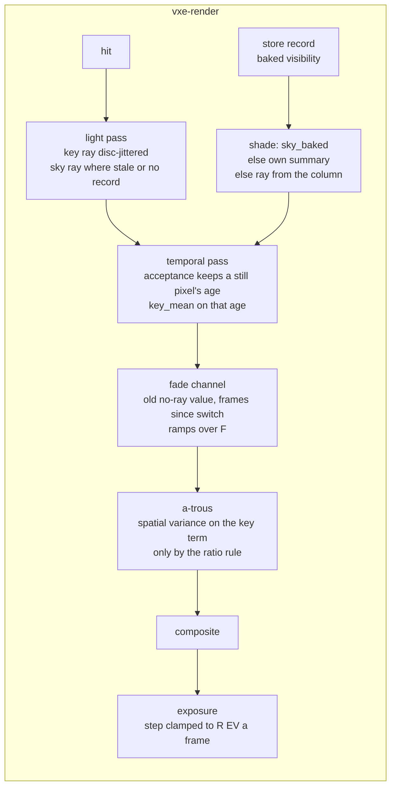

# 0094: The light's transitions: the key mean's age at a still camera, the no-ray sky prior and its fades, the exposure's rate, the dig's hole band, and the castle's fill-in

> **Status:** in-progress (approved 2026-11-19: the owner: "lets run 94 right away"; question 2, the exposure rate, on its recommendation, 1/32 EV a frame, the owner judging it at Phase 7)
> **Created:** 2026-11-19
> **Milestone:** M10: Outdoors in [`docs/roadmap.md`](../roadmap.md)
> **Related ADRs:** [ADR-0076](../adrs/0076-light-stability-rules-world-history-per-source-a-fade-per-transition-and-a-ratcheted-pop-counter.md)
> (proposed with Plan 0090: the five rules; rules 2, 3 and 5 are this plan's targets, and its
> binding clause is met below under "Where the histories live"),
> [ADR-0070](../adrs/0070-sky-light-is-baked-visibility-coloured-at-read-with-a-long-history-ray-where-stale.md)
> (the sky's baked visibility, the pair, the no-ray path this plan changes the prior of; its
> close adds an Outcome naming the prior as built),
> [ADR-0053](../adrs/0053-a-light-summary-per-block-and-a-two-level-parent-table-light-a-brick-with-no-value.md)
> (the fallback chain whose neighbour summaries leave the sky channel),
> [ADR-0033](../adrs/0033-eye-adaptation-as-an-asymmetric-two-stage-exposure-on-the-gpu.md)
> (the exposure whose step gains a rate cap),
> [ADR-0018](../adrs/0018-direct-light-per-pixel-one-sample-from-a-hit-buffer-with-svgf-history-killed-by-edits.md)
> (the temporal pass whose acceptance and age the key mean rides),
> [ADR-0046](../adrs/0046-static-emissive-light-is-baked-per-chunk-when-a-chunk-loads-or-changes.md)
> (`FADE`, the one fade length). No new ADR: every tradeoff here is decided by a reading
> inside a rule an accepted or proposed ADR already states.
> **Source:** Plan 0086's "The follow-up plan's scope" (its Followups section, the wrap-up
> amendment of 2026-11-19, items 1 to 9), its amendments "after the castle's stop" (the fill-in
> charter), "after the 86c window", "after the fix pass", "the wrap-up", "Phase 25's two
> calls" and "the owner's two answers after the slowdown" (2026-11-19: the light pass's
> compile cost and three regressions against its Phase 5 bars, routed here), its struck Phases
> 24a (the bands bar), 24f and 24g, its readings log (`docs/plans/logs/0086.md`, Phases 24a to
> 25, "the gate's slowdown" and the resume notes), and the owner's verdicts
> at windows 86c and 86d (`live/window86c/verdicts.md`, `live/window86d/verdicts.md`, with
> `4a-hole-flash.png`, `5b-grain.png`, `6-grain.png`, `7c-anchor-none.png`). Plan 0086 is cited
> by number, not linked: it is **still open** on branch `plan-0086` (tip `23a89c7b` at
> drafting), its file moves to `docs/plans/done/` at its close, and its readings log and
> `live/` are not on main.
> **Starts after:** Plan 0086 closes and merges into main. Nothing here runs on a tree without
> it: every rig, hook and before binary this plan names is 0086's.

## TL;DR

Plan 0086 made the outdoor light still at rest where the bake answers and left four
transitions open, each attributed part-way: the key light's mean through a canopy does not
converge at a still camera (the trunks' residual p99 is 13 to 25 times its mean, the signature
of pixels whose history keeps restarting, not of a mean that is too short); a face with no
record reads its sky from its neighbours' summaries and steps at every landing, which is the
castle's flicker in the shadowed part and the dig's far-wall flash; the auto exposure scales
both; and a dig's hole band flashes on a shadowed slope. This plan reads each one to its cause
first (the age histogram and the history rejections at rest, the observed-over-predicted
residual ratio, the castle's over-8 pixels split by source, the hole band's counters), then
fixes at the cause: the temporal pass keeps a still pixel's age, the chain's neighbours leave
the sky channel and a no-record face seeds its ray from the column, every no-ray value change
rides one fade of `F` frames, and the exposure moves at most `R` EV a frame. No new filter is
built unless the ratio says the variance is the mean's own. ADR-0076 rule 2 (looking away loses
nothing) and rule 3 (every change is one monotonic fade) are the bars; rule 5 (the exposure's
rate) is the cheapest fix and goes first on the castle. One owner window on main judges the
forest, the hills, a shadowed dig and the castle, with `live/bin86d` as the before; the bars
Plan 0086 could not meet (the tunnel's far end, the cave mouth's seal) come back as tests
against the picks. Two items the owner routed here after 0086's gate slowdown ride along: the
light pass's compile cost (+2.85 s a build on lavapipe, about 600 s of the gate, +38 s on a
cold driver cache; the default-off arms leave the default pipeline and the GPU tests get a
persistent pipeline cache) and three regressions against 0086's Phase 5 bars (the pair's mean,
the rare-hit clamp, the dug floor's first frame), attributed beside the canopy work and fixed
in the pair's estimator and the no-ray prior. The first thing a reader sees is Phase 1's age
table; in the window, the lit trunks at a 10-degree sun without grain.

## Context & problem

Plan 0086 closes on the 86c and 86d windows with these left (its wrap-up amendment and its
Followups, verbatim figures):

- **The canopy's grain at rest** (86c 5b "light is grainy after settle", 6 "grain after
  settle"; 86d 5b "still grainy, same as 86c" with `key_history` 256 in, 6 "grainy a bit", the
  penumbrae smoother, the lit trunk sides still grain). Phase 24b's table (`live/p24/b-canopy.log`,
  RTX, quiet): against a 1200-frame reference at 128 frames the forest at `10,180` reads
  trunks p99 61 / mean 4.78 and floor 16 / 0.63; at 15:00 floor 32 / 5.35 and trunks 33 / 2.00;
  the sky alone p99 1; with the sun's jitter off the trunks fall to 6 / 0.25 and 4 / 0.12. The
  residual is the key light's disc sample. Three leads, none read: (a) a converged mean's
  |residual| has p99 about three times its mean (a normal's 2.58 sigma against 0.80 sigma); 13
  to 25 says a subpopulation of young pixels, not a long mean on all; (b) `key_mean` in
  `temporal.wgsl` takes the direct part's age after the gradient's lambda has lowered it
  (`age * (1 - lambda)`) and resets on `!accepted || fresh`, so a lamp-light gradient or a
  fresh flag restarts the key mean too; (c) at a still camera under FSR 2's sub-pixel jitter the
  reprojection's taps at a thin trunk (a cylinder of a few voxels under the 27-voxel smoothed
  normal) land on a neighbour whose normal fails `HISTORY_COS` 0.8, and the pixel restarts. The
  cap cannot show in under 512 frames (at its cap `key_mean` is an exponential mean with
  variance `1 / (2 cap - 1)` of a sample's: 128 frames at cap 256 and cap 64 are the same
  estimator), so the 128-frame run at 256 (62 / 4.93) read nothing.
- **The `absorb` wobble after a turn** (86d 5c: clean after settle, "any view change makes the
  light wobble for 1-2 s"; 86c read about 0.5 s, so the 256 cap lengthened it). The key mean
  restarting at age 0 on every disoccluded pixel with a continuous transmittance's sample
  variance under it: the same view dependence as the first item, ADR-0076 rule 2's violation
  in its plainest form.
- **The dig's hole band on a shadowed slope** (86d 4a and 4b, `4a-hole-flash.png`: "a small,
  very fast bright flicker inside the hole and a bit around it", HUD 16:00, light 3.54 ms).
  Phase 24a's fix removed the view-wide flash (86d 4c on the before: "clearly worse, the whole
  view"); inside the dilated box at N it left 1.169 % at 17:00 and 1.000 % at noon
  (`live/p24/bar2-*.log`), and on RENOIR the ring stays stale two frames (N + 2 inside
  0.907 %). The hole band (within 8 voxels of the box) is printed, never barred. Candidates:
  the hole's own faces on the ray for the frame before the re-bake lands (ADR-0070's ring, by
  design), the contact shadow's seed (`SEED_AGE` 8, the record or the column), the key mean's
  restart on the hole's new faces.
- **Phase 24a's bands bar, restated and struck.** The band form (hole, ring 8 to 64 voxels,
  outside) at noon and 17:00 against 1.5 times the still pairs' max; it waits for the hills'
  own rule 1 reading at 17:00 at rest (today 0.273 to 0.630 % of pixels over 4 with no dig in
  the pair, the key light's sample on the slope under a low sun).
- **The castle's fill-in** (the charter; 86c run 9 on Plan 0083's binary, the before state:
  "fine, but it flickers in the shadowed part"). A whole dig's slots hold no baked visibility
  and no stale bit until the job lands, so `shade.wgsl`'s `sky_chained` answers them from the
  chunk's own summary, else the mean of its six face neighbours' summaries: for a keep chunk
  next to the hill, the hill's open faces, about 1.0, so the walls start lit as outdoors and
  step at every neighbouring landing (386 dig jobs land by the drain). The split reading
  (`flicker::reading::flicker_castle`, three arms): the fresh strip's over-8 mean 3.554 %
  auto, 3.158 % with the exposure pinned, 3.124 % with the key light off too, so the exposure's
  share is 0.396 points, the key light's 0.034 and the no-ray sky path's 3.124; **over 4 the
  exposure's share is 9.6 of 13.9 points**. The largest pairs fall on the frames where the
  chained count drops most (frame 8: 64 483 over 8, chained -6528, one dig landed). The source
  per over-8 pixel was not added. Phase 20 bar 1a on the tip: pair-to-store switches leave the
  band of 4 at 0.03 % with a relative step 0.173 (the line 0.10: (i) owed); pair-to-chain at
  17.54 % (the line 1 %: (ii) owed); chain-to-store 0.06 %. Phase 21 bar 4's band clause: 40
  far-wall pixels over by up to 18 levels at frames 64 and 65, the chain's prior until the dig
  job lands. The plan's regression line: the castle's fresh over-8 mean 3.431 % on 0086's tip.
- **The tunnel's far end** (Phase 25 bar 1, struck; `still::reading::the_tunnel_beside_the_lamp_lit_floor`):
  under FSR 2 at 1.5 over 128 frames the rim band's p99 is 2 against the headlamp's 3 (RTX)
  and 2 (lavapipe), met; the far end (5904 px, sky-ray hits under 0.05) reads 4 against 2 and
  4 against 1, not met; natively the headlamp reads 0 by construction (a fixed light, no
  estimator) and the sky 1. The far end's 4 is unattributed; its light is the baked term
  through the chain, the no-ray prior and the key mean.
- **The cave mouth's seal** (Phase 9 bar 5, Phase 17): `the_cave_mouth_is_lit_from_outside`
  keeps its golden and lost its seal clause, because since Phase 21 (c) the direct part holds
  no sky term and the walls' `direct_accumulated` reads 0 sealed and unsealed. The clause's
  claim stands owed: a sealed cave takes no sky light through its walls. Phase 17's shares on
  the old quantity (24.347 / 8.689 / 1.100 % at `512724cf`) are the before.
- **The light pass's compile cost** (0086's readings log, "the gate's slowdown"; the owner's
  answer 1: accept at 0086's close, fix here). The quiet gate at 0086's tip read 1883.9 s
  against the 19 min line after the column map's flush was fixed (`c682fa9d`); what remains is
  a fixed cost per device's pipelines: every lavapipe test that builds a frame is +2.2 to 2.6 s,
  the fly-through's light-pass build stage 2.6 to 5.4 s against the base's 2.6 to 2.7
  (`live/gate-cause/bis-*.log`: base `8afce1bc` 2617 / 2706 ms frame creation / light stage;
  `ed47dc5c`, Phase 7's closest-approach penumbra spike, default off, 3069 / 4559, the largest
  single step at +1.25 s; Phases 9 to 19 about +0.9, Phases 1 to 5 +0.6; `78fed792` 3565 /
  5532), about 600 s of the gate's wall. On the RTX with a fresh driver cache the release
  start's light-pass stage reads 46.2 s against main's 9.4 (init 67.2 against 29.1 s): the
  first start after an install or a driver update is about 38 s longer. The options 0086
  named: the default-off arms behind a pipeline-overridable constant or in a second pipeline
  built only when picked; a persistent pipeline cache for the GPU tests (the backlog's "A
  pipeline cache for the renderer's shaders"); removing the spike (the cheap-modes rule kept
  it).
- **Three regressions against 0086's Phase 5 readings** (its Phase 25 bar 2,
  `live/p25-bar2*.log`; the owner's answer 2: disclosed there, attributed here). **5.1**,
  `reading::the_visibility_pairs_mean_holds_still`: the pair's mean at frame 65 reads 0.6167
  against the bar's 0.5 within 0.1 (the rig's own hit rate 0.562; frame 64 0.6108, the mean
  over frames 65 to 128 0.5790; Phase 5 read 0.5542 / 0.5442), the largest change 0.0098 under
  1/64. **5.2**, `reading::a_rare_hit_is_clamped`: with the clamp on, one hit lifts the mean to
  0.4993 against the bar's 0.25 (Phase 5 read 0.2500), the mean 0.1511 against the form
  factor 0.029 (5.2 times; Phase 5 read 0.0177): a value of about one half after one sample is
  a pair blending a hit of 1 at age 1, which says the pair reset at the hit (the variance
  reset, or the band's `P_MIN` floor of call 1) rather than clamping it. **5.4's last clause**,
  `the_sky_ray_runs_only_where_stale` (`gpu_outdoor/bars.rs`, soak): the dug floor's centre
  stored `g` reads 24.828 on frame 1 and 3.584 from frame 2 **in both arms, `sky_rays` 1 and
  0** (Phase 5 read 0.000 then 4.047), so it is not the ray's: by the shaders' rules it is the
  no-ray path's prior, the hole's new cells reading the neighbours' summaries until the dig job
  lands, the mechanism of Phase 21 bar 4's far wall and the castle's keep. The clause "nothing
  before the re-bake lands" is printed, not asserted, at 0086's tip.

The owner's rule (2026-11-03, restated 2026-11-18): a stable image first, performance
considered; "a flame may flicker, nothing else may"; the owner judges in windows. Plan 0086's
rule since its Phase 1 holds here: the reading before the mechanism, each defect split before
anything is built, and no filter in front of a cause (its fix-pass amendment, call 1).

`nfr.md` figures touched: section 2 (the temporal pass, the a-trous if (ii) is built, the
light pass during a stamped structure's bake, the exposure pass), section 3 (one small target
for the fade, if the pair has no free channel), section 7 (the gate's wall, already over its
19 min line at 0086's tip, where the cause is 0086's Phase 25 done-when 4 to name; this plan
adds no gate test over the 10 s soak line).

## Decision

We read first and fix at the cause. **Phases 1 and 2 are readings only**, on rigs Plan 0086
built: the key mean's age histogram per class at a still camera, the history rejections per
frame at rest, the residual against its own binomial prediction (a ratio near 1 says the mean's
variance is at its length; well over 1 says the mean is not at its length or the sample is not
the model), the tunnel's far end split by term, the castle's over-8 pixels split by source
(pair, chain, store, exposure) against the landings, and the hole band's counters. **Then the
fixes, each at the cause the reading names, in the rule's form:** the temporal pass keeps a
still pixel's age (rule 2; the fix in the acceptance's normal test at a thin feature, the
taps' weights, or the age's carry, never a filter); a face with no record no longer reads its
neighbours' summaries in the sky channel and seeds its ray from the column (the far field
keeps its converging estimate); every change of a pixel's no-ray value (chain to store, chain
to chain, pair to store) rides one fade of `F` frames in the pair's channels (rule 3, Phase 20
(ii) generalised); the adapted log2 luminance moves at most `R` EV a frame (rule 5, an
`AutoExposure` field with a flag and a settings row); the hole band is barred in rule 3's form
and the ring and the outside in rule 4's. The a-trous's spatial variance on the key term alone
is built only when the trunks' age reads at cap and the 512-frame residual stays over the bar
with the ratio near 1: sample variance no mean can pay for without lag. **One owner window** on
main judges the forest at two suns, the hills at rest, a shadowed dig and the castle, with
`live/bin86d` beside it; a second short look runs only if the window records a defect as not
fixed and a shader changes after it. **The compile cost** is taken before the fixes (Phase 2a):
every default-off arm of the light pass (the penumbra spike, `absorb`, the reading hooks) leaves
the default pipeline, by an override constant where naga and the backends drop the dead branch
(read, not assumed) and by a second pipeline built when the arm is picked where they do not;
the GPU tests keep a `wgpu::PipelineCache` file per adapter and shader hash under `target/`,
kept only if a second start reads at most half the first (amended 2026-11-19 (owner): kept for
hardware adapters, skipped on lavapipe; Phase 2a bar 4). **The three Phase 5 regressions** are
traced in Phase 1 (the pair per frame from its reset, with its seed, age, band and sample, and
the source word for the dug floor) and fixed where the trace points: 5.4 in the no-ray prior
(Phase 5), 5.1 and 5.2 in the pair's estimator (its seed and its reset's rule, Phase 5), each
bar back as the gate test 0086 planned it. The bars Plan 0086 could not meet come back as tests: the
tunnel's far end against a still reference that carries the same jitter (the headlamp under
FSR 2, never the native headlamp), and the seal clause on the pair's term.

We rejected: a longer key history or a wider a-trous as the first move on the canopy (the
tail says young pixels, and a filter in front of a restart hides rule 2's violation); keeping
the neighbours' summaries in the sky channel and fading them (a prior that is wrong by the
hill's whole visibility is not a transition to smooth, it is a wrong value); the column held
with no ray as the default no-record answer (free and binary, wrong by half under an overhang;
read as the second arm, taken only if the ray's cost on the slow adapter is over the line);
the exposure left at ADR-0033's speed with only the light fixed (rule 5 names the exposure as a
source of its own, and the split reads it at 69 % of the castle's over-4 pixels); a native
still reference for the tunnel (degenerate: a fixed light has no estimator and reads 0); and
the unified light cache (ADR-0076 Alternative E: Plan 0090's ratchet reads whether it is
needed).

**Where the histories live (ADR-0076's binding clause).** The key light's visibility mean and
the sky ray's mean stay in the visibility pair, a screen-space accumulation that carries a
world-space estimate's reprojection (the record, else the column, seeds it) and that this plan
makes keep its age at a still camera; the fade's old value lives beside them for `F` frames;
the baked sky visibility lives in the store (ADR-0070); the exposure state is one scalar
(ADR-0033). Every switch this plan touches names its fade: the chain's and the landing's
switches ride the new fade; the exposure's step rides the rate cap; the hole's own faces ride
the pair's seed and the same fade.

## Architecture diagram



## Plan 0090's measures, where they fit

Plan 0090 (the pop counter) is approved and runs after this plan in the recommended order
(owner question 1), so its harness is not on the tree when this plan's phases run. Its
**forms** fit and are used; its **ratchet** does not yet exist and is not waited for:

- **Rule 3's trace classifier** (Plan 0090 Phase 3: `old` the mean of the 8 frames before
  the event, `new` the mean of frames `F + 8` to `F + 16` after it, a pixel breaks the rule
  when any frame leaves `[min - T_fade, max + T_fade]`, classed `flash`, `dip`, `slow`,
  `overshoot`) is the bar's form for the hole band (Phase 6), the castle's landings (Phase 5)
  and Phase 21 bar 4's band clause. It replaces the over-4 share where the pixel's value really
  changes.
- **Rule 4's bands** (the event's region by the hit position, rule 1's test outside) is the
  ring and outside bar (Phase 6), as 0086 restated it.
- **Rule 2's return frame** (a settled pose, a 90-degree turn, a turn back; the frame at the
  return against the settled image within `T_return`) is the `absorb` wobble's and the forest's
  turn reading (Phases 1 and 3).
- **Rule 5's form** (the log2 step per frame at most `R`, monotone toward its target) is the
  rate cap's own test (Phase 4).
- **The source attribution** (the term whose own change is largest, the exposure's share
  applied first) is the castle instrument Phase 2 adds per over-8 pixel.

Phase 1 writes these forms once, as plain functions over per-frame shots in
`apps/flythrough/tests/support/rules.rs`, with no baseline file and no ratchet; Plan 0090's
`tests/support/pops/` wraps them instead of writing a second copy, and this plan's scenes (the
castle's hall, the shadowed dig, the forest at a 10-degree sun) are candidates for its scene
table. The thresholds are Plan 0090's starting guesses until its Phase 5 calibrates them:
`T_still` 4, `T_fade` 4, `T_return` 8, `F` 16. **What does not fit:** the age histogram, the
rejection counts and the observed-over-predicted ratio are convergence diagnostics of one
estimator, not pop counts; no scene of Plan 0090 reads them, and they stay this plan's readings
in `gpu_outdoor`. Likewise the castle's three-arm split (the exposure pinned, the key light
off) is a term split by rig, which the counter's per-pixel attribution approximates but does
not replace.

## Implementation phases

Each phase ships as its own commit. `dev` implements all phases in one session with no review
between phases. The architect reviews once at the end, in a fresh session. Every phase carries
exactly one `**Owner skill:**`. Phases 1 to 6 are **exploration** before the window (lane rule
2b): they name readings and the tests of data, determinism and mechanism; the image bars and
goldens against the picks are Phase 8's. Readings run as release tests on the RTX 3080 Laptop
under the exclusive perf lock with the load named (the dev reference; the RADV RENOIR is the
slow adapter for cost lines); a bar every phase names the `gpu_*` binary it runs
(`test-changed.mjs --binaries`). Rule-form thresholds are `T_still` 4, `T_fade` 4, `T_return`
8, `F` 16 until Plan 0090 calibrates them. **Amended 2026-11-19 (architect), on Phases 1 and
2's caveat:** a second `Frame` on one rig did not drain its bake queue in 30 000 frames in
the hills' arms, the castle's arms (b) and (c) and the forest's turn, and the undrained
arms read up to 16 % where the drained read under 1 %. So from here **every arm of a reading
runs in its own process** (a fresh rig, `live/p1-run.sh`'s form), every table keeps its
"queue drained" column, and a reading whose queue did not drain is printed with that word
beside it and is never a bar's value. The cause (the queue, or the rig) is a followup, not
this plan's.

### Phase 1: The readings, the key light's side: the age at a still camera, the ratio, the hills at rest, the tunnel's far end by term
- **Owner skill:** dev
- **What:** Plan 0086's Phase 24f bar 1 as written, and the far end's split, on rigs that
  exist (`canopy::reading::the_canopy_residual`, `LightHooks::key_no_jitter`,
  `Frame::read_history_rejections`, `flicker::reading::flicker_dig_split`,
  `still::reading::the_tunnel_beside_the_lamp_lit_floor`; the binaries `live/p24/gpu_outdoor_b`
  and `gpu_outdoor_bi` as the before). (1) On both forest scenes (`10,180` under `voxel`; 15:00
  at the treads), the defaults, a still camera, the queue drained, per class (floor, trunks) at
  frame 128: the age histogram of the lighting pixels (`moments_out.z`: the shares under 16,
  under 64, at 128), the history rejections per frame at rest per word, and the residual
  against its own prediction: per pixel the binomial standard error at the reference's `g`
  over the pixel's effective sample count (its age, or `2 cap - 1` at the cap), in levels of
  the pixel's key term; per class the observed RMS residual over the predicted. (2) The same
  table at 512 frames at cap 256 and cap 64 beside it (24f bar 2), the pop share over the last
  32 pairs. (3) The hills at 17:00 at rest (24a's still pose, no dig): the still pairs' over-4
  share with the sun's jitter on and off (24f bar 6). (4) The tunnel's far end: Phase 25 bar
  1's rig with the far end's p99 split by term, the pair's sky (`sky_rays` 0 against 1), the
  key mean (`key_off`), the chain's no-ray prior (the store's source word per pixel), with the
  age histogram and the rejections over the far end's 5904 pixels; the rim band printed
  beside. (5) The `absorb` wobble in rule 2's form: the forest at sun 60 under `absorb`,
  settled, a 90-degree yaw over 10 frames, held 64, back over 10: the share of pixels over
  `T_return` at the return frame and the frames until the rule 1 share is back at the settled
  strip's, `voxel` beside it. The rule forms go in `tests/support/rules.rs` (rules 1 to 4 as
  functions over per-frame shots; the trace classifier's four classes). (6) **The three Phase
  5 regressions traced.** On 0086's own rigs (`reading::the_visibility_pairs_mean_holds_still`,
  `reading::a_rare_hit_is_clamped` in `gpu_sun`, `the_sky_ray_runs_only_where_stale` in
  `gpu_outdoor/bars.rs`): per frame at the rig's pixel the pair's four channels (the mean, the
  key mean, the short mean, the age), the seed it started from and its source (the record, the
  column), the sample, whether the band's reset fired and the clamp's bound that frame; for
  5.4 the stored value and the sky term's source word (own summary, neighbours' summaries,
  record) on frames 1 to the landing, in both arms. The candidates, named so the trace refutes
  them: 5.1, the seed's prior lifting the early mean (the column reads open above the roof's
  edge) or the band's `P_MIN` floor; 5.2, the variance reset firing on one hit over a
  near-zero mean (a reset pair at age 1 reads about one half, which is the 0.4993) instead of
  the clamp; 5.4, the neighbours' summaries on the no-ray path (the same in both arms says
  no ray is involved).
- **Files touched:** `apps/flythrough/tests/gpu_outdoor/canopy.rs`, `gpu_outdoor/still.rs`,
  `gpu_outdoor/flicker.rs`, `gpu_outdoor/bars.rs`, `crates/vxe-render/tests/gpu_sun.rs`,
  `apps/flythrough/tests/support/rules.rs` (new), `tests/support/defects.rs` (the age and the
  source word per pixel, if not at hand), `docs/plans/logs/0094.md`.
- **Done when:**
  1. **The age table is in the log:** both scenes, both classes, the three age shares, the
     rejections per frame at rest per word, the observed-over-predicted ratio per class at 128
     and 512 frames at both caps, and one line that says whether the trunks' mean is at its
     length. The lead it names is one of (a), (b), (c) or a fourth, by the counter that moved
     (a share of trunk pixels under age 64 at frame 128 over 1 % names a restart; a ratio
     between 0.7 and 1.5 with the ages at cap names the sample; outside both, the dev stops with
     the table for the architect).
  2. **The hills' rest reading is in the log:** the 17:00 still pairs' over-4 share with the
     jitter on and off, and one line of attribution (the expectation: the key light's sample on
     the slope; off, under 0.1 %).
  3. **The far end's split is in the log:** the far end's p99 per term, its age histogram and
     rejections, and one line naming the term that carries the 4 (the pair's sky, the key
     mean, or the chain), so Phase 3 or Phase 5 owns it.
  4. **The wobble is a number:** the `absorb` and `voxel` return-frame shares and the frames to
     settle, in the log.
  5. `tests/support/rules.rs` has a CPU unit test per form on constructed traces (under 1 s
     each: a flash above `max + T_fade` is `flash`, a trace that reaches `new` at frame `F + 1`
     is `slow`, a return frame 9 levels off is counted, a pixel outside the region moving 5 is
     counted).
  6. The readings' wall and load on the RTX in the log (no gate test is added by this phase but
     the unit tests).
  7. **The three regressions are attributed:** the three traces in the log, each with one line
     naming its cause by the channel that moved (5.1 the seed's value against the first
     samples, or the band; 5.2 the reset's frame and the pair's age after it; 5.4 the source
     word on frame 1) and the phase that fixes it (Phase 5 for all three as the candidates
     stand; another if the trace says so, named).

### Phase 2: The readings, the no-ray path's side: the castle's pixels by source, and the hole band's counters
- **Owner skill:** dev
- **What:** (1) The castle instrument the charter owes: `flicker::reading::flicker_castle`
  gains, per over-8 pixel of the fresh strip, the source as the pop counter classifies it (the
  exposure's share first from the exposure step, then the term whose own change is largest:
  the pair, the chain, the store) and the transition (the record's state at the hit between
  the two frames: no record, chained from the own summary, chained from the neighbours, baked;
  young; reset; steady), per frame against `digs_baked` and the chained count; the three arms
  as before. The keep's wall pixels (the shadowed part the owner named) are a class of their
  own in the table. (2) The dig's hole band at 16:00 and 17:00 on the shadowed side
  (`flicker_dig_split`, `VXE_SPLIT_TIME`): per pixel within 8 voxels of the box, on the pairs
  ending at N to N + 4, the cast flag, the pair's age (`SEED_AGE` 8 names the seed), the key
  mean's age, the record's state, and the rule 3 trace class from the frame before the dig to
  `F + 16` after the landing; the ring band's edge (8 to 16 voxels) beside it. The three
  candidates are told apart by those counters: the ray on the hole's own faces for the frame
  before the re-bake (cast flag set, the pair at `SEED_AGE`), the contact shadow's seed (the
  pair's `x` far from the record's value at the seed), the key mean's restart (the key age at 0
  on faces that did not change).
- **Files touched:** `apps/flythrough/tests/gpu_outdoor/flicker.rs`, `tests/support/defects.rs`
  (the per-pixel source word and the exposure step per frame, if not at hand),
  `crates/vxe-render/src/frame/baked.rs` (a read-back of the hit's record state, if the words
  are not reachable), `docs/plans/logs/0094.md`.
- **Done when:**
  1. **The castle's table is in the log** with the fresh strip's over-8 and over-4 pixels by
     source and transition per arm, the keep's walls as a class, and the series against the
     landings; one line names the first mechanism to build by share (the expectation from the
     split: the exposure first over 4, the chain's prior and the landings over 8).
  2. **The hole band's table is in the log** at both clocks with the counters per candidate
     and the rule 3 class shares; one line names the candidate, or names two with their shares.
  3. The fresh over-8 mean on this tree's arm (a) is printed against the regression line
     3.431 % as a reading (two readings of one binary differed by 0.167 points in 0086's log,
     so a difference under 0.2 points is noise).

### Phase 2a: The light pass's compile cost: the default-off arms out of the default pipeline, a pipeline cache for the GPU tests
- **Owner skill:** dev
- **What (the owner's answer 1 at 0086's close, 2026-11-19):** it runs before the fixes so
  they land on the split pipeline and every gpu run from here pays less. (1) **The inventory:**
  the light pass's arms that are off by default, from `light.wgsl`, `sky_light.wgsl` and
  `walk.wgsl`'s `PASSES` rows: the closest-approach penumbra spike (`--penumbra approach`),
  the `absorb` canopy walk, the reading hooks (`key_off`, `key_no_jitter`, the steps view's
  counters, the history-any hook), each with its branch's size. (2) **The mechanism, read not
  assumed:** first an `override` constant per arm (WGSL pipeline-overridable constants; naga
  emits a specialization constant on Vulkan and substitutes the value on the other backends)
  with the arm's code under `if` on it; the light-pass build stage is read on lavapipe and the
  RTX with the overrides at their defaults. Where the stage falls to the bar, that arm is
  done; where it does not (a backend compiling the dead branch), the arm's text leaves the
  default module and a second shader source is composed when the arm is picked, its pipeline
  built on the setting's apply (Plan 0069's apply class; the build is on the frame thread, its
  hitch read and disclosed; moving it to a worker is Plan 0092's seam when it lands). The
  default-off arms keep their flags, rows and banner words (the cheap-modes rule, 2026-11-12):
  nothing is removed. (3) **The pipeline cache for the GPU tests:** the test support's device
  helper opens a `wgpu::PipelineCache` from a file under `target/vxe-pipeline-cache/<adapter
  name and driver>/<hash of the shader sources>.bin` when the backend supports it (Vulkan:
  lavapipe and the RTX; absent otherwise; amended 2026-11-19 (owner): hardware adapters only,
  bar 4), passes it to every pipeline descriptor, and writes
  it back at the device's drop; a missing or stale file is a cold start, never an error. The
  engine's own cache under a game's cache directory stays the backlog's ("A wgpu pipeline cache
  owned by the engine"). The cache is kept only if it pays (bar 4); a cache that does not is
  removed in the same phase and the log says why.
- **Files touched:** `crates/vxe-render/src/shaders/light.wgsl`, `sky_light.wgsl`, `walk.wgsl`
  (the override constants or the arms' modules), `frame/pipelines.rs` (the overrides, the
  second pipeline), `frame/settings.rs` (the apply class of the arms' settings),
  `crates/vxe-render/src/internals.rs` or its shader-source listing (the composed default
  source), `apps/flythrough/tests/support/mod.rs` and `crates/vxe-render/tests/support/*` (the
  cache file), `crates/vxe-render/tests/gpu_frame.rs`, `apps/flythrough/src/run/*` (the stage
  lines, if a new one is needed), `docs/plans/logs/0094.md`.
- **Done when:**
  1. **The default pipeline compiles none of the arms.** A CPU test over the default
     pipeline's composed WGSL (`internals::shader_sources()` as `pipeline_times` reads it;
     under 1 s): the spike's and `absorb`'s function names are absent from the default source,
     or present only under an `override` that reads false, with the mechanism per arm named
     in the log.
  2. **The build stage is back near the base.** The fly-through's stage lines on lavapipe
     (0086's rig, `live/gate-cause/lvp-stage-*.log`'s flags, debug; three runs each): the
     light-pass build stage at or under 3.0 s and frame creation at or under 3.0 s (the base
     `8afce1bc` read 2.6 to 2.7 s each; the tip 5.5 and 3.6), with the arms at their defaults;
     with `--penumbra approach` picked, the arm works (its own test by name) and the extra
     build is read and printed. On the RTX release with a fresh driver cache
     (`__GL_SHADER_DISK_CACHE_PATH` to an empty directory, `--source outdoor --render 1280x720`)
     the light-pass stage at or under 15 s (main 9.4 s, 0086's tip 46.2) and init done at or
     under 35 s (main 29.1, the tip 67.2).
     **Amended 2026-11-19 (owner):** the lavapipe half is **accepted at its reading**: with
     every default-off arm of the walk out of the default light pipelines (`ae8d0722`, the
     arms between markers that `compose` drops) the light stage reads 3.66 to 3.74 s against
     5.11 to 5.16 before, frame creation 3.19 to 3.35 against 3.36 to 3.50 (debug, three runs
     each, `live/p2a/lvp-*.log`); the 3.0 s bar is not met, and the rest of the cost is
     default-on code (the arms' text removed outright read the same 3.6 to 3.7 s). The 3.7 s
     stands as the phase's reading; the remainder (about 1.0 s over the base's 2.7) goes to the
     backlog's "A pipeline cache for the renderer's shaders" entry, not to this plan. The RTX
     cold-start half of this bar is still owed as written.
     **Amended 2026-11-19 (architect), the RTX half read:** release, an emptied driver cache
     per run, load 3.9 to 5.9: the light stage 16.5 to 18.1 s and init done 36.6 to 39.2 s
     against the bar's 15 and 35, with `bin86d` at 43.0 and 71.0 s in the same session (a cut
     of 60 %; main's 9.4 / 29.1 were read at an unrecorded load). **Accepted as the loaded
     reading;** the bar's figures are re-read once, quiet (load under 2, the same binary form,
     `bin86d` beside it), in Phase 8 bar 5's quiet session, and a remainder over 15 s there
     goes to the same backlog entry as the lavapipe remainder (default-on code), not back to
     this phase.
  3. **Every arm still works when picked, and the default image is unchanged.** The tests that
     pick an arm pass by name (`gpu_sun`'s penumbra tests, 0086 Phase 14's `absorb` test,
     every test that sets a `LightHooks` bit: `--binaries gpu_sun,gpu_outdoor,gpu_frame`); the
     goldens are byte-identical (`gpu_golden`, `gpu_outdoor_golden` by name); the banner tests
     unchanged.
  4. **The cache stays for hardware adapters and is skipped on lavapipe.** **Amended
     2026-11-19 (owner)** on the reading (`gpu_frame` `reading::the_pipeline_cache_pays`,
     release, the lock): llvmpipe cold 5852 ms, warm 5682 (0.97), 84 B of data, so the cache
     holds no compiled code there; the RTX cold 29 436 ms against an empty driver cache, warm
     236 (0.01), 2.0 MB of data, cold again 395 ms off the driver's own disk cache. The test
     supports' device helper opens the cache file only when the adapter is a hardware device
     (`DeviceType::Cpu` skips it: lavapipe and any software adapter pay a write for nothing),
     and the test asserts both halves: on a CPU adapter no cache file is opened or written
     (the gate's form, under 1 s of added wall); on a hardware adapter the warm creation is at
     most a quarter of the cold against an empty driver cache (the RTX's reading 0.01; the
     phase's RTX run, named in the log). The cache file's absence or corruption is a cold
     start (the test deletes and truncates it once each). The 0.01 is also the reading the
     backlog's engine-side entry ("A wgpu pipeline cache owned by the engine") asked for: the
     cold first start after an install or a driver update (46.2 s at 0086's tip) is what the
     engine's own cache would cut; that cache stays the backlog's, with the reading recorded
     there.
  5. **The gate's wall falls by the compile's share.** The gpu tier's four cheap binaries
     (`gpu_exposure`, `gpu_frame`, `gpu_sky`, `gpu_walk`; 0086's broad reading: 143.7 s main,
     242.5 s tip, 31 tests) re-read quiet at this phase's tip: at or under 170 s (a guess: the
     base plus the 112 tests' own growth); the per-test delta against the tip printed. The full
     quiet gate is Phase 8 bar 5's.
     **Amended 2026-11-19 (architect):** the 170 s line assumed bar 2's 3.0 s; with the stage
     accepted at 3.7 the cut is about 1.4 s a frame-building test, 31 tests, so the line this
     phase can meet is **about 200 s** (242.5 less 43). Read loaded (7.9 falling to 3.4):
     212.5 s, of which one test rose 19.7 s in the run's first minute at load 7.9 and 27 of
     31 are within 0.5 s of the tip or lower; without the outlier 193 s. **Accepted as the
     loaded reading against the 200 s line;** the quiet value is Phase 8 bar 5's
     `test-times.mjs` per binary. The cache lives in `vxe-render`'s `test_support.rs`, which
     both supports' device helpers call (the disclosed deviation from Files touched; the
     right place, one copy).

### Phase 3: The key mean keeps its age at a still camera
- **Owner skill:** dev
- **What:** the fix at the cause Phase 1 bar 1 names, in the temporal pass, no filter and no
  new target: lead (b), the key mean's age taken before the gradient's lambda lowers it and
  its reset narrowed to the direct history's own reset (an edit box, a view change, no
  accepted tap), not to `fresh` where the key light's visibility did not change; lead (c), the
  acceptance at a thin feature (the normal test against the tap's smoothed normal where the
  pixel's own differs by the jitter alone, the taps' weights, or the pixel's own previous age
  carried where the view did not move); or the fourth the table names. If the cause is outside
  the temporal pass (the light pass's `fresh`, the hit's normal under the jitter, the
  upscaler), the dev stops with the table for the architect. Then the 512-frame residual
  re-read at cap 256 (24f bar 4), the `absorb` and `voxel` return reading re-taken, the far end
  re-read if Phase 1 bar 3 named the key mean. (ii), the a-trous's spatial variance estimate on
  the key term alone at a converged age (SVGF's, ADR-0018), is built only when the trunks' age
  reads at cap after the fix and the 512-frame residual stays over the bar with the ratio
  between 0.7 and 1.5, and never in the same commit as the age fix.
  **Amended 2026-11-19 (architect), on Phase 1's table and the owner's words of the same day
  ("light that is not still can be approximated around area and settle exit early; we don't
  need super precision if it becomes flicker").** The table names lead (c): the normal test
  resets 416 of 14 229 tested hits a frame at a still camera (2.93 %), 4.67 % of the trunk
  pixels are under age 64 at frame 128 (the 1 % line), and the ratio reads 0.94 to 1.36 with
  the rest of the ages at cap, so the residual that remains once the restarts stop is the
  estimator's own variance at its cap (the display residual at 512 frames, cap 256: trunks
  p99 15 to 30, mean 0.99 to 5.10, over the 8 / 2 bar). Two consequences. **First, the restart
  fix stays and comes first:** a rejection at a still camera is rule 2's violation and costs
  nothing to remove; smoothing young pixels in front of it (the owner's "approximate around
  area") would hide a wrong rejection at a cost and pool a thin trunk's pixels with the sky
  and floor beside it. The recommended form is lead (c)'s cheapest: at a still camera (the
  view matrix unchanged, the jitter aside) the reprojection's tap is the pixel itself, with
  its own previous normal, age and pair, so no neighbour's normal is tested; the tunnel's far
  end (Phase 1 bar 3: the key mean) is re-read, definitely, not conditionally. **Second, the
  settle (the owner's "exit early") replaces (ii) as the next arm, before any filter:** a pair
  whose age is at its cap and whose last `F` samples all lie inside its variance band stops
  blending (its age channel holds a value above the cap as the mark; both means hold; the
  sample and the band test still run every frame, so the cost is a compare); it unfreezes
  when the band is left as the reset rule already defines it (a real change: an edit box, a
  moving shadow edge, the sun's clock drifting the samples out of the band) or when the pixel
  is disoccluded or its history rejected, and the new value rides rule 3's fade from the held
  one. At rest the frame-to-frame change of a settled pixel is then 0 by construction, and
  what remains against the 1200-frame reference is a **still grain** (the estimator's value at
  the frame it settled, sd about `sqrt(g (1 - g) / (2 cap - 1))`, 0.03 in `g` at cap 256 and
  `g` 0.5), which the owner judges by eye in Phase 7 run 1 beside `bin86d`. (ii) is demoted to
  Phase 8's: built only if the owner's word in the window is that the still grain reads as
  dirt, never on the ratio rule alone. The settle covers both of the pair's means (the key
  mean and the sky mean) in one mechanism, so Phase 5's switches are its unfreeze cases and
  need no second rule; it lives in `temporal.wgsl`'s pair update and the age channel, 0 B.
  The settle is a new stability rule (an estimator at rest holds by construction, not by its
  cap) with a rejected alternative ((ii), a filter at a converged age at +0.4 ms on the slow
  adapter), so it is an ADR-0076 rule the architect writes at the window's verdict (ADR-0076
  is still proposed with Plan 0090; the backlog's "Settle early" entry holds the candidate);
  the dev proceeds on it as a measured arm with a flag (`LightHooks::no_settle` or a settings
  row under the cheap-modes rule) so Phase 7 can show both.
  **Amended 2026-11-19 (architect), after the Phase 3 stop (`074ff2c5`, the log's Phase 3).**
  Four calls, one recommended option each.
  (1) **The still camera's own tap, accepted without the material, normal and position tests:
  kept as built, option (b).** The waiver is the history's, not a light's: the footprint of a
  still pixel is the frame before's, whatever lights it, and a lamp-lit scene has the same
  restarts (the backlog's fired-lights grain is the same family). With the position test kept
  the rejections stayed at 114 a frame and the trunks under age 16 at 3.02 %, over bar 1's
  line; without it 12.7 a frame and 0.17 %, met. Limiting the waiver to the key light (a)
  would keep a rule 2 violation under every lamp; (c) misses the bar. Bar 5's clause "the
  lamp-lit goldens are byte-identical" was this plan's assumption, not a reading, and is
  struck: the two FSR 2 goldens that moved (21.9 and 19.5 % of pixels) are read for
  **magnitude and direction** before Phase 8 re-blesses them: the difference against the old
  golden as a histogram (p99, the share over 4) and the new and old images each against a
  512-frame reference of the same rig (the expectation: the new image is the nearer, since
  fewer pixels restart), with the settle off so the two changes are split (the wip ran both
  on). Phase 8 re-blesses them as a disclosed change with those numbers.
  (2) **The settle: fixed in form, not dropped.** The design as built (the key samples' short
  mean in the pair's `b` as `-1 - b`, the in-band count above the cap in `a`, at stored faces
  with no sky ray; `pair_step` for the sky mean) is a fair exploration encoding, with two
  faults the readings show. **The likely cause of the return frame's 38 % against 22 % and
  of the under-64 share doubling (0.17 to 0.34 %) with the settle on:** `key_settle` runs its
  band test at **every age**, and a key mean just reset holds one binary sample, so a penumbra
  pixel's second sample leaves the band at `g` near 0 or 1 (the band there is
  `3 sqrt(0.02 * 0.98 / 8)`, 0.15 in `g`; a short mean of 0.5 after samples 0 and 1 is 0.5
  away) and the fall returns `age = m - 1`, 1: the key mean is held young frame after frame
  and the direct part's history age falls with it. Every pixel that re-enters the view on the
  turn back (0 to 9 frames of history at the return frame) is in that state, which is the 38 %;
  at rest the 12.7 restarts a frame feed the same loop, which is the doubled young share and
  the unchanged pops (the 7 % unsettled pixels carry them). The trace that confirms it: the
  key mean's `age` per frame at a returned penumbra pixel, printed. **The form:** the settle's
  band is tested only **at the cap** (a settled pixel or one about to settle; a young key mean
  follows `key_mean` unchanged, as the plan wrote it: "a pair whose age is at its cap and whose
  last `F` samples all lie inside its band"); a release needs the band left on
  `SETTLE_RELEASE` 4 **consecutive** frames (a 3-sigma run at rest is 1 in 10^10 a pixel, so
  the hills' 28.9 releases a frame at rest fall to about 0; a real change of more than the band
  is seen in 4 frames), and a released mean moves toward its short mean at `1 / F` a frame
  (rule 3's fade, Phase 5 (2)'s form) and restarts its count; **the direct part's history age
  is never written by the key path** (the lamp's history is not the key light's to reset).
  The encoding's second fault: the reprojection's bilinear taps blend a negative `b` (a no-ray
  pixel's key short mean) with a neighbour's positive `b` (a cast pixel's sky short mean) at
  the edge of a stale ring, and `cap + count` with a plain age; a tap whose kind (the sign of
  `b`) differs from the pixel's own is read as its `x` and its age as the cap, or the tap is
  dropped from the pair's blend, the dev's pick; Phase 5 decides whether the fade's new target
  (if the pair's `b` cannot be retired) carries the key short mean and the counts instead, so
  the sign trick is Phase 5's to retire or keep. **Then the readings re-taken, one arm a
  process:** the ages table on and off (the under-64 share on within 0.05 points of off), the
  turn's return frame on and off (on at most off plus 2 points, the noise between two `voxel`
  runs read 0.5), the pops with 93 % settled (the expectation: under 0.1 % on the trunks, since
  the carriers were the young loop), the tunnel's far end on and off (its under-64 share rose
  from 0.15 to 6.55 % in the wip, the same loop), and bar 2's reset tests by name. **The stop
  rule, said plainly:** if after this form the return frame on is still over off by more than
  2 points, or the pops do not fall with 93 % of pixels settled, the settle leaves this plan
  for the backlog's "Settle early" entry with the readings, and Phases 4 to 8 run without it
  (the flag's default off). The owner likes the idea; it is kept as long as the readings let
  it be, and dropped only on a number, which this says in advance.
  (3) **The clock reading** (Flash 1.67 % over the 1 % stop line, the hills' queue not
  drained in 30 000 frames even alone): not a bar value and not a stop. The release form
  above changes what it reads (every release in the wip is the 3-sigma band on one short
  mean), so it is re-read after (2); its precondition is not "drained" but **the queue at a
  steady depth** (the depth printed per frame over the strip, within one job of its mean; a
  clock that runs may re-queue by design, and a reading that waits for a drain that never
  comes reads nothing), with the depth's series beside the table. The 1 % Flash line stands
  on the re-read; over it with the 4-frame release, the dev stops with the table.
  (4) **The window's switch:** the settle is a render setting under the cheap-modes rule, not
  a hook alone: a `RenderSettings` row (`settle`, default on while (2) holds), the CLI flag
  `--settle on|off` through `--check-args`, the banner word `settle off` when not the default
  (nothing when it is), the row in `docs/flythrough.md`; `LightHooks::no_settle` stays as the
  tests' bit. Bar 6 below.
- **Files touched:** `crates/vxe-render/src/shaders/temporal.wgsl`, `shaders/atrous.wgsl` (only
  (ii)), `crates/vxe-render/tests/gpu_sun.rs`, `apps/flythrough/tests/gpu_outdoor/canopy.rs`,
  `frame/settings.rs` (the settle's flag, amended 2026-11-19), `apps/flythrough/src/cli/*`,
  `hud/modes.rs`, `docs/flythrough.md` (the setting, its flag and banner word, amended
  2026-11-19), `docs/plans/logs/0094.md`.
- **Done when:**
  1. **A still camera keeps its age.** `a_still_camera_keeps_its_history` in `gpu_outdoor.rs`
     (the forest at `10,180` under `voxel`, 64 still frames at 160 x 90 under FSR 2 at 1.5, the
     queue drained; about 5 s on lavapipe, in the gate; the 320 x 180, 128-frame form as a
     reading): after 64 still frames the share of trunk and floor pixels whose history age is
     under 32 is at or under 1 % (the before's share printed from Phase 1's table: trunks
     4.67 %, floor 1.08 % under age 64), and the history rejections per frame at rest are
     under a tenth of the before's (416 normal and 37 other of 14 229 tested a frame, so at
     most 45 in all; amended 2026-11-19 (architect) with the figures). The settle is off for
     this bar (it reads the ages, which the settle holds at the mark).
  2. **Every rejection the fix narrows is still defended.**
     `a_moving_entity_leaves_no_ghost_and_no_stale_shadow`, `a_moving_shadow_edge_resets_the_history`,
     `a_reset_between_steps_restarts_the_history`, the disocclusion rigs and Phase 3's
     `reading::a_far_staircase_keeps_its_history` of Plan 0086 read as before, by name
     (`gpu_sun`, `gpu_outdoor`, `gpu_entity_*` under `--binaries`); the rejection the fix
     narrows is named in the log with the test that still defends it.
  3. **The canopy's light converges at rest.** `the_canopy_light_converges_at_rest` (both
     scenes, 512 frames at 320 x 180 against the 1200-frame reference; a release reading on
     the RTX for the phase, written `#[ignore = "soak"]` if its lavapipe wall is under 5 min,
     else a reading named in the log): the residual's p99 at or under 8 levels and its mean at
     or under 2 on the floor and on the trunks, and the pop share per pair at or under the
     lamp-lit forest floor's (0.195 %); or, over the bar, the trunks and the floor within a
     factor of 2 of each other with the ratio between 0.7 and 1.5, disclosed, and (ii) built
     and the bar re-read with (ii)'s cost (a guess: +0.05 ms RTX, +0.4 ms RENOIR in the
     forest). The guesses stand at `T_still` 4's scale until Phase 8 pins the window's value.
     **Amended 2026-11-19 (architect):** the same reading is taken with the settle on and
     off, both arms printed in one table: with it on, from the frame the last pixel of each
     class settles (printed; the expectation: within `cap + F` frames of the restart fix) the
     pop share per pair over the trunks and the floor is 0 and the frame-to-frame p99 is 0;
     the residual against the reference (mean, p99) is the **still grain**, printed, not
     barred, for the owner's eye in Phase 7. The "(ii) built" clause moves to Phase 8 by the
     owner's word; this phase builds no filter. One more clause, the settle's release:
     `a_moving_shadow_edge_resets_the_history` and `a_reset_between_steps_restarts_the_history`
     pass by name with the settle on (a real change still moves a settled pixel), and a new
     reading on the hills at 17:00 with the clock running at 1x for 60 s (`VXE_SPLIT_TIME`,
     the hills rig): the settled pixels' releases per frame and the rule 3 class of their
     traces (the expectation: the sun's drift releases a pixel when its samples leave the
     band, and each release is one `Fade`; a `Flash` share over 1 % names the band too narrow
     for the settle, and the dev stops with the table).
  4. **Turning away loses less.** The `absorb` and `voxel` return-frame shares and frames to
     settle after the fix, in the log against Phase 1 bar 4; `absorb` stays a non-default
     setting with its light pass disclosed (the backlog's entry), and `docs/flythrough.md`'s row
     names what is left of the wobble.
  5. **Nothing moves elsewhere.** `sky_rays` 0 and the lamp-lit goldens (`gpu_golden`) are
     byte-identical; the outdoor goldens a temporal fix moves are named with counts for Phase
     8; `frame_bytes` unchanged; the temporal pass's cost on both adapters at the forest spawn
     within noise of `live/bin86d`'s (the cost rig `live/p24f/cost86.sh`). **Amended
     2026-11-19 (architect):** the byte-identical clause is struck for the goldens the still
     camera's own tap moves (two FSR 2 lamp-lit goldens in the wip, 21.9 and 19.5 % of
     pixels); each moved golden is named with its difference histogram (p99, the share over
     4) against the old image and its distance to a 512-frame reference against the old
     golden's, read with the settle off, for Phase 8's re-bless. Goldens that neither change
     touches stay byte-identical.
  6. **The settle is reachable in the window** (added 2026-11-19 (architect)): `--settle off`
     is accepted by `--check-args`, the settings row round-trips (Plan 0069's setter test
     lists the field), the banner test pins `settle off` when set and nothing at the default
     (CPU, under 1 s), and `docs/flythrough.md` carries the row; `--settle on` and the
     default read the same ages table.

### Phase 4: The exposure moves at a bounded rate (ADR-0076 rule 5)
- **Owner skill:** dev
- **What:** `step_adapted`'s result clamped so the adapted log2 luminance moves at most `R` EV
  toward its target per frame, from an `AutoExposure` field in EV per second (`rate_ev_s`;
  frame-rate independent, applied as `R = rate_ev_s * dt` with `dt` the frame's own, capped at
  one frame's worth at 15 fps so a hitch does not step), a CLI flag `--exposure-rate` and a
  settings row with its mode shown on the banner when not the default; 0 disables the cap.
  The default is owner question 2's (the recommendation 1.875 EV/s, 1/32 EV a frame at 60 Hz).
  Young pixels stay in the meter (0086's first amendment rejected the exclusion: a block-less
  scene would hold its exposure). Then the castle's fresh strip re-read with the cap (Phase 2's
  instrument, arm (a) against arm (b)).
- **Files touched:** `crates/vxe-render/src/shaders/exposure.wgsl`, `crates/vxe-render/src/exposure.rs`,
  `frame/settings.rs`, `crates/vxe-render/tests/gpu_exposure.rs`, `apps/flythrough/src/cli/*`,
  `hud/modes.rs`, `docs/flythrough.md`, `apps/flythrough/tests/gpu_outdoor/flicker.rs`,
  `docs/plans/logs/0094.md`.
- **Done when:**
  1. **A step is bounded.** `a_light_on_steps_the_exposure_by_at_most_the_rate` in
     `gpu_exposure.rs` (a 64 x 36 scene, the headlamp off then on at frame 8, 48 frames; about
     2 s): with the rate at 1.875 EV/s and `dt` 1/60 the adapted log2 moves at most 1/32 EV a
     frame within 1/256 EV, monotonically toward its target, and reaches within 1/64 EV of a
     2 EV target by frame 8 + 64 + 2; with the rate 0 the trace is ADR-0033's (reaches within
     1/64 EV by the frame its 0.15 s says); the trace is printed.
  2. **A still scene does not move.** The same rig with no light change: the adapted log2
     within 1/64 EV over the settle (rule 5's still clause), asserted.
  3. **The castle's over-4 pixels fall by the exposure's share.** Phase 2's table re-read with
     the cap at the default: the fresh strip's over-4 mean within 1 point of arm (b)'s (the
     exposure pinned; 4.270 % in 0086's split), the over-8 within 0.5 points, both printed
     against arms (a) and (b) on this tree.
  4. The banner test pins `exposure rate` when not the default and nothing when it is (CPU,
     under 1 s); `--check-args` accepts the flag; the settings row round-trips (Plan 0069's
     setter test lists the field).
  5. **Cost:** 0 ms and 0 B by construction (a clamp on one scalar), stated.

### Phase 5: The no-ray path's prior for a face with no record, and one fade for every no-ray value change
- **Owner skill:** dev
- **What:** (1) **The prior.** `shade.wgsl`'s `sky_chained` and `store_sky_fallback` move
  together: a face with no record and a chunk with its own summary reads that summary; a face
  neighbour's summary no longer answers the sky channel. Where neither the record nor the own
  summary answers, two arms, read on the castle (the keep at the belt), the far field (the
  hills' horizon, 741 rays at rest in 0086's reading) and the forest after a turn: **A**, the
  ray cast, seeded from the column as 0086's call 1 seeds it (the far field keeps its
  converging estimate; the keep casts about 20 000 rays for the bake's length, Plan 0032's
  4.8 ms per 30 000 rays on the RENOIR); **B**, the column's answer held with no ray until the
  bake (free, binary, wrong by half under an overhang). A is taken unless its light pass on the
  RENOIR during the castle's bake is over the lighting line (4.0 ms) by more than the ray's
  share for longer than the bake's length; then B, disclosed. A provisional record written at
  a whole dig's opening (the column's bit per brick direction, `VIS_BAKED` set, no stale bit)
  is B's CPU-side form and covers the stamped chunk but not the dig ring's new cells; it is
  built only if B is taken.
  **Amended 2026-11-19 (architect), after Phase 1 bar 7's 5.4 trace:** the dug floor's frame 1
  reads the chunk's **own** summary (0.988, the hill's open faces), not the neighbours', so
  (1) as written would leave it. The own summary of a chunk with a dig job queued for it
  **predates the edit** and is wrong by the same amount as a neighbour's: for the castle's
  keep (a stamp is a dig job) it is the hill's open faces for the bake's length, 3.8 % of the
  walls' over-8 pixels in Phase 2's table as "switch own summary > record". So the rule is
  **a summary answers only while no job is queued for its chunk**: the dig queue sets the
  summary record's `SKY_STALE` bit at the enqueue (beside `mark_sky_stale` on the slots), the
  landing's bake rewrites the summary and clears it, and `sky_chained` and
  `store_sky_fallback` treat a stale summary as absent, so the chunk's no-record faces take
  the no-record arm (A or B) until the job lands. For a dig that lands the next frame this is
  one frame of the arm's answer; the column above a hole the column map does not resolve reads
  open (5.2's trace), so under A frame 1 reads about the pre-dig value from the seed (8 of 9
  samples), which is continuity, not a defect: **the defect 5.4 names is the step at the
  landing**, and (2)'s fade is its fix. Bar 9 is rewritten below. (2) **The fade.** At a pixel with accepted history whose no-ray
  value changes between frames (chain to store at a landing, chain to chain at a neighbour's
  landing, pair to store at the ring's re-bake) the pair carries the old value and ramps
  linearly to the new over `F` frames (16, ADR-0046's `FADE`; one constant for every source,
  rule 3), in the pair's channels if the short mean's `b` can be retired for it (the dev reads
  its users first; 0086 Phase 21 (a)'s variance band uses it), else in a new `rg16float`
  target on the lighting grid (the old value, the frames since the switch). A real change of
  the world's light then takes rule 3's form instead of its degenerate case. A pixel that
  resets (an edit box, a view change) drops its fade. (3) **(i) by bar 1a's line:** the pair's
  term takes the same normal arm and bounce as the baked read (`sky_baked_term`'s blend applied
  to the pair's visibility) so the pair-to-store switch's relative step (0.173 on the tip, the
  line 0.10) falls under the line; read after (1) and (2), built only if the line is still
  over. (4) The castle strip, Phase 20 bar 1a and Phase 21 bar 4's band clause re-read.
  (5) **The pair's estimator, by Phase 1 bar 7's traces:** 5.4 is (1)'s (the dug floor's
  frame 1 reads the own summary or the column-seeded ray, never the neighbours' 24.8); 5.2 at
  its cause, the reset's rule (a single sample outside the band over a mean near 0 is a
  firefly to clamp, not a world change to reset on: the reset needs the band left on more
  than one consecutive sample, or the band's floor at a near-zero mean widens to the clamp's
  bound; the dev picks by the trace, with `P_MIN`'s reason from 0086's call 1 kept, a block's
  pair at 0 or 1 must still reset when the world changes); 5.1 at its cause, the seed (the
  column's open answer above the roof's edge where the record has none: the seed weighs
  `SEED_AGE` 8 samples, so an open seed over a 0.56 hit rate lifts frame 65's mean by about
  `8 (1 - 0.56) / 72`, 0.05, which with the band's floor is the 0.06 over) or the band.
  Every reset and clamp test of 0086 stays green by name.
  **Amended 2026-11-19 (architect), by the traces:** 5.1 **and** 5.2 are both the column's
  seed (1.0, open, at `SEED_AGE` 8; no reset fired in either trace and the band did not
  move), so the reset's rule is **not** 5.2's fix and stays as it is. The fix is the seed's
  **weight by its source**: a record's value keeps `SEED_AGE` 8 (it is the face's own baked
  visibility), the column's answer takes a smaller weight `SEED_COLUMN` (a coarse prior that
  does not resolve a 6 x 6 hole), 2 as the starting value: 5.2's mean then reads 2 / 11 at
  frame 9 (0.18, under the bar's 0.25; at 8 it reads 0.5) and 5.1's lift at frame 65 falls
  from `8 (1 - 0.56) / 73`, 0.048, to `2 (1 - 0.56) / 67`, 0.013. Under A the no-record faces
  of Phase 5 (1) seed from the column at this weight too, so the castle's and the hole's
  young ray pixels converge faster and flicker more for the first frames: the age-weighted
  pool of Phase 6 (a) is the measure for that, and bars 4 and 9 print them.
- **Files touched:** `crates/vxe-render/src/shaders/shade.wgsl`, `shaders/temporal.wgsl`,
  `shaders/sky.wgsl` (the fade's term), `shaders/atrous.wgsl` and `composite.wgsl` (the fade
  carried around the filter as the stored part is), `frame/encode.rs`, `frame/pipelines.rs`,
  `frame/output_binds.rs` (the target, if one), `bake/queue/*` (the provisional record, only
  under B), `bake/queue/digs.rs` and `bake/summary.rs` (the summary's stale bit at the
  enqueue, amended 2026-11-19), `crates/vxe-render/tests/gpu_sun.rs`, `apps/flythrough/tests/gpu_outdoor/defects.rs`,
  `gpu_outdoor/flicker.rs`, `docs/plans/logs/0094.md`.
- **Done when:**
  1. **A no-record face reads no neighbour.** `a_face_with_no_record_reads_its_own_summary_or_the_column`
     in `gpu_sun.rs` (Phase 21 bar 3's open floor with the centre chunk's block withheld and
     its neighbours baked at visibility 1.0 under a half-covered sky, so the neighbours' mean
     would read 1.0 and the column 0.5; 16 frames at 160 x 90; about 3 s): the centre's faces
     read the own summary where the chunk has one, else the column's 0.5 within `1 / (SEED_AGE +
     1)` under A (the pair's seed) or exactly under B; the before reads 1.0, printed.
     **Amended 2026-11-19 (architect):** a second clause on the same rig: with the centre
     chunk's summary present but its `SKY_STALE` bit set (a dig job queued for the chunk and
     not landed), the centre's faces read the arm's answer, not the summary (the source word
     printed is never "own summary" while the bit is set); and `the_sky_ray_runs_only_where_stale`'s
     centre on frame 1 prints a source word other than "own summary" in both arms.
  2. **A landing is one fade.** `a_landing_is_one_fade` on `a_dig_leaves_no_dots`' rig in
     `gpu_sun.rs` (the key light off; about 8 s; the same test binary, no added wall if the
     rig is shared): over the hole's own faces and the ring, with `old` the mean of the 8
     frames before the landing and `new` the mean of frames `F + 8` to `F + 16` after it, the
     share of pixels whose trace leaves `[min - T_fade, max + T_fade]` or is `slow` is 0, and
     the trace reaches within `T_fade` of `new` by frame `F`; Phase 21 bar 4's band clause (the
     40 far-wall pixels over by up to 18 levels) is this bar, the before printed. The landing
     clause and the 5 % clause stand as written.
  3. **The switches land within the band.** `defects::reading::the_ray_region_lands` re-read on
     this tree (release, RTX, the lock): pair-to-store, pair-to-chain and chain-to-store
     switches each leave the band of 4 over 16 frames at or under 1 % (the tip's 0.03, 17.54,
     0.06 %), the pair-to-store relative step at or under 0.10 (the tip's 0.173; (i) built if
     not), the count of switches at least 1000; written as a soak test if its lavapipe wall is
     under 5 min, else a reading in the log.
  4. **The castle's walls take their light once.** Phase 2's castle instrument on this tree,
     arm (a) with Phase 4's cap: over the keep's wall pixels the share whose rule 3 trace
     leaves the band across the fresh strip's landings is at or under 1 % (a guess, the band
     share's line; the before from Phase 2 printed), and the fresh over-8 mean is under the
     regression line 3.431 % by more than the 0.2-point noise; the over-8 pixels by source
     printed (the expectation: the chain's share near 0, the remainder young ray pixels on the
     keep under A). **Amended 2026-11-19 (architect):** if the young ray pixels alone hold the
     share over the 1 % line, Phase 6's age-weighted pool is read on this rig too (the keep's
     young pixels are each other's neighbours) before B is considered; the owner's rule for the
     keep is a coarse steady wall over a precise one that grains in.
  5. **The arms' cost:** the light pass on both adapters during the castle's bake under A and
     B (the per-frame series until the drain), the hills at rest unchanged (0 cast pixels at
     rest, `the_sky_ray_runs_only_where_stale` by name), and the fade's cost: the temporal and
     composite passes on both adapters at the hills and the castle (a guess: +0.02 ms RTX,
     +0.1 ms RENOIR); `frame_bytes` names the target if one was added (about 2 MB at 1080p's
     half tier, a guess until read).
  6. **Nothing moves where the store is fresh.** The hills' noon golden is byte-identical
     (every pixel baked, no switch); the tunnel and forest goldens with switches are named with
     counts for Phase 8.
  7. **5.1, the mean converges and holds.** `the_visibility_pairs_mean_holds_still` in
     `gpu_sun.rs`, promoted from its `reading` to the gate test 0086 Phase 5 planned (about
     8 s on lavapipe): after frame 64 the pair's mean at the rig's pixel is within 0.1 of the
     rig's own hit rate over frames 65 to 128 (printed; 0.562 at 0086's tip, where the bar's
     0.5 was the half plane's form factor and the rig reads the jittered footprint), and its
     frame-to-frame change is at most 1/64; the tip's 0.6167 printed as the before.
  8. **5.2, a firefly is clamped.** `a_rare_hit_is_clamped` in `gpu_sun.rs`, promoted likewise
     (about 8 s): over frames 9 to 128 the pair's mean never exceeds 0.25, the same rig with the
     clamp off printed, the dark bias printed (the clamped mean against 0.029; the tip's 0.1511
     and 0.4993 as the before); `a_moving_shadow_edge_resets_the_history` and
     `a_reset_pixel_starts_from_its_record` still pass by name (the reset still fires on a
     real change).
  9. **5.4, the dig's light changes once.** **Rewritten 2026-11-19 (architect)** (the form
     "in `[0, baked + T_fade]` from frame 1" is struck: no source knows a new face's
     visibility before its bake, the column above the hole reads open, and a frame-1 value at
     the pre-dig value is continuity). `the_sky_ray_runs_only_where_stale`'s last clause
     asserted again (soak, as it stands; 12 to 14 s): the dug floor's centre's stored value
     from 8 frames before the dig to the landing plus `F + 16` is one rule 3 trace of class
     `Fade` with `old` the pre-dig mean (25.1 at the tip) and `new` the baked value (3.58):
     no frame leaves `[min - T_fade, max + T_fade]` (the tip's one-frame step 24.8 to 3.58 is
     the before, printed, class `Flash` or `Dip` by the classifier, as read), the trace is
     within `T_fade` of `new` by the landing plus `F`, and frame 1's source word is not "own
     summary"; in both arms.

### Phase 6: The dig's hole band, and the bands bar restated
- **Owner skill:** dev
- **What:** the fix of the candidate Phase 2 bar 2 named, if Phases 3 and 5 did not already
  remove it (the key mean's restart is Phase 3's; the chain's prior on the new faces is Phase
  5's; the contact shadow's seed is this phase's: the seed's prior re-read against the record
  at the hole's rim, `SEED_AGE` kept). Then Plan 0086 Phase 24a's bands bar as restated: the
  dilated box in three bands by the hit's distance from the dig's box: the **hole band** (within
  8 voxels) barred in rule 3's trace form; the **ring band** (8 to 64) and the **outside**
  (beyond 64) in rule 4's form against the larger of 0.5 % and 1.5 times the still pairs' max
  over the same band (the 8 pairs before the dig, the same pose and clock, printed; Phase 1 bar
  2's hills reading is the 17:00 still share), at noon and at 17:00, the before's values
  printed from `live/p24/gpu_outdoor_fix3`.
  **Amended 2026-11-19 (architect), on Phase 2 bar 2's counters.** The hole band's over-4
  pixels split a third **the sky ray on the hole's stale faces at the seed** (cast 35.0 /
  27.0 % at 16:00 / 17:00, the pair at `SEED_AGE` 31.5 / 24.9 %, the seed 0.105 in `g` from
  where it settles: one sample at weight 1 / 9 moves a stale face by up to 0.11, about 3
  levels at the hill's sky term), a third **the key mean's restart on the faces the dig
  uncovered** (history age 0 on 34.5 / 26.5 %), and the rest the chain's prior and the
  landing (Phase 5's). Neither third is Phase 3's: the restart on a new face is the edit box's
  reset, which Phase 3 keeps, and the stale face's ray is ADR-0070's ring by design. The fix
  for both is the owner's "approximate around area" in its one honest place, **the young
  pixels**: (a) an **age-weighted pool** on the pair's two means, a 5 x 5 footprint on the
  lighting grid edge-stopped by the hit's normal and chunk (the a-trous's stops), with the
  pooled weight `1 - age / (2 F)` (full at a reset, none from age 32 on), so a single disc or
  sky sample on a new face is averaged with its 24 young neighbours (variance / 25 where the
  neighbours are as young, which the hole's floor is) and a stale face's first ray samples are
  pooled with the ring's; it runs in the a-trous pass if the pair is bound there, else in a
  pass of its own after the temporal pass (the dev's pick by the pass table, the hitch of a
  new pass disclosed). The alternative, the stale record's seed weighted at `F` 16 instead of
  `SEED_AGE` 8 (one sample moves it 1 / 17), fixes the first third alone and slows a dug
  skylight's light by the same factor; it is read as the second arm on the first third if (a)
  leaves it over the bar. The risk is a smeared contact shadow at the hole's rim for the
  first `2 F` frames, bounded by the age weight and the normal stop, and read by name on
  `a_dig_leaves_no_dots` and `gpu_sun`'s penumbra tests. The cost (a guess): +0.05 ms RTX,
  +0.4 ms RENOIR at 1080p's half tier, paid only where young pixels exist (the footprint
  reads nothing at weight 0), so 0 at rest.
- **Files touched:** `apps/flythrough/tests/gpu_outdoor/flicker.rs`, `shaders/temporal.wgsl`
  (only the seed, if named), `shaders/atrous.wgsl` or a `shaders/pool.wgsl` with its
  `PASSES` row and `frame/pipelines.rs` (the age-weighted pool, amended 2026-11-19),
  `crates/vxe-render/tests/gpu_sun.rs`, `docs/plans/logs/0094.md`.
- **Done when:**
  1. **The hole takes its light once.** In `a_dig_changes_nothing_outside_its_reach` (soak; its
     RTX release run is the phase's reading, 73 to 112 s there; its lavapipe wall in the log,
     and over 5 min the settle shrinks to the caps plus the 8 still frames or the size to
     320 x 180): over the hole band the share of pixels whose rule 3 trace (from the 8 frames
     before the dig to `F + 16` after the landing) is `flash`, `dip` or `overshoot` is at or
     under 1 % and none is `slow` past `2 F` (the landing frame printed; a guess at the band
     share's line, the before printed); at noon in the test, at 16:00 and 17:00 as the RTX
     release reading on `reading::flicker_dig_split`. **Amended 2026-11-19 (architect):** the
     before is Phase 2 bar 2's (16:00: Flash 3.92, Dip 6.52, Slow 0.41, Overshoot 3.37 %;
     17:00: 5.28 / 7.30 / 0.62 / 3.47 %), and the reading is taken on three arms, the pool
     off, the pool on, and the pool on with `key_off`, with the cast and history-age-0
     counters beside each, so the two thirds are seen to fall one by one; the pool's cost on
     both adapters at the hills during the band's frames and at rest (0 expected) is printed.
  2. **The ring and the outside hold still.** The same test and reading: on the pairs ending at
     N, N + 1 and N + 2 (and N + 3 on RENOIR, where the ring stays stale two frames) the over-4
     share over the ring band and over the outside is at or under the larger of 0.5 % and 1.5
     times the still pairs' max over the same band, at noon and 17:00; the counters' clause of
     24a bar 2 stands.
  3. Phase 24a bars 3 to 5 of Plan 0086 hold by name (`a_dig_leaves_no_dots`,
     `the_sky_term_switches_without_a_dip`, `the_direct_part_holds_no_sky_term`,
     `a_reset_pixel_starts_from_its_record`; the lamp-lit goldens byte-identical).

### Phase 7: The owner's window: 86e on main
- **Owner skill:** human
- **What:** a runner (`live/session86e.sh`) on one release build at Phase 6's tip
  (`live/bin86e` with its `.commit`), `live/bin86d` (`78fed792`) beside it as the before, the
  fly-through's stdout visible, `--check-args` on every flag, a ping when ready. Six runs, each
  once on `bin86e`, runs 1 and 5 once on `bin86d` beside it: (1) the forest at `10,180` under
  `voxel`, settled ten seconds, the lit trunks and the sun patches (86c's 5b), then a fast turn
  and the settle; (2) the forest at 15:00, the penumbra edges on the treads and the shaded
  grass (86c's 6); (3) the hills at 17:00 looking down the slope, settled, no dig; (4) a dig on
  the shadowed side of a hill at 16:00 (86d's 4a); (5) the castle placed from the belt on the
  hills at noon, the owner inside, the shadowed part (86c's run 9, now on a binary with both
  plans' light); (6) the forest at sun 60 under `absorb`, a turn, the settle (86d's 5c), as a
  look at a non-default setting. The runner's notes name what to look for and what is known
  (the ring's one-frame ray by design on RENOIR only). The stills and the owner's words go to
  `live/window86e/verdicts.md`, quoted into the log.
- **Files touched:** `live/session86e.sh`, `docs/plans/logs/0094.md`.
- **Done when:** the owner has recorded, per run, fixed / not fixed / worse against 86d's state
  (86c's for the castle), a word on the hills at rest, and the exposure's rate by eye (too
  slow, right, or no difference) at the cave mouth and the castle; the words are in the log.

### Phase 8: The picks as tests, the bars Plan 0086 left, the goldens
- **Owner skill:** dev
- **What:** the bars of Phases 3 to 6 that the window kept, written or pinned as tests against
  the picks (the residual bar's 8 / 2 pinned to the window's value if the owner's word moves
  it; `key_history` 256, the exposure's rate, the settle, the pool and the prior's arm as
  defaults, each a setting under the cheap-modes rule, 2026-11-12; amended 2026-11-19
  (architect): (ii), the a-trous's spatial variance on the key term, is built here and only
  if the owner's word on run 1 is that the settled grain reads as dirt, with Phase 3 bar 3's
  cost guess and a reading before its bar); the two bars Plan 0086 struck, back as tests: **the
  tunnel's far end**, `the_tunnel_is_as_still_as_the_lamp_lit_floor` in `gpu_outdoor.rs` (the
  tunnel pose at the defaults, 128 frames at 320 x 180 under FSR 2 at 1.5; about 20 s, born
  `#[ignore = "soak"]`; no native variant: the still reference is the headlamp **under the same
  upscaler**, because the native headlamp is a fixed light with no estimator and reads 0 by
  construction): the p99 frame-to-frame change over the rim band and over the far end is at or
  under the headlamp's over the same region on the same pose with the sky off (the tip's 4
  against 2 at the far end printed as the before); **the seal clause** of
  `the_cave_mouth_is_lit_from_outside` (`gpu_outdoor_golden.rs`, soak), re-derived on the
  pair's term (`pair.x` times `E_sky` at the walls' lighting pixels) and on the composite's lit
  image: the sealed walls' sky term and their lit mean at 64 and 256 frames against the
  unsealed walls', the sealed at or under one sixteenth of the unsealed at 256 frames (a guess
  for a claim that is Phase 9 of 0086's: a sealed cave takes no sky light through its walls;
  the first reading pins it before the assertion is written), Phase 17's shares on the old
  quantity as the before in the log, the comment citing this plan replaced by the clause; the
  goldens Plan 0086 blessed that Phases 3 to 6 move (`outdoor_noon` must not move; `outdoor_sunset`,
  `outdoor_night`, `outdoor_forest_sunset`, `cave_mouth`, the tunnel's) re-blessed as a disclosed
  change with the difference counts per mechanism; the Outcome note for ADR-0070 (the no-ray
  prior as built) and the settings rows in `docs/flythrough.md`; the quiet tip gate.
- **Files touched:** the `gpu_*` test files above and their `golden/` images,
  `apps/flythrough/tests/gpu_outdoor_golden.rs`, `crates/vxe-render/src/frame/settings.rs`,
  `docs/flythrough.md`, `docs/plans/logs/0094.md`.
- **Done when:**
  1. Every bar Phases 3 to 6 name that the window kept exists, asserts the picked value, and
     passes in the gpu tier under the lock; each over 10 s on lavapipe is `#[ignore = "soak"]`
     and passes once by name; the gate tests this plan adds or promotes (Phase 3 bar 1, Phase
     4 bars 1 and 2, Phase 5 bars 1, 7 and 8, Phase 2a bars 1 and 4's CPU-adapter half; the
     warm run is the RTX's reading since the 2026-11-19 amendment) sum to under
     30 s on lavapipe, each named with its wall in the log.
  2. The tunnel test passes as written on lavapipe and on the RTX, or its far end's remaining
     p99 is attributed by term in the log and the test asserts the rim band alone, disclosed.
  3. The seal clause is back with its quantity named and its first reading in the log.
  4. The goldens are re-blessed and the log names each with its difference count and the
     mechanism that moved it; `outdoor_noon` is byte-identical.
  5. **The gate's wall, re-read quiet.** `cargo nextest run --profile gate --status-level
     pass` under the lock, load under 2 at the start, the binaries built before it: its wall
     at or under the 19 min line (1140 s; 0086's quiet tip read 1883.9 s, of which about 600 s
     is the compile cost Phase 2a removes (amended 2026-11-19 (owner): about 1.4 of the 2.4 s
     a frame-building test, a guess of 350 s, since bar 2 was accepted at 3.7 s) and about
     300 s is the 112 tests 0086 added), or
     over it with the remainder attributed per test against 0086's per-test diff
     (`test-times.mjs`, the top ten named; 0086's pre-roll bake under the sky, 36.1 against
     9.7 s on the switch test, is 0086's `1e16a8fd` and is named, not fixed here); this plan's
     own share is bar 1's sum. The reading goes to `docs/nfr.md` section 7 at the close.

### Phase 9: A second short look, only if the window asked for one
- **Owner skill:** human
- **What:** runs only if Phase 7 recorded any run as not fixed or worse **and** Phase 8 changed
  a shader or a default after the window (otherwise the plan closes on Phase 7's words). The
  same runner on a fresh `live/bin86f`, the runs the owner named, `bin86e` as the before.
- **Files touched:** `live/session86f.sh`, `docs/plans/logs/0094.md`.
- **Done when:** the owner's words per named run are in the log, or the log says the phase did
  not run and why.

## Data shapes

```rust
// illustrative: crates/vxe-render/src/exposure.rs
pub struct AutoExposure {
    // ... key, compensation_ev, min, max, tau_light, tau_cone, tau_rod, cone_floor, metering
    /// The most the adapted log2 luminance moves toward its target per second, in EV; 0 is
    /// no cap (ADR-0033's speed). ADR-0076 rule 5.
    pub rate_ev_s: f32,
}
```

```wgsl
// illustrative: the fade beside the pair (temporal.wgsl), if the pair's b cannot be retired
// rg16float on the lighting grid: r the no-ray value before the switch (the sky term's
// visibility, 0..1), g the frames since the switch (0 = no fade in flight); the term read is
// mix(r, current, min(g / F, 1)).
```

```rust
// illustrative: apps/flythrough/tests/support/rules.rs
pub enum TraceClass { Fade, Flash, Dip, Slow, Overshoot }
pub fn trace_class(before: &[u8], event: &[u8], after: &[u8], t_fade: u8, f: usize) -> TraceClass;
pub fn still_count(a: &Shot, b: &Shot, t_still: u8, region: &Mask) -> usize;
pub fn return_count(settled: &Shot, returned: &Shot, t_return: u8) -> usize;
```

Sizes: the fade target, if added, is 4 B per lighting pixel: about 2.1 MB at 1080p's half tier
(960 x 540), about 1.6 MB at the window's 844 x 460. The rate cap and the prior add nothing.

## Budgets

| `nfr.md` figure | projection (a guess unless marked read) | how the close measures it |
|---|---|---|
| §2 Lighting, the temporal pass (Phase 3) | an acceptance or age-carry change: 0 ms; (ii) if built is the a-trous's, below | Phase 3 bar 5, both adapters, the forest spawn, `live/p24f/cost86.sh` |
| §2 Denoise, the a-trous (Phase 3 (ii), only by the rule) | a spatial variance estimate at a converged age on one channel: +0.05 ms RTX, +0.4 ms RENOIR in the forest, against the 2.0 ms line. Amended 2026-11-19 (architect): Phase 8's, only by the owner's word on the settled grain | Phase 8 bar 1 |
| §2 Lighting, the temporal pass: the settle (Phase 3, amended 2026-11-19) | a compare on the band and a mark in the age channel: 0 ms, 0 B; at rest a settled pixel's change is 0 by construction | Phase 3 bar 3's two arms, Phase 3 bar 5 |
| §2 Denoise or a pass of its own: the age-weighted pool (Phase 6, amended 2026-11-19) | a 5 x 5 edge-stopped footprint on the pair's two means where the age is under `2 F`: +0.05 ms RTX, +0.4 ms RENOIR at 1080p's half tier during a dig's or a stamp's first frames (guesses), 0 at rest | Phase 6 bar 1's cost line, Phase 5 bar 5 if read on the keep |
| the exposure pass (Phase 4) | a clamp on one scalar: 0 ms, 0 B | Phase 4 bar 5 |
| §2 Lighting, the light pass during a stamped structure's bake (Phase 5, arm A) | the keep's rays for the bake's length: about +0.17 ms RTX, +3.2 ms RENOIR (20 000 rays at 4.8 ms per 30 000, read by Plan 0032) over about 1400 frames after the stamps, then 0; at rest 0 cast pixels | Phase 5 bar 5's per-frame series, both adapters; the hills at rest unchanged |
| §2 Lighting, the temporal pass and the composite (Phase 5, the fade) | one read and a mix at pixels with a fade in flight: +0.02 ms RTX, +0.1 ms RENOIR | Phase 5 bar 5 |
| §3 Everything else, frame targets (Phase 5) | 0 B if the pair's `b` carries the fade, else about 2.1 MB at 1080p's half tier | `frame_bytes`, Phase 5 bar 5 |
| §7 the gate's wall (19 min; 1883.9 s quiet at 0086's tip after the flush fix, over) | the light pass's compile cost out: the light-pass build stage 5.5 to at or under 3.0 s a device on lavapipe, about -600 s of the gate (read by 0086 as +2.2 to 2.6 s a frame-building test); this plan's gate tests under 30 s in sum; every test over 10 s on lavapipe born soak. **Amended 2026-11-19 (owner): read 5.1 to 3.7 s (debug, `ae8d0722`), accepted; the gate's share is then about 1.4 s a frame-building test, a guess of 350 s, read at Phase 8 bar 5** | Phase 2a bars 2 and 5, Phase 8 bar 5, `test-times.mjs` |
| §7 start-up, the first release start on a cold driver cache (RTX) | the light-pass stage 46.2 to at or under 15 s, init done 67.2 to at or under 35 s (main's 9.4 and 29.1). Read 2026-11-19 loaded (4 to 6): 16.5 to 18.1 and 36.6 to 39.2 s, `bin86d` 43.0 / 71.0 beside; accepted, re-read quiet at Phase 8 bar 5 | Phase 2a bar 2, Phase 8 bar 5 |
| §7 the gpu tier's four cheap binaries (Phase 2a bar 5) | 170 s as written; 200 s once bar 2 was accepted at 3.7 s. Read 2026-11-19 loaded: 212.5 s (193 without a 19.7 s outlier at load 7.9); accepted, quiet value at Phase 8 bar 5 | `test-times.mjs` per binary |
| §7 a default-off arm picked at runtime (Phase 2a, the second pipeline) | one pipeline built on the apply: a hitch of about 0.5 s RTX warm, 1.5 s lavapipe (a guess), once per pick; 0 with the override route. Read 2026-11-19 on lavapipe debug: `--penumbra approach` picked, the light stage 4.24 to 4.27 s against 3.7, about +0.55 s, before any frame | Phase 2a bar 2's picked run |
| the pipeline cache file (Phase 2a) | under `target/`, hardware adapters only (amended 2026-11-19 (owner)): the RTX's file 2.0 MB, warm creation 0.01 of a cold driver cache, read; none on lavapipe (0.97, 84 B); nothing in the engine or the frame | Phase 2a bar 4 |
| §2 a light-stability line (Plan 0090's, not yet written) | the castle's and the hole band's rule 3 shares and the forest's residual are readings this plan leaves for 0090's baseline | the log's tables; 0090 Phase 6 takes them |

No figure here moves the Floor profile's lines at rest: the fixes are to transitions and to an
estimator's acceptance. The slow adapter's outdoor light pass stays where Plan 0086's close
records it.

## Risks & open questions

- **The age reading names a cause outside the temporal pass** (the hit's normal under the
  jitter, the light pass's `fresh`, the upscaler's history). Phase 3 stops for the architect
  with the table; the plan's window waits. Mitigation: Phase 1 reads the rejections per word,
  which names the test that fails, before any fix.
- **The trunks' residual is sample variance after all** (the ages at cap, the ratio near 1).
  Then (ii) is the one lever and its cost is on the denoise line; the owner's "stable image,
  performance considered" allows it in the forest only if its RENOIR cost stays under the
  line's headroom, else it is a setting and the residual is disclosed. A `brick` default for
  canopies (a blob, no dapple) is a look call the owner already declined to build (0086 question
  8); it stays a setting.
- **Arm A's rays on the slow adapter during a castle's bake** are over the lighting line for
  the bake's length. Bounded by the bake (about 23 s after the stamps in 0086's readings) and
  by the keep's pixels; if the series says otherwise, B is taken and the overhang's error
  disclosed.
- **The fade needs a channel.** The pair's `b` (the sky's short mean) feeds the variance band
  of Phase 21 (a); retiring it changes a reset's detection. If it cannot go, the new target
  costs about 2 MB at the half tier and a binding in four passes, which is why Phase 5 reads
  the users first.
- **The exposure's cap changes the owner's look** (ADR-0033's 0.15 s toward bright). Owner
  question 2 decides the default; the cap is a setting either way, and 0 restores ADR-0033.
  Plan 0090 Phase 5 calibrates `R` later and may re-pin it.
- **The castle's regression line is noisy** (0.167 points between two readings of one
  binary). Phase 5 bar 4 asks for a fall by more than the noise and reads the rule 3 share,
  which does not depend on the exposure's path.
- **Thresholds are guesses** (`T_still` 4, `T_fade` 4, `T_return` 8, `F` 16, the 1 % band
  share, the 8 / 2 residual). Each is named as such, printed with the before, and pinned by
  Phase 8 from the window; Plan 0090's calibration supersedes them.
- **Determinism and layering:** nothing here touches `vxe-world`; every change is in
  `vxe-render`'s shaders, settings and the fly-through's tests. No new dependency. No vendor
  path.
- **The gate is over its line before this plan starts** (1883.9 s quiet at 0086's tip after
  its flush fix). Phase 2a takes the compile cost's share (about 600 s); what remains over
  1140 s is attributed per test in Phase 8, and the pre-roll's bake under the sky is 0086's to
  own. This plan adds under 30 s of gate tests and names each one's wall.
- **An override constant may not drop the dead branch on every backend** (naga substitutes
  the value on HLSL and MSL; on Vulkan the driver specializes, and lavapipe's LLVM should fold
  it, unread). Phase 2a reads the stage per arm and falls back to a second composed pipeline
  where the override does not pay; the second pipeline costs a hitch at the pick, disclosed.
- **Lavapipe's pipeline cache may hold no compiled code**, in which case the test cache pays
  nothing there and the RTX decides; a cache that does not pay is removed in the phase.
  Read 2026-11-19: it holds none (0.97, 84 B); the cache is skipped on CPU adapters and kept
  for hardware (owner; Phase 2a bar 4).
- **The settle lags a real change** (amended 2026-11-19): a settled pixel moves only when its
  samples leave the band, so a slow drift (the sun's clock) becomes a staircase of band-wide
  steps, each a fade of `F`; at `T_fade` 4 levels a step is invisible, but a band wider than
  that at a bright pixel would show. Phase 3 bar 3's clock reading names it; the flag turns
  the settle off; the still grain is the other cost, and the owner's eye in Phase 7 is its
  bar.
- **The age-weighted pool smears while young** (amended 2026-11-19): a contact shadow at a
  hole's rim is averaged with its lit neighbours for the first `2 F` frames; the normal and
  chunk stops bound it, and `a_dig_leaves_no_dots` and the penumbra tests read it by name. If
  the smear shows in the window, the footprint narrows (3 x 3) or the weight's age shortens.
- **The pair's reset rule serves two masters**: a firefly over a near-zero mean must be
  clamped (5.2) while a block's pair at 0 or 1 must reset when the world changes (0086 call 1's
  `P_MIN`). Phase 5 (5) changes the rule by the trace and keeps every reset test green by name;
  if the two cannot both hold, the dev stops with the traces for the architect.

## Owner questions (each with a recommendation; the dev proceeds on it)

1. **The slot.** Plan 0086 merges next; after it the index's order is Plan 0087 (the rename,
   alone, when no lane is open), then 0093 beside 0089, 0091, 0092, 0090, 0081 and M10. The
   index reserves 0094 without placing it, and says only that 0093's canopy shot may wait for
   it. Where does this plan run? **Recommended: right after Plan 0086 merges, as the next lane,
   before Plan 0087.** The owner's priority is the still image, and the owner has just seen
   the grain and the hole flash; every rig, hook, env variable (`VXE_SPLIT_TIME`,
   `VXE_TEST_ADAPTER`) and before binary this plan names is 0086's and un-renamed, and Plan
   0087 renames the crates and the `VXE_*` names, so a 0094 after 0087 owes a re-read of every
   path and name here; and Plan 0090's ratchet then takes its first baseline on a tree where
   these transitions are fixed, so the counter starts from the lower number. The cost is that
   0087 waits one more plan (0086 ran 25 phases in three days; this plan is nine, two of them
   readings). The alternative, after 0087 beside 0093 and 0089 (one file in common with 0093,
   `hud/modes.rs`), is acceptable at the price of the re-read.
2. **The exposure's rate, the default `R`.** The cap bounds how fast the eye brightens
   (ADR-0033's 0.15 s toward bright becomes a ramp). At display level `L` a step of `R` EV
   moves `L (2^R - 1)` levels: at `L` 180, 1/16 EV a frame (0086's guess) moves 8.0 levels,
   over `T_still` 4; 1/32 EV moves 3.9, under it. At 60 Hz 1/32 EV a frame is 1.875 EV/s: a
   2 EV change takes about 1.1 s, a cave mouth's 6 EV about 3.2 s, so the "blinded at first"
   moment ADR-0033 wanted lasts longer, not shorter. **Recommended: 1.875 EV/s (1/32 EV a
   frame at 60 Hz)** as the default, so a still frame's exposure step alone never crosses
   `T_still` on a bright pixel; the owner reads it by eye at the cave mouth and the castle in
   Phase 7 and may pick 1/16 (3.75 EV/s) there; Plan 0090 Phase 5 calibrates `R` later and
   re-pins it. The cap is a setting under the cheap-modes rule; 0 restores ADR-0033's speed.

## What this plan does NOT do

- **The perf plan's items:** the queue's step on the main thread (6.3 ms at 1080p against its
  1.0 line, Plan 0086 Phase 24c; owner question 7 of 0086), the tunnel stairs' frame rate, the
  pacing. The owed perf plan after this set owns them.
- **Plan 0090's stamp scene and the key mean's fade-in reading against `F`** (the backlog's
  entry; the architect's amendment to Plan 0090 at 0086's close).
- **A cheaper `absorb`** (the backlog's entry: a per-brick leaf density); `absorb` stays a
  non-default setting with its light pass disclosed.
- **The pop counter itself** (Plan 0090): this plan writes the rule forms once and leaves its
  readings for 0090's baseline; no baseline file, no ratchet here.
- **The engine's own pipeline cache** under a game's cache directory (the backlog's "A wgpu
  pipeline cache owned by the engine"): Phase 2a's cache is the GPU tests' only; a start-up
  plan owns the engine's.
- **Removing the penumbra spike or any default-off arm** (the cheap-modes rule keeps them);
  Phase 2a moves them out of the default pipeline, nothing more.
- **0086's pre-roll under the sky** (the bake carrying the sky rays, 36.1 against 9.7 s on
  the switch test's lavapipe pre-roll): named in Phase 8's gate reading, not changed.
- **The unified light cache** (ADR-0076 Alternative E).
- **A wider or narrower sun disc, a `brick` canopy by default, `--lighting full` in forests:**
  look and cost calls the owner declined at 0086's question 8.
- **A Windows run:** Linux windows only (owner, 2026-11-15).
- **Any change to the bake's ring or its stale bit** (ADR-0070's design: a dug skylight lights
  from the ray while the ring re-bakes).

## Implementation log

> Written by `dev`: one row per phase as its commit lands, then the close block. **The phases
> above are the contract. This section records what happened.** Observations, never conclusions:
> no pass list, no self-assessment. Deviations and unmet done-whens are **always** disclosed.
> Keep it shorter than `## Implementation phases`. Readings, gate counts, attempts, sweeps and
> resume notes go to the plan's readings log, `docs/plans/logs/0094.md` (started from
> `templates/readings-log.md`), and this section links it once it exists.

| phase | owner | state | commit |
|---|---|---|---|
| 1: The readings, the key light's side | dev | done; readings in [`logs/0094.md`](logs/0094.md); the sky term's source word added to the moments' `w` under `COUNT_STORE` (`temporal.wgsl`, outside Files touched); the rule-form unit tests in a CPU binary `tests/rules.rs` (not in `support/rules.rs`, which every gpu binary includes); 5.4's source is the own summary, not the neighbours' | 3d20c1a2 |
| 2: The readings, the no-ray path's side | dev | done; arms (b) and (c) of the castle ran with the queue undrained before the stamps; the keep's walls classed by a castle material within half a voxel of the hit | 527d35e0 |
| 2a: The light pass's compile cost, the pipeline cache | dev | done (exploration); bars 2 (RTX half), 5 over at load 4 to 8 (log); the arms dropped by text markers, no `override`; the cache in `vxe-render`'s `test_support.rs`, not the supports' `mod.rs` (outside Files touched: `settings.rs`'s `NOT_SETTINGS` row); wip `ae8d0722` | c3763d69 |
| 3: The key mean keeps its age at a still camera | dev | done (exploration; wip `074ff2c5`); the still-camera waiver drops the material, normal and position tests; the settle in the amended form tripped the stop rule (return frame 37.6 % on against 21.9 % off, pops at rest not falling): default off, row and flag kept, banner word `settle on` (not `settle off`); readings in the log and the backlog's "Settle early"; outside Files touched: `frame/compose.rs`, `settings.rs` (the row), `gpu_golden.rs` (bar 5's reading), `gpu_outdoor/still.rs` (`VXE_SETTLE`), `docs/backlog.md`; `a_still_camera_keeps_its_history` not written (Phase 8) | dee00eb7 |
| 4: The exposure's rate cap | dev | done (exploration; `live/phase4.patch`); bars 1 and 2 read as CPU tests on the f64 model (the GPU tests are Phase 8's); **bar 1 not met as written**: a 2 EV step lands within 1/64 EV at frame 82, not by frame 66 (8 + 64 + 2; the cap, then ADR-0033's tail); the castle's arm (a) ran with its queue undrained; outside Files touched: `layout_tests.rs`, `lib.rs`, `cli/mod.rs`, `cli/tests/outdoor.rs`; the settings row is `lighting.exposure`'s | 2d7a0a9f |
| 5: The no-ray prior and the fade | dev | done (exploration; wip `3e13c620`); arm A kept (RENOIR light pass 1.62 ms at the rig's 320 x 180 grid during the bake, B 0.62; 1080p's half tier not read); (3)'s (i) and B's provisional record not built; the fade in the pair's x and w, no target; **`a_dig_leaves_no_dots`'s landing clause fails** against the fade's ramp (off 64.8 at the landing + 1 to 8.8 at + 14) and **`a_reset_pixel_starts_from_its_record` fails** on `SEED_COLUMN` (age 2 against 8), both left as written; bar 3's relative step 0.228 (line 0.10); bars 1, 2 and 6 not written or read (Phase 8); bar 9's frame 1 reads 0 (the column seed), then a ramp to 3.58; outside Files touched: `pair.wgsl`, `lib.rs`, `frame/mod.rs`, `compose.rs`, `settings.rs`, `support/defects.rs` (`Stepper::timed`), `canopy.rs` | committed with this row |
| 6: The hole band and the bands bar | dev | not started | |
| 7: The owner's window (86e) | human | not started | |
| 8: The picks as tests, the bars 0086 left, the goldens | dev | not started | |
| 9: A second short look (conditional) | human | not started | |

### Notes

_(Deviations from the plan, with the commit, stated without justification. Done-whens not
satisfiable as stated, and what was done instead. Followups noticed and not acted on. One line
each. Empty is fine.)_

### Close triggers

- **What shipped:** feature / fix-only / docs-chore-only
- **Public API changed:** types, traits, functions, shader interfaces, config (list them, or none)
- **Budget readings:** each `nfr.md` figure touched, with its measured value, machine and commit
- **Gate at the tip:** the commands run (build, nextest, doctests, clippy, fmt, deny), exit codes, test counts
- **Outstanding `human` phases:** which, or none

## Followups

- Plan 0090 takes this plan's scenes (the castle's hall at the belt, the shadowed dig at
  16:00, the forest at a 10-degree sun) into its scene table, and its `tests/support/pops/`
  wraps `tests/support/rules.rs`.
- ADR-0070's Outcome at this plan's close: the no-ray prior as built (the own summary, else
  the column-seeded ray or the column held), the neighbours' summaries out of the sky channel.
- At Plan 0086's merge the backlog's entry "The fill-in after a stamp or a jump" leaves (this
  plan takes it); "A freshly placed castle's interior under the sky, as a pop-counter scene"
  stays Plan 0090's.
- (Added 2026-11-19, architect.) The settle is a candidate ADR-0076 rule (an estimator at rest
  holds by construction; the backlog's "Settle early" entry): the architect writes it at
  Phase 7's verdict, as an amendment to ADR-0076 while it is proposed or a new ADR if Plan
  0090 has accepted it by then.
- (Added 2026-11-19, architect.) A second `Frame` on one rig does not drain its bake queue in
  30 000 frames (Phase 1's hills arms, Phase 2's castle arms (b) and (c), the forest's turn
  twice on a fresh rig): the backlog's entry; a queue or rig finding for the perf plan or a
  chore, read before a gate test shares a rig.
- If the forest's trunks stay over the residual bar with (ii) built, a per-material style bit
  that lets a thin feature (a trunk) read the key light from a coarser shadow (ADR-0063's
  table) is a look plan's, not this one's.
