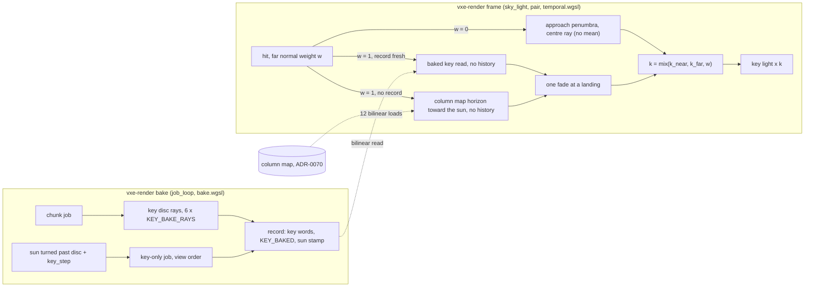

# 0095: A calm key light in motion: the column map's horizon at the far, the baked record where it lands, a deterministic penumbra near, judged with no pre-roll

> **Status:** in-progress (dev lane from 2026-11-20). Approved 2026-11-20 (owner go; stacked on plan-0094 at aff21a5a, merges main after 0094 lands). **Amended 2026-11-20 by the architect at window W1's verdicts** (the owner: the image right after a move must be calm without waiting; a pre-roll is not a fix): the far gains an instant estimate from the column map, the near a deterministic penumbra, the bake becomes the far's refinement; Phases 4 to 11 below are the contract from here, Phases 1 to 3 the record of what was built and seen. The owner's earlier picks stand (coarse far shadows per brick face direction; the far gate by the far normal's band; W1 at the default 3-degree sun; a lagging re-bake under the day cycle shows the old shadow with a fade). **Owner answers to the amendment's questions (2026-11-20):** the far keeps the baked record as its refinement (question 1); the approach penumbra is the near's default from Phase 5 (question 2); the far tiers' reach rule moves to Plan 0096, written on main by the architect there (question 3); W2 is short: the forest only, two arms, about 10 minutes, no pre-roll, from the first frame; the hills and the day cycle go to a later look if needed (question 4).
> **Created:** 2026-11-20
> **Milestone:** M10: Outdoors in [`docs/roadmap.md`](../roadmap.md)
> **Related ADRs:** [ADR-0079](../adrs/0079-the-key-lights-visibility-is-read-with-no-screen-history-the-record-or-the-column-maps-horizon-at-the-far-a-deterministic-penumbra-near.md)
> (proposed with this plan, amended with it on 2026-11-20: the decision, the W1 readings and
> the rejected alternatives, the spike's and W1's among them),
> [ADR-0070](../adrs/0070-sky-light-is-baked-visibility-coloured-at-read-with-a-long-history-ray-where-stale.md)
> (the sky's baked visibility this mirrors, and the column map the far's prior reads),
> [ADR-0046](../adrs/0046-static-emissive-light-is-baked-per-chunk-when-a-chunk-loads-or-changes.md)
> (the store, the bake job, `FADE`, the identity rule and the reach it implies),
> [ADR-0048](../adrs/0048-the-live-queue-orders-by-the-view-and-withdraws-the-work-a-flight-has-passed.md)
> (the queue order the key-only re-bake rides),
> [ADR-0042](../adrs/0042-the-far-shading-normal-blends-to-the-27-count-gradient-by-the-voxels-size-on-screen.md)
> (the far normal's band, the far gate),
> [ADR-0076](../adrs/0076-light-stability-rules-world-history-per-source-a-fade-per-transition-and-a-ratcheted-pop-counter.md)
> (rules 2, 3 and 6; the binding clause is met under "Where the histories live"; rule 6 is on
> Plan 0094's branch until it merges),
> ADR-0080 (proposed on main with Plan 0096, not on this branch: the drain and the far tiers,
> which decide when and where a record lands at the far; the reach rule this plan hands over),
> [ADR-0055](../adrs/0055-render-settings-are-one-struct-with-an-apply-class-per-field-and-profiles-are-named-values.md)
> (the settings rows this adds)
> **Source:** the motion-wobble spike (branch `spike-motion-wobble`, tip `9d8340e5` at drafting;
> its readings log `docs/plans/logs/wobble-spike.md` is committed there and summarised in
> ADR-0079's Context), the owner's complaint and direction at Plan 0094's window 94a
> (2026-11-20), the owner's answers of the same day, and window W1's verdicts with the reach
> reading behind them (`docs/plans/logs/0095.md`, "W1 run" and "The idle queue after W1").
> **Starts after:** Plan 0094 closes and merges into main (see "Merge order and the overlap
> with Plans 0094 and 0096").

## TL;DR

The far trees wobble after a turn and while flying because the key light's per-pixel
visibility mean restarts from one binary sample at every history rejection and climbs as
`1/n` for seconds; the near ground's treads and penumbrae do the same, and showed it at W1 as
grain and a dotted pattern along the step edges. The first form of this plan baked the key's
visibility per brick direction and read it at the far with no history; W1 showed the far holds
no record when it matters (nothing past about 72 m or in the LOD ring can ever bake under the
reach rule, and what can takes minutes to land) and that the near was untouched. This plan
makes **every key estimate deterministic with no screen history**: at the far a pixel reads the
baked record where fresh, else the **column map's horizon toward the sun** (a heightfield
shadow that exists today, covers the whole window and costs a dozen texture loads); near it
reads the **closest-approach penumbra** of one centre ray (Plan 0086's spike, still by
construction); between, the far normal's weight blends the two. The disc ray with a seeded
mean stays as a setting and the control arm. The first thing the owner sees (Phase 7, window
W2): the forest at 15:00 and `10,180` and the hills at noon **from the first frame, with no
pre-roll**, a slow fly, a turn and a hold, under the new default against the before. The
headless proof: the spike's rig with no drain, the queue stepping as the fly-through's does,
the far class (every far pixel, not only the baked ones) within 4 levels of its settled value
on at least 95 % of pixels 0.5 s after a 60-degree turn with the queue frozen, and reported
undrained with the queue's depth (today 50 % still over at 1 s and 45 % at 2 s).

## Context & problem

The complaint, the spike's readings and the direction are in ADR-0079's Context; the numbers
the phases are written against (`docs/plans/logs/wobble-spike.md`, the forest of seed 1 at
1080p through FSR 2 at 1.5, RTX 3080 Laptop, loaded):

| reading (far class, display pixels over 4 levels) | default | lighting off | no key ray |
|---|---|---|---|
| still, per frame pair | 0.33 % | 0.01 % | 0.13 % |
| fly at 1 m/s, per frame pair | 14.2 % | 1.34 % | 8.4 % |
| after a stop, against the hold's final frame, +0 / +60 / +120 frames | 35 / 25 / 12 % | 0.6 / 0.04 / 0.0 % | 34 / 22 / 9 % |
| after a 60-degree turn, against the hold's final frame, +0 / +60 / +120 | 59 / 50 / 45 % | 1.1 / 0.06 / 0.0 % | 55 / 49 / 46 % |

The near class drifts too (14.8 % of near pixels over 4 from their final value at the stop's
first frame): the ground's lit treads and the trunks' penumbrae.

**What W1 added (2026-11-20, RTX 3080 Laptop, the owner by eye, every run after a 30 to 40 s
pre-roll drain; `docs/plans/logs/0095.md`):**

- The baked blend (Phase 2's default) "changed nothing visible": the far (past 15 m) is 10.3 to
  12.2 % of the lighting pixels in the forest and on the hills from 2 m up, and the near
  ground's grain and post-turn wobble were untouched by design.
- The baked step was "better after full load, but user won't stay that long": once the camera
  moved, 1 000 to 2 300 in-view chunks had no record (HUD `missing 2337 (fallback 1535, black
  802)`, `in view 4623 waiting`) and the far was the ray again; and the near ground showed a
  fine dotted pattern along each step edge (a guess at the mechanism, read in Phase 5: the
  penumbra pixels' first samples after a reset moving the seeded mean by `1 / (n + 8)`).
- The ray arm kept some wobble around the trunks and leaves; the before was "a bit worse than
  the baked step, not much".
- **The reach reading** (the dev, `live/reach/`): a chunk bakes only when its whole light
  reach is resident full (`in_reach`, 5.39 chunks at light radius 4); the full radius is 16
  chunks, so no chunk beyond 11.18 chunks (about 72 m) ever bakes under `ReachMode::Full`, the
  LOD ring (16 to 24 chunks) never; the HUD's `reach-bound` count uses `len + lr > r_full` and
  undercounts the exact test by 1 890 chunks over the full sphere (the gap at 10.68 to 12.0
  chunks). Beside it, 461 px over 24 to 28 chunks within 10 chunks held a block whose hit brick
  had no record, at every dump from frame 60 on: unexplained.
- The owner's rule, restated at W1: the image a player sees right after moving must be calm
  without waiting; a long pre-roll is not acceptable as the fix.

The budget figures this touches (`docs/nfr.md`): section 2's lighting line (4.0 ms; the RADV
RENOIR's outdoor light pass reads 8.0 ms on the hills and 12.0 in the forest at rest, the RTX
3080 Laptop's 1.57 and 2.53), section 3's "everything else in VRAM" (the store: 10.6 MB on the
hills, 11.9 in the forest at 9 words a record; 11 words since Phase 1), section 4's dig budget
(the rings' re-bake), and the pre-roll line it must not move.

## Decision

**Every key estimate is deterministic and carries no screen history: the far reads the record
where fresh, else the column map's horizon toward the sun; the near reads the closest-approach
penumbra; the band blends them by the far normal's weight; the disc ray with a seeded mean stays
a setting; the record's landing and a re-bake are each one fade; the bake stays the far's
refinement for as long as the window keeps it.** ADR-0079 (amended) records why. Beyond the
spike's rejections (a shorter history, the world-hashed point, a far depth map, any history, a
wider pool, a world-space mean of screen samples, sun-arc stations, a blend everywhere) it
rejects: the bake alone with a pre-roll (W1: the far has no record when it matters); a wider
full residency (the cube law on 0.87 GB, the LOD ring still unbaked, the landing still waited
for); `ReachMode::Partial` by distance as the fix (a queue rule cannot answer a frame with no
record; it goes to Plan 0096 for its far tiers); the seeded disc ray at the near (W1's dots:
a seed moves where the climb starts, not that there is one); more rays a pixel (four times the
slow adapter's largest term for a half measure).

The look is decided at the owner's window, so **Phases 4 and 5 are exploration** (lane rule
2b): their bars are readings taken when cheap; the data, determinism and API tests land with
their phase; the image tests, goldens and the rig's bars are written in Phase 10 against the
picks.

### Where the histories live (ADR-0076's binding clause)

- **The key light's estimate lives in the world at every distance.** At the far: the store's
  record (six `u8` per brick, baked from the geometry and the sun), else the column map's tops
  (a heightfield of the resident world, flushed at every upload and edit), read with no
  screen history. Near: the closest-approach visibility of one centre ray, a function of the
  hit, the sun and the geometry alone, read with no history. The disc ray's running mean
  (`penumbra disc`) is the one screen-space estimator left, as a setting; its reset seeds from
  the world's estimate (the record, else the horizon) and never from its own first sample.
- **The fades:** a record's landing at a far face (horizon to record) and a key re-bake's
  landing (old record to new) each ride one fade of `FADE` frames in the pair's key slot
  (`no_ray_fade`'s form), since the key words snap in the store today; the far band's blend
  between the near and far estimates is a continuous weight on two estimates of one quantity
  and needs no fade (under `step` at `w` 1/2 the step rides the same fade). A face with no
  record and no column top (outside the footprint) reads lit, the light pass's own rule.

## Architecture diagram



## Implementation phases

Each phase ships as its own commit. `dev` implements all phases in one session with no review
between phases, stopping at the `human` phases. Every phase carries exactly one
`**Owner skill:**`. Phases 4 and 5 are **exploration** (lane rule 2b): built behind a setting,
named in the banner, readings instead of image bars; Phase 10 writes the bars against the
picks. A GPU test names its `gpu_*` binary and its lavapipe wall time; one over 10 s is born
`#[ignore = "soak"]`. Readings are taken on the RTX 3080 Laptop and the RADV RENOIR (lane rule
8), under the perf lock, with the load noted; **every stillness reading is taken with no
pre-roll drain** (the rig's `drain=0`: the queue steps at the fly-through's default budget from
the first frame, the segments start after a 120-frame settle for the exposure), states the
queue's depth, and is read twice: undrained as the owner sees it (ADR-0076 rule 6) and with the
queue frozen at the settle's end (`nqueue`) as the construction control. `--pre-roll-drain`
stays a testbed flag for a drained control reading and never runs in a window.

**The rig's protocol from Phase 4 on** (`apps/flythrough/tests/gpu_wobble.rs`, `mod reading`):
no drain; 120 settle frames; a still strip of 33 frames; a fly of 180 frames at 1 m/s; a stop
held 300 frames; a 60-degree turn over 40 frames; a hold of 300 frames. Classes near (under
6 m), mid (6 to 15 m), far (over 15 m) over **every** pixel of the class (the far-baked class
stays as a split, not as the bar's population), and the far's source split per frame (record,
horizon, ray) printed. Per pair: the share over 4 levels and the mean |dY|; in a hold: the same
against the hold's final frame at +0, +30 (0.5 s), +60 and +120 (2 s).

### Phase 1: The key channel in the store: two record words, the disc rays in the bake, the block's sun stamp
- **Owner skill:** dev (exploration)
- **State:** done, `011d707a` (the Implementation log). Built as the first form decided: the
  record grows two key words (`KEY_WORD` 9 and 10, `KEY_BAKED`, the stale bit shared with
  `SKY_STALE`; `BRICK_WORDS` 11), `KEY_BAKE_RAYS` 64 disc rays per brick direction from a hash
  of the voxel, face and sample index, the ray capped at the reach, the sun stamp in the
  summary's first key word (`KEY_SUN_AT`), the channel baked only under a key light above the
  horizon. The `gpu_sun` and `gpu_bake` tests named in the first form landed (the readings
  log, Phase 1). The debug view of the baked key per face was not built.
- **Done when:** as recorded; nothing further.

### Phase 2: The read: the far band reads the bake with no history, the near restart seeds from it
- **Owner skill:** dev (exploration)
- **State:** done, `937a08da`. `lighting.key_far` (`Baked` | `Ray`) and `lighting.key_far_mix`
  (`Blend` | `Step`), the menu rows and the banner words, the far-baked read in `temporal.wgsl`,
  the light pass casting no key ray at `w` 1 where the record is fresh, the pair's reset seeded
  from `k_store` at `SEED_AGE`, the rig with the far-baked class. The readings did not meet the
  first form's targets in any arm: the far-baked class was empty at the still and the stops
  with the queue undrained (the readings log, Phase 2); the light pass's ms, the store's bytes
  and the pre-roll on both adapters were not taken (owed to Phase 10).
- **Done when:** as recorded; the owed readings move to Phase 10.

### Phase 3: The owner's window W1 (run 2026-11-20, as the first form's Phase 4)
- **Owner skill:** human
- **State:** run 2026-11-20 13:3x to 13:50 on the forest (runs 1a to 2b, each after a pre-roll
  drain); the hills and the day cycle were not judged. The verdicts are in the readings log and
  under "Context & problem" above. The picks named: none of the first form's arms; the owner's
  rule instead, which this amendment answers.
- **Done when:** as recorded.

### Phase 4: The far's instant estimate: the column map's horizon toward the sun, no screen history
- **Owner skill:** dev (exploration)
- **What:** `lighting.key_far` gains `Column` (`Baked` | `Column` | `Ray`; `Baked` stays the
  branch default and now means "the record where fresh, else the horizon"; `Column` reads the
  horizon at every far pixel, record or not; `Ray` is the before). The shader function
  `column_key_visibility(p, n)` (`temporal.wgsl`, the column map already bound): lift the hit
  `SEED_LIFT` along `n`; march the sun's horizontal direction over the column map at
  `COLUMN_KEY_STEPS` (12, a guess) geometric distances from 4 to 512 voxels (ratio about 1.55:
  4, 6.2, 9.7, 15, 23, 36, 56, 87, 136, 211, 328, 512), the tops read bilinear over 2 x 2
  cells; the horizon's tangent is the largest `(top - z) / d`; the visibility is
  `clamp((tan(elevation) - tan(horizon)) / (2 tan(radius)) + 1/2, 0, 1)` with `radius` the
  sky uniform's `key_radius`; a step outside the footprint ends the march as lit; a sun at or
  under the horizon gives no key light as today. The light pass casts no key ray at a far
  pixel under `Baked` or `Column` (its sample word says "far"); the temporal pass takes the
  record where fresh (`Baked`) else the horizon, and under `disc` the pair's reset seed is the
  same value where no record. **The landing fade:** the far key value is carried in the pair's
  key slot and rides `no_ray_fade`'s form when its source switches (horizon to record, record
  to re-bake): one monotonic fade within `FADE` frames; `LIGHTING_HOOK_NO_FADE` disables it for
  the readings. **The absorbing top** (built only if the reading below asks): the column map's
  texel carries a flag bit beside `z` where the top voxel's material has `SHADOW_ABSORB`, and a
  march blocked by such a top reads `COLUMN_ABSORB_T` (0.3, a guess: `LEAF_SIGMA` 0.15 over
  about 8 voxels of canopy) instead of 0. The HUD banner names `key far column` and, under
  `Baked`, nothing (the default); the rig gains the `column` token and the far's source split.
- **Files touched:** `crates/vxe-render/src/shaders/temporal.wgsl`, `shaders/pair.wgsl`,
  `shaders/sky_light.wgsl`, `shaders/shade.wgsl`, `shaders/common.wgsl` (the lighting bits),
  `frame/settings.rs`, `frame/compose.rs`, `settings.rs`, `gpu_world/columns.rs` (the flag bit,
  if built), `apps/flythrough/src/cli/outdoor.rs`, `toggles.rs`, `hud/`,
  `apps/flythrough/tests/gpu_wobble.rs` (the protocol above), `crates/vxe-render/tests/gpu_sun.rs`,
  `docs/flythrough.md`, `docs/plans/logs/0095.md`.
- **Done when:**
  - CPU: the `Column` row round-trips through the settings file, the CLI and the menu
    (`settings/tests.rs`, `cli/tests/outdoor.rs`, `tests/menu.rs`, under 1 s), and `Ray`
    leaves the light pass's pipeline constants equal to Phase 2's.
  - GPU (`gpu_sun`, lavapipe, each under 10 s at the sky tests' 64-voxel rig, the queue never
    stepped so no record exists, the camera far enough that `w` is 1): an open floor under
    `Sky` with the sun at elevation 40 reads a key visibility of 255 at every far floor pixel;
    a floor 1 m under a solid slab reads 0; a floor beside a slab 10 voxels high with the sun at
    elevation 40 reads within 16 levels of 128 at the floor cells 8.9 voxels from the slab's
    edge on the shadow side (arithmetic: the hit is lifted `SEED_LIFT` 2.5 voxels along `n`, so
    `(10 - 2.5) / tan 40`), 255 at 13 voxels and 0 at 6 (the ramp at a 3-degree disc is about
    1.1 voxels wide there: `7.5 / tan 37` to `7.5 / tan 43`).
  - Determinism (`gpu_sun`, under 10 s): the far key value at a fixed pose is byte-equal
    across frames 1, 2 and 3 under `Column` (no history, no fade in flight), and a record
    landing at a far floor (one stepped job) moves the far key value monotonically over at most
    `FADE` frames to the record's value (rule 3's form, Plan 0094's `rules.rs` helpers).
  - Readings on the RTX with the rig, no drain, `Baked` and `Column` against `Ray` (all with
    `penumbra disc`), undrained and `nqueue`, the queue's depth and the far's source split
    printed: the far class's fly pair over 4 and mean |dY|; the stop's and the turn's far
    share over 4 against the hold's final frame at +0, +30, +60, +120; the still's far pair.
    The targets Phase 10's bars are written from: fly under 3 % (today 14.2; the lighting-off
    floor 1.34), the turn's +30 under 5 % and +120 under 2 % with the queue frozen (today 50
    and 45 at +60 and +120; the floor 0.06 and 0.0), the still at or under 0.35 % (today 0.33).
  - Readings on both adapters: the light pass's ms at rest in the forest at 15:00 and on the
    hills at noon, `Baked` and `Column` against `Ray` (release, 1080p, undrained at 1500 frames
    and drained by `--pre-roll-drain` as the control; today RTX 2.53 and 1.57, RENOIR 12.0 and
    8.0), the far class's share of the display beside; and the forest floor's mean luminance
    at `60,180` under `Column` against the drained record (the absorbing top is built if the
    horizon meters the floor darker by over a fifth).
  - The fly-through shows `key far column` (or `ray`) in the banner when the setting changes.

### Phase 5: The near with no history: the closest-approach penumbra as the key's near estimator, the seeded disc as the arm
- **Owner skill:** dev (exploration)
- **What:** Under `lighting.penumbra approach` (Plan 0086 Phase 7's spike, a setting today) the
  key term takes the frame's approach visibility times the ray's transmittance as the value:
  the pair's key slot is written with it and read back as a value, not averaged (`key_mean`
  bypassed; a reset changes nothing). The probes skip voxels whose material has `SHADOW_ABSORB`
  (the leaves), whose shadow the centre ray's transmittance already carries: the named
  candidate for the 1.9 times darker metering Plan 0086 read. The arm's code sits between
  `arms:begin` and `arms:end` lines today (Plan 0094 Phase 2a: default-off arms out of the
  default pipeline); this phase keeps it an arm and Phase 9 moves it into the default pipeline
  if picked. `penumbra disc` keeps the jittered ray and the mean, the reset seeded from the far
  estimate (Phase 4) at `SEED_AGE`. The rig gains the `approach` token; the banner already
  names `penumbra approach`.
- **Files touched:** `crates/vxe-render/src/shaders/walk.wgsl` (the probes' material test),
  `shaders/sky_light.wgsl`, `shaders/pair.wgsl`, `shaders/temporal.wgsl`,
  `apps/flythrough/tests/gpu_wobble.rs`, `crates/vxe-render/tests/gpu_sun.rs`,
  `docs/plans/logs/0095.md`.
- **Done when:**
  - GPU (`gpu_sun`, lavapipe, under 10 s): the near key value at a fixed pose is byte-equal
    across frames 1, 2 and 3 under `approach` (the pair's key slot unchanged by a reset), and
    the slab rig's profile (`reading::approach_penumbra_against_the_disc`, re-read) prints the
    rise with and without the probes' material skip, at 3 and 5 degrees.
  - GPU (`gpu_sun`, lavapipe, under 10 s): a floor under a one-voxel leaf layer of a
    `SHADOW_ABSORB` material reads, under `approach` with the skip, within 8 levels of
    `exp(-sigma)` times 255 for the layer's sigma (the transmittance alone), and a floor beside
    a solid post reads 0 in its shadow and 255 two voxels past the ramp.
  - Readings on the RTX with the rig, no drain, `approach` against `disc` (both at `key_far
    baked`), undrained and `nqueue`: the near class's pair over 4 while flying, the stop's and
    the turn's near share over 4 against the hold's final frame at +0, +30, +120 (today 14.8 %
    at the stop's +0; the lighting-off near figure read in the same run is the floor), the
    still's near pair; the far class beside, so the blend band's figures are seen whole.
  - Readings on both adapters: the light pass's ms at rest, `approach` with and without the
    skip against `disc`, the forest at 15:00 and `60,180` and the hills at noon (Plan 0086
    read +0.8 ms RTX, +6.6 ms RENOIR in the forest before the skip), and the frame's metered
    exposure beside (1.9 times before the skip).

### Phase 6: The reach-bound count uses the real reach extent, and the no-value bricks are named
- **Owner skill:** dev
- **What:** `view_census` (`crates/vxe-render/src/bake/queue/open.rs`) counts a chunk
  reach-bound by the exact test (`reach_crosses`, or `len + reach_extent(lr) > r_full` with
  `reach_extent` the longest offset in `reach_offsets(lr)`, 5.39 at 4), not `len + lr`; the
  HUD's `reach-bound` and the `bake queue:` line read the new count. A reading beside it, from
  `--dump-black` on the hills at noon (`live/reach/last.txt`): the materials, faces and cell
  states of the 461 px whose chunk holds a block and whose hit brick has no record, one
  paragraph in the readings log naming the cause if the dump shows it; a one-line fix lands
  here, anything larger is reported to the architect (Plan 0096's census takes it otherwise).
- **Files touched:** `crates/vxe-render/src/bake/queue/open.rs`, `bake/queue/mod.rs` or
  `bake/summary.rs` (`reach_extent`), `bake/queue/tests.rs`, `docs/plans/logs/0095.md`.
- **Done when:** `the_reach_bound_count_matches_the_exact_crossing_test` (CPU, under 2 s): a
  candidate list of every chunk of the full sphere at `r_full` 16 and light radius 4 counts the
  same chunks as `reach_crosses` does (11 814 by the dev's arithmetic; the test computes both
  and asserts equality, and that a chunk at 11.0 chunks out along an axis counts as not bound
  while one at 11.5 counts as bound); the readings log holds the no-value paragraph.

### Phase 7: The owner's window W2: the image right after a move, no pre-roll
- **Owner skill:** human
- **What (the owner's shape, 2026-11-20, question 4):** A release binary of the branch's tip
  after Phase 6, `live/sessionW2.sh` on the live-runner lib (dry-run with `skip`), **no
  `--pre-roll-drain` in any run**: the forest at `--time 15:00` and at `--sun 10,180`, from the
  first frame: a slow fly at 1 m/s for 10 s, a 60-degree turn and a 5 s hold, a fast 180-degree
  turn and a 5 s hold; two arms (the menu rows; the banner names the modes): (a) `key far
  baked` with `penumbra approach` (the default from Phase 5) and (d) `key far ray` with `disc`
  (the before). About 10 minutes. No hills and no day cycle (a later look if needed; `column`
  and `baked`+`disc` stay as menu rows the owner may switch to). The owner's verdicts, in the
  owner's words, to `live/windowW2/verdicts.md` with stills: (1) is the image calm right after
  the turns, near and far, under (a); (2) the far's look: does the horizon's shadow read as
  wrong anywhere (a canopy's floor too dark), and do the record's landings show as fades the eye
  objects to; (3) the near penumbra under `approach` against the before: its edge, the canopy
  floor's dapple, the step edges; (4) anything worse than the before; (5) the picks:
  `key_far_mix`, and whether the far keeps the record (the owner's answer to question 1 stands
  unless this verdict reverses it).
- **Files touched:** `live/sessionW2.sh`, `live/windowW2/` (untracked), `docs/plans/logs/0095.md`
  (the verdicts summarised).
- **Done when:** the five verdicts are written and the picks are named; a verdict that names a
  defect this plan's phases do not cover goes to the architect as an amendment, not to Phase 9.

### Phase 8: The sun's step and the edit's ring: key-only re-bake jobs (only if W2 keeps the record at the far)
- **Owner skill:** dev
- **What:** Built only if W2's pick keeps `key_far baked`; struck in the Implementation log
  with the reason if the far holds the horizon. `lighting.key_step` (degrees, 3 by default,
  live). A frame whose `key_dir` has turned past the block's baked direction (`KEY_SUN_AT`) by
  more than the disc's angular radius and more than `key_step` marks the block for a key-only
  job: a job kind that redraws the six key directions (the record's other words kept,
  `kept_bricks`' form) and whose landing rides Phase 4's fade, ordered by ADR-0048's view score
  behind dig jobs, under the queue's budget; the HUD's `bake queue:` line counts them
  (`key N`). A fixed sun queues none. An edit's rings re-bake the key words with the sky's and
  clear the shared stale bit (no new ring rule).
- **Files touched:** `crates/vxe-render/src/bake/job_loop.rs`, `bake/queue/` (the job kind),
  `bake/record.rs`, `shaders/bake.wgsl`, `frame/settings.rs`, `settings.rs`,
  `apps/flythrough/src/hud/` (the queue line), `crates/vxe-render/tests/gpu_sun.rs`,
  `docs/plans/logs/0095.md`.
- **Done when:**
  - GPU (`gpu_sun`, lavapipe, under 10 s): at a fixed sun 600 stepped frames queue 0 key jobs;
    turning the sun by 4 degrees queues a key job for every baked block within one frame and
    the re-baked `+z` value of a floor at a slab's shadow edge moves in the sun's direction;
    turning it by 1 degree queues none; a key-only job leaves the record's emissive and sky
    words byte-equal; the landing's trace at a far pixel is one monotonic fade within `FADE`
    frames.
  - GPU (`gpu_sun`, lavapipe, under 10 s): a dig under a fully lit floor re-bakes its key words
    with the sky's ring, the stale bit set at the dig and cleared at the landing.
  - Readings on both adapters, the day cycle at 1x, the forest at 15:00 and the hills at noon:
    key jobs a second and the seconds until every block in view has re-baked after a step,
    against the step's period (10 s at the default day), the queue's depth beside; the new
    budget figure (see Budgets).

### Phase 9: The fix pass after W2
- **Owner skill:** dev
- **What:** The picks as defaults; a picked arm moves into the default pipeline and an unpicked
  one stays an arm (Plan 0094 Phase 2a's rule); the shader constants the verdicts moved
  (`COLUMN_KEY_STEPS`, `COLUMN_ABSORB_T`, `KEY_BAKE_RAYS`, `key_step`, the band's mix). If the
  far holds the horizon for good (W2's pick under question 1), the key bake defaults off, the
  record returns to 9 words and Phase 1's bytes come out (the setting stays, the cheap-modes
  rule); nothing else that changes the design (a new mechanism goes back to the architect).
- **Files touched:** the files of Phases 4, 5 and 8 the picks touch, `docs/plans/logs/0095.md`.
- **Done when:** the defaults are the picks, the banner names them (nothing for a default), and
  the Phase 4 and 5 rig readings re-read on the RTX at the picks go to the log.

### Phase 10: The bars against the picks, the goldens, the readings in the NFR
- **Owner skill:** dev
- **What:** The rig's bars as tests, the goldens, and the budget readings.
- **Files touched:** `apps/flythrough/tests/gpu_wobble.rs` (the gate scene and the soak
  reading), `apps/flythrough/tests/gpu_outdoor/` (the far rule 2 scene), `apps/flythrough/tests/golden/`,
  `docs/nfr.md`, `docs/nfr/02-frame-budget.md`, `docs/nfr/03-memory.md`,
  `docs/plans/logs/0095.md`.
- **Done when:**
  - **The gate scene** (`gpu_wobble`, lavapipe, under 10 s or born soak): a 3 x 3 x 2 chunk
    forest of seed 1 at a 320 x 180 lighting grid (480 x 270 through FSR 2 at 1.5), **no
    drain**, the queue stepping at the default budget from the first frame, a 120-frame settle,
    a 20-frame fly at 1 m/s, a 60-degree turn over 10 frames, a 60-frame hold; on the far class
    (every far pixel): with the queue frozen at the settle's end, the fly's pair share over 4
    levels at most 3 % (mean over the fly), the turn's share over 4 from the hold's final frame
    at most 5 % at +30 and 2 % at +60, the still's at most 0.35 %; the near class's stop +0
    within 2 points of the lighting-off near figure the test reads in the same run; the same
    segments undrained print their figures with the queue's depth and assert the turn's +60 at
    most 10 % (a guess: the landings' fades in a 1 s hold; re-read when Plan 0096 lands). The
    bars at `key far ray` with `penumbra disc` print (the before figures) and are not asserted.
    The thresholds are Phase 4 and 5's targets unless the Phase 4, 5 and 9 readings on the RTX
    moved them, in which case the log names the reading and the test's doc comment the source
    (lane rule 2a's form).
  - **The soak reading** (`gpu_wobble`, `#[ignore = "soak"]`, the spike's full rig at 1080p,
    `VXE_TEST_ADAPTER` for the RTX by hand): prints the spike's table for the arm set
    `default`, `albedo`, `ray,disc`, `column` and `nqueue`, no drain, with the queue's depth and
    the far's source split, so a later plan re-reads the wobble with the same instrument.
  - **Rule 2 at the far** (`gpu_outdoor`, lavapipe, under 10 s): the forest's return frame
    after a 90-degree turn away and back matches the settled image within 4 levels on at least
    95 % of the far pixels, no drain (today's far return frame reads 37.6 % over 8, Plan 0094's
    reading); Plan 0090's counter takes the scene when it lands.
  - **A golden** (`gpu_outdoor_golden`, lavapipe): the forest at 15:00 at the far band under
    the picks, no drain, blessed on lavapipe, SSIM at least 0.98 against the bless.
  - **The readings in the NFR:** the light pass at rest on both adapters (section 2, undrained
    and drained), the store's bytes (section 3, at the record's final word count), the pre-roll
    (section 2, unchanged: a check, not a claim) and, if Phase 8 is built, the key re-bake's
    rate under the day cycle (a new line in section 2's table, see Budgets), each with machine,
    commit and load; the ADR-0079 Outcome facts in the close triggers.
- **Amended 2026-11-20 (owner), after the Phase 9 readings (`c6b6bf52`) and the tip gate
  (`40caec95`):**
  - **The far bars become "no worse than the before".** The picks read, queue frozen, fly 13.2 %,
    +30 37.2 %, +60 27.2 %, +120 12.8 % against the before (`key far ray`, `penumbra disc`)
    14.8 / 40.2 / 30.8 / 16.9 %; about 97 % of the far pixels sit inside the far normal's band and
    still cast the ray. The gate scene asserts each far segment (fly, +30, +60, the still) at or
    under the before's figure read in the same run plus 1 point, instead of 3 / 5 / 2 %; the
    undrained +60 bar and the near stop bar stand; the rule 2 far scene asserts the same form
    against the before's return frame. Every figure prints. Narrowing the band so far pixels stop
    casting is a backlog entry for the far-field work, not this plan's.
  - **The tree-shadow scene pins `key_far: Ray`.** `a_tree_shadow_travels_with_the_sun_at_320x180`
    tests the ray's geometry; with no record the default far reads the column horizon, a
    heightfield under the canopy. With `Ray` it reads (0.49, 46.78) against (0.5, 46.98).
  - **The approach penumbra is the default on every adapter and profile** (owner's pick over
    keeping disc on the slow adapter): the RENOIR's forest light pass reads 34.0 ms against
    11.8 ms under disc, the 4.0 ms section 2 line, and RTX 3.32 ms. The NFR rows record it as
    over the line, named; Plan 0096 Phase 6 (the slow adapter's light pass, lever by lever)
    takes approach's cost as a named lever.
  - **Phase 11 is struck:** W2 asked for no second look.
- **Amended 2026-11-21 (owner), after the Phase 10 bars at `404a0349`:**
  - **The near stop +0 bar is asserted only in the RTX soak reading at 1080p** (picks 0.81 %),
    against the lighting-off figure read in the same run plus 2 points. The lavapipe gate scene at
    a 320-pixel grid prints it (picks 21.32 %, before 16.62 %, lighting off 0.48 %): at that grid
    the far normal's band starts at about 2.2 m, so most near pixels read the far estimate.
  - **The undrained +60 and the rule 2 far return are readings, not bars.** Undrained +60: picks
    11.26 % against the 10 % guess (before 20.63 %). Far return: picks 84.72 % against the
    before's 77.27 % (exposure pinned: 76.76 against 68.86). Both print; Plan 0096's far tiers
    and the backlog's band entry take them. The far's four queue-frozen bars stand as amended.
  - **The goldens:** `outdoor_noon`, `outdoor_forest_sunset` and `cave_mouth` move with the
    library default `key_far: Baked` and are re-blessed at the picks as this plan's disclosed
    change (the owner judged the look at W2). `profile_portable_gate` already fails on main
    `e6582b9e` (0.8142 %); the dev names its cause and re-blesses it as main's disclosed change
    if the cause is the showcase palette, else reports.

### Phase 11: A second short look, only if W2 asked for one
- **Owner skill:** human
- **What:** Runs only if a W2 verdict named a defect as not fixed and a shader changed after
  the window; the same scenes, 10 minutes, `live/sessionW3.sh`, no pre-roll.
- **Files touched:** `live/sessionW3.sh`, `docs/plans/logs/0095.md`.
- **Done when:** the verdict is written, or the phase is struck in the Implementation log with
  the reason.

## Data shapes

```rust
// illustrative: bake/record.rs (as built in Phase 1)
pub const BRICK_WORDS: usize = 11;           // 9 before: +2 key visibility words
pub(crate) const KEY_WORD: usize = 9;        // dirs 0..3 in word 9, 4..5 in word 10
pub(crate) const KEY_BAKED: u32 = 1 << 16;   // word 10: baked under a key light
pub const KEY_BAKE_RAYS: u32 = 64;
pub const KEY_SUN_AT: u64 = SUMMARY_AT + KEY_WORD as u64; // the block's sun stamp
```

```wgsl
// illustrative: temporal.wgsl, the key term at a far pixel (Phase 4)
let w = far_normal_weight(v, rec.t);
var k_far = column_key_visibility(rec.p, n);        // the horizon, no state
if (key_far_baked && key_baked(voxel, face)) { k_far = record_key(rec, n); }
let k_near = select(key_mean, approach_sample, penumbra_approach);
let k = select(mix(k_near, k_far, w), select(k_near, k_far, w >= 0.5), key_far_step);
```

The column map stays `r32sint`: `z` in the low bits and, if built, the absorbing top's flag in
bit 30 (`COLUMN_NONE` is `i32::MIN`, untouched).

## What the dev reuses

- **The rig:** `apps/flythrough/tests/gpu_wobble.rs` (`mod reading`, in the tree since Phase
  2) with the spike's classes and the far-baked split; Phase 4 changes its protocol (no drain,
  the far's source split, the `column` and `approach` tokens), Phase 10 adds the gate scene.
  The runners under the untracked `live/wobble/` (`run-arms.sh`, `table.sh`; their text is in
  `docs/plans/logs/wobble-spike.md`, "The runners").
- **The approach penumbra:** `walk.wgsl`'s `approach_cell` and `approach_probe`,
  `sky_light.wgsl`'s `LIGHTING_PENUMBRA_APPROACH` branch, `lighting.penumbra` and `--penumbra`
  (Plan 0086 Phase 7, `ed47dc5c`); the test `reading::approach_penumbra_against_the_disc`.
- **The column map and its reads:** `gpu_world/columns.rs`, `common.wgsl`'s `column_map` and
  `above_column`, `pair.wgsl`'s `column_estimate` and `SEED_LIFT` (ADR-0070, Plan 0094).
- **The fade:** `pair.wgsl`'s `no_ray_fade` (Plan 0094 Phase 5).
- **Not reused:** the spike branch's `KEY_WORLD_HASH` arm (ADR-0079's Alternative B).

## Merge order and the overlap with Plans 0094 and 0096

Plan 0094 is closing in parallel; it edits `pair.wgsl`, `temporal.wgsl`, `shade.wgsl`,
`settings.rs`, `frame/settings.rs` and `tests/support/rules.rs`, which Phases 4 and 5 here
edit too. **Plan 0095 merges main when Plan 0094 lands** (lane rule 1); it never starts from
the spike branch. ADR-0076 rule 6, which the bars are read by, is on Plan 0094's branch until
that merge; this plan cites it by number.

Plan 0096 (approved, starts after this plan merges) owns the queue: how soon an in-view chunk
has a record, the far tiers, the drain slice. **This plan hands it the reach rule for the far
tiers** (a chunk whose reach crosses the full radius bakes at its far tier from the chunks
resident, the LOD mips as casters, `ReachMode::Partial` by band; without it no chunk past 11.2
chunks ever gets the far tier's record), the reach-bound count's fix as a landed instrument
(Phase 6), and the no-value bricks if Phase 6 cannot name them. Plan 0096's Phase 6 (c) reads
far pixels on the baked key or the horizon with no ray, as this plan lands them. The proposed
amendment to Plan 0096 is in this amendment's report; it is written into Plan 0096 on main by
the architect there.

## Budgets

| `docs/nfr.md` figure | today | expected | how the close measures it |
|---|---|---|---|
| Section 2, lighting line 4.0 ms: the light pass at rest, forest 15:00 / hills noon | RTX 2.53 / 1.57; RENOIR 12.0 / 8.0 ms | far: lower (a dozen texture loads a far pixel instead of a ray walked to the window's edge; the far is 10 to 17 % of the lighting pixels); near: `approach` read +0.8 RTX / +6.6 RENOIR by Plan 0086 before the probes' skip; the net is a reading, the Portable profile may decline `approach` | release `flythrough --headless --frames 1500 --render 1920x1080`, both adapters, undrained and drained (`--pre-roll-drain`), the picks against `ray,disc`, the frame line's median of the last 30 frames |
| Section 3, the store's bytes (the record 9 to 11 words) | hills 10.6 MB, forest 11.9 | about 13.0 and 14.5 MB (+22 %, arithmetic) while the far keeps the record; back to today's if it does not (Phase 9) | the same runs' `store` figure; `frame_bytes` test |
| Section 2, the pre-roll under a sky (the RTX's hills) | 14.4 s | unchanged by this plan (the horizon needs no bake; the key rays are Phase 1's +25 % of the bake's rays, read: the pre-roll figure is checked, not claimed) | the same runs' first frame with a record for every chunk in view, both adapters |
| Section 4, the dig's re-bake (the rings' rays) | the ring's sky rays on a dig's frame +0.6 RTX, +1.28 RENOIR | +25 % of the ring's bake rays, a guess, while the record stays | Plan 0086's dig rig, both adapters |
| **New, section 2 (only if Phase 8 is built):** the key re-bake's rate under the day cycle at 1x, `key_step` 3 degrees | none | the blocks in view re-baked within one step (10 s) on the RTX; the RENOIR's figure read and reported | Phase 8's reading, both adapters, forest and hills; the HUD's `key N` count |
| Frame targets | 536 150 828 B at 1080p | unchanged (no new target) | `frame_bytes` test |

The close review runs the gate tier (no soak, owner 2026-11-19), runs `test-times.mjs` on it,
and checks each row above for a number, a machine and a commit.

## Risks & open questions

- **The horizon is a heightfield** (ADR-0079's first negative, ADR-0027's Alternative A
  objection): a far cave mouth lit by a low sun, a ledge under a cliff's lip, read shadowed
  until a record lands; under a porous canopy the plain rule reads 0 where the disc reads about
  0.3. The absorbing top's constant is the named fix (Phase 4's reading decides); the record
  corrects the rest where it lands; W2's verdict (2) judges what is left.
- **The landing's fade may be the wobble under another name** while the queue lands in view
  order over seconds (minutes until Plan 0096): a far scene shows fades walking outward after a
  turn. If W2 reads them as such, the far holds the horizon for good (`Column`), the key bake
  defaults off and Phase 8 is struck (owner question 1).
- **The approach penumbra's look:** narrower than the disc's and on the lit side by about half
  a voxel; a leaf's near miss shadows where the disc half-lights (the probes' skip is the
  candidate); a caster past `APPROACH_REACH` beside the ray casts a hard edge. W2's verdict (3);
  the seeded disc is the fallback arm, with its dots.
- **The slow adapter's near cost:** `approach` read +6.6 ms of light pass on the RADV RENOIR in
  the forest (Plan 0086), six times the disc ray's storage loads; the far's saving and the
  probes' skip are read against it in Phase 5; the Portable profile may keep `disc` (Plan
  0096's Phase 6 reads the levers).
- **The hit's jump between a leaf's voxels** under FSR 2's jitter moves the horizon estimate by
  a fraction of its ramp (the tops read bilinear; the first step 4 voxels out); the spike's
  `leaf shadow brick` reading says a coarser value halves the far's motion term; Phase 4 reads
  it, and a coarser read (the tops' max over 2 x 2 cells at the far) is the named adjustment.
- **The band's blend** between a deterministic near and a deterministic far keeps no wobble;
  `step` stays a setting for the owner's eye.
- **Determinism of the bake:** unchanged from Phase 1 (hashed sample points, the identity test).
  The CPU side (`vxe-world`) is untouched; the column map's flag bit, if built, is derived from
  the mirror like the tops.
- **Memory:** the record's +8 B stays or goes with the far's pick; the column map's texel is
  unchanged in size; no per-frame allocation.
- **GPU features:** none new; the horizon is texture loads on a bound `r32sint` texture.
- **Threading:** the key-only job (Phase 8) runs on the bake's worker like every job.

## Owner questions (answered 2026-11-20, all as recommended but question 4's shape: see the status line; kept as the record)

1. **Does the far keep the record as its refinement, or hold the horizon for good?**
   **Recommended:** keep the record where it lands (`key far baked`: the record has the leaves'
   porosity and the disc's true penumbra; Plan 0096 makes the landing seconds and each landing
   is one fade), and let W2 judge the fades; if the owner's eye reads them as the wobble under
   another name, the far holds the horizon (`column`), the key bake defaults off, the record
   returns to 9 words and Phase 8 is struck. The alternative up front: `column` now, no bake,
   no re-bake, the far's shadow turning with the sun every frame and never changing otherwise.
2. **The near: the deterministic approach penumbra as the default, if its near reading is
   calm?** **Recommended:** yes, on the branch from Phase 5, judged at W2 against the seeded
   disc: it has no mean to restart, so the step edges and the trunks' penumbrae hold at once;
   its costs are a penumbra narrower than the disc's and on the lit side, and +0.8 ms RTX /
   +6.6 ms RENOIR of light pass before the probes' skip and the far's saving (the Portable
   profile may keep `disc`). The alternative: keep ADR-0027's jittered disc ray with the
   seeded mean (W1's dots along the step edges persist after every reset).
3. **The reach rule for the far tiers moves to Plan 0096** (`ReachMode::Partial` by band: a
   chunk whose reach crosses the full radius bakes at its far tier from the chunks resident,
   the LOD mips as casters), with ADR-0080 amended while proposed; this plan keeps the count's
   fix (Phase 6) and leaves faces beyond the reach on the horizon until then. **Recommended:**
   yes; the horizon makes the far calm without a record, so the rule is the queue's business
   and its tiers cannot work without it. The alternative: flip `--reach partial` on as the
   default now, in this plan (the baked far reaches about 102 m, every partial bake a later
   refinement landing).
4. **W2's shape:** from the first frame with no pre-roll, the forest at 15:00 and `10,180` and
   the hills at noon (the far is 12 % of the hills' pixels), four arms and the day cycle, about
   25 minutes, on Linux. **Recommended:** as written; the hills were not judged at W1. The
   alternative: the forest only, two arms (the proposed default and the before), 10 minutes.

## What this plan does NOT do

- **The queue's landings and their rate** (ADR-0076 rule 6's first case; the forest's queue
  never drains): Plan 0096's (ADR-0080): the drain slice, the far tiers, the record by rule,
  and the far tiers' reach rule this plan hands it. This plan makes the far correct enough
  before any record lands that none of it is waited for.
- **The sky pair's restart while flying** (`keyoff` left 8.4 % on the fly): the sky at a face
  with a fresh record reads the bake with no history (ADR-0070), and at a face with none Plan
  0094's prior; what is left is the no-record faces, Plan 0096's.
- **The far field** (Plan 0033): the shadows of casters beyond the window's footprint belong
  there; the horizon march ends lit at the footprint's edge.
- **A per-voxel or per-face far shadow** (ADR-0079's Alternative C, ADR-0046's face level): the
  brick level and the heightfield are accepted at the far; Alternative C is the named upgrade.
- **Plan 0090's counter** takes the rule 2 scene when it lands; this plan writes the scene.
- **Any change to the emissive or sky channels' bake**, or to the dig's hole band (Plan 0094).
- **A wider full residency** (ADR-0079's Alternative J).

## Implementation log

> Written by `dev`: one row per phase as its commit lands, then the close block. **The phases
> above are the contract. This section records what happened.** Observations, never conclusions:
> no pass list, no self-assessment. Deviations and unmet done-whens are **always** disclosed.
> Keep it shorter than `## Implementation phases`. Readings, gate counts, attempts, sweeps and
> resume notes go to the plan's readings log, `docs/plans/logs/0095.md` (started from
> `templates/readings-log.md`), and this section links it once it exists.

Readings: [`logs/0095.md`](logs/0095.md).

Amended 2026-11-20 (architect, at W1): the phases were renumbered; the rows below keep their
names. The first form's Phase 3 (the sun's step) is Phase 8 now, its Phase 4 (W1) is Phase 3,
its Phases 5 to 7 are Phases 9 to 11.

| phase | owner | state | commit |
|---|---|---|---|
| 1: The key channel in the store | dev | done (exploration) | 011d707a |
| 2: The read at the far band and the seed | dev | done (exploration); readings partial | 937a08da |
| 3: The owner's window W1 | human | run 2026-11-20 after a pre-roll drain (`7d19d8b0`, testbed flag); forest runs 1a to 2b judged, the hills and the day cycle not; no pick, the owner's rule instead (readings log) | |
| 4: The far's instant estimate: the column map's horizon | dev | done (exploration); readings in Phase 5's log section | 1006270b |
| 5: The near with no history: the approach penumbra | dev | done (exploration); readings partial | fe564d2b |
| 6: The reach-bound count, the no-value bricks | dev | done; the no-value bricks named (the dump's own voxel rounding), not fixed | 930e75ad |
| 7: The owner's window W2, no pre-roll | human | run 2026-11-20 on the forest, no pre-roll; (a) stands as the default, the far keeps the record; owner: 1a "everything besides near lines on slopes looks good", 1d "before - grain" (readings log) | 87b09f09 |
| 8: The sun's step and the edit's ring (if W2 keeps the record) | dev | done; the day-cycle readings in `87ced612` | a92aca70 |
| 9: The fix pass after W2 | dev | done; the picks were the defaults; the approach probes moved into the default light pipelines; the rig re-read follows the commit | 220a599c |
| 10: The bars, the goldens, the NFR readings | dev | done as amended `5f3e1e9b` (main merged `2dfbad9b`, flags cap `b46cb3eb`, wip `ce1a7050`); far bars asserted, near stop at the RTX 1080p only (0.81 against 0.04 % + 2), undrained +60 and far return printed; `outdoor_sunset.png` (6.05 %) and `profile_portable_gate.png` (0.81 %) not blessed (readings log) | committed with this row |
| 11: A second short look, if asked | human | struck 2026-11-20 (owner, amendment `95d735fd`): W2 asked for no second look | |

### Notes

- Phase 1: files beyond its list: `bake/job.rs` (the face's key rays), `bake/mod.rs`
  (`BakeReport::key_rays`), `bake/store.rs` (the summary keeps the sun stamp),
  `bake/summary.rs` (its layout test at 11 words), `frame/baked.rs` (`bake_key`),
  `shaders/light.wgsl` and `shaders/sky_light.wgsl` (`disc_direction` moved into the bake's
  modules); `gpu_world/format.rs`, `frame/settings.rs`, `settings.rs` and the HUD untouched.
- Phase 1: the block's sun stamp is the summary record's first key word (`KEY_SUN_AT`, its
  `KEY_BAKED` clear), not a new header word; a dig ring job stamps the current sun though its
  kept bricks may be older.
- Phase 1: the debug view of the baked key per face (a `store read` view) is not built.
- Phase 2: files beyond its list: `frame/compose.rs` (the two bits), `src/lib.rs` (exports),
  `settings/tests.rs` and `frame/settings/tests.rs` (moved out for the size cap), the fly-through's
  `cli/outdoor.rs`, `cli/mod.rs`, `cli/tests/outdoor.rs` (`--key-far`, `--key-far-mix`),
  `toggles.rs` (the menu rows), `tests/menu.rs` and `docs/flythrough.md`; `frame/encode.rs`
  untouched (the bits ride `Lighting::flags`).
- Phase 2: the banner names `key far` only off the default (`key far ray`, `key far baked,
  key far mix step`); the menu's rows name every mode.
- Phase 2: the far-baked class is read from the sky's source word `record` (the shared stale
  bit and job), not from the key words themselves.
- Phase 2: the rig readings do not meet the first form's Phase 2 targets in any arm; the
  far-baked class was empty at the still and the stops (the far unbaked after the drain); the
  light pass's ms, the store's bytes and the pre-roll on both adapters are not taken (readings
  log).
- Phase 2: the seed counts as SEED_AGE samples of the key mean at every pixel whose record is
  fresh, also where the record landed after the pixel's reset.
- Phase 3 (W1): `--pre-roll-drain SECONDS` (`7d19d8b0`, testbed only) was built for the window
  and stays a reading flag; the W1 verdicts and the reach reading are in the readings log.

- Phase 4: files beyond its list: `pair.wgsl` holds `column_key_visibility` and the key
  slot's tags (not `temporal.wgsl`); `tests/menu.rs` gains the `key far` cycle test;
  `gpu_world/columns.rs` untouched (no absorbing top built).
- Phase 4: the horizon reads each column top as a box from the cell's entry distance, not
  bilinear over 2 x 2 cells: bilinear tops put a 10-voxel slab's ramp at 7.9 voxels where the
  done-when's arithmetic says 8.9; a lifted point under its own cell's top reads 0.
- Phase 4: the landing fade moves at most 1/16 a frame (a fixed rate, no frame counter: the
  pair's w holds the sky's fade), so a small change lands in fewer than FADE frames; a cast
  pixel's mean hands over to the far value at once under `blend`, fades under `step`.
- Phase 4: the far estimate in the band (0 < w < 1) switches source with no fade.
- Phase 4: the landing test bakes the floor's `+z` faces of three brick columns with
  `bake_until`, not one stepped job; it asserts with its own trace check, not `rules.rs`
  (a fly-through test helper vxe-render's tests cannot reach).
- Phase 5: files beyond its list: the fly-through's `look.rs` (`DEFAULT_PENUMBRA`),
  `cli/outdoor.rs`, `cli/mod.rs`, `hud/modes.rs`, `cli/settings.rs`, `cli/tests.rs`,
  `cli/tests/outdoor.rs` and `docs/flythrough.md` (the default flip); `sky_light.wgsl` and
  `pair.wgsl` untouched.
- Phase 5: the default is the fly-through's start value, not the library's
  (`Lighting::default()` and `default_lighting()` keep `disc`, so no golden moves);
  `the_start_lighting_is_the_shared_default_lighting` names the penumbra as a third field the
  start sets beside the exposure and the lamp's bounce.
- Phase 5: the probes' skip has no setting; the reading without it is a build with
  `APPROACH_SKIP_ABSORB` false (`live/bin/p5-noskip`). Under the fly-through's default leaves
  (`--leaf-shadow voxel`) no material absorbs, so the skip acts only under `absorb`.
- Phase 5: `a_floor_under_a_leaf_layer_reads_its_transmittance` is born soak (15.0 s).
- Phase 5: inside the band under approach the key slot carries the far estimate's fade (not
  in the phase's text: Phase 4's undrained hold read the band's unfaded landings).
- Phase 6: the exact test lives in `open.rs` (`is_reach_bound`), not `queue/mod.rs` (at its
  1200-line cap); `reach_extent` in `summary.rs`.
- Phase 6: the no-value paragraph is read from W1's dump (7d19d8b0), not a new run; the
  dump's miscount is reported, not fixed (the fix is outside the phase's files and needs the
  face normal read back).
- Phase 7 (W2): the forest only, (a) against (d), no stills saved; run 0 (the open night)
  drew no remark; `key_far_mix` was not judged (blend stays); the owner routed the exposure in
  deep shade to Plan 0097 and the step lines on slopes to the backlog (both arms show them).
- Phase 8: files beyond its list: `bake/job.rs` (`Job::key_only`, `FACE_KEY_ONLY`),
  `bake/summary.rs` (`fade_mix` mixes the key bytes: the light pass's key slot follows a
  record's own value at once, so a re-bake's landing fades in the store, dig and refinement
  landings too), `bake/queue/stats.rs` (`QueueStats` moved out of `queue/mod.rs` for its
  1200-line cap), `layout_tests.rs`, `frame/baked.rs`, `lib.rs`, the fly-through's
  `run/queue.rs` (the stdout line) and `cli/outdoor.rs` with `docs/flythrough.md`
  (`--day-cycle`, a reading lever); `job_loop.rs` and `bake/record.rs` hold the job kind.
- Phase 8: a block stamped 0 (baked with no key light) re-bakes its key words once one is up;
  key-only jobs go ahead of the pool's, behind the digs, at most 16 a step and one slice of
  samples; they draw the key rays alone (no emissive sample, no sky ray).
- Phase 8: the far landing test drifts the sun 1 degree a frame: a 4-degree turn in one frame
  is a sky jump (over the 3-degree radius), which snaps the far slot by design.
- Phase 8: `key_step` is a settings-file row only (no menu row, no flag), as listed.
- Phase 9: the approach penumbra stays off the library's `Lighting::default()` and the
  fly-through's `default_lighting()` (the goldens' base); the fly-through starts in it.
  Files beyond its list: `frame/encode.rs` (`light_arms`), `frame/pipelines.rs`,
  `frame/compose.rs` (its test), the fly-through's `cli/mod.rs` and `cli/tests/outdoor.rs`
  (the loading stage's arms).
- Phase 10: files beyond its list: `tests/gpu_outdoor.rs` (the tree-shadow scene's `KeyFar::Ray`,
  the include), `tests/gpu_outdoor_golden.rs` (`outdoor_forest_afternoon_golden`),
  `tests/support/mod.rs` and `tests/support/wobble.rs` (the gate scene), `docs/backlog.md` (the
  far band's narrowing).
- Phase 10: the gate scene and the far return are born soak (130.1 s and 39.3 s on lavapipe);
  the golden is in the gate (7.6 s). The gate scene's tests were renamed to what they assert
  (`the_far_moves_no_worse_than_the_before`, `the_far_return_prints_against_the_before`); the
  far return asserts only that the scene has far pixels (over 5 % of the display).
- Phase 10: the near stop bar lives in `the_wobble_table_over_the_arm_set` (soak, by hand on the
  RTX), whose `default` and `albedo` arms are the picks and lighting off.
- Phase 10: `outdoor_sunset.png` moves 6.05 % with `key_far: Baked` (masked behind noon's
  failure in the same test); not named in the amendment, not blessed: the soak test
  `outdoor_goldens_differ_by_time_of_day` fails at the tip.
- Phase 10: `profile_portable_gate.png` (0.81 %) moved at Plan 0094 Phase 3 `dee00eb7`, not the
  showcase palette; not blessed: `portable_profile_golden` (soak) fails at the tip as on main.
- Phase 10 (coordinator, 2026-11-21, under the owner's decisions): `outdoor_sunset.png` re-blessed
  as this plan's `key_far: Baked` change, and `profile_portable_gate.png` as Plan 0094's (the
  still camera's tap, `dee00eb7`, which 0094 Phase 8 approved for the profile goldens and missed
  for this soak one) carried by this plan; both read 0.0000 % unblessed, `outdoor_night.png`
  0.0000 % (readings log). This supersedes the two "not blessed" notes above.
- Phase 10: the close block's triggers are not filled; the tip gate tier was not run (the
  amendment leaves it to the close review).

### Close triggers

- **What shipped:** feature / fix-only / docs-chore-only
- **Public API changed:** types, traits, functions, shader interfaces, config (list them, or none)
- **Budget readings:** each `nfr.md` figure touched, with its measured value, machine and commit
- **Gate at the tip:** the commands run (build, nextest, doctests, clippy, fmt, deny), exit codes, test counts
- **Outstanding `human` phases:** which, or none

## Followups

- The spike branch `spike-motion-wobble` is deleted after this plan closes (its log is cited by
  ADR-0079 and summarised there; the rig lives in the tree from Phase 2).
- If W2 holds the horizon at the far, ADR-0079's acceptance records the record's removal in its
  Outcome, and ADR-0027's Alternative A is the far's rule by that acceptance.
