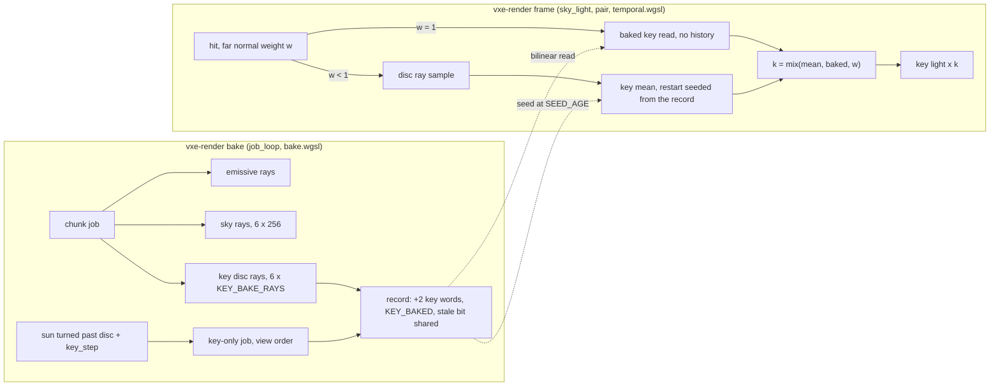

# 0095: Far key light from the bake: the key visibility per brick direction, no screen history at the far band, the near restart seeded from it, a stepped re-bake when the sun turns

> **Status:** in-progress (dev lane from 2026-11-20). Approved 2026-11-20 (owner go; stacked on plan-0094 at aff21a5a, merges main after 0094 lands). The owner accepted coarse far shadows per brick face direction and the far gate by the far normal's band; W1 judges the default 3-degree sun only; a lagging re-bake under the day cycle shows the old shadow with a fade (both as recommended).
> **Created:** 2026-11-20
> **Milestone:** M10: Outdoors in [`docs/roadmap.md`](../roadmap.md)
> **Related ADRs:** [ADR-0079](../adrs/0079-the-key-lights-visibility-is-baked-per-brick-direction-over-the-disc-and-read-without-screen-history-where-far.md)
> (proposed with this plan: the decision and the rejected alternatives, the spike's readings
> among them),
> [ADR-0070](../adrs/0070-sky-light-is-baked-visibility-coloured-at-read-with-a-long-history-ray-where-stale.md)
> (the sky's baked visibility this mirrors: the record, the bilinear read, the seed, the rings),
> [ADR-0046](../adrs/0046-static-emissive-light-is-baked-per-chunk-when-a-chunk-loads-or-changes.md)
> (the store, the bake job, `FADE`, the identity rule),
> [ADR-0048](../adrs/0048-the-live-queue-orders-by-the-view-and-withdraws-the-work-a-flight-has-passed.md)
> (the queue order the key-only re-bake rides),
> [ADR-0042](../adrs/0042-the-far-shading-normal-blends-to-the-27-count-gradient-by-the-voxels-size-on-screen.md)
> (the far normal's band, the far gate),
> [ADR-0076](../adrs/0076-light-stability-rules-world-history-per-source-a-fade-per-transition-and-a-ratcheted-pop-counter.md)
> (rules 2, 3 and 6; the binding clause is met under "Where the histories live"; rule 6 is on
> Plan 0094's branch until it merges),
> [ADR-0055](../adrs/0055-render-settings-are-one-struct-with-an-apply-class-per-field-and-profiles-are-named-values.md)
> (the settings rows this adds)
> **Source:** the motion-wobble spike (branch `spike-motion-wobble`, tip `9d8340e5` at drafting;
> its readings log `docs/plans/logs/wobble-spike.md` is committed there and summarised in
> ADR-0079's Context), the owner's complaint and direction at Plan 0094's window 94a
> (2026-11-20) and the owner's two answers of the same day.
> **Starts after:** Plan 0094 closes and merges into main (see "Merge order and the overlap
> with Plan 0094").

## TL;DR

The far trees wobble after a turn and while flying because the key light's per-pixel
visibility mean restarts from one binary sample at every history rejection and climbs as
`1/n` for seconds; the spike measured it and cleared the geometry, the upscaler, the a-trous
and the exposure. This plan bakes the key light's visibility per brick direction over the sun's
disc into the store, beside the sky's (ADR-0070), and reads it with no screen history where the
far normal's weight is 1; a near pixel keeps its disc ray but its restarted mean seeds from the
baked value; the channel re-bakes by key-only jobs when the sun has turned past the disc and a
settable step, and with the sky's rings at an edit. The first thing the owner sees (Phase 4,
window W1, as soon as Phases 1 and 2 show the far look): the forest at 15:00 and at `10,180`
under a slow fly and a 60-degree turn, with `key far` switchable between `baked` and `ray` in
the menu and named in the banner, the far canopies holding still under `baked`. The headless
proof is the spike's rig in the tree: the far pixels with a baked record change by over 4
levels on at most 3 % of a fly's frame pairs (14.2 % today) and are within 4 levels of their
settled value 8 frames after a turn on at least 95 % of pixels (41 % today), read on the
undrained image.

## Context & problem

The complaint, the readings and the direction are in ADR-0079's Context; the numbers below are
the ones the phases are written against (`docs/plans/logs/wobble-spike.md`, the forest of seed
1 at 1080p through FSR 2 at 1.5, RTX 3080 Laptop, loaded):

| reading (far class, display pixels over 4 levels) | default | lighting off | no key ray |
|---|---|---|---|
| still, per frame pair | 0.33 % | 0.01 % | 0.13 % |
| fly at 1 m/s, per frame pair | 14.2 % | 1.34 % | 8.4 % |
| after a stop, against the hold's final frame, +0 / +60 / +120 frames | 35 / 25 / 12 % | 0.6 / 0.04 / 0.0 % | 34 / 22 / 9 % |
| after a 60-degree turn, against the hold's final frame, +0 / +60 / +120 | 59 / 50 / 45 % | 1.1 / 0.06 / 0.0 % | 55 / 49 / 46 % |

Of the far pixels still differing after the turn, 85 % had a key mean under 64 frames old at
+0 and 76 % under 256 at +120: the restart, converging. The near class drifts too (14.8 % of
near pixels over 4 from their final value at the stop's first frame): the ground's lit treads
and the trunks' penumbrae. The queue's landings while the camera rests are the other term
(two thirds of the stop's differing far pixels at +0 were faces waiting for a record): Plan
0094's and the perf plan's (`docs/backlog.md`, "The bake queue's backlog at a still camera"),
and ADR-0076 rule 6 says what the image shows meanwhile. This plan's bars are read on the far
pixels whose hit has a baked record, so they hold on the undrained image, and the all-far
figure is reported beside each with the queue's depth.

The budget figures this touches (`docs/nfr.md`): section 2's lighting line (4.0 ms; the RADV
RENOIR's outdoor light pass reads 8.0 ms on the hills and 12.0 in the forest at rest, the RTX
3080 Laptop's 1.57 and 2.53), section 3's "everything else in VRAM" (the store: 10.6 MB on the
hills, 11.9 in the forest, 9 words a record), section 2's pre-roll (the RTX's hills 14.4 s
under a sky) and section 4's dig budget (the rings' re-bake).

## Decision

**Bake the key light's visibility per brick direction over the disc, beside the sky's; read it
with no screen history at the far band; seed the near ray's restarted mean from it; re-bake it
when the sun steps and at an edit's rings.** ADR-0079 records why. We rejected a shorter
history because it trades drift for grain; the world-hashed disc point because it was built
and read with no gain; a far sun depth map because it is a second shadow model where the store
already holds the sky's version of the same quantity; accepting any history because it halves
the flicker and none of the drift; a wider young pool because Plan 0094 read it as a loss; a
world-space mean of the screen's samples because its first frames are the same climb; sun-arc
stations for their bytes and their double shadows; and a blend of ray and bake everywhere
because it keeps the ray's cost and the wobble at the blend's weight.

The look is decided at the owner's window, so **Phases 1 to 3 are exploration** (lane rule 2b):
their bars are readings taken when cheap; the data, determinism and API tests land with their
phase; the image tests, goldens and the rig's bars are written in Phase 6 against the picks.

### Where the histories live (ADR-0076's binding clause)

- **The key light's estimate lives in the world:** the store's record (six `u8` per brick, two
  new words), baked from the geometry and the sun, read bilinear with no screen history where
  the far normal's weight is 1. The screen-space key mean carries that estimate's seed at a
  near pixel and corrects it toward the pixel's own value; it is never the estimate alone at a
  face whose record is fresh.
- **The fades:** a key re-bake's landing (a sun step or an edit's ring) rides ADR-0046's `FADE`
  like every other record change; the far band's switch between the ray's mean and the baked
  value is a blend of two estimates of one quantity by a continuous weight and needs no fade (if
  the window picks the step at `w` 1/2, the step rides the same `FADE`); the seed is not a
  switch of value (the pixel showed the baked value or nothing before its restart). A face
  with no record or a stale one keeps Plan 0094's prior and fades.

## Architecture diagram



## Implementation phases

Each phase ships as its own commit. `dev` implements all phases in one session with no review
between phases, stopping at the `human` phases. Every phase carries exactly one
`**Owner skill:**`. Phases 1 to 3 are **exploration** (lane rule 2b): built behind a setting,
named in the banner, readings instead of image bars; Phase 6 writes the bars against the picks.
A GPU test names its `gpu_*` binary and its lavapipe wall time; one over 10 s is born
`#[ignore = "soak"]`. Readings are taken on the RTX 3080 Laptop and the RADV RENOIR (lane
rule 8), under the perf lock, with the load noted; every stillness reading states the queue's
depth and is taken on the undrained image (ADR-0076 rule 6), with the queue frozen after the
pre-roll (the rig's `nqueue`) as the control.

### Phase 1: The key channel in the store: two record words, the disc rays in the bake, the block's sun stamp
- **Owner skill:** dev (exploration)
- **What:** The record grows two key visibility words (`KEY_WORD` 9 and 10: direction `face`'s
  `u8` at byte `face % 4` of word `9 + face / 4`, `KEY_BAKED` in the second word's bit 16, the
  stale bit shared with `SKY_STALE`); `record_key_visibility`, `key_words`; `RECORD_WORDS` and
  `BRICK_WORDS` 11, the WGSL constants through `compose.rs`. The bake job draws `KEY_BAKE_RAYS`
  (64, a constant beside `SKY_BAKE_RAYS`) rays per brick direction toward uniform points of
  the disc (`disc_direction` with the sky uniform's `key_dir` and `key_radius`) from face
  points, with the sample and disc points from a hash of the voxel, face and sample index; a
  ray that ends with no hit counts as lit; the SHADOW_ABSORB transmittance folds in as the
  light pass's does. The block's header gains the sun direction it was baked under (one word,
  the octahedral-packed direction, or two `f16`). The channel bakes only while the frame's sky
  has a key light above the horizon. A fly-through debug view (`store read` family, ADR-0049's
  `StoreRead`) shows the baked key value per face as grey, named in the banner.
- **Files touched:** `crates/vxe-render/src/bake/record.rs`, `bake/job_loop.rs`,
  `bake/pipeline.rs`, `src/shaders/bake.wgsl`, `gpu_world/format.rs`, `frame/compose.rs`,
  `frame/settings.rs`, `settings.rs`, `src/lib.rs` (exports), `crates/vxe-render/tests/gpu_sun.rs`
  (new tests), `apps/flythrough/tests/gpu_bake.rs`, `apps/flythrough/src/hud/` (the view's
  banner word), `docs/plans/logs/0095.md`.
- **Done when:**
  - CPU: `key_words([1, 0, 0.5, 0.25, 0.75, 1])` round-trips through `record_key_visibility`
    within one `u8` step per direction, and a record with no `KEY_BAKED` reads `None`
    (`bake/record.rs` unit tests, under 1 s).
  - GPU (`gpu_sun`, lavapipe, each under 10 s at the sky tests' 64-voxel rig): an open floor
    under `Sky` with the sun at elevation 40 bakes a `+z` key visibility of 255 (fully lit) and
    a floor face 1 m under a solid slab bakes 0; a floor whose brick is half under a slab's
    edge (the slab's edge over the brick's middle, the sun at the zenith) bakes `+z` within 16
    steps of 128 (the binomial standard deviation at 64 rays is 1/16, two sigma); a wall facing
    away from the sun bakes 0 for its direction.
  - Identity: two bakes of the same chunk under the same sun are byte-equal in their key words
    (the identity test of ADR-0046's `gpu_bake` extended to the new words, under 10 s), and a
    bake with the sky's key light off leaves the emissive and sky words byte-equal with the key
    on (the ADR-0070 no-sky test's form).
  - The record is 11 words: `frame_bytes` and the frame line's `store` figure at the forest
    and hills (release, drained, both adapters) go to the readings log against section 3's
    10.6 and 11.9 MB (arithmetic says about 13.0 and 14.5).
  - Readings: the pre-roll's seconds with the channel on against the RTX's 14.4 s on the hills
    (`flythrough --headless --source outdoor --frames 1500 --bake-budget frame:40`, both
    adapters), and the bake's rays per brick with and without the channel.

### Phase 2: The read: the far band reads the bake with no history, the near restart seeds from it
- **Owner skill:** dev (exploration)
- **What:** A setting `lighting.key_far` (`Baked` | `Ray`, default `Baked` on the branch; a
  menu row and a banner word; `Ray` is today's path to the bit) and `lighting.key_far_mix`
  (`Blend` | `Step`, default `Blend`). Under `Baked`, at a lighting pixel whose record has
  `KEY_BAKED` and no stale bit: the light pass casts no key ray where
  `far_normal_weight(v, t)` is 1 (its sample word says "baked"); the temporal pass reads the
  record's key visibility bilinear over the 2 x 2 cells and the normal's three nearest
  directions (the sky read's code path, `temporal.wgsl`) and takes
  `k = mix(key_mean, k_store, w)` (`Blend`) or `k_store` where `w >= 0.5` else `key_mean`
  (`Step`); the pair's key reset (any history rejection, `pair.wgsl`'s key path) seeds the
  mean from `k_store` at `SEED_AGE` instead of from the first sample. A record that is absent
  or stale keeps today's path. The rig gains the far-baked class (far pixels whose hit's record
  has `KEY_BAKED` and is fresh) beside far, and reports both.
- **Files touched:** `crates/vxe-render/src/shaders/sky_light.wgsl`, `shaders/pair.wgsl`,
  `shaders/temporal.wgsl`, `shaders/shade.wgsl`, `shaders/common.wgsl` (a lighting bit),
  `frame/settings.rs`, `frame/encode.rs`, `settings.rs`, `apps/flythrough/src/hud/` (the row
  and the banner), `apps/flythrough/tests/gpu_wobble.rs` (the rig from the spike branch, see
  "What the dev reuses"), `docs/plans/logs/0095.md`.
- **Done when:**
  - CPU: the settings rows round-trip through the settings file and the menu
    (`settings.rs` tests), and `Ray` leaves the light pass's pipeline constants equal to
    main's.
  - Readings on the RTX with the rig, default frame, `Baked`/`Blend` and `Baked`/`Step`
    against `Ray`, undrained (`drain` 2000) and `nqueue`, the queue's depth printed: the
    far-baked class's fly pair over 4 and mean |dY|; the stop's and the turn's far-baked
    share over 4 against the hold's final frame at +0, +8, +30, +60, +120; the near class's
    at +0 and +60; the still's far pair over 4. The targets the bars of Phase 6 are written
    from: fly under 3 % (today 14.2 on far), the turn's +8 under 5 % and +60 under 1.5 %
    (today 59 and 50 on far; the lighting-off floor is 1.1 and 0.06), the still at or under
    0.35 % (today 0.33), the near's +0 at most half of today's 14.8 %.
  - Readings on both adapters: the light pass's ms at rest in the forest at 15:00 and on the
    hills at noon, `Baked` against `Ray` (release, 1080p, drained; today RTX 2.53 and 1.57,
    RENOIR 12.0 and 8.0), the far class's share of the display beside.
  - The fly-through shows `key far baked blend` (or `step`, `ray`) in the banner when the
    setting changes.

### Phase 3: The sun's step and the edit's ring: key-only re-bake jobs
- **Owner skill:** dev (exploration)
- **What:** `lighting.key_step` (degrees, 3 by default, live). A frame whose `key_dir` has
  turned past the block's baked direction by more than the disc's angular radius and more than
  `key_step` marks the block for a key-only job: a job kind that redraws the six key directions
  (the record's other words kept, `kept_bricks`' form) and lands them under `FADE`, ordered by
  ADR-0048's view score behind dig jobs, under the queue's budget; the HUD's `bake queue:` line
  counts them (`key N`). A fixed sun queues none. An edit's rings re-bake the key words with the
  sky's and clear the shared stale bit (no new ring rule). The day cycle at 1x shows the far
  shadows step and fade.
- **Files touched:** `crates/vxe-render/src/bake/job_loop.rs`, `bake/queue.rs` (or the queue's
  module as named after Plan 0045), `bake/record.rs`, `shaders/bake.wgsl`, `frame/settings.rs`,
  `settings.rs`, `apps/flythrough/src/hud/` (the queue line), `crates/vxe-render/tests/gpu_sun.rs`,
  `docs/plans/logs/0095.md`.
- **Done when:**
  - GPU (`gpu_sun`, lavapipe, under 10 s): at a fixed sun 600 stepped frames queue 0 key jobs;
    turning the sun by 4 degrees queues a key job for every baked block within one frame and
    the re-baked `+z` value of a floor at a slab's shadow edge moves in the sun's direction (the
    lit fraction of a brick on the shadow's advancing side falls, on the retreating side
    rises); turning it by 1 degree (under the step) queues none; a key-only job leaves the
    record's emissive and sky words byte-equal.
  - GPU (`gpu_sun`, lavapipe, under 10 s): a dig under a floor whose brick was fully lit
    re-bakes its key words with the sky's ring, the stale bit set at the dig and cleared at the
    landing, and the landing's trace at a far-baked pixel is one monotonic fade within `FADE`
    frames (rule 3's form, Plan 0094's `rules.rs` helpers).
  - Readings on both adapters, the day cycle at 1x, the forest at 15:00 and the hills at noon:
    key jobs a second and the seconds until every block in view has re-baked after a step,
    against the step's period (10 s at the default day), the queue's depth and the frame's
    CPU step ms beside; this is the new budget figure (see Budgets).

### Phase 4: The owner's window W1: the far look, blend or step, the sun's step
- **Owner skill:** human
- **What:** A release binary of the branch's tip after Phase 3 (or after Phase 2 if Phase 3
  slips past the day: the window needs the far look, not the step), `live/sessionW1.sh` on the
  live-runner lib (dry-run with `skip`), the forest at `--time 15:00` and at `--sun 10,180`,
  the hills at noon; per scene: a slow fly at 1 m/s for 10 s, a 60-degree turn and a 5 s hold,
  under `key far baked blend`, then `step`, then `ray` (the menu row; the banner names the
  mode); the day cycle on for 60 s under `baked` on the hills (the far shadows' step and fade).
  The owner's verdicts, in the owner's words, to `live/windowW1/verdicts.md` with stills: (1)
  does the far wobble go under `baked`; (2) does the far brick-level shadow read as wrong
  anywhere (a canopy's underside, a hill's long shadow lost past the reach); (3) blend or step;
  (4) is the stepping far shadow under the day cycle acceptable; (5) anything the near seed
  made worse (the ground's penumbrae after a stop).
- **Files touched:** `live/sessionW1.sh`, `live/windowW1/` (untracked), `docs/plans/logs/0095.md`
  (the verdicts summarised).
- **Done when:** the five verdicts are written and the picks (`key_far` default, `key_far_mix`
  default, `key_step` default) are named; a verdict that names a defect this plan's phases do
  not cover goes to the architect as an amendment, not to Phase 5.

### Phase 5: The fix pass after W1
- **Owner skill:** dev
- **What:** The picks as defaults; the shader constants and settings the verdicts moved
  (`KEY_BAKE_RAYS`, `key_step`, the band's mix); nothing that changes the design (a new
  mechanism goes back to the architect).
- **Files touched:** the files of Phases 1 to 3 the picks touch, `docs/plans/logs/0095.md`.
- **Done when:** the defaults are the picks, the banner names them, and the Phase 2 readings
  re-read on the RTX at the picks go to the log.

### Phase 6: The bars against the picks, the goldens, the readings in the NFR
- **Owner skill:** dev
- **What:** The rig's bars as tests, the goldens, and the budget readings.
- **Files touched:** `apps/flythrough/tests/gpu_wobble.rs` (the gate scene and the soak
  reading), `apps/flythrough/tests/gpu_outdoor/` (the far rule 2 scene), `apps/flythrough/tests/golden/`,
  `docs/nfr.md`, `docs/nfr/02-frame-budget.md`, `docs/nfr/03-memory.md`,
  `docs/plans/logs/0095.md`.
- **Done when:**
  - **The gate scene** (`gpu_wobble`, lavapipe, under 10 s or born soak): a 3 x 3 x 2 chunk
    forest of seed 1 at a 320 x 180 lighting grid (480 x 270 through FSR 2 at 1.5), the queue
    drained before the segments and frozen through them, a 20-frame fly at 1 m/s, a 60-degree
    turn over 10 frames, a 60-frame hold; on the far-baked class: the fly's pair share over 4
    levels at most 3 % (mean over the fly), the turn's share over 4 from the hold's final
    frame at most 5 % at +8 and 1.5 % at +60, the still's at most 0.35 %; the same bars at
    `key_far ray` print (the before figures) and are not asserted. The thresholds are the
    Phase 2 targets unless the Phase 2 and 5 readings on the RTX moved them, in which case the
    log names the reading and the test's doc comment the source (lane rule 2a's form).
  - **The soak reading** (`gpu_wobble`, `#[ignore = "soak"]`, the spike's full rig at 1080p,
    `VXE_TEST_ADAPTER` for the RTX by hand): prints the spike's table for the arm set
    `default`, `albedo`, `ray` and `nqueue`, undrained with the queue's depth, so a later plan
    re-reads the wobble with the same instrument.
  - **Rule 2 at the far** (`gpu_outdoor`, lavapipe, under 10 s): the forest's return frame
    after a 90-degree turn away and back matches the settled image within 4 levels on at least
    95 % of the far-baked pixels (today's far return frame reads 37.6 % over 8, Plan 0094's
    reading); Plan 0090's counter takes the scene when it lands.
  - **A golden** (`gpu_outdoor_golden`, lavapipe): the forest at 15:00 at the far band under
    `baked`, blessed on lavapipe, SSIM at least 0.98 against the bless.
  - **The readings in the NFR:** the light pass at rest on both adapters (section 2), the
    store's bytes (section 3), the pre-roll (section 2) and the key re-bake's rate under the
    day cycle (a new line in section 2's table, see Budgets), each with machine, commit and
    load; the ADR-0079 Outcome facts in the close triggers.

### Phase 7: A second short look, only if W1 asked for one
- **Owner skill:** human
- **What:** Runs only if a W1 verdict named a defect as not fixed and a shader changed after
  the window; the same scenes, 10 minutes, `live/sessionW2.sh`.
- **Files touched:** `live/sessionW2.sh`, `docs/plans/logs/0095.md`.
- **Done when:** the verdict is written, or the phase is struck in the Implementation log with
  the reason.

## Data shapes

```rust
// illustrative: bake/record.rs
pub const BRICK_WORDS: usize = 11;           // 9 today: +2 key visibility words
pub(crate) const KEY_WORD: usize = 9;        // dirs 0..3 in word 9, 4..5 in word 10
pub(crate) const KEY_BAKED: u32 = 1 << 16;   // word 10: baked under a key light
// the stale bit stays SKY_STALE in word 8: one bit for both channels
pub const KEY_BAKE_RAYS: u32 = 64;           // a guess, Phase 1 reads it
pub fn record_key_visibility(r: &[u32], face: usize) -> Option<f32>;
```

```wgsl
// illustrative: temporal.wgsl, the key term at a fresh record
let w = far_normal_weight(v, rec.t);
let k_store = record_key(rec, n);            // bilinear, 3 nearest directions, as the sky's
let k = select(mix(key_mean, k_store, w), select(key_mean, k_store, w >= 0.5), key_far_step);
```

The block header: one word holding the baked sun direction (octahedral `2 x u16`); the frame
compares it with `sky.key_dir` once per block in the queue's marking pass, not per pixel.

## What the dev reuses from the spike branch

Branch `spike-motion-wobble` stays as it is; nothing merges from it. The dev takes:

- **The rig:** `git show spike-motion-wobble:apps/flythrough/tests/gpu_wobble.rs` (610 lines,
  `#[ignore = "reading"]`, arms by `VXE_WOBBLE` tokens in `Arm::parse`, the adapter by
  `VXE_TEST_ADAPTER`; classes by hit distance, per-pair and to-final shares, the `diag` lines
  by source and age). Phase 2 adds the far-baked class and the `key_far` tokens; Phase 6 adds
  the small gate scene. Its runners (`live/wobble/snap.sh`, `run-arms.sh`, `table.sh`) are
  untracked; their text is in the spike's readings log (`docs/plans/logs/wobble-spike.md`,
  "The runners") to recreate under `live/wobble/`.
- **Not reused:** the `KEY_WORLD_HASH` arm in `sky_light.wgsl` (`KEY_WORLD_HASH`, `KEY_FAR_T`,
  `world_rand`, the `key_t` private) and `shade.wgsl`'s `key_t` write: ADR-0079's Alternative
  B, measured and rejected. The far gate uses `far_normal_weight(v, rec.t)`, which
  `sky_light.wgsl` already calls for the sky's read.

## Merge order and the overlap with Plan 0094

Plan 0094 is closing in parallel (its Phase 7a landed, Phase 8 in progress, a short Phase 9
look, then the close). It edits `pair.wgsl` (the key path's settle removed, the fade in the
pair's `x` and `w`), `temporal.wgsl`, `shade.wgsl`, `settings.rs`, `frame/settings.rs` and
`tests/support/rules.rs`, which Phases 2 and 3 here edit too, and its Phase 8 promotes the
pair's bars (`a_reset_pixel_starts_from_its_record` among them) that Phase 2's seed touches.
**Plan 0095 starts from main after Plan 0094 merges.** If the owner's go comes before that
close, the lane starts stacked on `plan-0094` and merges main when 0094 lands (lane rule 1);
it never starts from the spike branch. ADR-0076 rule 6, which the bars are read by, is on
Plan 0094's branch until that merge; this plan cites it by number.

## Budgets

| `docs/nfr.md` figure | today | expected | how the close measures it |
|---|---|---|---|
| Section 2, lighting line 4.0 ms: the light pass at rest, forest 15:00 / hills noon | RTX 2.53 / 1.57; RENOIR 12.0 / 8.0 ms | lower: no key ray at the far pixels (17 % of the forest's display; more on the hills) | release `flythrough --headless --frames 1500 --render 1920x1080 --bake-budget frame:40`, both adapters, `Baked` against `Ray`, the frame line's median of the last 30 frames |
| Section 3, the store's bytes (the record 9 to 11 words) | hills 10.6 MB, forest 11.9 | about 13.0 and 14.5 MB (+22 %, arithmetic) | the same runs' `store` figure; `frame_bytes` test |
| Section 2, the pre-roll under a sky (the RTX's hills) | 14.4 s | at most 17 s (a guess: +384 rays per brick against the sky's 1536; a lit key ray walks to the reach) | the same runs' first frame with a record for every chunk in view, both adapters |
| Section 4, the dig's re-bake (the rings' rays) | the ring's sky rays on a dig's frame +0.6 RTX, +1.28 RENOIR | +25 % of the ring's bake rays, a guess | Plan 0086's dig rig, both adapters |
| **New, section 2:** the key re-bake's rate under the day cycle at 1x, `key_step` 3 degrees | none | the blocks in view re-baked within one step (10 s) on the RTX; the RENOIR's figure read and reported, a proposal for its line | Phase 3's reading, both adapters, forest and hills; the HUD's `key N` count |
| Frame targets | 536 150 828 B at 1080p | unchanged (no new target) | `frame_bytes` test |

The close review runs the gate tier (no soak, owner 2026-11-19), runs `test-times.mjs` on it,
and checks each row above for a number, a machine and a commit.

## Risks & open questions

- **The far cap loses long shadows** (ADR-0079's second negative). If W1 reads a lost hill
  shadow as wrong, the options are a longer bake cap for the key rays alone (the identity holds
  only when the whole window is resident) or ADR-0079's Alternative C at the far; both are
  amendments, not Phase 5 fixes.
- **The band's blend keeps a share of the wobble** at weights between 0 and 1 (16 to 48 m at
  1080p, arithmetic). W1 picks blend or step; a third form (a shorter key cap inside the band,
  since the seed makes a short cap cheap) is named here and not built unless the window asks.
- **The re-bake under the day cycle may not keep up** on the slow adapter (a guess: key-only
  jobs at a quarter of a full job's rays, today's 9 to 38 full jobs a second, 1720 blocks in
  the forest: 11 to 43 s a step against the 10 s period). The far then lags by several steps,
  in view order. Phase 3 reads it; the owner's question 2 below.
- **Determinism of the bake:** the key rays' sample points come from a hash, never from a
  frame counter or a pixel; the identity test asserts byte-equality. The CPU side (`vxe-world`)
  is untouched.
- **Memory:** +8 B a record is +2.4 MB on the hills; no per-frame allocation; the block header
  word is inside the existing block.
- **The seed's bias:** a near pixel seeded from the brick's mean at `SEED_AGE` 8 starts up to
  the brick's leak away from its own value (a shadow edge inside a brick) and corrects at
  `1 / (n + 8)`; this is smaller than the first sample's 0-or-1 start at every pixel whose
  brick is not exactly half lit, and larger only where the brick is half lit and the first
  sample happened to be right. Phase 2 reads the near class; if it worsens, `SEED_AGE` for the
  key seed is its own constant.
- **GPU features:** none new; the read is a storage buffer fetch of words already fetched.
- **Threading:** the key-only job runs on the bake's worker like every job; the marking pass
  runs where the queue is ordered.

## Owner questions (each with a recommendation; the dev proceeds on it)

1. **The default sun size for the bake's penumbra.** The testbed's disc is 3 degrees
   (`--sun-radius`), the real sun's 0.27. The baked penumbra follows whatever the frame's sky
   sets, so there is no decision for the engine; the question is only whether W1 should also
   look at the real sun's size. **Recommended:** no; W1 at the defaults, the real sun's size is
   a later window's if ever.
2. **Under a running day cycle, when the re-bake lags, the far shows the old sun's shadow
   (recommended) or falls back to the ray** (the wobble returns while the cycle runs).
   **Recommended:** the old shadow with the fade; the cycle is off by default and the step is a
   setting.

## What this plan does NOT do

- **The queue's landings at a still camera** (ADR-0076 rule 6's first case; the forest's queue
  never drains): the perf plan's (`docs/backlog.md`, "The bake queue's backlog at a still
  camera") and Plan 0094's prior. This plan's bars are read on the far pixels with a record.
- **The sky pair's restart while flying** (`keyoff` left 8.4 % on the fly): the sky at a face
  with a fresh record already reads the bake with no history (ADR-0070); what is left is the
  no-record faces, the item above.
- **The far field** (Plan 0033): the shadows of casters beyond the reach belong there.
- **A per-voxel or per-face far shadow** (ADR-0079's Alternative C, ADR-0046's face level): the
  brick level is accepted; Alternative C is the named upgrade.
- **Plan 0090's counter** takes the rule 2 scene when it lands; this plan writes the scene.
- **Any change to the emissive or sky channels' bake**, or to the dig's hole band (Plan 0094).

## Implementation log

> Written by `dev`: one row per phase as its commit lands, then the close block. **The phases
> above are the contract. This section records what happened.** Observations, never conclusions:
> no pass list, no self-assessment. Deviations and unmet done-whens are **always** disclosed.
> Keep it shorter than `## Implementation phases`. Readings, gate counts, attempts, sweeps and
> resume notes go to the plan's readings log, `docs/plans/logs/0095.md` (started from
> `templates/readings-log.md`), and this section links it once it exists.

Readings: [`logs/0095.md`](logs/0095.md).

| phase | owner | state | commit |
|---|---|---|---|
| 1: The key channel in the store | dev | done (exploration) | 011d707a |
| 2: The read at the far band and the seed | dev | done (exploration); readings partial | 937a08da |
| 3: The sun's step and the edit's ring | dev | not started (W1 runs before it, as the plan allows) | |
| 4: The owner's window W1 | human | prepared after Phase 2 (`live/sessionW1.sh`), not run | |
| 5: The fix pass after W1 | dev | not started | |
| 6: The bars, the goldens, the NFR readings | dev | not started | |
| 7: A second short look, if asked | human | not started | |

### Notes

- Phase 1: files beyond its list: `bake/job.rs` (the face's key rays), `bake/mod.rs`
  (`BakeReport::key_rays`), `bake/store.rs` (the summary keeps the sun stamp),
  `bake/summary.rs` (its layout test at 11 words), `frame/baked.rs` (`bake_key`),
  `shaders/light.wgsl` and `shaders/sky_light.wgsl` (`disc_direction` moved into the bake's
  modules); `gpu_world/format.rs`, `frame/settings.rs`, `settings.rs` and the HUD untouched.
- Phase 1: the block's sun stamp is the summary record's first key word (`KEY_SUN_AT`, its
  `KEY_BAKED` clear), not a new header word; a dig ring job stamps the current sun though its
  kept bricks may be older.
- Phase 1: the debug view of the baked key per face (a `store read` view) is not built.
- Phase 2: files beyond its list: `frame/compose.rs` (the two bits), `src/lib.rs` (exports),
  `settings/tests.rs` and `frame/settings/tests.rs` (moved out for the size cap), the fly-through's
  `cli/outdoor.rs`, `cli/mod.rs`, `cli/tests/outdoor.rs` (`--key-far`, `--key-far-mix`),
  `toggles.rs` (the menu rows), `tests/menu.rs` and `docs/flythrough.md`; `frame/encode.rs`
  untouched (the bits ride `Lighting::flags`).
- Phase 2: the banner names `key far` only off the default (`key far ray`, `key far baked,
  key far mix step`); the menu's rows name every mode.
- Phase 2: the far-baked class is read from the sky's source word `record` (the shared stale
  bit and job), not from the key words themselves.
- Phase 2: the rig readings do not meet the Phase 2 targets in any arm; the far-baked class
  was empty at the still and the stops (the far unbaked after the drain); the light pass's
  ms, the store's bytes and the pre-roll on both adapters are not taken (readings log).
- Phase 2: the seed counts as SEED_AGE samples of the key mean at every pixel whose record is
  fresh, also where the record landed after the pixel's reset.

### Close triggers

- **What shipped:** feature / fix-only / docs-chore-only
- **Public API changed:** types, traits, functions, shader interfaces, config (list them, or none)
- **Budget readings:** each `nfr.md` figure touched, with its measured value, machine and commit
- **Gate at the tip:** the commands run (build, nextest, doctests, clippy, fmt, deny), exit codes, test counts
- **Outstanding `human` phases:** which, or none

## Followups

- The spike branch `spike-motion-wobble` is deleted after this plan closes (its log is cited by
  ADR-0079 and summarised there; the rig lives in the tree from Phase 2).
