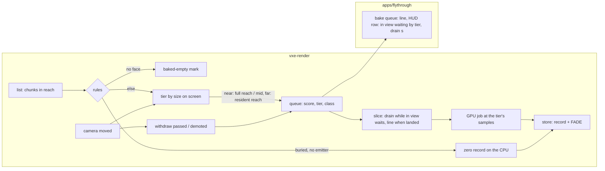

# 0096: Performance: the bake queue's drain (a record by rule, a tier by size on screen, a drain slice), the step off the depth, the slow adapter's light pass, and the sync's `alloc` and eviction scan

> **Status:** implemented, awaiting the fresh close review (dev, 2026-11-23): every phase landed, the Phase 9 rulings' test edits and third RENOIR read included (Implementation log, Close triggers). In progress from 2026-11-21. Approved 2026-11-20 (owner go; starts after Plan 0095 closes and merges). Owner picks, all as recommended: the drain slice 4.0 ms Floor / 6.0 ms Portable while in-view work waits, 1.0 once landed; a far chunk's 256-sample record is final until the camera brings it nearer; if the RENOIR forest stays over 4.0 ms the Portable profile owns the levers it picks and the Floor line stays with the miss disclosed; the window includes the 60 s cave glide. **Amended 2026-11-20 (owner)**, at Plan 0095's window W1: the far tiers' reach rule moves into this plan (ADR-0080 rule 4; a chunk whose reach crosses the full radius bakes its mid or far tier from the chunks resident, the near tier keeps the full reach), Phase 1's census counts reach-bound chunks by the exact test and names the no-record bricks if Plan 0095 Phase 6 cannot, Phase 6 (c) reads far pixels on the baked key or the column map's horizon, the landed state counts a LOD-ring face served by the horizon, and 0095's extra bake rays are conditional on its window W2. **Amended 2026-11-22 (architect, owner confirm owed)**, overnight at the Phase 6 checkpoint `2665f41f`: Phase 4's bar 2 is read at the default drain slice and the F2 rig's miss is a disclosed reading with its cause (the opening's candidate cap, routed to the Phase 5 bar 3 decision); Phase 6's lever (b) leaves bar 1 and the window (a no-op on cube faces, bounded at 0.16 ms by Phase 1's `--sky-rays 0` arm), the setting stays, and bar 1 becomes the key cap's test; Phase 6's paths fixed (`crates/vxe-render/tests/gpu_sun/key.rs`, `cli/outdoor.rs`). **Amended 2026-11-22 (architect, owner confirm owed)**, overnight at Phase 7's tip `8bb8857b`: Phase 7's bar 2 (the glide's `light place`) takes a Phase 7b, the write walk ending at the first refusal it cannot undo (outcomes identical, bar 1's test extended), before the Phase 8 window when it lands first; Phase 7's bar 3 (`alloc` and the sync lines) is disclosed, the per-brick packing routed to its own plan under ADR-0056 at this plan's close. **Amended 2026-11-22 (architect), at the Phase 8 window** (section "The window's verdict and what is left"): the verdicts are recorded with their standing; the three overnight amendments above and the readings log's five morning questions stand **on the recommended option under the owner's standing rule, not on his words**; Phase 6's base is `--penumbra disc` (Plan 0098's W1, owner confirm owed at its W2) and the approach penumbra's lever leaves this plan; the drain slice per profile is set by a headless sweep under a stated rule; Phase 9 is restated; the bake step off the main thread is a plan of its own, drafted now; the RENOIR's 85 ms frame was read at 3.79 times the Portable profile's pixels and is not a close trigger. **Owner picks, 2026-11-22**, on that section's four questions: the Portable profile renders at its 720p hint in a window; the bake-thread plan is drafted now and its lane runs after Plan 0087; the drain slice by frame rate first with the 2x drain guard; the rule 6 run and the 4096 arm go to Plan 0098's W2. **Amended 2026-11-23 (architect, owner confirm owed)**, at Phase 9's tip `a2d93d39` (section "The Phase 9 rulings"): the smallest-slice rigs' fix `501bcd95` stays (it restores the slice those tests state; the owner's rule on rigs applies, so his confirmation is owed); the failing opening test claims the candidates scored, not the index rebuilds; a dig's ring bakes at the profile's near tier, as ADR-0080 rule 2 says and as built; the RENOIR's 6.0 pick is accepted on the median of its quiet runs; what the close review checks about the four tests red since Phase 4 is in the Close triggers. **Amended 2026-11-23 (architect, owner confirm owed)**, at the fresh close review's findings on `05d0e6fe` (section "The close review's rulings"): ADR-0080 rule 1's zero record answered 0.1 to 7 % of the buried chunks in the plan's own scenes, so the plan gains **Phase 10** (a reading first, then the rule applied whatever the class, the reach or the columns' finality, behind a gate and an audit) and does not close before it; the workers' shells map is pinned in `docs/nfr.md` section 3; Phase 2's bar 5 and the census's bands, the Portable size rule's place and its aspect stretch, and the glide's `light place` are disclosed and routed; two facts about the drain picks are stated for the owner.
> **Created:** 2026-11-20
> **Milestone:** M10 (the outdoor scenes are where the queue never drains) and cross-cutting
> like [Plan 0067](done/0067-the-frames-cpu-a-cheap-queue-step-a-bake-budget-by-time-and-no-black-for-missing-light.md):
> it serves `docs/nfr.md` section 2's streaming, bake-slice and lighting lines and section 1's
> slow adapter. The owner's "address performance next" (2026-11-11), placed after Plans 0094 and
> 0095 (2026-11-20).
> **Related ADRs:** [ADR-0080](../adrs/0080-the-live-queue-bakes-what-the-image-reads-a-record-by-rule-a-tier-by-size-on-screen-and-a-drain-slice.md)
> (proposed with this plan: the queue bakes what the image reads; amended 2026-11-20 with rule
> 4, the reach rule by tier) and ADR-0079 (on branch `plan-0095` until Plan 0095 merges: the
> far's key light is the column map's horizon, refined by the record this plan lands). It rests on
> [ADR-0046](../adrs/0046-static-emissive-light-is-baked-per-chunk-when-a-chunk-loads-or-changes.md)
> (the store and its queue), [ADR-0048](../adrs/0048-the-live-queue-orders-by-the-view-and-withdraws-the-work-a-flight-has-passed.md)
> (the order and the withdrawal), [ADR-0052](../adrs/0052-the-live-queues-bake-budget-is-time-per-second-not-a-slice-per-frame.md)
> (the budget's unit), [ADR-0053](../adrs/0053-a-light-summary-per-block-and-a-two-level-parent-table-light-a-brick-with-no-value.md)
> (the fallback chain, the coarse answer rule 6 names), [ADR-0070](../adrs/0070-sky-light-is-baked-visibility-coloured-at-read-with-a-long-history-ray-where-stale.md)
> (the sky channel and the column-map rule) and
> [ADR-0076](../adrs/0076-light-stability-rules-world-history-per-source-a-fade-per-transition-and-a-ratcheted-pop-counter.md)
> rule 6 (proposed on Plan 0094's branch, 2026-11-20: the undrained image is the judged image;
> the drain time is this plan's budget). The sync phases rest on
> [ADR-0017](../adrs/0017-mirror-cpu-work-bounded-in-the-frame-loop-narrowing-on-stream-workers.md).

## TL;DR

The forest's bake queue held 12 752 to 16 150 jobs through the owner's window 94a and drained
at 9 to 38 chunks a second, so the precise light lands 7 to 30 minutes after the load; the owner:
"if we have to wait for a minute for light to settle, something is wrong with the light and we
need approximate things, it is not acceptable for user". This plan makes **the time the queue
takes to land what is in view a budget in `docs/nfr.md`** and meets it three ways (ADR-0080):
a chunk the rules can answer gets its record **without a GPU job** (no exposed face, or buried
under the column map with no emitter in reach: a zero record), every other chunk bakes at **a
sample tier set by its size on screen** (full where a voxel is over the far-normal band, the
coarse count where it is under it, promoted when the camera comes near, as one rule 3 fade;
**a mid or far chunk whose light reach crosses the streamer's full radius bakes from the chunks
resident**, since under the default reach rule nothing past about 72 m ever bakes and the far
tier would be empty), and the bake's slice **rises while in-view work waits** and falls to the
line when it has landed. Beside it: the queue's step on the main thread (6.3 ms p50 at 1080p while the queue is
deep) gets its cost off the queue's depth; the RADV RENOIR's outdoor light pass (8.0 and 12.0 ms
against the 4.0 ms line) is read lever by lever; and the sync's `alloc` stage and the light
placement's eviction scan (up to 1.2 s a sync in a windowed glide) take the backlog's two sync
entries. Phase 1 is readings only, on both adapters, **on the undrained image** (rule 6). The
first thing anyone sees: the `bake queue:` line and the HUD's queue row say how many in-view
chunks wait, by tier, and how many seconds the drain is projected to take.

## Context & problem

Every figure is a reading unless marked; "RTX" is the NVIDIA GeForce RTX 3080 Laptop GPU,
"RENOIR" the AMD Radeon Graphics (RADV RENOIR), the slow adapter of `docs/nfr.md` section 1.

- **The queue never drains outdoors.** Window 94a (Plan 0094's readings log, Phase 7, release
  `37783825`): the forest at 15:00 read a queue depth of 12 752 (run 2) and 14 499 with 4 419
  in-view chunks waiting, 782 of them coarse (run 4); run 6's `bake queue:` lines read depth
  16 099 to 16 150 over 5 s while `baked` rose by 9 to 38 chunks a second; run 2's first
  seconds read +94 to +190 a second (the coarse jobs). Full residency is 17 077 chunks at
  29.9 s, so nearly every resident chunk is listed. Plan 0086's close (`docs/nfr/02-frame-budget.md`,
  2026-11-19) read the hills' queue over 14 000 deep in every 900-frame run and the pre-roll
  on the RTX's hills lengthened from 7.3 s to 14.4 s with the sky channel; Plan 0094's and the
  wobble spike's rigs never drained the forest in 30 000 frames. The wobble spike
  (`docs/plans/logs/wobble-spike.md` on branch `spike-motion-wobble`) attributes two thirds of
  the far pixels still differing from their settled value at a stop to faces waiting for a
  record, the other third to the screen-space key and sky means that Plan 0095 takes.
- **The reach rule caps the baked far at about 72 m** (amended 2026-11-20; Plan 0095's
  readings log, "The idle queue after W1", `b7ad63f7` on branch `plan-0095`): a chunk bakes only
  when every chunk in its light reach is mirrored full (`in_reach`, offsets up to 5.39 chunks at
  `DEFAULT_LIGHT_RADIUS` 4), and the full radius is 16 chunks (`lod.r_full`; 12 in the Portable
  profile), so under `ReachMode::Full` no chunk past 11.18 chunks (about 72 m; about 42 m in
  the Portable profile) ever bakes and the LOD ring (16 to 24 chunks) never does. The hills at
  noon drained to 0 jobs at 26 s with 2 964 of 3 561 in-view chunks waiting reach-bound; the
  exact test (`reach_crosses`) marks 11 814 of the full sphere's chunks, the HUD's `len + lr >
  r_full` 9 924 (the 1 890 between lie at 10.68 to 12.0 chunks; Plan 0095 Phase 6 fixes the
  count). The last black dump there also found 461 px over 24 chunks within 10 chunks whose
  chunk holds a block and whose hit brick has no record, at every dump from frame 60 on,
  unexplained. The far band of this plan's tiers begins at about 38.5 m at 1080p (a voxel under
  2 px), so nearly every far-band chunk is past the reach line: without a reach rule the far
  tier has nothing to bake. `ReachMode::Partial` (`--reach partial`, Plan 0067 Phase 5) bakes
  such a chunk from the chunks resident and re-queues it when its reach arrives; the owner kept
  `Full` globally at Plan 0067's window ("not much difference really").
- **The arithmetic of the drain** (from Plan 0067's readings, `docs/plans/logs/0067.md`): a
  full job (4096 samples a brick direction, `QUEUE_BRICK_SAMPLES`) draws about 1.2e6 samples a
  chunk and a coarse one (256, `DEFAULT_COARSE_SAMPLES`) about 7.4e4; the RTX draws 5.1 ns a
  sample, the RENOIR 47.3. So a full chunk costs about 6.5 ms of RTX GPU and 60 ms of RENOIR
  GPU, a coarse one 0.4 and 3.5 ms (the sky channel since Plan 0086 adds 256 rays a brick
  direction, longer ones: not read per job). Under the default `frame:1.5` the queue draws
  about 40 ms of bake a wall second on the RTX and 30 on the RENOIR (`docs/nfr.md` section 2),
  so 16 000 full chunks are 104 s of RTX GPU and about 43 minutes at the slice; on the RENOIR
  960 s of GPU and about nine hours. No slice makes the RENOIR bake every resident chunk at
  the full count. The 94a drain rate (9 to 38 a second) is this mix of full and coarse jobs.
- **Rule 6 says what the image shows meanwhile** (ADR-0076, proposed, amended on Plan 0094's
  branch at `38460762`): a face whose record has not landed shows a coarse stable answer (the
  chain's neighbour or parent summary, ADR-0053; the no-ray prior Plan 0094 builds), and the
  record arrives as one fade. The rule leaves the drain's time to this plan as a budget. The
  budget is empty today: `docs/nfr.md` has a 1.0 ms bake-slice line the default `frame:1.5`
  already exceeds (the owner took the lines as proposed at Plan 0069's close) and no line for
  how long a chunk in view may wait.
- **The step on the main thread.** Plan 0086 Phase 24c (`docs/plans/logs/0086.md`, RTX,
  1080p, the tunnel's stairs at rest, the queue 14 103 to 15 444 deep): the queue's step p50
  6.2 to 6.6 ms, frame CPU p50 7.4 to 7.8, so the wall is the step and the GPU frame (4.5 ms)
  in series: 13.4 ms at 1080p, 16.6 at 1440p, where the GPU is within every Floor line. Plan
  0067 made a still queue's step cost 0.075 ms and a flight's regime B step 9 to 13 ms (nearly
  every step opening a job; `docs/nfr.md` section 2); its stage laps (`STEP_STAGES`,
  `crates/vxe-render/src/bake/stages.rs`) read the opening's `candidates`, `list` and `sort` as
  the large parts, each walking the candidate pool. Phase 5's reading (0086) put the step with
  the sky channel at 5.7 to 7.6 ms p50 while baking. The backlog's "CPU settle outdoors"
  entry read the same: 7.9 to 15.0 ms p50 for the 7 to 10 s after every load on a world with
  no emitter in reach whose store ends all zeros (3 285 chunks baked by 13.7 s), 0.05 ms once
  drained. `bake/queue/mod.rs` is at the 1200-line cap.
- **The slow adapter's light pass at rest** (Plan 0086's close, `docs/nfr/02-frame-budget.md`,
  release, headless 1080p at the defaults, the queue drained by `--bake-budget frame:40`,
  loaded): RENOIR light 8.025 ms on the hills at noon and 12.034 in the forest at 15:00
  against the 4.0 ms lighting line (10.5 and 12.5 before ADR-0070), inside frames of 53.3 and
  43.7 ms whose largest pass is the hit (21.9 and 10.7 ms); at the tunnel's stairs 3.88 + 0.34.
  The RTX reads 1.570 and 2.529, within the line. Plan 0032 Phase 6 read a sky ray at about
  4.8 ms on the RENOIR and 0.25 on the RTX; what the RENOIR pays at rest now is the key light's
  disc ray and the baked read. The review of Plan 0032's window
  (`docs/reviews/2026-11-17-plan-0032-window.md`, E2) named two levers unbuilt: a cap on the
  key ray's length and no sky ray from faces that look down.
- **The sync's two entries** (`docs/backlog.md` until this plan; Plan 0074's close, RTX host on
  `hpet`): `update + poll + sync` p99 18.0 to 23.7 ms in the tester cave and 20.4 to 22.7 in
  the castle against Plan 0067's 16.6 ms; the largest stage left is `alloc` (p99 7.3 to 8.8
  ms), whose profile read `fill_slot` 3.15 %, `BufferViewMut::drop` 3.12 %, `upload_brick`
  2.52 % of the main thread in a glide. The forest at leaf fill 128 read a sync p99 of 11.0 ms
  (`alloc` 5.3) and `update + poll + sync` max 150 ms (Plan 0032 Phase 9). In the owner's
  windowed `--glide 300` cave flight every second's slowest sync from about 4 s in is `light
  place`, up to 1 186 ms over 3 697 evictions and 99.9 M scan steps (r 0.997 against
  `light_scan_steps`, 11 to 12 ns a step), the free ranges growing to about 6 000; no headless
  glide (19 runs) evicted a range. The scan is `write_chunk_lights`
  (`crates/vxe-render/src/gpu_world/lights.rs`): on a failed first fit it walks every placed
  chunk for the farthest victim, once per eviction. Plan 0074's Phase 2 draft, a first-fit
  index (`fit.rs`), is kept untracked in the main checkout at `live/plan-0074/drafts/`.
- **The smaller backlog items this plan takes:** the queue step's remaining `filter` cost on a
  moving camera (about 0.074 ms p50; `gone`, `drop_reach`, `touched` each walking the mirror's
  changes), and the RTX's submits drawing 5.3 of a granted 8 ms slice under a per-second budget
  (Plan 0067's followup F2: the rounds planned against the slice, or `IN_FLIGHT` 2).

## Decision

**The queue bakes what the image reads, and the drain of what is in view is a budget**
(ADR-0080). Three mechanisms, in the order they pay: (1) a chunk the rules answer takes no GPU
job: a chunk with no exposed face holds nothing to light and is marked baked-empty; a chunk
whose reach box (the chunk dilated by the light radius, `DEFAULT_LIGHT_RADIUS` 4) lies under the
column map's lowest top over that footprint and holds no emitter in reach gets a zero record
written on the CPU with the baked bits set, since ADR-0070's rule already counts every ray
ending under the column top as not sky and no emitter can reach it. (2) Every other chunk bakes
at a tier set by its size on screen through the far-normal band (`far_normal` `[lo, hi]` pixels
a voxel, `[2, 6]` at the defaults): full (4096) where its nearest voxel projects over `hi`, a mid
count (1024) between, and the coarse count (256) under `lo`; a chunk that moves into a nearer
band as the camera moves is re-listed as a refinement and lands as one `FADE` (rule 3); one
that moves out is withdrawn like a passed job (ADR-0048) if not yet submitted. The far tier is
final, not a first pass: the queue reaches a landed state. **The reach rule is by tier**
(ADR-0080 rule 4, amended 2026-11-20): a near-band chunk waits for its full reach (ADR-0046); a
mid- or far-band chunk whose reach crosses the full radius (`reach_crosses`) bakes from the
chunks resident once nothing in its reach waits to upload, the LOD-only chunks beyond the sphere
casting from their mips, flagged partial in the queue's maps as `ReachMode::Partial` does
today; the partial record is refined by the band promotion, not by the reach filling (the
re-queue on arrival is off for mid and far records), and the dig's ring keeps the near count
with the re-queue. A LOD-only chunk holds no record; its faces read the column map (ADR-0079's
horizon, ADR-0070's sky rule) for good, and the landed state counts them as landed. (3) The slice (ADR-0052's unit) has
two values: a drain value while any in-view chunk waits for its tier's record and the line's
value once none does; both are settings rows per profile, judged in the owner's window.

Beside the queue: the step's opening cost is made proportional to the jobs it opens and the
chunks whose score changed, not to the queue's depth; the RENOIR's light pass is read lever by
lever behind settings (the key ray's cap, no sky ray from faces looking down, far pixels on the
baked key with no ray and no pair update once Plan 0095 lands), each lever a cheap mode kept as
a setting whether or not the Portable profile picks it; and the sync takes Plan 0074's Phase 2
index for the eviction scan and the `alloc` fix its profile names.

We rejected, for the reach (ADR-0080 Alternatives E to G), **a wider full residency** (cube-law
memory on about 0.87 GB live, the LOD ring still unbaked, the Portable profile cannot pay it),
**`--reach partial` as the global default** (the owner kept `Full` at Plan 0067's window; it
changes the near records that ADR-0046's identity test and the dig's ring stand on, for a gain
only the far needs) and **refining a partial far record when its reach fills** (one more job and
fade per approached chunk at about 72 m, where the mid band's re-bake at about 38 m lands at
the full reach anyway). We rejected **a larger slice alone** (the arithmetic above: the RENOIR cannot bake the
residency at the full count in any time the owner would call settling, and the RTX would spend
minutes), **a progressive queue that refines every chunk to the full count when idle** (no
landed state, so rule 6's "one fade when it lands" has no landing and the step never rests),
**a per-brick skip inside the GPU job** (the step still lists, scores and submits the chunk;
the CPU cost this plan chases stays), and **baking on the stream workers' CPUs** (ADR-0046's
rejected alternative; the GPU bake at 5 ns a sample is the fast path). A second GPU queue was
rejected in ADR-0052 (wgpu has one).

## Architecture diagram



## Implementation phases

Each phase ships as its own commit. `dev` implements all phases in one session with no review
between phases; the architect reviews once at the end, in a fresh session. Phases 3, 4 and 6 are
**exploration** (lane rule 2b): they name readings, not image tests, and the owner's window
(Phase 8) decides their values; Phase 9 writes the bars against the picks. Every reading is
taken on the **undrained image as well as the drained one**, with the queue's depth and the
in-view waiting count beside it (ADR-0076 rule 6), on the RTX (Floor profile, 1080p, FSR 2 at
1.5) and the RENOIR (`--adapter AMD`, Portable profile, 720p), release, under the exclusive perf
lock with the 1-minute load logged.

**Starts after Plan 0095 (the motion wobble) closes and merges**, which follows Plan 0094: 0094
lands rule 6's coarse prior and moves the default-off arms out of the default pipeline (the
RENOIR light-pass readings must be taken on that pipeline), and 0095 (amended 2026-11-20 at its
window W1) gives the far's key light an instant estimate from the column map's horizon that the
baked record refines where it lands (the owner's pick), so far pixels read a baked key or the
horizon with no ray; its key-visibility bake adds about 6 % to every job's rays (its guess)
**only if its window W2 keeps the record as the far's refinement**; if W2 holds the horizon for
good, 0095's key bake defaults off and the jobs' rays are unchanged. Either way the drain's cost
and the RENOIR's light pass are re-read here. Plan 0095 Phase 6 also lands the reach-bound
count's fix (the exact extent, 5.39 chunks at light radius 4) that Phase 1's census reads, and
names or hands over the 461 no-record pixels. If 0095 is still open when the lane is free, Phase
1 may run on 0094's tip with the +6 % carried as a projection and re-read at Phase 9.

### Phase 1: Readings on the undrained image, and the drain readout
- **Owner skill:** dev
- **What:** The one instrument this plan adds, then every reading the fix phases bar against.
  The instrument: the per-second `bake queue:` line (`apps/flythrough/src/run/queue.rs`,
  `print_queue_line`) and `run.json` gain the in-view waiting count split by the chunk's band
  (near, mid, far, by the far-normal band applied to the chunk's nearest corner) and by class
  (no record, coarse), the samples those chunks still need, and `drain_s`, the projection of
  that need over the last second's samples a second; the HUD's queue row shows `in view N
  waiting, drain Ns`. The per-submit GPU time (`LoopTimer`, `crates/vxe-render/src/bake/job_loop.rs`)
  is split across the submit's jobs by their samples into a ns-a-sample per class (full, coarse),
  printed on the line as an attribution, not a measurement. **No profiler scopes ride here**:
  Plan 0091's `budget_scope!` wraps `queue step` and `sync` later at the lines this plan sets;
  what Phase 1 needs is on the existing lines and `PassTimer`.
  The readings, in the readings log with machine, adapter, commit, load and the queue's depth:
  1. **The drain curves** at rest from the first world frame, the hills at noon and at 17:00
     and the forest at 15:00 (`--source outdoor`, `--spawn forest --trees forest`): depth,
     in-view waiting by band and class, baked a second by class, bake ms a second drawn
     against the slice granted, `drain_s`, until drained or 600 s; both adapters.
  2. **The census of the listed chunks** at the first world frame on the same scenes: how many
     hold no exposed face, how many are buried under the column map with no emitter in reach
     (the rule of Phase 2, computed on the CPU from the mirror's face masks, the column map and
     the emitter census), how many are surface chunks by band (near, mid, far by the far-normal
     band at 1080p) and in or out of the view cone, and how many of the surface chunks by band
     are **reach-bound by the exact test** (`reach_crosses`, or `len + reach_extent(lr) >
     r_full` with the extent 5.39 chunks at light radius 4, as Plan 0095 Phase 6 lands it; not
     the old `len + lr`), which is what Phase 3's reach rule bakes partial. This census sizes
     Phases 2 and 3; the guess it tests: the residency is a sphere of about 16 chunks' radius
     (17 077 chunks), about 800 columns, and the surface band is 2 to 3 chunks a column, so
     1 600 to 2 400 surface chunks on the hills and more under the forest's canopies, with
     most of the far band past the 11.18-chunk reach line. If Plan 0095 Phase 6 did not name
     the cause of the about 461 px whose chunk holds a block and whose hit brick has no record
     (`--dump-black` on the hills at noon, 24 to 28 chunks within 10 chunks, every dump from
     frame 60 on), this census takes them: the dump's materials, faces and cell states, one
     paragraph in the readings log naming the cause, and the fix in Phase 2 if it is a listing
     rule's miss (reported to the architect if larger).
  3. **The step's 21 stage means** (`bake queue step:` line, per regime) at a depth over 10 000
     and at the drained state, at rest and in a `--glide 300` flight; and the mirror's change
     count a step in the glide (printed beside the `filter` stages, the backlog's ask).
  4. **The moving camera:** in the glide and in a 90-degree turn (the wobble rig's protocol):
     jobs withdrawn before submit, jobs that completed after their chunk left the cone (wasted
     samples), chunks re-listed.
  5. **The RENOIR light pass by arm,** `PassTimer`'s `light` median of 30 frames at rest,
     drained and undrained, the hills at noon and the forest at 15:00: the default; `KEY_OFF`
     (the key ray's share); the sky ray never cast (a hook that reads the record as fresh, or
     `sky_rays 0` where it exists) and `SKY_RAY_ALWAYS`; `far_normal` off; the full tier
     against half; the a-trous at 1, 2 and 4 iterations. The RTX beside it.
  6. **The sync:** the tester cave bench and the forest at leaf fill 128 with the stage lines,
     a `perf record` of the main thread at `alloc`'s p99 syncs (the stages' callees by share);
     and a headless glide that fills the light buffer by shrinking it (`--light-samples` at
     1/16 of `DEFAULT_LIGHT_SAMPLES`, 1 << 20), which is the plan's bet on reproducing the
     window's eviction scan headless; its `light place` p99, evictions and scan steps.
- **Files touched:** `apps/flythrough/src/run/queue.rs`, `apps/flythrough/src/report.rs`,
  `apps/flythrough/src/hud/` (the queue row), `crates/vxe-render/src/bake/queue/open.rs`
  (`view_census` by band), `crates/vxe-render/src/bake/job_loop.rs` (the per-class split),
  `apps/flythrough/tests/queue_line.rs` or the existing CPU test of the line,
  `docs/plans/logs/0096.md`.
- **Done when:** `the_queue_line_reports_in_view_waiting_by_band_and_a_drain_projection` (CPU,
  under 1 s): a synthetic view of 12 chunks (4 near, 4 mid, 4 far, 6 without a record) at a
  known samples-a-second prints `in view 6 waiting (near 2 mid 2 far 2)` and a `drain_s` equal
  to the waiting samples over the rate, and `run.json` carries the same fields; the readings log
  holds tables 1 to 6 with the queue's depth beside every row; the readings of 2 and 3 name the
  census counts the Phase 2 and 5 bars use.

### Phase 2: A record without rays: no face, or buried with no emitter in reach
- **Owner skill:** dev
- **What:** At listing (`push_listed`, `crates/vxe-render/src/bake/queue/list.rs`) a chunk whose
  mirrored face masks hold no exposed face is marked baked-empty in the store's index (no record
  bytes, the reads already return zero for a missing record through the chain, which reads its
  neighbours' summaries as today); a chunk whose reach box lies under the column map's lowest
  top over the box's footprint (`gpu_world/columns.rs`) and whose emitter census in reach is
  empty (`exposed_emitters`, `gpu_world/lights.rs`) gets a zero record written on the CPU with
  `VIS_BAKED` set and `SKY_STALE` clear and a zero summary (ADR-0053), no GPU job. Both marks
  are undone by what undoes a bake today: a dig in the chunk or its reach re-lists it (the dig
  rings), a column top that drops (the column map's finality and catch-up path) re-lists the
  chunks whose box the rule covered, an emitter arriving in reach re-lists them. The rule lives
  in a new `bake/queue/rule.rs`; `bake/queue/mod.rs` (at the 1200-line cap) is split first, its
  tally and stats types moving to `bake/queue/stats.rs`.
- **Files touched:** `crates/vxe-render/src/bake/queue/{mod,list,rule,stats}.rs`,
  `crates/vxe-render/src/bake/{store,record,summary}.rs`, `crates/vxe-render/src/gpu_world/columns.rs`
  (a lowest-top query over a footprint), `crates/vxe-render/src/bake/queue/tests.rs`,
  `apps/flythrough/tests/gpu_bake.rs`.
- **Done when:** (1) `a_buried_chunk_with_no_emitter_in_reach_gets_the_bakes_bytes_without_a_job`
  (`gpu_bake`, lavapipe, about 4 s): a 7 x 7 x 7-chunk world of rock with a 3-chunk cave under a
  flat surface, no emitter: the cave chunks' records written by the rule equal byte for byte the
  records a full GPU bake of the same chunks writes, and the queue submitted 0 jobs for them.
  (2) `a_chunk_with_an_emitter_in_reach_or_a_box_crossing_the_column_top_is_not_skipped` (CPU,
  under 1 s): one emitter voxel 3 chunks away, or the box's top one chunk over the lowest
  column top, and the chunk is listed with a job. (3) `a_dig_to_the_sky_over_a_buried_chunk_relists_it`
  (CPU, under 2 s): a column carved from the surface into the cave lowers the column map and
  the cave's chunks re-enter the queue as stale. (4) `a_chunk_with_no_exposed_face_holds_no_record`
  (CPU, under 1 s): a uniform rock chunk and a uniform air chunk are marked baked-empty and the
  store's bytes do not grow. (5) The hills at noon and the forest at 15:00 at the first world
  frame on the RTX: the queue's depth equals Phase 1's census of surface chunks within 2 %
  (the census and the depth are read on the same frame), and the drained image at 320 x 180
  equals the base's drained image byte for byte (`outdoor_noon` and the forest golden rig of
  `gpu_golden.rs`, the queue drained by `frame:40` in both; lavapipe, about 8 s each, in the
  gate if under 10 s, else `#[ignore = "soak"]`).
- **Amended 2026-11-21 (owner), at the `e1944c81` checkpoint: the no-face verdict moves to the
  stream workers.** At the first world frame the forest's queue held 16 249 listed against about
  5 924 surface chunks, because faceless chunks (6 901) leave the pool only when listed, at 16
  checks an opening. The owner picked over a budgeted main-thread listing at pool sync (a full
  listing read 2.1 s across 16 threads, against Phase 5's 1.0 ms step line) and over reading bar 5
  after the queue has listed: the stream workers compute a chunk's no-face verdict when they mesh
  its mirror data, from its own face masks and its six neighbours' border masks (a neighbour not
  yet streamed counts as open, so the verdict errs toward a job), and the pool admits such a chunk
  already baked-empty; a neighbour arriving later that opens a border re-lists it. The buried
  rule stays at listing (it needs the column map's finality). Bar 5 stands with one change: the
  depth at the first world frame equals the census's surface plus buried-unresolved chunks within
  2 %, and the faceless count admitted to the queue is 0. The image half is read by bar 1's
  live-queue byte test, since the golden rigs bake through `bake_until`, not the live queue. The
  verdict's worker cost is read (microseconds a chunk) and the main thread gains no listing work.

### Phase 3: A tier by size on screen (exploration)
- **Owner skill:** dev
- **What:** `push_listed` and the refinement classes gain the band: the chunk's nearest corner
  projected at the output's focal length against `far_normal` `[lo, hi]` (px a voxel); over `hi`
  is the full tier (`QUEUE_BRICK_SAMPLES` 4096), between is mid (1024), under `lo` is the coarse
  tier (`DEFAULT_COARSE_SAMPLES` 256) **as its final record**. The tier is written in the record's
  head word (two bits of `VIS_WORD`'s free bits, `record.rs`) so the read can tell it and the
  hash tests can pin it. When the camera's chunk changes (`follow_window`, `step.rs`) the bands
  are re-evaluated for the chunks in the view cone: a chunk now in a nearer band than its record
  is re-listed as a refinement (the existing class, scored by ADR-0048), lands and fades over
  `FADE`; a listed job whose band fell is withdrawn if not submitted (ADR-0048's rule, one more
  reason). The sky channel's `SKY_BAKE_RAYS` (256) follows the tier (64 under `lo`) unless Phase
  1's census shows the sky rays are not the far chunks' cost. The tiers are a settings row
  (`bake.tiers`, three counts; the Portable profile's proposal 1024 / 256 / 256, a guess read in
  Phase 8). `--full-first` keeps its meaning inside the near band.
  **The reach rule by tier** (ADR-0080 rule 4, amended 2026-11-20): `reach_ready` keeps
  ADR-0046's rule for a near-band candidate; a mid- or far-band candidate whose reach crosses
  the full radius (`reach_crosses`, `bake/queue/mod.rs`) takes the `Partial` path
  (`summary.rs`, `Reach::Partial`) once nothing in its reach waits to upload, is flagged in
  `partial` as today, and its job's shadow walk reads the mirror as the frame does from the
  job's chunk (`bake_origin_chunk`), so a LOD-only chunk beyond the sphere casts from its mip;
  the phase confirms that with a test (below), since the walk's level choice is by distance
  from the origin chunk and a LOD-only chunk has no level-0 bricks. `requeue_partial` skips a
  flagged chunk whose record is at the mid or far tier (the band promotion is its refinement);
  the dig's ring, at the near count, keeps the re-queue. `ReachMode` becomes the near tier's
  mode (`Full` by default; `--reach partial` and key `8` keep their meaning for the near band,
  a setting that costs nothing when off). The `reach_bound` census (`open.rs`) splits into
  near-band reach-bound (waiting for good at a still camera) and mid/far reach-bound (listed
  partial). Readings, not bars: the drain curves of Phase 1 (1) re-read, the in-view drain time
  by adapter at `frame:1.5`, the record bytes of a far chunk against its full bake and of a
  partial far record against the same chunk baked with its reach filled (the value differences,
  for the owner's eye in Phase 8), the baked far's farthest chunk in view (about 16 chunks
  expected, 11.18 before).
- **Files touched:** `crates/vxe-render/src/bake/queue/{mod,list,open,step}.rs` (`reach_crosses`,
  `requeue_partial`, the census split), `crates/vxe-render/src/bake/{order,record,job,summary}.rs`
  (`ReachMode` scoped to the near tier), `crates/vxe-render/src/settings.rs` (`BakeKnobs`),
  `crates/vxe-render/src/frame/settings.rs` (the profile rows), `apps/flythrough/src/cli/flags.rs`,
  `docs/flythrough.md` (`--reach`), `crates/vxe-render/src/bake/queue/tests.rs`,
  `apps/flythrough/tests/gpu_bake.rs`.
- **Done when:** (1) `the_band_of_a_chunk_follows_the_far_normal_band_at_the_outputs_focal_length`
  (CPU, under 1 s): at 1080p with the fly-through's 70-degree vertical field (f = 540 / tan 35
  degrees, about 771 px) and `[2, 6]`, a chunk whose nearest corner is at 10 m reads full (a
  voxel 7.7 px), at 25 m mid (3.1 px), at 50 m coarse (1.5 px); at 720p the same chunks read
  full, coarse, coarse (f about 514 px: 5.1, 2.1, 1.0 px). (2) `a_far_record_is_promoted_as_one_fade_when_the_camera_comes_near`
  (`gpu_bake`, lavapipe, about 6 s): a chunk baked at the coarse tier at 50 m is re-listed when
  the camera steps to 10 m, its new record carries the full tier's bits, and the store's fade
  state for its blocks runs `FADE` frames once (no second restart). (3) `a_tiers_record_bytes_are_the_same_on_every_run`
  (`gpu_bake`, lavapipe, about 4 s): the coarse-tier record of a chunk hashes the same across
  two runs and two slicings, as ADR-0046's full record does; a partial far record, baked from a
  still camera after the sphere is resident, hashes the same across two runs too. (4)
  `a_far_band_chunk_whose_reach_crosses_the_full_radius_bakes_from_the_chunks_resident` (CPU,
  under 2 s): a streamed `QueueView` with `r_full` 16 and light radius 4 and a candidate list of
  the full sphere: every far-band chunk past 11.18 chunks out is listed with a job and flagged
  partial once nothing in its reach is pending, a near-band chunk at the same reach state (a
  shrunk `r_full` of 4 to make one) waits, and the step after a chunk arrives in a flagged far
  chunk's reach re-queues nothing while the same arrival in a flagged dig ring's reach re-queues
  the ring (the near count). (5) `a_lod_only_chunk_in_a_partial_reach_casts_from_its_mip`
  (`gpu_bake`, lavapipe, about 6 s): a world with one emitter chunk, a far-band receiver and a
  wall chunk between them that is mirrored LOD-only (the streamer's sphere set so the wall is
  past `r_full`): the receiver's partial record is darker on the wall's side than the same
  world with the wall absent, and equals within the coarse tier's noise the record baked with
  the wall resident full. (6) The readings log holds the in-view drain time at `frame:1.5` on
  both adapters, the far record's value difference against the full count, the partial record's
  against the filled reach, and the farthest baked chunk in view.

### Phase 4: The drain slice, and the submits that draw their slice (exploration)
- **Owner skill:** dev
- **What:** `Budget` (`bake/budget.rs`) gains a drain value: while the in-view waiting count is
  over zero the slice is `drain_ms` a frame (ADR-0052's per-second form stays available), and
  when it reaches zero the slice falls to the line's value (`line_ms`, 1.0, the `docs/nfr.md`
  bake line; the default `frame:1.5` becomes the drain value's floor). Proposed defaults, a
  guess until Phase 8: Floor `drain_ms` 4.0, Portable 6.0 (at 30 fps that is 180 ms a second),
  `line_ms` 1.0 on both; the arithmetic that sizes them: after Phases 2 and 3 the in-view work
  on the RTX's forest is about 30 near chunks at 6.5 ms, 250 mid at 1.6 and 1 000 far at 0.4,
  about 1 s of GPU (+6 % for Plan 0095's key rays), so 240 ms a second lands it in about 5 s;
  the RENOIR at 9.3 x the ns a sample and the Portable tiers (1024 / 256 / 256) is about 5 s of
  GPU, about 28 s at 180 ms a second. Both are estimates from Plan 0067's per-sample figures,
  not readings. The RTX's submits drawing 5.3 of a granted 8 ms (Plan 0067 F2) is read by a
  lap on `plan_rounds`, `send` and the `IN_FLIGHT` wait (`job_loop.rs`) and fixed where the lap
  points (rounds planned to the slice, or `IN_FLIGHT` 3, a setting). Readings, not bars: the
  drain curves at the drain slice on both adapters, the GPU frame while draining (the Floor
  profile's 16.6 ms line on the RTX: the hills at noon read 6.7 ms of GPU at 1080p, so 4 ms of
  slice leaves 5.9), the frame's wall and fps.
- **Files touched:** `crates/vxe-render/src/bake/{budget,job_loop}.rs`,
  `crates/vxe-render/src/bake/queue/step.rs`, `crates/vxe-render/src/settings.rs`,
  `crates/vxe-render/src/frame/{baked,settings}.rs`, `apps/flythrough/src/cli/flags.rs`,
  `apps/flythrough/src/run/queue.rs`.
- **Done when:** (1) `the_slice_is_the_drain_value_while_in_view_work_waits_and_the_line_after`
  (CPU, under 1 s): a synthetic queue with 3 in-view chunks waiting reads a slice of `drain_ms`
  at 60 Hz, and the step after the third lands reads `line_ms`. (2) `the_submits_draw_at_least_85_percent_of_the_granted_slice`
  is a reading on the RTX (the per-second line's `slice p50` over the granted slice at
  `second:150,0.25`, the F2 rig), not a lavapipe test; the readings log holds it before and
  after the fix. (3) The drain curves at the proposed defaults on both adapters, with the GPU
  frame and the wall beside them.
- **Amended 2026-11-22 (architect, owner confirm owed): bar 2 is read at the default slice
  form, and the F2 rig's miss is a disclosed reading, not a fix in this plan.** The lap
  (readings log, Phase 4, `da6d113a`) found the plans stopping out of rounds (716 of 1 116 at the
  F2 rig), not at the sample cap, with no step finding both submit slots unread: the submit is
  short of jobs, not of slots or of planned rounds, so neither named fix (rounds planned to the
  slice, `IN_FLIGHT` 3) reaches the cause. The jobs come from the opening, which admits at most
  `QUEUE_CHECKS` (16) candidates a lead a step (`open.rs`), and at the forest's tier mix after
  Phase 3 what a step admits drew 4.35 to 5.48 ms p50 of RTX GPU whatever the grant: under the F2
  rig's per-second grant of 6.3 to 8.9 ms (0.60 to 0.69 drawn), over the drain slice's 4.0 ms,
  where the cap binds (stops at the cap 1 800 against 188 out of rounds, 0.94 to 0.99 drawn).
  Phase 5's lazy walk changed the order's cost, not the cap, so a re-read after it would read the
  same. The fix that reaches the cause is an opening that admits candidates until the opened jobs'
  projected samples (the tier's count times the faces listed, at Phase 1's ns a sample) fill the
  granted slice; every candidate admitted costs a `list` (about 1 ms each, Phase 5's readings),
  the stage Phase 5's bar 3 already misses, so raising the cap trades GPU utilisation under the
  per-second budget for main-thread step time, the cost the owner named first (2026-11-11). So:
  (1) bar 2 reads **at the default slice form** (`bake.drain`, Floor 4,1 / Portable 6,1): the
  submits draw at least 85 % of the granted drain slice while in-view work waits (read 0.94 to
  0.99 at `da6d113a`, loaded; re-read quiet at Phase 9 on both adapters); (2) the F2 rig
  (`second:150,0.25`, ADR-0052's per-second form, no longer the default) stays a disclosed reading
  with its cause, in the log and in `docs/nfr/02-frame-budget.md` at Phase 9; (3) the
  opening-to-the-slice fix rides the Phase 5 bar 3 decision (the owner question in the readings
  log): if the listing leaves the main thread, the cap becomes the slice's and bar 2 is re-read
  at the F2 rig there; if not, Plan 0067's F2 entry returns to `docs/backlog.md` re-pointed at
  the opening's cap, not the planner. No code changes in Phase 4.

### Phase 5: The step off the queue's depth
- **Owner skill:** dev
- **What:** The opening's `candidates`, `list` and `sort` stages visit only the chunks whose
  score can have changed since the last step: the candidate pool keeps its scores and a dirty
  set (the camera's chunk changed: the view-cone members; a chunk arrived or left the mirror;
  a record landed), and the sort becomes a bucket per band and class kept incrementally, the
  step taking the first `OPEN_JOBS` from the nearest non-empty bucket. The `filter` stages
  (`gone`, `drop_reach`, `touched`, `forget`) share one walk of the mirror's change list
  (the backlog's F1). Phase 2's depth cut comes first, so this phase's bar is read at a depth the
  skip leaves (the forest's surface chunks, Phase 1's census) and at a synthetic 20 000.
- **Files touched:** `crates/vxe-render/src/bake/queue/{open,list,step,stats}.rs`,
  `crates/vxe-render/src/bake/order.rs`, `crates/vxe-render/src/bake/stages.rs`,
  `crates/vxe-render/src/bake/queue/tests.rs`.
- **Done when:** (1) `a_still_step_visits_no_candidate_and_a_one_chunk_move_visits_only_the_cone`
  (CPU, under 2 s): a synthetic pool of 20 000 chunks around a still camera: the step's
  `candidates` visit counter (a new stat) reads 0 on the second step; after the camera moves
  one chunk it reads at most the view cone's membership (counted by the test from the same
  geometry), never the pool's size. (2) `the_opened_jobs_are_the_nearest_of_their_band_whatever_the_depth`
  (CPU, under 2 s): the same pool at 2 000 and 20 000 opens the same first 16 jobs in the same
  order (ADR-0048's score kept). (3) The step on the RTX at the forest at 15:00 from the first
  world frame, regime B, release: **p50 at most 1.0 ms and p99 at most 4.0 ms** (today 6.2 to
  7.6 ms p50; the lines proposed under Budgets), read with the depth and regime on the line.
  (4) `images_are_unchanged_by_the_incremental_order` (`gpu_bake`, lavapipe, about 6 s): the
  drained store of a 5 x 5 x 5 world hashes the same before and after this phase (the order
  changes when, not what).
- **Amended 2026-11-22 (architect, on the recommended option; morning question 1): bar 3 is
  the depth's, and the per-job stages are a reading.** Bar 3 as written priced the depth and
  reads 20.7 / 55.0 ms (loaded) because of what a step does per job it opens (`list`,
  `collect`, `submit`, `fades`, `summaries`), whatever the depth. Bar 3 becomes: on the forest
  run the candidates scored a step stay under the view cone's membership (read 0 to 56 against
  a pool of 9 361) and the drained step's p50 is under 0.1 ms (read 0.065; 0.05 to 0.07 in the
  window's a2). The 1.0 / 4.0 ms line in Budgets stays as proposed; Phase 9 pins the regime B
  reading against it as a disclosed miss, and the plan that meets it is the bake step off the
  main thread (the section after Phase 9).

### Phase 6: The slow adapter's light pass, lever by lever (exploration)
- **Owner skill:** dev
- **What:** Each lever is a setting (the cheap-modes rule, owner 2026-11-12), its delta read on
  both adapters at rest, drained and undrained, the hills at noon and the forest at 15:00, the
  default pipeline Plan 0094 leaves (the default-off arms out of it): (a) a cap on the key ray's
  length in voxels past which the face counts lit (`sky_light.wgsl` `key_visibility`; the
  review's E2, 1536 voxels its first guess); (b) no sky ray from a face whose normal points
  down (`n.z < -0.5`), which reaches no sky through the ground under the column rule; (c) far
  pixels (the far-normal weight 1) read **the baked key where the record is fresh, else the
  column map's horizon toward the sun** (ADR-0079; Plan 0095 Phases 2 and 4 land both reads),
  with no key ray, and skip the pair's update (`temporal.wgsl`), which also removes a texture
  write a lighting pixel there; this lever's reading is the horizon march's cost
  (`COLUMN_KEY_STEPS` texture loads a far pixel) against the disc ray it replaces, on both
  adapters, and where Plan 0095 already made it the default the arm is its before; (d) the
  a-trous at 2 iterations in the Portable profile (Plan 0058's setting, unpicked on the
  RENOIR). The RTX is read beside each lever and must stay within 0.1 ms of its base. Readings,
  not bars; Phase 8 picks what the Portable profile owns.
- **Files touched:** `crates/vxe-render/src/shaders/{sky_light,shade,temporal}.wgsl`,
  `crates/vxe-render/src/frame/settings.rs` (the rows and flags), `apps/flythrough/src/cli/outdoor.rs`
  (the outdoor flags live there, not in `cli/flags.rs`; corrected 2026-11-22),
  `crates/vxe-render/tests/gpu_sun/key.rs` (the readings arms; the plan first named
  `apps/flythrough/tests/gpu_sun.rs`, which does not exist; corrected 2026-11-22).
- **Done when:** (1) `the_key_cap_and_the_down_face_skip_leave_the_lit_image_unchanged_where_they_do_not_apply`
  (`gpu_sun`, lavapipe, 320 x 180, about 8 s): a flat open floor at noon renders byte-identical
  with (a) and (b) on and off (no ray there is longer than the cap, no face looks down), and a
  box with an overhang differs only under the overhang. (2) The readings log holds the lever
  table on both adapters with the RTX deltas; the RENOIR's light pass with every lever on at
  the Portable profile is the number Phase 8 weighs against the 4.0 ms line.
- **Amended 2026-11-20 (owner), from Plan 0095's Phase 9 readings (`c6b6bf52`):** the approach
  penumbra is the default on every adapter and profile (the owner's pick over keeping `disc` on the
  slow adapter), and it is this phase's first named lever. Headless 1080p, forest 15:00, at rest:
  RENOIR 34.0 ms against 11.8 ms under `disc` (hills noon 11.2 against 7.4), RTX 3.32 against
  1.21. The lever table reads approach's own cost and the levers that cut it (its step count, its
  reach, a half-rate form) on both adapters; the Portable profile keeps approach unless the owner
  picks otherwise at Phase 8.
- **Amended 2026-11-22 (architect, owner confirm owed): lever (b) leaves bar 1 and the window;
  the setting stays; bar 1 becomes the key cap's test.** Bar 1's overhang check cannot hold on
  cube faces: `sky_visibility_sample` (`sky_light.wgsl`) draws its rays as a cosine lobe about the
  shading normal `n` and marches only a ray with `d.z > 0`, so on a face whose normal points
  straight down (`n.z = -1`) every ray is already counted blocked without a march, and the skip
  changes neither the image nor the cost there (the first run read "0 pixels differ, 5 388 on the
  underside"); it reaches only a face whose smoothed or far normal has `-1 < n.z < -0.5`, where it
  also darkens a face a sideways-up ray could have lit past an overhang's edge, so it is not exact
  there either. Its gain is bounded above by Phase 1's table 5 `--sky-rays 0` arm, which casts no
  sky ray at all: RENOIR forest 17.68 against 17.68 ms, hills noon 4.78 against 4.94, at most about
  0.16 ms against the 4.0 ms line, because at rest the sky ray is cast only where the record is
  stale (ADR-0070). A bar for 0.16 ms is not worth holding, and the third option (the skip by the
  hit's cube normal) is a no-op on the image by the same arithmetic; reading the lever on the far
  normal's band would read a band Plan 0098 is about to move. So: lever (b) is **dropped from bar
  1 and from Phase 8 (d)** (the window reads the key cap's look and 2 a-trous iterations), the
  built setting `lighting.sky_down_skip` / `--sky-down-skip` stays, default off (the cheap-modes
  rule, owner 2026-11-12), and the `skydown` arms the lever table is already running are recorded
  as the reading that closes it. **Bar 1 becomes the key cap's test**
  (`the_key_cap_leaves_the_lit_image_unchanged_where_no_ray_is_longer`,
  `crates/vxe-render/tests/gpu_sun/key.rs`, lavapipe, 320 x 180): a flat open floor at noon
  renders byte-identical with the cap on and off (a clear ray counts lit at the cap as at
  `KEY_RAY_LEN`), and a box with an overhang differs only on the floor under the overhang, whose
  ray meets the slab at the clearance height: the test sets the cap under that clearance (at the
  default 1 536 voxels nothing in a small rig is longer than the cap, which is why the first run
  read the overhang identical under the cap), and that floor counts lit under the cap while the
  open floor and the box's lit faces are unchanged. Its wall is read quiet; over the 10 s soak
  line (the first run read 54.3 s with six frames) it is born `#[ignore = "soak"]` and named so in
  the Implementation log. The approach penumbra's own lever waits for Plan 0098's window W1 and
  is out of this phase (the orchestrator's scope, 2026-11-22).
- **Amended 2026-11-22 (architect; Plan 0098's W1, owner confirm owed at its W2): the base is
  `--penumbra disc`, and approach's lever leaves this plan.** This replaces the 2026-11-20
  owner amendment above for this plan's readings: W1 points to the disc (under approach "light
  rays are gone when I am distant", and approach is the tunnel wall's blink), so the approach
  penumbra's cost is no lever here and its step count, reach and half-rate form are not built.
  Approach stays a setting (the cheap-modes rule). The default's flip is Plan 0098's code, not
  this plan's; until it merges the tree's default is approach and Phase 9 reads both. The
  levers that remain (the key cap, 2 a-trous iterations) are re-read at Phase 9 on the disc
  with `--key-far column --key-far-mix step`, the parts of 0098's picks this branch holds.
  Phase 1's table 5 already reads the disc's light pass on the RENOIR at Portable 720p
  (loaded): 5.25 ms in the forest against 17.68 under approach, 2.97 on the hills at noon
  against 4.94. If W2 overturns the disc, approach's reading stands as the disclosed miss
  `docs/nfr.md` already names and its lever goes to the backlog; this plan is not reopened.

### Phase 7: The sync: the eviction scan's index and the `alloc` stage
- **Owner skill:** dev
- **What:** Plan 0074's Phase 2 as drafted: the light buffer's free ranges in a first-fit index
  by size (the draft `fit.rs`, untracked in the main checkout at `live/plan-0074/drafts/`,
  read for its shape, not merged as is) and the eviction's victim from a distance-ordered index
  of the placed chunks (a `BTreeMap` by squared distance to the focus, kept on placement and
  on focus moves), so an eviction is O(log n) and `light_scan_steps` counts only the index
  walks; the first fit's and the victims' steps split on the line (the backlog's ask). Then
  `alloc` from Phase 1 (6)'s profile: the candidates named by the profile are `fill_slot`'s
  per-brick path, the mapped belt view's drop (`BufferViewMut::drop`, one unmap per chunk
  where one per sync would do) and `upload_brick`; the fix is what the profile points at, bytes
  unchanged.
- **Files touched:** `crates/vxe-render/src/gpu_world/{lights,alloc,slot,stage,window}.rs` and a
  new `gpu_world/fit.rs`, `crates/vxe-render/tests/` (the mirror's light placement tests),
  `apps/flythrough/src/report.rs`.
- **Done when:** (1) `the_indexed_placement_writes_the_same_bytes_as_the_scan` (CPU, under 2 s):
  a recorded sequence of 2 000 placements and 300 evictions with a moving focus gives the same
  ranges and the same light buffer bytes through the index as through today's walk (the walk
  kept behind a test-only path until this test passes, then deleted). (2) In the headless glide
  that fills the buffer (Phase 1 (6)'s rig, `--light-samples` at 1/16): `light place` p99 under
  2 ms over 300 s with at least 1 000 evictions logged (today the window's up to 1 186 ms; if the
  headless rig does not evict, the bar is read in Phase 8's glide). (3) The tester cave bench on
  the RTX host: **`alloc` p99 at most 3.0 ms** (today 7.3 to 8.8) and **`update + poll + sync`
  p99 at most 16.6 ms** (today 18.0 to 23.7), the forest at leaf fill 128 sync p99 at most
  6 ms (today 11.0); `pack + size` read beside them for the backlog's "Slot words packed on the
  workers" entry.
- **Amended 2026-11-22 (architect, owner confirm owed): bar 2's miss has one cause, the walk's
  retries, and takes Phase 7b; bar 2 stays as written and is re-read there.** The glide
  (readings log, Phase 7, `live/bin/p7a`, loaded) reads `light place` p50/p99 11.2 / 17.6 ms
  from 813 / 1 002 ms, with about 549 chunks evicted and 549 written a sync and about 15 400
  refused a sync: `place_lights`'s write walk retries every refused chunk at every sync, each
  retry a thinned count, a failed first fit and a victim lookup, about 0.7 µs, which is
  10.8 of the 11.2 ms. The churn is the rig's intent, not a fault: the buffer at 1/16
  (`--light-samples 65536`) holds a small fraction of the hold radius's demand, so the placed
  set is a frontier that moves with the focus, and a chunk entering it evicts one leaving it.
  Eviction hysteresis against that churn (option c) is rejected: it changes which chunks hold
  light near the frontier, a look change no window reads, to spare a cost that is not the
  evictions'. A cross-sync memo (no re-walk of a refused set until a range is released or the
  focus chunk moves) is not taken either: in the glide a range is released at every sync, so
  the walk would run anyway. What pays is ending the walk: Phase 7b.
- **Amended 2026-11-22 (architect, owner confirm owed): bar 3 is disclosed, not fixed in this
  plan; the per-brick packing goes to its own plan under ADR-0056.** The cave bench reads
  `alloc` p99 9.4 ms on the Phase 6 and the Phase 7 binaries alike against 3.0, `update +
  poll + sync` p99 21.4 to 21.7 against 16.6, and the forest at leaf fill 128 sync p99 7.5
  against 6 (`alloc` 2.9, `copy` 2.5); `light place` p99 fell from 2.0 to 1.6 (the index). The
  frame-pointer profile attributes `alloc` to the per-brick path as a whole and to no item a
  third of it: `upload_record`'s brick loop, `upload_brick` with `fill_slot` and the belt's
  staging (the mapped view's drop and its page faults about an eighth), about 9.5 µs a brick
  packed, 13 383 bricks at the slowest sync. So "the fix is what the profile points at" has no
  single target on the render thread: the stage is the packing, and taking the packing off the
  render thread is ADR-0056's accepted mechanism, which Plan 0070 deferred when the packing read
  1.5 ms of a 44 to 47 ms sync p99 and left a rule (the worker packing returns as its own plan
  at half or more of the sync p99 left after `light_note` and `alloc`). The rule is met in
  substance: `alloc` is the packing path, 9.4 of 19.4 ms. It is a slot-format boundary across
  threads, a plan of its own with the ADR's Outcome extended, not a phase of a plan in its
  fourth day. Capping the bricks a sync packs (option c) is rejected: it is the `--sync-ms`
  budget's trade, read at Plan 0064 Phase 4b (residency p95 2.7 to 6.9 s against 0.30 s), and
  the backlog's rule that a budget pays only once a chunk's upload is cheaper stands. So: bar
  3's three lines stay as written; Phase 9 pins the readings as disclosed misses in
  `docs/nfr.md` section 2 with the attribution above; the backlog's "Slot words packed on the
  workers" entry is re-pointed at this reading and its plan is drafted at this plan's close;
  the backlog's "sync's `alloc` stage" entry closes into it. Nothing changes for Phase 8: its
  (e) reads the sync row as a reading.

### Phase 7b: The write walk ends at the first refusal it cannot undo
- **Owner skill:** dev
- **What:** (Amended 2026-11-22, architect, owner confirm owed.) `place_lights`
  (`crates/vxe-render/src/gpu_world/lights.rs`) walks the wanted chunks nearest first, so once a
  chunk is refused (no free run holds it, no headroom above the high-water mark, no placed chunk
  farther than it) **every later unplaced chunk in the same walk is refused too**: it is at least
  as far, so it has no victim either (a victim lies strictly farther), and nothing has freed a
  run since. The walk ends there and counts the rest refused with a refusal's bookkeeping (the
  `light_refused` count, the `dirty` and `wait` sets), under two conditions that keep it exact:
  while the free list holds a run or the high-water mark is under the capacity the walk goes on,
  since a later chunk with a smaller thinned count may fit; and a later chunk that holds a range
  (a dirty placed one) is still rewritten, since its release may free a run, after which the walk
  goes on by the same rule. The outcomes (which chunks hold which ranges, the buffer's bytes) are
  the full walk's, and Phase 7's bar 1 defends that on a sequence that refuses. No flag, no
  setting: an exact early-out of a walk whose result it does not change.
- **Files touched:** `crates/vxe-render/src/gpu_world/lights.rs` (`place_lights`; the `Ranges`
  queries the stop reads: a free run exists, headroom), `crates/vxe-render/src/gpu_world/fit.rs`
  if the free list needs an any-run query, the bar 1 unit test beside them.
- **Done when:** (1) `the_indexed_placement_writes_the_same_bytes_as_the_scan` (Phase 7 bar 1)
  gains a refusing phase: a buffer that holds about a tenth of the sequence's demand, so most
  placements refuse, with rewrites of dirty placed chunks among the refused, and every step's
  placed ranges, free ranges, high-water mark and buffer words still equal the walk's. (2)
  `a_refused_walk_ends_at_the_first_refusal_it_cannot_undo` (CPU, under 1 s): on a full buffer
  with no free run, a walk of N wanted chunks whose first K fit calls `place` K + 1 times and
  counts N - K refused; the same walk with a dirty placed chunk after the refusal calls it once
  more and resumes the unplaced chunks only if that rewrite left a run. (3) Phase 7's bar 2
  re-read on its rig (`--headless --frames 18000 --glide 300 --light-samples 65536`, RTX Floor
  1080p, the load logged): `light place` p99 under 2 ms with over 1 000 evictions logged. If it
  lands over 2 ms with the retries gone, the residual is disclosed with its split (the wanted
  set's collection and sort against the writes), and no second mechanism rides in this plan.
  (4) The cave bench's `light place` p99 within 0.1 ms of Phase 7's 1.55 to 1.63 (the bench
  refuses nothing, so the stop never fires). Order: **before Phase 8** when it lands before the
  owner opens the window; the runner `live/session96.sh` stays valid (no flag, no outcome
  change) and `live/bin96/flythrough` is rebuilt at 7b's tip. If the owner opens the window
  first, the window runs on Phase 7's binary, 7b lands after it, and (e) is not re-run.

### Phase 8: The owner's window
- **Owner skill:** human
- **What:** One session on the dev box (Linux; the RENOIR is the same laptop's iGPU through
  `--adapter AMD`), release at Phase 7's tip, the runner `live/session96.sh` with a banner word
  per arm, stdout visible, HUD on with the queue row. (a) **Rule 6 by eye:** the forest at
  15:00 and the hills at 17:00 from a fresh start on both adapters: does the image before the
  drain look like the image after it but coarser, does each landing read as one fade, is
  anything popping or black while `in view N waiting` falls to 0, and how long until it does
  (the HUD's `drain Ns` against the stopwatch). (b) **The far tier:** fly slowly toward a far
  tree and a far ridge: is the promotion's fade visible, do the far shadows at 256 samples look
  wrong against the same view drained at `bake.tiers 4096,4096,4096`; on the approach from 100
  to 40 m, does the far ridge's partial record (its rim cast from mips) read any different from
  the mid band's full-reach record it fades into, and is the line where the baked far ends and
  the horizon begins (about 102 m, the LOD ring) visible as a seam in the key light's shadows.
  (c) **The drain slice's
  trade:** arms `drain_ms` 1.5, 4.0 and 8.0 on the RTX and 3.0, 6.0 and 12.0 on the RENOIR:
  the fps the owner feels against the seconds to land. (d) **The RENOIR's light pass levers**
  (Phase 6's a to d) in the Portable profile: the key cap's and the down-face skip's look, 2
  a-trous iterations. (e) **The sync:** a 60 s `--glide 300` on the tester's cave path with
  the sync's stage row visible; the stagger at 30 to 40 s present or gone. The owner's words
  and picks are quoted in the readings log; the architect amends Phase 9's values.
- **Files touched:** none (the runner under `live/`, untracked).
- **Done when:** the readings log quotes the owner's verdict on (a) to (e) and a pick for
  `drain_ms` per profile, the tiers per profile, and the light-pass levers the Portable profile
  owns; a pick the owner declines to make takes the recommended value.
- **Run 2026-11-22, 21:19 to 21:29**, on `1844a99b`: the verdict is in the section "The
  window's verdict and what is left" after Phase 9, the numbers in the readings log's Phase 8.

### Phase 9: The bars, the lines and the goldens after the picks
- **Owner skill:** dev
- **What:** The picks become the defaults and the profile rows; the bars pinned: the drain time
  of what is in view and of the whole residency, the step's lines, the sync's lines, the light
  pass readings, in `docs/nfr.md` section 2 with the readings in `docs/nfr/02-frame-budget.md`
  (the bake-slice line rewritten as two values, drain and landed); the goldens the picks moved
  re-blessed with their reason; the backlog's entries this plan took closed or re-pointed; the
  dig's enqueue read once more with the tiers (a dig's ring is baked at the near tier whatever
  the band, since the owner is looking at it).
- **Files touched:** `crates/vxe-render/src/frame/settings.rs`, `apps/flythrough/tests/gpu_bake.rs`,
  `apps/flythrough/tests/gpu_golden.rs` and its goldens, `docs/nfr.md`,
  `docs/nfr/02-frame-budget.md`, `docs/backlog.md`, `docs/flythrough.md`.
- **Done when:** (1) `the_in_view_drain_of_the_forest_lands_within_its_budget` is a release
  reading on both adapters recorded in the log (the headless rig of Phase 1 (1), the budget
  lines below), not a lavapipe test; (2) `a_digs_ring_bakes_at_the_near_tier_in_the_far_band`
  (`gpu_bake`, lavapipe, about 4 s): a dig at 50 m lists its ring at 4096; (3) every Phase 2 to
  7 test passes at the picked defaults; (4) `cargo nextest run --profile gate` at the tip under
  the perf lock, its wall recorded against section 7's 19 min; (5) the nfr lines read the
  values below, with machine and commit.
- **Amended 2026-11-22 (architect): restated in the section below**, which adds the Portable
  profile's size in a window, the drain sweep and its rule, the disc base and the quiet
  re-reads, and says which lines are pinned as disclosed misses.
- **Amended 2026-11-23 (architect, owner confirm owed): done-when (2) reads the profile's near
  tier, not 4096**, and the failing opening test gets a new claim; both in the section "The
  Phase 9 rulings".

### Phase 10: The rule reaches the buried chunks: a reading, then the rule at every opening
- **Owner skill:** dev
- **What:** (Amended 2026-11-23, architect, owner confirm owed; the reasons are in "The close
  review's rulings", ruling 1.) Two steps, the second behind the first's gate.
  **10a, the reading (no behaviour change).** Behind a reading flag (the existing
  `--queue-census` or a new one, dev's call; the default step is unchanged), the queue counts
  every GPU job it opens for a chunk the rule would answer at that opening (`buried` under the
  tops as they stand and no emitter near, read whatever the class, the reach and the columns'
  finality), split by what kept the rule from it, the first that applies in this order:
  `provisional` (a column over the reach not final), `partial` (the reach crosses the full
  radius), `class 1` (a catch-up or a refinement of a block it already holds); with each
  split's samples, and the same counts again for jobs opened before the in-view landing on
  chunks in the view cone. The counts go on the `bake queue:` line and into `run.json`. Runs:
  Phase 9 (2)'s rig, quiet, the forest at 15:00 and the hills at noon, RTX at Floor 1080p
  (1.5) and RENOIR at Portable 720p (6.0), from the first world frame to the empty queue (the
  RENOIR forest to its in-view landing plus 60 s).
  **The gate, fixed before the reading:** 10b proceeds if, in the RTX's or the RENOIR's
  forest, the jobs counted before the in-view landing are at least 10 % of the jobs, or their
  samples at least 10 % of the samples, opened before that landing. Under it on both: no
  mechanism, the reading is the disclosure, and ruling 1's backlog line stands.
  **10b, the mechanism.** The opening applies the rule to every candidate it holds for, in
  place of `class == 0 && !partial && !provisional` (`bake/queue/open.rs`): (1) the catch-up
  of a provisional block whose columns turned final writes the zero record with no job, and
  lands as a catch-up lands today (one fade from the provisional block); (2) a first opening
  under a column not final reads the rule on the tops as they stand, and the record it writes
  is final, not provisional (no catch-up follows); (3) a candidate whose reach crosses the
  full radius reads the rule on the chunks resident, and its zero record is not flagged
  partial. Each stays exact by the re-list the rule already has (`relist_zeroed`), which must
  see every mirror change over the footprint's columns: a dig, an arrival, an eviction, a
  swap to LOD. **Three facts the dev confirms by reading before any code, and stops and
  reports if one is false:** (i) a column's lowest top never falls when a chunk arrives (it
  falls only by a dig, an eviction or a swap to LOD, each a mirror change the re-list reads),
  so a chunk buried under tops not yet final is buried under the final ones; (ii)
  `emitters_near` reads the same emitters a job on that reach would sample, so a partial job
  sees none the rule missed; (iii) a chunk arriving in a ruled chunk's reach with an emitter,
  at the full radius's edge too, is a change the re-list reads. A false fact drops its case
  ((2) for (i), (3) for (ii) or (iii)) and the others go on. No other mechanism rides here.
- **Files touched:** `crates/vxe-render/src/bake/queue/{open,list,rule,mod,stats}.rs`,
  `crates/vxe-render/src/bake/queue/tests.rs`, `apps/flythrough/tests/gpu_bake.rs`,
  `apps/flythrough/src/run/queue.rs`, `apps/flythrough/src/report.rs`, the flag in
  `apps/flythrough/src/cli/`, `docs/flythrough.md`, `docs/plans/logs/0096.md`, `docs/nfr.md`
  and `docs/nfr/02-frame-budget.md` (the re-read rows).
- **Done when:** **10a:** the readings log holds the table (per run: the buried count of the
  census, the zero records, the jobs and samples counted by split, whole and before the
  in-view landing, against the run's jobs and samples) and states the gate's verdict in one
  line. **10b, if the gate opens:** (1) Phase 2 bar 1's rig
  (`a_buried_chunk_with_no_emitter_in_reach_gets_the_bakes_bytes_without_a_job`, `gpu_bake`,
  lavapipe) run twice more, once with a chunk over the cave still waiting to upload at the
  opening and once with the full radius shrunk so the cave's reach crosses it: the ruled
  records equal byte for byte a GPU bake of the same chunks in the whole world, 0 jobs were
  submitted for them, and they are neither provisional nor partial in the queue's maps (about
  8 s each, a guess; born `#[ignore = "soak"]` over the 10 s line). (2)
  `a_catch_up_the_rule_answers_writes_the_zero_record_without_a_job` (CPU, under 2 s): a
  buried chunk baked provisional takes no second job when its columns turn final, its block
  is the zero record, and its fade runs once. (3)
  `a_ruled_chunk_is_relisted_when_the_rule_stops_holding` (CPU, under 2 s, three cases on a
  chunk ruled under a column not final or a partial reach): a column carved from the surface
  into it; a chunk with an emitter arriving within its reach; the chunk over it evicted so
  the lowest top falls under its box; each re-lists it with a job. Phase 2's bars 2 and 3
  still pass. (4) **The audit on the plan's scenes** (a reading flag, release, both
  adapters, the forest and the hills from the first world frame to the empty queue): every
  chunk the rule answers is also baked by a job in that arm and the two blocks are compared;
  **0 blocks differ**, with the count compared in the log. A block that differs stops the
  phase: the dev reports the chunk, the words (emitter, sky, key) and the case, that case is
  not turned on, and nothing is tuned to make the audit pass. (5) Phase 9 (3)'s drain rows
  re-read quiet on the four runs, with the zero records against the census's buried count and
  the jobs opened; the new readings sit beside the old in `docs/nfr.md` section 2 and the
  lines do not move (the RTX's 10 s is still expected missed: the step's CPU is Plan 0099's).
  (6) No golden moves; `gpu_golden` is unchanged. Binaries, every one that reads the queue
  (ruling 4 of the Phase 9 rulings): `gpu_bake`, `gpu_bake_tiers`, `gpu_queue`,
  `gpu_queue_reach`.

## The window's verdict and what is left (amendment, 2026-11-22, architect)

Phase 8 ran on 2026-11-22 from 21:19 to 21:29 on the dev box, release `1844a99b`
(`live/bin96`), a window of 2530 x 1378 (internal 1687 x 919 at FSR 2's 1.5), on mains under
the performance power profile. The numbers per run are in the readings log
([logs/0096.md](logs/0096.md), "Phase 8").

### The verdict, item by item

| item | what was run | the verdict | standing |
|---|---|---|---|
| (a) RTX, the forest (a1) | 18 s of world frames, closed with 437 chunks in view still waiting | "works, but fps around 30" | the owner's words |
| (a) RTX, the hills at 17:00 (a2) | 99 s | "fully settled in around a minute or so if I am looking for stable fps (70+)" | the owner's words; the log reads 31 to 45 fps until the in-view work lands 16.1 s after the first world frame, 55 to 69 until the queue empties at 27.5 s, 68 to 77 from about 35 s |
| (a) RENOIR at Portable (a3, a4) | 67 and 81 s | "very slow, around 8-9 fps"; "as slow" | the owner's words; GPU-bound (gpu 85.5 and 84.7 ms, cpu 5.9 and 8.6) |
| (a) rule 6 by eye: coarser but the same, one fade per landing, nothing popping or black | all four | not stated | **unjudged**. An image-stability question, so it takes no recommended answer; a fresh-start run is added to Plan 0098's W2 (owner, 2026-11-22) |
| (b) the far tier: 256 against 4096, the promotion's fade, the seam at the LOD ring | b1 for 31 s; b2 for 23 frames | no words, no complaint | **unjudged**; b2 closed 1 s after its first world frame, so the 4096 arm was not seen. The tiers stay at the profiles' rows by recommendation; the 4096 arm is added to Plan 0098's W2 (owner, 2026-11-22) |
| (c) the drain slice | RTX arms skipped; RENOIR 3.0 and 6.0 for 30 and 41 frames | "wherever best performance on synthetic" | the owner's words: he declines to pick by eye, the readings set it |
| (d) the RENOIR's levers | skipped | none | **unjudged**; by recommendation the Portable profile owns no new lever (below) |
| (e) the cave glide, RTX | 25 s of world frames | "no stagger"; "went surprisingly well with about 30-40 fps" | the owner's words |
| the five morning questions and the three overnight amendments | not put to him | none | **by recommendation**, under the owner's standing rule (2026-11-03: a question that is not about image stability takes the recommended option). Not his words; he may overturn any of them |

### What the window settles

- **The eviction stagger is gone** ((e), the owner's words). The glide's `light place` read
  2.2 / 6.2 ms p50/p99 with 158 / 1 279 chunks evicted a sync and a slowest sync of 21.0 ms,
  against up to 1 186 ms before Phase 7. Phase 7's bar 2 (under 2 ms) is still missed, on the
  1/16 rig (8.6 / 10.7 ms) and here; it is disclosed with Phase 7b's split and no further
  mechanism rides in this plan, as Phase 7b says.
- **The queue lands.** The RTX's hills land what is in view 16.1 s after the first world frame
  and empty the residency at 27.5 s; b1's forest landed its view at 22.3 s. Before this plan
  the forest never drained in 30 000 frames.
- **The drain slice is the readings' to set** ((c)); the rule is below.

### The two findings the window adds, and where each goes

**1. The RTX holds about 30 fps while the queue drains, and the cause is the main thread, not
the slice.** In a1 the frame's CPU read 28.0 ms p50 against a march GPU of 11.6 ms, and the
queue's step in regime B 28.0 / 51.1 ms p50/p99 over 465 steps; in a2 the step read 13.1 /
34.3 and the frame rate rose as the queue emptied (the step 0.05 ms once drained, the wall
13.3 ms, GPU-bound at this window). The owner's "about a minute" on the hills reads 36 to 44 s
from the process start on the log's clock. Either way it is the complaint this plan was
written for (2026-11-20: "if we have to wait for a minute for light to settle, something is
wrong"), now with a frame rate attached, and it is not met: the in-view drain's proposed line
on the RTX is 10 s and the step's is 1.0 ms. Phases 2 to 5 took the depth out of the step and
gave the queue an end; the cost left is per job opened and it runs on the render thread.
**That is not stretched into this plan.** The lines stay as proposed and are pinned as
disclosed misses, and the fix is **the bake step off the main thread, a plan of its own with
its threading decision (ADR-0017 extended or superseded)**: the listing, the collect, the
submit, the fades and the summaries on a bake thread, the render thread keeping the slot
writes; it also takes the opening's candidate cap (Phase 4's F2 reading) and the in-view
drain's 10 s line. **It is drafted now**, beside Phase 9, not at the close: it is the owner's
first-named cost (2026-11-11) and his "no waiting for light" (2026-11-20). Its lane starts
**after Plan 0087, the rename** (owner, 2026-11-22: drafted now, the lane after the rename,
not before it), by which time this plan and Plan 0098 have merged (0098's Phase 6 edits
`bake/queue/step.rs`).

**2. The RENOIR's 85 ms was read at 3.79 times the Portable profile's pixels.** The line
(`docs/nfr.md` section 2) is **33.3 ms a frame at 720p output with FSR 2 at 1.5**, an internal
853 x 480, set at Plan 0069's close from indoor readings of 8.1 to 16.3 ms; the lighting
line this plan reads the RENOIR against (4.0 ms) is the Floor split's, applied at Portable
720p by the Budgets table. The window ran the profile at 2530 x 1378, because a profile's
`output_hint` sizes only a headless run and a window renders at its own size. What the
profile reads at its own resolution, headless (loaded, indicative):

| RENOIR, Portable, 1280 x 720 | forest 15:00 | hills at noon | source |
|---|---|---|---|
| GPU frame at rest, approach (the tree's default) | 32.7 ms | 24.2 ms | Phase 6's base |
| of it the light pass, approach / disc | 17.7 / 5.25 ms | 4.94 / 2.97 ms | Phase 1's table 5 |
| GPU frame at rest, disc | about 20.3 ms | about 22.2 ms | **arithmetic** across the two tables, not a run |
| wall while draining / after, approach | 47 / 37 ms | 39 / 28 ms | Phase 4's drain curves |
| the window's GPU divided by 3.79 | 22.6 ms | 22.3 ms (17:00) | **a guess**: the passes do not scale alike (the forest's hit read 4.9 times its 720p figure, its light 1.3 times, unexplained) |

So at the resolution its line names, the profile is at the line in the forest under approach
and over it while draining, and the disc is what brings it inside (a projection until Phase 9
reads it). At the window's size no lever this plan holds reaches 33.3 ms: FSR 2's passes
alone read 16.4 ms there and the hit 25.5 to 34.3. **This is not a close trigger** (no line
is defined at that size) **and not a plan of its own.** It is a profile change inside Phase
9: **the Portable profile renders at its output hint in a window too** and the window scales
it, the mechanism `--render WxH` already is; the other profiles keep the window's size. A
720p image stretched over a large window is softer, which the owner has not seen: picked all
the same (**owner, 2026-11-22**), and shown with one RENOIR run at Plan 0098's W2. What stays over the Floor split at any
size is the RENOIR's hit pass (the backlog's beam prepass, before Plan 0033) and FSR 2's
upscale line (the profile lines' own), both already named under "What this plan does NOT do".

### The picks by recommendation

- **The tiers** stay 4096 / 1024 / 256 (Floor) and 1024 / 256 / 256 (Portable). The far
  tier's look at 256 is unjudged, so the risk "The far tier's look" stays open in ADR-0080's
  Outcome at the close, not closed by silence.
- **The Portable profile owns no new light-pass lever.** The key cap read within the noise
  (-0.11 to +0.14 ms) and stays off. Two a-trous iterations read 0.6 to 0.7 ms cheaper on the
  RENOIR and change the filter, which every profile keeps from the Floor as an image-stability
  choice (`RenderSettings::profile`) and nobody judged; it stays a setting.
- **The drain slice, by the owner's rule ("best performance on synthetic").** Phase 9 sweeps,
  headless and quiet, the forest at 15:00 and the hills at noon from the first world frame:
  1.5, 4.0 and 8.0 ms on the RTX (Floor, 1080p), 3.0, 6.0 and 12.0 on the RENOIR (Portable,
  720p). The rule, fixed before the readings: an arm whose in-view drain is over twice the
  shortest arm's is out; of the rest the pick is the lowest frame wall p50 while in-view work
  waits; arms within 5 % of it tie, and a tie goes to the shorter drain, then to today's row
  (4.0 and 6.0). The forest decides where the scenes disagree. Frame rate first, since that
  is what the owner named; the guard keeps a slice that never lands from winning. The rule is
  the owner's pick (**owner, 2026-11-22**).

### Phase 9, restated (dev)

The original Phase 9 stands (the dig's ring test, every Phase 2 to 7 test at the defaults, the
gate at the tip, the backlog's entries); these replace or add to its readings and lines:

1. **The Portable profile's size in a window** (`apps/flythrough/src/app.rs`,
   `cli/settings.rs`, the HUD's size row, `docs/flythrough.md`). Done when: a CPU test of the
   argument resolution reads an output of 1280 x 720 for `--profile portable` in a window and
   the window's size for the other profiles, `--render` overriding both ways (a form that says
   "the window's size" is dev's to name); the HUD's size row shows the internal, the output
   and the window's size, so the mode is on screen.
2. **The drain sweep** under the rule above; the picked values become the profiles'
   `bake.drain` rows. The table (per arm: the in-view drain after the first world frame, the
   residency's, the wall p50 and p99 while draining and after, the drawn over the granted
   slice) goes to the readings log.
3. **The lines, pinned quiet** (1-minute load under 2 at the start, logged, no other lane's
   GPU or cargo job running; a loaded run is labelled indicative and does not pin a line), on
   both adapters at the picked slice: the in-view and whole-residency drain; the step in
   regime B and drained; the cave bench's sync lines and the glide's `light place`; the
   submits' drawn share at the drain slice (the window's a3 drew 8.8 to 9.7 ms of a granted
   6.0 at the large size; read it at 720p). **Every proposed line in Budgets stays as
   written; none moves to its reading.** A line that is missed is pinned in `docs/nfr.md` as
   a disclosed miss with its cause and the plan that takes it.
4. **The RENOIR's light pass** at Portable 720p, at rest, drained and undrained, the forest
   and the hills at noon: the tree's default (approach), and the disc base
   (`--penumbra disc --key-far column --key-far-mix step`) with the arms key cap, 2 a-trous
   iterations and both; the RTX at Floor beside each, within 0.1 ms of its base. The Budgets
   bar (at most 4.0 ms on the hills at noon) is read on the disc base.
5. **What the earlier phases still owe:** the quiet walls of the lavapipe tests read loaded
   (Phase 2's bar 1, Phase 3's bars 2, 3 and 5, Phase 5's bar 4 at 15.8 s), each born
   `#[ignore = "soak"]` if over the 10 s line; and the readings the log names as not read
   (Phase 2's bar 5, Phase 3's bar 6), read or named as not read at the close.
6. **The window's readings** go to `docs/nfr/02-frame-budget.md` labelled with the window's
   size, beside the 720p figures, not against the Portable line.
7. **Goldens:** no pick moved a drained image (the tiers and the levers are unchanged, the
   slice changes when, not what), so no re-bless is expected; a golden that moves is reported,
   not re-blessed.
8. **The backlog:** Plan 0067's F2 entry and the step's per-job cost are re-pointed at "The
   bake step off the main thread" (`docs/backlog.md`, Next up); the approach penumbra's lever
   is not added unless Plan 0098's W2 overturns the disc.

### How the plan closes

After Phase 9 the plan goes to its fresh-session close review; **no fix pass precedes it**,
since the window named no defect in a mechanism this plan built. It closes with its misses
disclosed, not met: the in-view drain on the RTX, the step's line, the sync's three lines,
the glide's `light place`, and the RENOIR's forest light pass under either penumbra. ADR-0080
is accepted with an Outcome that says so and carries the unjudged far tier. Plan 0098 and
this plan touch the same light-pass figures; whichever merges second re-reads them at its
close. Follow-ups, in order: **the bake step off the main thread** (drafted now; the lane
after Plan 0087, the owner's order, 2026-11-22), then **slot words packed on the workers**
(ADR-0056's mechanism, drafted at this plan's close as the Phase 7 amendment says; the owner
called the glide fine, so its lane can wait for Plan 0091's scopes), with the beam prepass
where the backlog has it, before Plan 0033.

## The Phase 9 rulings (amendment, 2026-11-23, architect, owner confirm owed)

Phase 9 landed at `501bcd95` with one gate test failing and three calls open (Implementation
log, Notes; readings log, Phase 9 (6) and (7)). The owner was not asked: each ruling below is
the architect's, made by reading the rig, the tests, `bake/order.rs`, `bake/queue/digs.rs` and
ADR-0080; ruling 1 sits on his rule about rigs and ruling 3 touches a look, so both are
marked for his word. No production code changes; the dev's part is two test edits and one
reading.

### 1. The smallest-slice rigs run without the drain value: `501bcd95` stays (owner confirm owed)

**It is a correction of Phase 4's side effect on the rig, not a rig bent to a check.** The
owner's rule (2026-11-22, "we don't simplify for the sake of tests passing") forbids changing
a scene, fixture or rig so a check passes. Read against it:

- Every rig that sets `slice_ms: 1e-6` says in its doc comment what it is for: "the smallest
  slice (a step draws the cap's floor, 16 384 samples)", and the tests' arithmetic is written
  on that cap (`a_starved_queue_recovers` asserts `full > 2 * CAP`;
  `a_still_camera_drains_and_withdraws_nothing` bounds its steps by the samples over 16 384).
  They need jobs that outlast a step, so a move, a dig or an advance can meet a job still in
  the loop. That is the condition under test (withdrawal, a dig that is never withdrawn, a
  starved opening), and it predates this plan.
- Phase 4 gave every queue a drain value by default (`Frame`'s knobs), and
  `Drain::slice_ms` takes `drain_ms.max(budget)` while in-view work waits. The rigs never
  asked for it: their stated slice was replaced, their jobs ended inside one step, and the
  moves found nothing to withdraw. No test changed; the rig silently stopped being the rig.
- `501bcd95` moves no assertion and no scene. It turns the drain value off, through the
  product's own switch (`drain: None`, what `Frame::set_bake_drain(None)` and
  `--bake-drain off` do), for a rig that states the smallest slice.
- **The product is right as built and does not change.** Under ADR-0080 rule 3 the drain
  value is "at least the budget's slice" while in-view work waits; a tiny budget under a
  drain value draws the drain value, on purpose, and
  `the_slice_is_the_drain_value_while_in_view_work_waits_and_the_line_after` holds that,
  with its last line holding "no drain value: the budget alone". A consumer who wants a
  starved queue turns the drain value off, as the rig now does. So option (c) (the product
  honours a tiny slice over the drain value) would undo rule 3 for the sake of four rigs,
  and option (b) (revert and re-derive the tests at the drain slice) would rewrite four
  tests' scenes to fit the new default, which is the thing the owner's rule forbids.

For the owner, in three sentences: the four tests were written to watch a queue that works
slowly enough for a job to still be running when the camera moves, and they say so in their
comments. Phase 4's new default sped the queue up underneath them, so they stopped testing
that; the fix puts the slow queue back by switching the new default off in those rigs and
changes nothing they assert. The engine's behaviour is untouched, and a game can still starve
the queue the same way the rig does.

### 2. `an_opening_without_a_mirror_event_rebuilds_nothing` claims the candidates scored

The test's claim was "every opening after the first, on a still mirror with jobs ending
between, scores nothing again", counted by `rebuilt`: before Phase 5 an opening that scored
at all scored the whole order, so one rebuild was the unit of work. Phase 5 replaced the
whole sort with walks that score a cell's candidates when an opening reaches it; `rebuilt`
now counts only a change of the order's leads and reads 0 on any still camera, so asserting
on it (the dev's option (b)) would hold whatever the walk did. The work an opening does is
the candidates it scores, and Phase 5 already counts that: `QueueStats::visited` (the count
`a_still_step_visits_no_candidate_and_a_one_chunk_move_visits_only_the_cone` reads on
`Ordered` alone). No new counter is needed: a walk that starts again scores its cells
again, so the sum of `visited` shows it.

**Done when (dev, test edits only, `apps/flythrough/tests/gpu_queue_reach.rs`):**

- `an_opening_without_a_mirror_event_rebuilds_nothing`, same rig, same order assertions
  (`[2, 3, 1, 4, 0]`, then `[2, 3, 1, 4, 0, 7, 5, 6]`), same reach-walk count (7), and in
  place of the `rebuilt` sums:
  1. over the still stretch (from the first step until the five ready chunks have baked and
     the jobs are empty) the sum of `st.visited` over **every step** is **exactly 7**: the
     pool at the first opening is chunks 0 to 6 (chunk 7 waits to upload), in two order
     cells (0 to 3 and 4 to 7), and each candidate is scored once, when the walk first
     reaches its cell. Any walk started again on the still mirror reads over 7;
  2. `st.rebuilt == 0` at every step of the test (no lead changes; kept as the cheap guard
     it now is, not as the claim);
  3. the 40 steps after the stretch read `visited == 0` each;
  4. after `sync_one` mirrors chunk 7, the first step that scores reads `visited` **exactly
     3**: the pool then is chunks 5, 6 and 7, all in the scanned cell 4 to 7, and chunk 7
     joining it starts that lead's walk again, once (this replaces "chunk 7's arrival scores
     the order once"). The sum of `visited` from there to the empty queue is printed as a
     reading, not asserted: records land in that stretch, and a landing may score;
  5. the doc comment says what is counted (candidates scored, each once; an arrival scores
     its cell's again).
- `a_still_step_scans_nothing` (same file): its 100 still steps assert
  `(st.scanned, st.reach_checks, st.rebuilt, st.visited) == (0, 0, 0, 0)`. Its comment says
  "score nothing" and `rebuilt` no longer measures that; this is Phase 5's bar 1 at the
  queue's step, which the log notes was read on `Ordered` only.
- **The numbers 7 and 3 are derived by reading the walk, not run** (no GPU work in the
  amending session). If a reading differs, the dev stops and reports which candidate was
  scored twice and what started the walk again; the number is not moved to the reading. A
  rescoring on a still mirror is a Phase 5 defect, fixed in `bake/order.rs` or `open.rs`,
  not in the test.
- Binaries: `gpu_queue_reach` and `gpu_queue` (`test-changed.mjs --profile gpu --binaries`),
  under the perf lock; about the binaries' usual wall, no new test.

### 3. A dig's ring bakes at the profile's near tier: `91003891` stands (owner may look)

**The plan means the tier.** ADR-0080 rule 2 reads "A dig's ring bakes at the near tier
whatever its band. The counts are a settings row per profile", and rule 4 "the dig's ring
keeps the near count". Done-when (2)'s "4096" was the Floor row's near count written as a
number, not a second rule. Done-when (2) now reads: `a_digs_ring_bakes_at_the_near_tier_in_the_far_band`
(`gpu_bake_tiers`, lavapipe, 5.9 s quiet): a dig at 48 m in the far band re-bakes its ring
at the near tier's count, not its band's nor the queue's own (the same dig at near tiers 64
and 32 draws samples in the ratio 2, a whole number of the near count a direction), the dug
records marked near and the kept ones far. That is what the test asserts.

Why the tier and not 4096 under Portable: at 4096 the ring would be the only light on the
screen baked at four times its neighbours' count (every chunk the Portable player stands
beside holds a 1024 record), so the dig would show as a patch cleaner than the wall around
it, and it would land four times later on the adapter that reads 9.3 times the ns a sample,
at the moment the player watches for the light to follow the dig (owner, 2026-11-20: no
waiting for light). Nothing changes at Floor (near is 4096 there) or without bands.

**What is left is a look question, and it is the Portable near tier's, not the dig's:**
whether 1024 samples reads as grain at arm's length. The tiers stand by recommendation
(the window's (b) was unjudged). It does not gate the close. A dig is added to the RENOIR
run of Plan 0098's W2 (the orchestrator's run list; this plan does not edit Plan 0098): dig
a wall at 720p Portable and look at the ring once it lands. If it reads grainy the answer
is the Portable row's near count (2048 or 4096, a settings row, with the drain re-read), a
follow-up, not a dig exception.

### 4. Four gate tests were red from Phase 4 to Phase 9

`a_dig_is_never_withdrawn`, `a_passed_chunk_is_withdrawn`,
`a_still_camera_drains_and_withdraws_nothing`, `a_starved_queue_recovers` and the opening
test failed from `b95913fb` or `e3b03e75` until the tip's gate, through five phases and the
owner's window, because each phase ran the `gpu_*` binaries it named (the lane rule since
2026-11-10) and Phases 4 to 7b named neither `gpu_queue` nor `gpu_queue_reach` while
changing `bake/queue/`. No product behaviour was wrong (the four were the rig's slice, the
fifth a counter that changed meaning), so the window's verdicts stand; but a real
withdrawal defect would have hidden the same way. What the close review checks is in the
Close triggers. **The rule is the harness's, not this plan's**: the per-phase run should
pick the `gpu_*` binaries from the files a phase changed, not only from the names the plan
gave (Followups).

### 5. The RENOIR's drain pick: 6.0 accepted

The rule fixed before the readings does not say which of an arm's runs is its reading; it
is **the median of the arm's quiet runs** (a loaded run pins nothing, Phase 9 item 3). The
6.0 arm's quiet runs read 37.6 and 27.1 s, median 32.4 against the guard's 36.7: in. The
two loaded runs (27.0 and 27.0) can only have been slowed by their load and agree with the
27.1. **The pick stays 6.0.** One more quiet read of the arm is asked of the dev when the
lock is free (about 4 minutes), for the line, not the pick: the in-view line (30 s) is met
on one quiet run of two, and `docs/nfr.md` says so (it already names the 37.6); with the
third run it reads "met on k of 3 quiet runs". If the median of the three is over the
guard the dev stops and reports (by the rule the arm is then out and 12.0 is the pick,
which is the owner's rule to apply, not a silent flip). The stall behind the 37.6 (the
drawn share fell to 0.180 once) has no cause named; it goes to Plan 0099's readings as an
open item, since the submit moves to the bake thread there.

### What the dev does to reach "implemented, awaiting the fresh close review"

1. The two test edits of ruling 2, one commit (`test(flythrough): ...`); `gpu_queue_reach`
   and `gpu_queue` pass under the perf lock, or the dev stops and reports as ruling 2 says.
2. The third quiet RENOIR forest 6.0 read (ruling 5), its row in the readings log and the
   `docs/nfr.md` wording; named as not read if no quiet window comes in the pass.
3. **No second whole gate.** The tip's gate ran at `501bcd95` (1343 of 1344); the delta is
   one test file, covered by step 1's two binaries, and the close review runs the gate
   itself on the finished tree. The Close triggers' gate line states both facts.
4. The Implementation log's Phase 9 row, the Notes (the three open items closed against
   this section) and the `Status:` line ("implemented, awaiting the fresh close review").

### Questions for the owner (each stands on its first option until he says otherwise)

1. **The rig fix (ruling 1).** (a) Keep `501bcd95`: it restores the slow queue those tests
   were written on (recommended, in force). (b) Revert it and rewrite the four tests for
   the drain slice. (c) Change the engine so a tiny budget beats the drain value.
2. **A dig under Portable (ruling 3).** (a) The ring bakes at Portable's near tier, 1024,
   like everything near; look at one dig on the RENOIR at W2 (recommended, in force).
   (b) A dig always bakes at 4096 whatever the profile. (c) Raise Portable's near tier.
3. **The red tests nobody ran (ruling 4).** (a) A harness chore: the per-phase run picks
   the `gpu_*` binaries from the changed files (recommended; not started without his go).
   (b) Leave the rule; the tip's gate is the net, as it was here. (c) Every phase runs the
   whole gpu tier again.

## The close review's rulings (amendment, 2026-11-23, architect, owner confirm owed)

The fresh close review of `05d0e6fe` came back not clean. Its code findings (M1, m1, m2, m3)
are the dev's fix pass. These are the findings that are design or disclosure questions. The
owner was not asked; each ruling is the architect's, from the lane's logs under `live/p9r/`,
`bake/queue/{open,list,rule,mod}.rs` and `cli/settings.rs`. No GPU run was made in the
amending session, so every figure below is a log's or arithmetic on one, and says which.

### 1. Rule 1's zero record is almost inert in the plan's scenes: Phase 10 (review M2)

**The reading** (the last `bake queue:` line of each quiet run against the census at the
first world frame, readings log Phase 9 (2) and (5)):

| run | buried, no emitter in reach (census) | zero records by the rule | provisional opened / catch-ups | opened partial | baked |
|---|---|---|---|---|---|
| RTX forest, Floor | 3 540, all under a column not final | 236 | 3 088 / 3 061 | 7 375 | 12 670 |
| RTX hills, Floor | 3 526, all under a column not final | 233 to 241 | 4 158 to 4 176 / 3 609 to 3 710 | 7 816 | 13 341 |
| RENOIR forest, Portable | 1 019, columns final | 1 to 12 | 537 to 898 / 406 to 706 | 3 288 | 4 545 |
| RENOIR hills, Portable | 1 066, columns final | 6 | 1 195 / 646 | 3 167 | 5 142 |

The rule answered 7 % of the chunks it describes on the RTX and about 1 % on the RENOIR. No
done-when is broken: ADR-0080 words it so ("where the column map is not final for the
footprint the chunk is baked, not ruled") and the opening applies it only when `class == 0
&& !partial && !provisional`. But the plan's first mechanism "in the order they pay" pays
almost nothing where the plan was aimed, nothing said so, and `docs/nfr.md` gave the RTX's
in-view miss wholly to the step's CPU (a sentence there now says what is not read).

**The cause is wider than the review's.** The review names the provisional bake and its
catch-up. On the RENOIR the columns were final at the census and the rule still answered 1 to
12 of over 1 000, so there the exclusion is the partial reach (most of the sphere crosses the
full radius, rule 4) or the class (a block baked provisional in the pre-roll comes back as
class 1). Which, and in what shares, is not read. **Arithmetic, not a reading:** in the RTX
forest about 3 300 buried chunks took at least one GPU job among about 9 600 first bakes,
about a third of the jobs, on an adapter whose drain is bound by the CPU a job opened costs;
their samples, and how many fell before the in-view landing, are unknown.

**Why a phase here and not Plan 0099 or a disclosure.** (a) It is this plan's mechanism and
its ADR is still proposed; accepting ADR-0080 with an Outcome that says rule 1 is inert and
superseding it days later is the worse record. (b) Plan 0099 asserts the store's bytes equal
across its modes and reads its base in Phase 1; a rule change belongs under that base, not
inside a threading plan, and its lane is behind Plans 0098 and 0087. (c) The RTX forest lands
in 36.5 s against 10 and the owner's rule is no waiting for light; a third of the jobs is the
largest lever left that needs no new thread. (d) Disclosure alone leaves a known cheap win
unread. Against it: the plan is in its fifth day, and the rule's reach grows about fifteen
times, into the area where a mistake is a dark cave. So the phase is **a reading first, with
a gate fixed now**, the mechanism only the three exclusions lifted, and **an audit on the
real scenes** (every ruled chunk also baked and compared, 0 differ) before it is the default.

**Should a buried chunk bake provisional at all? No, if fact (i) of Phase 10 holds.** A
provisional bake exists because a column's tops may still rise, which can turn sky into no
sky. The rule only asks that the box is under the lowest top; a top that rises keeps it
under. So the rule read on tops not yet final is already the final answer, and what can
undo it (a dig, an eviction, a swap to LOD) is a mirror change the re-list reads. The same
argument carries the partial reach: the job would sample only the emitters resident, which
is what the rule reads, and an emitter arriving later is a change the re-list reads. Both
are arguments from reading the code, not tests; Phase 10 makes the dev confirm each fact
before coding and drops the case whose fact fails.

**ADR-0080** is not edited here: at the close its rule 1 is amended while proposed (the
sentence on the column map's finality replaced by the re-list rule) if Phase 10b lands, or
its Outcome states the 0.1 to 7 % if the gate stays shut. The reviewer's ceremony writes it.

### 2. The workers' shells map is a reading, pinned in section 3 (review M3)

52 210 056 B over 17 077 shells in the forest at Floor (48 686 472 on the hills) and
22 938 088 B over 7 153 at Portable (21 332 456), about 3.0 KB a full chunk held, printed on
the queue line and recorded nowhere. It is CPU memory, about 1.2 % of section 3's 4 GB line
for the world in RAM. **Pinned as a reading** in `docs/nfr.md` section 3 and
`docs/nfr/03-memory.md` in this amendment's commit. It needs no acceptance from the owner
and no backlog entry for a cut: it is not near a line, and the map is what moved the
no-face verdict off the main thread (the 2026-11-21 amendment). Not checked: whether the
world-RAM figure of section 3 already counts it.

### 3. Phase 2's bar 5 and the census's bands: disclosed (review m4)

- **Bar 5 as amended ("the faceless count admitted to the queue is 0") reads 16, 27, 0 and
  8, missed**, all at the residency's edge. The cause is the 2026-11-21 amendment's own rule:
  a neighbour not yet streamed counts as open, and at the edge the outer neighbour never
  streams, so the worker's verdict errs toward a job and the listing finds no face. Each
  costs one listing and no job. The bar was written too tight for the mechanism beside it;
  it is **not rewritten after its reading**, it stands missed with this cause, and no fix
  rides: the count is bounded by the sphere's surface and 27 is the largest read.
- **The census reads every surface chunk as near** ("mid 0, far 0") on all four runs, so it
  was taken without the bands, and Phase 1 (2)'s "surface chunks by band" was never read by
  band; Phase 3 was sized from the in-view line's bands instead (which do read mid and far).
  Disclosed; the census is a reading flag, and its fix is a backlog line (`docs/backlog.md`,
  "Plan 0096's leftovers").

### 4. Where "Portable renders 720p in a window" lives, and the stretch (review m5; the owner's)

As built the rule is the fly-through's (`cli/settings.rs`, `fixed_output`): `vxe-render` is
untouched and `RenderSettings::output_hint`'s doc says "the consumer's window wins". So a
game that picks `Profile::Portable` draws at its window's size with no warning, while the
Portable frame line (33.3 ms at 720p) and rule 2's bands (the output's focal length) presume
720p. And the fly-through scales a 16:9 frame to the window's shape with no letterbox: at
2530 x 1378 that is a stretch of about 3 %.

- **In force now, without the owner (the dev's, in the fix pass):** `output_hint`'s doc
  comment says what is true: the engine never applies the hint; the Portable profile's frame
  line and its tiers are stated at the hint; a consumer that draws Portable at a larger
  output gets neither; the fly-through holds the hint in a window. `docs/flythrough.md`
  already names the rule.
- **Recommended, on the owner's word only:** the rule is the profile's, as a readable row
  the consumer honours. ADR-0055 makes a profile the engine's statement of what a class of
  machine can draw, and "this profile's output is fixed at its hint" is part of that
  statement; the engine still never sizes a window (it is a library). Built as a step of the
  fix pass, **done when**: `RenderSettings` carries a row (a name like `output_fixed`, dev's
  to name) true for Portable and false for the others, listed with the profile's rows; the
  fly-through's `fixed_output` reads the row, not `Profile::Portable`; a CPU test reads the
  row per profile and the fly-through's resolution from it, `--render` overriding both ways
  as today.
- **The stretch is a backlog line, not a defect before the close.** About 3 % on a window
  the owner has not yet seen at this size (the RENOIR run of Plan 0098's W2 shows it). The
  fix proposed there: the hint's pixel count at the window's aspect (1 301 x 708 for that
  window, arithmetic), so no stretch, no bars and the same budget.

### 5. The glide's `light place`: confirmed, with one change (review m7)

Confirmed: a backlog entry now (`docs/backlog.md`, "Plan 0096's leftovers"), taken as a
phase of the "Slot words packed on the workers" plan (ADR-0056), which is the sync's CPU on
the render thread and uses the same bench and glide. **The change:** the 1/16 buffer is a
stress rig (it holds a small fraction of the demand by design, Phase 7's amendment), so the
line "under 2 ms in a glide that evicts" is judged where a default buffer evicts, which so
far is only the window. The `docs/nfr.md` row is reworded once the dev has one quiet read at
the default buffer (the cave bench's `light place` p99, read 1.07 at load 1.78, re-read in
Phase 10a's lock time): "met where nothing evicts (bench), missed in an evicting glide (the
window's 2.16 / 6.19 ms p50 / p99 at the default buffer; 6.84 / 8.84 on the 1/16 stress
rig, loaded)", taken by the backlog entry, in place of "no plan takes it yet".

### 6. Two facts about the drain picks, disclosed for the owner (not decided)

- **"The median of the arm's quiet runs" was defined after the 37.6 s run had been seen**
  (ruling 5 of the Phase 9 rulings). The rule as fixed before the readings does not say
  which run is an arm's reading. Read strictly on the first quiet run, the RENOIR's 6.0 arm
  was out of the 2x guard by 0.9 s (37.6 against 36.7) and 12.0 was the pick. The two later
  quiet runs read 27.1 and 27.0. The pick in force is 6.0; whether it stands is the owner's.
- **Floor's 1.5 ms equals the old default `frame:1.5`.** So on Floor, rule 3 changes nothing
  while in-view work waits and lowers the slice to 1.0 once it has landed: the RTX's gain in
  this plan is rules 1, 2 and 4 and Phase 5, not the drain slice, and what is out of view
  drains at two thirds of the old rate after the landing.

### What the dev does after the current fix pass

1. The `output_hint` doc comment (ruling 4, in force), with the fix pass's commits.
2. **Phase 10a**, at once: the counters behind the reading flag, the four quiet runs, the
   table and the gate's verdict in the readings log; the cave bench's quiet `light place`
   beside them (ruling 5) and the `docs/nfr.md` row's rewording.
3. **Phase 10b** only if the gate opens, the three facts confirmed first. It stands on the
   recommended option (question 1 below) unless the owner says otherwise this morning.
4. The row for Phase 10 in the Implementation log, the Close triggers' budget line, and the
   pointer for a fresh review **of Phase 10's commits and the fix pass only**; the first
   review's findings on the rest stand. The close ceremony follows that review and the
   owner's words.

### Questions for the owner (the first option is the recommendation)

The three questions of the Phase 9 rulings stay open beside these.

1. **The inert rule (ruling 1).** (a) Phase 10 in this plan: the reading now, the fix if the
   gate opens, the close after it (recommended, in force). (b) Close now with the miss
   disclosed and hand the reading and the fix to Plan 0099. (c) Disclose only.
2. **Where the 720p rule lives (ruling 4).** (a) A row of the engine's profile that the
   consumer reads, the fly-through honouring it; built in the fix pass (recommended; not
   built without his word). (b) It stays the fly-through's rule; the engine's doc states the
   presumption (in force). (c) The engine itself draws at the hint and scales.
3. **The 3 % stretch (ruling 4).** (a) A backlog line; look at the RENOIR run at W2
   (recommended, in force). (b) Fix before the close: the hint's pixel count at the window's
   aspect. (c) Fix before the close with a letterbox.
4. **The RENOIR's drain pick (ruling 6).** (a) 6.0 stays, on the median of three quiet runs
   (recommended, in force). (b) The rule read strictly on the first quiet run: 12.0.

## Data shapes

```rust
// illustrative
pub enum Band { Near, Mid, Far }            // by the far-normal band at the output's focal length
pub struct Tiers { pub near: u32, pub mid: u32, pub far: u32 }  // samples a brick direction; 4096 / 1024 / 256
pub enum Verdict { NoFace, ZeroByRule, Bake(Band, Reach) }     // what the rules say of a listed chunk;
                                                                // Reach::Partial only for Mid and Far
pub struct Budget { pub drain_ms: f64, pub line_ms: f64, pub per_second: Option<(f64, f64)> }
// record head word: VIS_BAKED (1 << 16), SKY_STALE (1 << 17), TIER (2 bits of the free bits)
```

The store's bytes do not grow: the tier takes free bits of the record's head word, the
baked-empty mark is an index state with no record. The index of placed light chunks by distance
is one `BTreeMap<(u64, ChunkCoord), Range>` beside today's `chunks` map, about 24 bytes a placed
chunk (8 192 chunks at the cap: under 200 KB).

## Budgets

| `docs/nfr.md` figure | today (reading) | proposed line | how the close measures it |
|---|---|---|---|
| **New: in-view drain** (every chunk in the view cone that can hold a record holds its tier's record, from the first world frame, at rest; a LOD-ring face served by the column map's horizon and sky rule has no record to wait for and counts as landed, amended 2026-11-20) | forest 15:00 never in 30 000 frames; 4 419 in view waiting at 94a; the hills "landed" at 26 s with 2 964 in view reach-bound under the old rule | **RTX Floor at most 10 s; RENOIR Portable at most 30 s** (estimates from the arithmetic in Phase 4; pinned from Phase 9's readings) | the Phase 1 (1) rig, release, both adapters, hills noon and forest 15:00, `drain_s` and the stopwatch frame, the in-view waiting count at 0 with the reach-bound count beside it |
| **New: whole-residency drain** at rest | 7 to 30 min on the RTX (94a) | **RTX at most 60 s; RENOIR at most 180 s** (estimates) | the same rig to depth 0 |
| The live bake's slice, 1.0 ms | `frame:1.5` default, over the line | two values: `drain_ms` while in view waits (Floor 4.0, Portable 6.0, the owner's pick), **`line_ms` 1.0 once landed**; the Floor frame stays within 16.6 while draining | the per-second line's slice p50 and the GPU frame, both adapters |
| The queue's step (inside the 1.0 ms streaming line; no line of its own today) | 6.2 to 7.6 ms p50 at a depth over 14 000; 0.075 drained | **p50 at most 1.0 ms at any depth, p99 at most 4.0 ms**, both regimes | the `bake queue step:` line at the forest from the first world frame, RTX, release |
| Lighting, 4.0 ms (RENOIR) | 8.025 hills, 12.034 forest at rest, drained | the levers' deltas read; **the Portable profile's light pass at most 4.0 ms on the hills at noon**; the forest's figure is a reading the owner weighs in Phase 8 (the line stays; a miss is disclosed, not moved) | `PassTimer` `light` median of 30 frames at rest, drained and undrained, 720p Portable |
| Lighting (RTX) | 1.570 / 2.529 | unchanged within 0.1 ms by every lever | the same, 1080p Floor |
| `update + poll + sync` p99 (streaming) | 18.0 to 23.7 ms cave | **at most 16.6 ms**; `alloc` p99 at most 3.0; `light place` p99 under 2 ms in a glide that evicts | the tester cave bench and the Phase 1 (6) glide, RTX host, `hpet` noted |
| Images | | drained images byte-identical through Phase 2 and Phase 5; moved only by the tiers and the levers the owner picks (re-blessed with the reason) | `gpu_golden` on lavapipe |
| Section 7, the gate | 1792.6 s at 0086's close, over 19 min | this plan adds about 50 s of lavapipe (the tests named, each under 10 s) and no soak test by default | the tip's gate wall |

## Risks & open questions

- **The zero-by-rule record at the column map's edge.** The rule is exact under ADR-0070's
  column clause only if the column map is final for the footprint; a chunk whose footprint's
  columns are still provisional is baked, not ruled (the census says how many). A dig that
  lowers a column must re-list every chunk the rule covered (Phase 2's test 3); a miss there is
  a dark cave under a new hole, visible at once.
- **The store becomes camera-dependent.** ADR-0046's bit-identity "whatever the slicing" now
  holds per tier; the `--bake-file` hash and Plan 0089's mirror oracle read the tier bits
  beside the bytes. Phase 3's test 3 pins it.
- **The far tier's look.** 256 samples a brick direction is the coarse pass the owner has seen
  as a first pass, never as a final record on a far ridge; if the window rejects it the mid
  count becomes the far tier (the arithmetic in Phase 4 then roughly doubles the drain).
- **A partial far record's bytes are the residency's at the bake** (amended 2026-11-20). At a
  still camera the job waits until nothing in reach is pending, so the record is the sphere's
  and Phase 3's hash test holds; in motion it is whatever had arrived and stays until the band
  promotion. A camera that stops at 60 m keeps far records cast partly from mips; Phase 8 (b)
  reads whether the eye can tell. If it can, the re-queue on arrival comes back for the far
  tiers (ADR-0080 Alternative G) at one more fade per approached chunk.
- **The drain's order may not match what is visible** (the backlog's "The bake queue ordered by
  what the march touched", 2026-11-20): the in-view drain orders by an estimated size on screen
  and bakes chunks behind hills and trunks before some the eye sees. If the in-view drain misses
  its 10 s bar after Phases 2 to 4, the march's touched set (a bit per chunk hit this frame,
  read back a frame late) is the optional lever: it orders the queue by actual visibility and
  skips the occluded. Taken inside this plan only on that miss; otherwise the entry stays.
- **The RENOIR may not reach 4.0 ms in the forest** at any lever this plan names; the hit pass
  (10.7 to 21.9 ms there) is not this plan's and the backlog's beam prepass is the next lever.
  The plan discloses the miss; the Portable profile owns the levers it picks.
- **The eviction scan may not reproduce headless** even with a shrunk buffer (the window's
  buffer fills, the headless glides' did not, cause open); Phase 8 (e) is the fallback reading
  and Phase 7's bytes test holds either way.
- **`IN_FLIGHT` 3** (if the F2 lap points there) holds one more submit's prepared bytes
  (`PREPARED_BYTES_MAX` 64 MiB is the cap) and lengthens the withdrawal's blind spot by one
  submit.
- **Plan 0095's bake rays** (+6 %, a guess; only if its window W2 keeps the record as the far's
  refinement) and its far-pixel read (the baked key, else the horizon) change Phases 3, 4 and
  6's numbers; the plan starts after it merges, and Phase 1 re-reads if it ran before.
- **The baked far ends at the sphere** (about 102 m at the defaults, 77 m in the Portable
  profile): past it the key light is the horizon's heightfield shadow for good. Whether that
  seam shows is Phase 8 (b)'s question; the answer that moves it is ADR-0079's, not a wider
  residency (ADR-0080 Alternative E).
- **Threading:** nothing moves off the render thread; the CPU-written zero record goes through
  the store's existing write path on that thread.

## What this plan does NOT do

- **The hit pass on the RENOIR** (21.9 ms on the hills against 3.0): the backlog's "A beam
  prepass, or a distance value per brick", before Plan 0033.
- **The screen-space key and sky means' restart** (the other half of "everything wobbles"):
  Plan 0095.
- **The coarse prior's look before a landing** (rule 6's "what the image shows meanwhile"):
  Plan 0094.
- **A profiler.** Plan 0091's scopes, GPU lane and `budget_scope!` come after; this plan's one
  readout (Phase 1) is a line, and 0091 wraps `queue step` and `sync` at the lines Phase 9 sets.
- **FSR 2's upscale line** (9.97 ms on the RENOIR) and the denoise line (7.0 to 7.6): the
  profile plan's lines, read beside Phase 6's table and left.
- **Slot words packed on the workers** (`pack + size` at 17 % of the sync p99): its backlog
  entry's rule (half or more of what is left after `alloc`) is re-read at Phase 7 (3).
- **The first-block fallback fade's CPU under `chain`** (about 1.7 ms of a regime B step): a
  look change or an ADR-0053 Outcome, read beside Phase 5's bar and left in the backlog.
- **A worker thread for the step** (ADR-0017's narrowing): not needed if Phase 5's bar holds;
  named as the next lever if it does not.
- **The pipeline cache** (Plan 0094 gives the GPU tests one; the engine's is the backlog's).
- **Windows readings** (owner, 2026-11-15: once in a while, not per plan).

## Implementation log

> Written by `dev`: one row per phase as its commit lands, then the close block. **The phases
> above are the contract. This section records what happened.** Observations, never conclusions:
> no pass list, no self-assessment. Deviations and unmet done-whens are **always** disclosed.
> Keep it shorter than `## Implementation phases`. Readings, gate counts, attempts, sweeps and
> resume notes go to the plan's readings log, `docs/plans/logs/0096.md` (started from
> `templates/readings-log.md`), and this section links it once it exists.

Readings log: [logs/0096.md](logs/0096.md).

| phase | owner | state | commit |
|---|---|---|---|
| 1: readings on the undrained image, the drain readout | dev | done; readout code in `e1944c81` (wip, with Phase 2's first cut); table 5 lacks `far_normal` off, `KEY_OFF` and `SKY_RAY_ALWAYS` (re-run queued on `--light-hooks`, a reading flag added in `cli/settings.rs`), table 6 lacks the `perf` profile; the 1/16 light-buffer glide evicts headless (`light place` p50 813 ms) and runs about 1 frame a second | `2437b054` |
| 2: a record without rays | dev | done as amended: the zero record by rule at listing (`e1944c81`), the no-face verdict on the stream workers (`bake/seal.rs`, `bake/queue/sealed.rs`); bar 4 is a lavapipe test (the store needs a device); bar 5 (the census against the depth on the amended binary) and the verdict's worker cost not read (the GPU lock is held by the Phase 1 glide); bar 1 read 10.4 s loaded, its quiet re-read owed; `apps/flythrough/src/setup.rs` and `run/pilot.rs` outside the files touched | `c6af7f7d` |
| 3: a tier by size on screen | dev | done (exploration), from the `9800edb0` wip; the reach code moved to a new `bake/queue/reach.rs`; bars 2, 3, 5 in a new `tests/gpu_bake_tiers.rs`, not `gpu_bake.rs`; bar 1's 720p bands read mid, mid, far (the plan's text: full, coarse, coarse); bar 4 reads the crossing past 10.61 chunks, an octant of the sphere; far-tier sky rays 64 without the census reading; `apps/flythrough/src/run/queue.rs`, `cli/{mod,parse,settings}.rs`, `run/{loading,profile}.rs`, `frame/apply.rs`, `lib.rs`, `bake/queue/{digs,keys,stats,tiers}.rs` outside the files touched; bars 2, 3, 5 and bar 6's readings not read (the perf lock held by plan 0097's window) | `01b35ccb` |
| 4: the drain slice, the submits' slice | dev | done (exploration), code in the `da6d113a` wip (with Phase 3's `retier` idle fix and its tests' rigs); `bake/queue/{mod,open,stats,tiers,tests}.rs`, `frame/apply.rs`, `lib.rs`, `apps/flythrough/src/cli/{mod,parse,settings}.rs` (`--bake-drain` there, not `cli/flags.rs`), `run/{loading,profile}.rs`, `docs/flythrough.md` outside the files touched; bar 2 not met: the F2 rig draws 0.60 to 0.69 of the granted slice, plans stopping out of rounds, and neither named fix (rounds to the slice, `IN_FLIGHT` 3) applied; bar 3's readings loaded (load 0.9 to 14.8) | `b95913fb` |
| 5: the step off the depth | dev | done; the order is a lazy walk over 4-chunk cells per class, not a bucket per band; bar 1 drives `Ordered`, not a queue step; bar 4 in `gpu_queue.rs` against a one-shot bake, not a before/after hash; F1 shares one walk for `gone` and `forget` only; `apps/flythrough/src/run/queue.rs`, `tests/gpu_queue.rs` outside the files touched, `stages.rs` untouched; bar 3 not met (step B p50 20.7 ms, p99 55.0, loaded): owner decision owed: (a) disclose / (b) amend bar to Phase 5's stages / (c) listing on a worker thread | `e3b03e75` |
| 6: the slow adapter's light pass, lever by lever | dev | done (exploration) as amended, code in the `2665f41f` wip; lever (b) built and default off, out of bar 1; bar 1 is the key cap's test, `#[ignore = "soak"]` (20.8 s, loaded), its rig under `key_far ray` (under the default `baked` the horizon replaces the ray and no cap shows) and a floating slab (no post); `cli/mod.rs`, `hud/modes.rs`, `frame/{compose,encode}.rs`, `settings.rs`, `layout_tests.rs`, `common.wgsl`, `docs/flythrough.md` outside the files touched; the lever table read loaded (load 1.2 to 4.1); the RENOIR's all-levers light pass at Portable 4.66 ms hills noon, 17.43 forest, over the 4.0 line | `e8e9ccc2` |
| 7: the sync's eviction index and `alloc` | dev | done; the indexes in `fit.rs` and `lights.rs` `Ranges`, the walk kept as the test's `#[cfg(test)]` reference (not deleted); bar 1 a unit test in `gpu_world::lights`, not under `tests/`; `light_scan_steps` split into fit and victim steps; `alloc` unchanged: the frame-pointer profile names no item holding a third of it; bar 2 not met (glide `light place` p99 17.6 ms, loaded: the walk retries ~15 400 refused chunks a sync); bar 3 not met (cave `alloc` p99 9.4 ms, `update + poll + sync` 21.4 to 21.7, forest leaf 128 sync 7.5); `gpu_world/{alloc,slot,stage,window}.rs` untouched, `tests/gpu_mirror_budget.rs`, `apps/flythrough/tests/path.rs` touched | `8bb8857b` |
| 7b: the write walk ends at the first refusal | dev | done; the walk is `write_walk` over a `WriteWalk` trait (the sync's and the tests' mock), the tests in a new `gpu_world/lights/tests.rs` (lights.rs over 1 200 lines with them); the stop is read per later chunk (its thinned count against `FreeRanges::longest` and the headroom), not "no free range and no headroom": that condition never fired on the refusing replay (0 of 36 524 refusals skipped, the free list fragmented); bar 2's (2) third case calls `place` for the one chunk the rewrite's run holds; bar 3 not met (glide `light place` p50/p99 8.59 / 10.67 ms, loaded): the retries gone, the residual the wanted set's collection (58 %) and sort (40 %); `live/bin96/flythrough` rebuilt at this commit | committed with this row |
| 8: the owner's window | human | run 2026-11-22 21:19 to 21:29 on `1844a99b` (window 2530 x 1378, internal 1687 x 919); the owner's words on (a)'s frame rates, (c) ("wherever best performance on synthetic") and (e) ("no stagger"); rule 6 by eye, (b) and (d) unjudged, b2's 4096 arm not seen, c1 to c3, c6 and d1 to d3 skipped; the picks by recommendation and the owner's four (the Portable size in a window, the drain rule) in the section after Phase 9; numbers in the readings log's Phase 8 | `33003841` (recorded) |
| 9: the bars, the lines and the goldens | dev | done as restated and amended (the Phase 9 rulings): Portable at 720p in a window (`627175be`); a dig's ring at the near tier's count, the profile's (`91003891`); the sweep picked Floor 1.5 (from 4.0), Portable kept 6.0 (`317077b3`); lines pinned with misses in `docs/nfr.md` section 2 (`433e3392`); one test born soak (`c65ff24d`); the smallest-slice rigs run without the drain value (`501bcd95`, 4 tests broken since Phase 4); the gate at `501bcd95` had 1 failure, `an_opening_without_a_mirror_event_rebuilds_nothing` (Phase 5's `rebuilt` counts a re-lead only), re-derived by ruling 2 on `visited` (`39a25de9`, 7 and 3 as derived; `gpu_queue_reach` and `gpu_queue` 27 passed); the third quiet RENOIR forest 6.0 read 27.0 s (ruling 5); no second whole gate | `39a25de9` |

### Notes

_(Deviations from the plan, with the commit, stated without justification. Done-whens not
satisfiable as stated, and what was done instead. Followups noticed and not acted on. One line
each. Empty is fine.)_

- Phase 9 done-when (2): the dig's ring test is in `gpu_bake_tiers.rs`, not `gpu_bake.rs`, and reads 7 680 / 3 840 samples at near tiers of 64 / 32; under Portable a dig bakes at Portable's near (1 024), not 4 096 (`91003891`); closed by ruling 3 (the profile's near tier; owner's word owed).
- Phase 9 (2): the RENOIR forest 6.0 arm read 37.6 s in view on one quiet run (out of the 2x guard) and 27.0 to 27.1 on four more (two quiet, two at loads 2.05 and 2.30); closed by ruling 5: the median of the three quiet runs, 27.1 s, is in, the pick stays 6.0, the in-view line met on 2 of 3 quiet runs.
- Phase 9 (3): the RTX's in-view drain, the step on both adapters, the Floor frame while draining, `alloc`, the glide's `light place`, the RENOIR forest's residency and its light pass under either penumbra are missed and pinned as disclosed misses; the cave bench's `update + poll + sync` p99 (14.82 ms) is met.
- Phase 9 (3): the 1/16 glide was never read quiet (loads 2.81 and 2.33); its row is indicative.
- Phase 9 (4): the RTX's key cap reads -0.12 / -0.11 ms against the disc base, 0.01 to 0.02 outside "within 0.1 ms" (cheaper; off by default).
- Phase 9: `a_dig_is_never_withdrawn`, `a_passed_chunk_is_withdrawn`, `a_still_camera_drains_and_withdraws_nothing` (`gpu_queue`) and `a_starved_queue_recovers` (`gpu_queue_reach`) failed from Phase 4 (`b95913fb`; bisected, pass at `01b35ccb`): the drain value replaced the rigs' smallest slice. `501bcd95` starts a rig under 1e-3 ms with no drain value (`tests/support/queue.rs`, outside the files touched); no assertion moved; kept by ruling 1 (owner's word owed).
- Phase 9: `an_opening_without_a_mirror_event_rebuilds_nothing` (`gpu_queue_reach`) failed at `501bcd95`: Phase 5's `Ordered::set_view` returns true (and `rebuilt` counts) only when the lead changes, so "only the first opening scores" read 0, not 1; closed by ruling 2 (`39a25de9`): the test sums `visited`, 7 over the still stretch and 3 at chunk 7's arrival as derived, `rebuilt` 0 at every step; `a_still_step_scans_nothing` asserts `visited` 0.
- Phase 9: `crates/vxe-render/src/settings.rs` is the profile table, not `frame/settings.rs`; `bake/budget.rs`, `bake/queue/tests.rs`, `cli/settings.rs`, `docs/flythrough.md` and `tests/gpu_bake_tiers.rs` outside the files touched; `gpu_golden` unchanged (no golden moved in the gate).
- Main merged twice (`17bae4a3` url 2.5.9 and Plans 0098 / 0099; `dae25b47` Plan 0097, v0.70.0); the backlog's "bake step off the main thread" is a pointer to Plan 0099.

### Close triggers

_(Facts for the architect. No recommendations, and no suggested version bump.)_

- **What shipped:** the record by rule at listing and the no-face verdict on the stream workers (ADR-0080 rule 1); the tiers by size on screen, 4096 / 1024 / 256 Floor and 1024 / 256 / 256 Portable (rule 2), the far tiers' reach rule (rule 4); the drain slice, Floor 1.5,1 and Portable 6,1 (rule 3); the opening's order as a walk from the camera; the RENOIR's light-pass levers as settings, default off; the light placement's first-fit and victim indexes and the write walk's stop; the Portable profile at its 720p hint in a window; a dig's ring at the profile's near tier.
- **Public API changed:** `vxe_render::{Band, Bands, Drain, DEFAULT_DRAIN, DEFAULT_TIERS, InViewWaiting, ListingCensus, chunk_nearest, in_view_census}` and the settings rows `bake.tiers` and `bake.drain`; `Frame::set_bake_drain`; flythrough flags `--bake-drain`, `--render WxH|window` and the Phase 6 levers.
- **Budget readings:** `docs/nfr.md` section 2, "The bake queue's drain and step": in view landed RTX 36.5 s forest / 12.2 hills against 10 (missed), RENOIR 27.1 / 16.7 against 30 (forest met on 2 of 3 quiet runs); residency RTX 49.1 / 37.1 against 60, RENOIR hills 152.5, forest over 220 s against 180 (missed); step B RTX 15.48 / 27.89 ms, RENOIR 1.04 / 9.55 against 1.0 / 4.0 (missed); the RTX frame while draining wall p50 26 ms (missed); cave bench `update + poll + sync` p99 14.82 (met), `alloc` p99 6.42 against 3.0 (missed); the glide's `light place` p99 8.84 against 2 (missed, loaded); RENOIR Portable light pass on the hills 2.42 ms on the disc base (met), 4.81 under approach, forest 5.13 / 17.38 (missed).
- **Gate at the tip:** `501bcd95`, `cargo nextest run --workspace --profile gate` under the perf lock after `scripts/build-guests.sh`, 12 jobs, 16 GiB cap: 1344 run, 1343 passed, 1 failed (`gpu_queue_reach::an_opening_without_a_mirror_event_rebuilds_nothing`), 229 skipped; **1437.1 s**, over section 7's 19 min; load 38.3 at the lock (the gate's own build just before) and 2.2 at the end, so loaded. Doctests 10 passed; workspace clippy, fmt and `cargo deny check` clean. No second whole gate (the Phase 9 rulings, the dev's step 3): the delta since `501bcd95` is one test file, `apps/flythrough/tests/gpu_queue_reach.rs` (`39a25de9`), covered by `gpu_queue_reach` and `gpu_queue` run whole under the perf lock (27 passed, 3 skipped, lavapipe); the close review runs its own gate on the finished tree.
- **Outstanding `human` phases:** none; Plan 0098's W2 carries rule 6 by eye, the far tier's 4096 arm and one RENOIR run at 720p in a window.
- **For the close review (architect, 2026-11-23; section "The Phase 9 rulings"):** (1) five gate tests were red from Phase 4 or 5 to Phase 9 unseen. Diff `apps/flythrough/tests/gpu_queue.rs`, `gpu_queue_reach.rs` and `tests/support/` from the plan's base `123964e7` to the tip and confirm no assertion of the four rig tests moved and the only rig change is `501bcd95`'s; read the opening test against ruling 2's done-when (the sum of `visited`, exactly 7, not `rebuilt`). (2) Every rig at `slice_ms: 1e-6` ran under the drain value from Phase 4 to `501bcd95`, also the ones that stayed green: the review's own gate is the first whole run with all of them on their stated slice. (3) For each of Phases 4 to 7b, set the files changed under `crates/vxe-render/src/bake/` against the binaries its row says it ran, and name any other `gpu_*` binary that reads the queue and ran only at the tip. (4) The window (Phase 8) ran on a tree with these five red; confirm from the bisect in the readings log (Phase 9 (7)) that none was a product defect. (5) Rulings 1 and 3 await the owner's word; a close before it says so in the verdict.

## Followups

- **The per-phase GPU run picks its binaries from the changed files** (architect, 2026-11-23; the harness's, not this plan's; awaits the owner's go). Today a phase runs the `gpu_*` binaries its plan names (`test-changed.mjs --profile gpu --binaries`); five tests in `gpu_queue` and `gpu_queue_reach` stayed red from Phase 4 to the tip's gate because the phases that changed `bake/queue/` did not name them. The mechanical form: `test-changed.mjs` adds, to the named binaries, every `gpu_*` binary whose test file or support module names a changed module's public items (or a path map kept beside the script), and the lane rules say a phase's named binaries are a floor. To `docs/backlog.md` at the close unless a chore takes it first.
- **The RENOIR forest's one stalled drain** (37.6 s against 27.1; the drawn share fell to 0.180 once): no cause named; an open reading for Plan 0099, where the submit moves to the bake thread.
