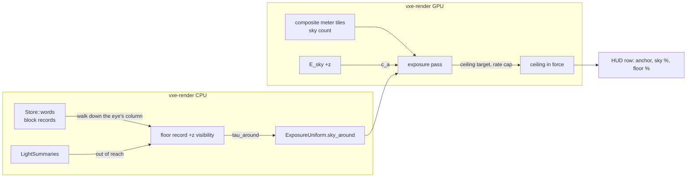

# 0097: The exposure's anchor by the sky around the camera: the floor record under the eye, a time constant, and the canopy's shade kept in daylight

> **Status:** approved 2026-11-20 (the owner's picks at window W2, all as recommended: the
> anchor by the sky around the camera's position, a small plan of its own, the slope's step
> lines to the backlog). **The lane starts after Plan 0095 closes and merges** (owner's
> order, 2026-11-20).
> **Created:** 2026-11-20
> **Milestone:** M10: Outdoors in [`docs/roadmap.md`](../roadmap.md); Plan 0094's exposure
> follow-up.
> **Related ADRs:** [ADR-0081](../adrs/0081-the-sky-anchor-holds-by-the-sky-over-the-cameras-floor-or-in-view-and-releases-where-both-are-absent.md)
> (proposed with this plan: the anchor holds by the sky over the camera's floor or in view,
> releases where both are absent); it rests on
> [ADR-0033](../adrs/0033-eye-adaptation-as-an-asymmetric-two-stage-exposure-on-the-gpu.md)
> (the exposure model and its `[min, max]`),
> [ADR-0070](../adrs/0070-sky-light-is-baked-visibility-coloured-at-read-with-a-long-history-ray-where-stale.md)
> (the baked sky visibility per record, the source it reads) and
> [ADR-0076](../adrs/0076-light-stability-rules-world-history-per-source-a-fade-per-transition-and-a-ratcheted-pop-counter.md)
> rule 5 (the ceiling moves under the rate cap and follows the surroundings; its clause of this
> date points at ADR-0081) and rule 6 (the coarse stable answer first).

## TL;DR

At window W2 (2026-11-20, the forest at `--sun 10,180`) the owner reached a deep-shade spot and
read it "too bright": Plan 0094 Phase 7b anchors the exposure's ceiling by the share of **sky
in view**, so one canopy closing over the last sky pixel releases the ceiling from -4.34 EV
toward +2 and the floor washes to pale mint, about 5 EV on one leaf. This plan anchors by the
**sky around the camera** instead: the `+z` sky visibility of the baked record of the floor
under the eye (ADR-0070's 256-ray hemisphere fraction, already on the CPU in the store's
block words), smoothed by a time constant, combined with the in-view share by the larger of
the two so every scene Phase 7b held stays bit for bit; a tunnel or cave, whose floor sees no
sky, still releases to `max`, and the night stays at +2 EV under Phase 8a's clamp. Phase 1
reads the measure at the two W2 spots and the tunnel before the threshold is pinned; Phase 2
builds it; the owner's window judges the forest, the noon tunnel and the owed open hills at
midnight; Phase 4 writes the picks as tests. The first thing a reader sees is Phase 1's table:
the floor's hemisphere share at the shade spot against the 1 %-sky spot and the deep tunnel.

## Context & problem

**The HUD at W2** (the owner flying the forest at `--sun 10,180`, both arms of Plan 0095's
spike, so Plan 0094's exposure): at x 237.4 y 642.8 z 596.7 with 1 % of the view sky, `ceiling
-4.34 EV`, `eye -4.34`, the floor right; at x 367.4 y 690.8 z 569.4 with 0 % sky, the ceiling
releasing toward `max` (+1.38 EV and climbing to +2), `eye -0.86` against `scene -1.8`, the
floor pale mint. The two spots are about 14 m apart under one canopy. Phase 7b's ceiling target
is `c_a` at a share of `F` = 1/256 and over, `max` at 0, log2-linear between (`AutoExposure::
ceiling_target`, `exposure.wgsl`'s `ceiling_target`); the forest floor meters between 1/256
and 1/128 of sky at the readings' poses (`docs/plans/logs/0094.md`, Phase 7b bar 1: "a thin
margin, the measure's arm (c) case"), so a leaf decides it.

**The owner's rules, binding here:** the exposure follows the surroundings, not the time of day
(window 94b); stable over precise; no waiting for light to settle. **The verdicts that must
hold:** "noon tunnel all good" (94c run 1: deep in the tunnel at noon the ceiling releases to
`max` and the lamp-lit walls meter themselves), and the night held at +2 EV (94c's 2b, Phase
8a: `c_a >= max` is `max` at every share).

**The sources in `vxe-render`** (read for ADR-0081): the brick records' per-face sky
visibility (`bake/record.rs`, `record_visibility`, `VIS_BAKED`, `SKY_STALE`; the store keeps
every block's words on the CPU in `Store::words`), the chunk summaries (`bake/summary.rs`,
`LightSummaries::summary`, a record per chunk with the faces' mean visibility per direction),
the column map (`gpu_world/columns.rs`, the highest opaque voxel per 2-voxel column) and
`E_sky` (`sky_irradiance.wgsl`, the unoccluded sky's irradiance per axis: the anchor's level,
no visibility). ADR-0081 picks the floor record under the eye, with the own chunk summary as
the fallback out of reach, and names the rest.

**Budgets touched** (`docs/nfr.md` section 2): the exposure pass (0.035 ms on the RTX at
rest, `docs/nfr/02-frame-budget.md`), the render thread's frame CPU; no VRAM (the uniform's
spare word).

## Decision

The anchor holds by `s = max(f_sky / F, f_floor / F_floor)`: the ceiling's target is `log2 c =
mix(log2 max, log2 c_a, min(s, 1))`, the ceiling in force steps toward it under the rate cap as
today. `f_floor` is the `+z` visibility of the first baked record with a `+z` face in the brick
column under the eye, within `AROUND_REACH` cells; the camera's own chunk summary's `+z`
visibility out of reach; absent (the term drops, Phase 7b's behaviour) where neither exists.
It is smoothed on the CPU at `tau_around` before it enters the uniform. A stale record answers
with its old value. `F_floor` 0 is the before. We rejected the hits' baked visibility
(view-dependent), the chunk summaries' spatial mean (reads through rock: a shallow tunnel
anchors), the column map's footprint (a vertical line, not a hemisphere), camera rays (a new
ray source where a baked hemisphere exists; the fallback arm) and a hysteresis pair (a step
where the rules want fades): ADR-0081.

## Architecture diagram



## Implementation phases

Each phase ships as its own commit; `dev` runs them in one session, the architect reviews once
in a fresh session. Phases 1 and 2 are exploration before the owner's window (lane rules 2b):
readings and CPU tests of data and API, no new image tests until Phase 4. Per-phase tests run
by `node scripts/test-changed.mjs --profile gpu --binaries <names>`; the whole gpu tier is the
tip's.

### Phase 1: The reading: the sky over the floor at the W2 spots, the tunnel, the mouth and the hills
- **Owner skill:** dev
- **What:** a CPU reader of the measure (`bake::sky_over_floor(store, eye) -> Option<(f32,
  Source)>`: the walk down the eye's brick column over the store's CPU block words, the own
  chunk summary out of reach, `Source` naming which answered) and a reading that prints it
  beside Phase 7b's in-view share, the metered level, the ceiling in force and the eye at the
  scenes that decide the threshold.
- **Files touched:** `crates/vxe-render/src/bake/summary.rs` (or a sibling `bake/around.rs`
  if `summary.rs` nears the cap), `bake/store.rs` (a `pub(crate)` record lookup by voxel over
  `words`, the same directory arithmetic `common.wgsl`'s record read uses), `bake/mod.rs`,
  `crates/vxe-render/tests/gpu_sun/` or `tests/rules.rs` (the CPU test),
  `apps/flythrough/tests/gpu_outdoor/ceiling.rs` (`reading::the_sky_over_the_floor`),
  `apps/flythrough/tests/support/terms.rs` (a forest rig generated about given voxel
  positions), `docs/plans/logs/0097.md`.
- **Done when:**
  1. **The reader is pinned on built records** (`the_floor_record_under_the_eye`, CPU, under
     1 s): on a `Store` whose CPU words hold hand-built blocks (`visibility_words`,
     `record_words`), an eye 17 voxels over a floor cell with a `+z` face at visibility 0.12
     reads `Some((0.12 within 1/255, Record))`; with that cell marked `SKY_STALE` the same
     value; with the floor's record missing and the chunk summary at 0.5, `Some((0.5,
     Summary))`; with the floor 9 cells down and no summary, `None`; a cell with faces but no
     `+z` face is walked past.
  2. **The table before the threshold** (`reading::the_sky_over_the_floor`, `gpu_outdoor.rs`,
     lavapipe, 160 x 90, the store baked by `support::bake_around` at radius 1 about each
     pose, 256 samples, 24 frames, a reset, 24 frames; under 60 s or soak; the RTX beside it by
     `VXE_TEST_ADAPTER`): at the W2 shade spot (eye x 367.4 y 690.8 z 569.4 voxels, the
     fly-through's `--source outdoor --trees forest --sun 10,180`; the rig generated about it
     from the same source and seed) and the W2 1 %-sky spot (x 237.4 y 642.8 z 596.7), both
     facing as the owner did (the HUD's yaw if in the W2 log, else along -x at pitch -10
     degrees), the tunnel's deep pose at noon with the lamp on (Phase 7b's), the tunnel 3 m
     inside the mouth facing in, the mouth from inside, the hills at noon facing away, the
     forest at 17:45: `f_floor` and its source, `f_sky`, metered, ceiling, eye. The table is in
     the log. `F_floor`'s default is the largest power-of-two fraction under both W2 spots'
     `f_floor` and over the deep tunnel's; the 3 m pose is read, not barred.
  3. **The stop rule:** if the shade spot's `f_floor` is 0 or under 2/255 (indistinguishable from
     the deep tunnel's at the `u8` quantum), or its source is `Summary`, the phase stops for
     the architect (ADR-0081 Alternative E, camera rays, is the arm built then), and Phase 2 is
     not started on the record.
  4. **The measure's cost** is printed: the walk's microseconds a frame on the RTX release
     (`bake::sky_over_floor` timed over 600 frames); under 20 us is the expectation, stated.

### Phase 2: The anchor by the floor's sky: the field, the time constant, the combined target, the HUD and the flag
- **Owner skill:** dev
- **What:** `AutoExposure` gains `sky_anchor_floor` (`F_floor`, the default from Phase 1; 0 is
  the before) and `sky_around_tau` (1 s); the frame computes `f_floor` each frame from the
  camera, smooths it (`f += (t - f) (1 - exp(-dt / tau))`, a `None` holding the last value and
  flagging absence after `tau` seconds without an answer), and writes it into the uniform's
  spare word (`_pad1` becomes `sky_around`, and a flag bit for absent); `ceiling_target` (Rust
  and WGSL) takes both shares and combines them by the larger normalised share; the HUD's
  exposure row shows it (`ceiling -4.34 EV (anchor 4, sky 1 %, floor 12 %)`), the fly-through's
  `--sky-anchor-floor X|off` and a settings row carry `F_floor`, the banner names it when not
  the default; `tau_around` is a settings row only.
- **Files touched:** `crates/vxe-render/src/exposure.rs`, `shaders/exposure.wgsl`,
  `shaders/common.wgsl` (if the state carries the readout), `frame/encode.rs`
  (`exposure_uniform`), `frame/mod.rs`, `frame/settings.rs` (two rows), `layout_tests.rs`,
  `crates/vxe-render/tests/gpu_exposure.rs`, `apps/flythrough/src/cli/outdoor.rs`,
  `cli/tests/outdoor.rs`, `hud/stats.rs`, `hud/modes.rs`, `docs/flythrough.md`,
  `docs/plans/logs/0097.md`.
- **Done when:**
  1. **The combined target** (`the_ceiling_target_follows_the_floor_too`, CPU, under 1 s,
     beside `the_ceiling_target_follows_the_sky_in_view`): at a day ground with `c_a` under
     `max`, `ceiling_target(ground, sky 0, floor F_floor)` is `c_a` exactly (`==`);
     `(sky F, floor 0)` is `c_a` exactly; `(0, 0)` is `max` within 1/256 EV; `(0, F_floor /
     2)` is `sqrt(c_a max)` within 1/256 EV; `(F / 2, F_floor / 2)` equals `(F / 2, 0)` (the
     larger share decides, both at a half); with `sky_anchor_floor` 0 every clause of the 7b
     test holds unchanged (the before); at a night ground (`c_a >= max`) `max` at every pair.
  2. **The time constant** (`the_floor_share_settles_at_tau`, CPU, under 1 s): a step of the
     floor's share from 0 to 0.5 at `dt` 1/60 and `tau` 1 reaches 0.5 (1 - 1/e) within 1/256
     at frame 60, monotonically; an absent answer holds the last value for 60 frames and reads
     absent at frame 61 (the term drops); `tau` 0 jumps.
  3. **The shade keeps the daylight** (`the_shade_under_the_canopy_keeps_the_anchor`,
     `gpu_outdoor.rs`, lavapipe 160 x 90, the two W2 poses on Phase 1's rig, baked at radius 1,
     the exposure settled; under 60 s, so soak; the RTX beside by `VXE_TEST_ADAPTER`): the
     settled eye at the shade spot is within 1 EV of the settled eye at the 1 %-sky spot (the
     before, printed: about 3.5 EV apart and climbing); both ceilings in force are within 1/64
     EV of `c_a`; with `sky_anchor_floor` 0 the shade spot releases (the before, asserted so
     the test sees its mechanism).
  4. **The noon tunnel and the night hold.** `the_tunnel_exposes_for_its_walls_by_day` (soak)
     passes unchanged: deep at noon `f_floor` is 0 (printed), the ceiling in force within 1/64
     EV of `max`, the eye the meter's; at midnight the ceiling and the eye within 1/64 EV of
     `max` (+2 EV); `reading::the_ceiling_by_hour` unchanged.
  5. **The open sky is byte-identical.** `outdoor_noon`, `outdoor_sunset`,
     `outdoor_forest_sunset`, `cave_mouth`, `outdoor_night`, `fsr2.png`, `upscaled.png` and the
     two profile goldens are byte-identical to the tip's bless in both arms (`sky_anchor_floor`
     default and 0), read before any bless; a moved pixel is a stop for the architect, not a
     bless. `the_ceiling_moves_at_the_rate` (`gpu_exposure.rs`) passes unchanged (its rig
     holds no baked record: the term is absent).
  6. **The flag and the rows.** `--check-args` accepts `--sky-anchor-floor`; the banner names
     `sky anchor floor X` when not the default and nothing when it is; the HUD row shows the
     floor share and `floor -` while absent; the two settings rows round-trip (Plan 0069's
     setter test lists them); `ExposureUniform` in `layout_tests.rs` (its size unchanged, the
     field named). **Cost:** 0 ms on the GPU by construction (one `max` and one `mix`), the
     walk's CPU as Phase 1 read it, stated.

### Phase 3: The owner's window
- **Owner skill:** human
- **What:** a windowed session on Linux, a `live/session97.sh` runner with the tip's binary and
  `live/bin94c` (or the tip of main before this plan) as the before, the fly-through's stdout
  visible, the HUD's exposure row on. Runs, in this order: (1) **the owed first run** from
  Plan 0094's Followups: the open hills at midnight (`--source outdoor --time 00:00`, the
  default spawn), a word on the moonlit level at +2 EV; (2) the forest at `--sun 10,180`, the
  owner's W2 path from the 1 %-sky spot into the deep shade and back, with the before beside
  it; (3) the forest at 15:00, the same path; (4) the noon tunnel with the lamp on, from the
  mouth to the deep pose and back (94c's "all good" as the bar); (5) the cave mouth from inside
  and out. The architect quotes the words into the log and routes any pick: `F_floor` and
  `tau_around` are settings, a wrong place for the measure (ADR-0081's Negative) is the stop
  for Alternative E.
- **Files touched:** `live/` (untracked), `docs/plans/logs/0097.md`.
- **Done when:** the owner's words per run are in the log; run (2) says the deep shade is no
  longer "too bright" against the before, or names what is wrong; run (4) still reads "all
  good" or names the change; run (1) has a word on the moonlit level.

### Phase 4: The picks as tests and the docs
- **Owner skill:** dev
- **What:** the window's picks as defaults (any `F_floor` or `tau_around` move, with the
  affected goldens re-blessed as a disclosed change and their difference counts in the log),
  the walk reading as a test, and the docs' rows.
- **Files touched:** `apps/flythrough/tests/gpu_outdoor/ceiling.rs`, `crates/vxe-render/src/
  exposure.rs` (defaults), `docs/flythrough.md`, `docs/nfr/02-frame-budget.md` (the exposure
  row's note), `docs/plans/logs/0097.md`.
- **Done when:**
  1. **The walk does not wobble** (`reading::the_canopy_walk_exposure`, RTX release, `gpu_outdoor.rs`,
     a camera path between the two W2 spots and back at 15 voxels a second, about 9.4 s each
     way at 60 Hz, the store baked along it): per frame `f_floor`, `f_sky`, the ceiling in
     force and the eye; the ceiling in force stays within 0.5 EV of `c_a` on every frame; the
     largest one-frame step of log2 exposure is at or under `R_f + 1/256` (0.0625 + 1/256);
     the trace is in the log. The lavapipe form at 160 x 90 is a soak test asserting the same
     two clauses over 120 frames at 4 x the speed if it runs under 60 s, else the reading alone.
  2. **The picks are the defaults:** `DEFAULT_SKY_ANCHOR_FLOOR` and `DEFAULT_SKY_AROUND_TAU`
     are the window's values, their doc comments name the reading; every golden byte-identical
     to Phase 2's bless unless a pick moved it, each move named with its count.
  3. `docs/flythrough.md`'s exposure rows name `--sky-anchor-floor`, the floor share in the HUD
     row and the before (`off`); `docs/nfr/02-frame-budget.md`'s exposure row notes the walk's
     CPU microseconds with machine and commit.

## Data shapes

```rust
// illustrative
pub struct AutoExposure {
    // ... as today ...
    /// The sky share over the camera's floor at and over which the anchor holds in full
    /// (ADR-0081); 0 is the sky in view alone.
    pub sky_anchor_floor: f32,
    /// The time constant, in seconds, the floor's share is smoothed at before it enters the
    /// exposure; 0 jumps.
    pub sky_around_tau: f32,
}

/// Which answered the sky over the floor.
pub enum AroundSource { Record, Summary }

/// The uniform's spare word: the smoothed floor share, with a mode bit for absent.
// ExposureUniform { ..., sky_share: f32, sky_around: f32 }  // _pad1 renamed, 112 B unchanged
```

The walk: from the eye's voxel, the brick cell (8 voxels) that holds it, then down one cell at
a time over at most `AROUND_REACH` (8) cells, reading each cell's record from the chunk's CPU
block words (`Store::words`, the directory the shader reads); the first record with the `+z`
direction bit and `VIS_BAKED` answers with its `+z` byte over 255. No `vxe-world` read.

## Budgets

| `nfr.md` figure | Expected | How the close measures it |
|---|---|---|
| Section 2, the exposure pass (0.035 ms RTX at rest) | unchanged by construction (one `max`, one `mix`) | stated, not re-timed |
| Section 2, the render thread's frame CPU | + the walk, under 20 us a frame (a guess, Phase 1 bar 4 reads it) | `bake::sky_over_floor` timed over 600 frames, RTX release, the forest |
| Section 3, VRAM | 0 (the uniform's spare word) | `layout_tests.rs`: the uniform's size unchanged |
| Section 7, the test tiers | the two soak tests under 60 s each on lavapipe; the gate gains three CPU tests under 1 s | `node scripts/test-times.mjs` on the tip's gate log |

## Risks & open questions

- **The floor is not the eye** (ADR-0081's Negative): a low overhang or a skylit room reads the
  floor's hemisphere, not the eye's. The window's runs (4) and (5) look at the tunnel and the
  mouth; the stop is Alternative E.
- **The record has not landed.** At a cold start or after a stamp the term is absent for the
  seconds Plan 0096's drain takes, and the exposure shows Phase 7b's release, then re-anchors
  as a fade under the rate cap. Disclosed; the no-wait rule is met by the coarse answer (the
  view's share), not by waiting.
- **Determinism:** render-side only, f32 on the CPU with the frame's `dt` as ADR-0033's model
  already is; the headless tests step a fixed `dt`. Nothing reaches `vxe-world`.
- **Threading:** the store's CPU words are read on the render thread where the queue's step
  writes them; the walk takes the same borrow the summary chain does, no new lock.
- **Both W2 spots may read alike** at the `u8` quantum: Phase 1's stop rule.
- **`tau_around` against the rate cap:** two smoothing stages can read slow when stepping out of
  a cave; the walk reading and the window's run (4) are the bars, and `tau` is a setting.

## What this plan does NOT do

- No rays from the camera (ADR-0081 Alternative E, the fallback arm, built only on a stop).
- No change to the meter, its weights, `F` (1/256), the rate (3.75 EV/s), the night clamp or
  `OUTDOOR_MAX`.
- No tone-curve toe, no change to the moonlit level: a word at the window's run (1) routes to a
  setting (`--exposure-max`, `compensation_ev`) and a re-bless, per Plan 0094's Followups.
- The thin step lines along voxel slopes seen at W2 are a look entry in `docs/backlog.md`, not
  this plan's.
- No change to the bake, the records' layout or the column map.

## Implementation log

> Written by `dev`: one row per phase as its commit lands, then the close block. **The phases
> above are the contract. This section records what happened.** Observations, never conclusions:
> no pass list, no self-assessment. Deviations and unmet done-whens are **always** disclosed.
> Keep it shorter than `## Implementation phases`. Readings, gate counts, attempts, sweeps and
> resume notes go to the plan's readings log, `docs/plans/logs/0097.md` (started from
> `templates/readings-log.md`), and this section links it once it exists.

| phase | owner | state | commit |
|---|---|---|---|
| 1: The reading: the sky over the floor | dev | not started | |
| 2: The anchor by the floor's sky | dev | not started | |
| 3: The owner's window | human | not started | |
| 4: The picks as tests and the docs | dev | not started | |

### Notes

_(Deviations from the plan, with the commit, stated without justification. Done-whens not
satisfiable as stated, and what was done instead. Followups noticed and not acted on. One line
each. Empty is fine.)_

### Close triggers

_(Facts for the architect. No recommendations, and no suggested version bump.)_

- **What shipped:** feature / fix-only / docs-chore-only
- **Public API changed:** types, traits, functions, shader interfaces, config (list them, or none)
- **Budget readings:** each `nfr.md` figure touched, with its measured value, machine and commit
- **Gate at the tip:** the commands run (build, nextest, doctests, clippy, fmt, deny), exit codes, test counts
- **Outstanding `human` phases:** which, or none

## Followups

- ADR-0081's Outcome at the close: the source that answered at each window scene, `F_floor`
  and `tau_around` as read, and whether Alternative E was needed.
- ADR-0076 rule 5's clause of this date is accepted with ADR-0076 at Plan 0090's close; if
  Plan 0090 accepts it first, ADR-0081 carries the clause alone.
- Plan 0094's leftover tautology in `the_tunnel_exposes_for_its_walls_by_day` (the luma clause
  inside `if ratio.abs() <= 0.5`; `docs/backlog.md`, "Plan 0094's leftovers") is in Phase 2's
  file: fix it there if the test is opened, and say so in the log.
