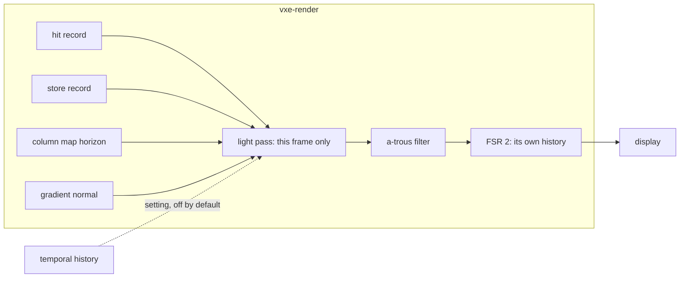

# 0098: A calm light by default: no screen history, smooth sources to the mid range, and the FSR 2 turn

> **Status:** draft
> **Created:** 2026-11-21
> **Milestone:** M10: Outdoors in [`docs/roadmap.md`](../roadmap.md)
> **Related ADRs:** [ADR-0082](../adrs/0082-the-light-pass-keeps-no-screen-history-by-default-and-reads-smooth-sources-to-the-mid-range.md)
> (proposed with this plan),
> [ADR-0079](../adrs/0079-the-key-lights-visibility-is-read-with-no-screen-history-the-record-or-the-column-maps-horizon-at-the-far-a-deterministic-penumbra-near.md)
> (the key light's far estimate and the approach penumbra this builds on),
> [ADR-0042](../adrs/0042-the-far-shading-normal-blends-to-the-27-count-gradient-by-the-voxels-size-on-screen.md)
> (the far normal's band, which this widens),
> [ADR-0076](../adrs/0076-light-stability-rules-world-history-per-source-a-fade-per-transition-and-a-ratcheted-pop-counter.md)
> (rule 6),
> [ADR-0055](../adrs/0055-render-settings-are-one-struct-with-an-apply-class-per-field-and-profiles-are-named-values.md)
> (the settings row this adds)
> **Source:** the owner's diagnosis window of 2026-11-21 (his words in
> [`logs/0098.md`](logs/0098.md)) and the rule agreed that evening: no new wobble plan until
> one switch combination in the window reads calm, and the plan ships that combination.

## TL;DR

The diagnosis window found a switch combination the owner calls calm on the slopes with no
grain: **the light passes with no screen history, and smooth sources out to the mid range**
(`light history off`, `key far column`, `key far mix step`, `far normal 8,12`). This plan makes
that combination one named setting, confirms it by eye in the scenes the window did not reach,
and then makes the picks the defaults. What it does not yet have a fix for is the second
source the window named: **the far trees wobble after a turn because of FSR 2**, which the
owner wants kept; Phase 2 reads where FSR 2 loses the far pixels before any mechanism is
written. The first thing the owner sees (Phase 3, window W1): the forest and the noon slope
under `calm` against today's default, flying, stopping and turning. The headless proof: the
wobble rig's `calm` arm against its `albedo` arm.

## Context & problem

Plans 0094 and 0095 passed their bars and the owner saw no change; ADR-0082's Context has why
and what the window found. The verdicts this plan is written against:

| what the owner switched | his words |
|---|---|
| smooth far, light history off | "now things got better, nothing on slopes", "no grain" |
| light history back on | "yes, its light history - with it wobble worsens" |
| exposure back to auto | "stays calm" |
| upscaler off (native) | "no wobble on turn, slight when move on the distance" |
| FSR 2 back on | "yes fsr makes them wobble - trees, but without it picture is not right" |
| `queue freeze` on | "freeze makes things worse" |
| default far, history off, approach | "when I move shadow moves with me which is not right" |
| the same with `penumbra disc` | "shadow does not move" |

**What the window left unseen** (each is a run of W1, not an assumption of this plan):

- The calm combination on the noon slope (scene A's dashes "wobble while flying" under every
  switch tried there, and neither `light history` nor `far normal 8,12` was tried there; `2..6`
  was "clearly the best" of off, `1..2` and `2..6`).
- The "bright places around the trees when moving" under the smooth far (seen once with the
  history on, cause unread).
- Whether `penumbra disc` grains with no history (one random ray a frame with nothing to
  average it), and how the disc's centre ray alone looks (`key jitter off`: a hard shadow, the
  same every frame, the cheapest).
- Any scene under lamps: the fired lights' and the emissive terms with no history.

**Two things the owner answered before the window that the window overturned.** "Stop refining
what is in view" lost to "freeze makes things worse", so this plan does not touch the bake
queue. "Seconds after stopping" narrowed to two sources: the history (slopes, grain) and FSR 2
(trees, after a turn and slightly while moving at a distance).

The budget figures this touches: `docs/nfr.md` section 2's lighting line (4.0 ms; the window's
HUD read the light pass at 3.36 ms under approach and 1.74 ms under disc on the RTX 3080
Laptop, one pose, not a reading of record) and the upscaler's line if Phase 5 changes FSR 2's
render scale.

## Decision

**Ship the combination the owner called calm as the default once W1 confirms it; read FSR 2
before fixing it.** ADR-0082 records the decision and the three rejected lines (a better
history, a frozen queue, no upscaler). Inside this plan we also reject: a fix for the approach
penumbra's camera-following before the pick (the owner may take the disc or the centre ray, at
about half the light pass's time), and an asserting harness before the window (lane rules 2b).

## Architecture diagram



## Implementation phases

Each phase ships as its own commit. Phases 1 and 2 are **exploration** (they name readings,
not image tests). The lane needs the debug page's switches of `diag-edges` (`ac0d4132`): it
stacks on `plan-0097` with that commit, or starts from main once Plan 0097 has merged and
cherry-picks it; the orchestrator's call.

### Phase 1: The calm combination as one setting (exploration)
- **Owner skill:** dev
- **What:** `light history` becomes a render setting (ADR-0055: a `Lighting` field in place
  of the hook `LightHooks::no_history`, a settings-file row, `--light-history on|off`, the
  debug page's row), and one flag, `--calm`, sets the window's combination: light history off,
  `key far column`, `key far mix step`, `far normal 8,12`. The HUD's lighting row and the
  banner name `calm` and each row that is off its default. The wobble rig gains the arms `calm`
  and `calm,native`. No default changes.
- **Files touched:** `crates/vxe-render/src/frame/settings.rs`,
  `crates/vxe-render/src/frame/encode.rs`, `apps/flythrough/src/cli/outdoor.rs`,
  `apps/flythrough/src/cli/tests/outdoor.rs`, `apps/flythrough/src/toggles.rs`,
  `apps/flythrough/src/hud/modes.rs`, `apps/flythrough/tests/gpu_wobble.rs`,
  `docs/flythrough.md`, `docs/plans/logs/0098.md`.
- **Done when:**
  - CPU (`apps/flythrough/src/cli/tests/outdoor.rs`, under 1 s): `--calm` parses to exactly
    those four values; `--calm --far-normal 2,6` keeps the later flag's band; the lighting row
    reads `light history off` and the banner names `calm`.
  - Readings in the log (no assertion), RTX 3080 Laptop and RADV RENOIR, 1080p, the forest at
    15:00 and at `--sun 10,180`, the hills at noon: the light pass's time under the default
    and under `--calm`; the wobble rig's soak reading
    (`gpu_wobble` `the_wobble_table_over_the_arm_set`, born soak, about 10 min on the RTX) for
    `default`, `albedo`, `calm`, `calm,native`: the far and near shares while flying, after
    the stop and after the turn.
  - `--binaries gpu_wobble` is the phase's GPU run.

### Phase 2: Where FSR 2 loses the far trees after a turn (exploration, a spike)
- **Owner skill:** dev
- **What:** Readings that split the trees' post-turn wobble inside the FSR 2 path, under
  `--calm` and under `--view albedo` (the light out of the picture), on the wobble rig's turn.
  For the far class, per frame over the 30 frames after the turn: the share of pixels whose
  history FSR 2 rejects or shortens, split by stage (the depth clip's disocclusion, the lock's
  release, the accumulate pass's colour clamp); the motion vectors' error against the exact
  reprojection of the hit record's world point; and the share of far pixels whose hit changes
  between two jitter phases at a still camera (leaves under a pixel that a jitter step finds
  or misses). Then each lever that is a constant or a flag today, read the same way: the
  render scale 1.5 against 1.3 and against 1.0 with FSR 2 on (its antialiasing at native),
  `--jitter-phases`, and the far normal's band. Levers that need no new shader logic get a
  debug-page switch for W1; nothing else is built.
- **Files touched:** `apps/flythrough/tests/gpu_wobble.rs` (or a sibling `gpu_wobble/fsr.rs`),
  `crates/vxe-render/src/fsr2/` and `crates/vxe-render/src/shaders/fsr2/` (a debug readback
  of the stages' masks, behind the test hooks), `apps/flythrough/src/toggles.rs`,
  `docs/plans/logs/0098.md`.
- **Done when:** the log holds one table, RTX 3080 Laptop, with the far class's share per
  stage at +0, +10 and +30 frames after the turn and each lever's row, and names the stage
  that accounts for the largest share, or says that none does. The frame time under each
  lever is in the same table (scale 1.0 marches 2.25 times the pixels of scale 1.5). The
  readings are soak tests (`gpu_wobble`), never a gate.

### Phase 3: The owner's window W1
- **Owner skill:** human
- **What:** One session on Linux, the RTX 3080 Laptop, every mode shown on screen. The move in
  each run: fly slowly 5 s, stop and hold 5 s, turn about 60 degrees, hold 5 s.
  1. The forest at `--sun 10,180` and the noon slope (the window's two poses): today's default
     against `--calm`. Is `calm` calm on the slope's dashes while flying? Are the bright
     places around the trees there, and do they matter?
  2. Under `calm`, the penumbra: approach, disc, and the disc's centre ray (`key jitter off`).
     Which one, for the shadow that stays put and for grain?
  3. Under `calm`, the band: `2,6` against `8,12` (and one value between if neither is right).
     Is the far trees' loss of shadow detail acceptable?
  4. A scene under lamps (the castle's hall) with light history off against on: grain?
  5. The FSR 2 levers Phase 2 exposed, under `calm`: which, if any, calms the trees after the
     turn, and at what frame rate (the HUD's).
- **Files touched:** `docs/plans/logs/0098.md` (the verdicts, in the owner's words).
- **Done when:** the log holds a verdict per run and the picks: light history's default (per
  scene kind if lamps need it), the band, the penumbra, and the FSR 2 lever or "none yet".

### Phase 4: The picks become the defaults
- **Owner skill:** dev
- **What:** The defaults of `Lighting` and the fly-through take W1's picks; the architect
  writes the picks into ADR-0082's Outcome at the close. An arm not picked that costs nothing
  when off stays a setting (owner, 2026-11-12). `--calm` goes if the defaults equal it. The
  goldens that the new defaults move are re-blessed on lavapipe.
- **Files touched:** `crates/vxe-render/src/frame/settings.rs`, the fly-through's defaults
  under `apps/flythrough/src/cli/`, the goldens under `apps/flythrough/tests/`,
  `apps/flythrough/tests/gpu_wobble.rs`, `docs/flythrough.md`,
  `docs/nfr/02-frame-budget.md`, `docs/plans/logs/0098.md`.
- **Done when:**
  - CPU (under 1 s): the default settings equal the picks, row by row.
  - `gpu_wobble` (soak, RTX by `VXE_TEST_ADAPTER=rtx`, about 10 min; lavapipe about 130 s,
    also soak): with the queue stepping and no drain, the default arm's near share over 4
    levels at the stop's first frame is at most the `albedo` arm's plus 2 points (the bar Plan
    0095 held), and the default arm's far share 30 frames after the stop is at most the arm
    `calm,native`'s plus 2 points if W1 picked no FSR 2 lever (the light adds nothing over
    the upscaler's own), stated against the picked lever's arm otherwise.
  - The light pass's time under the new defaults, both adapters, the three scenes, replaces
    the readings in `docs/nfr/02-frame-budget.md` with the machine and the commit.
  - `--binaries gpu_wobble` plus the golden binaries the re-bless touches.

### Phase 5: The FSR 2 turn
- **Owner skill:** dev
- **What:** Written by the architect as an amendment at W1's verdicts, against the stage
  Phase 2 named and the lever the owner picked. If Phase 2 names no stage and W1 picks no
  lever, this phase is struck and the trees' wobble goes to the backlog with Phase 2's table.
- **Files touched:** named by the amendment.
- **Done when:** named by the amendment; until then `dev` stops after Phase 4.

## Data shapes

```rust
// illustrative: the hook becomes a setting (ADR-0055), live, off by default after Phase 4
pub struct Lighting {
    /// The light passes read last frame's means through the history test.
    pub history: bool,
    // ...
}
```

## Budgets

- **Section 2, the lighting line (4.0 ms).** Expected to fall or hold: no history removes
  work only if its passes can be skipped (unread), and the penumbra pick may halve the pass
  (the window's HUD, one pose: 3.36 ms approach, 1.74 ms disc). Phase 1 reads it, Phase 4
  records it: `flythrough --headless --source outdoor`, the forest and the hills, 1080p, RTX
  3080 Laptop and RADV RENOIR, under the perf lock.
- **Section 2, the frame at the default scale.** Moves only if Phase 5 changes FSR 2's render
  scale; Phase 2's table carries the frame time per lever so the pick is made with its cost.
- **Section 7, the gate's wall time.** Unchanged: every new GPU test is soak.

## Risks & open questions

- **The calm combination may not hold on the noon slope.** Scene A's dashes wobbled while
  flying under every switch tried, and the two that matter were not tried there. If W1's run 1
  says no, the plan stops at Phase 3 and the dashes get their own reading (the candidates are
  in the backlog's slope-lines entry).
- **No history may grain under lamps.** If W1's run 4 says so, the default splits by term
  (the outdoor terms take no history, the lamp terms keep theirs), which ADR-0082's Outcome
  records.
- **FSR 2 may have no cheap lever.** FSR 2 at scale 1.0 is the likeliest calm arm and costs
  2.25 times the marched pixels; on the RADV RENOIR that is not affordable. The owner then
  chooses between the wobble and the frame rate per profile.
- **The readings have misled twice.** Every bar in Phase 4 is tied to an arm the owner judged
  by eye; no bar stands for a look he has not seen.
- **Plan 0096 overlaps at one point.** Its Phase 6's first lever is the approach penumbra's
  cost on the RADV RENOIR; that lever waits for W1's penumbra pick. Its Phases 3 to 5 (the
  tiers, the drain slice, the step) stand: the window showed a frozen queue is worse, not
  better.
- Determinism, memory and threading: none touched (render settings only; no world code).

## What this plan does NOT do

- It does not touch the bake queue, its drain or its tiers (Plan 0096).
- It does not touch the exposure (Plan 0097; the window: "stays calm").
- It does not replace FSR 2 or tune our own upscaler.
- It does not remove the history's code or the arms not picked.
- It does not fix the F9 steps view's frame rate (backlog).
- It does not make the approach penumbra world-fixed unless the owner picks approach at W1;
  that fix is then an amendment.

## Implementation log

> Written by `dev`: one row per phase as its commit lands, then the close block. **The phases
> above are the contract. This section records what happened.** Observations, never
> conclusions. Readings, attempts and resume notes go to [`logs/0098.md`](logs/0098.md).

| phase | owner | state | commit |
|---|---|---|---|
| 1: The calm combination as one setting | dev | not started | |
| 2: Where FSR 2 loses the far trees | dev | not started | |
| 3: The owner's window W1 | human | not started | |
| 4: The picks become the defaults | dev | not started | |
| 5: The FSR 2 turn | dev | awaits the amendment | |

### Notes

_(Empty.)_

### Close triggers

_(Facts for the architect.)_

- **What shipped:**
- **Public API changed:**
- **Budget readings:**
- **Gate at the tip:**
- **Outstanding `human` phases:**

## Followups

- The slope's step lines and the narrowed key band (backlog) are taken here through the
  widened band; whatever W1 leaves of them returns to the backlog at the close.
