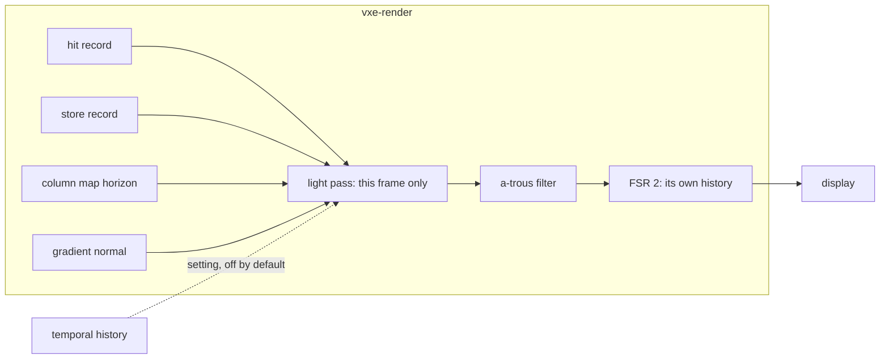

# 0098: A calm light by default: no screen history, smooth sources to the mid range, and the FSR 2 turn

> **Status:** in-progress. **Amended 2026-11-22 (architect, owner confirm owed)**, at window W1's
> verdicts (section "Amendment at W1"): the picks are light history off, `key far column`,
> `key far mix step`, the band `4..8` and `penumbra disc`; Phase 6 (a bake landing fades in the
> store) and Phase 7 (the one further window, W2) are new; Phase 5 becomes a spike of
> render-side arms for the far trees, no content changed; Phase 4 runs last with its bars
> restated. **Amended 2026-11-23 (architect, owner confirm owed)**, at Phase 6's readings
> (section "Amendment at the Phase 6 readings"): the landing pop is the light pass switching
> source, no store word, so Phase 6b (the switch itself fades, by the block's landing frame) is
> new and runs before W2; W2's runs 2 and 4 are restated.
> **Amended 2026-11-23 (owner)**, at window W2's verdicts (section "Amendment at W2"): the calm
> picks are accepted and become the defaults, light history off under lamps too; `landing fade`,
> `source fade` and `far light wide` stay settings, off; Phase 4's near bar is restated from the
> readings; Phase 8 (a dig under the calm picks neither darkens its surround nor flashes),
> Phase 9 (the sunlit terraces at noon, a reading) and Phase 10 (the owner's look, W3) are new.
> **Order from here: 8, 9, 4, 10.**
> **Amended 2026-11-23 (architect's rulings, owner confirm owed)**, at Phase 4's findings
> (section "Amendment at Phase 4's findings"): the shown key shadow under the defaults is the
> column map's horizon at every distance, the disc's ray is cast and never shown; Phase 4's
> far bar moves to the arm with the queue stopped; Phases 11 (the soak bars), 12 (the HUD's
> `light:` row) and 13 (the key ray that is never shown is not cast, and a test of the
> default's near key shadow) are new. **Order from here: 11, 12, 13 (beside W3), 10, the close.**
> **Created:** 2026-11-21
> **Milestone:** M10: Outdoors in [`docs/roadmap.md`](../roadmap.md)
> **Related ADRs:** [ADR-0082](../adrs/0082-the-light-pass-keeps-no-screen-history-by-default-and-reads-smooth-sources-to-the-mid-range.md)
> (proposed with this plan),
> [ADR-0079](../adrs/0079-the-key-lights-visibility-is-read-with-no-screen-history-the-record-or-the-column-maps-horizon-at-the-far-a-deterministic-penumbra-near.md)
> (the key light's far estimate and the approach penumbra this builds on),
> [ADR-0042](../adrs/0042-the-far-shading-normal-blends-to-the-27-count-gradient-by-the-voxels-size-on-screen.md)
> (the far normal's band, which this widens),
> [ADR-0076](../adrs/0076-light-stability-rules-world-history-per-source-a-fade-per-transition-and-a-ratcheted-pop-counter.md)
> (rule 6),
> [ADR-0055](../adrs/0055-render-settings-are-one-struct-with-an-apply-class-per-field-and-profiles-are-named-values.md)
> (the settings row this adds)
> **Source:** the owner's diagnosis window of 2026-11-21 (his words in
> [`logs/0098.md`](logs/0098.md)) and the rule agreed that evening: no new wobble plan until
> one switch combination in the window reads calm, and the plan ships that combination.

## TL;DR

The diagnosis window found a switch combination the owner calls calm on the slopes with no
grain: **the light passes with no screen history, and smooth sources out to the mid range**
(`light history off`, `key far column`, `key far mix step`, `far normal 8,12`). This plan makes
that combination one named setting, confirms it by eye in the scenes the window did not reach,
and then makes the picks the defaults. What it does not yet have a fix for is the second
source the window named: **the far trees wobble after a turn because of FSR 2**, which the
owner wants kept; Phase 2 reads where FSR 2 loses the far pixels before any mechanism is
written. The first thing the owner sees (Phase 3, window W1): the forest and the noon slope
under `calm` against today's default, flying, stopping and turning. The headless proof: the
wobble rig's `calm` arm against its `albedo` arm.

## Context & problem

Plans 0094 and 0095 passed their bars and the owner saw no change; ADR-0082's Context has why
and what the window found. The verdicts this plan is written against:

| what the owner switched | his words |
|---|---|
| smooth far, light history off | "now things got better, nothing on slopes", "no grain" |
| light history back on | "yes, its light history - with it wobble worsens" |
| exposure back to auto | "stays calm" |
| upscaler off (native) | "no wobble on turn, slight when move on the distance" |
| FSR 2 back on | "yes fsr makes them wobble - trees, but without it picture is not right" |
| `queue freeze` on | "freeze makes things worse" |
| default far, history off, approach | "when I move shadow moves with me which is not right" |
| the same with `penumbra disc` | "shadow does not move" |

**What the window left unseen** (each is a run of W1, not an assumption of this plan):

- The calm combination on the noon slope (scene A's dashes "wobble while flying" under every
  switch tried there, and neither `light history` nor `far normal 8,12` was tried there; `2..6`
  was "clearly the best" of off, `1..2` and `2..6`).
- The "bright places around the trees when moving" under the smooth far (seen once with the
  history on, cause unread).
- Whether `penumbra disc` grains with no history (one random ray a frame with nothing to
  average it), and how the disc's centre ray alone looks (`key jitter off`: a hard shadow, the
  same every frame, the cheapest).
- Any scene under lamps: the fired lights' and the emissive terms with no history.

**Two things the owner answered before the window that the window overturned.** "Stop refining
what is in view" lost to "freeze makes things worse", so this plan does not touch the bake
queue. "Seconds after stopping" narrowed to two sources: the history (slopes, grain) and FSR 2
(trees, after a turn and slightly while moving at a distance).

The budget figures this touches: `docs/nfr.md` section 2's lighting line (4.0 ms; the window's
HUD read the light pass at 3.36 ms under approach and 1.74 ms under disc on the RTX 3080
Laptop, one pose, not a reading of record) and the upscaler's line if Phase 5 changes FSR 2's
render scale.

## Amendment at W1 (2026-11-22; architect, owner confirm owed where marked)

W1 ran in two sittings on 2026-11-22; the owner's words are in [`logs/0098.md`](logs/0098.md)
("Phase 3: W1's verdicts"), with the leak window's and the Plan 0097 lane's finding beside
them. What they settle, and what they do not:

| question | W1's answer | standing |
|---|---|---|
| calm against the default | calm: "wobble on slopes is gone"; the default: "wobble on slopes came back" | the owner's words |
| key far | column: the baked record shows false sun under the canopy ("with keyfar column its dark") | the owner's words (leak window) |
| penumbra | disc: under approach "light rays are gone when I am distant", "no such behaviour when I am on penumbra disc"; approach is the tunnel wall's blink ("now it doesn't blink" under disc); both disc and history off calm the deep-shade dashes | **owner confirm owed**: no pick was stated, `key jitter off` was not judged, grain under disc with no history was not asked; "the shadow did not follow" under approach is withdrawn ("I may be mistaken on shadows") |
| band | "I think 4..8" | **owner confirm owed** (his "I think"; the slopes were called calm at `8..12`) |
| under lamps | the castle: "no grain, all good" with light history **on**; off was not flipped | unjudged: history off indoors has no verdict |
| FSR 2 levers | none beats scale 1.5 with FSR 2's own phases; scale 1 "does look right, fps is around 30" | the owner's words |
| what is left | "only distant trees", while moving | the owner's words |
| a denser canopy | wobbles less (256, then 160, then 64), and "this is not the way... we don't know what models will be used in the end and can't simplify models"; 256 with calm: "almost no wobble, but trees looks bad" | the owner's words; a rule |

**Three things the readings add** (all in the log):

- **A bake landing pops with no screen history.** Under `calm` with the exposure pinned, 15.61 %
  of the near pixels change in the one frame a chunk's bake lands (stop +43), and nothing
  moves with the queue stopped. The store fades a block's words, and the key words' change was
  left to the light pass's history (`bake/queue/step.rs`), which `calm` turns off; which of
  the image's reads carries the pop is not read. ADR-0082's "holds without a fade" is wrong and
  is amended. The Plan 0097 lane's finding (18.67 % of near pixels in one frame at stop +3
  after a 20-frame fly, the exposure constant, the default arm, a debug build: indicative) is
  the same suspect and is read in Phase 6, on its short fly as it stands.
- **The far trees' wobble is sparse geometry under jitter, made visible by the light.** At a
  still camera 17.46 % of the far hits change between two jitter phases, 16.28 points of it
  leaves at 15 to 60 m, where a voxel is 2 to 4.5 px: over a pixel, so a LOD mip chosen by
  pixel size never applies. The same flips under `--view albedo` move 1 to 3 % of the far
  pixels over 4 levels against 22 % lit, and the owner called albedo "no wobble". So the
  flips are there in every arm; what the eye sees is the difference in light between the two
  hits a jitter step picks. **No mechanism is known to calm it on any model.** That is the
  honest state, and Phase 5 is a spike, not a fix.
- **The default with the history on read better on the trees once** (W1 run 8i: "trees seem
  better - wobble only on move and only distant trees"), unexplained; a history averages the
  two hits' light over the phases, which is one reading of it and a guess.

**The rule this amendment is written under** (owner, 2026-11-22, on the test tunnel's roof slot
and on the leaf fill): no scene, model or fixture is simplified so that a check passes. The
wobble rig's forest, its leaf fill and its fly lengths stay as they are.

## Amendment at the Phase 6 readings (2026-11-23; architect, owner confirm owed)

Phase 6 built what it was written to build and the pop did not move
([`logs/0098.md`](logs/0098.md), "Phase 6 readings"): `landing fade` changes no stop pair by
more than 0.07 points (`calm,pin` 15.57 % off, 15.59 % on; fly 20: 36.72 % both), every pop
falls in a frame where one block lands over the fallback chain, and every such landing reads
0 changed cells. The W1 amendment guessed the pop was a store word (the key words); that guess
was wrong. **What the readings and the code say instead** (a strong suspect, not yet read per
pixel; Phase 6b's first step reads it):

- A face whose chunk holds no block has no record, so the light pass casts its sky ray and the
  temporal pass shows the visibility pair. With no light history the pair is reset every frame,
  and a reset pair holds its seed alone (`pair_step`, pair.wgsl): the column map's answer at
  the hit (`column_estimate`), which is 1 above the column's top and 0 under it. The ray's
  sample is never shown.
- The frame the chunk's first block lands, the face's own cell holds a baked visibility
  (`sky_baked`, shade.wgsl), no ray is cast, and the pixel shows the baked term
  (`sky_baked_term`, temporal.wgsl). Under a canopy that is a step from no sky light to the
  baked share, in one frame, over every pixel of the chunk. No word in the store changed: the
  chain holds no sky visibility to fade from.
- With the history on, the step rides `no_ray_fade` (2.26 % under `default,pin`); `calm` has
  no history to carry it.

**The decision.** The switch of source fades in the light pass, timed by a world record and not
by a screen history: the block carries the frame it first landed, and for the fade's frames
the temporal pass mixes what the pixel showed before the block toward the block's baked term
(Phase 6b). The "before" needs no second ray: it is the column's answer, one map read. Rejected
here: a screen history kept only for pixels whose source just switched (it is the history
this plan removes, and a pixel that enters the view mid-fade has none), and accepting the pop
(the owner's rule: a stable image first). If the per-pixel reading refutes the suspect, 6b
builds nothing and reports.

**Four smaller things settled here.**

1. **Phase 5's `far light wide` is within the phase as written**: its text says that where the
   named term does not pass through the filter, the arm widens that term's own source, and the
   log says which (`21fcdf67`: the face's baked sky visibility mixed toward its chunk
   summary's by the far normal's weight). Two notes: the filter's relaxation stayed under the
   same switch, so W2 judges both as one arm; and a chunk summary is one value a direction
   over 6.4 m, read with no blend across chunks, so the reading's 7.35 % against `calm`'s
   13.78 % says calmer, not right. W2's run 4 asks both.
2. **`light history far` leaves W2.** It read 35.21 % at the turn's +10 against `calm`'s
   13.78 %, and it was "the last to build and the first to drop". It stays a setting on the
   debug page (it costs nothing when off); the session does not walk the owner through it.
3. **`--binaries gpu_wobble` checks nothing**: every test in the binary is ignored (readings
   and soak), so the run reports 0 tests. From here a phase's GPU run is two things, both
   named: an unignored `gpu_*` binary that renders through the files the phase touched, and
   each reading by its exact filter with `--run-ignored only`, with the count of tests run
   (over 0) in the log. Phases 6b and 4 say which.
4. **W2's run 2** compares both fades off against both on (Phase 7).

**One thing the code reading adds, for the dev to confirm and nothing more:** with the light
history off, every cast sky ray's sample is dropped (the reset pair shows its seed). If the
reading agrees, the cast is cost with no image; skipping it is a followup, not this phase.

## Amendment at W2 (2026-11-23; owner)

W2 ran on 2026-11-23 (`live/session98b.sh`, `live/bin98b` at `925859c9`; its runs 6 and 7 on
Plan 0096's binary, which holds none of this plan's picks). The owner's words are in
[`logs/0098.md`](logs/0098.md) ("Phase 7: W2's verdicts"). The verdicts are his; the causes
named below are suspects until Phases 8 and 9 read them.

| question | W2's answer | what follows |
|---|---|---|
| the calm picks, the forest (1a, 2a) | "1a looks great, even distant wobble is not too bad"; "2a all looks correct, no wobble, only problem is dig" | the five picks are the defaults (Phase 4); the disc and `4..8` stand, `key jitter off` stays a setting (no word for it) |
| under lamps (3) | "no flicker, all good with defaults of this window" (light history off) | light history is off everywhere; no split by term |
| the landing's two fades (2b) | "a bit more wobble, but acceptable"; against 2a at the landings: "no difference"; "fade length is right", and the ground while it waits: "acceptable" | `landing fade` and `source fade` stay settings, off by default (owner, 2026-11-12: a cheap arm not picked stays a setting) |
| `far light wide` (4) | "not calmer, framerates are around 70-90" | stays a setting, off; no far-trees arm is picked |
| the distant trees | "not too bad" under calm | no work here; the backlog's "Distant trees that do not wobble" and Plan 0033's re-read carry what is left |
| **a dig under calm** (1a, 2a) | "Problem with blink on digging is back, area around becomes darker, and the dig itself lights up"; without `--calm` on the same binary (5): "there is no flash on a dig" | **a finding, fixed here before the close: Phase 8** |
| **the sunlit terraces at noon** (1b) | "on sunlighted spots I see wobble on slopes" (the steps' small shadow squares on the sunlit face move; `live/window98b/1b-sunlit-slope-wobble.png`) | **a finding, read here: Phase 9**; a fix only if cheap |
| without the picks (5, 6, 7) | 5: "a slight wobble on slopes"; 6 and 7 (Plan 0096's binary): "wobble is back and hard, on slopes and trees alike" | the picks are what removes it; the Radeon at Portable under the picks is unjudged (Phase 10) |

**Phase 4's near bar could not be met as written, and is restated.** It read: no stop pair
moves more near pixels over 4 levels than `calm,pin,nqueue`'s largest plus 2 points. Three
readings say it measured the wrong thing (the log, Phases 6 and 6b):

- A landing's frame is the machine's, not the rig's: the same pop fell at stop +40 on a loaded
  run, inside the fly on a quiet one, and in the settle once the rig read every settle frame
  back. A bar on the stop reads a landing in one run and none in the next.
- Where a landing is read, a first block over the chain moves 37.3 % of the near pixels over 4
  levels in its frame under `calm` (a mean of 17.7 levels), and 15 to 20 % under the default
  with the history on. `source fade` cuts the mean 3.4 to 5.5 times and leaves the share over
  4 levels where it was (37.15 %): a fade from black in linear light is not under 4 levels a
  frame, and no 16-frame fade of a 64-level change can be.
- The owner looked at exactly this (2a against 2b) and saw "no difference", with 2a "all
  looks correct".

So the bar splits (Phase 4): **the image at rest with nothing landing is asserted** (the arm
with the queue stopped), and **a landing's step is a recorded reading**, printed by the rig
and written into ADR-0082's Outcome as accepted by eye at W2, not a bar. Rejected: a bar on
the share over 4 levels at a landing (it would fail on the picture the owner accepted), and a
bar on the fade's monotonic steps (the fades are off by default, so it would test a setting
nobody runs).

**The perceptual mix for `source fade` is dropped, not parked.** It was the answer to a bar
that is gone; the owner sees no difference with the fade on, and the fade is off. If someone
turns the setting on for a look later, the log's "What the fade does" has the two reasons and
the options.

**The dig under calm (Phase 8).** With `--calm` a dig darkens the area around the hole and
the fresh hole shows white with black voxels until its light lands
(`live/window98b/1a-dig-blink.png`); the same binary without `--calm` shows no flash. The
orchestrator's suspect, unconfirmed: with the light history off nothing carries the dig's two
switches of source. By the code, three places can step with no history: the dig's ring is
marked stale, so its faces leave the baked term for the reset pair's seed (two estimates of
one term, temporal.wgsl) and return when the re-bake lands, and the store's fade skips a stale
word (Phase 6b's "not covered"); the hole's new faces hold no record of their own and show the
seed (the column's answer, 1 for open) until the dig's block lands; and the key words in the
ring re-bake with nothing to fade them. Any of the five picks could be the one, not only the
history, so Phase 8's first step reads which.

**The sunlit terraces (Phase 9).** W1 called the slopes calm under `calm` at approach and
`8..12` on the forest slope; W2's noon slope ran the disc at `4..8`. What moves is the one-voxel
shadow each step casts on the next at a high sun. Suspects, none read: the disc's one random
ray a frame with no history to average it (W1's open risk), the far normal's band ending
nearer than before (`4..8` against `8..12`), `key far column`'s mix step crossing the face, and
FSR 2's jitter on a shadow under a pixel wide. The owner's priority is a stable image, so it
is read before it is parked.

**What else the log owed after W2, settled here.**

1. **The rig's landing timing.** Landings fall where the machine puts them; the restated bar
   does not depend on it, and the rig keeps printing every pop with its segment and frame.
2. **The RADV RENOIR's pass times** (owed from Phase 6b) stay in Phase 4.
3. **The cast sky ray whose sample is never shown** (history off: Phase 6b's reading agrees,
   0.00 % of cast pixels show anything but the seed) stays a followup; Phase 8 may want that
   sample at a dig, so nothing removes the cast before Phase 8 lands.
4. **The Plan 0097 lane's finding** (18.67 % of the near at stop +3 after a short fly) is the
   same switch of source at a landing (Phase 6b step 1) and falls under the reading above.
5. **Runs 6, 7 and 7b** (far shadows at the profile's tiers "fine"; Portable at 720p "frames
   around 25, softer acceptable"; the dig's light under Portable "grainy", bright specks) are
   Plan 0096's, on its binary, and are not this plan's work.

## Amendment at Phase 4's findings (2026-11-23; architect's rulings, owner confirm owed)

Phases 8, 9 and 4 are in ([`logs/0098.md`](logs/0098.md), their sections). The dev agents
reported six findings. **Every ruling here is the architect's; the owner has not spoken on
any of them.** The four that loosen or move a bar, or touch what the owner accepted by eye,
are listed again under "Questions for the owner", each with a recommended option; the lane
goes on by the rulings, and an owner's "no" is a fix pass.

### What the default key shadow is (finding 2, read first: three others hang on it)

**Confirmed in the shaders by the architect** (`temporal.wgsl`'s key branch, `pair.wgsl`
`key_mean`, `light_history_at`, `column_key_visibility`, `shade.wgsl` `key_from_store`,
`frame/settings.rs`'s lighting bits):

- With light history off, `Params::history` bit 0 is clear, the temporal pass takes no taps,
  `accepted` stays false and the key branch's `reset` is true at every pixel in every frame.
  The dig hold reprojects the visibility pair alone and leaves `accepted` false.
- `far_on` is `LIGHTING_KEY_BAKED` and a store face and no entity. `key far column` sets
  `LIGHTING_KEY_BAKED` with `LIGHTING_KEY_COLUMN`, and "a store face" is a property of the
  hit (`reads_store`: an opaque cube face entered from air), true with no store baked at all.
- Under `far_on` and `reset`, `k_far` is the column map's horizon and `key_mean` returns the
  seed, `k_far`. The cast sample `vis.y` reaches nothing. With `far_on` the band's mix, blend
  or step, mixes `k_far` with `k_far`.
- The light pass still casts the disc's ray wherever the far normal's weight is under one
  half (`key_from_store` is false there).
- `column_key_visibility` returns 0 wherever the hit, lifted along its face normal, lies
  under its own column's top, at any sun elevation; elsewhere the horizon toward the sun with
  the disc's width of ramp.

**So, under the defaults, at every opaque cube face and at every distance, the key light's
visibility is the column map's horizon.** No disc penumbra is shown, `key jitter` moves
nothing (Phase 9: `knj` equals `calm` to the pixel), `key far mix` changes only where the
ray is cast, and `key far baked` differs only where a fresh key record is held. `gpu_sun`'s
roof slab agrees: a rise of 0 voxels under the defaults against 2.8 with the history on.

**Inferred from the code, not read on a rig:**

- A face under any cover gets no sun at any sun angle: a floor behind a window, a cave
  mouth's floor at a low sun, the ground under a canopy at 15:00. The forest golden shows
  the last (finding 6); no rig reads the first two.
- At an entity hit and at a field surface `far_on` is false, so a reset mean shows the raw
  sample: one random disc ray a frame with nothing to average it, at a shadow's edge falling
  on an entity. `walker_shadow.png` moved 18 % at the re-bless; nobody has looked at it move.
- Phase 9's key share (22 to 32 % of the moved step-shadow pixels show the key value moving
  at the jittered hit) is the column horizon's hard edge sampled at a hit that moves with
  the jitter: a one-voxel step's shadow is one map cell's edge, with no penumbra to spread
  it and no mean to hold it. The history closing 57 to 68 % fits (with it the ray's mean is
  shown and carried). The same cause is likely, not proven: no arm reads a soft edge with no
  history, because none exists.

**What follows.**

1. **The picture the owner accepted is this picture.** W2's 1a ("looks great") and 2a ("all
   looks correct") ran the five picks, so they showed the column horizon's key shadow near
   and far. The accepted default is: sun shadows from the column map, hard-edged but for the
   disc's ramp at the horizon, none of it under cover. The ruling keeps it. Nothing in this
   plan adds a penumbra.
2. **W1's "penumbra disc" over "approach" re-read.** The approach penumbra takes the cast
   sample as it is with no history (`k = vis.y`), so under `calm` approach was the only arm
   that showed a true ray near, and the column's answer from the band's half outward. Where
   the two disagree (under a canopy, in the tunnel) the picture changed with distance: "light
   rays are gone when I am distant" and the tunnel wall's blink are that seam. "Disc" under
   `calm` showed the column's answer everywhere: no seam, so "no such behaviour" and "now it
   doesn't blink". **The owner picked one source at every distance over a true ray near; the
   word "disc" named it by accident.** The pick stands as he saw it. What it is called is
   corrected in the docs (below) and in ADR-0082's Outcome at the close.
3. **The docs stop claiming a disc penumbra by default.** Corrected with this amendment:
   `docs/flythrough.md` (`--penumbra`, `--key-far`, `--key-far-mix`, the debug page's `key
   jitter`) and ADR-0082 (still proposed; its Negative list said the disc shows per-frame
   noise with no history, which is true only at an entity or a field surface). The plan's
   earlier sections keep their words as history; "the disc" in the W1 and W2 amendments and
   in Phase 4 reads as "the penumbra setting at `disc`", whose ray is not shown.
4. **The ray that is cast and dropped is cost with no image**, in the light pass, on every
   near cube face, every frame. Its share of the pass is unread. Skipping it is one more
   clause in `key_from_store` behind settings that exist, and the goldens re-blessed in
   Phase 4 pin the image it must not move: **Phase 13, in this plan, with a stop rule** (more
   than that clause, or any golden moving, and it goes to the backlog instead). The sky ray
   whose sample is never shown (Phase 6b) is **not** skipped here: the dig hold reads it
   (`pair_taken` runs `pair_step` over the cast rays), so it stays a followup.
5. **A soft near shadow with no screen history is a design question for a later plan**, with
   the sun under cover beside it. The two known arms both fail something the owner said: a
   true ray near shows the seam against the column (W1), and a running mean is the history
   this plan removes. Backlog, dated today.

### The rulings on the other findings

**1. Phase 4's far bar: the far is asserted at rest, printed while the queue steps
(options (b) and (c) together; (a) rejected).** One configuration reads far +30 at 13.59,
23.48 and 26.43 % (fly 180) and 17.91, 36.45 and 41.52 % (fly 20) over runs: the queue
still holds 1300 to 1400 chunks at the stop, their sky records land in the far during the
stop at the machine's pace, and the reading is "to the stop's last frame", so it counts
every landing after frame 30. It is the near bar's fault again (the W2 amendment: "a
landing's frame is the machine's, not the rig's"), and the answer is the same split. With
the queue stopped the arm read 9.98 % (fly 180) and 11.39 % (fly 20): that is the jitter
and FSR 2 on the far trees with nothing landing, which is what "even distant wobble is not
too bad" judged. A median of several runs (a) is rejected: it triples a 15-minute arm to
average out the queue's timing, which is not the claim, and a median of 13, 23 and 26 still
moves by more than 2 points with one more run. The bar's value is not known from one run a
fly, so Phase 11 reads it three times and stops if the at-rest far is not steady either.

**3. The HUD's `light:` row: fixed here, before the close (Phase 12).** The row prints
`QUEUE_BRICK_SAMPLES` whatever the queue's tiers are; the owner's rule is that a toggle
under test shows its true mode in the window, and W3's runs 4 and 5a to 5d
(`live/session98c.sh`) compare tiers under Portable. **Until a binary with Phase 12 is in
the session, those runs' tier is the one on the run's command line and in the run's title,
not the banner's `4096`;** the session's notes say so.

**4. `the_wobble_table_over_the_arm_set` keeps its table and loses its assertion; the claim
moves to the at-rest arm.** The bar (Plan 0095 Phase 10: the default's stop +0 near, first
frame to last, at most `albedo`'s plus 2 points) defended "the near does not go on settling
after a stop". It has failed since Phase 1 for two reasons that are not that claim: an
exposure step in the stop (14.5 of 19.83 points, Plan 0097's) and landings in the stop (a
plateau that steps out between +40 and +60), the quantity the W2 amendment already ruled a
reading. Restating it against the `before` arm is rejected (it would bar a configuration
nobody ships, and `default, pinned` read 5.35 % there too). Retiring the test is rejected:
Plans 0095 to 0098 re-read the wobble through its table. The claim is defended where it can
be read: `default,pin,nqueue`'s stop +0 near, the same quantity with the same bar as
written (`albedo`'s 0.05 % plus 2 points: 2.05 %), on the arm where nothing lands and the
exposure is fixed; it read 1.02 % and 1.20 % in Phase 4. Phase 11 moves it.

**5. The files past Phase 4's list: no assertion weakened, no scene or fixture changed;
three things for Phase 11 and 13.** Read: the diffs of `gpu_sun.rs`, `gpu_exposure.rs`,
`gpu_lights.rs`, `gpu_dynamic_lights.rs`, `gpu_outdoor/flicker.rs`, `menu.rs` and
`gpu_wobble.rs` between `311c5e6a` and `248d64db`. Each mechanism test sets the
configuration it reads (`light_history: true`) and keeps its assertions and its rig to the
byte; `menu.rs` and the CLI tests pin the new defaults. What the close review should not
have to find again:

- **`gpu_sun.rs`'s `frame()` helper now sets history on, `key far baked` and blend for the
  whole file**, so no test of `vxe-render` renders the default's near key shadow (the
  nearest, `the_far_horizon_is_the_same_every_frame`, reads the far under `column`). The
  picks' own image has the re-blessed goldens and nothing that names its property. Phase 13
  adds the test.
- **The dig test's baseline arm is not the arm the owner judged.** `before` keeps the disc;
  the fly-through's default before Phase 4 was the approach penumbra, and W2's run 5 ("no
  flash") ran it. The bars barely moved (ring 1.38 to 1.36 %, hole 31.24 to 31.11 %, excess
  +0.0 to +0.1), so nothing was loosened to pass, but the doc comment claims run 5. Phase 11
  puts `approach` into `before` and reads the test again.
- **A reading that is not a number passes the near bar.** `rest.near_pair > 2.5` is false
  for NaN (`wobble_on` returns NaN on one path); the far check tests for it. Phase 11.

**6. `outdoor_forest_afternoon.png`: the golden stands as blessed and says what it shows; it
is the defaults' honest picture with no store, and it is a finding.** Before: sunlit ground
between the trunks at 15:00. After: black ground, lit only where no canopy is overhead
(`live/p4/golden-before/` against `apps/flythrough/tests/golden/`). The log's reason (most
of the frame past the band) is not it: by the code the same holds at every distance. Two
terms go dark together. The key light: the column's answer is 0 under a canopy at any sun
angle, **with or without a store**; the slanted sun between the trunks is gone under the
defaults in the window too, and the owner looked at that forest at `--sun 10,180` (W2's 1a
and 2a) and called it correct. The sky term: with no record the reset pair shows the column's
answer, 0 under a canopy, and the cast sky ray is dropped; a baked store gives the face its
record's visibility, so this half lasts only until the bake lands (W2's 2b: "acceptable").
The golden defends that the default image with no store is what it is, frame for frame;
blessing it was right. What it shows a consumer: **with no store bound, or before the bake
lands, every face under cover is unlit by sun and sky.** That is a limit of the picks, said
in ADR-0082's Outcome at the close and in the backlog entry of ruling 5; whether it is
acceptable for a consumer that renders with no bake is the owner's (question 4). Phase 13
makes the golden's doc comment say what the image is, so the next reader does not take it
for a broken sun.

### Questions for the owner (each with the recommended option; none holds W3)

1. **The far bar moves to the queue-stopped arm, and the far with the queue stepping
   becomes a printed reading** (ruling 1). Recommended: yes; it is the split you made for
   the near at W2. The other option: keep the stepping bar and take the median of several runs
   (the soak run several times over, and still not steady).
2. **The old wobble table stops asserting; its claim is asserted on the queue-stopped arm at
   the bar as written, 2.05 %** (ruling 4). Recommended: yes. The other options: retire the
   table, or keep a test that has failed since Phase 1.
3. **The default sun shadow has no penumbra and no sun under cover; you accepted the
   picture without those words** (finding 2). Recommended: keep it as the default, name it
   truthfully in ADR-0082 and the docs, and park the soft, true near shadow as a later plan.
   The other option: a look before the close at one interior with a low sun through an
   opening (no rig or window has shown one), and at a shadow's edge on a moving entity.
4. **With no store, or before a bake lands, faces under cover are black** (finding 6).
   Recommended: accept for this plan (the window bakes within seconds and you called the
   wait acceptable); the backlog entry carries "a better value before the bake". The other
   option: the default keeps the light history where a face has no record, which gives back
   the wobble there.

## Decision

**Ship the combination the owner called calm as the default once W1 confirms it; read FSR 2
before fixing it.** ADR-0082 records the decision and the three rejected lines (a better
history, a frozen queue, no upscaler). Inside this plan we also reject: a fix for the approach
penumbra's camera-following before the pick (the owner may take the disc or the centre ray, at
about half the light pass's time), and an asserting harness before the window (lane rules 2b).

## Architecture diagram



## Implementation phases

Each phase ships as its own commit. Phases 1, 2, 5, 6 and 6b are **exploration** (they name
readings, not image tests; CPU tests of data and flags stay with their phase). From the
W2 amendment on the order is 8, 9, 4, 10: Phases 8 and 4 assert (they are not exploration),
Phase 9 is exploration, Phase 10 is the owner's. The lane needs the debug page's switches of `diag-edges` (`ac0d4132`): it
stacks on `plan-0097` with that commit, or starts from main once Plan 0097 has merged and
cherry-picks it; the orchestrator's call.

### Phase 1: The calm combination as one setting (exploration)
- **Owner skill:** dev
- **What:** `light history` becomes a render setting (ADR-0055: a `Lighting` field in place
  of the hook `LightHooks::no_history`, a settings-file row, `--light-history on|off`, the
  debug page's row), and one flag, `--calm`, sets the window's combination: light history off,
  `key far column`, `key far mix step`, `far normal 8,12`. The HUD's lighting row and the
  banner name `calm` and each row that is off its default. The wobble rig gains the arms `calm`
  and `calm,native`. No default changes.
- **Files touched:** `crates/vxe-render/src/frame/settings.rs`,
  `crates/vxe-render/src/frame/encode.rs`, `apps/flythrough/src/cli/outdoor.rs`,
  `apps/flythrough/src/cli/tests/outdoor.rs`, `apps/flythrough/src/toggles.rs`,
  `apps/flythrough/src/hud/modes.rs`, `apps/flythrough/tests/gpu_wobble.rs`,
  `docs/flythrough.md`, `docs/plans/logs/0098.md`.
- **Done when:**
  - CPU (`apps/flythrough/src/cli/tests/outdoor.rs`, under 1 s): `--calm` parses to exactly
    those four values; `--calm --far-normal 2,6` keeps the later flag's band; the lighting row
    reads `light history off` and the banner names `calm`.
  - Readings in the log (no assertion), RTX 3080 Laptop and RADV RENOIR, 1080p, the forest at
    15:00 and at `--sun 10,180`, the hills at noon: the light pass's time under the default
    and under `--calm`; the wobble rig's soak reading
    (`gpu_wobble` `the_wobble_table_over_the_arm_set`, born soak, about 10 min on the RTX) for
    `default`, `albedo`, `calm`, `calm,native`: the far and near shares while flying, after
    the stop and after the turn.
  - `--binaries gpu_wobble` is the phase's GPU run.

### Phase 2: Where FSR 2 loses the far trees after a turn (exploration, a spike)
- **Owner skill:** dev
- **What:** Readings that split the trees' post-turn wobble inside the FSR 2 path, under
  `--calm` and under `--view albedo` (the light out of the picture), on the wobble rig's turn.
  For the far class, per frame over the 30 frames after the turn: the share of pixels whose
  history FSR 2 rejects or shortens, split by stage (the depth clip's disocclusion, the lock's
  release, the accumulate pass's colour clamp); the motion vectors' error against the exact
  reprojection of the hit record's world point; and the share of far pixels whose hit changes
  between two jitter phases at a still camera (leaves under a pixel that a jitter step finds
  or misses). Then each lever that is a constant or a flag today, read the same way: the
  render scale 1.5 against 1.3 and against 1.0 with FSR 2 on (its antialiasing at native),
  `--jitter-phases`, and the far normal's band. Levers that need no new shader logic get a
  debug-page switch for W1; nothing else is built.
- **Files touched:** `apps/flythrough/tests/gpu_wobble.rs` (or a sibling `gpu_wobble/fsr.rs`),
  `crates/vxe-render/src/fsr2/` and `crates/vxe-render/src/shaders/fsr2/` (a debug readback
  of the stages' masks, behind the test hooks), `apps/flythrough/src/toggles.rs`,
  `docs/plans/logs/0098.md`.
- **Done when:** the log holds one table, RTX 3080 Laptop, with the far class's share per
  stage at +0, +10 and +30 frames after the turn and each lever's row, and names the stage
  that accounts for the largest share, or says that none does. The frame time under each
  lever is in the same table (scale 1.0 marches 2.25 times the pixels of scale 1.5). The
  readings are soak tests (`gpu_wobble`), never a gate.

### Phase 3: The owner's window W1
- **Owner skill:** human
- **What:** One session on Linux, the RTX 3080 Laptop, every mode shown on screen. The move in
  each run: fly slowly 5 s, stop and hold 5 s, turn about 60 degrees, hold 5 s.
  1. The forest at `--sun 10,180` and the noon slope (the window's two poses): today's default
     against `--calm`. Is `calm` calm on the slope's dashes while flying? Are the bright
     places around the trees there, and do they matter?
  2. Under `calm`, the penumbra: approach, disc, and the disc's centre ray (`key jitter off`).
     Which one, for the shadow that stays put and for grain?
  3. Under `calm`, the band: `2,6` against `8,12` (and one value between if neither is right).
     Is the far trees' loss of shadow detail acceptable?
  4. A scene under lamps (the castle's hall) with light history off against on: grain?
  5. The FSR 2 levers Phase 2 exposed, under `calm`: which, if any, calms the trees after the
     turn, and at what frame rate (the HUD's).
- **Files touched:** `docs/plans/logs/0098.md` (the verdicts, in the owner's words).
- **Done when:** the log holds a verdict per run and the picks: light history's default (per
  scene kind if lamps need it), the band, the penumbra, and the FSR 2 lever or "none yet".

### Phase 4: The picks become the defaults (after Phases 8 and 9, before W3)
- **Owner skill:** dev
- **What** (restated 2026-11-23, owner, at W2): the defaults of `Lighting` and the fly-through
  take W2's picks: light history off (every scene kind, lamps included), `key far column`,
  `key far mix step`, far normal `4..8`, `penumbra disc` with its jitter on. Every arm not
  picked stays a setting, off (owner, 2026-11-12): `landing fade`, `source fade`,
  `far light wide`, `light history far`, light history on, the approach penumbra,
  `key jitter off`, `key far baked`. The named profiles (ADR-0055) take the picks with the
  defaults: no profile sets one of the five rows back (the Portable profile under the picks is
  W3's run 3, not a reason to split it here). `--calm` goes if the defaults equal it; the
  rig's token `calm` stays as the picks' name. Phase 8's switch stays on. The goldens that the
  new defaults move are re-blessed on lavapipe. The architect writes the picks, the landing's
  step accepted by eye and the dig's rule into ADR-0082's Outcome at the close.
- **Files touched:** `crates/vxe-render/src/frame/settings.rs`,
  `crates/vxe-render/src/settings.rs` (the profiles), the fly-through's defaults under
  `apps/flythrough/src/cli/`, the goldens under `apps/flythrough/tests/`,
  `apps/flythrough/tests/gpu_wobble.rs`, `docs/flythrough.md`,
  `docs/nfr/02-frame-budget.md`, `docs/plans/logs/0098.md`.
- **Done when** (restated 2026-11-23; each bar names an arm the owner judged):
  - CPU (under 1 s): the default settings equal the five picks, row by row; `landing fade`,
    `source fade`, `far light wide` and `light history far` are off; every named profile holds
    the five picks.
  - `gpu_wobble` (soak, RTX by `VXE_TEST_ADAPTER=rtx`, about 15 min an arm; lavapipe also
    soak), the exposure pinned, at the rig's fly of 180 frames and at a fly of 20:
    - **near, at rest:** with the queue stopped after the settle (the default arm with
      `pin,nqueue`), no frame pair of the stop moves more than 2.5 % of the near pixels over 4
      levels. The arm read 0.49 % (Phase 6) and 0.08 % and 0.01 % (Phase 6b); the bar is the
      largest of them plus 2 points. It defends: with nothing landing, the image the owner
      called correct holds still.
    - **near, at a landing: printed, not barred.** With the queue stepping, the rig prints
      every pair over 2 % with its segment, its frame, the blocks landed, the share over 4
      levels and the mean change (the log's 37.3 % and 17.7 levels at a first block over the
      chain). The owner accepted that step by eye at W2 (2a); the amendment says why no bar
      reads it.
    - **far (superseded 2026-11-23 by Phase 11: asserted on the queue-stopped arm, printed
      while the queue steps; the text below is the bar as Phase 4 ran it):** the far share
      over 4 levels 30 frames after the stop, the default arm with
      `pin`, is at most the `calm,pin` reading plus 2 points. Phase 6's table reads 10.00 %,
      so 12.00 %; the dev reads `calm,pin` once more on the rig as committed, before the
      defaults move, and if that reading differs (the landings have since moved into the
      settle) the bar is that reading plus 2 points, both readings in the log. It is a ratchet
      on what the owner accepted ("even distant wobble is not too bad"), not a claim the
      trees are calm; `calm,native` (0.0 %) is printed beside it as the distance left.
  - Phase 8's dig test passes under the defaults with no flag set.
  - The light pass's and the temporal pass's time under the new defaults, the RTX 3080 Laptop
    and the RADV RENOIR (Phase 6b's owed readings with them), the three scenes, replace the
    readings in `docs/nfr/02-frame-budget.md` with the machine and the commit.
  - The phase's GPU run: the golden binaries the re-bless touches (unignored), then the gate
    tier and the whole gpu tier at the tip (lane rules 4). The bars above are soak tests in
    `gpu_wobble`, run by name with `--run-ignored only` on the RTX, the count of tests run in
    the log (the binary holds no unignored test).

### Phase 5: The far trees, a spike of render-side arms (exploration)
- **Owner skill:** dev
- **What** (amended 2026-11-22, architect; owner confirm owed, question 1 of the amendment's
  report): no arm is known to work, so nothing here is a default. A reading first, then at
  most three arms, each a debug-page switch that shows its mode, each acting on any model
  (nothing reads the material's kind, the prefab or the leaf fill).
  1. **The reading.** Over the rig's still pairs (`gpu_wobble/fsr.rs`, the far flips by band
     and kind), the luma difference between a flipping pixel's two phases, split by the term
     that carries it: the key light, the sky term, the lamp terms, the shading normal's
     cosine, the albedo (the views and hooks the rig has; where a term has no view the reading
     says so). It names the term with the largest share, or says none dominates.
  2. **Arm `far light wide`:** where the far normal's weight applies, the a-trous filter's
     plane and normal edge stops relax by that weight, so the light of two hits a jitter step
     apart is one spatial mean (`atrous.wgsl` `edge_weight`). Built against the term the
     reading names; if that term does not pass through the filter, the arm widens that term's
     own source instead and the log says which.
  3. **Arm `far jitter` (1, 0.5, 0):** the primary ray's sub-pixel offset scales down where
     the pixel's previous hit lies in the far band, FSR 2's own jitter input unchanged. The
     eye's ground for it: the upscaler off, with no jitter, read "no wobble on turn, slight
     when move on the distance".
  4. **Arm `light history far`:** the light passes keep their history at the far normal's
     weight 1 only. The ground for it is run 8i alone, and it gives back ADR-0082's rule at
     the far, so it is the last to build and the first to drop.
  An arm that needs more than a switch and a few lines of shader is reported and not built.
  Not an arm: a denser canopy, a LOD mip by pixel size (the voxels are over a pixel), a change
  to AMD's rectification (Phase 2 read the clamp at 38 % of the far pixels under albedo, which
  is calm, so the clamp is where the contrast shows, not its source).
- **Files touched:** `apps/flythrough/tests/gpu_wobble/fsr.rs`,
  `crates/vxe-render/src/shaders/{atrous,hit,temporal}.wgsl`,
  `crates/vxe-render/src/frame/settings.rs` (default-off rows), `apps/flythrough/src/toggles.rs`,
  `apps/flythrough/src/hud/modes.rs`, `docs/plans/logs/0098.md`.
- **Done when:** the log holds the term table, and one table on the RTX 3080 Laptop with a
  row per arm beside `calm` (as picked), `albedo` and `calm,native`: the hits phase to phase,
  the far over 4 levels while flying, at the stop's +0 and +30 and at the turn's +0, +10 and
  +30, and the light pass's and the frame's time. It says which arm closes more than half of
  the distance from `calm` to `albedo` at the turn's +10, or that none does. Each arm's mode
  reads on the HUD's lighting row. The rig's forest is byte for byte the one Phase 2 read.
  Readings only (`--binaries gpu_wobble`); no golden, no bar.

### Phase 6: The picks under one flag, and a bake landing fades in the store (exploration)
- **Owner skill:** dev
- **What:** (a) `--calm` and the rig's `calm` token take W1's picks: light history off,
  `key far column`, `key far mix step`, far normal `4..8`, `penumbra disc`; the HUD names
  `calm` while all five hold. Phases 1 and 2's tables were read at approach and `8..12`, so
  the wobble table's `calm` and `calm,pin` rows are read again. (b) A reading: the rig's
  landing rows say, at each frame a chunk's bake lands in the stop, which of the image's reads
  changed (the block's pool words under the store's fade, the key words, the summary and
  parent words) and how many blocks were fading; at the rig's fly of 180 and at a fly of 20
  with the default arm (the Plan 0097 lane's 18.67 % at stop +3). It names the read whose
  change shows in one frame. (c) The fade: that read's change rides the store's fade
  (`Fade`, `refade`, `fade_mix` in `bake/queue/step.rs`), over the same frames as the block's
  other words, so no landing depends on a screen history to arrive softly. A debug-page
  switch `landing fade` (on, off) shows its mode, for W2's before and after.
- **Files touched:** `crates/vxe-render/src/bake/queue/step.rs`,
  `crates/vxe-render/src/bake/{store,summary}.rs`, the light pass's read of the faded words
  (`crates/vxe-render/src/shaders/{shade,temporal}.wgsl`), `apps/flythrough/src/cli/outdoor.rs`,
  `apps/flythrough/src/cli/tests/outdoor.rs`, `apps/flythrough/src/toggles.rs`,
  `apps/flythrough/src/hud/modes.rs`, `apps/flythrough/tests/gpu_wobble.rs`,
  `docs/flythrough.md`, `docs/plans/logs/0098.md`.
- **Done when:**
  - CPU (`cli/tests/outdoor.rs`, under 1 s): `--calm` parses to exactly those five values and
    a later flag still wins.
  - A test of the store's data, beside the queue's existing fade tests (CPU if `fade_mix` is
    reachable without a device, else the bake's `gpu_*` binary, named in the log, under 10 s
    on lavapipe): after a first block lands over a fallback and after a refinement lands,
    every word the light pass reads for that block, the key words included, moves from its old
    value to its new one over the fade's frames, and no queue step moves a word further than
    the step's share of the whole change plus one unit of rounding.
  - Readings in the log (RTX 3080 Laptop, the exposure pinned, `calm,pin` and `default,pin`,
    fly 180 and fly 20, before and after): the stop's largest near pair over 4 levels and its
    frame, beside the arm `calm,pin,nqueue`'s; and the `default,pin,nqueue` row the log owes.
  - `--binaries gpu_wobble` plus the bake binary the data test lives in.

### Phase 6b: A landing's switch of source fades by the block's landing frame (exploration)
- **Owner skill:** dev
- **What** (added 2026-11-23, architect; owner confirm owed). Three steps, in order; step 1
  gates the other two.
  1. **The reading.** The rig's landing rows gain the near class's sources: at the pop pair of
     `calm,pin` (fly 180 and fly 20), over the near pixels that move over 4 levels, the share
     that lies in the landed chunk, the share whose sky source went from no value with the ray
     cast to the record (`sky_source`'s words), and the pair's visibility before and after. If
     under half of the moved pixels switched source, stop: nothing is built, the log says what
     the pixels did instead, and W2's run 2 falls back (Phase 7). The same reading says what
     the pixel showed before (the column's answer, by the code) and whether a cast sample is
     ever shown with the history off.
  2. **The record.** A block carries one word, the frame its chunk's **first** block landed
     plus one, 0 for none: written with the block's words at a landing over the fallback
     chain or a bare one, kept by every later landing of the chunk (a refinement, a key
     re-bake, a dig), 0 for a block placed before the first frame (the pre-roll) and whenever
     the switch is off. A new head word (4 bytes a block) unless the dev finds spare bits that
     `Store::summarise` does not rewrite; the log says which. The store's fade stage does no
     new work: nothing is written per frame.
  3. **The mix.** In the temporal pass, at a face whose sky term comes from its record with no
     ray and whose pixel takes no light history (history off, or a reset pixel): with
     `p = (frame - landed + 1) / FADE_F` under 1, the sky term is the term the pixel showed
     before the block (step 1 names its form; by the code `column_estimate` at the hit times
     the sky's irradiance about the shading normal) mixed toward `sky_baked_term` by `p`. One
     fade of `FADE_F` frames, ADR-0076's rule 3, the same length as `no_ray_fade`. A pixel
     whose history is taken keeps `no_ray_fade` as it is; the two never stack. `shade.wgsl`
     does not change (the ray stays uncast once the record is there).
  The setting is `Lighting::source_fade` (default off), `--source-fade on|off`, the debug
  page's row `source fade`, the HUD's lighting row and the banner `source fade on`, the rig's
  token `sfade`. Off, the word is 0 everywhere and the image is today's byte for byte.
  **Not covered, and said so:** the key light's record under `key far baked` with the history
  off (not a pick: `calm` reads the column), and a dig's ring, whose stale record steps to its
  re-bake's (the store's fade skips a stale word); both go to Followups. The term before the
  block passed through the a-trous filter and the faded one rides around it; a step at the
  fade's first frame, if the reading shows one, is reported and not chased tonight.
- **Files touched:** `crates/vxe-render/src/bake/{record,store,summary}.rs`,
  `crates/vxe-render/src/bake/queue/{step,mod,tests}.rs`, `crates/vxe-render/src/frame/baked.rs`
  (the frame's number to the queue), `crates/vxe-render/src/frame/{settings,encode}.rs`,
  `crates/vxe-render/src/settings.rs`, `crates/vxe-render/src/shaders/{temporal,hitrec}.wgsl`,
  `apps/flythrough/src/cli/{outdoor,mod}.rs`, `apps/flythrough/src/cli/tests/outdoor.rs`,
  `apps/flythrough/src/toggles.rs`, `apps/flythrough/src/hud/modes.rs`,
  `apps/flythrough/tests/gpu_wobble.rs`, `docs/flythrough.md`, `docs/plans/logs/0098.md`.
- **Done when:**
  - Step 1's table is in the log (RTX 3080 Laptop) and names the switch of source, or refutes
    it and the phase ends there.
  - CPU (`bake::queue::tests`, under 1 s): under the switch a first landing over the fallback
    chain and a bare one both write the landing frame plus one; a refinement and a key re-bake
    landing on the chunk keep the first value; with the switch off, and for a block placed
    with no frame, the word is 0. CPU (`cli/tests/outdoor.rs`, under 1 s): `--source-fade on`
    parses, the lighting row reads `source fade on`, and `--calm` alone leaves it off.
  - Readings in the log (RTX 3080 Laptop, the exposure pinned, fly 180 and fly 20):
    `calm,pin,sfade` and `calm,pin,lfade,sfade` beside `calm,pin` and `calm,pin,nqueue`: the
    stop's largest near pair over 4 levels and its frame, the landing rows, and whether the
    largest pair is within 2 points of `calm,pin,nqueue`'s (Phase 4's near bar; here a
    reading). `default,pin,sfade` beside `default,pin`: no figure worse. The light and
    temporal passes' time off and on, at the hold and over a fresh start's first 60 frames
    (every chunk fading), on the RTX; the RADV RENOIR's the same if the night allows, else
    owed to Phase 4 and said.
  - The phase's GPU run (lavapipe): `--binaries gpu_outdoor gpu_queue`, each with tests run
    over 0 and the switch off (the default image has not moved); if either holds no unignored
    test through the sky term and the store, the dev names the binary that does. The readings
    run by filter (`reading::wobble`, `--run-ignored only`) on the RTX.
  - `live/bin98b` is rebuilt at the phase's commit and `live/session98b.sh` takes Phase 7's
    runs 2 and 4 as restated; its `--check-args` passes.

### Phase 7: The owner's window W2 (run 2026-11-23; its picks are in "Amendment at W2")
- **Owner skill:** human
- **What:** One session on Linux, the RTX 3080 Laptop, every mode shown on screen.
  1. The forest at `--sun 10,180` and the noon slope under `--calm` as picked: still calm on
     the slopes at `4..8` with the disc? Grain in the disc's penumbra with no history? The
     disc against `key jitter off`. The sun patches at a distance.
  2. The forest floor, a short fly and a stop, eyes on the near ground for 3 s (restated
     2026-11-23): `--calm` against `--calm --landing-fade on --source-fade on`, the banner
     naming both. A pop without them, one soft fade with them? Is the fade's length right?
     And what the ground shows before its light lands (under a canopy, no sky light): is that
     acceptable while it waits? If Phase 6b ended at its reading, this run is `--calm` against
     `--calm --light-history on` and asks which the owner takes for the near ground.
  3. The castle's hall under lamps: light history off against on. Grain, flicker?
  4. The forest under `--calm`, flying and turning (restated 2026-11-23): `far light wide`
     off against on. Are the distant trees calmer? Do they still look right: canopies gone
     flat, blocks or seams of light about 6 m across on the far canopy and ground, shade lost
     under far trees? At what frame rate? (`light history far` is not walked; it stays on the
     debug page.)
- **Files touched:** `docs/plans/logs/0098.md` (the verdicts, in the owner's words).
- **Done when:** the log holds a verdict per run and the picks: the penumbra and the band
  confirmed or changed, light history under lamps (off everywhere, or the lamp terms keep
  theirs), the landing's fades (on, off, or the pop accepted), and the far-trees arm or "none". If none, the trees' wobble goes to the backlog
  with Phase 2's and Phase 5's tables and this plan closes on the calm defaults; if an arm is
  picked that Phase 4 cannot make a default as a setting, it gets its own plan.

### Phase 8: A dig under the calm picks neither darkens its surround nor flashes
- **Owner skill:** dev
- **What** (added 2026-11-23, owner: fixed before this plan closes). Three steps, in order;
  step 1 gates the fix. No scene, hole size or flight changes so that a check passes.
  1. **The reading.** The dig rigs as they stand (`gpu_outdoor`'s `flicker::reading::dig_split`
     on the hills at noon, and the wobble rig's forest floor at `--sun 10,180`, where the owner
     saw it), from the frame before the dig (N - 1) until every dig job has landed plus 24
     frames. Arms: `default` (the history on: W2's run 5, "no flash"), `calm`, and `calm` with
     each of the five picks put back alone. Per frame, over two classes of display pixels, the
     **ring** (outside the dug box, inside the box dilated by 64 voxels) and the **hole** (the
     faces the dig made): the mean luma, the share darker than at N - 1 by over 4 levels (the
     ring) and brighter than the settled frame by over 4 levels (the hole), the sky source
     word (`sky_source`: record, stale record, own summary, column) and whether the ray was
     cast, the shown visibility, the key term's value, and the queue's dig state (the frame
     the provisional block and the ring's re-bake land). It names, for the ring's dip and for
     the hole's flash apart: the pick that brings it, the term that carries it and the switch
     of source at its first and last frame. If the dip or the flash is not a switch of source
     the history used to carry, the dev stops, reports what it is, and builds nothing.
  2. **The fix.** Candidates, to be chosen by step 1's table:
     - **(a) The old light holds until the new lands, then one fade by a world record
       (recommended).** While a ring face's record is stale and the pixel takes no light
       history, it keeps showing the baked term from the stale record (no move to the seed's
       estimate and back); when the re-bake lands, the store's fade carries the stale words
       to the new ones (today it skips a stale word) over `FADE_F` frames. A new face in the
       hole shows, until its dig block lands, the value the reading names as the nearest
       world estimate of what it will be (its cell's stale record or its chunk's summary, not
       the column's open 1), then fades by the landing word as Phase 6b's mix does. It is
       ADR-0082's rule and ADR-0076's rule 3 kept: timed by the world, right for a pixel that
       enters the view mid-fade.
     - **(b) A screen history for the dig's box alone**, for the frames until its jobs land
       plus `FADE_F`. A few lines over the edit boxes the encode already holds, and it is what
       run 5 showed. It gives back the history this plan removes inside the box, and a pixel
       that enters mid-fade has none. The fallback if (a) needs a change to the store's layout
       or more than the files below.
     - **(c) The dig's light lands in the dig's own frame** at a low tier. Not here: the
       queue's tiers and the frame's slice are Plans 0096 and 0099's.
     Rejected: accepting the blink (the owner's verdict), and the history back on by default.
     The fix is one setting, `Lighting::dig_hold` (default on once built; `--dig-hold on|off`,
     the debug page's row `dig hold`, the HUD's lighting row and the banner name it while it
     is off its default), so W3 can flip it. Off, the image is today's byte for byte; on, an
     image with no dig in flight is today's byte for byte.
  3. **The test.** An asserting test beside `a_dig_changes_nothing_outside_its_reach`.
- **Files touched:** `apps/flythrough/tests/gpu_outdoor/flicker.rs`,
  `apps/flythrough/tests/support/defects.rs`, `apps/flythrough/tests/gpu_wobble.rs`,
  `crates/vxe-render/src/shaders/{temporal,pair,shade}.wgsl`,
  `crates/vxe-render/src/bake/queue/{step,tests}.rs`, `crates/vxe-render/src/bake/store.rs`,
  `crates/vxe-render/src/frame/{settings,encode}.rs`, `crates/vxe-render/src/settings.rs`,
  `apps/flythrough/src/cli/outdoor.rs`, `apps/flythrough/src/cli/tests/outdoor.rs`,
  `apps/flythrough/src/toggles.rs`, `apps/flythrough/src/hud/modes.rs`, `docs/flythrough.md`,
  `docs/plans/logs/0098.md`.
- **Done when:**
  - Step 1's table is in the log (RTX 3080 Laptop, both scenes, the seven arms) and names the
    pick, the term and the switch for the dip and for the flash, or refutes the suspect and
    the phase stops there with a report.
  - `gpu_outdoor` (`flicker`, lavapipe, the dig rig at 320 x 180; expected under 10 s, a
    guess: over the soak line it is born `#[ignore = "soak"]`, the phase says so, and the
    dev names the unignored test that still renders a dig through the changed code), under
    the five picks with `dig hold` on, against the arm with the history on (the look the
    owner called "no flash"), from N to the last dig landing plus 24 frames:
    - **the surround does not darken:** in every frame the share of ring pixels darker by
      over 4 levels than both their value at N - 1 and their settled value is at most the
      history-on arm's largest such share plus 2 points;
    - **the hole does not flash:** in every frame the share of hole pixels brighter than
      their settled value by over 4 levels is at most the history-on arm's largest plus 2
      points, and the hole's mean luma never exceeds its settled mean by more than the
      history-on arm's largest excess plus 4 levels;
    - with `dig hold` off the same test's first claim fails (printed once in the log: the bar
      bites on the fault it was written for).
  - CPU (`bake::queue::tests`, under 1 s) for any store word the fix moves or adds: a stale
    word rides the fade from its old value to the re-bake's, no step further than the step's
    share of the change plus one unit of rounding; `--dig-hold off` parses and the lighting
    row names it (`cli/tests/outdoor.rs`).
  - Readings in the log (RTX 3080 Laptop): step 1's table again with the fix on; the light
    and temporal passes' time with a dig in flight and at rest, on against off; the RADV
    RENOIR's the same.
  - The phase's GPU run (lavapipe): `--binaries gpu_outdoor gpu_queue gpu_outdoor_golden`,
    tests run over 0, the goldens passing with no re-bless (the image at rest has not moved).
  - The owner's look is W3's run 1 (Phase 10).

### Phase 9: The sunlit terraces at noon, a reading (exploration)
- **Owner skill:** dev
- **What** (added 2026-11-23, owner's finding at W2 run 1b). A reading that names the
  mechanism, on the noon slope as the window ran it (`--source outdoor --time 12:00`, the
  still's pose in `live/window98b/1b-sunlit-slope-wobble.png`: x -299.5 y 0.5 z 549.5), the
  scene untouched. The class is the **step shadows**: display pixels on a key-lit face within
  2 px of the key term's shadow edge, split by the far normal's weight (0, between, 1). At a
  still camera over the jitter's phases and over the window's slow fly, the share of the
  class moving over 4 levels pair to pair, and which term moves (the key visibility, the
  shading normal's cosine, the sky term), for the arms: `calm`; `calm` with `key jitter off`;
  with the approach penumbra; with the light history on; with the band at `8,12` and at
  `2,6`; with `key far baked`; and `calm,native` (no FSR 2, no jitter). It names the arm
  that closes more than half of the distance from `calm` to `calm,native`, or says none does,
  and whether the class moves at a still camera at all.
  **The fix is routed by the result:** (i) an existing switch closes it: nothing is built,
  W3's run 2 shows `calm` against that switch and the owner picks (a changed pick is one
  default's row and a re-bless, a fix pass after W3); (ii) a switch and a few lines of shader
  in the files below would close it (for example the disc's ray fixed per world position
  instead of drawn per frame): it is built default-off, its mode on the HUD's lighting row,
  for the same run; (iii) anything larger: reported with the table, and the architect writes
  a dated backlog entry at the close. No default changes in this phase.
- **Files touched:** `apps/flythrough/tests/gpu_wobble.rs` (or a sibling under
  `gpu_wobble/`), `crates/vxe-render/src/shaders/{shade,temporal}.wgsl` and
  `crates/vxe-render/src/frame/settings.rs` (case ii only), `apps/flythrough/src/toggles.rs`,
  `apps/flythrough/src/hud/modes.rs`, `docs/plans/logs/0098.md`.
- **Done when:** the log holds the table (RTX 3080 Laptop, still and flying, a row an arm,
  the three weights apart, the pass times beside it), names the mechanism or says none of
  the arms holds it, and states which of (i), (ii), (iii) applies and what W3's run 2
  compares. A built arm shows its mode on screen and leaves the image byte for byte when
  off. Readings only, run by filter with `--run-ignored only`, the count of tests run in the
  log; no golden, no bar.

### Phase 10: The owner's look, window W3
- **Owner skill:** human
- **What** (added 2026-11-23). One session on Linux, every mode shown on screen, on a tree
  that holds this plan through Phase 4 and Plan 0096's lane (the orchestrator's call which:
  this branch with main merged in once Plan 0096 lands, or main).
  1. **The dig under the defaults**, the forest floor at `--sun 10,180` and the noon slope:
     dig three or four holes. Does the surround stay as it was? Does the hole arrive without
     a white or bright flash? Then `dig hold` off on the debug page for the before.
  2. **The noon terraces**, the cave mouth's slope at 12:00, the slow fly and a stop: the
     defaults against what Phase 9 routed (a switch, a built arm, or nothing to compare).
     Still wobbling on the sunlit steps? If an arm calms it, does the shadow still look right?
  3. **The Radeon at the Portable profile**, 1280 x 720, the forest at 15:00, under the
     defaults: W2's run 7 was "really hard" wobble on a binary with none of the picks and a
     480p march, so the picks at that size are unjudged. Calm enough? (The frame rate and the
     dig's grain there are Plan 0096's questions.)
- **Files touched:** `docs/plans/logs/0098.md` (the verdicts, in the owner's words).
- **Done when:** the log holds a verdict per run. Run 1 is this plan's: a dig that still
  darkens or flashes goes back to Phase 8 as a fix pass. Run 2 either changes a pick (a fix
  pass: the default's row and the re-bless) or sends the terraces to the backlog with Phase
  9's table. Run 3 does not hold the close: a wobble that is the picks' at 480p goes to the
  backlog beside the far trees', one that is the profile's to Plan 0096.
- **Notes for the session (added 2026-11-23, architect).** The session is
  `live/session98c.sh` on `live/bin98d`; its runs 4 and 5a to 5d are the Portable profile and
  its bake tiers. (a) The banner's `light:` row prints `4096` for the near tier whatever the
  tiers are, until a binary with Phase 12: the tier is the one in the run's title. (b) The
  sun's shadow under the defaults is the column map's at every distance, with no penumbra
  and no sun under cover ("Amendment at Phase 4's findings"); `key jitter` and `penumbra
  disc` change nothing on world faces, `penumbra approach` puts a true ray near. (c) Run 2's
  `light history on` is also the only arm that shows the disc's soft edge.

### Phase 11: The soak bars read what holds still (a fix step)
- **Owner skill:** dev
- **What** (added 2026-11-23, architect's rulings 1, 4 and 5; owner confirm owed). No scene,
  flight, class or threshold of the rig changes. In `gpu_wobble`:
  1. `the_defaults_hold_still_at_rest_and_the_far_holds` asserts on `default,pin,nqueue`
     alone, at both flies: the largest stop near pair (2.5 %, as it stands), the stop +0
     near (first frame to last) at most 2.05 % (Plan 0095 Phase 10's bar as written, `albedo`
     0.05 % plus 2 points), and the far +30 at most the largest of three readings of that
     arm plus 2 points. `default,pin` (the queue stepping) and `default,pin,native` are
     printed: far +30, far +0, the queue's depth at the stop's end, every landing row. The
     constants `CALM_PIN_FAR30` go. A reading that is not a number fails the test.
  2. `the_wobble_table_over_the_arm_set` keeps its arms and its printed table and loses its
     assertion; it moves under `mod reading` (run by hand), its doc comment naming where its
     claim is asserted now.
  3. In `gpu_outdoor/flicker.rs`, the dig rig's `before` token takes the approach penumbra
     (the fly-through's default before Phase 4, the arm W2's run 5 showed).
- **Files touched:** `apps/flythrough/tests/gpu_wobble.rs`,
  `apps/flythrough/tests/gpu_outdoor/flicker.rs`, `docs/plans/logs/0098.md`.
- **Done when:**
  - The log holds `default,pin,nqueue`'s far +30, stop +0 near and largest near pair from
    three runs a fly (Phase 4's run and two more; `reading::wobble` by `VXE_WOBBLE`, RTX
    3080 Laptop, exclusive perf lock, the load beside each), and the far bar a fly is the
    largest plus 2 points (from Phase 4's one run: 11.98 % at fly 180 and 13.39 % at fly 20
    if the two more read no higher). **If the three far readings of a fly span more than 2
    points, or any stop +0 near is over 2.05 %, the dev stops and reports the table**: the
    quantity is then not steady at rest either and the bar is the owner's.
  - `the_defaults_hold_still_at_rest_and_the_far_holds` (soak; 27 min on the RTX in Phase 4, three
    arms at two flies) passes on the RTX, 1 test run, and its output prints the stepping
    arm's far beside the at-rest bar. Stepping the queue cannot fail it.
  - `flicker::a_dig_under_calm_neither_darkens_nor_flashes` (soak, about 100 s on lavapipe)
    passes with `before` on the approach penumbra, its three figures against the bars in
    the log beside Phase 4's; if it does not pass, the dev stops and reports (the bar is not
    moved).
  - `gpu_wobble` still holds no unignored test; the phase's GPU run is the two soak tests by
    name with `--run-ignored only`, the count of tests run in the log. Quick tier, clippy
    and fmt over the changed crate.

### Phase 12: The HUD's `light:` row names the queue's own tiers (a fix step)
- **Owner skill:** dev
- **What** (added 2026-11-23, architect's ruling 3). `write_queue_banner_row`
  (`apps/flythrough/src/run/hud_feed.rs`) prints the live queue's sample tiers from the
  run's settings (`Args::bake.tiers`: the profile's, `--bake-tiers`, a profile switched in
  the menu), near, mid and far, in place of the constant `QUEUE_BRICK_SAMPLES` at both of
  its places. The row's other words stay.
- **Files touched:** `apps/flythrough/src/run/hud_feed.rs`, its tests under
  `apps/flythrough/src/run/`, `docs/flythrough.md` (where the row is described),
  `docs/plans/logs/0098.md`.
- **Done when:**
  - CPU (the run's tests, under 1 s): with `--bake-tiers 2048,256,64` the row holds 2048,
    256 and 64 as its three tiers and no `4096`; with `--profile portable` and no tier flag
    it holds that profile's three tiers, read from the profile and not written into the
    test; with no flag it holds `vxe_render::DEFAULT_TIERS`; after the menu switches the
    profile the next row holds the new profile's tiers.
  - Quick tier, clippy and fmt over the changed crate. No GPU run.
  - The orchestrator rebuilds the session's binary if W3's runs 4 and 5 are still ahead.

### Phase 13: The key ray that is never shown is not cast, and the default's near key shadow has a test
- **Owner skill:** dev
- **What** (added 2026-11-23, architect's ruling on finding 2; owner confirm owed).
  1. **The test first.** In `crates/vxe-render/tests/gpu_sun/key.rs`, on the slab-edge rig
     at the near (the far normal's weight 0) under `Lighting::default()` with a sky set and
     no override of history, key far or mix: the key slot at every floor pixel is the same
     value on frames 1, 2 and 3 with `key jitter` on, some pixel lies strictly between 0 and
     1 (the horizon's ramp is in view), and every pixel equals the same rig's value under
     the far estimate alone (the file's `far_frame`, the far normal's weight 1). It names the default's
     property: the near key shadow is the column map's horizon, the same every frame.
  2. **The skip.** `key_from_store` (`shade.wgsl`) also answers true, so no key ray is cast
     and the temporal pass takes its no-ray branch, where every condition holds that makes
     the cast sample unshown: the far estimate on (`LIGHTING_KEY_BAKED`), a store face, the
     penumbra not approach, and the light history's setting off for the pixel (off, and not
     `light history far`). An entity, a field surface, the approach penumbra, the history
     on and `key far ray` cast as they do today. The dev says in the log whether the
     condition reads the setting or `Params::history`'s bit and why a frame with an invalid
     history is safe.
  3. **The golden's words.** `outdoor_forest_afternoon_golden`'s doc comment says what the
     image is under the defaults with no store (no sun and no sky under the canopy, by the
     column map), citing ADR-0082.
  **Stop rule:** if the skip needs more than that predicate and its comment, or any golden
  or `gpu_sun` test moves, the dev reverts the skip, keeps steps 1 and 3, and reports; the
  skip then goes to the backlog entry.
- **Files touched:** `crates/vxe-render/src/shaders/shade.wgsl`,
  `crates/vxe-render/tests/gpu_sun/key.rs`, `apps/flythrough/tests/gpu_outdoor_golden.rs`
  (a comment), `docs/nfr/02-frame-budget.md`, `docs/plans/logs/0098.md`.
- **Done when:**
  - The new `gpu_sun` test (lavapipe, expected under 10 s, a guess from its sibling
    `the_far_horizon_is_the_same_every_frame`; over the soak line it is born
    `#[ignore = "soak"]` and the log says so) passes before the skip and after it.
  - With the skip: every golden passes with no re-bless, `gpu_sun` and `gpu_lights` pass
    untouched (the history-on paths cast as before), and Phase 8's dig test passes.
  - The light pass's time before and after, the three scenes of Phase 4's table, RTX 3080
    Laptop and RADV RENOIR, exclusive perf lock, in the log; the after row replaces Phase
    4's in `docs/nfr/02-frame-budget.md` with the machine and the commit. A fall under the
    run-to-run spread is reported as "no measurable gain" and the skip stays (it is still a
    ray not cast).
  - The phase's GPU run (lavapipe): `--binaries gpu_sun gpu_lights gpu_outdoor
    gpu_outdoor_golden gpu_golden`, tests run over 0; then the gate tier and the whole gpu
    tier at the tip once Phases 11 and 12 are in (lane rules 4).

### The order to the close (restated 2026-11-23)

| step | owner | done when |
|---|---|---|
| Phase 11 | dev | the soak test passes on the RTX on the queue-stopped arm, or the dev stops with the three-run table |
| Phase 12 | dev | the `light:` row holds the queue's own tiers under a flag, a profile and a menu switch |
| Phase 13 | dev | the default's near key shadow has its test; the unshown ray is not cast with every golden unmoved, or the skip is reverted and parked |
| Phase 10 (W3) | human | a verdict per run in the log; may run beside 11 to 13 (they take the GPU only when the session's lock is free) |
| fix pass, only if W3 changes a pick or sends the dig back | dev | the default's row, its re-bless and Phase 13's test agree with the new pick |
| the gate at the tip | dev | build, the gate tier on lavapipe under the perf lock, clippy, fmt, deny and the doc gates pass on the tree that holds 11 to 13 and main; the two soak tests of Phase 11 pass by name |
| the close review | architect, a fresh session | the review is clean, ADR-0082 is accepted with its Outcome (the picks named as they are shown, the landing's step, the dig's rule, the limits under cover), the backlog holds what is parked, the plan moves to `done/` |

## Data shapes

```rust
// illustrative: the hook becomes a setting (ADR-0055), live, off by default after Phase 4
pub struct Lighting {
    /// The light passes read last frame's means through the history test.
    pub history: bool,
    // ...
}
```

## Budgets

- **Section 2, the lighting line (4.0 ms).** Expected to fall or hold: no history removes
  work only if its passes can be skipped (unread), and the penumbra pick may halve the pass
  (the window's HUD, one pose: 3.36 ms approach, 1.74 ms disc). Phase 1 reads it, Phase 4
  records it: `flythrough --headless --source outdoor`, the forest and the hills, 1080p, RTX
  3080 Laptop and RADV RENOIR, under the perf lock.
- **Section 2, the frame at the default scale.** W1 picked no FSR 2 lever, so the scale holds
  at 1.5. Phase 5's table carries the light pass's and the frame's time per arm so W2's pick
  is made with its cost; Phase 6's fade adds words to the store's fade stage (`S_FADES`),
  read in its lap beside the before. Phase 6b (guesses, measured there): 4 bytes a block in
  the store; no work in the queue's step; in the temporal pass one more store word read at a
  record's pixel (under 0.05 ms on the RTX 3080 Laptop, under 0.1 ms on the RADV RENOIR) and,
  for the 16 frames a chunk fades, one column map read and one irradiance mix a pixel (under
  0.1 ms and 0.3 ms with every chunk in view fading).
- **Phase 8 (guesses, measured there).** No new store word if the landing word and the stale
  bit suffice; in the temporal pass, for the pixels of a dig's ring and hole while its jobs
  are in flight, one more store read and one mix (under 0.05 ms on the RTX 3080 Laptop, under
  0.2 ms on the RADV RENOIR, nothing at rest); the store's fade stage takes the ring's stale
  words for `FADE_F` frames a dig (read in its lap, `S_FADES`).
- **Section 7, the gate's wall time.** Every new GPU test is soak, but Phase 8's dig test if it
  reads under 10 s on lavapipe; then the gate grows by that time, stated at the close.

## Risks & open questions

- **The calm combination may not hold on the noon slope.** Scene A's dashes wobbled while
  flying under every switch tried, and the two that matter were not tried there. If W1's run 1
  says no, the plan stops at Phase 3 and the dashes get their own reading (the candidates are
  in the backlog's slope-lines entry).
- **No history may grain under lamps.** W1 did not flip it there (the castle read "all good"
  with the history on). W2's run 3 judges it; if it grains, the default splits by term (the
  outdoor terms take no history, the lamp terms keep theirs), an amendment before Phase 4,
  which ADR-0082's Outcome records.
- **The far trees may have no arm.** Phase 5 is a spike under an honest "none known". The
  plan then closes with the trees' wobble disclosed and in the backlog, not with a bar that
  hides it.
- **The disc draws one random ray a frame with nothing to average it.** The owner looked at
  the disc under `calm` and named no grain, but was not asked; W2's run 1 asks, with
  `key jitter off` beside it.
- **FSR 2 may have no cheap lever.** FSR 2 at scale 1.0 is the likeliest calm arm and costs
  2.25 times the marched pixels; on the RADV RENOIR that is not affordable. The owner then
  chooses between the wobble and the frame rate per profile.
- **The readings have misled twice.** Every bar in Phase 4 is tied to an arm the owner judged
  by eye; no bar stands for a look he has not seen.
- **Plan 0096 overlaps at one point.** Its Phase 6's first lever is the approach penumbra's
  cost on the RADV RENOIR; W1's pick is the disc (owner confirm owed at W2), so that lever
  falls away and its levers are read on the disc. Its Phases 3 to 5 (the
  tiers, the drain slice, the step) stand: the window showed a frozen queue is worse, not
  better.
- **Phase 6b and Plan 0099.** The landing frame is written once, with the block's words, so it
  rides Plan 0099's write list as a block word and adds nothing to the fades its bake thread
  paces. The frame is the one in that plan's message; a list applied late starts the fade
  part-way (one larger first step, never backwards), which is the owner's answer to its
  question 2. The clock is the shader's, so a late bake step cannot stall this fade.
- **The fade may show what the pop hid.** Before its block lands a face under a canopy shows
  no sky light (the column's answer is 0 or 1). A 16-frame fade from that is calm and still a
  visible brightening; if the owner minds the wait and not the step, the fix is a better value
  before the bake (Plan 0096's ground), not a longer fade.
- **The dig's blink may not be the history's.** Phase 8's suspect is the orchestrator's and
  the architect's reading of the code, not a measurement; four other picks changed with
  `--calm`. The phase's first step is the bisect, and it stops if the suspect falls.
- **A new face in a hole has no old light.** Candidate (a) shows the nearest world estimate
  until the dig's block lands; if that estimate is far from the landed value the hole still
  steps, softly. The bar is tied to the history-on arm the owner called "no flash", so the
  test says whether it is at least that good.
- **The terraces' wobble may be the disc itself.** One random ray a frame with nothing to
  average it was W1's open risk; if Phase 9 names it, the cheap arms are the centre ray (a
  hard shadow) or a ray fixed in the world, and the choice is the owner's eye at W3, not a
  reading's.
- **W3 may change a pick after Phase 4 lands.** Then one default's row and its goldens move
  again in a fix pass; accepted, so that the window judges the true defaults.
- Determinism, memory and threading: none touched (render settings only; no world code).

## What this plan does NOT do

- It does not touch the bake queue, its drain or its tiers (Plan 0096).
- It does not touch the exposure (Plan 0097; the window: "stays calm").
- It does not replace FSR 2 or tune our own upscaler.
- It does not remove the history's code or the arms not picked.
- It does not fix the F9 steps view's frame rate (backlog).
- It does not make the approach penumbra world-fixed: W1 points to the disc, and approach
  stays a setting as it is.
- It does not change a scene, a model, the leaf fill or a rig's flight so that a bar passes
  (owner, 2026-11-22).
- It does not change FSR 2's arithmetic, its scale or its phases (W1: no lever beats today's).
- It does not calm the distant trees (W2: "not too bad"; no arm picked): the backlog's stable
  far representation and Plan 0033's re-read carry them.
- It does not change how a dug hole looks once its light has landed (the backlog's lit floor
  and darker interiors), nor the dig's tier, grain or timing under a profile (Plan 0096).
- It does not make `source fade` perceptual or default (W2: no difference by eye).

## Implementation log

> Written by `dev`: one row per phase as its commit lands, then the close block. **The phases
> above are the contract. This section records what happened.** Observations, never
> conclusions. Readings, attempts and resume notes go to [`logs/0098.md`](logs/0098.md).

| phase | owner | state | commit |
|---|---|---|---|
| 1: The calm combination as one setting | dev | done (6370f2c4); `Lighting::light_history` (the plan's `history` is taken by `HistoryKill`); the setting row in `crates/vxe-render/src/settings.rs`; `start_lighting` in `cli/mod.rs`; the menu's far normal steps 4..8 and 8..12 too (`cli/parse.rs`, `run/tests.rs`); the hook's three lines dropped from `gpu_outdoor/canopy.rs`; readings in the log | committed with this row |
| 2: Where FSR 2 loses the far trees | dev | done (e2963230; the table and the motion fix with the next row's commit); instrument in; the reading is `mod reading` (`gpu_wobble/fsr.rs`), not soak; the levers' switches need `run/keys.rs` and `run/profile.rs`; readings in the log | committed with this row |
| 3: The owner's window W1 | human | run 2026-11-22 in two sittings (`live/session98.sh` at `e2963230`); verdicts in the log, amendment in the plan | the amendment's commit |
| 4: The picks become the defaults | dev | done but the far bar (main merged first, 311c5e6a); `Lighting::default()` and every profile take the five, `DEFAULT_FAR_NORMAL`; `--calm` and `is_calm` removed; near at rest met (0.17, 0.13 %); **far +30 not met at fly 180** (26.43 % against 23.48 + 2; one configuration reads 13.6 to 26.4 % over runs); 8 goldens re-blessed; the history mechanism tests set `light_history` on, past the files: `crates/vxe-render/tests/gpu_{sun,exposure}.rs`, `apps/flythrough/tests/gpu_{lights,dynamic_lights,outdoor/flicker}.rs`, `menu.rs`, the CLI and run tests, `lib.rs`; readings in the log | 248d64db |
| 5: The far trees, a spike of render-side arms | dev | done (the term split 689479db; arms 257cdd23; `far light wide` also widens the stored sky term's source 21fcdf67, the term the split names); `far jitter` not built (no previous hit in the hit pass); `far light wide` closes 61 % of calm-to-albedo at the turn's +10, `light history far` none; readings in the log | committed with this row |
| 6: The picks under one flag, a landing fades in the store | dev | done (9e243955; the landing rows' cell count fae329ce); `--calm` takes the five picks, `landing fade` built and its data test passes; readings on the RTX in the log: the fade moves no pop (every landing reads 0 changed cells: the pop is the light pass's source switching to a new block, no store word); the gpu tier over `gpu_wobble` holds no unignored test | committed with this row |
| 6b: A landing's switch of source fades by the block's landing frame | dev | done (47e44039; the rig's reads 925859c9); step 1 confirms (fly 20's pop: 99.9 % of the moved near pixels in the landed chunk and switched from no value to the record; no cast sample shown with the history off); `LANDED_AT` a new head word; `source_faded` in pair.wgsl (temporal.wgsl at its cap); readings: the landing's mean near change falls 3.4 to 5.5 times but its share over 4 levels does not (a linear-light fade from black); default arms unchanged; readings in the log | committed with this row |
| 7: The owner's window W2 | human | run 2026-11-23 (`live/session98b.sh`, `live/bin98b` at `925859c9`; runs 6 and 7 on Plan 0096's binary); verdicts in the log, amendment in the plan | the amendment's commit |
| 8: A dig under the calm picks neither darkens nor flashes | dev | done (f4f52360); step 1: the pick is light history off for the ring's dip and the hole's flash (the sky term: the stale ring seeds its pair under the cap, the hole holds its stale seed until the landing); the fix is (a) for the ring and (b) for the hole under `Lighting::dig_hold` (default on); `--dig-hold`; files past the list: `frame/state.rs`, `edits.wgsl`, `layout_tests.rs`, `cli/mod.rs`; the test reads the forest (the hills' ring does not bite) and is soak (62 s); readings in the log | f4f52360 |
| 9: The sunlit terraces at noon, a reading | dev | done; the reading `terraces::reading::terraces` (`gpu_wobble/terraces.rs`, wobble tokens `hist` and `baked` added); at a still camera the step shadows move 2.4 to 3.9 % a pair under `calm`, 0 % native; the light history closes over half (57 to 68 %), `light history far` the far bin alone; route (i), nothing built; `light history far` read beside the phase's arms; readings in the log | 2faa6e83 |
| 10: The owner's look, window W3 | human | not started | |
| 11: The soak bars read what holds still | dev | done; the at-rest arm read three times a fly (far +30 9.98 % thrice at fly 180, 11.39 / 11.36 / 11.36 % at fly 20; every stop +0 near under 2.05 %), bars 11.98 and 13.39 %; the soak test passed on the RTX (932 s); the dig test passed with `before` on approach (ring 1.63 % for the before, was 1.36); readings in the log | c46fb41a |
| 12: The HUD's `light:` row names the queue's own tiers | dev | done; `bricks 8/NEAR,MID,FAR` and the coarse clause's near tier from `Args::bake.tiers`; the test in `run/menu_tests.rs` (`tests.rs` is near the 1200-line cap); window build in `live/bin98e` (session 98c ran on `bin98d`) | committed with this row |

### Notes

_(Empty.)_

### Close triggers

_(Facts for the architect.)_

- **What shipped:**
- **Public API changed:**
- **Budget readings:**
- **Gate at the tip:**
- **Outstanding `human` phases:**

## Followups

- From Phase 6b (2026-11-23): with the history off a cast sky ray's sample is never shown
  (skip the cast; the reading agrees, and it waits for Phase 8, which may want the sample at
  a dig); the key light's record under `key far baked` still steps at a landing with no
  history. The dig's ring is Phase 8's.
- From Phase 4's findings (2026-11-23): a sun shadow near that is soft and true under cover
  with no screen history, the raw disc sample at an entity or a field surface, the unshown
  sky cast, and the black cover with no store are in the backlog ("The sun's shadow near
  under the calm defaults"); Phase 13's skip joins it if its stop rule fires.
- From W2 (2026-11-23): `source fade`'s mix is linear from black, so its first frames are
  large on the display (the log, "What the fade does"); dropped while the fade is off by
  default. Whatever Phase 9 and W3 leave of the noon terraces, and W3's word on the Portable
  profile under the picks, go to the backlog at the close.

- The slope's step lines and the narrowed key band (backlog) are taken here through the
  widened band; whatever W1 leaves of them returns to the backlog at the close.
