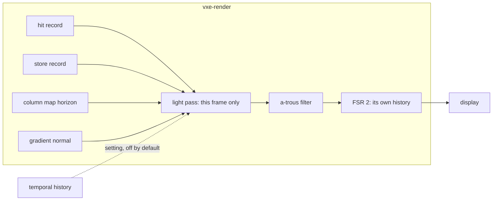

# 0098: A calm light by default: no screen history, smooth sources to the mid range, and the FSR 2 turn

> **Status:** in-progress. **Amended 2026-11-22 (architect, owner confirm owed)**, at window W1's
> verdicts (section "Amendment at W1"): the picks are light history off, `key far column`,
> `key far mix step`, the band `4..8` and `penumbra disc`; Phase 6 (a bake landing fades in the
> store) and Phase 7 (the one further window, W2) are new; Phase 5 becomes a spike of
> render-side arms for the far trees, no content changed; Phase 4 runs last with its bars
> restated. Order from here: 6, 5, 7, 4.
> **Created:** 2026-11-21
> **Milestone:** M10: Outdoors in [`docs/roadmap.md`](../roadmap.md)
> **Related ADRs:** [ADR-0082](../adrs/0082-the-light-pass-keeps-no-screen-history-by-default-and-reads-smooth-sources-to-the-mid-range.md)
> (proposed with this plan),
> [ADR-0079](../adrs/0079-the-key-lights-visibility-is-read-with-no-screen-history-the-record-or-the-column-maps-horizon-at-the-far-a-deterministic-penumbra-near.md)
> (the key light's far estimate and the approach penumbra this builds on),
> [ADR-0042](../adrs/0042-the-far-shading-normal-blends-to-the-27-count-gradient-by-the-voxels-size-on-screen.md)
> (the far normal's band, which this widens),
> [ADR-0076](../adrs/0076-light-stability-rules-world-history-per-source-a-fade-per-transition-and-a-ratcheted-pop-counter.md)
> (rule 6),
> [ADR-0055](../adrs/0055-render-settings-are-one-struct-with-an-apply-class-per-field-and-profiles-are-named-values.md)
> (the settings row this adds)
> **Source:** the owner's diagnosis window of 2026-11-21 (his words in
> [`logs/0098.md`](logs/0098.md)) and the rule agreed that evening: no new wobble plan until
> one switch combination in the window reads calm, and the plan ships that combination.

## TL;DR

The diagnosis window found a switch combination the owner calls calm on the slopes with no
grain: **the light passes with no screen history, and smooth sources out to the mid range**
(`light history off`, `key far column`, `key far mix step`, `far normal 8,12`). This plan makes
that combination one named setting, confirms it by eye in the scenes the window did not reach,
and then makes the picks the defaults. What it does not yet have a fix for is the second
source the window named: **the far trees wobble after a turn because of FSR 2**, which the
owner wants kept; Phase 2 reads where FSR 2 loses the far pixels before any mechanism is
written. The first thing the owner sees (Phase 3, window W1): the forest and the noon slope
under `calm` against today's default, flying, stopping and turning. The headless proof: the
wobble rig's `calm` arm against its `albedo` arm.

## Context & problem

Plans 0094 and 0095 passed their bars and the owner saw no change; ADR-0082's Context has why
and what the window found. The verdicts this plan is written against:

| what the owner switched | his words |
|---|---|
| smooth far, light history off | "now things got better, nothing on slopes", "no grain" |
| light history back on | "yes, its light history - with it wobble worsens" |
| exposure back to auto | "stays calm" |
| upscaler off (native) | "no wobble on turn, slight when move on the distance" |
| FSR 2 back on | "yes fsr makes them wobble - trees, but without it picture is not right" |
| `queue freeze` on | "freeze makes things worse" |
| default far, history off, approach | "when I move shadow moves with me which is not right" |
| the same with `penumbra disc` | "shadow does not move" |

**What the window left unseen** (each is a run of W1, not an assumption of this plan):

- The calm combination on the noon slope (scene A's dashes "wobble while flying" under every
  switch tried there, and neither `light history` nor `far normal 8,12` was tried there; `2..6`
  was "clearly the best" of off, `1..2` and `2..6`).
- The "bright places around the trees when moving" under the smooth far (seen once with the
  history on, cause unread).
- Whether `penumbra disc` grains with no history (one random ray a frame with nothing to
  average it), and how the disc's centre ray alone looks (`key jitter off`: a hard shadow, the
  same every frame, the cheapest).
- Any scene under lamps: the fired lights' and the emissive terms with no history.

**Two things the owner answered before the window that the window overturned.** "Stop refining
what is in view" lost to "freeze makes things worse", so this plan does not touch the bake
queue. "Seconds after stopping" narrowed to two sources: the history (slopes, grain) and FSR 2
(trees, after a turn and slightly while moving at a distance).

The budget figures this touches: `docs/nfr.md` section 2's lighting line (4.0 ms; the window's
HUD read the light pass at 3.36 ms under approach and 1.74 ms under disc on the RTX 3080
Laptop, one pose, not a reading of record) and the upscaler's line if Phase 5 changes FSR 2's
render scale.

## Amendment at W1 (2026-11-22; architect, owner confirm owed where marked)

W1 ran in two sittings on 2026-11-22; the owner's words are in [`logs/0098.md`](logs/0098.md)
("Phase 3: W1's verdicts"), with the leak window's and the Plan 0097 lane's finding beside
them. What they settle, and what they do not:

| question | W1's answer | standing |
|---|---|---|
| calm against the default | calm: "wobble on slopes is gone"; the default: "wobble on slopes came back" | the owner's words |
| key far | column: the baked record shows false sun under the canopy ("with keyfar column its dark") | the owner's words (leak window) |
| penumbra | disc: under approach "light rays are gone when I am distant", "no such behaviour when I am on penumbra disc"; approach is the tunnel wall's blink ("now it doesn't blink" under disc); both disc and history off calm the deep-shade dashes | **owner confirm owed**: no pick was stated, `key jitter off` was not judged, grain under disc with no history was not asked; "the shadow did not follow" under approach is withdrawn ("I may be mistaken on shadows") |
| band | "I think 4..8" | **owner confirm owed** (his "I think"; the slopes were called calm at `8..12`) |
| under lamps | the castle: "no grain, all good" with light history **on**; off was not flipped | unjudged: history off indoors has no verdict |
| FSR 2 levers | none beats scale 1.5 with FSR 2's own phases; scale 1 "does look right, fps is around 30" | the owner's words |
| what is left | "only distant trees", while moving | the owner's words |
| a denser canopy | wobbles less (256, then 160, then 64), and "this is not the way... we don't know what models will be used in the end and can't simplify models"; 256 with calm: "almost no wobble, but trees looks bad" | the owner's words; a rule |

**Three things the readings add** (all in the log):

- **A bake landing pops with no screen history.** Under `calm` with the exposure pinned, 15.61 %
  of the near pixels change in the one frame a chunk's bake lands (stop +43), and nothing
  moves with the queue stopped. The store fades a block's words, and the key words' change was
  left to the light pass's history (`bake/queue/step.rs`), which `calm` turns off; which of
  the image's reads carries the pop is not read. ADR-0082's "holds without a fade" is wrong and
  is amended. The Plan 0097 lane's finding (18.67 % of near pixels in one frame at stop +3
  after a 20-frame fly, the exposure constant, the default arm, a debug build: indicative) is
  the same suspect and is read in Phase 6, on its short fly as it stands.
- **The far trees' wobble is sparse geometry under jitter, made visible by the light.** At a
  still camera 17.46 % of the far hits change between two jitter phases, 16.28 points of it
  leaves at 15 to 60 m, where a voxel is 2 to 4.5 px: over a pixel, so a LOD mip chosen by
  pixel size never applies. The same flips under `--view albedo` move 1 to 3 % of the far
  pixels over 4 levels against 22 % lit, and the owner called albedo "no wobble". So the
  flips are there in every arm; what the eye sees is the difference in light between the two
  hits a jitter step picks. **No mechanism is known to calm it on any model.** That is the
  honest state, and Phase 5 is a spike, not a fix.
- **The default with the history on read better on the trees once** (W1 run 8i: "trees seem
  better - wobble only on move and only distant trees"), unexplained; a history averages the
  two hits' light over the phases, which is one reading of it and a guess.

**The rule this amendment is written under** (owner, 2026-11-22, on the test tunnel's roof slot
and on the leaf fill): no scene, model or fixture is simplified so that a check passes. The
wobble rig's forest, its leaf fill and its fly lengths stay as they are.

## Decision

**Ship the combination the owner called calm as the default once W1 confirms it; read FSR 2
before fixing it.** ADR-0082 records the decision and the three rejected lines (a better
history, a frozen queue, no upscaler). Inside this plan we also reject: a fix for the approach
penumbra's camera-following before the pick (the owner may take the disc or the centre ray, at
about half the light pass's time), and an asserting harness before the window (lane rules 2b).

## Architecture diagram



## Implementation phases

Each phase ships as its own commit. Phases 1, 2, 5 and 6 are **exploration** (they name
readings, not image tests; CPU tests of data and flags stay with their phase). From the
amendment on the order is 6, 5, 7, 4. The lane needs the debug page's switches of `diag-edges` (`ac0d4132`): it
stacks on `plan-0097` with that commit, or starts from main once Plan 0097 has merged and
cherry-picks it; the orchestrator's call.

### Phase 1: The calm combination as one setting (exploration)
- **Owner skill:** dev
- **What:** `light history` becomes a render setting (ADR-0055: a `Lighting` field in place
  of the hook `LightHooks::no_history`, a settings-file row, `--light-history on|off`, the
  debug page's row), and one flag, `--calm`, sets the window's combination: light history off,
  `key far column`, `key far mix step`, `far normal 8,12`. The HUD's lighting row and the
  banner name `calm` and each row that is off its default. The wobble rig gains the arms `calm`
  and `calm,native`. No default changes.
- **Files touched:** `crates/vxe-render/src/frame/settings.rs`,
  `crates/vxe-render/src/frame/encode.rs`, `apps/flythrough/src/cli/outdoor.rs`,
  `apps/flythrough/src/cli/tests/outdoor.rs`, `apps/flythrough/src/toggles.rs`,
  `apps/flythrough/src/hud/modes.rs`, `apps/flythrough/tests/gpu_wobble.rs`,
  `docs/flythrough.md`, `docs/plans/logs/0098.md`.
- **Done when:**
  - CPU (`apps/flythrough/src/cli/tests/outdoor.rs`, under 1 s): `--calm` parses to exactly
    those four values; `--calm --far-normal 2,6` keeps the later flag's band; the lighting row
    reads `light history off` and the banner names `calm`.
  - Readings in the log (no assertion), RTX 3080 Laptop and RADV RENOIR, 1080p, the forest at
    15:00 and at `--sun 10,180`, the hills at noon: the light pass's time under the default
    and under `--calm`; the wobble rig's soak reading
    (`gpu_wobble` `the_wobble_table_over_the_arm_set`, born soak, about 10 min on the RTX) for
    `default`, `albedo`, `calm`, `calm,native`: the far and near shares while flying, after
    the stop and after the turn.
  - `--binaries gpu_wobble` is the phase's GPU run.

### Phase 2: Where FSR 2 loses the far trees after a turn (exploration, a spike)
- **Owner skill:** dev
- **What:** Readings that split the trees' post-turn wobble inside the FSR 2 path, under
  `--calm` and under `--view albedo` (the light out of the picture), on the wobble rig's turn.
  For the far class, per frame over the 30 frames after the turn: the share of pixels whose
  history FSR 2 rejects or shortens, split by stage (the depth clip's disocclusion, the lock's
  release, the accumulate pass's colour clamp); the motion vectors' error against the exact
  reprojection of the hit record's world point; and the share of far pixels whose hit changes
  between two jitter phases at a still camera (leaves under a pixel that a jitter step finds
  or misses). Then each lever that is a constant or a flag today, read the same way: the
  render scale 1.5 against 1.3 and against 1.0 with FSR 2 on (its antialiasing at native),
  `--jitter-phases`, and the far normal's band. Levers that need no new shader logic get a
  debug-page switch for W1; nothing else is built.
- **Files touched:** `apps/flythrough/tests/gpu_wobble.rs` (or a sibling `gpu_wobble/fsr.rs`),
  `crates/vxe-render/src/fsr2/` and `crates/vxe-render/src/shaders/fsr2/` (a debug readback
  of the stages' masks, behind the test hooks), `apps/flythrough/src/toggles.rs`,
  `docs/plans/logs/0098.md`.
- **Done when:** the log holds one table, RTX 3080 Laptop, with the far class's share per
  stage at +0, +10 and +30 frames after the turn and each lever's row, and names the stage
  that accounts for the largest share, or says that none does. The frame time under each
  lever is in the same table (scale 1.0 marches 2.25 times the pixels of scale 1.5). The
  readings are soak tests (`gpu_wobble`), never a gate.

### Phase 3: The owner's window W1
- **Owner skill:** human
- **What:** One session on Linux, the RTX 3080 Laptop, every mode shown on screen. The move in
  each run: fly slowly 5 s, stop and hold 5 s, turn about 60 degrees, hold 5 s.
  1. The forest at `--sun 10,180` and the noon slope (the window's two poses): today's default
     against `--calm`. Is `calm` calm on the slope's dashes while flying? Are the bright
     places around the trees there, and do they matter?
  2. Under `calm`, the penumbra: approach, disc, and the disc's centre ray (`key jitter off`).
     Which one, for the shadow that stays put and for grain?
  3. Under `calm`, the band: `2,6` against `8,12` (and one value between if neither is right).
     Is the far trees' loss of shadow detail acceptable?
  4. A scene under lamps (the castle's hall) with light history off against on: grain?
  5. The FSR 2 levers Phase 2 exposed, under `calm`: which, if any, calms the trees after the
     turn, and at what frame rate (the HUD's).
- **Files touched:** `docs/plans/logs/0098.md` (the verdicts, in the owner's words).
- **Done when:** the log holds a verdict per run and the picks: light history's default (per
  scene kind if lamps need it), the band, the penumbra, and the FSR 2 lever or "none yet".

### Phase 4: The picks become the defaults (runs last, after W2)
- **Owner skill:** dev
- **What:** The defaults of `Lighting` and the fly-through take the picks as W2 confirms them
  (W1's: light history off, `key far column`, `key far mix step`, far normal `4..8`,
  `penumbra disc`; light history under lamps and a far-trees arm by W2's verdicts); the
  architect writes the picks into ADR-0082's Outcome at the close. An arm not picked that costs
  nothing when off stays a setting (owner, 2026-11-12): the approach penumbra, `key far baked`,
  light history on, each spike arm. `--calm` goes if the defaults equal it. The goldens that
  the new defaults move are re-blessed on lavapipe.
- **Files touched:** `crates/vxe-render/src/frame/settings.rs`, the fly-through's defaults
  under `apps/flythrough/src/cli/`, the goldens under `apps/flythrough/tests/`,
  `apps/flythrough/tests/gpu_wobble.rs`, `docs/flythrough.md`,
  `docs/nfr/02-frame-budget.md`, `docs/plans/logs/0098.md`.
- **Done when** (amended 2026-11-22; each bar names the arm the owner judged):
  - CPU (under 1 s): the default settings equal the picks, row by row.
  - `gpu_wobble` (soak, RTX by `VXE_TEST_ADAPTER=rtx`, about 15 min an arm; lavapipe also
    soak), the default arm with the exposure pinned, the queue stepping and no drain, at the
    rig's fly of 180 frames and at a fly of 20:
    - **near (replaces the bar on the stop's first frame):** no frame pair of the stop moves
      more near pixels over 4 levels than the arm `calm,pin,nqueue`'s largest pair plus 2
      points (0.32 % in the log's run, so 2.32 %). The arm is the image with nothing landing;
      the eye's side of it is W2 run 2, the fade against the pop. The share against the stop's
      last frame is printed, not barred: light still arriving as one fade is ADR-0076's rule 6.
    - **far:** the far share over 4 levels 30 frames after the stop is at most the reading of
      the arm W2 judged plus 2 points (`calm` as picked, Phase 6's table; or the picked
      far-trees arm, Phase 5's). Until a far-trees arm is picked this is a ratchet on what the owner accepted
      ("only distant trees"), not a claim the trees are calm; the arm `calm,native` (0.0 %) is
      printed beside it as the distance left.
  - The light pass's time under the new defaults, both adapters, the three scenes, replaces
    the readings in `docs/nfr/02-frame-budget.md` with the machine and the commit.
  - `--binaries gpu_wobble` plus the golden binaries the re-bless touches.

### Phase 5: The far trees, a spike of render-side arms (exploration)
- **Owner skill:** dev
- **What** (amended 2026-11-22, architect; owner confirm owed, question 1 of the amendment's
  report): no arm is known to work, so nothing here is a default. A reading first, then at
  most three arms, each a debug-page switch that shows its mode, each acting on any model
  (nothing reads the material's kind, the prefab or the leaf fill).
  1. **The reading.** Over the rig's still pairs (`gpu_wobble/fsr.rs`, the far flips by band
     and kind), the luma difference between a flipping pixel's two phases, split by the term
     that carries it: the key light, the sky term, the lamp terms, the shading normal's
     cosine, the albedo (the views and hooks the rig has; where a term has no view the reading
     says so). It names the term with the largest share, or says none dominates.
  2. **Arm `far light wide`:** where the far normal's weight applies, the a-trous filter's
     plane and normal edge stops relax by that weight, so the light of two hits a jitter step
     apart is one spatial mean (`atrous.wgsl` `edge_weight`). Built against the term the
     reading names; if that term does not pass through the filter, the arm widens that term's
     own source instead and the log says which.
  3. **Arm `far jitter` (1, 0.5, 0):** the primary ray's sub-pixel offset scales down where
     the pixel's previous hit lies in the far band, FSR 2's own jitter input unchanged. The
     eye's ground for it: the upscaler off, with no jitter, read "no wobble on turn, slight
     when move on the distance".
  4. **Arm `light history far`:** the light passes keep their history at the far normal's
     weight 1 only. The ground for it is run 8i alone, and it gives back ADR-0082's rule at
     the far, so it is the last to build and the first to drop.
  An arm that needs more than a switch and a few lines of shader is reported and not built.
  Not an arm: a denser canopy, a LOD mip by pixel size (the voxels are over a pixel), a change
  to AMD's rectification (Phase 2 read the clamp at 38 % of the far pixels under albedo, which
  is calm, so the clamp is where the contrast shows, not its source).
- **Files touched:** `apps/flythrough/tests/gpu_wobble/fsr.rs`,
  `crates/vxe-render/src/shaders/{atrous,hit,temporal}.wgsl`,
  `crates/vxe-render/src/frame/settings.rs` (default-off rows), `apps/flythrough/src/toggles.rs`,
  `apps/flythrough/src/hud/modes.rs`, `docs/plans/logs/0098.md`.
- **Done when:** the log holds the term table, and one table on the RTX 3080 Laptop with a
  row per arm beside `calm` (as picked), `albedo` and `calm,native`: the hits phase to phase,
  the far over 4 levels while flying, at the stop's +0 and +30 and at the turn's +0, +10 and
  +30, and the light pass's and the frame's time. It says which arm closes more than half of
  the distance from `calm` to `albedo` at the turn's +10, or that none does. Each arm's mode
  reads on the HUD's lighting row. The rig's forest is byte for byte the one Phase 2 read.
  Readings only (`--binaries gpu_wobble`); no golden, no bar.

### Phase 6: The picks under one flag, and a bake landing fades in the store (exploration)
- **Owner skill:** dev
- **What:** (a) `--calm` and the rig's `calm` token take W1's picks: light history off,
  `key far column`, `key far mix step`, far normal `4..8`, `penumbra disc`; the HUD names
  `calm` while all five hold. Phases 1 and 2's tables were read at approach and `8..12`, so
  the wobble table's `calm` and `calm,pin` rows are read again. (b) A reading: the rig's
  landing rows say, at each frame a chunk's bake lands in the stop, which of the image's reads
  changed (the block's pool words under the store's fade, the key words, the summary and
  parent words) and how many blocks were fading; at the rig's fly of 180 and at a fly of 20
  with the default arm (the Plan 0097 lane's 18.67 % at stop +3). It names the read whose
  change shows in one frame. (c) The fade: that read's change rides the store's fade
  (`Fade`, `refade`, `fade_mix` in `bake/queue/step.rs`), over the same frames as the block's
  other words, so no landing depends on a screen history to arrive softly. A debug-page
  switch `landing fade` (on, off) shows its mode, for W2's before and after.
- **Files touched:** `crates/vxe-render/src/bake/queue/step.rs`,
  `crates/vxe-render/src/bake/{store,summary}.rs`, the light pass's read of the faded words
  (`crates/vxe-render/src/shaders/{shade,temporal}.wgsl`), `apps/flythrough/src/cli/outdoor.rs`,
  `apps/flythrough/src/cli/tests/outdoor.rs`, `apps/flythrough/src/toggles.rs`,
  `apps/flythrough/src/hud/modes.rs`, `apps/flythrough/tests/gpu_wobble.rs`,
  `docs/flythrough.md`, `docs/plans/logs/0098.md`.
- **Done when:**
  - CPU (`cli/tests/outdoor.rs`, under 1 s): `--calm` parses to exactly those five values and
    a later flag still wins.
  - A test of the store's data, beside the queue's existing fade tests (CPU if `fade_mix` is
    reachable without a device, else the bake's `gpu_*` binary, named in the log, under 10 s
    on lavapipe): after a first block lands over a fallback and after a refinement lands,
    every word the light pass reads for that block, the key words included, moves from its old
    value to its new one over the fade's frames, and no queue step moves a word further than
    the step's share of the whole change plus one unit of rounding.
  - Readings in the log (RTX 3080 Laptop, the exposure pinned, `calm,pin` and `default,pin`,
    fly 180 and fly 20, before and after): the stop's largest near pair over 4 levels and its
    frame, beside the arm `calm,pin,nqueue`'s; and the `default,pin,nqueue` row the log owes.
  - `--binaries gpu_wobble` plus the bake binary the data test lives in.

### Phase 7: The owner's window W2 (the one further window)
- **Owner skill:** human
- **What:** One session on Linux, the RTX 3080 Laptop, every mode shown on screen.
  1. The forest at `--sun 10,180` and the noon slope under `--calm` as picked: still calm on
     the slopes at `4..8` with the disc? Grain in the disc's penumbra with no history? The
     disc against `key jitter off`. The sun patches at a distance.
  2. The forest floor, a short fly and a stop, eyes on the near ground for 3 s: `landing fade`
     off against on. A pop without it, none with it?
  3. The castle's hall under lamps: light history off against on. Grain, flicker?
  4. The forest under `--calm`, flying and turning: each Phase 5 arm against none. Does any
     calm the distant trees, does the picture still look right, at what frame rate?
- **Files touched:** `docs/plans/logs/0098.md` (the verdicts, in the owner's words).
- **Done when:** the log holds a verdict per run and the picks: the penumbra and the band
  confirmed or changed, light history under lamps (off everywhere, or the lamp terms keep
  theirs), and the far-trees arm or "none". If none, the trees' wobble goes to the backlog
  with Phase 2's and Phase 5's tables and this plan closes on the calm defaults; if an arm is
  picked that Phase 4 cannot make a default as a setting, it gets its own plan.

## Data shapes

```rust
// illustrative: the hook becomes a setting (ADR-0055), live, off by default after Phase 4
pub struct Lighting {
    /// The light passes read last frame's means through the history test.
    pub history: bool,
    // ...
}
```

## Budgets

- **Section 2, the lighting line (4.0 ms).** Expected to fall or hold: no history removes
  work only if its passes can be skipped (unread), and the penumbra pick may halve the pass
  (the window's HUD, one pose: 3.36 ms approach, 1.74 ms disc). Phase 1 reads it, Phase 4
  records it: `flythrough --headless --source outdoor`, the forest and the hills, 1080p, RTX
  3080 Laptop and RADV RENOIR, under the perf lock.
- **Section 2, the frame at the default scale.** W1 picked no FSR 2 lever, so the scale holds
  at 1.5. Phase 5's table carries the light pass's and the frame's time per arm so W2's pick
  is made with its cost; Phase 6's fade adds words to the store's fade stage (`S_FADES`),
  read in its lap beside the before.
- **Section 7, the gate's wall time.** Unchanged: every new GPU test is soak.

## Risks & open questions

- **The calm combination may not hold on the noon slope.** Scene A's dashes wobbled while
  flying under every switch tried, and the two that matter were not tried there. If W1's run 1
  says no, the plan stops at Phase 3 and the dashes get their own reading (the candidates are
  in the backlog's slope-lines entry).
- **No history may grain under lamps.** W1 did not flip it there (the castle read "all good"
  with the history on). W2's run 3 judges it; if it grains, the default splits by term (the
  outdoor terms take no history, the lamp terms keep theirs), an amendment before Phase 4,
  which ADR-0082's Outcome records.
- **The far trees may have no arm.** Phase 5 is a spike under an honest "none known". The
  plan then closes with the trees' wobble disclosed and in the backlog, not with a bar that
  hides it.
- **The disc draws one random ray a frame with nothing to average it.** The owner looked at
  the disc under `calm` and named no grain, but was not asked; W2's run 1 asks, with
  `key jitter off` beside it.
- **FSR 2 may have no cheap lever.** FSR 2 at scale 1.0 is the likeliest calm arm and costs
  2.25 times the marched pixels; on the RADV RENOIR that is not affordable. The owner then
  chooses between the wobble and the frame rate per profile.
- **The readings have misled twice.** Every bar in Phase 4 is tied to an arm the owner judged
  by eye; no bar stands for a look he has not seen.
- **Plan 0096 overlaps at one point.** Its Phase 6's first lever is the approach penumbra's
  cost on the RADV RENOIR; W1's pick is the disc (owner confirm owed at W2), so that lever
  falls away and its levers are read on the disc. Its Phases 3 to 5 (the
  tiers, the drain slice, the step) stand: the window showed a frozen queue is worse, not
  better.
- Determinism, memory and threading: none touched (render settings only; no world code).

## What this plan does NOT do

- It does not touch the bake queue, its drain or its tiers (Plan 0096).
- It does not touch the exposure (Plan 0097; the window: "stays calm").
- It does not replace FSR 2 or tune our own upscaler.
- It does not remove the history's code or the arms not picked.
- It does not fix the F9 steps view's frame rate (backlog).
- It does not make the approach penumbra world-fixed: W1 points to the disc, and approach
  stays a setting as it is.
- It does not change a scene, a model, the leaf fill or a rig's flight so that a bar passes
  (owner, 2026-11-22).
- It does not change FSR 2's arithmetic, its scale or its phases (W1: no lever beats today's).

## Implementation log

> Written by `dev`: one row per phase as its commit lands, then the close block. **The phases
> above are the contract. This section records what happened.** Observations, never
> conclusions. Readings, attempts and resume notes go to [`logs/0098.md`](logs/0098.md).

| phase | owner | state | commit |
|---|---|---|---|
| 1: The calm combination as one setting | dev | done (6370f2c4); `Lighting::light_history` (the plan's `history` is taken by `HistoryKill`); the setting row in `crates/vxe-render/src/settings.rs`; `start_lighting` in `cli/mod.rs`; the menu's far normal steps 4..8 and 8..12 too (`cli/parse.rs`, `run/tests.rs`); the hook's three lines dropped from `gpu_outdoor/canopy.rs`; readings in the log | committed with this row |
| 2: Where FSR 2 loses the far trees | dev | done (e2963230; the table and the motion fix with the next row's commit); instrument in; the reading is `mod reading` (`gpu_wobble/fsr.rs`), not soak; the levers' switches need `run/keys.rs` and `run/profile.rs`; readings in the log | committed with this row |
| 3: The owner's window W1 | human | run 2026-11-22 in two sittings (`live/session98.sh` at `e2963230`); verdicts in the log, amendment in the plan | the amendment's commit |
| 4: The picks become the defaults | dev | not started; runs last, after W2 | |
| 5: The far trees, a spike of render-side arms | dev | not started | |
| 6: The picks under one flag, a landing fades in the store | dev | not started; runs first | |
| 7: The owner's window W2 | human | not started | |

### Notes

_(Empty.)_

### Close triggers

_(Facts for the architect.)_

- **What shipped:**
- **Public API changed:**
- **Budget readings:**
- **Gate at the tip:**
- **Outstanding `human` phases:**

## Followups

- The slope's step lines and the narrowed key band (backlog) are taken here through the
  widened band; whatever W1 leaves of them returns to the backlog at the close.
