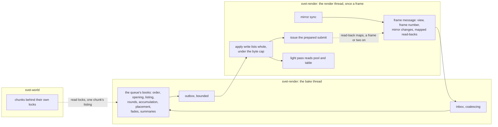

# 0099: The bake step off the main thread: a bake thread, write lists the render thread applies, and the in-view drain

> **Status:** in-progress (Phases 3d, 4c2, 3f, 3g and 4d landed 2026-11-26, Phase 4d's stop (the RTX forest's fed 0.599 on one run) reported; Phase 5 next; Phases 1, 2, 2b, 2c, 3a, 2d, 2e, 4b, 4c and 3c landed 2026-11-25; Phase 3b built, its stops ruled 2026-11-25: Phase 3d comes before 4c2; question 8 answered (a), owner 2026-11-25: the wait stays as built, Phase 3d's figures go beside the Phase 5 window); approved (owner, 2026-11-22; his answers are under "Risks & open questions":
> the recommended option in each, question 2 by his own words). **After: 0096, 0098, 0087** (owner, 2026-11-22:
> drafted now, the lane after the rename; then 0089 and 0093, 0091, ...).
> **Re-read 2026-11-24** after Plan 0098 (v0.72.0) and the rename (v0.73.0): Phases 1 to 3 are
> amended under "Amended 2026-11-24 (architect re-read)", which wins over the phases' text where
> the two differ. **Questions 6 and 7 are answered** (owner, 2026-11-25: 6 (a), the edit's frame
> waits for the dig; 7 (f), the stretch at 1.5); Phase 3b builds both, before Phase 4d.
> **Created:** 2026-11-22
> **Milestone:** M10 (the outdoor scenes are where the queue is deep) and cross-cutting, like
> [Plan 0096](done/0096-the-bake-queues-drain-tiers-a-drain-slice-the-step-and-the-slow-adapters-light-pass.md):
> it serves `docs/nfr.md` section 2's streaming line, the bake queue's step inside it and the
> Floor frame, and takes the lines Plan 0096 closes with as disclosed misses.
> **Related ADRs:** [ADR-0083](../adrs/0083-the-live-bake-queue-runs-on-a-bake-thread-the-render-thread-applies-its-write-lists-and-issues-its-submits.md)
> (proposed with this plan), which extends
> [ADR-0017](../adrs/0017-mirror-cpu-work-bounded-in-the-frame-loop-narrowing-on-stream-workers.md);
> [ADR-0080](../adrs/0080-the-live-queue-bakes-what-the-image-reads-a-record-by-rule-a-tier-by-size-on-screen-and-a-drain-slice.md)
> (the tiers and the drain slice),
> [ADR-0076](../adrs/0076-light-stability-rules-world-history-per-source-a-fade-per-transition-and-a-ratcheted-pop-counter.md)
> rules 3 and 6, [ADR-0046](../adrs/0046-static-emissive-light-is-baked-per-chunk-when-a-chunk-loads-or-changes.md)
> (the store's bit-identity).
> **Source:** Plan 0096's Phase 8 window (2026-11-22) and its section "The window's verdict and
> what is left"; the readings are in `docs/plans/logs/0096.md` on branch `plan-0096` until that
> plan merges.

## TL;DR

After a fresh start in the forest the RTX 3080 Laptop holds about 30 fps while the bake queue
drains, because the queue's step costs 28 ms a frame on the render thread; the GPU needs 11.6.
This plan moves the queue's books and all of its per-job CPU work to **one bake thread**
(ADR-0083). The render thread sends the view and the mirror's changes once a frame, never
waits, and applies what comes back: **write lists** (a block's words and its table word always
together, so no frame reads half a landing) under a byte cap, and at most one prepared submit.
The same code runs in **lockstep** on the calling thread as a setting, which is how the tests,
the pre-roll and every assertion on the undrained image stay reproducible. The store's bytes
do not change. Then the bake thread is made to keep the submits fed, because the drain slice
is granted per frame and a doubled frame rate is twice the bake a second only if the CPU side
keeps up. The first thing anyone sees: the `bake queue step:` line splits the step into what
must stay on the render thread and what can leave, on the unchanged forest fresh start.

## Context & problem

Every figure is a reading unless marked. "RTX" is the NVIDIA GeForce RTX 3080 Laptop GPU,
"RENOIR" the AMD Radeon Graphics (RADV RENOIR), the slow adapter of `docs/nfr.md` section 1.
The readings are Plan 0096's (`docs/plans/logs/0096.md` on `plan-0096`).

**The window (Phase 8, 2026-11-22, release `1844a99b`, 2530 x 1378, internal 1687 x 919, mains,
performance profile, 1-minute load 0.98).** Forest: `--source outdoor --spawn forest --trees
forest --time 15:00`; hills: `--source outdoor --time 17:00`.

| run | the owner's words | fps | wall p50 / p99 | frame CPU p50 | march GPU p50 | step, regime B, p50 / p99 | in view landed after the first world frame |
|---|---|---|---|---|---|---|---|
| RTX forest (a1) | "works, but fps around 30" | 25 to 41 | 28.3 / 59.1 ms | 28.0 ms | 11.6 ms | 28.0 / 51.1 ms (465 steps) | not reached in 17.9 s |
| RTX hills (a2) | "fully settled in around a minute or so if I am looking for stable fps (70+)" | 31 to 45, then 55 to 69, then 68 to 77 | 13.3 / 34.3 ms | 1.2 ms | 11.8 ms | 13.1 / 34.3 ms; drained 0.05 to 0.07 | 16.1 s; empty at 27.5 s |
| RTX forest, profile tiers (b1) | none | not split | 20.5 / 60.5 ms | 19.8 ms | 12.1 ms | 21.5 / 60.0 ms | 22.3 s |
| RENOIR forest (a3) | "very slow, around 8-9 fps" | 8 to 11 | 106.8 / 119.5 ms | 9.8 ms | 100.6 ms | 8.7 / 17.5 ms | not reached |

The RENOIR is GPU-bound at that size (3.79 times the Portable profile's pixels; Plan 0096
Phase 9 re-reads it at 720p). Its step is 7 to 9 ms all the same.

**What a step costs, by stage** (Plan 0096 Phase 5, `e3b03e75`, RTX, Floor, 1920 x 1080,
headless, the forest at 15:00, loaded; stage means a line in regime B): `list` 10.0 to 18.1 ms
(the faces of the 16 to 32 candidates an opening admits, about 1 ms each, already spread over
scoped threads the render thread waits for), `collect` 5.0 to 7.0, `submit` 5.0 to 8.1,
`fades` 4.3 to 7.5, `summaries` 1.6 to 2.6; together 25.9 to 43.3 ms. `candidates` reads 1.1
to 1.6 and the depth-bound stages are gone (0 to 56 candidates scored a step against a pool
of 9 361). The step read 20.7 / 55.0 ms p50/p99 against Plan 0096's proposed line of **1.0 /
4.0 ms**, which that plan pins as a disclosed miss and hands here.

**What is not known, and Phase 1 reads.** How each of those stages splits between pure CPU
(which can leave the render thread) and `wgpu` calls (`write_buffer` copies, the encode, the
submit, the mapped read; ADR-0083 keeps the writes and the submits on the render thread).
ADR-0017's Outcome found `write_buffer` at 41.8 % of the mirror sync's samples, so the split
is not a formality: it decides whether the render thread's share can reach 1.0 ms and which
of Phase 4's levers are needed.

**The drain is the other half.** Plan 0096 proposed "in view landed at most 10 s after the
first world frame" on the RTX and reads 16.1 s (hills) and 22.3 s (forest) at the window. The
drain slice (4.0 ms at Floor while in-view work waits) is granted per frame and the submits
draw 0.94 to 0.99 of it, so at about 30 fps the bake gets about 120 ms of GPU a wall second.
At 70 fps the grant is 280 ms. **Arithmetic, not a reading:** 22.3 s x 30 / 70 is 9.6 s, if
the bake side prepares 2.3 times the jobs a second. One regime B step's CPU (26 to 43 ms) fed
4.35 to 5.48 ms of RTX GPU (Plan 0096 Phase 4), so one thread running nothing else makes 23 to
38 steps' worth a second, 100 to 210 ms of GPU, **36 to 75 % of that grant**. Moving the step
restores the frame rate; it does not by itself shorten the drain. Phase 4 is for that, and
takes the opening's candidate cap with it (Plan 0096's F2 reading: the per-second rig draws
0.60 to 0.69 of its grant because an opening admits at most a fixed count of candidates).

**The rules this is held to** (owner): a stable image is the one priority, performance
considered; no waiting for light (ADR-0076 rule 6; a minute's settle is unacceptable); a
budget is measured on named hardware and a figure without a measurement says it is a guess;
no scene or fixture is simplified so a bar passes; `svet-world` stays headless and
deterministic and GPU code lives in `svet-render` only.

## Decision

The queue's books and its per-job CPU work run on one dedicated bake thread; the render
thread keeps every `wgpu` submit and every write the image reads, applied once a frame from
write lists; the same code runs in lockstep as a setting. ADR-0083 holds the decision and its
costs. We rejected **spreading the step over the stream workers** because only the listing is
a pure function of a chunk and 16 to 25 ms would stay; **capping the opens on the render
thread** because it buys the frame rate with a longer drain; **amortising the listing**
because the step still reads 16 to 25 ms with the listing free; **a bake thread that also
submits and writes** because a block and its table word could land in different frames, a
pop by construction; and **a fork and join inside the frame** because the frame still waits
for a 28 ms step.

## Architecture diagram



In lockstep the three bake boxes run inside the frame's call on the calling thread, one step
per frame, and the two channels hold one item.

## Implementation phases

Each phase ships as its own commit. `dev` implements all phases in one session with no review
between phases; the architect reviews once at the end, in a fresh session.

**Starts after Plans 0096 and 0098 have merged and after Plan 0087 (the rename)**: 0096 is the
base for this subsystem, 0098's Phase 6 edits the landing fade in the same step file, and 0087
renames the crates and identifiers. **The tree's names win**: every path and identifier below
is as of `plan-0096`'s tip `33003841` and names a mechanism; where the tree differs, dev
follows the tree and notes it. Phase 1 re-reads the base, because Plan 0096's Phase 9 and
Plan 0098 both move it.

**Inherited from Plan 0098** (added 2026-11-24 by the architect at that plan's close, v0.72.0;
facts of the base; the architect's re-read of Phases 1 to 3 against them is the section "Amended
2026-11-24 (architect re-read)"). Plan 0098 closed after this plan was approved and changed the
dig's path through `bake/queue/`:

- **A dig's ring 1 is a job of its own.** `open_digs` splits a dug chunk: the bricks the box
  dilated by one voxel touches re-bake first, in a job opened in the edit's step into a table
  slot (`open_now`; the last open job that is neither a dig's nor key-only is withdrawn where
  none is free) and promoted ahead of every job; the chunk's other dig bricks open as a second
  job once the first is placed **and its `DIG_FADE` fade has ended**. A chunk splits only where
  its provisional block took the listing's size in the pool.
- **Stale jobs are withdrawn at the edit**, not awaited (`take_boxes`, `withdraw_at`,
  `JobLoop::withdraw`): a dig's bricks rejoin `digs`, another job's chunk returns to the
  candidates. A ring-1 job with no live face closes in its step's submit
  (`JobLoop::close_ended`); a placement that throws a stale job's block away marks its chunk
  touched.
- **The held record is made inside `take_boxes`** (`bake/held.rs`, through `list_dug` on
  scoped listing threads): a CPU estimate against the world and the store's blocks as the
  edit found them, written over the provisional block. It moves to the bake thread with the
  step; it reads the world's chunks under their read locks (the "Risks" line on a dig's write
  lock applies to it too).
- **The base of "an edit's light"** (`docs/nfr/04-edits.md`, "An edit's light"): ring 1 lands 1
  or 2 frames after the dig on the RTX 3080 Laptop and on the RADV RENOIR at Portable, on a
  waiting queue too, so the Budgets table's line reads "within 4 frames" with the thread on;
  the lavapipe image test's bar is 8 frames and "no later than the reference plus 1".
- **The dig frame's step time is a reading this plan owns**: 25.9 ms (sequence A) and 14.5 ms
  (B) in the means on the RTX, about 7 and 5.5 on the RENOIR, with a run-to-run spread of up
  to 30 ms on the RTX. Phase 1 reads it again with at least eight alternated runs a tree
  before any bar is held against it. The dig rig's queue never drains (its frames do not wait
  on the device; `docs/backlog.md`, "Plan 0098's leftovers"), which Phase 1's base reading on
  that rig must fix or avoid.
- **Tests that pin this behaviour:** `gpu_queue::a_dig_jumps_every_open_job_and_withdraws_its_stale_one`,
  `gpu_queue_reach::{a_fade_moves_a_record_by_its_share_a_frame, a_full_pool_keeps_the_queue_alive,
  an_emitter_dug_away_darkens_what_it_lit}`, `gpu_sun::a_dig_rebakes_the_key_words_with_the_sky_ring`,
  `bake::held::tests`, and the soak image test
  `flicker::a_fresh_hole_holds_its_value_until_its_light_lands`. `open_digs` knows a dig's fade
  by `frames == DIG_FADE`, which a fade paced by elapsed frames (Phase 2) must keep true or
  replace with a flag.
- **Files near the size gate:** `bake/queue/mod.rs` 1060 and `bake/job_loop.rs` 1047 of 1200
  lines.

**Test cost** (the rules Plans 0096 and 0098 run under): per phase,
`node scripts/test-changed.mjs --profile quick` over the changed crates; the phase's GPU run
is `--profile gpu --binaries` with the binaries the phase names, under the perf lock; clippy
and fmt per phase; `cargo nextest run --profile gate` once, at the tip (Phase 6). No soak or
full tier. Every perf reading is release, under the exclusive perf lock, with the 1-minute
load logged (under 2 at the start to pin a line; a loaded run is labelled indicative and pins
nothing), on the RTX (`--adapter RTX --profile floor`, 1920 x 1080, FSR 2 at 1.5) and the
RENOIR (`--adapter RENOIR --profile portable`, 1280 x 720), **and names its mode, lockstep or
thread**. The scene is the forest fresh start the owner saw, flags unchanged (above), from the
first world frame, with the hills at 17:00 beside it; no tree count, radius, tier or sample
count is lowered for a bar. The RTX forest is also read at the window's 2530 x 1378 as a
reading (no line is defined at that size). This plan is not look-driven: the store's bytes
are asserted equal, so no phase is exploration and no golden is expected to move.

### Phase 1: The step's split on the line, and the base readings
- **Owner skill:** dev
- **What:** No behaviour changes. The step's stage timers gain a second axis: each stage's
  time in `wgpu` calls (`write_buffer`, the encode, the submit, the poll, the mapped read and
  unmap) against the rest, and the bytes written a step to the pool, the table and the
  summary buffers. The `bake queue step:` line and the HUD's queue row print the two sums as
  `render` (what ADR-0083 leaves on the render thread) and `movable`. The fresh-start rig is
  named (a script line in the readings log, the window's flags). Readings: the base on both
  adapters and both scenes; the RTX forest at the window's size; the dig's ring today (frames
  from a dig that removes an emitter to the near ring's records changing, the existing
  `gpu_bake` test's rig); the edit's wait today (p99 of a dig op's wall while the queue is in
  regime B); the same RTX forest run pinned to 8 logical CPUs of 4 cores (`taskset`), labelled
  as the dev box's stand-in for the floor's CPU, not as the floor.
- **Files touched:** `crates/svet-render/src/bake/stages.rs`,
  `crates/svet-render/src/bake/queue/{step,stats}.rs`, `crates/svet-render/src/bake/store.rs`,
  `crates/svet-render/src/bake/job_loop.rs`, `apps/flythrough/src/run/queue.rs`, the HUD's
  queue row, `docs/flythrough.md`, `docs/plans/logs/0099.md` (new).
- **Done when:** (1) `the_step_line_splits_render_and_movable_and_they_sum_to_the_step`
  (CPU, under 1 s): a step's stage record with known laps formats to a line whose `render`
  and `movable` sums equal the stages' sum within 0.001 ms. (2) The readings log holds, per
  adapter and scene, in regime B: the step p50/p99, `render` and `movable` p50/p99, the bytes
  written a step p50/p99, the frame's wall and CPU p50/p99 while in-view work waits, the
  in-view and whole-residency drain after the first world frame, the submits' drawn share of
  the granted slice; and the dig's and the edit's base figures. (3) **A stop, not a bar:** if
  `render` p50 on the RTX forest is over 1.0 ms, dev reports it to the architect before
  Phase 2 with the split by call; the staging-belt lever of Phase 4 then moves ahead of
  Phase 3 by amendment. (4) `--binaries gpu_queue gpu_bake` pass unchanged.

### Phase 2: The queue in two halves, in lockstep
- **Owner skill:** dev
- **What:** The step is cut along ADR-0083's line with both halves still on the calling
  thread. The **bake half** owns the queue and the store's books and reads nothing of the
  frame but a message: the view, the frame's number, the mirror's changes with each changed
  chunk's new state, the store's window, the mapped read-backs, the GPU times. It keeps a
  shadow of the mirror's membership from those changes and holds no reference to the mirror.
  It returns one **write list** (ordered buffer writes: block words, table words, summary and
  parent words, fades' shown words, the window's move) and at most one **prepared submit**
  (planned rounds and the entry table's bytes). The **render half** holds the GPU buffers
  and no rule: it applies whole lists in order under a byte cap, carries what does not fit,
  writes and issues the prepared submit after the sync, and collects mapped read-backs. A
  submit is stamped with its frame; a read-back is placed only after the changes up to the
  frame it mapped in. Fades are paced by the frame number in the message. The store's table
  is read by the light pass through the store's own window, so a window that moves a step
  late shows the fallback chain for an entering chunk, never another chunk's record; if the
  tree reads the table by the mirror's window, that is fixed here and noted. Public reads of
  the books (statistics, a block's words, the bake file) go through the bake half.
- **Files touched:** `crates/svet-render/src/bake/queue/` (the step and its neighbours, and
  new files for the message, the write list and the shadow membership),
  `crates/svet-render/src/bake/{store,job_loop,summary,job}.rs`,
  `crates/svet-render/src/frame/baked.rs`, `crates/svet-render/src/bake/queue/tests.rs`,
  `crates/svet-render/tests/gpu_queue.rs`.
- **Done when:** (1) `a_landing_is_applied_whole_or_not_at_all` (CPU, under 1 s): against a
  recording applier, three lists of 40, 40 and 40 KiB under a 64 KiB cap apply as one list a
  frame over three frames, in order; no frame holds a block's words without its table word;
  a single list over the cap is refused at its making, not split. (2)
  `a_change_after_a_submit_stales_its_result_and_one_before_does_not` (CPU, under 1 s): a
  submit stamped frame 5 whose read-back maps at frame 7: a change inside its chunk's reach
  in the frame 6 message releases the block and re-queues the chunk; the same change in the
  frame 4 message leaves it placed. (3) `the_shadow_membership_answers_as_the_mirror_does`
  (CPU, under 2 s): over a recorded sequence of 2 000 mirror changes (arrivals, LOD swaps,
  evictions, a window move), the shadow's held-full, LOD-only and lights-ready answers equal
  the mirror's after every message. (4) `a_fade_is_monotone_when_steps_are_skipped` (CPU,
  under 1 s): a 16-frame fade whose bake steps arrive at frames 1, 2, 5, 9 and 16: every
  shown word lies between its old and new value, never moves back, moves at most the elapsed
  frames' share of the change plus one unit of rounding, and equals the new value at frame
  16. (5) The existing `gpu_queue` test that settles a 5 x 5 x 5 world through the live queue
  against a one-shot bake still reads every block bit-identical (lavapipe, about 16 s loaded
  at Plan 0096; over the soak line it is run by name here and marked as that plan leaves it),
  and `gpu_bake` passes unchanged. (6) Reading: the lockstep step on the RTX forest is within
  10 % of Phase 1's base p50 (the cut itself must not cost).
  `--binaries gpu_queue gpu_bake`.

### Phase 3: The bake half on its own thread
- **Owner skill:** dev
- **What:** One named thread runs the bake half in a loop: take the inbox (coalescing: the
  newest view replaces the older, change lists append in order), run one step, push the list
  and the submit to a bounded outbox, wait when it is full or when there is nothing to do.
  The render thread's calls only swap and try: it never waits on the bake thread. A render
  setting `bake thread` (`on` in a window, `off` being lockstep; ADR-0055's row, a
  settings-file row, `--bake-thread on|off`) picks the mode and **the HUD's queue row and the
  banner show it**. Lockstep stays the mode of the pre-roll, a one-shot bake, and every test
  and headless run that asserts bytes before the drain; the reading rigs pass `on`. A dig's
  ring is a priority message: the bake thread serves it before the opening. The world's
  chunks reach the thread through a handle the world already shares with its stream workers
  (or one added to `svet-world` that carries no bake concept); a read lock is held for one
  chunk's listing at most. Dropping the renderer stops and joins the thread; a panic on it
  surfaces as the step's error on the next frame.
- **Files touched:** `crates/svet-render/src/bake/queue/` (the thread, the inbox and outbox),
  `crates/svet-render/src/frame/{baked,settings}.rs`, `crates/svet-render/src/settings.rs`,
  `crates/svet-world/src/store.rs` only if a shareable handle is missing,
  `apps/flythrough/src/cli/` (the flag and its test), `apps/flythrough/src/hud/` (the row),
  `apps/flythrough/src/run/queue.rs`, `crates/svet-render/tests/gpu_queue.rs`,
  `docs/flythrough.md`.
- **Done when:** (1) `the_render_side_returns_with_the_bake_side_stalled` (CPU, under 2 s):
  with the bake half held by a test hook, 100 frame calls return, apply nothing, and leave
  an inbox of one view and a change set no larger than the distinct chunks sent. (2)
  `the_outbox_is_bounded_and_the_bake_side_waits` (CPU, under 2 s): with the render half not
  applying, the outbox stops at its cap in bytes and the bake half's step count stops
  rising. (3) `dropping_the_queue_joins_the_bake_thread` and
  `a_panic_on_the_bake_thread_is_the_next_steps_error` (CPU, under 1 s each). (4)
  `the_threaded_queue_drains_to_the_lockstep_store` (`gpu_queue`, lavapipe, a guess of 20 s,
  so born `#[ignore = "soak"]` and run by name in this phase and at the tip): the same
  5 x 5 x 5 world drained with the thread on holds every block bit-identical to the lockstep
  store's and to a one-shot bake's. (5) The dig: with the thread on, the near ring's records
  change within Phase 1's base frame count plus 2 (`gpu_bake`, the existing dug-emitter rig
  with the mode as a parameter, at the wall the tree's test has). (6) `the_flag_and_the_row_name_the_mode` (CPU,
  under 1 s): `--bake-thread off` parses to lockstep and the HUD's row reads `bake thread
  off`; unset in a window it reads `on`. (7) **The bars, thread on, quiet, RTX, the forest
  fresh start at Floor 1080p, regime B:** the render thread's bake share **p50 at most
  1.0 ms and p99 at most 4.0 ms**; the frame's wall **p50 at most 16.6 ms** while in-view
  work waits; the same share bar on the RENOIR at Portable 720p, its wall p50 not over Phase
  1's base by more than 2 %. (8) Readings: the frame's fps over the drain at the window's
  size; the share of frames that carried a fade step while a block was fading (a guess: at
  least 90 % at 60 fps); the edit's wait p99 against Phase 1's base; the `taskset` arm;
  the in-view drain, which this phase is not expected to shorten.
  `--binaries gpu_queue gpu_bake`.

### Phase 4: The bake thread keeps the slice fed
- **Owner skill:** dev
- **What:** The drain's bar, by the largest bake-side stage first, as Phase 3's readings
  order them. The named levers, each taken only if its stage is in the way: (a) **the opening
  admits to the slice**: candidates are admitted until the opened jobs' projected samples
  (the tier's count times the faces listed, at the measured time a sample) cover the granted
  slice at the frame rate read, in place of the fixed count per step (Plan 0096's F2
  entry); (b) **the listing off the bake loop**: a kept pool in place of threads spawned per
  batch, sized so the process does not run more busy threads than logical cores beside the
  stream workers, the bake loop taking results as they finish; (c) **the fades**: mixed only
  for blocks whose target differs from what is shown, at the cadence the frame number sets;
  (d) **the copies**, only if Phase 1's stop fired or the byte cap is what holds the drain:
  the bake thread fills a mapped staging range and the render thread encodes copies
  (ADR-0022's mechanism, no new decision). No lever changes a record's bytes, a tier or the
  slice.
- **Files touched:** `crates/svet-render/src/bake/queue/{open,list,digs}.rs` and the thread's
  files, `crates/svet-render/src/bake/{order,budget,store}.rs`,
  `crates/svet-render/src/bake/queue/tests.rs`, `apps/flythrough/src/run/queue.rs`.
- **Done when:** (1) `the_opening_admits_until_the_projected_samples_cover_the_slice` (CPU,
  under 1 s): a synthetic pool whose jobs project 0.4 ms each under a 4.0 ms slice opens at
  least 10 and at most 11 a step (10 x 0.4 covers 4.0); under a 1.0 ms slice at least 3 and
  at most 4 (3 x 0.4 is the first sum over 1.0); one job of overshoot, never a fixed count. (2) `the_opened_jobs_are_the_nearest_of_their_band`
  (the existing order test, CPU, under 2 s) holds: the levers change how many open, not which
  first. (3) Phase 3's test 4 and the lockstep store test still pass. (4) **The bars, thread
  on, quiet, from the first world frame:** on the RTX at Floor 1080p the submits draw **at
  least 0.85 of the granted drain slice** while in-view work waits, and **in view has landed
  within 10 s** on the forest and on the hills; on the RENOIR at Portable 720p **within
  30 s**; Phase 3's share and wall bars still hold. (5) Readings: the whole-residency drain
  on both adapters; the per-second rig (`second:150,0.25`) drawn share, Plan 0096's F2
  figure; the bake thread's busy share of a core and the process's runnable threads against
  the logical cores, with the `taskset` arm beside them. (6) A bar in (4) that is missed
  after the levers are in is disclosed with the stage that holds it; it is not met by
  raising the slice or lowering a tier. `--binaries gpu_queue gpu_bake`.

### Phase 5: The owner's window
- **Owner skill:** human
- **What:** One window, on Linux, on the dev box on mains, release at Phase 4's tip, the
  mode shown on the HUD. The runner starts each run and the stdout stays visible. (a) RTX,
  Floor, the forest fresh start, thread on, then the same with `--bake-thread off`: is the
  frame rate there from the first seconds, and is anything different in the image but the
  frame rate (a landing that pops, a fade that steps, a block that flashes)? (b) RTX, the
  hills at 17:00, thread on: how long until it reads settled. (c) RTX, a few digs next to a
  lamp while the queue is deep: does the light follow the dig as it does with the thread
  off? (d) RENOIR, Portable (at its 720p, as Plan 0096 Phase 9 leaves it), the forest,
  thread on: nothing worse than before.
- **Files touched:** none (the verdicts go to `docs/plans/logs/0099.md`, recorded by the
  architect or the orchestrator).
- **Done when:** the owner has said, for (a) to (d), fine or what is wrong, in his words; an
  item he did not judge is recorded as unjudged, and an image-stability item takes no
  recommended answer in his place.

### Phase 6: The lines, the defaults and the documents
- **Owner skill:** dev
- **What:** The window's findings in mechanisms this plan built are fixed here or routed by
  the architect's amendment. The lines are pinned quiet on both adapters, in the thread
  mode: the render thread's bake share, the frame's wall while draining, the in-view and
  whole-residency drain, the submits' drawn share, the dig's ring and the edit's wait, the
  outbox's and the shadow's peak bytes. Each goes to `docs/nfr.md` section 2 or its readings
  file with machine, adapter, scene, mode and commit; a line that is missed is pinned as a
  disclosed miss with its cause, not moved to its reading. `docs/flythrough.md` and the
  flag's help name the mode. The backlog's entries this plan took are closed into it.
- **Files touched:** `docs/nfr.md`, `docs/nfr/02-frame-budget.md`, `docs/flythrough.md`,
  `docs/backlog.md`, whatever the window's findings touch, `docs/plans/logs/0099.md`.
- **Done when:** (1) every figure under Budgets has a quiet reading on both adapters with
  its mode, or is named as not read with the reason. (2) Every test this plan named passes
  at the defaults; the soak-marked ones were run by name once at this tip. (3) The gate at
  the tip: build, `cargo nextest run --profile gate`, doctests, clippy, fmt, deny, the doc
  gates; its wall is recorded against section 7. (4) No golden moved; one that did is
  reported with the frame it differs in, not re-blessed.

## Amended 2026-11-24 (architect re-read): Phases 1 to 3 against the tree

Read against `be97152a` (v0.73.0), the code and not this plan's memory of it. The phases'
intent stands. What follows restates only the What, Files touched and Done when that change;
where it differs from the phase's text above, this section wins. Phase 4 on is not re-read,
with one name fixed: its order test is
`the_opened_jobs_are_the_nearest_of_their_band_whatever_the_depth`.

**Names the tree has.** The queue's GPU tests are `apps/flythrough/tests/gpu_queue.rs` and
`gpu_queue_reach.rs` (no `crates/svet-render/tests/gpu_queue.rs`); `gpu_sun` is under
`crates/svet-render/tests/`. `gpu_bake`'s dug-emitter test
(`a_dug_emitter_leaves_the_near_ring_at_once`) digs through the blocking `Frame::rebake_digs`
and never enters the live queue, so it is not the dig's base or bar: the queue's dig rigs are
`gpu_queue::a_dig_jumps_every_open_job_and_withdraws_its_stale_one` and `gpu_outdoor`'s
`dig_line::reading::dig_timeline` (`SVET_LINE`, sequences A and B, stepped by
`support::defects::Stepper`). The flag lands in `apps/flythrough/src/cli/queue_flags.rs`, the
render settings under `crates/svet-render/src/frame/settings/`. Every other path the three
phases name exists.

**Where a dig's path lives.** In lockstep (Phase 2) all of it runs in the edit's step, as today,
so ring 1 still lands 1 or 2 frames on. On the thread (Phase 3) each row is a frame or more
later unless question 6 is answered (a).

| piece (the tree's name) | Phase 2: which half | Phase 3: which thread | guarded by |
|---|---|---|---|
| the box's intake (`Frame::invalidate`, `BakeQueue::invalidate`) | the render half puts the box in the frame's message; the books' part (sealed, masks, facelessness) is the bake half's | bake thread, ahead of the opening | Phase 2 (7), Phase 3 (5a) |
| `take_boxes`: `withdraw_at`, the sky-stale marks, `list_dug` with `held_visibilities`, the provisional and held block's put | bake half; its writes are that step's list; the world under read locks | bake thread | Phase 2 (7); `bake::held::tests`; the soak image test by name |
| `open_digs`, `open_now`, ring 2's wait on ring 1's fade | bake half | bake thread | Phase 2 (8); `gpu_queue`'s dig test |
| ring 1 promoted, `close_ended`, its rounds planned first | bake half plans; the render half writes the slot's candidate table and issues the submit after the sync | the plan on the bake thread, the issue on the render thread a list later | Phase 2 (7), Phase 3 (5b) |
| the read-back, `Placement::place`, `refade` over `DIG_FADE` | the render half collects the map; the bake half places | bake thread | Phase 2 (2), `gpu_queue_reach` |
| `advance_fades` | bake half, by the message's frame number | bake thread | Phase 2 (4) and (8) |

### Phase 1, amended

- **What, added.** (a) The dig base is read on the queue's own rig, `dig_timeline`, drained and
  waiting, sequences A and B, both adapters; `gpu_bake` is not read for it. (b) **The rig's
  stepper waits on the device once a frame** (as `support::queue`'s rig does, standing for the
  fly-through's present), as a mode the dig readings use; a gate test that takes the mode has
  its binary run in this phase. Without it the rig's queue never drains and "drained" is a
  waiting queue (`docs/backlog.md`, "Plan 0098's leftovers"). (c) The dig frame's step (D+0) is
  read with **at least eight runs a sequence and adapter**, with its `boxes` and `digs` laps
  and the new `render` and `movable` sums. (d) `render` counts the candidate tables' writes
  (`JobLoop::refresh_tables`), the parameters' write and a dig's block writes with the rest.
- **Files touched, added:** `apps/flythrough/tests/support/defects.rs`,
  `apps/flythrough/tests/gpu_outdoor/dig_line.rs`.
- **Done when, added.** (5) With the stepper's mode on, the rig's `drained` state reaches 0
  chunks in view waiting on the RTX and on the RENOIR, the frame it does so logged. **A stop:**
  if it does not, dev reports the read-backs a frame to the architect before the dig base is
  read. (6) The readings log holds, per adapter and sequence, eight runs' D+0 step in ms with
  the mean and the range, the `boxes` and `digs` laps, and ring 1's landing in frames for
  every dig on the drained and on the waiting queue; a landing that is not the 1 or 2 frames
  of `docs/nfr/04-edits.md` is reported to the architect before Phase 2. **No later bar or
  comparison is held against a dig-frame figure with fewer than eight alternated runs a
  side.** (4) reads `--binaries gpu_queue gpu_queue_reach gpu_bake`.

### Phase 2, amended

- **What, added.** The message's list above is not the whole of what the step reads today.
  1. **The message also carries** the edit boxes since the last one, the bake's sky bits and
     key light, the settings the frame sets each step (the column wait, the key step, the
     landing fade, `dig hold`, the far-normal band, the knobs) and the stream workers'
     prepared masks. `QueueView::resident` is a borrowed closure; the bake half takes the
     streamer's residency as owned data.
  2. **The shadow answers every mirror read the bake half makes**, not membership alone:
     held full, LOD-only, **waiting to upload** (`is_pending`, `pending_chunks`, and with them
     `column_final`), **each chunk column's lowest top** (`column_lowest`, the record by rule),
     and per chunk **whether it holds an exposed emitter and whether its light range is
     current** (`emitters_near`, `lights_ready_near`). A light range's change is not in the
     mirror's change list (`take_changes` notes membership and uploads); the render half adds
     the chunks whose range or dirty mark changed, and the columns a change touched with their
     new lowest top. The rule is answered on the snapshot; a later change relists the zero
     record as it does today.
  3. **The candidate tables stay with the render half**: a pure function of the mirror's light
     ranges, written for the slots a prepared submit names as it goes out and again when the
     ranges move. It is not a rule of the queue's.
  4. **A first block's landing word is the frame its list is applied in, plus one.** The shader
     fades a block's source by that word (Plan 0098 Phase 6b), so the word of the frame the
     bake half made the list in would start the fade part-way. The list marks the word; the
     render half writes it at apply.
  5. **A submit's stamp is the newest message the bake half had read when it planned it**, not
     the frame the render half issued it in: a change in any later message inside the job's
     reach stales it.
  6. **`Fade` says it is a dig's** (a flag set where `refade` takes a dug block), and
     `open_digs` reads the flag in place of `frames == DIG_FADE`.
  7. **An edit's writes are never carried.** The step that takes a box puts the sky-stale
     marks and every held and provisional block in its list whole, whatever their size, and
     they count against the frame's cap first; landings wait for the room that is left.
- **Files touched, added:** `crates/svet-render/src/gpu_world/` (change notes and snapshot
  reads only; nothing of `sync` moves), `crates/svet-render/src/bake/held.rs`,
  `apps/flythrough/tests/{gpu_queue,gpu_queue_reach}.rs`. New code goes to new files:
  `bake/queue/mod.rs` and `bake/job_loop.rs` are near the size gate.
- **Done when, changed and added.** (2) gains a case: a submit planned from the frame 4
  message and issued in frame 6 is staled by a change in the frame 5 message. (3) reads, over
  a sequence that also holds light ranges written, moved and dropped, uploads queued and done,
  and a dig that lowers a column's top: the shadow's held-full, LOD-only, **pending,
  column-final, lowest-top, emitters-near** and lights-ready answers equal the mirror's after
  every message. (7) `a_dig_is_served_whole_in_the_edits_step` (CPU, under 2 s; the bake half
  against a recording applier): a box in a chunk that holds a block, with landings over the cap
  already waiting: the list of the step that took the box holds, for each touched chunk, its
  sky-stale marks and its held block's words with its table word, all applied in that frame;
  that step's prepared submit plans ring 1's rounds ahead of every other job's; the landings
  are the ones carried. (8) `ring_two_waits_out_a_dig_fade_whose_steps_are_skipped` (CPU, under
  1 s): ring 1 of a split chunk placed at frame 10, bake steps at frames 11, 13 and 14: ring 2
  opens at neither 11 nor 13 and opens at 14; a chunk under a 16-frame landing fade opens its
  dig's bricks in the first step. (9) `a_first_blocks_landing_word_is_the_frame_it_is_applied_in`
  (CPU, under 1 s): a first block whose list was made at frame 5 and applied at frame 7 holds
  8 at its landing word; a refinement applied at frame 9 keeps 8. (10) The dig's tests pass
  unchanged in lockstep: `--binaries gpu_queue gpu_queue_reach gpu_bake gpu_sun`, and the soak
  image test `flicker::a_fresh_hole_holds_its_value_until_its_light_lands` by name, once.

### Phase 3, amended

- **What, changed.** The dig's box is in the message since Phase 2. **A step in progress admits
  no further candidate once a box waits in the inbox**, and the next step takes the box first;
  this holds under either answer to question 6. Whether the edit's frame then waits for that
  step's list is question 6; dev builds (a) or (b) as answered and **does not start the dig
  clause before the answer**. Every dig test that reads an image or a record before the drain
  stays in lockstep (the plan's rule), so the thread's dig is guarded by (5) alone.
- **Files touched, changed:** `apps/flythrough/tests/gpu_queue.rs` in place of the
  `crates/svet-render/tests/` path; `apps/flythrough/tests/gpu_outdoor/dig_line.rs` and
  `support/defects.rs` (the mode as the rig's parameter).
- **Done when, changed.** (5) is three parts. (5a) `a_waiting_box_ends_the_opening` (CPU, under
  2 s): 32 candidates ready and a test hook that posts a box after the second listing: the
  step lists at most 3, and the next list is the dig's (its held block and table word). (5b)
  On `gpu_queue`'s dig rig with the mode as a parameter (lavapipe, at the wall the tree's test
  has), thread on: ring 1's block is applied within Phase 1's base frame count plus 2. (5c)
  **Under answer (a):** on the same rig, the pool read back after the edit's own frame holds
  the held block for every touched brick (no frame between the edit and the held record).
  **Under answer (b):** the frames from the edit to the held record's apply are logged, at most
  2 on that rig. (8) gains, on the forest in regime B with the thread on, both adapters,
  sequences A and B, eight runs alternated with lockstep: the frames from a dig to its held
  record applied and to ring 1 applied, the dig frame's wall against Phase 1's, and the share
  of dig fades that moved in all 4 of their frames. (7)'s bars are read on runs with no edit.
  `--binaries gpu_queue gpu_queue_reach gpu_bake gpu_sun`.

## Amended 2026-11-25 (architect, code reading of the RENOIR's ring-1 landing)

Read against `1f2960bf` and Phase 1's 64 timelines (`live/p1d/`); the long form, with the lines
and the arithmetic, is in [`logs/0099.md`](logs/0099.md), "Architect's code reading". Where this
section differs from a phase's text it wins. **Phase 2 builds what it was going to build.**

**What ring 1 waits on: the submit's sample cap, and nothing else.** On the drained RENOIR at the
dig the loop has 14 of 16 slots free, one submit unread (room under `IN_FLIGHT`), the read-back
a frame on (the rig waits on the device once a frame, on both adapters), and no fade or ring-2
job in the way: ring 1 never waits for a fade (`open_digs`), and the edit withdraws every dig
job in its ring (`take_boxes`). The job is cut by the cap (`open_step`, `bake/queue/step.rs`):
`(slice + edit_ms) / ns_per_sample`, where `ns_per_sample` is a running mean of a read-back
submit's GPU ms over its samples. Drained, the slice is the line's 1.0 ms and the submits are
18 000 to 35 000 samples; the mean then reads **28 to 55 ns** against 10 to 16 at the first dig
and 9 to 10 on the waiting queue, so the dig's 4.0 ms buys 73 000 to 143 000 samples a frame and
a ring 1 of 221 595 and 275 022 samples goes out over 2 to 4 frames. Every run's landing is
`ceil(ring-1 samples / cap)` submits and one frame's read-back.

**Why the mean is wrong for it (derived from the logged caps, not read directly).** The caps
invert to each submit's ms; on the RENOIR they fit **about 0.8 ms a dispatch plus 11 to 13 ns a
sample** (RTX: about 0.4 to 0.6 ms plus 1 ns). A slice that grows from 1.0 to 4.0 ms is priced
at the small submits' mean, most of which is the fixed part; the mean takes about ten steps to
come down. The same holds in reverse: the first steps after the view drains are priced at the
large submits' mean and overdraw the line. The steady state is the same either way; only a
change of slice is mispriced. The RTX's cap at a dig is 2.1 to 4.7 million samples against a
ring 1 of at most 246 497, and the waiting RENOIR's is 0.6 to 1.0 million: neither is cut.

**What the bar measures.** `dig_timeline` reads the queue's books after each step: ring 1 has
landed in the first frame whose step leaves the chunk with no live dig job holding a ring-1
brick, the step that placed it; D+0 is the frame whose step reads the edit. **Sequence A's dig 2
reads D+2 at best by the rig's making**: dig 3 comes one frame later into the same chunk and
withdraws dig 2's job, so dig 2 lands with dig 3. `docs/nfr/04-edits.md`'s "1 or 2 frames" was
never read on a drained RENOIR (its text says that rig never drained); Phase 1 is the first.

**Verdict: a defect in the cap's pricing, not the dig's mechanism and not the rig.** Plan 0098's
jump, withdrawal and slots do what they say. Phase 2b below fixes the pricing after Phase 2 has
moved the code; `edit_ms` stays 3 ms. **With honest pricing the RENOIR's 4.0 ms still buys about
260 000 to 330 000 samples (arithmetic)**, at the edge of this rig's largest ring 1, so its
drained A may read 1, 3, 2: that is owner question 7.

**Phase 2: nothing changes.** The estimate's update and the cap's formula move to the bake half
as they are (the GPU times are in the message already); dev does not correct them there, and
the dig tests pass unchanged in lockstep as (10) asks.

### Phase 2b: The cap prices a slice by a dispatch's fixed cost and a sample's cost
- **Owner skill:** dev
- **What:** After Phase 2 and before Phase 3, in the bake half, in lockstep. (a) **The reading
  first.** `dig_timeline`'s row gains the read-back's samples and GPU ms
  (`QueueStats::samples`, `ms`); one drained A run on the RENOIR and one on the RTX; the ms
  fitted over the samples. **A stop:** if the RENOIR's fit holds no fixed part of at least
  0.3 ms, dev reports to the architect and builds nothing of (b). (b) **The estimate is two
  figures**, a dispatch's fixed ms and the ns a sample, both from the submits read back, and
  the cap is `(slice + edit_ms - fixed) / ns a sample` under the clamp it has. The fixed part
  is kept while the submits' sizes do not spread (a steady slice cannot separate the two) and
  is 0 until they first have. The printed `ns a sample` stays the mean; the two figures print
  beside it. No slice, `edit_ms`, tier, order or record changes.
- **Files touched:** `crates/svet-render/src/bake/budget.rs` (the estimate, a type with no
  GPU), the bake half's step and `bake/queue/stats.rs`, `bake/queue/tests.rs`,
  `apps/flythrough/src/run/queue.rs` (the line), `apps/flythrough/tests/gpu_outdoor/dig_line.rs`,
  `docs/flythrough.md`, `docs/plans/logs/0099.md`.
- **Done when:** (1) `a_grown_slice_is_priced_by_the_cost_a_sample_not_the_mean` (CPU, under
  1 s): the estimate fed 40 submits costing `0.85 ms + 12 ns x samples`, each of the size its
  cap gave under a 6.0 ms slice, then 200 under a 1.0 ms slice: the cap for a 4.0 ms slice is
  within 10 % of 262 500 (the mean's rule gives about 63 000), and the first cap under the
  1.0 ms slice is at most 20 000 (the mean's rule gives about 71 000). (2)
  `a_steady_slice_draws_what_the_mean_drew` (CPU, under 1 s): 200 submits at one slice with no
  earlier spread: the cap is the mean's rule's within 1 %. (3) The RENOIR, drained, sequence A,
  eight runs alternated with drained B: each dig's D+0 submit carries its ring 1 whole or the
  whole cap, the cap at least 0.9 of `(4.0 ms - fixed) / ns a sample` at (a)'s fit; ring 1's
  landing per dig logged and reported to the architect. No bar on its frames until question 7
  is answered. (4) RTX drained A and RENOIR waiting A, four runs each: ring 1 at D+1, 2, 1. (5)
  The 5 x 5 x 5 store test reads bit-identical; `--binaries gpu_queue gpu_queue_reach gpu_bake`.
  (6) Reading: the RENOIR forest fresh start against Phase 1's row (in view 0, drain 0, the
  drawn share).

**Phase 3's base, restated.** "Base plus 2" is held against the same rig and state read in
lockstep at Phase 3's own tip, not against the nfr's sentence: (5b) on `gpu_queue`'s lavapipe
rig; (8) on the forest in regime B, a waiting queue, where the base is D+1 (D+2 for a dig
re-dug the next frame) on both adapters. The drained RENOIR's base is Phase 2b (3)'s reading.
**Phase 4's lever (a)** projects a job's time with Phase 2b's two figures, not the mean.

**Owner question 7 (open; Phase 2, 2b and 3 run on before the answer; Phase 6 pins the line
with it).** How "an edit's light" is stated where a dig's ring 1 does not fit one frame's
grant, which today is only the drained RENOIR. (a) **Recommended: the grant stays, the line
says what it buys.** Ring 1 lands 1 frame after the dig (2 where the next frame digs the same
chunk again) while its samples fit `slice + edit_ms`; a larger ring takes a frame more per
grant. The RENOIR's drained A is pinned as Phase 2b reads it (expected 1, 3, 2). (b) **Ring 1
goes whole in the edit's submit whatever the cap.** 1 or 2 frames on every adapter; the dig
frame's GPU grows by the whole ring (about 4.2 ms here on the RENOIR by arithmetic, more for a
larger edit, with no bound but the edit's size). (c) **Portable's `edit_ms` goes from 3 to
5 ms.** Fits this rig's digs; 2 ms more on the RENOIR's dig frames, which Plan 0098's window
already read over Portable's 33.3 ms line while a dig is held. (d) **Leave it:** the line reads
1 to 4 frames on a drained RENOIR.

## Amended 2026-11-25 (architect, ruling on Phase 2b's readings)

Read against `30f6b7ea`: `SampleCost` (`bake/budget.rs`), the cap (`open_step`), `open_digs`,
`JobLoop::plan_rounds`, and Phase 2b's timelines (`live/p2bd/`). The long form is in
[`logs/0099.md`](logs/0099.md), "Architect's ruling on Phase 2b". Where this section differs
from the text above it wins. Most of Phase 2b's adapter readings were taken loaded (1.4 to 42).

**1. The estimate's split: accepted as built, with its limits.** The slope kept and the level
re-read is the sounder half to hold: a steady slice reads the level and cannot read the slope.
Its limits, none of them worse than the mean's rule it replaced:
- **No fixed part (the RTX):** the level reads at or under 0 and the price is the recent ms over
  the recent samples, the mean's rule in effect. A rejected fit (slope under 0, or its error over
  10 %) keeps the last slope; with none yet the price is the mean.
- **A slice that grows** is priced right once one spread has been read (A: 1, 4, 3 to 1, 2, 2).
  **A slice that shrinks after only large submits** is not (ruling 2).
- **One slow small submit moves the level by a fifth of its excess** for about three read-backs
  (36 916 samples in 4.21 ms read the fixed part 1.53 ms; the cap 211 037 cut a ring of 239 491
  the fit's 252 000 would have carried). Within one drained B run the price at the digs read
  0.00 ms + 11.9 ns to 1.53 ms + 14.3 ns. Whether that is the load or the estimate is not read:
  Phase 2c (6) reads it quiet, with a stop.
- **The slope goes stale between spreads.** It misprices only a change of slice, by its own
  error, and a change of slice is itself the spread that re-reads it.

**2. The first steps after the view drains: left, as a named limit.** The dev's (a) and (b) both
need something read under the line before the drain (a fixed part at small sizes, a steady cap).
The case read, the first drain of a session, has neither, so neither fixes what was measured.
The overdraw is at most the dispatch's fixed part (0.82 ms on the RENOIR, none resolvable on the
RTX), decays 0.8 a read-back, and is what the mean's rule did (62 132 to 84 554 then, 69 979 to
93 314 now). Phase 2b's done-when (1) holds its second figure on exact costs only, by the CPU
test. **Phase 4 (5) gains a reading:** the ten steps after the view drains, each submit's GPU ms
against the line, both adapters, the first drain and one after a move. Phase 6 pins it; over the
line by more than 1.0 ms, or for more than ten steps, it is routed as a finding with the dev's
(a) as the candidate.

**3. Ring 2 behind another job: an order fault, fixed in Phase 2c.** ADR-0046 ("rings 1 and 2
re-bake ahead of every other job") and ADR-0048 ("digs, rings 1 and 2, stay ahead of every
score") are the intent. The timeline (`radeon-drained-A-after-2`, D3+2 to D3+15): 15 slots free,
6 to 10 dig jobs pending, one open job that is not a dig's drawing the whole cap of 233 000 to
354 000 a frame, the edit's 3 ms with it. `plan_rounds` plans every open job's rounds before it
opens a pending one, and `promote` orders open jobs only; a ring-1 job is opened at once
(`open_now`), a ring-2 job is not. The larger cap lets the opening admit that job in the dig's
step (`samples_left < 2 * cap`), which the mean's small cap did not. **Not a change of the
accepted picture:** the RTX reads D+6 to 8 before and after, and the RENOIR's 20 to 26 frames
is inside the 14 to 31 it read before; what is held longer is ring 2's own old records.

**4. Owner question 7** is restated below on the readings. **5. Phase 3** is split below: 3a
runs before question 6's answer, 3b waits for it. Also ruled: the job's stamp (the dev's Phase 2
note) is accepted, a job reads the world at its listing, so a later change must stale it.

### Phase 2c: A dig job takes a free slot ahead of every other job's rounds
- **Owner skill:** dev
- **What:** In lockstep, in the bake half, before Phase 3a. Every dig job `open_digs` pushes is
  opened into a free table slot in that step, as ring 1's is, so `promote` puts its rounds ahead
  of every job that is not a dig's. Where no slot is free a ring-2 job stays first of the
  pending ones and withdraws nothing (only ring 1 withdraws). The fade's wait, the two-slice
  rule, the listing a step does, the cap and every record are unchanged.
- **Files touched:** `crates/svet-render/src/bake/queue/{digs,tests}.rs`,
  `crates/svet-render/src/bake/job_loop.rs` only if the opening needs a caller there,
  `docs/plans/logs/0099.md`.
- **Done when:** (1) `a_dig_job_is_planned_ahead_of_an_open_job_that_is_not_a_digs` (CPU, under
  1 s): one open job that is not a dig's with 4 000 000 samples left, 15 slots free, a ring-2
  chunk out of its fade whose job is 100 000 samples, a cap of 250 000: the step's submit plans
  the dig job's 100 000 first and no more than 150 000 and one round of the other's; with no
  slot free the dig job is first of the pending ones and no job is withdrawn. (2) The order test,
  `ring_two_waits_out_a_dig_fade_whose_steps_are_skipped` and `gpu_queue`'s dig test pass
  unchanged. (3) RENOIR, drained, sequence A, eight runs: no row from a dig to its last ring
  chunk's landing shows `other` samples in flight while a dig job is pending and a slot is free;
  every ring chunk's landing for digs 2 and 3 is logged against 14 to 31 (the mean) and 20 to 26
  (Phase 2b). (4) RTX drained A and RENOIR waiting A, four runs each: ring 1 at D+1, 2, 1; every
  ring chunk's landing logged against D+6 to 8 and D+7 to 9. (5) The 5 x 5 x 5 store test reads
  bit-identical; `--binaries gpu_queue gpu_queue_reach gpu_bake`. (6) **Quiet** (load under 1.5
  at the lock, or the load said and the reading marked loaded): Phase 2b (a)'s fit on the RENOIR
  again, and RENOIR drained B, eight runs, with each dig's ring-1 samples, cap and price. **A
  stop:** more than 3 of 48 at D+2 (Phase 1's base) is reported to the architect with each one's
  read-back; it holds Phase 3b's dig readings, not Phase 3a.

### Phase 3, split: 3a before question 6's answer, 3b after it

What the three answers share is everything but the edit's frame: under (b) a box takes the path
every message takes; (a) adds a wait on the frames that carry a box; (c) adds the same wait on
every frame while a dig waits or bakes (the render thread waits for the list made from its own
message, which is lockstep's cost and picture without handing the bake half between threads).
So 3a builds the path and 3b adds the wait or does not. **Two rules keep 3b additive:** the bake
half is owned by its thread and never stepped from another; every write list names the newest
message's frame it was made from.

**Phase 3a (dev; runs now).** Phase 3's What and its amendment, less the dig clause, with the
setting's default left `off` in a window (the rigs and tests pass `on`), so no picture is shown
on a path the owner has not answered for. A box sent with the thread on is served when the bake
thread reaches it, ahead of the opening. Done when, of Phase 3 as amended: **(1), (2), (3), (4),
(5a), (7)** on runs with no edit, **(8)** less its dig readings, and **(6)** restated: the flag
parses both ways, the HUD's row and the banner name the mode, and unset it reads `off`. Added,
from the log's Phase 3 gotchas, all CPU and under 1 s each:
- (9) `a_fade_ahead_of_its_landing_list_keeps_the_applied_word`: a first block's list made from
  message 5 and a fade's `show` of that chunk made from message 6, applied in frames 8 and 9:
  the landing word reads 9 after each.
- (10) `a_job_and_a_box_are_stamped_by_the_messages_frame`: bake steps 1 and 2 read the messages
  of frames 10 and 14 (11 to 13 coalesced); the job that joined in step 2 holds 14 and step 2's
  list names 14; a box in message 15, taken in step 3, holds 15, not a step count, and stales
  the job; a change carried in message 14 does not.
- (11) `the_reads_count_a_box_in_flight`: the bake half held, a box sent in message 7: over
  frames 7 to 9 every public read that consults the mailbox today (a dig waiting, drained,
  sealed, faceless, blocked) answers as lockstep's does; they answer from the bake half's books
  once a list made from message 7 or later is applied.
- (12) `a_knob_set_reaches_the_bake_side_in_the_next_message`: `set_bake_digs(5.0, false)`
  between frames 3 and 4: the step that reads message 4 sizes its cap with 5.0, and with the
  thread on neither a setter nor `bake_queue_mut` writes the bake half's state directly.

**Phase 3b (dev; waits for question 6).** The default `on` in a window ((6) as first written),
the edit's frame as answered, **(5b), (5c)** and (8)'s dig readings, against lockstep at
Phase 2c's order. Under (c) the architect writes its done-when at the answer.

### Owner question 7, restated on the readings (open)

This text replaces question 7 above. Only Phase 6's line waits on it. How "an edit's light" is
stated where a dig's ring 1 does not fit one frame's grant. **Read** (Phase 2b, loaded; the
quiet re-read is Phase 2c (6)): on the drained RENOIR at Portable the 4.0 ms grant, priced
honestly, bought 256 000 to 280 000 samples at digs 2 and 3. Sequence A (rings of 180 613,
221 595 and 275 022) landed 1, 2, 2 in seven runs of eight and 1, 2, 1 in one: D+1 9, D+2 15 of
24, where dig 2's D+2 is the rig's making (dig 3 re-digs its chunk a frame later) and dig 3's is
the one ring at the grant's edge. Sequence B landed D+1 42 and D+2 6 of 48. The RTX and the
waiting RENOIR: 1, 2, 1 in all 16 runs. **Nothing read is later than D+2**: the "1 or 2 frames"
of `docs/nfr/04-edits.md` now holds on every state read.
(a) **Recommended, and what the readings favour: the grant stays, the line says what it buys.**
Ring 1 lands 1 frame after the dig; 2 where the next frame digs the same chunk again, or where
the ring is over the grant (`slice + edit_ms` less a dispatch's fixed part: about 250 000
samples on the RENOIR at Portable). Pinned as read. No code.
(b) **Ring 1 goes whole in the edit's submit whatever the cap.** Dig 3's seven D+2 of 24 and up
to B's 6 of 48 land a frame sooner. By the fit the largest ring read (330 000) costs 4.98 ms,
1.0 ms over the grant, on that dig's frame, with no bound but the edit's size.
(c) **Portable's `edit_ms` goes from 3 to 5 ms.** Buys about 410 000 samples by the fit, over
every ring read; the same landings as (b) on this rig, for up to 2 ms more on each RENOIR dig
frame, which Plan 0098's window already read over Portable's 33.3 ms line while a dig is held.
(d) **Leave the sentence without the condition.** True of everything read; an edit larger than
this rig's breaks it unsaid.

## Amended 2026-11-25 (architect, ruling on Phase 2c's stop)

Read against `b13311a2`: `SampleCost` (`bake/budget.rs`), `JobLoop::collect` and `withdraw`
(`bake/job_loop.rs`), the cap and `read_stats` (`bake/queue/step.rs`), `take_boxes`,
`open_digs`, `open_pushed`, `open_now` (`bake/queue/digs.rs`), and Phase 2c's quiet timelines
(`live/p2cd/`). The long form, with the lines, the per-dig table and the fits, is in
[`logs/0099.md`](logs/0099.md), "Architect's ruling on Phase 2c's stop". Where this section
differs from the text above it wins. Nothing was built or run; the fits are the architect's,
over the rows the rig already prints.

**1. Both, and mostly the grant's edge.** A sample's cost on the RENOIR depends on whose it is.
Fitted over the row's `flight r1 / r2 / other` columns against the next row's read-back (quiet
B, 709 read-backs): **0.805 ms a dispatch, 14.64 ns a ring-1 sample, 16.35 ns a ring-2 sample,
7.95 ns any other job's**, R squared 0.940 (one price: 0.878); drained A reads 0.751, 12.09,
16.34, 8.90. The one price follows what was drawn last, and under Phase 2c that is ring 2 (18.7
to 20.0 ns all in), so the edit's cap read 199 000 to 214 000 at the 14 where ring 1's own cost
buys about 218 000. **Of the 14: an exact ring-1 price lands 6 to 9 at D+1; 5 to 8 stay at D+2** (by the
fit dig 4's ring of 225 725 costs 4.11 ms, every run; by each dig's own read-back five cost 4.01
to 4.33 ms). The same submit's time varies by 0.4 ms (rms), and three of B's six rings cost 3.81
to 4.11 ms: the grant sits on this rig's rings. That part is question 7, not a defect.
Drained A's two 1, 3, 2 are the price's: its cap of 225 445 was priced at 0.571 ms + 15.21 ns
(the row prints the price after its own read-back; the cap is taken before it), where A's
ring 1 costs 12.09 ns and the grant buys 268 700.

**2. (b) is a correctness fix, built in Phase 2d.** `SubmitDone::samples` counts the samples
kept; `gpu_ms` is the whole dispatch's. A round of a withdrawn job, a round past a face's stop
and a round of an unmapped read-back are all drawn and not kept. The estimate reads the samples
drawn. **Ruling 1's third limit above ("one slow small submit") is withdrawn:** it was a
read-back of 219 679 drawn samples counted as 36 916. A read-back with nothing kept is read too
(today it is skipped, 40 in the eight quiet B runs).

**3. (a) as worded cannot be built on `class_samples`; a price by the job's class is built
instead.** `class_samples` splits by whether a job draws its own count (the coarse pass), not
by ring: both of a dig's rings are one class. `class_ms` is the dispatch's ms shared by samples,
so both classes read the same ns in any one dispatch; it holds no cost of a class. The cost by
class is real (fit above, the same in four sets of runs); why is not read (ray length is the
candidate, and the read-back carries it). Rule: **a dig's two classes each keep the ns a sample
all in, read from the read-backs that are theirs, and a step's cap is priced by the class of
the job planned first.** All in, not net of the fixed part: a dig's submits all go out under one
grant, and the general price's fixed part swings 0 to 1.2 ms between a class's read-backs. One
read-back a dig is enough for ring 1 (it is kept between digs; the first sets it); a class not
read yet takes the other dig class's, then the general price. A step with no dig is priced as
today.

**Also read: dig work overdraws the grant when it follows other work.** At dig 1, D+1 and D+2
go out at a cap priced on other jobs' 8 to 11 ns and draw ring 2 at 16: 323 000 to 396 000
samples in **5.6 to 8.1 ms against 4.0**, in all 16 quiet runs; on the waiting RENOIR D1+1
reads 14.7 to 15.7 ms against 9.0. Not new with Phase 2c (Phase 2b read the same when ring 2
opened, at D+8 to D+21); Phase 2c moved it to the two frames after the dig. Rule 3 prices it
from a session's second dig on; the first dig's D+1 has no dig read-back to price by and stays
a named limit.

**4. The withdrawn rounds: Plan 0098's rule, right, and left; a reading for Phase 4.**
`take_boxes` withdraws every dig job in the new dig's ring chunks: their rounds read the world
before the edit and would be staled at their end anyway. Phase 2c did not add the rule; it put
ring 2 in flight when the next dig comes (Phase 2b: 16 such read-backs in eight runs, now 40,
3.8 to 5.4 ms each, inside the grant, not on top of it). The larger fact in B: a dig every 8
frames into the same chunks lets no ring chunk land until 12 frames after the last dig (D+52,
44, 36, 28, 20, 12), with the grant raised throughout. "Ring 2 after ring 1 lands" saves
nothing (ring 1 lands at D+1 or 2, the next dig is at D+8). A wait of some frames after the
last box would, and would put a lone dig's ring 2 that much later, which Phase 2c just fixed
and the owner has not judged. **Phase 4 (5) gains a reading:** RENOIR drained B, the dig
samples an edit withdrew (`dig_withdrawn_samples`) over the dig samples drawn, and the GPU ms
of D+1 to D+7. Over a half withdrawn, the architect rules there on the candidate (a ring-2 job
waits N frames after the last box in its ring, the grant not raised for a job that only waits),
with Phase 5's window as its judge.

**5. Phase 2d below. It follows Phase 3a and precedes Phase 3b and Phase 4.** The estimate is
the bake half's and reads the same in lockstep and on the thread; Phase 3a is being built over
the same files, and nothing of 3a's done-whens reads a dig. Phase 3b's dig readings are taken
"against lockstep at Phase 2c's order **and Phase 2d's price**"; Phase 4's lever (a) projects a
job's time by its class's price.

### Phase 2d: The estimate reads what was drawn, and a dig's cap is priced by its class
- **Owner skill:** dev
- **What:** In lockstep, in the bake half, at Phase 3a's tip. (a) `SubmitDone` gains the samples
  drawn by the dispatches whose time is in `gpu_ms` (kept or not), and those of ring-1 dig jobs
  and of other dig jobs among them; the queue's estimate reads the drawn count and no longer
  skips a read-back with nothing kept. `samples` keeps its meaning. (b) Beside `SampleCost`,
  two figures: the ns a sample all in of ring-1 work and of other dig work. A read-back at
  least 0.9 ring 1's by drawn samples moves ring 1's (`0.8 old + 0.2 new`; the first sets it);
  one at least 0.9 dig work and not ring 1's moves the dig's. (c) The step's cap: a ring-1 dig
  waiting or open prices `slice + edit_ms` by ring 1's figure; else a dig job open, by the
  dig's; else `SampleCost::cap` as today. A figure not read takes the other's, then the general
  price. The clamp, `edit_ms`, the two-slice rule, the order and every record are unchanged.
  (d) The rig's row prints the two figures and the read-back's mean ray length.
- **Files touched:** `crates/svet-render/src/bake/budget.rs` (the figures, no GPU),
  `bake/job_loop.rs` (`SubmitDone`, the job's class), `bake/queue/{step,digs,stats}.rs`,
  `bake/queue/{tests,split_tests}.rs`, `apps/flythrough/tests/gpu_outdoor/dig_line.rs`,
  `docs/flythrough.md` if the queue's line changes, `docs/plans/logs/0099.md`.
- **Done when:** (1) `a_withdrawn_round_counts_in_what_the_estimate_reads` (CPU, under 1 s, the
  device-less rig): a submit of one job's 200 000 samples and another's 20 000, the first
  withdrawn before the read-back, read back in 4.0 ms: `samples` is 20 000, the drawn count
  220 000, and an estimate started at 20 ns reads a mean of 19.64 (kept samples give 56.0);
  with both withdrawn `samples` is 0 and the mean is again 19.64. (2)
  `a_dig_cap_is_priced_by_its_class` (CPU, under 1 s): costs of 0.8 ms a dispatch and 14.6,
  16.4 and 8.0 ns a ring-1, ring-2 and other sample; 100 other read-backs at their caps under
  1.0 ms, then ten digs under 4.0 ms, each one ring-1 read-back and seven ring-2, each of the
  size its cap gave: ring 1's cap is within 10 % of 219 178, the dig's within 10 % of 195 122;
  before the first ring-2 read-back the dig's cap is ring 1's; a 1.0 ms step with no dig is
  sized by `SampleCost::cap(1.0)`. (3) `a_step_prices_its_cap_by_the_first_jobs_class` (CPU):
  figures of 16.0 and 20.0 ns and a general price of 10.0 ns, a 1.0 ms slice, `edit_ms` 3: the
  caps are 250 000 with a ring-1 dig waiting, 200 000 with only a ring-2 job open, 100 000 with
  no dig. (4) Phase 2b's and 2c's CPU tests pass unchanged; the 5 x 5 x 5 store test reads
  bit-identical; `--binaries gpu_queue gpu_queue_reach gpu_bake`. (5) **Quiet** (as Phase 2c
  (6)): RENOIR drained B and drained A, eight runs each, with each dig's ring-1 jobs, cap,
  figures, D+0 submit's read-back and landing, and every dig-work read-back's ms from D+1 on.
  RTX drained A and RENOIR waiting A, four runs each: ring 1 at D+1, 2, 1. **The stop,
  re-based.** A D+2 in B is **the grant's edge** where its D+0 submit's ms plus the ring-1
  samples cut at ring 1's figure is over `slice + edit_ms`, and **a fault** where it is not.
  Reported to the architect with each row: more than 3 faults of 48; more than 10 at the
  grant's edge (today 5 to 8); a ring 1 at D+3 or later in B; more than one 1, 3, 2 in A's
  eight; a D+0 submit over 5.0 ms in more than 4 of 48; a dig-work read-back over 6.0 ms sent
  later than a session's first D+1 (today 5.6 to 8.1 ms at D1+1 and D1+2). It holds Phase 3b's
  dig readings and nothing else.

### Owner question 7, restated on the quiet readings (open)

This text replaces question 7 above. Phase 6's line waits on it, and option (e)'s few lines.
How "an edit's light" is stated where a dig's ring 1 does not fit one frame's grant. **Read**
(Phase 2c, quiet, lockstep): on the drained RENOIR at Portable the grant is 4.0 ms (the line's
1.0 and `edit_ms` 3) and this rig's rings sit on it. By the fit a ring-1 sample costs 12.1 to
14.6 ns over a dispatch's 0.75 to 0.81 ms, so 4.0 ms buys 218 000 to 269 000 samples; four of
the nine digs' rings cost 3.81 to 4.11 ms, and the same submit's time varies by 0.4 ms.
Sequence B landed **D+1 34, D+2 14 of 48** (Phase 2b, loaded: 6; Phase 1: 3): dig 4 in all
eight runs, dig 6 in five, dig 3 in one. Phase 2d's price is expected to move 6 to 9 of them;
5 to 8 stay under any honest price. Sequence A landed 1, 2, 2 in six runs of eight and
**1, 3, 2 in two**: D+1 8, D+2 14, D+3 2 of 24. **"Nothing read is later than D+2" no longer
holds:** a dig re-dug the next frame lands with the second dig, and where that one's ring is
cut (by 337 and 1 514 samples here) it lands at D+3. The RTX and the waiting RENOIR: 1, 2, 1 in
all 8 runs. **Plainly: Portable's 3 ms edit grant does not carry this rig's rings in one frame
on the drained RENOIR with any margin. Whether it should is the owner's budget.**
(a) **The grant stays, the line says what it buys.** Ring 1 lands 1 frame after the dig while
its samples fit the grant (about 220 000 on the RENOIR at Portable); 2 where they do not, or
where the next frame digs the same chunk again; 3 where both. Pinned as Phase 2d reads it. No
code. The no-cost answer, and no longer the one the readings favour: a third of this rig's
digs land on the condition.
(b) **Ring 1 goes whole in the edit's submit whatever the cap.** Every landing read becomes 1
(2 re-dug). The largest ring read at a dig (275 022) costs 4.1 to 4.8 ms by the fits, with no
bound but the edit's size.
(c) **Portable's `edit_ms` goes from 3 to 5 ms.** 6.0 ms buys about 355 000 ring-1 samples,
over every ring read with a fifth to spare. Up to 2 ms more on every frame while a dig's rings
bake (D+0 to about D+14 here, not the dig's frame alone), on the adapter Plan 0098's window
read over Portable's 33.3 ms line while a dig is held.
(d) **Leave the sentence as it is.** No longer true of what was read (D+3 twice).
(e) **New, and what the readings favour: the grant stretches by an eighth for ring 1 alone.**
Ring-1 jobs within 1.125 of the cap go whole in the edit's submit: at most 0.5 ms over the
grant at Portable, on the dig's frame only. The readings are rings at the grant, not far over
it: the largest cut read is 26 468 samples of 225 725 (12 %), and under Phase 2d's price about
4 %. Expected to carry every ring read in B and A's re-dug job (to be read); a ring further
over still lands at 2, and the line says so as in (a). A few lines at the cap, built at the
answer.

## Amended 2026-11-25 (architect, ruling on Phase 2d's stop)

Read against `243c1f2b`: `bake.wgsl` (`bake_round`), `emissive.wgsl` (`candidate`,
`draw_candidates`), `JobCtx::open` and `plan`, `JobLoop::plan_rounds` and `collect`
(`bake/job_loop.rs`), `DigCost` and `SampleCost` (`bake/budget.rs`), `priced_cap` and
`read_stats` (`bake/queue/step.rs`), `open_digs` (`bake/queue/digs.rs`), `bake/held.rs`, the
Portable profile (`settings.rs`), and Phase 2d's timelines and summaries (`live/p2dd/`,
`live/p2d-{B,A}.txt`). The long form, with the per-dig ratios, is in
[`logs/0099.md`](logs/0099.md), "Architect's ruling on Phase 2d's stop". Where this section
differs from the text above it wins. Nothing was built or run. **This is the third pricing fix
to miss its bar, so this ruling builds no fourth price: it reads why a price cannot hold this
bar, and puts a bound where the prediction was.**

**1. A sample is the estimator's unit, not the GPU's (code).** On the RENOIR at Portable a dig
job bakes at the near tier's 1 024 samples a brick direction (`settings.rs`, `near_count`),
drawn on 16 of the direction's faces, 64 a face, one entry each (`JobCtx::open`, the subset
rule; a direction with fewer faces draws more on each). Of a face's 64 samples the first 16
also cast a sky ray and the first 4 a key ray (`sky_n`, `key_n`: 256 and 64 a direction). In
`bake_round` a sky ray is walked only where its drawn direction rises (`d.z > 0`: every one of
an up face's, half of a side face's, none of a down face's) and a key ray only where the face
looks at the light. Every sample then draws 32 candidates (`KEPT_CANDIDATES`), each of which
returns at an empty table's header. In this scene nothing comes of them: every row of every
timeline prints `ray 0.00`, the count of emitter shadow rays, so no sample of any dig kept a
candidate. **So a dig sample here is 44 empty candidate loops in 64 and at most 20 rays, and
its time is the rays' walk through whatever stands over the hole plus a per-sample part.** The
faces, their directions and the ray counts are known on the CPU when a round is planned
(`FaceState`); how far a ray walks is not, and next to a lamp (Phase 5 (c)) the same sample
also weighs 32 real candidates and casts a shadow ray. "ns a sample by class" names none of
this: ring 1 and ring 2 differ by where their faces are, not by what a sample is. **Not
determinable from code and logs:** how the time splits between the walks and the empty loops
(no row prints the sky or key rays; the read-back's `rays` words are the emitter's alone), so
whether a count the CPU holds would price a submit better than its samples do. Phase 2e (5)
reads the split.

**2. No price holds this bar, whatever it is built from (log).** The same submit read in six
quiet runs, B's dig 4 at D+0, the first 190 979 to 198 397 samples of the one job of 225 725:
**2.82 to 3.73 ms (14.3 to 18.9 ns a sample)**; dig 2's D+0 submit, its caps within 6 %, 2.67
to 3.64 ms. That is the adapter's own spread, about a seventh either way, and nothing known
before the cap is taken removes it. Between digs the medians read 16.3, 17.5 and 20.6 ns (B)
and 15.9 and 17.1 (A): the size of the spread within one dig. Against that, **every ring this
rig digs after the first costs 3.0 to 4.9 ms whole against a grant of 4.0**: by each dig's own
median, dig 3's 205 407 costs 4.24 ms, dig 4's 3.67, dig 6's 3.80, A's dig 2's 3.78 and A's
dig 3's 275 022 4.38. A cap priced from the dig before lands these on either side of the grant
by chance. Phases 2b, 2c and 2d each moved the cap by 3 to 8 % and each moved the count: that
is what a threshold inside the noise does. **Predicting a dig's price from an earlier dig's
read-back is sound for work an eighth or more under the grant and for sizing ring 2's
submits; it cannot decide a ring at the grant, and the feedback being a dig late is the
smaller half of why.**

**3. Did Phase 2d make it worse: yes at the edge, and it stays.** Its caps at digs 3, 4 and 6
read 170 357 to 208 889 against Phase 2c's 199 229 to 214 445, for the two reasons the dev
named and the code confirms: ring 1 unread takes the dig's figure (`DigCost::ns`), which is
ring 2's 20.0 to 21.5 ns all in, and ring 1's first reading is the costliest dig's (dig 3,
20.6) and moves a fifth a reading after. Ten digs of 48 moved from D+1 to D+2 and A's re-dug
job from two runs of eight to seven, a frame each, on rings ruling 2 calls a coin toss.
**(a), the drawn count, is a correctness fix and stays. (b) and (c), the figures and the cap
by class, stay as built: not for the edge, where Phase 2e makes them moot, but because they
are kept between digs.** A dig that follows other work is priced by that work's 8 to 11 ns
and draws 4.9 to 8.1 ms against 4.0 on D+0 to D+2 (dig 1 of every run: the stop's fifth and
sixth counts); with the figures kept, that is a session's first dig and not every dig after a
pause. **By construction, not read:** the rig's digs come 8 frames apart. Phase 2e (4) reads
it, and if a dig after a pause draws as a first dig does, the architect cuts (b) and (c) back
to (a) at Phase 6. No revert phase now.

**4. The stop's six counts.** Faults 9, edge 15 and A's seven of eight: the grant's edge
under ruling 2; the split into "fault" and "edge" priced the cut samples by the figure in
question and is withdrawn. B's one D+3 (run 2): a disturbed run (its fixed part read 3.07 to
3.57 ms from dig 3 on); not retaken, kept in the log as read. D+0 over 5.0 ms (8, all dig
1's) and dig work over 6.0 ms at D1+2: the named limit of ruling 3, a frame longer than the
Phase 2c ruling said because D1+1's read-back arrives after D1+2's cap is taken. **None of
the six is over this plan's own line**: Budgets holds the dig's near ring to the base's
frames plus 2, the drained RENOIR's base is 1, 2, 2 (Phase 2b), and Plan 0098 accepted "ring
1 within 6 frames on the RENOIR at Portable". The stops were tripwires on a prediction.
**The stop is lifted; it no longer holds Phase 3b's dig readings.**

**5. What the owner sees, either way (ADR-0076, `bake/held.rs`, `DIG_FADE`).** At the dig's
frame the dug bricks take the held record (made on the CPU, never under `HELD_FLOOR`; no
frame is without it); when ring 1 lands the store fades to the baked record over 4 frames,
the "slight colour change at a landing" of window 98e. Ring 1 at D+2 in place of D+1 starts
that fade one frame later: at the RENOIR's 30 fps the change ends about 200 ms after the dig
in place of about 170, and A's re-dug D+3 at about 230. No black frame, no pop and no dip in
either. The base this plan started from (Phase 1, the tree as Plan 0098 left it) read D+3
and D+4 there. **Nobody has looked at D+1 against D+2 side by side**; Phase 5 (d) now does.

**6. The design: a bound for ring 1, the price for the rest.** Ring 1 is what the eye is
on, it is one frame's work by the rule's intent, and its size is bounded by the edit's. So
ring 1 goes whole in the edit's submit while it is within a stated stretch of the cap, and
the cap prices everything else as today. The stretch is in samples against the priced cap,
so it absorbs the price's error and the adapter's spread instead of chasing them. **Option
(e)'s eighth is too small, by the readings:** ring over cap read 1.03 to 1.10 at dig 3, 1.04
to 1.20 at dig 6, **1.14 to 1.33 at dig 4 in all seven quiet runs**, and 1.21 to 1.30 at A's
dig 3; the dev's "32 751 of 225 725" is a share of the ring, 17 % of the cap it met. A
stretch of 1.5 is over every quiet ratio read, with an eighth to spare; it is not over run
2's (2.1, the disturbed one). It is built as a setting at today's value, so the owner picks
by eye and the grant is not loosened before he does.

### Phase 2e: Ring 1 goes whole in the edit's submit within a stretch of the cap
- **Owner skill:** dev
- **What:** In lockstep, in the bake half, at the tip; exploration (readings, no image test).
  (a) A queue knob, the ring-1 stretch, 1.0 to 2.0, **default 1.0 (today's cap)**: a render
  setting `bake.ring1_stretch` (live), a setter beside `Frame::set_bake_digs` that reaches the
  bake side in the frame's message as `edit_ms` does, the fly-through's `--bake-ring1-stretch`,
  and the HUD's queue row and the banner naming the value whenever it is not 1.0. (b) At the
  submit, once the step's ring-1 dig jobs are open and ahead (`submit`, before `dispatch`):
  where the samples those jobs have left to plan are over the cap and at most the stretch
  times the cap, the submit's cap is that count, so ring 1 is planned whole and no other job
  takes a round. Over the stretch, or with no ring-1 job, the cap is `priced_cap`'s. The
  price, `edit_ms`, the order, the two-slice rule, the withdrawals and every record are
  unchanged; Phase 2d stays as built. (c) The rig's row prints the cap sent and whether it was
  stretched; `dig_timeline` takes the stretch, and gains sequence C: B's dig 1, then B's dig 4
  alone 64 frames later.
- **Files touched:** `crates/svet-render/src/settings.rs` and its tests,
  `crates/svet-render/src/frame/baked.rs`,
  `crates/svet-render/src/bake/queue/{mod,step,stats,message}.rs`,
  `bake/queue/split_tests.rs` (not `tests.rs`, which is near the size gate),
  `apps/flythrough/src/cli/{flags,parse,settings}.rs`,
  `apps/flythrough/src/run/{queue,hud_feed}.rs` and the HUD's tests,
  `apps/flythrough/tests/gpu_outdoor/dig_line.rs`, `docs/flythrough.md`,
  `docs/plans/logs/0099.md`.
- **Done when:** (1) `ring_one_within_the_stretch_goes_whole` (CPU, under 1 s, the
  device-less rig): a ring-1 job of 240 000 samples ahead of an open job that is not a dig's
  with 4 000 000 left, a cap of 200 000. At 1.0 and at 1.125 (225 000) the submit plans
  200 000 of ring 1, at most one round over, and none of the other job; at 1.5 (300 000) it
  plans all 240 000 and none of the other. Two ring-1 jobs of 160 000 and 96 000 at 1.5: both
  whole, 256 000. A ring-1 job with 144 000 left under the same cap at 1.5: the cap stays
  200 000 and the other job takes 56 000, at most one round over. (2)
  `the_stretch_reaches_the_bake_side_in_the_next_message` (CPU, under 1 s): set to 1.5 between
  frames 3 and 4, the step that reads message 4 plans by it, and with the thread on no setter
  writes the bake half directly; the settings' rows walk lists `bake.ring1_stretch`; the HUD
  row's text holds `stretch 1.5` at 1.5 and no such word at 1.0. (3) Every CPU test of Phases
  2b, 2c and 2d passes unchanged at the default; the 5 x 5 x 5 store test reads bit-identical
  at 1.0 and at 1.5; `--binaries gpu_queue gpu_queue_reach gpu_bake` (lavapipe, about 135 s
  together, as at Phase 2d). (4) **Quiet** (as Phase 2c (6)), RENOIR drained B and drained A,
  eight runs each at 1.5 alternated with eight at 1.0; RTX drained A and RENOIR waiting A,
  four runs each at 1.5. **The claim, per row:** at 1.5 every dig whose ring-1 samples are at
  most 1.5 times the cap it met sends them whole at D+0 and lands at D+1, or at D+2 where the
  next frame digs its chunk again; a row that breaks it is reported with its timeline. RTX
  and waiting: 1, 2, 1. Reported beside it, no bar: the rings over 1.5 caps (none expected on
  a quiet run, by ruling 6's ratios), each D+0 submit's ms at both values (arithmetic: about
  4.9 ms at most, A's 275 022), and sequence C on the drained RENOIR, four runs: the second
  dig's D+0 to D+2 submits' ms against the first's and against 4.0. (5) **Reading, the split
  of a dig submit's time** (a rig-only arm; no setting or flag is added, and if it needs one
  the dev reports that instead): drained A on the RENOIR, four runs with the bake's candidates
  at 0 against four as is: the D+0 and the ring-2 submits' ns a sample. Reported to the
  architect before Phase 4 starts. No stop in this phase.

**Phase 3b.** Its dig readings are taken against lockstep at Phase 2c's order, Phase 2d's
price and Phase 2e's stretch at the value question 7's answer sets (1.0 until then). It
waits for question 6 alone. **Phase 4.** Lever (a) projects an opened job's time by the
general price (`SampleCost`; a job that is not a dig's has no class figure), with the
tolerance its done-when (1) already carries, one job. If Phase 2e (5) reads the empty
candidate loops at a third or more of a dig submit's time, the architect amends Phase 4
before it starts with a lever the drain's bar may need more than the dig does: a job whose
candidate table is empty draws each face's ray samples and stops (a guess until read; the
store's bit-identity is the constraint). The two readings the Phase 2b and 2c rulings gave
Phase 4 (5) stand. **Phase 5 (d)** gains: on the RENOIR at Portable, the forest at 15:00,
the view landed, a few digs with `--bake-ring1-stretch 1.5` and the same without, the value
on the HUD; the owner's words on whether he sees a difference. **Phase 6** pins the dig's
line with question 7's answer, and names as limits the first dig after other work (ruling 3)
and the adapter's spread of a seventh on one submit's time (ruling 2).

### Owner question 7, restated on the code reading (open)

This text replaces question 7 above. **The reading changes its options: (d) is false, (e) is
too small to do what it was offered for, and the choice is now one number, the stretch, or
(c).** It is a budget question, not image stability: every option fades the same way, none
shows a black frame, and all are inside the picture window 98e accepted. Phase 5 (d) lets
the owner answer by eye; Phase 6 pins the line with the answer.
**How far over the edit's grant may a dig's ring 1 go so that it lands in one frame?**
Portable's grant on the drained RENOIR is 4.0 ms (the line's 1.0 and `edit_ms` 3); this rig's
rings cost 3.0 to 4.9 ms whole and one submit's time spreads by a seventh, so at the grant a
ring lands at D+1 or D+2 by chance (read: D+2 in 14 to 24 of 48, a re-dug job at D+3 in two
to seven runs of eight).
(f) **Recommended: the stretch at 1.5.** A ring 1 within one and a half caps goes whole in
the edit's submit: up to 2.0 ms over the grant by the price, on the dig's frame alone, on an
adapter whose frame reads a median of 14.3 ms of GPU in this rig's rows (21.4 at most; the
rig's size, not a window's) against Portable's 33.3. Expected, by arithmetic over the ratios
read, and read in Phase 2e: every ring here at D+1 (D+2 re-dug), the largest submit about
4.9 ms. A ring over 1.5 caps (a larger edit, a disturbed frame) lands a frame later, and the
line says so.
(a) **The stretch stays 1.0: the grant is the grant.** The line reads "ring 1 lands within 2
frames of the dig on the slow adapter, 3 where the next frame digs the same chunk again".
No frame's cost moves and nothing more is built. What is given up is one frame, about 33 ms,
before a four-frame fade starts, on a drained RENOIR.
(b) **No bound: ring 1 whole whatever the cap.** As (f) on this rig; a large edit's ring
costs its whole size on the dig's frame.
(c) **Portable's `edit_ms` from 3 to 5 ms.** The same landings as (f) by arithmetic, for up
to 2 ms more on every frame while a dig's rings bake (D+0 to about D+14), not the dig's
frame alone. Dominated by (f).
(e) **Withdrawn as an answer:** an eighth carries dig 3 and most of dig 6 and none of dig 4
(1.14 to 1.33 caps). (d) **Withdrawn:** the sentence without a condition is not true of what
was read.

## Amended 2026-11-25 (architect, Phase 4 after lever (b))

Read against `7a456701`: the opening (`BakeQueue::open`, `bake/queue/open.rs`), the pool
(`send_batch`, `take_listed`, `listing_samples`, `bake/queue/lister.rs`), the bound
(`listing_bound`, `bake/queue/list.rs`), the step's gate and its submit (`open_step`, `submit`,
`bake/queue/step.rs`), the loop (`JobLoop::dispatch`, `plan_rounds`, `samples_left`,
`bake/job_loop.rs`), the render half (`GpuHalf::send`, `collect`, `bake/issue.rs`), the frame
(`render_frame`, `mapped`, `replay`, `bake/link.rs`), the thread (`bake/thread.rs`) and the
price (`SampleCost`, `Drain`, `bake/budget.rs`); and the once-a-second lines of
`live/p3ar/rtx-forest-{on,off}-*.log` and `live/p4r/{b,x}-*.log`. Where this section differs
from Phase 4's text it wins. Lever (b) (`514c9a71`) stands as built, with one defect (ruling 1).
**Phase 4's remaining work is Phases 4b, 4c and 4d below, in that order, one brief each.**

**A figure in this plan that is stale.** The Floor profile's drain slice is **1.5 ms**
(`DEFAULT_DRAIN`, Plan 0096 Phase 9's sweep), not the 4.0 ms the Context and Phase 4 name; every
log line of these runs reads `granted 1.50 ms`. Portable's is 6.0 ms. Done-when (1)'s 4.0 and
1.0 ms are a synthetic's and stand. The 10 s line was derived at 4.0 ms (ruling 3).

### Ruling 1: the pooled opening admits to a level, and a pooled candidate counts at its bound times the measured fill

**What the code does.** `open` walks the order and stops once `left >= 2 * cap`, where `left`
is `lp.samples_left()` plus `listing_samples()`, the sum of `listing_bound` over the candidates
in the pool's hands: the mask directions' bound times the tier's count, or
`CHUNK_BRICKS x 6 x count` where no masks arrived. In lockstep a batch is listed inside the
walk and `left` continues from what `push_batch` pushed, so the bound is corrected in the same
step. With the pool the correction comes a step later (`take_listed`, at the next opening), so
the walk stops on the bounds, two or three candidates in, and the submit that follows runs out
of rounds (read: 4 to 5 jobs open, 0.45 of the cap drawn, `out of rounds` 651 to 1443). Counted
as 0 (the experiment) nothing bounds the pool but `QUEUE_CHECKS` sends a step.

**Ruled.**
- **Scope: the pooled opening only** (`lists_off_the_loop()`, the bake thread). Lockstep's
  sliced opening, the pre-roll and the one-shot bakes keep today's rule to the letter, so every
  lockstep test and golden that reads before the drain is unchanged by construction; lockstep
  feeds 0.99 a frame on the forest as it is. Plan 0096's F2 entry (the `QUEUE_CHECKS` cap)
  closes for the thread's mode and stays a disclosed reading for lockstep.
- **A pooled candidate counts `bound x fill`.** The fill is the samples the returned listings
  pushed over their bounds, kept over about the last 64 listings returned, one figure for
  candidates with prepared masks and one for those without (the bound's two formulas); a
  faceless or zero-by-rule listing counts its 0, a listing the pool refused is not counted.
  Until 16 of a kind have returned the fill is 1 (the bound). A kept mean a tier would drop what
  the bound knows of the chunk; the bound alone and 0 are the two readings above. The estimate
  lives one step: `take_listed` replaces it with the job's own samples.
- **The level is three slices.** The opening admits while the projection
  (`lp.samples_left()` plus the pooled estimates) is under `3 x cap`, the step's priced cap
  (`priced_cap`, `SampleCost` and the dig classes as they are). The opening runs before the
  step's submit, and what it sends is pushed a step later, so with a level `L` before the draw
  and a draw `d` of at most one cap the next step holds `L - d + (3 cap - L)`, at least two
  caps: lockstep's two slices at every draw. The walk stops at the first candidate past the
  level: **one job of overshoot, never a count.** The backlog is bounded by the level itself,
  re-read from the loop every step.
- **`QUEUE_CHECKS` bounds the candidates found not ready** (reach, lights) in a pooled opening,
  per class as today, not the candidates admitted. Which opens first does not change: the
  order, the class rule and the re-check stay.
- **A guard, counted:** at most 64 candidates in the pool's hands; a step it stops is counted
  on the `bake queue slice:` line. It is not the rule; if it stops steps on the forest, dev
  reports it.
- **The step's gate reads the same projection and level**, and `take_listed` runs every step
  ahead of it (today both sit behind `lp.samples_left() < 2 * cap`).
- **A defect of lever (b), fixed here.** `open_step` sets `quiet_until` (`QUEUE_QUIET`, 8
  steps) when an opening leaves the loop's chunk count unchanged and the loop idle. A pooled
  opening on an empty loop sends and pushes nothing, so it reads as quiet and the listings wait
  eight steps unless the mirror changes (`follow_window` resets it, which hides it during a
  fresh start). An opening that sent, or a pool that holds a candidate, is not quiet.
- **"At the frame rate read" means one slice a frame, never carried.** A step that reads a
  coalesced message plans one submit of one cap. A frame with no step loses its slice: making
  it up would put two slices in one frame's GPU time. So the feed's ceiling is the steps a
  frame (0.91 after lever (b)) times the drawn share a submit.
- **Done-when (1), restated** (the claim kept: admit until the projected work covers the
  level, one job of overshoot, never a fixed count): in Phase 4b.

### Ruling 2: the in-flight bound is what holds the submits under one a frame; the thread plans to a depth of 3 or 4, and a frame issues one submit

**The round trip, by the code.** A bake step plans a submit while `lp.in_flight() < IN_FLIGHT`
(`submit`). The frame that takes that step issues it (`replay`, `GpuHalf::send`: the submit and
`map_async`) and, in the same call, polls without waiting and collects what has mapped
(`mapped`): never the submit it just issued. The read-back leaves with a frame's message
(`link.send`), the next frame's at the earliest; the step that reads that message frees the
slot (`lp.collect`) and plans again; a later frame issues it. **A slot turns once in two
frames at best**, in three when the map is not ready at the next frame's poll (the frame is
GPU-bound at 134 fps, CPU 1.5 ms of 7.8) or the step's output misses the next take. Two slots
give 1.0 a frame at best and 0.67 with one slip; read 0.59 to 0.77, with 430 to 446 steps
finding both unread. The RENOIR's 24 ms frame covers the trip: 1.00 a frame, 0 such steps.
"Free the slot earlier" is not an option the code offers: the render side already collects at
the first poll that finds the map and sends it in that frame's message, and a slot the bake
side frees before its read-back is a deeper bound by another name.

**Ruled.**
- **The thread's depth is 3 or 4, by reading; lockstep, the pre-roll and the one-shot bakes
  stay at `IN_FLIGHT` 2**, bit-identical. The least of 3 and 4 at which the steps with every
  slot unread are at most 2 % of the steps while in view waits (Phase 4c); if neither, 4 and a
  report. A face's samples are drawn in sample order and a round past its stop is discarded
  (`JobLoop::collect`), so the depth changes no record; Phase 3's store test asserts it.
- **A frame issues at most one submit.** ADR-0083 says so ("at most one prepared submit");
  `render_frame` replays every step it took, and two steps' outputs can land in one take. The
  ops past the frame's first `Op::Issue` are carried, in order, to the next frame; the lists
  are applied as today. A frame's bake on the GPU is then at most one cap at any depth, as in
  lockstep, so the depth spends no frame time the slice did not grant: no owner question.
- **What the depth costs.** A readback buffer each (`STAMP_BYTES + BAKE_BATCH_FACES x
  FACE_BYTES`, 5.5 MiB, host-mapped, made on demand): 11.0 MiB at 2, 16.5 at 3, 22.0 at 4;
  Phase 6 pins the peak beside the outbox. Bake work the GPU can hold queued when it runs
  behind: the depth in caps (Floor's drain 4.5 or 6.0 ms against 3.0; Portable's 18 or 24
  against 12, reached only if its trip grows, which it does not today). Rounds planned before
  an earlier submit's stop is read are waste: a reading in Phase 4c, not a bar.
- **Not ruled, a stop:** the loop's 16 table slots (`QUEUE_SLOTS`) hold a job until its last
  read-back, a frame longer per unit of depth. If Phase 4c reads submits out of rounds with no
  slot free, dev reports it; the slot count is not raised without an amendment.

### Ruling 3: the RTX forest's 10 s is not reachable by feeding, and dev does not chase it

**Arithmetic over the logs** (the drawn slice summed to the line that reads `in view 0`, by the
submits a second times their p50; the frames from the same lines):

| run | fed a frame | drawn slice to in view 0 | of it, the in-view chunks with no block | in view 0 |
|---|---|---|---|---|
| thread, Phase 3a (`on-1`) | 0.42 | 1.95 s | 0.74 s, at 11.0 s | 24.5 s |
| thread, lever (b), two runs | 0.37, 0.40 | 1.91, 2.00 s | 0.73, 0.69 s, at 11.8, 10.8 s | 27.3, 26.6 s |
| thread, the experiment (loaded) | 0.58 | 1.89 s | 0.75 s, at 8.4 s | 18.4 s |
| lockstep (`off-1`, `off-3`) | 0.99 | 2.47, 2.21 s | 0.99 s, at 14.2, 16.5 s | 31.4, 33.2 s |

The view costs 1.89 to 2.00 s of slice with the thread, 1 260 to 1 330 frames fully fed at
1.5 ms. **At 0.85 fed that is 1 480 to 1 570 frames: 11.6 to 12.3 s at the 7.83 ms frame
read, 12.6 to 13.3 s at 8.5 ms** (the frame is GPU-bound and grows by the bake it is fed; a
derivation). Fed whole it is 9.8 to 11.6 s. At lockstep's cost it is 14.7 to 16.5 s at 0.85;
why lockstep's view costs a quarter more slice is not read.

**What holds it, named now as done-when (6) asks.** (1) **The slice**: the line's arithmetic
(22.3 s x 30 / 70) was made at 4.0 ms a frame; at 1.5 ms it is not owed. (2) **The order**:
`QueueOrder::default()` is `Refine::Tier` (ADR-0048's Outcome), so every chunk with no block
opens before any refinement, in view or out. In every run the in-view chunks with no block
have landed at 0.69 to 0.75 s of slice, and the count then stands at 31 (pre-roll blocks at 3
to 5 chunks, coarse for their band) while about 4 400 chunks out of view bake; the 31 then take
0.14 to 0.21 s. Were they not behind the out-of-view work, the same arithmetic gives 5 to
6.5 s at 0.85. The order is not this plan's ("What this plan does NOT do"; done-when (2)); it
is a Followup below. The RENOIR at Portable is not held by it (12.9 s read, no in-view
refinement waiting; its bar is 30 s).

**Ruled.** The bar dev works to is the feed: **at least 0.85 of the granted drain slice a
frame** (the product the log's `live/p4-fed.py` reads, not the slice line's share a submit,
which read 0.97 while 58 % of the frames went unfed). The RTX's 10 s is read and pinned as a
disclosed miss with the two holders above unless it is met; no lever, depth or level is tuned
for it. The hills and the RENOIR's bars stand as written; the hills are not read with the
thread at all yet.

### Phase 4b: The pooled opening admits to three slices at the measured fill
- **Owner skill:** dev
- **What:** Ruling 1, in the bake half, the pooled opening only. The projection and its level
  in a helper beside `list_batch` (`open` is at clippy's line limit); the fill's two figures
  kept by `take_listed`; `QUEUE_CHECKS` counting the not-ready; the guard of 64; the step's
  gate and `take_listed` every step; the quiet rule. The `bake queue slice:` line gains the
  projection over the cap at the draw (p50), the two fills and the guard's count. Lockstep's
  opening is not edited.
- **Files touched:** `crates/svet-render/src/bake/queue/{open,lister,list,step,stats}.rs`,
  `bake/queue/split_tests/lister.rs`, `bake/queue/tests.rs`,
  `apps/flythrough/src/run/queue.rs`, `docs/flythrough.md`, `docs/plans/logs/0099.md`.
- **Done when:** (1) `the_opening_admits_until_the_projected_samples_cover_the_slice` (CPU,
  under 1 s, the device-less rig with the pool): candidates of 200 000 samples, bounds exact,
  a price of 2 ns and no fixed part. Under a 4.0 ms slice (cap 2 000 000, level 6 000 000) an
  empty loop's opening sends 30 or 31 (30 x 200 000 is the level), more than `QUEUE_CHECKS`;
  each later opening, the loop's samples left one cap lower, sends 10 or 11. Under 1.0 ms (cap
  500 000, level 1 500 000) the first sends 8 or 9 (7 x 200 000 is under it) and the next ten
  send 2 to 4 each and 25 or 26 together. (2)
  `a_pooled_candidate_counts_its_bound_times_the_fill` (CPU, under 1 s): after 64 listings
  returned at a quarter of their bounds, an empty loop under a cap of 2 000 000 sends 30
  candidates of bound 800 000 (30 x 800 000 x 0.25); before 16 have returned it sends 8 (7 x
  800 000 is under the level). (3) `an_opening_that_only_sends_is_not_quiet` (CPU, under 1 s):
  an empty idle loop, the mirror unchanged, an opening that sends 4: their jobs are in the
  loop after the next step, not eight steps on. (4)
  `the_opened_jobs_are_the_nearest_of_their_band_whatever_the_depth` holds, and with the pool
  the candidates sent are the walk's order from its start. (5) Lockstep is untouched:
  `--binaries gpu_queue gpu_bake` pass, and `the_threaded_queue_drains_to_the_lockstep_store`
  by name reads bit-identical. (6) Reading, two quiet runs, RTX Floor 1080p forest, thread on,
  the depth still 2: the drawn share a submit (expected about 0.98, the experiment's), `out of
  rounds`, jobs, the projection at the draw, fed a frame, the bake step's movable p50 and p99
  by stage. **A stop:** a drawn share a submit under 0.9 with two caps or more projected at
  the draw is not the level's doing; dev reports it with the free slots at the stops before
  Phase 4c.

### Phase 4c: One submit a frame, and the thread's depth in flight
- **Owner skill:** dev
- **What:** Ruling 2. (a) `render_frame` issues at most one submit a frame and carries the ops
  past it in order (the carry the join already keeps, `unissued`); the join and the stop
  replay it as they do today. (b) The bound `submit` reads is the bake half's own: `IN_FLIGHT`
  in lockstep, the pre-roll and the one-shot bakes, the thread's depth with the thread on, set
  where the pool is started; a knob for the reading (whether it stays a setting is dev's call:
  it costs nothing off). (c) The render side notes each submit's frame of issue and the frame
  its read-back left in: the round trip in frames, on a teardown line with the issuer's peak
  buffers and the frames that carried a submit.
- **Files touched:** `crates/svet-render/src/bake/{link,issue,job_loop}.rs`,
  `bake/queue/{step,stats,split_tests}.rs`, `crates/svet-render/src/frame/{baked,bake_thread}.rs`,
  `apps/flythrough/src/run/queue.rs`, `docs/flythrough.md`, `docs/plans/logs/0099.md`.
- **Done when:** (1) `a_frame_issues_one_submit_and_carries_the_rest_in_order` (CPU, under
  1 s, the recording half): two steps taken in one frame (tables A, issue A, tables B, issue
  B) replay as tables A, issue A in that frame and tables B, issue B in the next, ahead of
  the next frame's own step; no frame issues two; a join with a submit carried issues it. (2)
  `the_thread_plans_to_its_depth_and_lockstep_to_two` (CPU, under 1 s): with every read-back
  withheld the threaded bake half plans as many submits as its depth and counts the steps
  after as blocked; lockstep's plans two. (3)
  `the_threaded_queue_drains_to_the_lockstep_store` by name, at the depth chosen:
  bit-identical; `--binaries gpu_queue gpu_bake`. (4) Reading, quiet, RTX Floor 1080p forest,
  thread on, two runs each at depths 2, 3 and 4, alternated: the steps with every slot unread
  over the steps while in view waits, submits a frame, fed a frame, the round trip's frames
  (p50, p99), wasted samples over drawn, `out of rounds` with no slot free, the issuer's peak
  buffers, the frame's wall p50 and p99 while in view waits. **The depth is the least of 3
  and 4 that reads at most 2 % of steps blocked**; neither: 4, and a report to the architect
  with the round trip. (5) At that depth Phase 3's bars hold on the RTX forest (share p50 at
  most 1.0 ms, p99 at most 4.0 ms, wall p50 at most 16.6 ms), and one RENOIR Portable forest
  run reads a wall p50 while in view waits not over Phase 3a's 24.29 ms by more than 2 %.

### Phase 4d: The feed's bar, the drain's readings, and levers (c) and (d) by reading
- **Owner skill:** dev
- **What:** No mechanism unless a reading names one. A teardown line `frames: queue fed:`:
  the samples planned into submits over the caps granted, summed over the frames while in
  view waits (a frame with no step counts the newest cap), with its two factors, submits a
  frame and the drawn share a submit; it replaces the parser's product of medians. Phase 4's
  done-whens (4) to (6) as restated here, and its readings (5) with the two the Phase 2b and
  2c rulings added. Levers (c) and (d) are built only if the feed's bar is missed and the
  bake step's stages name the fades, or the lists carried past a frame name the byte cap; by
  the readings so far neither is in the way (fades 0.62 ms p50; Phase 1's stop did not fire).
  The log's resume notes are deleted and the Implementation log's Phase 4 row written.
- **Files touched:** `crates/svet-render/src/bake/queue/stats.rs`,
  `apps/flythrough/src/run/{queue,frame}.rs`, `docs/flythrough.md`, `docs/plans/logs/0099.md`,
  the plan's Implementation log row; a lever's files only if it is taken.
- **Done when:** (1) `the_fed_line_is_the_samples_planned_over_the_caps_granted` (CPU, under
  1 s): ten frames at a cap of 1 000, six with a submit of 900 and four with none, print fed
  0.54, submits a frame 0.60, drawn a submit 0.90. (2) **The bar, thread on, quiet, four runs
  a scene, from the first world frame:** on the RTX at Floor 1080p, the forest and the hills,
  **fed a frame at least 0.85** while in view waits; missed, it is disclosed with the stage
  that holds the steps a frame or the drawn share, and no slice, tier, level or depth is
  changed for it. (3) In view landed: read on both scenes and both adapters; the RENOIR at
  Portable within 30 s; the RTX against 10 s, pinned as met or as the disclosed miss of
  ruling 3, with the time the in-view chunks with no block landed beside it. (4) Readings: the
  whole-residency drain on both adapters; `second:150,0.25`; the bake thread's busy share and
  the runnable threads against the logical cores, with the `taskset` arm; the ten steps after
  the view drains; the RENOIR drained B's withdrawn samples (lockstep, a dig rig); one pair of
  RTX forest runs with `--queue-weights 4,2` (the blended order ADR-0048 keeps as a comparison
  flag), labelled a reading of what the order holds, pinning nothing. (5) Phase 3's share and
  wall bars still hold. `--binaries gpu_queue gpu_bake`, the store test by name.

## Amended 2026-11-25 (owner: questions 6 and 7 answered)

Read against `11840dc5`: `render_frame`, `replay_a_frame`, `ThreadLink::send` and `take`
(`bake/link.rs`), the thread's loop and its two locks (`bake/thread.rs`), `BoxSender`
(`bake/queue/box_signal.rs`), `RenderSettings::profile` and `BakeKnobs::default`
(`settings.rs`), `DEFAULT_RING1_STRETCH` (`bake/budget.rs`), and the log's Phase 2e and
"For Phase 2d and Phase 3b". Where this section differs from the text above it wins. Nothing
was built or run.

**The answers.**

- **Question 6 (the dig's held record with the bake thread on): (a) the edit's frame waits for
  the dig.** A frame that carries a box does not return from the bake call until the bake side
  has served it, and applies that list in the same frame, as lockstep does. (owner, 2026-11-25)
- **Question 7 (how far over the edit's grant a dig's ring 1 may go): (f) the stretch at 1.5.**
  Phase 2e built `bake.ring1_stretch` (default 1.0) and read 1.5 on the RENOIR drained: ring 1
  at D+1 in 48 of 48 against 26 of 48 at 1.0, the largest whole ring-1 submit 4.64 ms. (owner,
  2026-11-25)

**What they close.** Question 6 under "Risks & open questions" and the Status line's "question
6 is open with the owner"; "does not start the dig clause before the answer" (Phase 3,
amended) and "Phase 3b (dev; waits for question 6)" (Phase 3, split); the branches written for
answers (b) and (c) in done-when (5c) and in the split are dead. Question 7 in all three of its
texts ("restated on the readings", "on the quiet readings", "on the code reading"); the last
one's options (a), (b), (c) are not taken. The risk "The dig's ring ... stays a lockstep call"
is superseded by the wait below. The Phase 2d ruling's reserve (ruling 3: cut (b) and (c) back
if a dig after a pause draws as a first dig) is closed by sequence C: the second dig, 64 frames
on, drew as a later dig does; the figures stay.

### Ruling 1: what the edit's frame waits for, and what it issues

- **The wait.** A frame whose message holds a box sends that message first (with the read-backs
  mapped so far), then waits for an outbox entry made from that message's frame or later (the
  rule Phase 3's split kept: every list names the newest message it was made from), then
  replays and applies as any frame does. That is the rest of the step in progress, which admits
  no further candidate once the box is stamped (Phase 3a's signal), plus the dig's own step.
  The wait takes the outbox as it waits, so a full outbox cannot hold the bake thread against
  it. It ends on the entry, on the thread's panic and on the stop; **there is no timeout**: one
  would show the hole without its held record on exactly the frames that run late, the picture
  question 6 (a) was picked to rule out.
- **The dig's submit goes out in the edit's frame, behind a carried one.** Phase 4c holds a
  frame to one submit and carries the rest. On the edit's frame a submit carried from an
  earlier frame is issued first, in order, and the dig step's after it: two submits in that
  frame, at most one cap more of GPU (the drain's: 1.5 ms at Floor, 6.0 ms at Portable), on
  dig frames only. The other choice, the dig's submit a frame later whenever a carry happens to
  sit in front, makes ring 1's frame a matter of timing. Counted and read (done-when (8)).
- **Only the box's frame waits.** Ring 1's read-back still crosses as every read-back does: it
  maps a frame or more after its submit, leaves with that frame's message, and its landing is
  applied from a later frame's take. **By this reading of `render_frame`, not read on a rig:
  with the thread on ring 1 is applied one frame later than lockstep's** (two where the map
  misses the next poll, which Phase 4c reads on the RTX at 134 fps), inside the Budgets line
  (the base's frames plus 2). No second wait is built; Phase 3b reads it in frames and in ms
  and Phase 5 (c) is its judge.

### Phase 3b: The edit's frame waits for the dig, the window's default, the stretch at 1.5
- **Owner skill:** dev
- **What:** At Phase 4c's tip, before Phase 4d (the order is below).
  (a) Ruling 1 in `render_frame` and the thread's handle: the box frame's order (collect,
  send, wait, take, replay, apply), a waiting take beside `BakeThread::take`, the carried
  submit and the dig's both issued. What the frame's apply reports (`landed`) goes with the
  next frame's message. Phase 2's rule "an edit's writes are never carried" holds with the
  thread on: the dig step's sky-stale marks and held blocks are applied in the edit's frame
  whatever the byte cap.
  (b) The wait is a lap of its own (`RENDER_LAPS` gains it, so the render thread's share on a
  dig frame is honest) and a teardown line, `frames: bake thread dig wait:`: the dig frames,
  the wait's p50, p99 and max in ms, the dig frames that issued two submits.
  (c) **The window's default is `on`.** `RenderSettings::bake_thread` stays `false` in every
  profile: a profile is what a headless consumer and every test start from, and lockstep is
  the mode that keeps them reproducible (question 1 (a)). The fly-through resolves an unset
  `--bake-thread` to `on` where it opens a window (the tester's child windows with it) and to
  `off` under `--headless`; a settings-file row or the flag wins; a profile picked in the menu
  keeps the session's mode (today it sets it back to the profile's `off`). The HUD's row and
  the banner name the mode as they do.
  (d) **The stretch's default is 1.5** (ruling 2 below): `DEFAULT_RING1_STRETCH`, its doc
  lines, `docs/flythrough.md`. The HUD's row and the banner name the stretch whenever it is
  not the default.
  (e) `dig_timeline` and `gpu_queue`'s dig rig take the mode as a parameter (Phase 3,
  amended); the timeline's row gains the wait's ms and the submits issued in the frame.
- **Files touched:** `crates/svet-render/src/bake/{thread,link}.rs`,
  `bake/queue/box_signal.rs` only if the wait needs the count, `bake/queue/stats.rs`,
  `bake/queue/split_tests/{thread,stretch}.rs`, `bake/budget.rs` (the default),
  `crates/svet-render/src/settings.rs` (doc lines and its tests; no row is added),
  `crates/svet-render/src/frame/{baked,bake_thread}.rs`,
  `apps/flythrough/src/cli/{parse,queue_flags,settings,mod}.rs`,
  `apps/flythrough/src/run/{queue,hud_feed,hud_live_tests,loading}.rs` and the menu's profile
  switch, `apps/flythrough/tests/{gpu_queue,gpu_settings_rows}.rs`,
  `apps/flythrough/tests/gpu_outdoor/dig_line.rs`, `tests/support/defects.rs`,
  `docs/flythrough.md`, `docs/plans/logs/0099.md`. `settings.rs` is at 1 047 lines and
  `hud_feed.rs` at 1 011 of 1 200: new code goes to new files.
- **Done when:**
  (1) `the_edits_frame_waits_for_its_list_and_no_other_frame_does` (CPU, under 2 s, the
  threaded device-less rig): with the bake half held by the hook and released from a second
  thread, a frame whose message holds a box returns only after the step that read that
  message, with the held block's words and its table word for every touched chunk applied in
  that frame and that step's submit issued in it; Phase 3's (1) holds unchanged beside it (100
  frames with no box return with the bake half held and apply nothing).
  (2) `a_wait_ends_on_a_panic_and_a_full_outbox_does_not_hold_it` (CPU, under 2 s): a panic
  in the step that takes the box is the box frame's error, returned, not a hang; with the
  outbox at its cap when the box is sent, the box frame returns with the dig's list applied.
  (3) `a_dig_frame_issues_a_carried_submit_and_its_own_in_order` (CPU, under 1 s, the
  recording half): a carried (tables A, issue A) and the dig's step (tables B, issue B) replay
  as all four in that frame, in order; the same two with no box replay as Phase 4c's (1) has
  them, one submit a frame.
  (4) **(5c), answer (a):** on `gpu_queue`'s dig rig, thread on (lavapipe, at the wall the
  tree's dig test has, about 10 s; the gate if under the soak line, else born
  `#[ignore = "soak"]` and run by name): the pool read back after the edit's own frame holds
  the held block for every touched brick, over at least three digs.
  (5) **(5b):** on the same rig, thread on: ring 1's block is applied within lockstep's frame
  count on that rig plus 2, lockstep read in the same test.
  (6) **(6) as first written**, `the_flag_and_the_row_name_the_mode` (CPU, under 1 s): unset
  with a window the mode parses `on` and the row reads `bake thread on`; unset under
  `--headless` it is `off`; `--bake-thread off` in a window is lockstep; a profile switch in
  the menu leaves the mode as it was; `RenderSettings::profile` reads `false` in all four.
  (7) **The stretch at 1.5.** `DEFAULT_RING1_STRETCH` is 1.5; the settings' rows walk
  (`gpu_settings_rows`, `Why::Queue`; its test value becomes 2.0, inside the range) passes;
  `the_stretch_is_named_on_the_row_when_not_one` restated: no `stretch` word unset or at 1.5,
  `stretch 1.0` at 1.0; `the_stretch_reaches_the_bake_side_in_the_next_message` and its thread
  twin set 1.0 before they set 1.5, so the cut they compare against is still read (ring 1 of
  280 against a cap of 200 goes whole at the new default); the quick tier is run at the new
  default and **a CPU test of Phases 2b to 2e that reads a ring cut at the cap sets 1.0 by
  name and keeps its figures**; none is re-valued.
  (8) **Readings, quiet (as Phase 2c (6)), at the defaults (stretch 1.5), eight runs a side,
  thread on alternated with lockstep, sequences A and B:** the forest in regime B (the waiting
  queue) on the RTX at Floor and the RENOIR at Portable, and RENOIR drained B (where the
  stretch acts). Per dig: the frames from the dig to its held record applied; the frames and
  the ms from the dig to ring 1 applied; the wait in ms; the dig frame's wall against
  lockstep's; the submits issued in the frame; whether the dig's step found every slot unread;
  the share of dig fades that moved in all 4 of their frames; the dig op's wall p99 against
  Phase 1's 0.04 to 0.09 ms plus one chunk's listing (the pool now lists beside the edit).
  **The claim, per dig: the held record is applied 0 frames after the dig with the thread
  on.** **The wait's bound is a reading with stops** (the plan's 3 to 6 ms on the RTX is a
  guess: the rest of a step, movable p50 2.5 ms after lever (b) and 5.1 in its experiment,
  and the dig's `boxes` and `digs`, 2.0 to 2.6 ms in Phase 1's means). Reported to the
  architect before Phase 4d, each with its timelines: a held record later than the dig's
  frame; the wait on the RTX over 6.0 ms at p50 or 12.0 ms at p99; a dig frame's wall p50
  with the thread on over lockstep's on the same rig, either adapter (the wait stands in for
  lockstep's dig step, 10.8 to 24.6 ms in Phase 1's RTX means and 2.7 to 5.1 on the RENOIR,
  and must not cost more); ring 1 applied later than lockstep's frames plus 2; more than 1
  dig frame in 8 with two submits on the RENOIR.
  (9) Phase 3's (7) bars hold on a run with no edit at this tip (one RTX forest run; Phase 4d
  reads them in full). `--binaries gpu_queue gpu_queue_reach gpu_bake gpu_sun
  gpu_settings_rows`; for the stretch's new default in lockstep, once each: the soak image
  test `flicker::a_fresh_hole_holds_its_value_until_its_light_lands` by name and the golden
  binaries (`gpu_golden`, `gpu_outdoor_golden`, `gpu_castle_golden`, `gpu_hud_golden`). **A
  golden that moves is reported with the frame and the dig it follows, not re-blessed**: a
  ring that lands a frame sooner is the one way this plan may move one, and the architect
  rules on it.

### Ruling 2: where the 1.5 lands

**Profile rows.** `bake.ring1_stretch`, `Live` (unchanged): Floor 1.5, Portable 1.5,
Performance 1.5, High 1.5, from `BakeKnobs::default`; the same in all four, so
`PROFILE_PICKS` gains no row. `bake_thread`, `Live`: `false` in all four, unchanged (Phase 3b
(c)). Read on the RENOIR at Portable only. On the RTX the stretch never acted (Phase 2e: its
caps are 2 to 36 times its rings); where it does, the most it adds is half a grant on the
dig's frame (arithmetic from `DEFAULT_BAKE_EDIT_MS` and the line, not read at Floor).

**Phase 3b makes the change, not Phase 6.** The owner has answered, 3b's dig readings are
owed at the answered value, and Phase 5's window should show what ships; Phase 6 comes after
the window and pins lines. Tests that move are in 3b's done-when (7) and (9).

**The line Phase 6 pins** (`docs/nfr/04-edits.md`, "An edit's light"; the slow adapter at
Portable, lockstep, as Phase 2e read it): **ring 1 within 1.5 caps goes whole in the edit's
submit and lands at D+1, D+2 where the next frame digs the same chunk; a ring over 1.5 caps
lands a frame later.** With the thread on the same sentence is pinned at the frames Phase 3b
reads (expected one more, ruling 1), each with its mode. **Named limits, beside it:** (1) **a
session's first dig** is priced by other work: its D+0 submit read 4.76 to 6.14 ms and its
D+1 and D+2 5.81 to 7.87 ms against 4.0, at both values of the stretch; (2) **the D+2 submit,
ring 2 at the dig's figure, reads over 4.0 ms** (3.93 to 5.92 in sequences B and C); and the
adapter's spread of a seventh on one submit's time (the Phase 2d ruling), which the stretch
absorbs for ring 1 and nothing absorbs for ring 2.

**Phase 5.** (c) gains: is there a hitch on the frame of a dig with the thread on that is not
there with it off. (d)'s RENOIR run digs a few times at the default, which is now 1.5 and
costs no launch. **The side-by-side at 1.0 is kept as a check only**: one more launch
(`--bake-ring1-stretch 1.0`, the value on the HUD), run if the owner wants to see what he
picked against; it reopens nothing unless he says 1.5 looks worse.

### The order: 4c, then 3b, then 4d

Phase 4c (running) and Phase 3b both edit `render_frame`, `replay_a_frame` and the carry in
`bake/link.rs`, `frame/{baked,bake_thread}.rs`, `bake/queue/{stats,split_tests}`,
`apps/flythrough/src/run/queue.rs` and `docs/flythrough.md`, and 3b's ruling on the dig's
submit is written on 4c's carry and depth. **4c finishes first, untouched; 3b is not started
beside it.** Phase 4d edits `bake/queue/stats.rs` and `run/{queue,frame}.rs` too (its `fed`
line beside 3b's `dig wait` line) and builds no mechanism: it goes last, so its bars and
Phase 3's share and wall bars are read once, on the tree Phase 5 shows, with the wait and
both defaults in. Its bar runs pass `--bake-thread on` by name as before; its lockstep dig
reading (RENOIR drained B's withdrawn samples) passes `--bake-ring1-stretch` by name at the
value its row states. One lane, one dev at a time: 4c, 3b, 4d, then Phase 5.

### ADR-0083

Still `proposed` in this branch, so it is amended in place with this section: the wait is in
its Decision (the one exception to "never waits", and the edit's frame's second submit),
question 6's (b) and (c) are among its alternatives. Nothing is owed to its Outcome for this
at the close.

## Amended 2026-11-25 (architect, ruling on Phase 4c's stop: the table slots)

Read against `11840dc5`: the loop (`JobLoop`, `plan_rounds`, `fill_entries`, `collect`,
`close_ended`, `withdraw`, `bake/job_loop.rs`), the one-shot loop (`run_jobs`, `bake/job.rs`),
the tables buffer (`BakePipeline`, `bake/pipeline.rs`), the render half (`write_job_table`,
`refresh_tables`, `GpuHalf::send`, `bake/issue.rs`), the ops (`Op`, `bake/link.rs`), the entry's
slot word (`FaceState::input`, `bake_round` and `bake_table_slot` in `bake.wgsl`), the dig's
opening (`open_now`, `bake/queue/digs.rs`), the pooled level (`open_step`,
`bake/queue/step.rs`), `gpu_bake`'s one-job-a-submit test, and the lane's
`live/p4r/d{2,3}-*.log`. Where this section differs from the text above it wins. Nothing was
built or run. **One new part, Phase 4c2, after Phase 3b and before Phase 4d.**

### What a slot is, and why 16

- **A slot is one row of one buffer.** `bake job tables` is a read-only storage buffer of
  `OPEN_JOBS` (256) rows of `TABLE_SLOT_BYTES` (1 026 sixteen-byte words, 16 416 B): a job's
  light candidate table and its chunk. It is 4 202 496 B, made once with the bake's pipeline,
  one entry of bind group 3. The one-shot loop takes rows 0 to 239 (`LOOP_SLOTS`) and the live
  queue the last 16 (`QUEUE_SLOTS`), kept apart so a one-shot bake between two of the queue's
  submits leaves its open jobs' tables. An entry's face row names its job's row (word 17);
  the shader reads the table and the LOD walk's origin chunk through it and nothing else:
  `bake.wgsl` holds the row's stride and no count, and a face's random stream is its seed, its
  key and its sample index.
- **Nothing is sized by 16** but the queue's share of the 256: no shader constant, no readback
  layout (a readback is the entries, 5.5 MiB a buffer whatever the jobs), no message size (an
  `Op::Tables` names `(slot, chunk)`; the render half builds the table). 16 dates from Plan
  0059 Phase 8 (`d45df554`), before there was a bake thread. No budget names it.
- **What grows with more.** VRAM: nothing while the count stays inside the 256. Render thread:
  a table is built and written once a job opened, not a slot, so the same jobs cost the same;
  `refresh_tables` rewrites every open job's table when the mirror's light epoch moves, at
  most 16 416 B each (1.05 MB at 64 open against 0.26 MB at 16), on the frames a light
  changes. Bake thread: `plan_rounds` walks every open job's live faces a step and `collect`
  finds a job by its slot, both linear in the jobs open. CPU memory: the open jobs' face
  states, bounded by the samples admitted (three caps and a job, ruling 1 above), not by the
  count.
- **The count changes no record.** `gpu_bake`'s test bakes the same chunks with one job open
  and with all of them open and asserts the blocks equal; the threaded store test asserts the
  mode. **Lockstep stays at 16 all the same:** the count decides which step a job opens in, so
  it moves every frame read before the drain, as the depth would.

### Ruling: the thread's steps take more of the 256; a slot is not freed early

**Why 16 binds with the thread on and not in lockstep.** Every live-queue face has
`n_min == n_max`, so a job's rounds are all planned the first time the cap lets them: a job is
opened, queued whole in one submit (two where the cap cuts it), and then holds its row with
nothing left to plan until its last read-back closes it (`close_ended`). In lockstep that is
the next step. With the thread it is three to four steps (plan, issue at a later take, map a
frame on, the message, the step that reads it). A cap at Floor is about 670 000 samples
(1.5 ms at 0.29 ms + 1.8 ns) and a job on the forest about 185 000 in the mean (3.7e7 samples
a second over 200 jobs landed; a derivation from the once-a-second lines), far fewer for a
coarse job at fill 0.1: 3.6 jobs a cap in the mean times 3.5 steps is 13 rows, so 16 holds
the mean and nothing under it. The rig's synthetic is the same arithmetic exactly (Phase 4c2
(1)).

**Ruled: the count is the lever, by mode, as the depth is.**
- **The queue's reserve is the last 64 rows of the 256**; the one-shot loop takes the first
  192. No byte of VRAM, no shader or layout change. A one-shot bake's blocks do not depend on
  the jobs it holds open (`gpu_bake`, above), and its submits are cut by `SUBMIT_SAMPLES` long
  before 192 jobs.
- **Lockstep and the pre-roll keep the last 16 of them**, to the letter.
- **The bake thread's steps take 32, 48 or 64, by reading** (`THREAD_SLOTS`, set where the
  depth is set, with the pool): the least at which the plans out of rounds with no slot free
  are at most 2 % of the steps while in view waits; none: 64 and a report.
- **At the join the loop returns to its 16**: a job open in a row outside them keeps it until
  it closes, and no job opens into one after the pool stops.
- **Records: none. Tiers: none. The slice: none** (a submit is still one priced cap, one a
  frame). **Lockstep: bit-identical**, by construction (its 16 rows, its order of `free`) and
  by the store test.

**Rejected.**
- **Free the row at the job's last issue, keep a completion record.** The GPU allows it (a
  table write is queued ahead of the next submit, so a submit issued earlier read the old
  row). But one dispatch still needs every one of its jobs' rows at once, so a submit holds at
  most 16 jobs however early they free: at three and a half steps a job that is what 56 rows
  give, and 64 rows give more for a constant. It would re-key the entries from the slot to a
  job, give a failed map's redraw (`collect`, `!mapped`) a row to win back, and either move
  lockstep's frames before the drain or run two bookkeepings by mode in the loop's core. If 64
  still binds it is the next thing to weigh, on that reading.
- **Smaller or larger jobs.** A job is a chunk at its tier; its size is the record's.
- **Planning a job's rounds across more submits earlier.** They are already all planned at the
  first.
- **Admission by slots as well as samples.** It would stop the opening at 16 jobs: fewer
  pending, the same rows held, no sample more a frame. The level stays samples.

**The dig (not a new claim).** `open_now` gives a ring-1 job a free row, and where none is
free withdraws a job; a job with rounds in flight frees its row only at its read-back. With
every row held by jobs queued whole, a dig's ring 1 on the thread waits a round trip for one.
More rows make a free one the usual case. Phase 3b reads its dig timelines at 16; Phase 4c2
re-reads one sequence.

### What the feed can reach

**Not 0.85 by this alone.** The feed is the submits a frame times the drawn share. Unbound,
the steps that sent nothing (286 to 309 a run, a fifth) send, and the short submits (38 % of
them stop out of rounds, 97 to 98 % of those for a row) fill: the drawn share goes to about
0.97 and the submits a frame to the steps a frame, **which read 0.72 to 0.74 at depth 3**
(0.79 to 0.81 at depth 2). **Fed a frame about 0.70, between 0.65 and 0.75: a derivation.**
The RENOIR reads 0.976 because its step is short against its frame, not because of its rows.

**What holds the steps a frame: the bake step's wall against the frame** (a frame with no
step loses its slice, ruling 1 above). Regime B, depth 3, both quiet RTX runs: the step's
movable part 8.0 to 8.1 ms p50, 18.9 to 19.1 p99, mean 8.6 to 8.7, against a frame of 8.4 ms
p50; by stage p50: submit 2.3 to 2.4, checks 1.8, collect 1.6, candidates 1.1, fades 0.8,
summaries 0.3. At depth 2 it read 6.2 p50, mean 6.9. On the RENOIR the mean is 1.4 ms against
24 ms. It grew with the work a step moves and will grow again with the rows. That is the next
bound, named now; it is not this part's, and no stage is cut before it is read unbound.

**In view on the RTX forest.** The view costs 1.89 to 2.00 s of slice, 1 260 to 1 330 frames
fed whole (ruling 3 above); read at fed 0.57 it is 18.8 to 19.2 s, which the same arithmetic
gives (2 210 to 2 330 frames at 8.4 ms). **At fed 0.70: 15.1 to 16.0 s; across 0.65 to 0.75,
14.1 to 17.2 s.** At 0.85 it is the 11.6 to 13.3 s already written. What holds it past the
feed is unchanged: the order (31 in-view refinements behind about 4 400 out-of-view chunks
with no block; the Followup) and the 1.5 ms slice the 10 s line was not derived at.

### Phase 4c2: The bake thread's table slots
- **Owner skill:** dev
- **What:** At Phase 3b's tip, before Phase 4d. The ruling: the queue's reserve of 64 rows
  (`LOOP_SLOTS` 192); the loop's rows by mode (16 without the pool, `THREAD_SLOTS` with it,
  set at the pool's start and returned at its stop as ruled); a knob for the reading,
  `--bake-slots N` (16 to 64), as `--bake-depth` is: listed in `NOT_SETTINGS`, not a settings
  row, and dev's call whether it stays. The `bake queue slice:` line gains the jobs open at
  the draw (p50 and max) and the steps that neither were blocked nor sent a submit. No other
  mechanism: no early free, no change to `plan_rounds`' order, the level, the depth's default
  or the cap.
- **Files touched:** `crates/svet-render/src/bake/{job_loop,budget}.rs`,
  `bake/queue/{mod,lister,step,stats}.rs`, `bake/queue/split_tests/lister.rs`,
  `crates/svet-render/src/frame/{baked,bake_thread}.rs`, `crates/svet-render/src/lib.rs`,
  `crates/svet-render/src/settings.rs` (the `NOT_SETTINGS` row only; the file is near its
  cap), `apps/flythrough/src/cli/{parse,queue_flags,mod}.rs`,
  `apps/flythrough/src/run/{queue,loading}.rs`, `docs/flythrough.md`,
  `docs/plans/logs/0099.md`. **Phase 3b edits `frame/{baked,bake_thread}.rs`,
  `bake/queue/stats.rs`, `settings.rs`, the `cli` files, `run/{queue,loading}.rs` and
  `docs/flythrough.md`: this part is not started beside it.** It does not touch
  `render_frame`, `replay_a_frame` or `bake/link.rs`.
- **Done when:**
  (1) `the_threads_slots_hold_its_depth_in_caps` (CPU, under 1 s, the pooled device-less rig
  of Phase 4c's (2), read-backs withheld, jobs of 198 750 samples in 318 faces of 625, a
  4.0 ms slice at 2 ns: cap 2 000 000, depth 3). **At 16 rows:** two submits, of 2 000 000
  (ten jobs whole and 20 faces of the eleventh) and 1 180 000 samples (the eleventh's 186 250
  and five jobs), the second counted out of rounds with no slot free, and the third step
  sends nothing and is not counted blocked. **At 32 rows:** three submits of 2 000 000 each,
  21 jobs open after the second and 31 after the third, none stopped for a slot. **At 32 rows
  and depth 4:** the fourth submit is 360 000 (the thirty-first's 161 250 and one job), out
  of rounds with no slot free; **at 48** it is 2 000 000 with 41 open. Where the rig's job is
  not 198 750 the figures are restated by the same arithmetic, in the test's comment.
  (2) `lockstep_keeps_sixteen_slots_whatever_the_count` (CPU, under 1 s): the same jobs with
  no pool and the count set to 64 plan 2 000 000 then 1 180 000 and hold 16 jobs, every slot
  in the last 16 rows.
  (3) `a_join_returns_the_loop_to_its_sixteen` (CPU, under 1 s): the pool stopped with 31
  jobs open; the read-backs released, every job opened after the stop takes one of the last
  16 rows, and once the 31 have closed the loop's free rows are those 16.
  (4) The one-shot loop: `LOOP_SLOTS` is 192 and the two ranges do not meet (a `const`
  assertion); `--binaries gpu_bake gpu_queue` pass, `gpu_bake`'s one-job-a-submit test among
  them; `gpu_golden` once by name. **A golden that moves is reported, not re-blessed.**
  (5) `the_threaded_queue_drains_to_the_lockstep_store` by name at the count picked:
  bit-identical.
  (6) **Reading, quiet, RTX Floor 1080p forest, thread on, depth 3, two runs each at 16, 32,
  48 and 64, alternated** (16 is Phase 4c's reading taken again at this tip): fed a frame,
  submits a frame, steps a frame, the steps that neither were blocked nor sent, out of rounds
  and of them with no slot free, the blocked steps over the steps, the drawn share a submit,
  the jobs open at the draw, wasted over drawn, the bake step's regime B movable p50, p99 and
  mean with its submit, collect, checks and candidates stages, the render share p50 and p99,
  the wall p50 and p99 while in view waits, in view landed. **The count is the least of 32,
  48 and 64 that reads at most 2 % of the steps out of rounds with no slot free in both its
  runs**; none: 64 and a report. Expected at it, a derivation and not a bar: the steps that
  neither blocked nor sent under 50 a run (286 to 309 today), submits a frame within 0.03 of
  the steps a frame, fed 0.65 to 0.75.
  (7) At the count picked: Phase 3's bars on those runs (share p50 at most 1.0 ms, p99 at
  most 4.0 ms, wall p50 at most 16.6 ms); **one RENOIR Portable forest run**: fed at least
  0.95, wall p50 while in view waits at most 24.78 ms (Phase 4c's line), in view landed
  within 30 s; **four RTX forest runs of Phase 3b's sequence A in regime B**: the frames and
  the ms from the dig to ring 1 applied and the wait, beside Phase 3b's on the same rig.
  **Stops, each reported to the architect with the stage table before Phase 4d, none chased:**
  (a) fed a frame under 0.85 at the count picked with the steps a frame under 0.88: the bound
  is the bake step's wall against the frame, as projected; (b) the steps a frame at the count
  picked under 16's by more than 0.05, or fed at 64 not over 16's by 0.05: the rows are not
  the bound, or cost the step what they feed; (c) blocked steps over 2 % at depth 3: one pair
  at depth 4 beside it; (d) ring 1 applied later than Phase 3b read, or a Phase 3 bar missed.

### The order: 4c, 3b, 4c2, 4d

One lane, one dev at a time. Phase 4d's bars are read at the count Phase 4c2 picks; its
done-when (2) stands as written (0.85, a miss disclosed with the stage that holds the steps a
frame, nothing changed for it). By the projection above the RTX misses it on the step's wall;
whether a stage of the step is cut for it is a ruling on Phase 4c2's stop (a), not Phase 4d's
call. **No owner question:** the ruling spends no VRAM and no frame time, and loosens no bar.

## Amended 2026-11-25 (architect, ruling on Phase 3b's stops)

Read against `0779f503`: `render_frame`, `replay_a_frame`, `take_waiting`, `bake_step`
(`bake/link.rs`), the thread's loop and `take_until` (`bake/thread.rs`), `ListMaker` and `Lists`
(`bake/writes.rs`), `Store::{show, put, mark_sky_stale}` (`bake/store.rs`), `take_boxes`,
`open_digs`, `advance_fades` (`bake/queue/digs.rs`), `step`, `step_books`, `submit`
(`bake/queue/step.rs`), `Books::of` (`bake/queue/books.rs`), `thread_frame` and
`read_store_block` (`frame/{bake_thread,baked}.rs`), the readers (`support/queue.rs`,
`gpu_queue.rs`, `gpu_outdoor/dig_line.rs`) and the lane's `live/p3bd` timelines. The evidence
by file and frame is in the log ("Architect's ruling on Phase 3b's stops"). Where this section
differs from the text above it wins. Nothing was built or run. **Two new parts, Phase 3c (a
fix) and Phase 3d (a reading), before Phase 4c2; one owner question (8), which holds nothing.**

### Ruling 1: the held block is written, then written over: an edit's list is applied ahead of lists made before it

**The cause, by the code.** It is not a refused place (`pool+0` on every row of both rigs) and
not the order of the wait and the place. It is the order of the apply.
- `Lists::take` puts an edit's list ahead of every landing list waiting (`writes.rs`, "ahead of
  every landing still waiting"), and `ListMaker::finish` puts it first in its own step. That
  is Phase 2's rule 7 as built: "they count against the frame's cap first".
- With the wait, the edit's frame sends its message and then takes the whole outbox
  (`render_frame`, `take_waiting`): the step made from the frame before (S, which ran after
  that frame's take) and the dig's step (D), in that order. S's lists go in first, D's edit
  list is then moved ahead of them, and the frame applies D's edit list, **then S's lists**.
- S made its writes before the dig. Where one of them writes a dug chunk it lands after the
  held block: a fade's `Store::show` rewrites the block's words at its place (a ring chunk
  that landed in the last `DIG_FADE` frames is fading, and every step shows every fade); a
  landing's `Store::put` rewrites the block and points the chunk table at its own place. D
  ended the chunk's fade (`take_boxes`), so nothing writes the held block again: the pool
  shows the block from before the dig, with no record for the hole's new faces and no stale
  mark, until ring 1 lands. **That is the picture question 6 (a) was picked to rule out**, for
  2 to 6 frames, on a dig into a ring that landed a moment before.
- The same order is wrong for any landing list still waiting under the byte cap when an edit
  arrives, and inside one step for a write made before the box (a window move's table
  rewrite). Lockstep cannot show the first two: one step a frame, applied in its step.

**What the timelines show.** In both rigs the dig never told is the one whose ring-1 chunk had
a dig's fade running at the edit: RTX waiting B dig 5 (frame 34; `[-1, 9, 8]` and `[0, 9, 8]`
landed at frame 33), RENOIR drained B dig 3 (frame 18; `[0, 9, 8]` landed at frame 15). No
other RENOIR dig has one. **Not shown:** RTX digs 3 and 4 also dig a fading ring-1 chunk and
are told; that fits only if their held block took a new place (the fade then writes the freed
old one, and the reader looks at the books' place), and the timeline prints no place. Phase
3c's done-when (5) settles it, with the reading that would if it does not.

**The reader has a blind side.** `pool_ring` reads the pool at the books' place
(`read_store_block`), not where the pool's own chunk table points. A landing applied after
the edit's list that points the table back at a freed place would read "held D+0" while the
screen shows the old block. Phase 3c closes it.

**Ruled: lists are applied in the order they were made; an edit's list is never carried, and
takes the lists made before it with it.**

### Phase 3c: An edit's list lands after the writes made before it
- **Owner skill:** dev
- **What:** At Phase 3b's tip. (a) `ListMaker` gives a step's lists in the order made: the
  landings made before the box, the edit's list, the landings made after (a unit over the cap
  sent whole keeps its place in that order). `Lists::take` keeps the order it is given.
  `Lists::apply`: while an edit's list waits, every list up to and with the last one is
  applied whatever the cap; then landings while they fit. The join applies the same way. (b)
  The frame counts the bytes it applied over its cap for an edit (the `dig wait` line: the
  frames, the bytes' p50 and max). (c) The dig readers take a chunk's place from the pool's
  chunk table word, read back, in both modes. No other mechanism.
- **Files touched:** `crates/svet-render/src/bake/writes.rs` and its tests,
  `bake/{link,store}.rs` only where the order is handed on, `bake/queue/{stats,split_tests}`,
  `crates/svet-render/src/frame/{baked,bake_thread}.rs` (the reader's accessor, the count),
  `apps/flythrough/src/run/queue.rs`, `apps/flythrough/tests/gpu_queue.rs`,
  `tests/gpu_outdoor/dig_line.rs`, `tests/support/queue.rs`, `docs/flythrough.md`,
  `docs/plans/logs/0099.md`.
- **Done when:**
  (1) `an_edits_list_lands_after_the_writes_made_before_it` (CPU, under 1 s, the recording
  applier): a fade's show of a chunk at place P made from message 5 and an edit's block at P
  made from message 6, taken in one frame under a cap that fits neither: P holds the edit's
  block after that frame. With a landing (block at P, table word to P) from message 5 and
  the edit's block at Q with its table word: the table reads Q. With 2 MiB of landings ahead
  of the edit under a 1 MiB cap: all applied in that frame, the count reads 1 MiB over; two
  landings made after the edit wait as they do today.
  (2) `a_steps_lists_keep_the_order_they_were_made` (CPU, under 1 s): a table write made
  before the box, the edit's write of the same word, a landing after: three lists in that
  order, and the word reads the edit's. `an_edit_list_is_never_carried` restated: the edit's
  500 bytes and the two landings ahead of it apply in its frame (660), none behind it.
  (3) `the_edits_frame_waits_for_its_list_and_no_other_frame_does` gains the case: the held
  step holds a fade's show of the dug chunk from the message before; the frame returns with
  the held block's words at the chunk's place.
  (4) Lockstep bit-identical: `the_threaded_queue_drains_to_the_lockstep_store` by name,
  `--binaries gpu_queue gpu_queue_reach gpu_bake gpu_sun gpu_settings_rows` (the tip gate
  owed since `c7853595` with it), `gpu_golden` once by name; a golden that moves is reported.
  (5) **Reading, quiet, thread on, four runs each: RTX waiting B and RENOIR drained B.** The
  held block is told at D+0 in every dig, dig 5 and dig 3 among them, the place read through
  the pool's table. **If one is still not told: stop.** The one reading then, and nothing
  else: for that dig, per ring-1 chunk, the books' place before and after the edit's frame,
  the pool's table word, and the first record and rule of `dig_held` that fail.
  (6) The apply lap on the dig frames of (5), p50 and max, beside the bytes over the cap.
  **A stop:** p50 over 1.0 ms on the RTX.
- **Rejected.** Keep the edit first and drop from the older lists the writes it covers: a
  write would need its chunk, and a table rewrite or a summary has none. Send the held block
  again a step later: one frame of the old block is the defect. Fix the reader only: the
  order is wrong whatever the reader sees. Cost of the ruling: a dig frame may apply up to
  the lists waiting plus the outbox (8 MiB) in one frame; (6) reads it.

### Ruling 2: what the wait waits on, and its bar

**By the code.** The wait ends when an entry made from the box's message is in the outbox
(`take_until`, `books.frame >= frame`). The thread pushes an entry only after its step has
returned and `Books::of` has made the snapshot (`bake_step`, the loop in `thread.rs`). So
the frame waits for: the rest of a step in progress; the pick-up; **the dig's whole step**
(every stage, as lockstep's dig step has, less the `wgpu` calls); the snapshot; the
hand-back. It waits on no submit, no device poll (`Recorder::poll` is empty) and not on the
depth in flight (a full depth stops the step's planning, nothing blocks).

**The bar was derived wrongly.** 6.0 / 12.0 ms priced "the rest of a step" at lever (b)'s
2.5 ms and the dig's step as its `boxes` and `digs` alone (2.0 to 2.6 ms). The step has since
grown to 8.0 ms p50 and 19 p99 on the RTX in regime B (the slots ruling), and the wait is all
of it. Read: the dig step's stages over 0.5 ms sum to 5.5 to 11.6 ms on RTX waiting B (boxes
1.9 to 2.3; collect, submit, candidates and checks the rest) against waits of 8.5 to 15.7.
**Restated: the wait's p50 is at most lockstep's dig step p50 on the same rig and sequence.**
Read against it: RTX A 16.3 against 24.2, RTX B 12.2 against 15.9, RENOIR A 3.4 against 3.8,
RENOIR B 3.1 against 3.4: held. **RENOIR drained B 5.6 against 3.2: missed**, with the step's
own stages no larger than lockstep's; about 1.5 to 2 ms lies outside the step (the pick-up,
the snapshot, which carries the dig trace in this rig, the hand-back). Phase 3d names the part.

**What the rig does not read.** The timeline's frame (a step, read-backs, a render with a
device wait) is long enough that no step is in progress at the edit, so its wait is the dig's
step alone. In a window at 134 fps a step is in progress most of the time: the wait gains its
rest, up to a step (8.0 ms p50, 19 p99 on the RTX in regime B; about half in the mean, a
derivation). Phase 3d reads it at the fly-through's pace.

**It can wait on less; whether it should is the owner's (question 8).** Question 6 (a)'s
promise is the held record, which exists when `take_boxes` returns. Everything after it in
the dig's step serves ring 1's submit and the queue's own work.

### Ruling 3: the dig frame's "wall" is the bake call's wall, and "not over lockstep's" cannot hold

**What the column is.** `stages.total_ms` on the dig's frame: in lockstep the step
(`apply_lists`), with the thread the render thread's whole time in the bake call
(`thread_frame`). Neither is the frame's wall; **both are what the bake call takes from the
render thread on that frame, which is the right thing to compare**: the passes after it are
the same in either mode. Done-when (8)'s word "wall" is read as that.

**The bar is unreachable by construction.** With the thread the call is lockstep's dig step
moved to another thread, plus what the hand-off adds: the pick-up, the snapshot, the
hand-back, and the issue of the submit ahead of the dig's (ruling 5). Read: over by 0.3 to
0.4 ms on RTX B and the RENOIR waiting rigs, by 2.8 ms on RENOIR drained B (ruling 2's part).
**Restated: the call's p50 is at most lockstep's plus the hand-off's parts, each read by
Phase 3d; a part over 0.5 ms p50 on either adapter is a stop.**

### Ruling 4: ring 1's lateness is two steps and a rig's frame; its bar is in ms

**By the code.** Only the box's frame waits. Ring 1's read-back maps at a later frame's poll
(`mapped`: never the submit just issued), leaves with that frame's message, waits for a step
in progress, is placed in the collect stage of the step that reads it, and is handed back
only at that step's end; the next take applies it. After the map that is up to two steps:
1.4 ms each on the RENOIR (D+2 in every dig read, 104), 8.0 ms p50 and 19 p99 on the RTX in
regime B.
Where the dig's step finds every slot unread (2 to 4 digs of 24 and 48) ring 1 is not planned
in it at all. My "one frame later, two where the map misses" counted the map and not the
steps: wrong for a deep queue on the RTX.

**The frames read are the rig's.** In the timeline lockstep's ring 1 is D+1 by construction
(the device wait maps it before the next step), and a threaded frame is as long as the rig's
read-backs. Done-when (8) asked for the ms; the timeline does not print it. **Restated: ring
1 is applied within lockstep's ms on the same dig plus two of lockstep's mean frames on that
dig** (the Budgets row's "frames plus 2", at the frame lockstep has). Phase 3d reads it.
**No second wait and no early hand-back for a read-back is built** before that reading; if
it misses, the lever named is a ring-1 read-back's message stamped as a box's is.

### Ruling 5: a dig frame issues two submits as a rule; "1 in 8" was derived on a carry

**By the code.** The Q6 amendment's ruling 1 allowed "a submit carried from an earlier
frame" ahead of the dig's and took it for rare on the RENOIR. But the submit ahead is not a
carry: it is the one planned by the step made from the frame before, which every frame
issues, and the dig's frame takes that step and the dig's together (ruling 1 above).
`replay_a_frame` then issues both. A carry, where there is one, makes three; the depth bounds
it (`in_flight < bound`). Read: RENOIR two in 107 of 120 and three in 5; RTX three in 46 of
72. **The bar is withdrawn. Restated: a dig frame issues the dig's submit behind at most the
depth less one; more than three is a stop.** The GPU side is a disclosed limit: on the RTX a
dig frame's bake is up to three caps, the dig's grown one among them, against lockstep's
one; Phase 5 (c) judges it with the wait.
**Rejected.** The dig's submit alone, ahead of the others: a job's table row is rewritten
between submits, so a submit cannot pass one planned before it. The dig's submit a frame
later: ring 1's frame becomes a matter of timing (rejected with question 6).

### Ruling 6: the lavapipe rig's pace is fair; a frame count is a bar only at a stated frame

`gpu_queue`'s rig has no frame of its own (no render, no present): lockstep's is the step's
wall and a threaded one 0.1 ms. Padding the threaded frame to lockstep's mean on the same
dig, 16.667 ms at least, makes "lockstep's frames plus 2" the ms bar of ruling 4 in frame
units, and scales it with a loaded machine as lockstep itself scales. **Kept.** What it does
not read, and is not asked to: a step in progress at the edit (ruling 2) and a dig into a
fading ring (Phase 3c's CPU tests carry that). Its held assertion does not depend on the
pace. **From here every count of frames with the thread on is stated with the frame it was
read at and its ms beside it; where the two disagree the ms is the bar.**

### Phase 3d: The dig read in ms, the wait by its parts, at the fly-through's pace
- **Owner skill:** dev
- **What:** At Phase 3c's tip. A reading; no mechanism. (a) The wait's parts, timed: from the
  send to the dig step's start (the rest of a step in progress and the pick-up), from there
  to the end of its `boxes` stage, the step's rest, the snapshot, the hand-back; on the
  `frames: bake thread dig wait:` line (p50 and p99 each) and the timeline's dig row, with
  the dig frame's issue and apply laps and the frames by submits issued (1, 2, 3). (b) The
  timeline's dig row gains the ms from the edit's frame's start to the end of the frame that
  applied the held block and of the one that applied ring 1, in both modes. (c) The
  fly-through's teardown prints, for the dig frames, lockstep's bake call beside the wait.
- **Files touched:** `crates/svet-render/src/bake/{link,thread}.rs`, `bake/queue/stats.rs`,
  `crates/svet-render/src/frame/bake_thread.rs`, `apps/flythrough/src/run/queue.rs`,
  `apps/flythrough/tests/gpu_outdoor/dig_line.rs`, `docs/flythrough.md`,
  `docs/plans/logs/0099.md`.
- **Done when:**
  (1) `the_waits_parts_sum_to_the_wait` (CPU, under 1 s, the threaded device-less rig with
  the hook holding the step 20 ms): the parts sum to the wait within 0.5 ms and the held
  time is in the first.
  (2) **Timelines, quiet, four runs a side, thread alternated with lockstep:** RTX waiting A
  and B, RTX drained B, RENOIR drained B. Per rig: the wait and its parts; the call against
  lockstep's; ring 1 in ms against lockstep's ms plus two of its mean frames.
  (3) **The fly-through, headless, quiet, RTX Floor 1080p forest from a fresh start,
  `--dig-at` six frames while in view waits and six after it reads 0, `--bake-thread on`
  and `off`, two runs each; one RENOIR Portable pair.** The wait's p50, p99 and max and its
  parts by state, lockstep's call on the same frames, the submits issued. Each run its own
  lock hold; none over 20 minutes.
  **Stops, each reported with its rows, none tuned around:** the pick-up with no step in
  progress (the timelines), the snapshot or the hand-back over 0.5 ms p50 on either
  adapter; a wait p50 over lockstep's dig step on a timeline rig; ring 1 over ruling 4's ms
  bar at p50; a dig frame with more than three submits. **(3) has no bar: its figures are
  question 8's.**

### Owner question 8 (open; it holds no phase)

**The dig frame's stall with the bake thread on.** Question 6 (a) was picked on a guess of 3
to 6 ms on the RTX. Read: **12.2 to 16.3 ms p50, 27 to 48 ms p99** while the queue is deep,
about what lockstep's dig frame costs (15.9 to 24.2, 32 to 45); 3.1 to 5.6 ms on the RENOIR;
drained on the RTX not read (Phase 3d); in a window a step in progress adds to it (ruling 2).
The held record is in the edit's frame under either option once Phase 3c is in.
- **(a) Keep the wait as built and judge it at Phase 5 (c)** (recommended), Phase 3d's figures
  beside the window. For: nothing more to build; every frame but a dig's is free of the step,
  and a dig's costs what it cost before; ring 1 goes out as early as it can. Against: a dig
  while the queue is deep stalls its frame by two frames' time at 134 fps at the median, six
  at the worst read.
- **(b) The dig's step hands the held block back as soon as it is written** (a Phase 3e,
  written on this answer): the frame waits to the end of the step's `boxes` stage only, and
  the step's submit, ring 1's rounds first, is issued by the next frame. For: the wait is the
  rest of a step in progress plus about 3 to 4 ms on the RTX (a derivation from the stage
  rows). Against: ring 1 one frame later, so the held record shows a frame longer; a step
  that publishes twice (the thread's hand-off, the wait, the replay and their tests); the
  dig readings taken again.
The lane does not wait: (a) is what the tree does, and (b) changes only the dig's frame.

**Answered 2026-11-25 (owner): (a).** The wait stays as built; no Phase 3e is written. Phase
3d's figures go beside the window, and Phase 5 (c) judges the dig frame's stall by eye.

### The order: 3c, 3d, 4c2, 4d, then Phase 5

One lane, one dev at a time. **3c first**: it is the image fault, and every dig reading after
it is taken on the fixed order. **3d next**: it restates Phase 3b's missed bars in ms and
gives question 8 its figures. Phase 4c2's (7) reads its four dig runs beside Phase 3d's, in
ms, and its stop (d) reads "later than Phase 3d read". Phase 4d is unchanged. Phase 3b's
done-when (8) stands as read: stop 1 is Phase 3c's, stops 2 to 5 are restated above, and none
is re-run as written.

### ADR-0083

Amended in place (still `proposed`): lists are applied in the order made and an edit's list
takes the lists made before it with it; the edit's frame issues the dig's submit behind up
to the depth less one. Question 8's answer, if (b), is one more line in its Decision.

## Amended 2026-11-26 (architect, after Phase 3d)

Read against `8158f508`: `Books::of` and `around` (`bake/queue/books.rs`), `bake_step`,
`StepTimes`, `DigWaitParts`, `take_waiting`, `absorb`, `render_frame` (`bake/link.rs`), the
thread's loop and `take_until` (`bake/thread.rs`), `submit` (`bake/queue/step.rs`),
`in_flight_bound` (`bake/queue/lister.rs`), `Inbox::answered` (`bake/queue/message.rs`),
`dig_trace` (`bake/queue/stats.rs`), the books' readers under `frame/`, and the lane's raw
rows (`live/p3dd`, `live/p3dr`, `live/p3d-check.out`). The evidence by file and row is in the
log ("Architect's ruling after Phase 3d"). Where this section differs from the text above it
wins. Nothing was built or run. **One new part, Phase 3f (a fix), after Phase 4c2 and before
Phase 4d; one bar restated; no owner question.** ("3e" stays the name of question 8's option
(b), which is not written.)

### Ruling 1: the snapshot copies every per-chunk set of the books, and the edit's frame does not need it

**What it copies.** `Books::of` builds, from nothing, on every step: the store's block map
(a clone, one entry a baked chunk); `lesser` (a walk of every block with a count lookup);
`faceless`, `sealed` (a walk of every worker verdict), `blocked` and `busy` (the jobs' chunks,
the digs, ring 3 and both due sets) as new hash sets, none sized; the store's counters (a sum
over every block); both age lists; the block words of up to 27 chunks about the eye; and it
takes the stream workers' shell lock for two counts (`BakeQueue::shells`, whose own comment
says the step never takes it). Under `trace_digs` (the timeline rigs only) it adds the dig
trace, which walks every open job's face states, and a clone of the coarse set.

**Why 1.2 to 4.5 ms.** Every part is the size of the residency or of the store, and none is
kept from the step before. Read: 1.15 to 1.38 ms on the RTX at Floor (17 077 full chunks),
0.31 to 0.47 on the RENOIR at Portable (7 153). It barely moves with the store (RTX 1.2 ms at
2 200 to 3 200 blocks, 1.35 at about 14 000), so the larger share follows the residency (the verdicts,
the faceless set, the due sets), not the block map. **Not shown:** which set; nothing times
them apart. The timelines' 1.4 to 4.5 ms is this plus the trace, which no product run builds.

**Must it sit inside the wait: no.** The edit's frame takes from the dig's step its ops and
its lists; `render_frame` replays and applies those and nothing in the picture reads the
books. The books serve the public reads and the mailbox (`inbox.answered`: a box leaves the
mailbox once the books that took it are the ones read). The step's results and its snapshot
are one outbox entry only because `bake_step` returns them together.

**Ruled: a step's lists and its submit are handed back when the step returns; the snapshot
follows as its own entry, and the edit's frame waits for the lists.** What stays is the
snapshot's cost on the bake thread, **disclosed: 1.2 to 1.4 ms a step on the RTX forest at
Floor, about 15 % of a regime B step's 8.0 ms p50** (0.3 to 0.5 ms on the RENOIR). It is
outside the step's stage table today, so the feed's readings have not seen it; Phase 4d
reads it (below).

**Rejected.** *Make the snapshot cheap in place* (each set shared with the step before and
remade only when its source changed): the right lever for the thread's own cycle, but every
set needs a change mark at each of its writers, which set costs is not read, and a dig's
step changes several of them, so the dig's frame would still pay; named for Phase 4d by
reading, not built here. *Leave it and disclose it:* it is the one part of the wait the
picture does not need, and the ruling of 2026-11-25 made a hand-off part over 0.5 ms a stop.
*No snapshot on a dig's step:* the same change to the hand-off, and the public reads then lag
two steps. *Time the trace apart and keep the code:* the runs with no trace still read 1.15
to 1.38 ms.

### Phase 3f: The edit's frame waits for the step's lists, not for its books
- **Owner skill:** dev
- **What:** At Phase 4c2's tip, before Phase 4d. (a) The bake thread hands a step's ops,
  lists and stats to the outbox when the step returns, then makes the snapshot and hands it
  in as an entry of its own (no op, no list). (b) The render thread keeps the newest books
  it has taken, and answers the mailbox up to the older of the lists applied and the books
  held, so no read finds a box in neither. (c) The edit's frame waits for the entry that
  holds the lists made from its message. Where the queue traces digs (the rigs) it waits for
  that step's books too, so the timelines' D+0 rows read what they read today. (d) The
  wait's `snapshot` part reads 0 without the trace; the snapshot's ms a step go on the
  teardown's `bake thread snapshot:` line (p50, p99). No other mechanism: `Books::of` copies
  what it copies today, and no frame but an edit's waits.
- **Files touched:** `crates/svet-render/src/bake/{link,thread}.rs`,
  `bake/queue/split_tests/thread.rs`, `crates/svet-render/src/frame/bake_thread.rs`,
  `apps/flythrough/src/run/{queue,mod}.rs`, `docs/flythrough.md`, `docs/plans/logs/0099.md`.
- **Done when:**
  (1) `the_edits_frame_does_not_wait_for_the_books` (CPU, under 1 s, the threaded
  device-less rig, a hook that holds the snapshot until the test lets it go): the edit's
  frame returns while the snapshot is held, with the held block's words applied; the books
  it holds are the step before's; a read of the dug chunk still finds the box in the
  mailbox. The snapshot let go, the next frame holds the dig's books and the mailbox has
  answered.
  (2) `the_mailbox_answers_by_the_older_of_lists_and_books` (CPU, under 1 s): a frame with
  no edit that takes step 6's lists before its books keeps message 6 unanswered; the frame
  that takes the books answers it. A stop between the two hands lockstep the step's lists,
  applied once.
  (3) `the_waits_parts_sum_to_the_wait` restated: the `snapshot` part 0, the sum within
  0.5 ms. With the trace on, the edit's frame returns holding the dig's books.
  (4) `the_threaded_queue_drains_to_the_lockstep_store` by name, bit-identical;
  `--binaries gpu_queue gpu_bake`.
  (5) **Reading, quiet, the fly-through headless as Phase 3d's (3):** RTX Floor 1080p
  forest, the same `--dig-at` frames, thread on twice and off once; one RENOIR Portable
  pair. Each run its own lock hold, none over 20 minutes. **The bar (ruling 2): the wait's
  p50 less its `rest` part is at most lockstep's call p50 in the same state, on both
  adapters; the `snapshot` part reads 0.** Expected by Phase 3d's rows less the snapshot, a
  derivation and not a bar: RTX 26 to 27 ms while in view waits and 5.0 to 6.4 after, RENOIR
  11.5 and 4.6.
  (6) **Timelines, quiet, thread on, two runs each: RTX waiting B and RENOIR drained B.**
  Held at D+0 in every dig; ring 1 within Phase 3d's ms bar (lockstep's rows stand).
  **Stops, each reported with its rows, none tuned around:** a dig whose held block is not
  told at D+0; (5)'s bar missed in a state; a reader other than the rigs' trace that needs
  the dig's books in the edit's frame.

### Ruling 2: the timeline's step is not lockstep's step; the wait's bar is read at the fly-through's pace

**Less the snapshot, one miss goes and two shrink.** RTX waiting A about 23.3 against 25.4
(held); RTX drained B about 9.6 against 9.4 (over by 0.25 ms); RENOIR drained B about 4.2
against 3.2 (over by 1.0).

**Why the step's stages differ: the work differs.** The thread's steps hold up to its depth
unread, 3 (`in_flight_bound`), where lockstep holds 2 (`IN_FLIGHT`), and a step collects
every read-back its message carries. The timeline's frame is 20 to 55 ms (a step, the pool
read-backs, a render with a device wait), so by the edit every submit in flight has mapped:
the dig's step reads back the whole depth at once and its frame issues three submits (22 of
24 on RTX drained B). The stage rows say so: on RTX drained B `collect` 1.8 to 2.5 ms against
lockstep's 0.6 to 1.1, `candidates` 0.9 to 1.4 against at most 0.6, `refresh` 1.2 against
under 0.5, `submit` 1.6 to 3.9 against 1.8 to 2.3, while lockstep's `list` (2.2 to 3.3) is on
the pool with the thread. The sums meet (9.7 against 9.4) by chance of the rig, not by the
bar's derivation, which took the thread's step for lockstep's less its `wgpu` calls.
**On the RENOIR** `submit` (0.55 to 0.78 ms, under 0.5 in lockstep) and the stages under
0.5 ms carry about half of the 1.0 ms the same way; the rest is `boxes` and `refresh`, each
about 0.2 ms over. **Not shown:** why. It is not the
render thread (it is blocked in the wait while the step runs). A thread woken from its
condvar after about 45 ms idle is the candidate, and only this rig idles it that long.

**At the pace the product runs, the thread's dig step is under lockstep's in every state
read.** Phase 3d's fly-through rows, `boxes` plus `step_rest` against lockstep's call, p50:
RTX while in view waits 21.0 and 20.2 against 25.2 and 24.8; after 6.0 and 4.6 against 8.0
and 6.3; RENOIR 11.2 against 11.8 and 3.8 against 5.9. What puts the RTX's wait over
lockstep's while the queue is deep (28.4 and 27.6 against 25) is the step in progress at the
send, 4.8 and 6.9 ms p50: the part the ruling of 2026-11-25 derived as "up to a step".

**The bar, restated.** *At the fly-through's pace, on both adapters and in both states, the
wait's p50 less its `rest` part is at most lockstep's call p50 on the same frames.* It holds
on Phase 3d's rows with the snapshot still in (RTX 23.7 and 20.7 against 25.2 and 24.8; 7.7
and 6.4 against 8.0 and 6.3, within lockstep's own spread between two runs; RENOIR 11.8
against 11.8, 5.1 against 5.9) and Phase 3f (5) reads it again. **The `rest` part is a
disclosed cost, not a bar:** 4.8 to 6.9 ms p50 and up to 11.3 ms on the RTX while the queue
is deep, 0 at p50 once drained. **On the timeline rigs the wait against lockstep's step is a
reading from here**, printed with its parts; the two misses stand as read, with their cause.

**Rejected.** *Stop the step in progress when a box is sent:* a step's books are half
written between stages, and a point to leave it at is question 8's option (b) by another
door. *Hold the thread's dig step to lockstep's depth:* it shortens a rig's row and delays
the read-backs the dig's ring waits behind. *Pad or pace the timeline to the window's
frame:* the rig's pace was ruled fair for what it asserts (the held block, ring 1); the
fly-through reads the wait. *Keep the thread warm:* a spin for a rig's 0.4 ms.

### Ruling 3: what the owner is told at Phase 5 (c), and question 8

**Told, beside the window** (RTX 3080 Laptop, Floor 1080p, the forest, headless, six dig
frames a state and two runs a mode; quiet at the lock):
- **While the queue is deep a dig stalls its frame about 28 ms with the thread on, about
  25 ms with it off** (worst of twelve 38 against 44). The stall is nearly the same; what
  differs is the frames around it: 8.4 ms with the thread on, 21.8 ms with it off. **With
  the thread on a dig is one frame of about three frames' time; with it off it was one
  frame among frames as long.** Phase 3f takes about 1.3 ms off it.
- **Once the queue has drained: 6.4 to 7.7 ms either way**, under one frame; about 5 to 6.4
  after Phase 3f.
- RENOIR, Portable: 11.8 ms deep and 5.1 drained, against lockstep's 11.8 and 5.9. On the
  RTX the dig's frame also issues up to three bake submits where lockstep issues one
  (the ruling of 2026-11-25, 5).

**Question 8 is not reopened.** The owner picked (a) on "12 to 16 ms p50, about what
lockstep's dig frame costs" and on "in a window a step in progress adds to it". The figure
at the window's pace is twice that, and lockstep's on the same frames grew with it (25 ms):
the relation he accepted holds within 3 ms at p50, and the wait's worst is under
lockstep's. He chose to judge the stall by eye and the window is where he does. **He is
told the 28 ms, and that the frames around it are now short, before he looks.** If he sees
it, option (b) is the fix pass, written on his word; by Phase 3d's parts it would wait 9 to
11 ms p50 while the queue is deep (the step in progress and a `boxes` stage that reads
4.3 ms there, not the 3 to 4 ms derived on the timeline) and about 2.2 ms once drained.

**Phase 5 (c), restated:** the digs are made with the thread on and then off, while the
queue is deep and again once the HUD reads it drained. The owner is asked two things in
his words: does the light follow the dig as it does with the thread off, and does the dig's
frame hitch. The second is an image-stability item and takes no answer in his place.

### The order: 4c2, 3f, 4d, then Phase 5

One lane, one dev at a time. **Phase 4c2 goes on as it is**: it does not touch `bake/link.rs`
or the thread's loop, and its (7) reads its dig runs beside Phase 3d's as written. **Phase
3f next**, so Phase 4d's readings and the window see the final dig frame. **Phase 4d gains
one reading in its (4):** the snapshot's ms a step beside the bake step's regime B p50 and
the steps a frame. Where its bar (2) is missed with the steps a frame as the bound, the
snapshot is named with the stages; the sets remade only on a change is then a lever by a
ruling, as levers (c) and (d) are, and is not built in Phase 4d. Phase 3d's stops are
closed by this section: the snapshot's by Phase 3f, the wait's by the bar above.

### ADR-0083

Amended in place (still `proposed`): the edit's frame's wait ends on the step's lists; the
books' snapshot follows as its own entry, and the mailbox answers by the older of the two.

## Amended 2026-11-26 (architect, after Phase 4c2)

Read against `a338f8c7`: the step (`submit`, `open_step`, `bake/queue/step.rs`), the loop
(`dispatch`, `plan_rounds`, `fill_entries`, `collect`, `close_ended`, `samples_left`,
`JobCtx::plan`, `bake/job_loop.rs`), the bound and the projection (`in_flight_bound`,
`projection`, `bake/queue/lister.rs`), the snapshot (`Books::of`, `QueueStats::after`,
`bake/queue/books.rs`), the hand-over (`bake_step`, `absorb`, `bake/link.rs`; the loop of
`BakeThread::start`, `bake/thread.rs`), the dig's opening (`open_now`, `bake/queue/digs.rs`),
the per-second line's feed (`QueueRun::note_step`, `apps/flythrough/src/run/queue.rs`), the
parser (`live/p4c-parse.py`) and the raw rows (`live/p4c2r`, `live/p4c2-check.out`,
`live/p3d-check.out`). The evidence by file, line and row is in the log ("Architect's ruling
after Phase 4c2"). Where this section differs from the text above it wins. Nothing was built
or run. **No new mechanism. The count returns to 16; the feed stops here as a disclosed
miss; Phases 3f and 4d are restated; one owner question is added to Phase 5.**

### What the readings are, and what they are not

- **Known: at 32 rows and more, every step sends a submit, at the cap.** While in view
  waits, the slice line's own counters read 1 252 plans in 1 252 steps and 1 212 in 1 212
  at 32 (48: 1 262 and 1 217, all; 64: 1 248 of 1 249, 1 253 of 1 253), 12 to 20 of them a
  run out of rounds, none blocked. At 16: 437 of 470 and 1 509 of 1 563, with 39 to 42 %
  of the steps out of rounds for a row. The round trip is one frame at p99. So at 32 the
  submits a frame **are** the steps a frame, 0.65, and nothing else holds them.
- **The table's "fed 0.55" and "submits 0.53 a frame" are the parser's, and low.** The
  per-second line pushes one figure a **frame** that read anything back (`note_step`), and
  that frame's stats sum the read-backs of every step it took (`after`). The parser
  multiplies the count of such frames by their median. At 32, 1 015 and 982 frames stand
  for 1 252 and 1 212 submits (0.81); the median, 1.05 to 1.09 of the grant, is of sums.
  This is the product of medians Phase 4d's line was written to replace.
- **Derived, not read: fed is about 0.65 to 0.70 at every count, and the rows bought 0.01
  to 0.03.** Two ways, from the same logs: 0.65 submits a frame, each at least a cap; and
  the samples read back a frame while in view waits, 426 000 at 16 (run 2), 432 000 to
  457 000 at 32 to 64, against a cap of about 630 000 to 650 000 (1.5 ms at the printed
  price). The slots ruling projected 0.70; by this it was near, and in view moved as far
  as that gives (17.3 to 17.6 s against 18.0 and Phase 4c's 18.8 to 19.2). Phase 4d's line
  reads it; until then 0.65 to 0.70 is a derivation.
- **Known: a step's stages grew with the samples it moves, not with the jobs open.** The
  jobs open at the draw read 16 to 17 in the median at every count. What changed at 32 is
  that no step is short: every one plans a whole cap and reads a whole cap back, about
  10 000 entries each way (a round is 64 samples, `QUEUE_ROUND`). `submit` and `collect`
  are loops over entries (`fill_entries`, `collect`) and grew 0.6 to 0.7 ms each.
  **Not shown:** how those two stages split between the entries and the walks of every
  open job (`JobCtx::plan` over each open job's live faces, `close_ended`'s pass a
  read-back, `samples_left` three times a step); nothing times them apart.
- **Known: the steps a frame are the bound, and the stage table does not hold all of a
  step.** At 32: frame 8.5 ms p50 over 0.652 steps a frame is 13.0 ms from one step's
  start to the next. The stages' mean is 9.8 ms (regime B, the whole run); the snapshot is
  1.2 to 1.4 (Phase 3d's reading; it follows the residency). **About 1.9 ms is not read**
  (16: 1.2 and 2.6): the stage mean is not taken while in view waits, and nothing times
  the thread between a snapshot's end and the next message.

### Ruling 1: the bake thread ships 16 rows; `--bake-slots` stays a reading's knob

`THREAD_SLOTS` returns to 16 (the knob's default with it); the reserve of 64, the knob and
its range, the rows by mode and the join's return stay as built and cost nothing.

- **What 32 bought:** 0.01 to 0.03 of feed by the derivation above, and in view 0.4 to
  0.7 s sooner than the one comparable 16-row run (17.3 to 17.6 s against 18.0).
- **What 32 cost, on the same rig Phase 3d read at 16:** ring 1 later by 87 ms on waiting A
  dig 3 (217 against 130) and by 40 to 65 ms on waiting B digs 4 to 6; one dig's ring 1 at
  D+14; the edit's wait p50 47.3 ms against 27.7 (A) and 15.9 against 12.4 (B), `step_rest`
  28.1 against 9.6 on A. No dig is over its ms bar, and held is at D+0 in every one.
  **Not shown: why.** The rig's trace is in the snapshot part (9.3 against 4.5) and is not
  the product's; the rest is in the dig's own step, and `open_now` reads nothing by the
  count but the free rows. **Not read: the dig's frame at the window's pace at 32**; every
  figure the owner is told at Phase 5 (c) was read at 16.
- **So:** the dig's frame and ring 1 are what his eye meets, they read worse at 32 where
  read, the count they were accepted at is 16, and the gain is a second of eighteen.
  Stable image first.

**Rejected.** *Ship 32 as picked:* the pick's rule (2 % of steps out of rounds for a row)
measured the rows, not the feed, and stop (b) says the rows are not the bound. *Read the
fly-through's dig frames at 32 first, then choose:* one more run for at most 0.03 of feed.
*48 or 64:* the same feed, the same step. *Free a row at the job's last issue* (the slots
ruling's next thing to weigh "if 64 still binds"): 64 does not bind and the feed did not
move, so it is not weighed. **At 16 the 39 to 42 % of steps out of rounds for a row stand
as a disclosed reading**, with this section as its cause and cost.

### Ruling 2: the feed is bounded by the step against the frame; the plan stops there

**The bound, by the code.** A step plans at most one submit (`submit`: one `dispatch`
while `in_flight() < bound`); a frame issues at most one (Phase 4c); a frame with no step
loses its slice (the ruling of 2026-11-25). So fed a frame is at most the steps a frame
times a cap, and at 32 it is exactly that. The step is longer than the frame on this
adapter (13.0 ms against 8.5), and the frame is short because this plan made it so. On the
RENOIR the step is 1.3 ms against 24 and fed reads 0.994.

**No one fix the code supports reaches 0.85.** At one cap a step the bar needs 10.0 ms
from one step to the next, 3.0 ms less than read. What a step holds is seven parts of
0.9 to 2.8 ms (submit 2.8, collect 2.2, checks 2.0, the snapshot 1.3, candidates 1.25,
fades 0.85, and the 1.9 not read), each its own change with an unread yield. The largest
single part removed whole gives about 0.83; the snapshot removed whole, about 0.73. Three
fixes on this feed missed their derivations (the level, the depth, the rows). A fourth is
not written.

**Ruled: the 0.85 bar is pinned as a disclosed miss on the RTX at Floor**, with the bound
named: the bake step's time from start to start against the frame. It is read by Phase
4d's line, at 16 rows; no slice, tier, level, depth or count is changed for it. **The 10 s
line stays the disclosed miss the ruling of 2026-11-25 made it**, with three holders now:
the feed, the order (below) and the 1.5 ms slice it was not derived at. The plan closes on
what it has: the bake step off the render thread (share p50 0.8 ms), frames of 8.4 ms
against lockstep's 21.8 while in view waits, in view at 17 to 19 s against lockstep's 31,
the queue empty at 37 s against 51, the RENOIR's bars held.

**Named for a follow-on, in `docs/backlog.md` ("The bake thread's feed on the RTX"), none
built here:**
1. **A reading first:** the thread's cycle by its parts while in view waits (Phase 4d
   prints it), and `submit` and `collect` split into their entry loops and their walks of
   the open jobs.
2. **A step that plans a submit for each frame it spanned**, up to the depth, the frame
   still issuing one. The only lever that removes the bound instead of trimming it:
   derived at about 5 ms a cap and 8 ms a step, two caps a step feed about 0.9. **Its
   cost is the edit's:** the step in progress at a dig's send grows with it, and that is
   the wait's `rest` part. An image-side trade, so the owner's, on a reading.
3. **The snapshot's sets kept between steps** (the ruling after Phase 3d named it).
4. **The walks of the open jobs** made once a step, and the opening's walk (candidates
   and checks, 3.25 ms) not run on every step.

**Rejected.** *Lever 2 as Phase 4e now:* the most promising and the least read, and it
lengthens the one part of the dig frame Phase 3f cannot shorten. *Lever 3 as Phase 4e:*
safe, and misses the bar by construction. *Raise the slice so 0.65 of it draws 1.5 ms:*
it spends the frame (question 3 (c), not taken). *Hold the plan open for the feed:* the
frame rate was the window's complaint, and it is met.

### Phase 3f, amended: the count first, then the fix, read at 16

Phase 3f stands as written, with these changes.
- **A first commit: `THREAD_SLOTS` 16** (`crates/svet-render/src/bake/budget.rs`, the
  knob's default in `docs/flythrough.md`); Phase 4c2's tests name their counts and stand;
  `the_threaded_queue_drains_to_the_lockstep_store` by name at 16, bit-identical. Then
  the fix, its own commit.
- **Its readings (5) and (6) are at 16 rows.** (6) gains two runs of RTX waiting A. A
  stop beside the others: at 16 at this tip, ring 1's p50 on waiting A dig 3 or waiting B
  digs 4 to 6 over Phase 3d's by more than 20 ms means the rows were not the cause, and is
  reported with its rows.
- (5)'s rows replace Phase 3d's in what the owner is told at Phase 5 (c).

### Phase 4d, restated: two lines and one batch of runs

- **Owner skill:** dev
- **What:** After Phase 3f. No mechanism. (a) The teardown line `frames: queue fed:` as
  Phase 4d (1) defines it: the samples planned into submits over the caps granted, summed
  over the frames while in view waits, with submits a frame and the drawn share a submit.
  (b) A teardown line `bake thread cycle:`, over the steps while in view waits, p50 and
  mean: the wait for a message, the step, the snapshot, the hand-over, and their sum
  against the frame's wall (the instants `Picked` and `StepTimes` already carry). (c) One
  batch, quiet, thread on, 16 rows, depth 3, each run its own lock hold, none near 20
  minutes: RTX Floor 1080p forest twice; the same twice with `--queue-weights 4,2`; RTX
  hills at 17:00 twice; RENOIR Portable 720p forest once and hills once. (d) The log's
  resume notes deleted, the Implementation log's Phase 4 row written.
- **Files touched:** `crates/svet-render/src/bake/queue/stats.rs`,
  `crates/svet-render/src/bake/link.rs` (the cycle's figures only),
  `crates/svet-render/src/frame/bake_thread.rs`, `apps/flythrough/src/run/{queue,frame,mod}.rs`,
  `docs/flythrough.md`, `docs/plans/logs/0099.md`, the plan's Implementation log row.
- **Done when:** (1) `the_fed_line_is_the_samples_planned_over_the_caps_granted` as
  written (0.54, 0.60, 0.90). (2) `the_cycle_parts_sum_to_the_time_between_two_steps`
  (CPU, under 1 s, the threaded device-less rig): the four parts of a step sum to the time
  from its pick-up's `free` to the next step's within 0.1 ms. (3) **Read, per run:** the
  fed line and its factors; the cycle line; in view 0 from the first world frame and,
  beside it, when the in-view chunks with no block had landed and how many coarse blocks
  in view then waited; the queue empty; Phase 3's share and wall. (4) **Pinned:** RTX
  forest and hills, fed against 0.85 and in view against 10 s, each met or a disclosed
  miss with the bound of ruling 2 and the cycle's parts; RENOIR fed at least 0.95 and in
  view within 30 s, both scenes; Phase 3's bars hold. (5) The weights pair is labelled a
  reading of what the order holds and pins nothing. `--binaries gpu_queue gpu_bake`, the
  store test by name. **Stops, reported, none chased:** the fed line on the RTX forest
  under 0.60 or over 0.75 (the derivation above is wrong); a RENOIR bar or a Phase 3 bar
  missed.
- **Not this phase's:** levers (c) and (d) and the four named above. The other readings
  of the old (4) (`second:150,0.25`, the `taskset` arm, the ten steps after the view
  drains, the RENOIR drained B's withdrawn samples) move to Phase 6 (1): one run each, or
  named as not read with the reason.

### Phase 5, restated: what the owner is told and asked

At 16 rows, release at Phase 4d's tip. **Told before he looks** (RTX 3080 Laptop, Floor
1080p, forest, headless, quiet): frames 8.4 ms with the thread on against 21.8 off while
in view waits; in view lit at 17 to 19 s against 31; the queue empty at about 37 s against
51; a dig's frame as Phase 3f (5) reads it (before it: about 28 ms on against 25 off while
the queue is deep, 6 to 8 ms either way once drained).
- (a), (b) and (d) as written; (c) as the ruling after Phase 3d restated it (the light
  follows the dig; does the dig's frame hitch).
- **(e), new, the order (question 9).** On the forest fresh start the chunks in view with
  no light have landed about 7 s after the first frame; 31 chunks in view that hold a
  coarse block then wait 9 to 11 s more behind about 4 400 chunks out of view. Read: the
  one run whose pre-roll left no coarse block in view (16 rows, run 1) had its view done
  at 6.9 s, the seven others at 16.9 to 18.0. He is asked, in his words: **does he see
  those chunks refine late, and does it matter?** Phase 4d's weights pair is beside it.

**Question 9 (owner; image side, so no answer in his place; it holds no phase).** Whether
an in-view refinement opens ahead of out-of-view chunks with no block.
(a) **A follow-on plan, a reading first** (recommended): the order is ADR-0048's and
ADR-0080 rule 3's, and what a turn of the camera then meets (chunks with no block) is the
image side nobody has read. It could bring in view to about 7 s at today's feed.
(b) **Leave the order:** nothing out of view is later; the 17 to 19 s stands.
(c) **Amend the order inside this plan:** the fastest, and it reopens a plan that is
closing on an unread image question.

### The order from here

One lane, one dev at a time, one fix or one reading a phase: **Phase 3f** (the count,
then the fix, read at 16); **Phase 4d** (the two lines, the batch); **Phase 5** (the
owner's window); **Phase 6** (the pins, the moved readings, the backlog, the gate); the
fresh-session close review. **The tip gate** read past 20 minutes under the lock in one
hold; Phase 6 runs it in parts, the `gpu_*` binaries in one hold and the rest outside the
lock, each part under the line, and reports if the tiers cannot be split so.

### ADR-0083

Not amended: it names no row count and no feed bar. At the close its Outcome takes the
feed's bound (ruling 2) and the bake thread's 16 rows as readings.

## Amended 2026-11-26 (architect, after Phase 3f)

Read against `6553dc54`: the hand-over (`bake_step`, `take_waiting`, `absorb`,
`render_frame`, `DigWaitParts::of`, `bake/link.rs`), the thread's loop, `put` and
`take_until` (`bake/thread.rs`), the mailbox (`Inbox::take`, `answered`,
`bake/queue/message.rs`), the dig's opening (`open_now`, `bake/queue/digs.rs`), the box
signal (`bake/queue/box_signal.rs`), the step's code between the two trees
(`git diff 1d94e563 1b744e32`), the test (`waits_parts`, `split_tests/thread.rs`) and the
raw rows (`live/p3fd`, `live/p3dd`, `live/p4c2dd`, `live/p3fr2`, `live/p3dr`). The evidence
by file and row is in the log ("Architect's ruling after Phase 3f"). Where this section
differs from the text above it wins. Nothing was built or run. **Both stops are closed with
no fix and no further run. One new part, Phase 3g (a test and a printed figure, no
mechanism), before Phase 4d. What the owner is told at Phase 5 (c) is restated. No owner
question.**

### Ruling 1: stop 1 is not a miss; the figure does not resolve 0.4 ms

- **What "the wait less its rest" is.** A frame's wait less its `rest` is the pick-up, the
  dig's step and the hand-back (`DigWaitParts::of`; the snapshot part is 0). Pick-up reads
  0.000 and hand-back 0.014 ms, so it is the dig's own step on the bake thread. The line
  prints no such figure: the table's is the p50 of the six waits less the p50 of the six
  rests, and a p50 of six is the third smallest.
- **The same six frames, two sums.** The p50s' difference reads 24.69 and 25.14 ms; the
  step's two parts' p50s (`boxes` plus `step_rest`) read 24.38 and 22.55. The two differ by
  up to 2.6 ms on one run, seven times the miss. A run's six dig frames span 20.9 to
  43.9 ms of call (run 1) and 28.4 to 43.4 (run 2).
- **The reference moves more than the miss.** Lockstep's step is decided by the frame
  count, so its three runs on the same frames agree: p50 24.76, 24.80 and 25.25 ms. That
  span, 0.49 ms, is its own run-to-run spread. The thread's dig step is not decided by the
  frame: what the queue holds at frame 120 depends on how many steps ran before it.
- **The code gives no reason for the thread's dig step to pass lockstep's call.** It is the
  same `BakeQueue::step` less the listing (on the pool) and every `wgpu` call (recorded),
  plus a depth of 3 and the read-backs of the messages merged while a step was in progress.
  Between Phase 3d's tree and this one no line of a step's work at 16 rows changed (a range
  check at a row's release, two counters, the rows set at the pool's start), and the steps
  that are not a dig's read the same in both (regime B movable p50 7.74 and 7.65 ms then,
  7.19 and 7.65 now).

**Ruled: equal within what six frames a run resolve; the stop is closed; no run is added.**
The bar stays as ruling 2 after Phase 3d wrote it. **How it is read from here:** per dig
frame, the wait less that frame's own rest; the p50 over the dig frames of a state pooled
over the runs; against lockstep's call pooled over as many runs, two a side at least. A
thread figure at or under lockstep's pooled p50 holds; one over the largest of lockstep's
run p50s is a miss; between the two it reads "equal" and is reported with both figures.
That is a resolution, not a margin. Phase 3g prints the per-frame figure; Phase 6 (1)'s pin
of the edit's wait reads it so.

**Rejected.** *Two more lockstep runs now:* three exist and agree; the spread is on the
thread's side and is the queue's, not the clock's. *A tolerance in ms:* it would stand for
a spread nobody chose. *Drop the bar:* it is the one check that the thread's dig step has
not grown past lockstep's.

### Ruling 2: stop 2 is the dig finding no free row, a mode the plan already names

- **The landing has two values, not a spread.** On waiting B digs 5 and 6 ring 1 lands at
  78 to 118 ms where the dig's jobs open in the dig's step, and at 133 to 144 ms where they
  do not. In all four late digs (Phase 3d run 3 dig 6 at 132.7 ms; this phase's 132.9,
  143.8 and 132.8) the D+0 row reads the same: the dig's jobs "pending, no free slot", no
  ring-1 sample in flight, one submit unread, 2 or 6 jobs withdrawn, and a step in progress
  at the send (`rest` 1.7 to 10.8 ms). In the eight others ring 1 is in flight at D+0.
- **The mechanism is `open_now`'s, as its comment says.** A dig withdraws the last open
  jobs for its ring-1 jobs, but a withdrawn job's row frees only when its rounds in flight
  are read back. Where the step in progress at the send has just planned a submit over
  those jobs (the frame's `sent` is over what stays in flight by the withdrawn jobs'
  samples: 2 368 914 against 1 287 294), ring 1 waits one round trip for a row: three of
  the rig's frames. The slots ruling named it ("With every row held by jobs queued whole,
  a dig's ring 1 on the thread waits a round trip for one"), and ruling 4 of 2026-11-25
  counted it (2 to 4 digs of 24 and 48).
- **Phase 3f's change gives no path that delays ring 1.** The bake side learns of a box
  from the message alone (`Inbox::take` hands the arrivals once); the mailbox's later
  answer is read by the public reads only (`QueueRead`). The lists reach a frame sooner
  than before, never later: waiting B digs 1 to 3 land 6 to 14 ms sooner.
- **What moved is how often the rig meets the mode:** 3 of 4 readings of digs 5 and 6
  against 1 of 8, and a step in progress at the send in 6 of 12 waiting B digs against 1
  of 24. **Not shown: why.** Two runs do not separate it from the phase between the rig's
  fixed dig frames (34 and 42) and a submit every third frame.
- **At the window's pace a step in progress at the send is the usual case in both trees**
  (`rest` p50 5.5 ms now, 4.8 and 6.9 then), and there the light at the dig is no later:
  rings 1 and 2 have landed 147 to 189 ms after the dig (median 172 of twelve) against 128
  to 223 (178) at Phase 3d, and 194 to 401 (232 of eighteen) in lockstep.
- **The stop's own question is answered.** At 16 rows waiting A dig 3 and waiting B dig 4
  are back at Phase 3d's (+3.8 and -3.1 ms; +87 and +40 at 32): the rows were the cause
  there. Digs 5 and 6 are the mode above, which 16 rows have and 32 had too (2 of 24).

**Ruled: closed, within a named mode; no fix and no run.** Ring 1's bar (lockstep's ms
plus two of its frames) holds by 69 to 83 ms at the p50, and no dig is over it. No decision
in this plan turns on the mode's rate in the rig: the count is ruled, the bar holds, and
the owner judges the light at the dig by eye at Phase 5 (c). **Disclosed with the pins (Phase 6):**
a dig that finds every row with rounds in flight lands ring 1 one round trip later; 3 of
12 waiting B digs here. **Not read:** how often at the window's pace, where a round trip
is one frame; the fly-through prints no such count.

**The lever, named and not built** (the backlog's entry on the bake thread's feed takes
it): a step that reads a box waiting (`BoxSignal::waits`) plans no submit, so the rows stay
free to withdraw; it also ends the step in progress sooner. It is a point to leave a step
at, which is question 8's option (b) by another door, so it is the owner's, on his word at
the window.

**Rejected.** *Two more runs to make four:* they would settle a rate nothing here acts on.
*A fix phase now:* no bar is missed, and the one lever is the answered question 8.
*Free a withdrawn job's row at once:* the slots ruling's rejected re-keying.

### Ruling 3: where the wait's 2 ms went, and what the owner is told

**By the parts** (RTX, while in view waits, p50 of six, Phase 3d then this phase): `rest`
4.8 and 6.9, then 5.5 and 5.5; `boxes` 4.3 and 4.2, then 4.6 and 4.3; the snapshot 1.2 and
1.2, then 0; `step_rest` 16.7 and 15.9, then 19.8 and 18.3. The snapshot left the wait as
ruled, and the dig's step after its `boxes` stage reads 2.4 to 3.1 ms longer. **Not shown:
why.** The step's code is the same and the other steps read the same (ruling 1); a dig
frame differs from the next by up to 23 ms in a run, so twelve digs a tree resolve about
2 ms and no less. It is told as read.

**The wait is not the stall the eye meets; the frame is.** The fly-through prints the
longest frame from each dig until its rings 1 and 2 landed (`dig settled:`); with the
thread on it is the dig's call plus 8.4 to 12.4 ms in each of this phase's twelve. RTX
3080 Laptop, Floor 1080p, forest, headless, quiet, medians: while in view waits 43.9 ms with the thread on (twelve digs, 29.3 to 56.3)
against 45.0 off (eighteen, 35.4 to 83.0); once drained 19.5 (10.3 to 24.5) against 31.8
(19.2 to 55.4). RENOIR, Portable 720p, one run a side: 47.6 against 42.5 while in view
waits, 27.7 against 34.4 after. The RENOIR's dig frame is 5 ms longer with the thread on
while its wait is shorter (10.5 against a call of 12.8): its dig frame issues two bake
submits where lockstep's issues one (the ruling of 2026-11-25, 5); not timed apart.

**Told before he looks at Phase 5 (c), replacing ruling 3 after Phase 3d:**
- **While the queue is deep a dig's frame is about 44 ms with the thread on and about
  45 ms with it off. The frames around it are 8.4 ms on and 21.9 off, so the same stall is
  now about five frames' time in a smooth run where it was two in a slow one.** Of the 44
  the render thread waits about 30 for the bake thread (lockstep's bake call is 25).
- **Once the queue has drained the dig's frame is about 20 ms on and about 32 off.**
- **The light at the dig (rings 1 and 2) has landed about 170 ms after it with the thread
  on, about 230 off;** once drained about 95 against about 127.
- RENOIR: 48 ms on against 43 off while the queue is deep (frames around it 24 against
  30), 28 against 34 after; the light at the dig 255 against 249 ms, and 177 against 161.

Question 8 stays answered (a). The earlier text told him "about 28 ms" and "three frames'
time"; that was the wait, and the frame is what he will see.

### Ruling 4: the test compares clocks; Phase 3g tests the parts by order

`the_waits_parts_sum_to_the_wait` holds a step with a 50 ms sleep and asserts three
wall-clock facts under whatever else the machine runs: the rest within 0.5 ms of the
sleep, every other part under the rest, the sum within 0.5 ms of a lap taken by two other
clock reads. Each fails when a thread is descheduled; a longer hold moves the odds, not the
cause. The parts are spans between instants (`DigWaitParts::of` is pure), so their
arithmetic needs no thread, and what the thread shows is an order, not a duration.

### Phase 3g: The wait's parts tested by order, and the wait less its rest printed per frame
- **Owner skill:** dev
- **What:** After Phase 3f, before Phase 4d. No mechanism; no line of the product's path
  but a kept span. (a) `DigWaitParts::of` tested on made instants. (b) The threaded test's
  held step waits on a gate, not a sleep: its hook returns once the queue's box signal
  reads a box sent (`BoxSignal::waits`), with a one-second guard that fails the test. No
  assertion compares a duration with a constant or with another part. (c) The link keeps
  the span between the wait's own two instants (the send and the take's return) beside
  the parts. (d) The fly-through's `bake thread dig wait:` line gains `less rest p50/p99`:
  per dig frame, the wait less that frame's rest.
- **Files touched:** `crates/svet-render/src/bake/link.rs`,
  `bake/queue/split_tests/thread.rs` and `thread/books.rs`,
  `crates/svet-render/src/frame/bake_thread.rs`, `apps/flythrough/src/run/{queue,mod}.rs`,
  `docs/flythrough.md`, `docs/plans/logs/0099.md`.
- **Done when:**
  (1) `the_waits_parts_are_the_spans_between_its_instants` (CPU, no thread, under 0.1 s):
  for made instants each part is its span exactly; a send after the thread was free reads
  rest 0 and the pick-up from the send; a `boxes` figure past the step's end stops at it;
  a traced step's books' end is the snapshot part; in each case the sum is the span from
  the send to the take's return.
  (2) `the_waits_parts_sum_to_the_wait` restated, both arms: the rest is over 0 (the held
  step ended after the send, by the gate); the parts' sum is the kept span to the clock's
  tick; untraced the snapshot part is 0, traced the frame holds the dig's books.
  (3) `the_dig_wait_line_reads_the_wait_less_its_rest_per_frame` (CPU): three made dig
  frames whose per-frame p50 differs from the difference of the two p50s; the line's
  figure is the per-frame one.
  (4) (2) run by name 40 times beside a running quick tier: 0 failures, the count in the
  log. The quick tier, the phase's clippy, fmt, every `scripts/check-*.mjs`. No GPU tier
  and no lock: no render path changes.
  **Stops, reported:** the gate cannot be read from the hook without a change to the
  product's path beyond the kept span; a failure in the 40.

### Ruling 5: Phase 4d goes on as restated; the order

**Phase 3g, Phase 4d, Phase 5, Phase 6, the close review.** Phase 4d is unchanged but for
its (2): the cycle's four parts are spans between instants one clock took in order, so
`the_cycle_parts_sum_to_the_time_between_two_steps` asserts their sum to the clock's tick
and holds no step by a sleep. Phase 5's "a dig's frame as Phase 3f (5) reads it" is the
text of ruling 3 above. Phase 6 (1) pins the edit's wait by ruling 1's reading and ring 1
with ruling 2's disclosure.

**Phase 3f's deviations stand:** the new test file (the size gate), the rig's drain on
the message taken (a step is two entries), the three tests that take the dig's books
before reading the place (the claim, the held block among the edit's frame's writes, is
as it was; the close review reads them).

### ADR-0083

Not amended.

## Amended 2026-11-26 (architect, after Phase 3g)

Phase 3g landed with neither stop fired. Its quick tier beside the 40 runs showed a second
test with the fault ruling 4 named:
`the_edits_frame_waits_for_its_list_and_no_other_frame_does` fails 3 of 40 at the Phase 3g
tip and 2 of 40 at its base, run by name beside a quick tier, in the fading-chunk case. The
case paces its frames by a 1 ms sleep and releases the held step from a second thread
after a 50 ms sleep, so a descheduled thread changes which frame the step lands in.

**Phase 6 takes the remedy as its first item, before the pins**, by Phase 3g's pattern:
the held step waits on a gate the test releases at the frame it names (the box signal or a
gate of the test's own), frames are stepped by count and not by a sleep, and no assertion
is loosened. Done when: the test run by name 40 times beside a running quick tier has 0
failures, the count in the log. **Stop, reported:** the case cannot be gated without a
change to the product's path. Phase 4d is unchanged and goes first.

## Data shapes

```rust
// illustrative; the tree's names win
struct FrameMessage {            // render thread -> bake thread, one a frame, coalesced
    frame: u64,
    view: View,                  // eye, forward, the slice's interval
    changes: Vec<(ChunkCoord, Held)>,   // Held: Full { lights_ready }, Lod, Gone
    window: ChunkExtent,
    read_backs: Vec<ReadBack>,   // mapped, each with the frame its submit went out in
}
struct WriteList {               // bake thread -> render thread, applied whole in one frame
    step: u64,
    bytes: usize,                // at most the frame's cap, by construction
    writes: Vec<Write>,          // Pool { at, words } | Table { .. } | Summary { .. } | Window(..)
    submit: Option<PreparedSubmit>,     // planned rounds and the entry table's bytes
}
enum BakeThreading { Lockstep, Thread }
```

Memory, **guesses until Phase 6 reads them**: the shadow membership about 24 bytes a resident
chunk (about 0.5 MB at 20 000 chunks, arithmetic); the outbox capped at 8 MiB of write lists;
the frame's apply cap 1 MiB (sized from Phase 1's bytes a step, which is not read yet). The
store's GPU bytes and its CPU copy of the blocks do not change.

## Budgets

| `docs/nfr.md` figure | today (reading) | this plan's line | standing | how the close measures it |
|---|---|---|---|---|
| The bake queue's step on the render thread (inside the 1.0 ms streaming line of section 2) | 28.0 / 51.1 ms p50/p99 at the window; 20.7 / 55.0 headless 1080p, loaded | the render thread's bake share **p50 at most 1.0 ms, p99 at most 4.0 ms**, regime B, both adapters | Plan 0096's proposed line, carried. **Whether the copies fit it is a guess** until Phase 1's split | the `bake queue step:` line's `render` share, the forest fresh start, thread on, quiet |
| The Floor frame, 16.6 ms, while in-view work waits | wall p50 28.3 ms at the window's size | **wall p50 at most 16.6 ms** on the RTX at Floor 1080p | an existing line (Plan 0096's Budgets row), not met today | the run's `frames:` line split at the in-view landing |
| In-view drain (Plan 0096's new line) | RTX 16.1 s hills, 22.3 s forest at the window; RENOIR 35.2 s hills at 3.79 times its pixels | **RTX Floor at most 10 s, RENOIR Portable at most 30 s** | Plan 0096's estimates, carried. **A guess**: 9.6 s is arithmetic from the frame rate, and needs Phase 4 | `drain_s` and the in-view waiting count at 0, both scenes |
| Whole-residency drain | RTX 27.5 s hills at the window | Plan 0096's lines (RTX 60 s, RENOIR 180 s), re-read | carried, no new claim | the same rig to depth 0 |
| The submits' drawn share of the drain slice | 0.94 to 0.99 at about 30 fps; 0.60 to 0.69 at the per-second rig | **at least 0.85** at the frame rate the thread gives | Plan 0096's bar, re-read where it is harder | the `bake queue slice:` line |
| An edit's light (section 4) | read in Phase 1 | the dig's near ring within the base's frames **plus 2**; the dig op's wall p99 within the base plus one chunk's listing | **a guess** until Phase 1 reads the base | `gpu_bake`'s dug-emitter rig; the fly-through's dig while in regime B |
| Memory (section 3) | none | outbox at most 8 MiB, shadow about 0.5 MB | **guesses** | peak counters on the queue's line |
| The floor's CPU (4 cores, 8 threads) | not read; no machine | no line; the `taskset` arm's wall and share beside the unpinned run | a stand-in on the dev box, labelled, not the floor | Phase 1, 3 and 4's pinned runs |
| Images | | every drained block bit-identical across lockstep, the thread and a one-shot bake; no golden moves | a property, asserted | `gpu_queue`, `gpu_golden` at the tip |
| Section 7, the gate | per Plan 0096's close | about 10 s of CPU tests and under 15 s of lavapipe in the gate; one soak-born test | **a guess** | the tip's gate wall |

## Risks & open questions

**Questions the owner answers before the go** (the first option is the recommendation):

**Answered (owner, 2026-11-22): (a) in all five.** Question 2 in his words: "I agree with
keeping fade length"; the other four: "agreed on other recommended".

1. **What runs in which mode.** (a) The thread in a window and in the perf rigs; lockstep for
   the pre-roll, the tests, the goldens, the pop counter and any headless run that asserts
   bytes before the drain. (b) The thread everywhere, and such assertions wait for the drain.
   (c) Lockstep stays the default and the thread is opt-in until a later plan.
2. **The fade when the bake thread is late.** This one is image stability, so it takes no
   answer by default. (a) The fade keeps its length in frames and takes one larger step when
   a bake step is late; never backwards; judged at the window. (b) The fade moves into the
   shader (two blocks and a factor; more pool words and a read in the light pass, its own
   ADR and plan). (c) The fades stay on the render thread (4.3 to 7.5 ms of the step stays,
   and the 1.0 ms line is missed by decision).
3. **Does this plan own the drain's 10 s?** (a) Yes: Phase 4 is in, and a miss after its
   levers is disclosed. (b) No: this plan takes the frame rate only and the drain gets its
   own plan after Plan 0091's scopes. (c) Raise the drain slice instead (it costs the frame
   the 16.6 ms line).
4. **The floor's CPU.** (a) A `taskset` run on the dev box, labelled a stand-in. (b) No
   reading, a projection only. (c) Hold the line until a 4-core machine is on hand.
5. **The window.** (a) As Phase 5 is written: the RTX's forest both modes, the hills, the
   digs, one RENOIR run. (b) RTX only.

6. **Open (owner; added by the re-read of 2026-11-24). The dig's held record with the bake
   thread on.** Image stability, so it takes no answer by default. Today the edit's step
   writes the held record over the dug bricks before that frame's light pass reads the store:
   no frame shows the hole without it, the picture accepted at Plan 0098's window 98e. As
   Phase 3 was written, the box goes to the bake thread in that frame's message and the held
   record comes back in a later frame's list; until then the hole's new faces read the old
   block, which holds no record for them (the picture before `dig hold`). How many frames is
   not read. Arithmetic: a regime B step is 26 to 43 ms on its thread, 2 to 3 frames at
   70 fps, and the dig's own work reads `boxes` 2.2 to 2.4 ms and `digs` under 0.5 on the RTX
   (Plan 0098's log); ring 1's landing is later by about twice that, the box in and the
   read-back in.
   (a) **The edit's frame waits for the dig** (recommended). A frame that carries a box does
   not return from the bake call until the bake side has served it, and applies that list in
   the same frame, as lockstep does. The wait is one listing in progress plus the dig's own
   work: a guess of 3 to 6 ms on the RTX, on dig frames only, against today's 14.5 to 25.9 ms
   dig-frame step. ADR-0083 already gives lockstep "a dig's ring where the consumer asks for it
   at once"; this makes it what the thread does by default, and "the render thread never
   waits" gains that one exception (an Outcome line on the ADR).
   (b) **As written:** the held record arrives when the bake thread reaches the box, the owner
   judges the frames without it at Phase 5 (c), and (a) is the fix pass if he sees it. No
   hitch; the picture he rejected at windows 98c and 98d may be back for a few frames a dig.
   (c) **Lockstep while a dig waits or bakes:** the whole step returns to the render thread
   for those frames (about 28 ms each in regime B). The simplest; a dig in a deep queue
   drops the frame rate for as long as its rings take.

**Risks.**

- **Determinism.** `svet-world` is read through its existing locks and gains nothing. The
  store's bytes are mode-independent and asserted so. What is lost is the frame a record
  lands in: any test that reads the undrained image with the thread on is flaky by
  construction, and the plan's rule (lockstep for such tests) is one a later plan can break
  silently. `scripts/check-test-tiers.mjs` is the place for a mechanical guard if it
  happens; not built here.
- **The copies may not fit 1.0 ms.** Phase 1's stop exists for this. The byte cap then holds
  the frame and delays landings; lever (d) is the answer, and it is the larger half of
  ADR-0022's work for this store.
- **One thread may not feed the slice** (36 to 75 % of the 70 fps grant by the arithmetic
  above). Phase 4's levers are ordered by reading, and its bar may be missed and disclosed.
- **Lock contention with edits.** The bake thread's listing holds chunk read locks while a
  dig wants a write lock. Bounded by one chunk's listing; read in Phases 1 and 3. If the
  edit's p99 moves by more than that, the listing reads from the workers' prepared masks
  only and falls back to the world for a neighbour without them, under a try-lock.
- **The dig's ring** is a frame or two later with the thread on. If the owner sees it at
  (c), the ring's re-bake stays a lockstep call on the main thread (it is bounded by the
  ring).
- **Oversubscription on few cores.** The stream workers default to half the logical cores;
  the listing's fan-out and the bake thread add to them. The `taskset` arm reads it; the
  floor itself is not read.
- **The store's window lags the mirror's by a step.** Safe only if the light pass reads the
  table by the store's own window (Phase 2 checks and fixes it). A wrong record for one
  frame would be a pop.
- **Shutdown and panics.** A bake thread that outlives the device, or dies silently and
  leaves the queue frozen, is a hang in a test and a dark world in a window. Phase 3 tests
  both.
- **GPU features:** none new. Nothing branches on the backend.
- **Plan 0098's fade test** bounds a queue step's move by the step's share of the change;
  Phase 2 restates it as the elapsed frames' share, which is the same in lockstep. If 0098
  lands a different bound, the tree's wins and the difference is noted.

## What this plan does NOT do

- **Slot words packed on the stream workers** (ADR-0056, the sync's `alloc`): its own plan,
  drafted at Plan 0096's close.
- **The mirror's sync.** ADR-0017's rule for the mirror stands; nothing of `sync` moves.
- **The fade in the shader**, unless the owner picks question 2 (b), which is then its own
  ADR and plan.
- **The drain slice's value, the tiers, the reach rule, the order's score** (ADR-0080 and
  ADR-0048): unchanged.
- **The RENOIR's hit pass and FSR 2's upscale line**: the backlog's beam prepass and the
  profile lines' own.
- **A profiler.** Plan 0091 comes after and wraps the bake thread and the render thread's
  apply at the lines Phase 6 pins; this plan's readout is the queue's line.
- **A general job system.** One thread for one owner; the listing's pool is the queue's.
- **Windows readings** (owner, 2026-11-15: once in a while, not per plan).

## Implementation log

> Written by `dev`: one row per phase as its commit lands, then the close block. **The phases
> above are the contract. This section records what happened.** Observations, never conclusions:
> no pass list, no self-assessment. Deviations and unmet done-whens are **always** disclosed.
> Keep it shorter than `## Implementation phases`. Readings, gate counts, attempts, sweeps and
> resume notes go to the plan's readings log, `docs/plans/logs/0099.md` (started from
> `templates/readings-log.md`), and this section links it once it exists.

Readings, gate counts and attempts: [`logs/0099.md`](logs/0099.md).

| phase | owner | state | commit |
|---|---|---|---|
| 1: the step's split on the line, the base readings | dev | done; render p50 0.690 ms on the quiet RTX forest (the stop did not fire); the drained rig reaches 0 in view waiting on both adapters; RENOIR drained A's ring 1 lands D+3 or D+4 for digs 2 and 3 (reported); most readings loaded, quiet re-reads owed (log) | committed with this row |
| 2: the queue in two halves, in lockstep | dev | done; done-whens 1 to 5 and 7 to 10 pass; (6) re-read at the last commit at load 1.94 at the start, 2.25 at the end: step p50 10.73 ms against Phase 1's 13.77; the frame message carries boxes and masks through a mailbox the public reads consult; the knob setters stay direct writes (log) | `f0d06f1a` |
| 2b: the cap prices a slice by a fixed part and a sample's cost | dev | done; (a) RENOIR fit 0.823 ms + 12.61 ns (the stop did not fire), RTX no fixed part resolvable; RENOIR drained A ring 1 before 1, 4, 3 (D+1 8, D+3 8, D+4 8), after 1, 2, 2 (D+1 9, D+2 15), every dig-2/3 cap over the floor; RTX drained and RENOIR waiting 1, 2, 1 before and after; the drain's end still overdraws; the estimate keeps the slope and re-reads the level (a deviation, Notes) (log) | committed with this row |
| 2c: a dig job takes a free slot ahead of every other job's rounds | dev | done; (1), (2), (4), (5) pass; (3) no row with `other` in flight while a dig job waits with a slot free, digs 2 and 3's ring chunks D+11 to 14 (before 20 to 26), ring 1 1, 2, 2 in six of eight and 1, 3, 2 in two; (6) quiet RENOIR fit 0.630 ms + 15.18 ns, drained B ring 1 D+2 14 of 48: **the stop fired**, reported to the architect (log) | committed with this row |
| 2d: the estimate reads what was drawn, a dig's cap by its class | dev | done; (1) to (4) pass (gpu binaries 49 of 49, the store bit-identical); (5) quiet: RTX drained and RENOIR waiting A 1, 2, 1 in all eight; RENOIR drained B D+1 23, D+2 24, D+3 1 of 48 (Phase 2c 34, 14), A 1, 3, 2 in seven of eight; ring 1's first figure is dig 3's ring at 20.6 ns all in, where digs 4 and 6 cost 16 to 17.5; **the stop fired** (faults 9, edge 15, D+0 over 5.0 ms 8, all dig 1's), reported to the architect; the row's ray length reads 0 (log) | `0cfd6e13`, committed with this row |
| 2e: ring 1 goes whole within a stretch of the cap | dev | done (exploration); (1) to (3) pass, the store bit-identical at 1.0 and at 1.5 (gpu binaries 49 of 49 each, both loaded); (4) quiet: at 1.5 RENOIR drained B D+1 48 of 48 (1.0: 26, D+2 22), drained A 1, 2, 1 in eight (1.0: 1, 3, 2), RTX and waiting A 1, 2, 1, sequence C 1, 1 (1.0: 1, 2); no ring over 1.5 caps; largest whole ring-1 submit 4.64 ms; (5) empty candidate loops about 23 % of a D+0 submit's ns, 21 % of ring 2's (log) | `74f1d2cd` |
| 3: the bake half on its own thread | dev | 3g done: `DigWaitParts` keeps the wait's span; (1) to (3) pass (CPU); (2) holds its step on a gate the box's send releases, no sleep: 40 of 40 by name beside a quick tier, twice; the `bake thread dig wait:` line reads `less rest` per frame; quick tier 612 of 612, clippy, fmt, checks clean; `the_edits_frame_waits_for_its_list_and_no_other_frame_does` fails beside a quick tier 3 in 40 here, 2 in 40 at the base (not chased); the dig lines moved to `run/queue/dig_lines.rs` (size cap) (log); 3f done: `THREAD_SLOTS` 16; a step's results go to the outbox when it returns, its books' snapshot follows as its own entry; the edit's frame waits for the lists (and the books where the queue traces digs); the mailbox answers by the older of lists applied and books held; (1) to (4) pass (gpu binaries 34 of 34, the store bit-identical at 16); (5) quiet, RTX in view waits wait p50 30.2/30.6 ms, rest 5.5/5.5, less rest 24.7/25.1 against lockstep's 24.8 (**missed on run 2 by 0.38 ms**), after 5.8/7.8 against 14.0, RENOIR 10.5/4.5 against 12.8/4.7, snapshot part 0 everywhere, snapshot a step p50 1.33 to 1.34 ms RTX, 0.53 RENOIR; (6) held D+0 in 30 of 30 digs, ring 1 at 16 over Phase 3d's by **20.3 and 20.8 ms on waiting B digs 5 and 6** (median of two; A dig 3 +3.8, B dig 4 -3.1): two stops fire, reported; the fly-through's dig-frame record fixed (`1b744e32`); a new test file and the rig's drain changed (log); 3d done (a reading): the wait by its parts (rest, pickup, boxes, step_rest, snapshot, handback), held and ring 1 in ms; (1) passes; (2) quiet, 32 timelines: wait p50 against lockstep's dig step RTX A 27.7/25.4 **missed**, RTX B 12.4/15.6 held, RTX drained B 11.8/9.4 **missed**, RENOIR drained B 5.6/3.2 **missed**; pickup and handback p50 at most 0.024 ms; snapshot p50 4.5, 1.9, 2.2, 1.4 ms **missed** on every rig (the rig's dig trace in it); ring 1 within lockstep's ms plus two frames in 84 of 84 digs; at most 3 submits; held D+0 in every dig; (3) the fly-through, RTX in view waits: wait p50 28.4/27.6 ms (a step in progress 4.8/6.9 of it), lockstep's call 25.2/24.8; after: 7.7/6.4 against 8.0/6.3; snapshot without the trace 1.2 to 1.4 ms; RENOIR 11.8 and 5.1 against 11.8 and 5.9 (log); 3c done: lists apply in the order made, an edit's takes every list made before it; (1) to (3) pass (CPU, (3) fails on the old order); (4) the store bit-identical, gpu binaries 83 of 83, 25 golden tests unmoved; (5) quiet, four runs each: held D+0 in 48 of 48 digs on RTX waiting B and RENOIR drained B (dig 5 and dig 3 among them); (6) apply lap on the dig frames RTX p50 0.287 max 0.566 ms, RENOIR 0.049 / 1.013, one frame of 48 over the cap (398 536 bytes); `a_dig_is_served_whole_in_the_edits_step` restated to the order (log); 3b built, its stops reported (questions 6 (a) and 7 (f) answered): done-whens 1 to 3, 6 and 7 pass; (4) and (5) pass on lavapipe (held bit-identical to lockstep's at D+0 over three digs; ring 1 D+2 threaded, D+1 lockstep, frames paced to lockstep's; 6.5 s, in the gate); (9) the five gpu binaries 83 of 83, the sole walk, the store test and the soak flicker test pass, 25 golden tests pass unmoved, the no-edit RTX forest share p50/p99 0.812/1.379 ms, wall p50 7.51 ms; (8) quiet, 80 runs: held D+0 in every lockstep dig, threaded held D+0 but one dig a run never told on RTX waiting B and RENOIR drained B (stop owed), four stops fire (RTX wait p50 16.3 and 12.2 ms; the dig step wall over lockstep's on RENOIR and RTX B; RTX ring 1 up to D+6 against D+1; RENOIR two submits 48 of 48) (log); 3a done: done-whens (1) to (4), (5a), (6) restated, (9) to (12) pass; (7) quiet, eight runs a side: RTX forest share p50/p99 0.601/1.118 ms (max p99 1.153), wall p50 7.83 ms while in view waits; RENOIR 0.449/0.800, wall p50 24.29 (Phase 1 33.68); (8) fade share 0.61 RTX at 134 fps, 0.82 at the window's size, 1.00 RENOIR; in-view drain 32.9 to 24.2 s RTX, 17.3 to 12.9 s RENOIR; setting off by default (log) | `dc2394ef`, `53a29dbf`, `647fcb6f`, `68cacf9f`, `aba47e60`, `0a8e71c8`, `99c08238`, `e2c269df`, `69fcabf8`, `0758027b`, `21a2eb14`, `574b9b30`, `05f5cec7` (wip), `db08dfbb`, `2e29e1f9`, `c7853595`, `1c2bebe2`, `e019bb48`, `0779f503`, `4686656e`, `9b21917f`, `1d94e563`, `8158f508`, `519a2255`, `0c88a0c3`, `1b744e32`, `56117e85`, committed with this row |
| 4: the bake thread keeps the slice fed | dev | done; 4d: two teardown lines, no mechanism: `frames: queue fed:` (the samples planned into submits over the caps granted while in view waits, `QueueFed`, `QueueStats::submits`) and `frames: bake thread cycle:` (wait, step, snapshot, hand-over, their sum against the frame's wall, `Cycle`); (1) and (2) pass (CPU, (2) by the clock's order, no sleep); gpu binaries 34 of 34, the store test passes; quick tier 614 of 614, clippy, fmt, checks clean; quiet batch at 16 rows, depth 3: RTX forest fed 0.611/**0.599** (submits a frame 0.714/0.686, drawn 0.856/0.874), cycle sum p50 10.45/11.06 ms against the frame's 8.27/8.34 (step 8.99/9.58, snapshot 1.15/1.23, wait 0 p50), in view 17.9/19.0 s (no block in view at 7.5/8.1 s, 31 coarse then): 0.85 and 10 s missed as disclosed, **the stop (fed under 0.60) fires on run 2 by 0.001**, reported; RTX hills fed 0.589/0.582, in view 6.5/6.6 s; `--queue-weights 4,2` (a reading) fed 0.648/0.685, in view 11.8/11.7 s; RENOIR fed 1.000/0.996, in view 12.7/11.5 s; Phase 3's bars hold (RTX share p50 at most 0.797, p99 1.313, wall p50 at most 9.94 ms); `books.rs`, `step.rs` and a new test file outside the list (log); earlier: lever (b) the listing pool (gpu binaries 33 of 33, the threaded store bit-identical); 4b done: the pooled opening admits to 3 caps at the measured fill, quiet fix, (1) to (5) pass (gpu binaries 33 of 33 and the store bit-identical at 5c518cf0); RTX forest two quiet runs: drawn 0.973/0.950 a submit at 3.05 to 3.10 caps projected (the stop did not fire), submits 0.52 a frame, fed 0.49, in view 0 at 22.0/22.3 s; 4c: one submit a frame and the thread's depth, (1) to (3) pass (gpu binaries 33 of 33, the store bit-identical at depth 3); RTX forest quiet, depth 3 picked (blocked 0.06 %/0 %), submits 0.59 to 0.60 a frame at every depth, fed 0.57; Phase 3's bars hold; RENOIR wall p50 24.08 ms; **stop: the 16 table slots are the next bound** (log); 4c2: the queue's reserve of 64 rows, lockstep 16, the thread `THREAD_SLOTS` 32 (`--bake-slots`), returned to 16 at the join; (1) to (5) pass (gpu binaries 49 of 49, `gpu_golden` unmoved, the store bit-identical at 32); RTX forest quiet, two runs a count: out of rounds with no slot free 0.54/0.40 % of the steps at 32 (16: 39/42 %), fed 0.552/0.554 (16: 0.550/0.605), steps a frame 0.653/0.652 (16: 0.708/0.787), movable p50 9.3 against 7.2 to 7.7 ms, in view 0 at 17.6/17.3 s; Phase 3's bars hold; RENOIR fed 0.994, wall p50 23.97 ms, in view 12.6 s; **stops (a), (b) and (d) fire** (ring 1 later than Phase 3d on waiting A dig 3 and B digs 4 to 6); books.rs outside the list; the tip gate owed (projected past 20 minutes) (log) | `514c9a71`, `5c518cf0`, `d95e99bb`, `11840dc5`, `45d5521d`, `fd62b667`, `cde2e966`, committed with this row |
| 5: the owner's window | human | not started | |
| 6: the lines, the defaults and the documents | dev | not started | |

### Notes

- (architect, at the draft) Every path and identifier in this plan is as of `plan-0096`'s tip
  `33003841`, before Plan 0098's merge and before Plan 0087 renames the crates, the
  environment variables and the identifiers. The mechanisms are the contract; the tree's
  names win.
- (dev, Phase 1) Files outside the phase's list: `crates/svet-render/src/frame/baked.rs` (the
  step's start carries the thread's call tally; the world bind group's creation counts as a
  `wgpu` call), `crates/svet-render/src/lib.rs` (`debug::WRITE_KINDS`),
  `apps/flythrough/src/run/{frame,mod,hud_feed,tests}.rs` and `hud/stats/tests.rs` (the row's
  feed and its tests, and a new teardown line, `frames: queue split:`, that files each frame's
  wall and CPU by the queue's drain flag: the plan's "wall and CPU while in-view work waits").
- (dev, Phase 1) The candidate tables' build (`job_table`) counts with their writes as
  `render`, as Phase 2 item 3 keeps them on the render half. The bytes carry a fourth buffer,
  `job` (the job uniform, the faces, the candidate tables, the parameters), beside `pool`,
  `table` and `summary`.
- (dev, Phase 1) The edit's wait is read in the dig rig (`dig_along_timed`: the world's op and
  `Frame::invalidate`), not in the fly-through: the rig runs no listing beside the edit, so the
  read-lock contention of the plan's risk is not in it.
- (dev, Phase 2) The stamp a read-back is compared against is the job's (the newest message
  read when the job joined the loop), not the submit's. Every case done-when (2) names reads the
  same under either; a job listed at 2, planned at 4, with an edit at 3 is staled under both.
  Left for the architect's eye.
- (dev, Phase 2) Files outside the phase's list: `crates/svet-world/src/stream/{mod,residency}.rs`
  (`Streamer::full_chunks`, the owned residency snapshot), `crates/svet-render/src/lib.rs`
  (`Residency`), every `QueueView` maker in `apps/flythrough/src/run/` and the rigs under
  `apps/flythrough/tests/` and `crates/svet-render/tests/gpu_sun.rs`.
- (dev, Phase 2) The knob setters (`Frame::set_bake_*`) and the app's `bake_queue_mut` writes
  are not in the frame's message: they are set at load or by a key, not each step. Phase 3
  routes them.
- (dev, Phase 2b) The estimate keeps the two figures the amendment names but holds the other
  one fixed between spreads: the ns a sample is the slope of a fit over the last 64
  read-backs, kept between spreads, and the fixed part is re-read every step as the level of
  that slope through the recent read-backs. The amendment's letter (the fixed part kept, the
  ns a sample re-read) was built first and read once on the RENOIR: dig 2's cap 217 495
  against the floor 226 755, the ns a sample swinging 13 to 21 under the line. The readings
  and replays are in the log.
- (dev, Phase 2b) Files outside the phase's list: `crates/svet-render/src/bake/job_loop.rs`
  (`SubmitDone::timed`, the dispatches a step read back) and `bake/queue/mod.rs` (the
  estimate's field).
- (dev, Phase 2c) The test of done-when (1) is in `bake/queue/split_tests.rs` (the device-less
  rig's recording render half), not `tests.rs`; the opening's tail is `BakeQueue::open_pushed`.
- (dev, Phase 2b) Not met: the first steps after the view drains still overdraw the line (N-2
  caps 69 979 to 93 314 against 62 132 to 84 554 before): the drain's submits are all large,
  and they read the fixed part badly. Reported to the architect.
- (dev, Phase 3a) With the thread on, the render thread's bake share is filed whole under the
  `apply` stage (`stages.total_ms` and `render_ms[apply]` are the render thread's wall in the
  frame's call; the other stages are the bake thread's), so the `queue step` line's step p50
  is the render thread's share on either side.
- (dev, Phase 3a) The books' snapshot carries block words only for the columns within 16
  voxels of the step's eye (its chunk and two under, and that chunk's summary): an encode
  whose eye has moved past that before the next snapshot reads no sky over the floor (at rest
  the image is the same). Read per frame (`Frame::bake_snapshot_reach`, the teardown's
  `bake thread snapshot:` line): on the RTX outdoor path (`--path outdoor --path-mode bench`,
  Floor 1080p) 4404 frames, 19 with the eye past the reach (the frames before the first
  snapshot among them; consecutive runs not read), 0 with the answer lost. Not widened.
- (dev, Phase 3a) `Frame::store()` asserts while the thread runs; `fit_store` drops waiting
  lists when it rebuilds the pool; a drained queue still makes one small outbox entry a step
  (its books' snapshot).
- (dev, Phase 3a) A waiting box (Phase 3 as amended): the render side counts the messages it
  sends with a box and stamps each with the count, the bake side keeps the newest count it
  took; a threaded opening that reads a box waiting admits no further candidate and leaves the
  listed-but-unpushed in the pool. Nothing else of the dig clause is built.
- (dev, Phase 3a) The bake thread's step starts its laps on its own clock and `wgpu` call tally
  (the render thread's start underflowed the thread-local byte counts; found by done-when 4).
- (dev, Phase 3a) A profile switched in the fly-through's menu sets `bake_thread` to the
  profile's value (off), as it does the tiers and the drain.
- (dev, Phase 3a) The readings of (7) and (8) added teardown lines (`bake thread render laps`, `fade steps`, the snapshot's longest run) and fixed the fly-through's census request, which went through `bake_queue_mut()` (`None` with the thread on) and froze the in-view count; it goes through `Frame::set_bake_queue` now. The RTX runs are 7200 frames, not Phase 1's 3600, so the thread's faster frames reach the residency's end; both sides take 7200.
- (dev, Phase 3a) (8)'s fade share at 60 fps is derived, not read: no headless run is paced, and the share falls with the frame time (log).
- (architect, at the draft) The backlog entry "The bake step off the main thread" exists on
  `plan-0096` only; at that plan's merge it is marked taken by this plan.

### Close triggers

_(Facts for the architect. No recommendations, and no suggested version bump.)_

- **What shipped:**
- **Public API changed:**
- **Budget readings:**
- **Gate at the tip:**
- **Outstanding `human` phases:**

## Followups

- (architect, 2026-11-25) **The in-view refinements wait behind every chunk with no block,
  in view or out** (`Refine::Tier`, ADR-0048's Outcome; the section "Amended 2026-11-25
  (architect, Phase 4 after lever (b))", ruling 3). On the RTX forest it holds "in view
  landed" at about twice the slice the in-view work itself costs. Whether a refinement the
  drain's set waits for opens ahead of out-of-view chunks with no block is an order decision
  (ADR-0048, ADR-0080 rule 3) with an image side (Plan 0060 Phase 2's stop was read on the
  blended score); Phase 4d reads `--queue-weights 4,2` beside it. Its own amendment or plan,
  at the owner's word.
