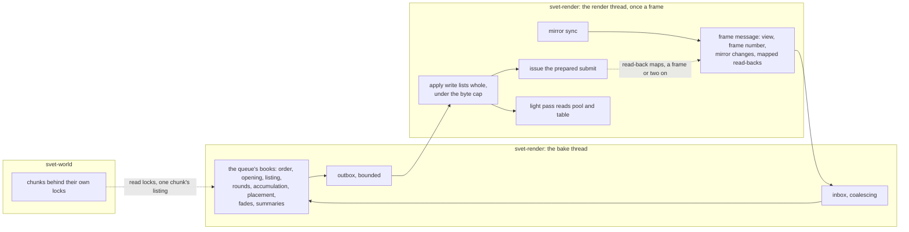

# 0099: The bake step off the main thread: a bake thread, write lists the render thread applies, and the in-view drain

> **Status:** in-progress (Phases 1, 2, 2b and 2c landed 2026-11-25); approved (owner, 2026-11-22; his answers are under "Risks & open questions":
> the recommended option in each, question 2 by his own words). **After: 0096, 0098, 0087** (owner, 2026-11-22:
> drafted now, the lane after the rename; then 0089 and 0093, 0091, ...).
> **Re-read 2026-11-24** after Plan 0098 (v0.72.0) and the rename (v0.73.0): Phases 1 to 3 are
> amended under "Amended 2026-11-24 (architect re-read)", which wins over the phases' text where
> the two differ; **question 6 (the dig's held record with the thread on) is open with the
> owner** and holds Phase 3's dig clause only. Phases 1 and 2 start without it.
> **Created:** 2026-11-22
> **Milestone:** M10 (the outdoor scenes are where the queue is deep) and cross-cutting, like
> [Plan 0096](done/0096-the-bake-queues-drain-tiers-a-drain-slice-the-step-and-the-slow-adapters-light-pass.md):
> it serves `docs/nfr.md` section 2's streaming line, the bake queue's step inside it and the
> Floor frame, and takes the lines Plan 0096 closes with as disclosed misses.
> **Related ADRs:** [ADR-0083](../adrs/0083-the-live-bake-queue-runs-on-a-bake-thread-the-render-thread-applies-its-write-lists-and-issues-its-submits.md)
> (proposed with this plan), which extends
> [ADR-0017](../adrs/0017-mirror-cpu-work-bounded-in-the-frame-loop-narrowing-on-stream-workers.md);
> [ADR-0080](../adrs/0080-the-live-queue-bakes-what-the-image-reads-a-record-by-rule-a-tier-by-size-on-screen-and-a-drain-slice.md)
> (the tiers and the drain slice),
> [ADR-0076](../adrs/0076-light-stability-rules-world-history-per-source-a-fade-per-transition-and-a-ratcheted-pop-counter.md)
> rules 3 and 6, [ADR-0046](../adrs/0046-static-emissive-light-is-baked-per-chunk-when-a-chunk-loads-or-changes.md)
> (the store's bit-identity).
> **Source:** Plan 0096's Phase 8 window (2026-11-22) and its section "The window's verdict and
> what is left"; the readings are in `docs/plans/logs/0096.md` on branch `plan-0096` until that
> plan merges.

## TL;DR

After a fresh start in the forest the RTX 3080 Laptop holds about 30 fps while the bake queue
drains, because the queue's step costs 28 ms a frame on the render thread; the GPU needs 11.6.
This plan moves the queue's books and all of its per-job CPU work to **one bake thread**
(ADR-0083). The render thread sends the view and the mirror's changes once a frame, never
waits, and applies what comes back: **write lists** (a block's words and its table word always
together, so no frame reads half a landing) under a byte cap, and at most one prepared submit.
The same code runs in **lockstep** on the calling thread as a setting, which is how the tests,
the pre-roll and every assertion on the undrained image stay reproducible. The store's bytes
do not change. Then the bake thread is made to keep the submits fed, because the drain slice
is granted per frame and a doubled frame rate is twice the bake a second only if the CPU side
keeps up. The first thing anyone sees: the `bake queue step:` line splits the step into what
must stay on the render thread and what can leave, on the unchanged forest fresh start.

## Context & problem

Every figure is a reading unless marked. "RTX" is the NVIDIA GeForce RTX 3080 Laptop GPU,
"RENOIR" the AMD Radeon Graphics (RADV RENOIR), the slow adapter of `docs/nfr.md` section 1.
The readings are Plan 0096's (`docs/plans/logs/0096.md` on `plan-0096`).

**The window (Phase 8, 2026-11-22, release `1844a99b`, 2530 x 1378, internal 1687 x 919, mains,
performance profile, 1-minute load 0.98).** Forest: `--source outdoor --spawn forest --trees
forest --time 15:00`; hills: `--source outdoor --time 17:00`.

| run | the owner's words | fps | wall p50 / p99 | frame CPU p50 | march GPU p50 | step, regime B, p50 / p99 | in view landed after the first world frame |
|---|---|---|---|---|---|---|---|
| RTX forest (a1) | "works, but fps around 30" | 25 to 41 | 28.3 / 59.1 ms | 28.0 ms | 11.6 ms | 28.0 / 51.1 ms (465 steps) | not reached in 17.9 s |
| RTX hills (a2) | "fully settled in around a minute or so if I am looking for stable fps (70+)" | 31 to 45, then 55 to 69, then 68 to 77 | 13.3 / 34.3 ms | 1.2 ms | 11.8 ms | 13.1 / 34.3 ms; drained 0.05 to 0.07 | 16.1 s; empty at 27.5 s |
| RTX forest, profile tiers (b1) | none | not split | 20.5 / 60.5 ms | 19.8 ms | 12.1 ms | 21.5 / 60.0 ms | 22.3 s |
| RENOIR forest (a3) | "very slow, around 8-9 fps" | 8 to 11 | 106.8 / 119.5 ms | 9.8 ms | 100.6 ms | 8.7 / 17.5 ms | not reached |

The RENOIR is GPU-bound at that size (3.79 times the Portable profile's pixels; Plan 0096
Phase 9 re-reads it at 720p). Its step is 7 to 9 ms all the same.

**What a step costs, by stage** (Plan 0096 Phase 5, `e3b03e75`, RTX, Floor, 1920 x 1080,
headless, the forest at 15:00, loaded; stage means a line in regime B): `list` 10.0 to 18.1 ms
(the faces of the 16 to 32 candidates an opening admits, about 1 ms each, already spread over
scoped threads the render thread waits for), `collect` 5.0 to 7.0, `submit` 5.0 to 8.1,
`fades` 4.3 to 7.5, `summaries` 1.6 to 2.6; together 25.9 to 43.3 ms. `candidates` reads 1.1
to 1.6 and the depth-bound stages are gone (0 to 56 candidates scored a step against a pool
of 9 361). The step read 20.7 / 55.0 ms p50/p99 against Plan 0096's proposed line of **1.0 /
4.0 ms**, which that plan pins as a disclosed miss and hands here.

**What is not known, and Phase 1 reads.** How each of those stages splits between pure CPU
(which can leave the render thread) and `wgpu` calls (`write_buffer` copies, the encode, the
submit, the mapped read; ADR-0083 keeps the writes and the submits on the render thread).
ADR-0017's Outcome found `write_buffer` at 41.8 % of the mirror sync's samples, so the split
is not a formality: it decides whether the render thread's share can reach 1.0 ms and which
of Phase 4's levers are needed.

**The drain is the other half.** Plan 0096 proposed "in view landed at most 10 s after the
first world frame" on the RTX and reads 16.1 s (hills) and 22.3 s (forest) at the window. The
drain slice (4.0 ms at Floor while in-view work waits) is granted per frame and the submits
draw 0.94 to 0.99 of it, so at about 30 fps the bake gets about 120 ms of GPU a wall second.
At 70 fps the grant is 280 ms. **Arithmetic, not a reading:** 22.3 s x 30 / 70 is 9.6 s, if
the bake side prepares 2.3 times the jobs a second. One regime B step's CPU (26 to 43 ms) fed
4.35 to 5.48 ms of RTX GPU (Plan 0096 Phase 4), so one thread running nothing else makes 23 to
38 steps' worth a second, 100 to 210 ms of GPU, **36 to 75 % of that grant**. Moving the step
restores the frame rate; it does not by itself shorten the drain. Phase 4 is for that, and
takes the opening's candidate cap with it (Plan 0096's F2 reading: the per-second rig draws
0.60 to 0.69 of its grant because an opening admits at most a fixed count of candidates).

**The rules this is held to** (owner): a stable image is the one priority, performance
considered; no waiting for light (ADR-0076 rule 6; a minute's settle is unacceptable); a
budget is measured on named hardware and a figure without a measurement says it is a guess;
no scene or fixture is simplified so a bar passes; `svet-world` stays headless and
deterministic and GPU code lives in `svet-render` only.

## Decision

The queue's books and its per-job CPU work run on one dedicated bake thread; the render
thread keeps every `wgpu` submit and every write the image reads, applied once a frame from
write lists; the same code runs in lockstep as a setting. ADR-0083 holds the decision and its
costs. We rejected **spreading the step over the stream workers** because only the listing is
a pure function of a chunk and 16 to 25 ms would stay; **capping the opens on the render
thread** because it buys the frame rate with a longer drain; **amortising the listing**
because the step still reads 16 to 25 ms with the listing free; **a bake thread that also
submits and writes** because a block and its table word could land in different frames, a
pop by construction; and **a fork and join inside the frame** because the frame still waits
for a 28 ms step.

## Architecture diagram



In lockstep the three bake boxes run inside the frame's call on the calling thread, one step
per frame, and the two channels hold one item.

## Implementation phases

Each phase ships as its own commit. `dev` implements all phases in one session with no review
between phases; the architect reviews once at the end, in a fresh session.

**Starts after Plans 0096 and 0098 have merged and after Plan 0087 (the rename)**: 0096 is the
base for this subsystem, 0098's Phase 6 edits the landing fade in the same step file, and 0087
renames the crates and identifiers. **The tree's names win**: every path and identifier below
is as of `plan-0096`'s tip `33003841` and names a mechanism; where the tree differs, dev
follows the tree and notes it. Phase 1 re-reads the base, because Plan 0096's Phase 9 and
Plan 0098 both move it.

**Inherited from Plan 0098** (added 2026-11-24 by the architect at that plan's close, v0.72.0;
facts of the base; the architect's re-read of Phases 1 to 3 against them is the section "Amended
2026-11-24 (architect re-read)"). Plan 0098 closed after this plan was approved and changed the
dig's path through `bake/queue/`:

- **A dig's ring 1 is a job of its own.** `open_digs` splits a dug chunk: the bricks the box
  dilated by one voxel touches re-bake first, in a job opened in the edit's step into a table
  slot (`open_now`; the last open job that is neither a dig's nor key-only is withdrawn where
  none is free) and promoted ahead of every job; the chunk's other dig bricks open as a second
  job once the first is placed **and its `DIG_FADE` fade has ended**. A chunk splits only where
  its provisional block took the listing's size in the pool.
- **Stale jobs are withdrawn at the edit**, not awaited (`take_boxes`, `withdraw_at`,
  `JobLoop::withdraw`): a dig's bricks rejoin `digs`, another job's chunk returns to the
  candidates. A ring-1 job with no live face closes in its step's submit
  (`JobLoop::close_ended`); a placement that throws a stale job's block away marks its chunk
  touched.
- **The held record is made inside `take_boxes`** (`bake/held.rs`, through `list_dug` on
  scoped listing threads): a CPU estimate against the world and the store's blocks as the
  edit found them, written over the provisional block. It moves to the bake thread with the
  step; it reads the world's chunks under their read locks (the "Risks" line on a dig's write
  lock applies to it too).
- **The base of "an edit's light"** (`docs/nfr/04-edits.md`, "An edit's light"): ring 1 lands 1
  or 2 frames after the dig on the RTX 3080 Laptop and on the RADV RENOIR at Portable, on a
  waiting queue too, so the Budgets table's line reads "within 4 frames" with the thread on;
  the lavapipe image test's bar is 8 frames and "no later than the reference plus 1".
- **The dig frame's step time is a reading this plan owns**: 25.9 ms (sequence A) and 14.5 ms
  (B) in the means on the RTX, about 7 and 5.5 on the RENOIR, with a run-to-run spread of up
  to 30 ms on the RTX. Phase 1 reads it again with at least eight alternated runs a tree
  before any bar is held against it. The dig rig's queue never drains (its frames do not wait
  on the device; `docs/backlog.md`, "Plan 0098's leftovers"), which Phase 1's base reading on
  that rig must fix or avoid.
- **Tests that pin this behaviour:** `gpu_queue::a_dig_jumps_every_open_job_and_withdraws_its_stale_one`,
  `gpu_queue_reach::{a_fade_moves_a_record_by_its_share_a_frame, a_full_pool_keeps_the_queue_alive,
  an_emitter_dug_away_darkens_what_it_lit}`, `gpu_sun::a_dig_rebakes_the_key_words_with_the_sky_ring`,
  `bake::held::tests`, and the soak image test
  `flicker::a_fresh_hole_holds_its_value_until_its_light_lands`. `open_digs` knows a dig's fade
  by `frames == DIG_FADE`, which a fade paced by elapsed frames (Phase 2) must keep true or
  replace with a flag.
- **Files near the size gate:** `bake/queue/mod.rs` 1060 and `bake/job_loop.rs` 1047 of 1200
  lines.

**Test cost** (the rules Plans 0096 and 0098 run under): per phase,
`node scripts/test-changed.mjs --profile quick` over the changed crates; the phase's GPU run
is `--profile gpu --binaries` with the binaries the phase names, under the perf lock; clippy
and fmt per phase; `cargo nextest run --profile gate` once, at the tip (Phase 6). No soak or
full tier. Every perf reading is release, under the exclusive perf lock, with the 1-minute
load logged (under 2 at the start to pin a line; a loaded run is labelled indicative and pins
nothing), on the RTX (`--adapter RTX --profile floor`, 1920 x 1080, FSR 2 at 1.5) and the
RENOIR (`--adapter RENOIR --profile portable`, 1280 x 720), **and names its mode, lockstep or
thread**. The scene is the forest fresh start the owner saw, flags unchanged (above), from the
first world frame, with the hills at 17:00 beside it; no tree count, radius, tier or sample
count is lowered for a bar. The RTX forest is also read at the window's 2530 x 1378 as a
reading (no line is defined at that size). This plan is not look-driven: the store's bytes
are asserted equal, so no phase is exploration and no golden is expected to move.

### Phase 1: The step's split on the line, and the base readings
- **Owner skill:** dev
- **What:** No behaviour changes. The step's stage timers gain a second axis: each stage's
  time in `wgpu` calls (`write_buffer`, the encode, the submit, the poll, the mapped read and
  unmap) against the rest, and the bytes written a step to the pool, the table and the
  summary buffers. The `bake queue step:` line and the HUD's queue row print the two sums as
  `render` (what ADR-0083 leaves on the render thread) and `movable`. The fresh-start rig is
  named (a script line in the readings log, the window's flags). Readings: the base on both
  adapters and both scenes; the RTX forest at the window's size; the dig's ring today (frames
  from a dig that removes an emitter to the near ring's records changing, the existing
  `gpu_bake` test's rig); the edit's wait today (p99 of a dig op's wall while the queue is in
  regime B); the same RTX forest run pinned to 8 logical CPUs of 4 cores (`taskset`), labelled
  as the dev box's stand-in for the floor's CPU, not as the floor.
- **Files touched:** `crates/svet-render/src/bake/stages.rs`,
  `crates/svet-render/src/bake/queue/{step,stats}.rs`, `crates/svet-render/src/bake/store.rs`,
  `crates/svet-render/src/bake/job_loop.rs`, `apps/flythrough/src/run/queue.rs`, the HUD's
  queue row, `docs/flythrough.md`, `docs/plans/logs/0099.md` (new).
- **Done when:** (1) `the_step_line_splits_render_and_movable_and_they_sum_to_the_step`
  (CPU, under 1 s): a step's stage record with known laps formats to a line whose `render`
  and `movable` sums equal the stages' sum within 0.001 ms. (2) The readings log holds, per
  adapter and scene, in regime B: the step p50/p99, `render` and `movable` p50/p99, the bytes
  written a step p50/p99, the frame's wall and CPU p50/p99 while in-view work waits, the
  in-view and whole-residency drain after the first world frame, the submits' drawn share of
  the granted slice; and the dig's and the edit's base figures. (3) **A stop, not a bar:** if
  `render` p50 on the RTX forest is over 1.0 ms, dev reports it to the architect before
  Phase 2 with the split by call; the staging-belt lever of Phase 4 then moves ahead of
  Phase 3 by amendment. (4) `--binaries gpu_queue gpu_bake` pass unchanged.

### Phase 2: The queue in two halves, in lockstep
- **Owner skill:** dev
- **What:** The step is cut along ADR-0083's line with both halves still on the calling
  thread. The **bake half** owns the queue and the store's books and reads nothing of the
  frame but a message: the view, the frame's number, the mirror's changes with each changed
  chunk's new state, the store's window, the mapped read-backs, the GPU times. It keeps a
  shadow of the mirror's membership from those changes and holds no reference to the mirror.
  It returns one **write list** (ordered buffer writes: block words, table words, summary and
  parent words, fades' shown words, the window's move) and at most one **prepared submit**
  (planned rounds and the entry table's bytes). The **render half** holds the GPU buffers
  and no rule: it applies whole lists in order under a byte cap, carries what does not fit,
  writes and issues the prepared submit after the sync, and collects mapped read-backs. A
  submit is stamped with its frame; a read-back is placed only after the changes up to the
  frame it mapped in. Fades are paced by the frame number in the message. The store's table
  is read by the light pass through the store's own window, so a window that moves a step
  late shows the fallback chain for an entering chunk, never another chunk's record; if the
  tree reads the table by the mirror's window, that is fixed here and noted. Public reads of
  the books (statistics, a block's words, the bake file) go through the bake half.
- **Files touched:** `crates/svet-render/src/bake/queue/` (the step and its neighbours, and
  new files for the message, the write list and the shadow membership),
  `crates/svet-render/src/bake/{store,job_loop,summary,job}.rs`,
  `crates/svet-render/src/frame/baked.rs`, `crates/svet-render/src/bake/queue/tests.rs`,
  `crates/svet-render/tests/gpu_queue.rs`.
- **Done when:** (1) `a_landing_is_applied_whole_or_not_at_all` (CPU, under 1 s): against a
  recording applier, three lists of 40, 40 and 40 KiB under a 64 KiB cap apply as one list a
  frame over three frames, in order; no frame holds a block's words without its table word;
  a single list over the cap is refused at its making, not split. (2)
  `a_change_after_a_submit_stales_its_result_and_one_before_does_not` (CPU, under 1 s): a
  submit stamped frame 5 whose read-back maps at frame 7: a change inside its chunk's reach
  in the frame 6 message releases the block and re-queues the chunk; the same change in the
  frame 4 message leaves it placed. (3) `the_shadow_membership_answers_as_the_mirror_does`
  (CPU, under 2 s): over a recorded sequence of 2 000 mirror changes (arrivals, LOD swaps,
  evictions, a window move), the shadow's held-full, LOD-only and lights-ready answers equal
  the mirror's after every message. (4) `a_fade_is_monotone_when_steps_are_skipped` (CPU,
  under 1 s): a 16-frame fade whose bake steps arrive at frames 1, 2, 5, 9 and 16: every
  shown word lies between its old and new value, never moves back, moves at most the elapsed
  frames' share of the change plus one unit of rounding, and equals the new value at frame
  16. (5) The existing `gpu_queue` test that settles a 5 x 5 x 5 world through the live queue
  against a one-shot bake still reads every block bit-identical (lavapipe, about 16 s loaded
  at Plan 0096; over the soak line it is run by name here and marked as that plan leaves it),
  and `gpu_bake` passes unchanged. (6) Reading: the lockstep step on the RTX forest is within
  10 % of Phase 1's base p50 (the cut itself must not cost).
  `--binaries gpu_queue gpu_bake`.

### Phase 3: The bake half on its own thread
- **Owner skill:** dev
- **What:** One named thread runs the bake half in a loop: take the inbox (coalescing: the
  newest view replaces the older, change lists append in order), run one step, push the list
  and the submit to a bounded outbox, wait when it is full or when there is nothing to do.
  The render thread's calls only swap and try: it never waits on the bake thread. A render
  setting `bake thread` (`on` in a window, `off` being lockstep; ADR-0055's row, a
  settings-file row, `--bake-thread on|off`) picks the mode and **the HUD's queue row and the
  banner show it**. Lockstep stays the mode of the pre-roll, a one-shot bake, and every test
  and headless run that asserts bytes before the drain; the reading rigs pass `on`. A dig's
  ring is a priority message: the bake thread serves it before the opening. The world's
  chunks reach the thread through a handle the world already shares with its stream workers
  (or one added to `svet-world` that carries no bake concept); a read lock is held for one
  chunk's listing at most. Dropping the renderer stops and joins the thread; a panic on it
  surfaces as the step's error on the next frame.
- **Files touched:** `crates/svet-render/src/bake/queue/` (the thread, the inbox and outbox),
  `crates/svet-render/src/frame/{baked,settings}.rs`, `crates/svet-render/src/settings.rs`,
  `crates/svet-world/src/store.rs` only if a shareable handle is missing,
  `apps/flythrough/src/cli/` (the flag and its test), `apps/flythrough/src/hud/` (the row),
  `apps/flythrough/src/run/queue.rs`, `crates/svet-render/tests/gpu_queue.rs`,
  `docs/flythrough.md`.
- **Done when:** (1) `the_render_side_returns_with_the_bake_side_stalled` (CPU, under 2 s):
  with the bake half held by a test hook, 100 frame calls return, apply nothing, and leave
  an inbox of one view and a change set no larger than the distinct chunks sent. (2)
  `the_outbox_is_bounded_and_the_bake_side_waits` (CPU, under 2 s): with the render half not
  applying, the outbox stops at its cap in bytes and the bake half's step count stops
  rising. (3) `dropping_the_queue_joins_the_bake_thread` and
  `a_panic_on_the_bake_thread_is_the_next_steps_error` (CPU, under 1 s each). (4)
  `the_threaded_queue_drains_to_the_lockstep_store` (`gpu_queue`, lavapipe, a guess of 20 s,
  so born `#[ignore = "soak"]` and run by name in this phase and at the tip): the same
  5 x 5 x 5 world drained with the thread on holds every block bit-identical to the lockstep
  store's and to a one-shot bake's. (5) The dig: with the thread on, the near ring's records
  change within Phase 1's base frame count plus 2 (`gpu_bake`, the existing dug-emitter rig
  with the mode as a parameter, at the wall the tree's test has). (6) `the_flag_and_the_row_name_the_mode` (CPU,
  under 1 s): `--bake-thread off` parses to lockstep and the HUD's row reads `bake thread
  off`; unset in a window it reads `on`. (7) **The bars, thread on, quiet, RTX, the forest
  fresh start at Floor 1080p, regime B:** the render thread's bake share **p50 at most
  1.0 ms and p99 at most 4.0 ms**; the frame's wall **p50 at most 16.6 ms** while in-view
  work waits; the same share bar on the RENOIR at Portable 720p, its wall p50 not over Phase
  1's base by more than 2 %. (8) Readings: the frame's fps over the drain at the window's
  size; the share of frames that carried a fade step while a block was fading (a guess: at
  least 90 % at 60 fps); the edit's wait p99 against Phase 1's base; the `taskset` arm;
  the in-view drain, which this phase is not expected to shorten.
  `--binaries gpu_queue gpu_bake`.

### Phase 4: The bake thread keeps the slice fed
- **Owner skill:** dev
- **What:** The drain's bar, by the largest bake-side stage first, as Phase 3's readings
  order them. The named levers, each taken only if its stage is in the way: (a) **the opening
  admits to the slice**: candidates are admitted until the opened jobs' projected samples
  (the tier's count times the faces listed, at the measured time a sample) cover the granted
  slice at the frame rate read, in place of the fixed count per step (Plan 0096's F2
  entry); (b) **the listing off the bake loop**: a kept pool in place of threads spawned per
  batch, sized so the process does not run more busy threads than logical cores beside the
  stream workers, the bake loop taking results as they finish; (c) **the fades**: mixed only
  for blocks whose target differs from what is shown, at the cadence the frame number sets;
  (d) **the copies**, only if Phase 1's stop fired or the byte cap is what holds the drain:
  the bake thread fills a mapped staging range and the render thread encodes copies
  (ADR-0022's mechanism, no new decision). No lever changes a record's bytes, a tier or the
  slice.
- **Files touched:** `crates/svet-render/src/bake/queue/{open,list,digs}.rs` and the thread's
  files, `crates/svet-render/src/bake/{order,budget,store}.rs`,
  `crates/svet-render/src/bake/queue/tests.rs`, `apps/flythrough/src/run/queue.rs`.
- **Done when:** (1) `the_opening_admits_until_the_projected_samples_cover_the_slice` (CPU,
  under 1 s): a synthetic pool whose jobs project 0.4 ms each under a 4.0 ms slice opens at
  least 10 and at most 11 a step (10 x 0.4 covers 4.0); under a 1.0 ms slice at least 3 and
  at most 4 (3 x 0.4 is the first sum over 1.0); one job of overshoot, never a fixed count. (2) `the_opened_jobs_are_the_nearest_of_their_band`
  (the existing order test, CPU, under 2 s) holds: the levers change how many open, not which
  first. (3) Phase 3's test 4 and the lockstep store test still pass. (4) **The bars, thread
  on, quiet, from the first world frame:** on the RTX at Floor 1080p the submits draw **at
  least 0.85 of the granted drain slice** while in-view work waits, and **in view has landed
  within 10 s** on the forest and on the hills; on the RENOIR at Portable 720p **within
  30 s**; Phase 3's share and wall bars still hold. (5) Readings: the whole-residency drain
  on both adapters; the per-second rig (`second:150,0.25`) drawn share, Plan 0096's F2
  figure; the bake thread's busy share of a core and the process's runnable threads against
  the logical cores, with the `taskset` arm beside them. (6) A bar in (4) that is missed
  after the levers are in is disclosed with the stage that holds it; it is not met by
  raising the slice or lowering a tier. `--binaries gpu_queue gpu_bake`.

### Phase 5: The owner's window
- **Owner skill:** human
- **What:** One window, on Linux, on the dev box on mains, release at Phase 4's tip, the
  mode shown on the HUD. The runner starts each run and the stdout stays visible. (a) RTX,
  Floor, the forest fresh start, thread on, then the same with `--bake-thread off`: is the
  frame rate there from the first seconds, and is anything different in the image but the
  frame rate (a landing that pops, a fade that steps, a block that flashes)? (b) RTX, the
  hills at 17:00, thread on: how long until it reads settled. (c) RTX, a few digs next to a
  lamp while the queue is deep: does the light follow the dig as it does with the thread
  off? (d) RENOIR, Portable (at its 720p, as Plan 0096 Phase 9 leaves it), the forest,
  thread on: nothing worse than before.
- **Files touched:** none (the verdicts go to `docs/plans/logs/0099.md`, recorded by the
  architect or the orchestrator).
- **Done when:** the owner has said, for (a) to (d), fine or what is wrong, in his words; an
  item he did not judge is recorded as unjudged, and an image-stability item takes no
  recommended answer in his place.

### Phase 6: The lines, the defaults and the documents
- **Owner skill:** dev
- **What:** The window's findings in mechanisms this plan built are fixed here or routed by
  the architect's amendment. The lines are pinned quiet on both adapters, in the thread
  mode: the render thread's bake share, the frame's wall while draining, the in-view and
  whole-residency drain, the submits' drawn share, the dig's ring and the edit's wait, the
  outbox's and the shadow's peak bytes. Each goes to `docs/nfr.md` section 2 or its readings
  file with machine, adapter, scene, mode and commit; a line that is missed is pinned as a
  disclosed miss with its cause, not moved to its reading. `docs/flythrough.md` and the
  flag's help name the mode. The backlog's entries this plan took are closed into it.
- **Files touched:** `docs/nfr.md`, `docs/nfr/02-frame-budget.md`, `docs/flythrough.md`,
  `docs/backlog.md`, whatever the window's findings touch, `docs/plans/logs/0099.md`.
- **Done when:** (1) every figure under Budgets has a quiet reading on both adapters with
  its mode, or is named as not read with the reason. (2) Every test this plan named passes
  at the defaults; the soak-marked ones were run by name once at this tip. (3) The gate at
  the tip: build, `cargo nextest run --profile gate`, doctests, clippy, fmt, deny, the doc
  gates; its wall is recorded against section 7. (4) No golden moved; one that did is
  reported with the frame it differs in, not re-blessed.

## Amended 2026-11-24 (architect re-read): Phases 1 to 3 against the tree

Read against `be97152a` (v0.73.0), the code and not this plan's memory of it. The phases'
intent stands. What follows restates only the What, Files touched and Done when that change;
where it differs from the phase's text above, this section wins. Phase 4 on is not re-read,
with one name fixed: its order test is
`the_opened_jobs_are_the_nearest_of_their_band_whatever_the_depth`.

**Names the tree has.** The queue's GPU tests are `apps/flythrough/tests/gpu_queue.rs` and
`gpu_queue_reach.rs` (no `crates/svet-render/tests/gpu_queue.rs`); `gpu_sun` is under
`crates/svet-render/tests/`. `gpu_bake`'s dug-emitter test
(`a_dug_emitter_leaves_the_near_ring_at_once`) digs through the blocking `Frame::rebake_digs`
and never enters the live queue, so it is not the dig's base or bar: the queue's dig rigs are
`gpu_queue::a_dig_jumps_every_open_job_and_withdraws_its_stale_one` and `gpu_outdoor`'s
`dig_line::reading::dig_timeline` (`SVET_LINE`, sequences A and B, stepped by
`support::defects::Stepper`). The flag lands in `apps/flythrough/src/cli/queue_flags.rs`, the
render settings under `crates/svet-render/src/frame/settings/`. Every other path the three
phases name exists.

**Where a dig's path lives.** In lockstep (Phase 2) all of it runs in the edit's step, as today,
so ring 1 still lands 1 or 2 frames on. On the thread (Phase 3) each row is a frame or more
later unless question 6 is answered (a).

| piece (the tree's name) | Phase 2: which half | Phase 3: which thread | guarded by |
|---|---|---|---|
| the box's intake (`Frame::invalidate`, `BakeQueue::invalidate`) | the render half puts the box in the frame's message; the books' part (sealed, masks, facelessness) is the bake half's | bake thread, ahead of the opening | Phase 2 (7), Phase 3 (5a) |
| `take_boxes`: `withdraw_at`, the sky-stale marks, `list_dug` with `held_visibilities`, the provisional and held block's put | bake half; its writes are that step's list; the world under read locks | bake thread | Phase 2 (7); `bake::held::tests`; the soak image test by name |
| `open_digs`, `open_now`, ring 2's wait on ring 1's fade | bake half | bake thread | Phase 2 (8); `gpu_queue`'s dig test |
| ring 1 promoted, `close_ended`, its rounds planned first | bake half plans; the render half writes the slot's candidate table and issues the submit after the sync | the plan on the bake thread, the issue on the render thread a list later | Phase 2 (7), Phase 3 (5b) |
| the read-back, `Placement::place`, `refade` over `DIG_FADE` | the render half collects the map; the bake half places | bake thread | Phase 2 (2), `gpu_queue_reach` |
| `advance_fades` | bake half, by the message's frame number | bake thread | Phase 2 (4) and (8) |

### Phase 1, amended

- **What, added.** (a) The dig base is read on the queue's own rig, `dig_timeline`, drained and
  waiting, sequences A and B, both adapters; `gpu_bake` is not read for it. (b) **The rig's
  stepper waits on the device once a frame** (as `support::queue`'s rig does, standing for the
  fly-through's present), as a mode the dig readings use; a gate test that takes the mode has
  its binary run in this phase. Without it the rig's queue never drains and "drained" is a
  waiting queue (`docs/backlog.md`, "Plan 0098's leftovers"). (c) The dig frame's step (D+0) is
  read with **at least eight runs a sequence and adapter**, with its `boxes` and `digs` laps
  and the new `render` and `movable` sums. (d) `render` counts the candidate tables' writes
  (`JobLoop::refresh_tables`), the parameters' write and a dig's block writes with the rest.
- **Files touched, added:** `apps/flythrough/tests/support/defects.rs`,
  `apps/flythrough/tests/gpu_outdoor/dig_line.rs`.
- **Done when, added.** (5) With the stepper's mode on, the rig's `drained` state reaches 0
  chunks in view waiting on the RTX and on the RENOIR, the frame it does so logged. **A stop:**
  if it does not, dev reports the read-backs a frame to the architect before the dig base is
  read. (6) The readings log holds, per adapter and sequence, eight runs' D+0 step in ms with
  the mean and the range, the `boxes` and `digs` laps, and ring 1's landing in frames for
  every dig on the drained and on the waiting queue; a landing that is not the 1 or 2 frames
  of `docs/nfr/04-edits.md` is reported to the architect before Phase 2. **No later bar or
  comparison is held against a dig-frame figure with fewer than eight alternated runs a
  side.** (4) reads `--binaries gpu_queue gpu_queue_reach gpu_bake`.

### Phase 2, amended

- **What, added.** The message's list above is not the whole of what the step reads today.
  1. **The message also carries** the edit boxes since the last one, the bake's sky bits and
     key light, the settings the frame sets each step (the column wait, the key step, the
     landing fade, `dig hold`, the far-normal band, the knobs) and the stream workers'
     prepared masks. `QueueView::resident` is a borrowed closure; the bake half takes the
     streamer's residency as owned data.
  2. **The shadow answers every mirror read the bake half makes**, not membership alone:
     held full, LOD-only, **waiting to upload** (`is_pending`, `pending_chunks`, and with them
     `column_final`), **each chunk column's lowest top** (`column_lowest`, the record by rule),
     and per chunk **whether it holds an exposed emitter and whether its light range is
     current** (`emitters_near`, `lights_ready_near`). A light range's change is not in the
     mirror's change list (`take_changes` notes membership and uploads); the render half adds
     the chunks whose range or dirty mark changed, and the columns a change touched with their
     new lowest top. The rule is answered on the snapshot; a later change relists the zero
     record as it does today.
  3. **The candidate tables stay with the render half**: a pure function of the mirror's light
     ranges, written for the slots a prepared submit names as it goes out and again when the
     ranges move. It is not a rule of the queue's.
  4. **A first block's landing word is the frame its list is applied in, plus one.** The shader
     fades a block's source by that word (Plan 0098 Phase 6b), so the word of the frame the
     bake half made the list in would start the fade part-way. The list marks the word; the
     render half writes it at apply.
  5. **A submit's stamp is the newest message the bake half had read when it planned it**, not
     the frame the render half issued it in: a change in any later message inside the job's
     reach stales it.
  6. **`Fade` says it is a dig's** (a flag set where `refade` takes a dug block), and
     `open_digs` reads the flag in place of `frames == DIG_FADE`.
  7. **An edit's writes are never carried.** The step that takes a box puts the sky-stale
     marks and every held and provisional block in its list whole, whatever their size, and
     they count against the frame's cap first; landings wait for the room that is left.
- **Files touched, added:** `crates/svet-render/src/gpu_world/` (change notes and snapshot
  reads only; nothing of `sync` moves), `crates/svet-render/src/bake/held.rs`,
  `apps/flythrough/tests/{gpu_queue,gpu_queue_reach}.rs`. New code goes to new files:
  `bake/queue/mod.rs` and `bake/job_loop.rs` are near the size gate.
- **Done when, changed and added.** (2) gains a case: a submit planned from the frame 4
  message and issued in frame 6 is staled by a change in the frame 5 message. (3) reads, over
  a sequence that also holds light ranges written, moved and dropped, uploads queued and done,
  and a dig that lowers a column's top: the shadow's held-full, LOD-only, **pending,
  column-final, lowest-top, emitters-near** and lights-ready answers equal the mirror's after
  every message. (7) `a_dig_is_served_whole_in_the_edits_step` (CPU, under 2 s; the bake half
  against a recording applier): a box in a chunk that holds a block, with landings over the cap
  already waiting: the list of the step that took the box holds, for each touched chunk, its
  sky-stale marks and its held block's words with its table word, all applied in that frame;
  that step's prepared submit plans ring 1's rounds ahead of every other job's; the landings
  are the ones carried. (8) `ring_two_waits_out_a_dig_fade_whose_steps_are_skipped` (CPU, under
  1 s): ring 1 of a split chunk placed at frame 10, bake steps at frames 11, 13 and 14: ring 2
  opens at neither 11 nor 13 and opens at 14; a chunk under a 16-frame landing fade opens its
  dig's bricks in the first step. (9) `a_first_blocks_landing_word_is_the_frame_it_is_applied_in`
  (CPU, under 1 s): a first block whose list was made at frame 5 and applied at frame 7 holds
  8 at its landing word; a refinement applied at frame 9 keeps 8. (10) The dig's tests pass
  unchanged in lockstep: `--binaries gpu_queue gpu_queue_reach gpu_bake gpu_sun`, and the soak
  image test `flicker::a_fresh_hole_holds_its_value_until_its_light_lands` by name, once.

### Phase 3, amended

- **What, changed.** The dig's box is in the message since Phase 2. **A step in progress admits
  no further candidate once a box waits in the inbox**, and the next step takes the box first;
  this holds under either answer to question 6. Whether the edit's frame then waits for that
  step's list is question 6; dev builds (a) or (b) as answered and **does not start the dig
  clause before the answer**. Every dig test that reads an image or a record before the drain
  stays in lockstep (the plan's rule), so the thread's dig is guarded by (5) alone.
- **Files touched, changed:** `apps/flythrough/tests/gpu_queue.rs` in place of the
  `crates/svet-render/tests/` path; `apps/flythrough/tests/gpu_outdoor/dig_line.rs` and
  `support/defects.rs` (the mode as the rig's parameter).
- **Done when, changed.** (5) is three parts. (5a) `a_waiting_box_ends_the_opening` (CPU, under
  2 s): 32 candidates ready and a test hook that posts a box after the second listing: the
  step lists at most 3, and the next list is the dig's (its held block and table word). (5b)
  On `gpu_queue`'s dig rig with the mode as a parameter (lavapipe, at the wall the tree's test
  has), thread on: ring 1's block is applied within Phase 1's base frame count plus 2. (5c)
  **Under answer (a):** on the same rig, the pool read back after the edit's own frame holds
  the held block for every touched brick (no frame between the edit and the held record).
  **Under answer (b):** the frames from the edit to the held record's apply are logged, at most
  2 on that rig. (8) gains, on the forest in regime B with the thread on, both adapters,
  sequences A and B, eight runs alternated with lockstep: the frames from a dig to its held
  record applied and to ring 1 applied, the dig frame's wall against Phase 1's, and the share
  of dig fades that moved in all 4 of their frames. (7)'s bars are read on runs with no edit.
  `--binaries gpu_queue gpu_queue_reach gpu_bake gpu_sun`.

## Amended 2026-11-25 (architect, code reading of the RENOIR's ring-1 landing)

Read against `1f2960bf` and Phase 1's 64 timelines (`live/p1d/`); the long form, with the lines
and the arithmetic, is in [`logs/0099.md`](logs/0099.md), "Architect's code reading". Where this
section differs from a phase's text it wins. **Phase 2 builds what it was going to build.**

**What ring 1 waits on: the submit's sample cap, and nothing else.** On the drained RENOIR at the
dig the loop has 14 of 16 slots free, one submit unread (room under `IN_FLIGHT`), the read-back
a frame on (the rig waits on the device once a frame, on both adapters), and no fade or ring-2
job in the way: ring 1 never waits for a fade (`open_digs`), and the edit withdraws every dig
job in its ring (`take_boxes`). The job is cut by the cap (`open_step`, `bake/queue/step.rs`):
`(slice + edit_ms) / ns_per_sample`, where `ns_per_sample` is a running mean of a read-back
submit's GPU ms over its samples. Drained, the slice is the line's 1.0 ms and the submits are
18 000 to 35 000 samples; the mean then reads **28 to 55 ns** against 10 to 16 at the first dig
and 9 to 10 on the waiting queue, so the dig's 4.0 ms buys 73 000 to 143 000 samples a frame and
a ring 1 of 221 595 and 275 022 samples goes out over 2 to 4 frames. Every run's landing is
`ceil(ring-1 samples / cap)` submits and one frame's read-back.

**Why the mean is wrong for it (derived from the logged caps, not read directly).** The caps
invert to each submit's ms; on the RENOIR they fit **about 0.8 ms a dispatch plus 11 to 13 ns a
sample** (RTX: about 0.4 to 0.6 ms plus 1 ns). A slice that grows from 1.0 to 4.0 ms is priced
at the small submits' mean, most of which is the fixed part; the mean takes about ten steps to
come down. The same holds in reverse: the first steps after the view drains are priced at the
large submits' mean and overdraw the line. The steady state is the same either way; only a
change of slice is mispriced. The RTX's cap at a dig is 2.1 to 4.7 million samples against a
ring 1 of at most 246 497, and the waiting RENOIR's is 0.6 to 1.0 million: neither is cut.

**What the bar measures.** `dig_timeline` reads the queue's books after each step: ring 1 has
landed in the first frame whose step leaves the chunk with no live dig job holding a ring-1
brick, the step that placed it; D+0 is the frame whose step reads the edit. **Sequence A's dig 2
reads D+2 at best by the rig's making**: dig 3 comes one frame later into the same chunk and
withdraws dig 2's job, so dig 2 lands with dig 3. `docs/nfr/04-edits.md`'s "1 or 2 frames" was
never read on a drained RENOIR (its text says that rig never drained); Phase 1 is the first.

**Verdict: a defect in the cap's pricing, not the dig's mechanism and not the rig.** Plan 0098's
jump, withdrawal and slots do what they say. Phase 2b below fixes the pricing after Phase 2 has
moved the code; `edit_ms` stays 3 ms. **With honest pricing the RENOIR's 4.0 ms still buys about
260 000 to 330 000 samples (arithmetic)**, at the edge of this rig's largest ring 1, so its
drained A may read 1, 3, 2: that is owner question 7.

**Phase 2: nothing changes.** The estimate's update and the cap's formula move to the bake half
as they are (the GPU times are in the message already); dev does not correct them there, and
the dig tests pass unchanged in lockstep as (10) asks.

### Phase 2b: The cap prices a slice by a dispatch's fixed cost and a sample's cost
- **Owner skill:** dev
- **What:** After Phase 2 and before Phase 3, in the bake half, in lockstep. (a) **The reading
  first.** `dig_timeline`'s row gains the read-back's samples and GPU ms
  (`QueueStats::samples`, `ms`); one drained A run on the RENOIR and one on the RTX; the ms
  fitted over the samples. **A stop:** if the RENOIR's fit holds no fixed part of at least
  0.3 ms, dev reports to the architect and builds nothing of (b). (b) **The estimate is two
  figures**, a dispatch's fixed ms and the ns a sample, both from the submits read back, and
  the cap is `(slice + edit_ms - fixed) / ns a sample` under the clamp it has. The fixed part
  is kept while the submits' sizes do not spread (a steady slice cannot separate the two) and
  is 0 until they first have. The printed `ns a sample` stays the mean; the two figures print
  beside it. No slice, `edit_ms`, tier, order or record changes.
- **Files touched:** `crates/svet-render/src/bake/budget.rs` (the estimate, a type with no
  GPU), the bake half's step and `bake/queue/stats.rs`, `bake/queue/tests.rs`,
  `apps/flythrough/src/run/queue.rs` (the line), `apps/flythrough/tests/gpu_outdoor/dig_line.rs`,
  `docs/flythrough.md`, `docs/plans/logs/0099.md`.
- **Done when:** (1) `a_grown_slice_is_priced_by_the_cost_a_sample_not_the_mean` (CPU, under
  1 s): the estimate fed 40 submits costing `0.85 ms + 12 ns x samples`, each of the size its
  cap gave under a 6.0 ms slice, then 200 under a 1.0 ms slice: the cap for a 4.0 ms slice is
  within 10 % of 262 500 (the mean's rule gives about 63 000), and the first cap under the
  1.0 ms slice is at most 20 000 (the mean's rule gives about 71 000). (2)
  `a_steady_slice_draws_what_the_mean_drew` (CPU, under 1 s): 200 submits at one slice with no
  earlier spread: the cap is the mean's rule's within 1 %. (3) The RENOIR, drained, sequence A,
  eight runs alternated with drained B: each dig's D+0 submit carries its ring 1 whole or the
  whole cap, the cap at least 0.9 of `(4.0 ms - fixed) / ns a sample` at (a)'s fit; ring 1's
  landing per dig logged and reported to the architect. No bar on its frames until question 7
  is answered. (4) RTX drained A and RENOIR waiting A, four runs each: ring 1 at D+1, 2, 1. (5)
  The 5 x 5 x 5 store test reads bit-identical; `--binaries gpu_queue gpu_queue_reach gpu_bake`.
  (6) Reading: the RENOIR forest fresh start against Phase 1's row (in view 0, drain 0, the
  drawn share).

**Phase 3's base, restated.** "Base plus 2" is held against the same rig and state read in
lockstep at Phase 3's own tip, not against the nfr's sentence: (5b) on `gpu_queue`'s lavapipe
rig; (8) on the forest in regime B, a waiting queue, where the base is D+1 (D+2 for a dig
re-dug the next frame) on both adapters. The drained RENOIR's base is Phase 2b (3)'s reading.
**Phase 4's lever (a)** projects a job's time with Phase 2b's two figures, not the mean.

**Owner question 7 (open; Phase 2, 2b and 3 run on before the answer; Phase 6 pins the line
with it).** How "an edit's light" is stated where a dig's ring 1 does not fit one frame's
grant, which today is only the drained RENOIR. (a) **Recommended: the grant stays, the line
says what it buys.** Ring 1 lands 1 frame after the dig (2 where the next frame digs the same
chunk again) while its samples fit `slice + edit_ms`; a larger ring takes a frame more per
grant. The RENOIR's drained A is pinned as Phase 2b reads it (expected 1, 3, 2). (b) **Ring 1
goes whole in the edit's submit whatever the cap.** 1 or 2 frames on every adapter; the dig
frame's GPU grows by the whole ring (about 4.2 ms here on the RENOIR by arithmetic, more for a
larger edit, with no bound but the edit's size). (c) **Portable's `edit_ms` goes from 3 to
5 ms.** Fits this rig's digs; 2 ms more on the RENOIR's dig frames, which Plan 0098's window
already read over Portable's 33.3 ms line while a dig is held. (d) **Leave it:** the line reads
1 to 4 frames on a drained RENOIR.

## Amended 2026-11-25 (architect, ruling on Phase 2b's readings)

Read against `30f6b7ea`: `SampleCost` (`bake/budget.rs`), the cap (`open_step`), `open_digs`,
`JobLoop::plan_rounds`, and Phase 2b's timelines (`live/p2bd/`). The long form is in
[`logs/0099.md`](logs/0099.md), "Architect's ruling on Phase 2b". Where this section differs
from the text above it wins. Most of Phase 2b's adapter readings were taken loaded (1.4 to 42).

**1. The estimate's split: accepted as built, with its limits.** The slope kept and the level
re-read is the sounder half to hold: a steady slice reads the level and cannot read the slope.
Its limits, none of them worse than the mean's rule it replaced:
- **No fixed part (the RTX):** the level reads at or under 0 and the price is the recent ms over
  the recent samples, the mean's rule in effect. A rejected fit (slope under 0, or its error over
  10 %) keeps the last slope; with none yet the price is the mean.
- **A slice that grows** is priced right once one spread has been read (A: 1, 4, 3 to 1, 2, 2).
  **A slice that shrinks after only large submits** is not (ruling 2).
- **One slow small submit moves the level by a fifth of its excess** for about three read-backs
  (36 916 samples in 4.21 ms read the fixed part 1.53 ms; the cap 211 037 cut a ring of 239 491
  the fit's 252 000 would have carried). Within one drained B run the price at the digs read
  0.00 ms + 11.9 ns to 1.53 ms + 14.3 ns. Whether that is the load or the estimate is not read:
  Phase 2c (6) reads it quiet, with a stop.
- **The slope goes stale between spreads.** It misprices only a change of slice, by its own
  error, and a change of slice is itself the spread that re-reads it.

**2. The first steps after the view drains: left, as a named limit.** The dev's (a) and (b) both
need something read under the line before the drain (a fixed part at small sizes, a steady cap).
The case read, the first drain of a session, has neither, so neither fixes what was measured.
The overdraw is at most the dispatch's fixed part (0.82 ms on the RENOIR, none resolvable on the
RTX), decays 0.8 a read-back, and is what the mean's rule did (62 132 to 84 554 then, 69 979 to
93 314 now). Phase 2b's done-when (1) holds its second figure on exact costs only, by the CPU
test. **Phase 4 (5) gains a reading:** the ten steps after the view drains, each submit's GPU ms
against the line, both adapters, the first drain and one after a move. Phase 6 pins it; over the
line by more than 1.0 ms, or for more than ten steps, it is routed as a finding with the dev's
(a) as the candidate.

**3. Ring 2 behind another job: an order fault, fixed in Phase 2c.** ADR-0046 ("rings 1 and 2
re-bake ahead of every other job") and ADR-0048 ("digs, rings 1 and 2, stay ahead of every
score") are the intent. The timeline (`radeon-drained-A-after-2`, D3+2 to D3+15): 15 slots free,
6 to 10 dig jobs pending, one open job that is not a dig's drawing the whole cap of 233 000 to
354 000 a frame, the edit's 3 ms with it. `plan_rounds` plans every open job's rounds before it
opens a pending one, and `promote` orders open jobs only; a ring-1 job is opened at once
(`open_now`), a ring-2 job is not. The larger cap lets the opening admit that job in the dig's
step (`samples_left < 2 * cap`), which the mean's small cap did not. **Not a change of the
accepted picture:** the RTX reads D+6 to 8 before and after, and the RENOIR's 20 to 26 frames
is inside the 14 to 31 it read before; what is held longer is ring 2's own old records.

**4. Owner question 7** is restated below on the readings. **5. Phase 3** is split below: 3a
runs before question 6's answer, 3b waits for it. Also ruled: the job's stamp (the dev's Phase 2
note) is accepted, a job reads the world at its listing, so a later change must stale it.

### Phase 2c: A dig job takes a free slot ahead of every other job's rounds
- **Owner skill:** dev
- **What:** In lockstep, in the bake half, before Phase 3a. Every dig job `open_digs` pushes is
  opened into a free table slot in that step, as ring 1's is, so `promote` puts its rounds ahead
  of every job that is not a dig's. Where no slot is free a ring-2 job stays first of the
  pending ones and withdraws nothing (only ring 1 withdraws). The fade's wait, the two-slice
  rule, the listing a step does, the cap and every record are unchanged.
- **Files touched:** `crates/svet-render/src/bake/queue/{digs,tests}.rs`,
  `crates/svet-render/src/bake/job_loop.rs` only if the opening needs a caller there,
  `docs/plans/logs/0099.md`.
- **Done when:** (1) `a_dig_job_is_planned_ahead_of_an_open_job_that_is_not_a_digs` (CPU, under
  1 s): one open job that is not a dig's with 4 000 000 samples left, 15 slots free, a ring-2
  chunk out of its fade whose job is 100 000 samples, a cap of 250 000: the step's submit plans
  the dig job's 100 000 first and no more than 150 000 and one round of the other's; with no
  slot free the dig job is first of the pending ones and no job is withdrawn. (2) The order test,
  `ring_two_waits_out_a_dig_fade_whose_steps_are_skipped` and `gpu_queue`'s dig test pass
  unchanged. (3) RENOIR, drained, sequence A, eight runs: no row from a dig to its last ring
  chunk's landing shows `other` samples in flight while a dig job is pending and a slot is free;
  every ring chunk's landing for digs 2 and 3 is logged against 14 to 31 (the mean) and 20 to 26
  (Phase 2b). (4) RTX drained A and RENOIR waiting A, four runs each: ring 1 at D+1, 2, 1; every
  ring chunk's landing logged against D+6 to 8 and D+7 to 9. (5) The 5 x 5 x 5 store test reads
  bit-identical; `--binaries gpu_queue gpu_queue_reach gpu_bake`. (6) **Quiet** (load under 1.5
  at the lock, or the load said and the reading marked loaded): Phase 2b (a)'s fit on the RENOIR
  again, and RENOIR drained B, eight runs, with each dig's ring-1 samples, cap and price. **A
  stop:** more than 3 of 48 at D+2 (Phase 1's base) is reported to the architect with each one's
  read-back; it holds Phase 3b's dig readings, not Phase 3a.

### Phase 3, split: 3a before question 6's answer, 3b after it

What the three answers share is everything but the edit's frame: under (b) a box takes the path
every message takes; (a) adds a wait on the frames that carry a box; (c) adds the same wait on
every frame while a dig waits or bakes (the render thread waits for the list made from its own
message, which is lockstep's cost and picture without handing the bake half between threads).
So 3a builds the path and 3b adds the wait or does not. **Two rules keep 3b additive:** the bake
half is owned by its thread and never stepped from another; every write list names the newest
message's frame it was made from.

**Phase 3a (dev; runs now).** Phase 3's What and its amendment, less the dig clause, with the
setting's default left `off` in a window (the rigs and tests pass `on`), so no picture is shown
on a path the owner has not answered for. A box sent with the thread on is served when the bake
thread reaches it, ahead of the opening. Done when, of Phase 3 as amended: **(1), (2), (3), (4),
(5a), (7)** on runs with no edit, **(8)** less its dig readings, and **(6)** restated: the flag
parses both ways, the HUD's row and the banner name the mode, and unset it reads `off`. Added,
from the log's Phase 3 gotchas, all CPU and under 1 s each:
- (9) `a_fade_ahead_of_its_landing_list_keeps_the_applied_word`: a first block's list made from
  message 5 and a fade's `show` of that chunk made from message 6, applied in frames 8 and 9:
  the landing word reads 9 after each.
- (10) `a_job_and_a_box_are_stamped_by_the_messages_frame`: bake steps 1 and 2 read the messages
  of frames 10 and 14 (11 to 13 coalesced); the job that joined in step 2 holds 14 and step 2's
  list names 14; a box in message 15, taken in step 3, holds 15, not a step count, and stales
  the job; a change carried in message 14 does not.
- (11) `the_reads_count_a_box_in_flight`: the bake half held, a box sent in message 7: over
  frames 7 to 9 every public read that consults the mailbox today (a dig waiting, drained,
  sealed, faceless, blocked) answers as lockstep's does; they answer from the bake half's books
  once a list made from message 7 or later is applied.
- (12) `a_knob_set_reaches_the_bake_side_in_the_next_message`: `set_bake_digs(5.0, false)`
  between frames 3 and 4: the step that reads message 4 sizes its cap with 5.0, and with the
  thread on neither a setter nor `bake_queue_mut` writes the bake half's state directly.

**Phase 3b (dev; waits for question 6).** The default `on` in a window ((6) as first written),
the edit's frame as answered, **(5b), (5c)** and (8)'s dig readings, against lockstep at
Phase 2c's order. Under (c) the architect writes its done-when at the answer.

### Owner question 7, restated on the readings (open)

This text replaces question 7 above. Only Phase 6's line waits on it. How "an edit's light" is
stated where a dig's ring 1 does not fit one frame's grant. **Read** (Phase 2b, loaded; the
quiet re-read is Phase 2c (6)): on the drained RENOIR at Portable the 4.0 ms grant, priced
honestly, bought 256 000 to 280 000 samples at digs 2 and 3. Sequence A (rings of 180 613,
221 595 and 275 022) landed 1, 2, 2 in seven runs of eight and 1, 2, 1 in one: D+1 9, D+2 15 of
24, where dig 2's D+2 is the rig's making (dig 3 re-digs its chunk a frame later) and dig 3's is
the one ring at the grant's edge. Sequence B landed D+1 42 and D+2 6 of 48. The RTX and the
waiting RENOIR: 1, 2, 1 in all 16 runs. **Nothing read is later than D+2**: the "1 or 2 frames"
of `docs/nfr/04-edits.md` now holds on every state read.
(a) **Recommended, and what the readings favour: the grant stays, the line says what it buys.**
Ring 1 lands 1 frame after the dig; 2 where the next frame digs the same chunk again, or where
the ring is over the grant (`slice + edit_ms` less a dispatch's fixed part: about 250 000
samples on the RENOIR at Portable). Pinned as read. No code.
(b) **Ring 1 goes whole in the edit's submit whatever the cap.** Dig 3's seven D+2 of 24 and up
to B's 6 of 48 land a frame sooner. By the fit the largest ring read (330 000) costs 4.98 ms,
1.0 ms over the grant, on that dig's frame, with no bound but the edit's size.
(c) **Portable's `edit_ms` goes from 3 to 5 ms.** Buys about 410 000 samples by the fit, over
every ring read; the same landings as (b) on this rig, for up to 2 ms more on each RENOIR dig
frame, which Plan 0098's window already read over Portable's 33.3 ms line while a dig is held.
(d) **Leave the sentence without the condition.** True of everything read; an edit larger than
this rig's breaks it unsaid.

## Amended 2026-11-25 (architect, ruling on Phase 2c's stop)

Read against `b13311a2`: `SampleCost` (`bake/budget.rs`), `JobLoop::collect` and `withdraw`
(`bake/job_loop.rs`), the cap and `read_stats` (`bake/queue/step.rs`), `take_boxes`,
`open_digs`, `open_pushed`, `open_now` (`bake/queue/digs.rs`), and Phase 2c's quiet timelines
(`live/p2cd/`). The long form, with the lines, the per-dig table and the fits, is in
[`logs/0099.md`](logs/0099.md), "Architect's ruling on Phase 2c's stop". Where this section
differs from the text above it wins. Nothing was built or run; the fits are the architect's,
over the rows the rig already prints.

**1. Both, and mostly the grant's edge.** A sample's cost on the RENOIR depends on whose it is.
Fitted over the row's `flight r1 / r2 / other` columns against the next row's read-back (quiet
B, 709 read-backs): **0.805 ms a dispatch, 14.64 ns a ring-1 sample, 16.35 ns a ring-2 sample,
7.95 ns any other job's**, R squared 0.940 (one price: 0.878); drained A reads 0.751, 12.09,
16.34, 8.90. The one price follows what was drawn last, and under Phase 2c that is ring 2 (18.7
to 20.0 ns all in), so the edit's cap read 199 000 to 214 000 at the 14 where ring 1's own cost
buys about 218 000. **Of the 14: an exact ring-1 price lands 6 to 9 at D+1; 5 to 8 stay at D+2** (by the
fit dig 4's ring of 225 725 costs 4.11 ms, every run; by each dig's own read-back five cost 4.01
to 4.33 ms). The same submit's time varies by 0.4 ms (rms), and three of B's six rings cost 3.81
to 4.11 ms: the grant sits on this rig's rings. That part is question 7, not a defect.
Drained A's two 1, 3, 2 are the price's: its cap of 225 445 was priced at 0.571 ms + 15.21 ns
(the row prints the price after its own read-back; the cap is taken before it), where A's
ring 1 costs 12.09 ns and the grant buys 268 700.

**2. (b) is a correctness fix, built in Phase 2d.** `SubmitDone::samples` counts the samples
kept; `gpu_ms` is the whole dispatch's. A round of a withdrawn job, a round past a face's stop
and a round of an unmapped read-back are all drawn and not kept. The estimate reads the samples
drawn. **Ruling 1's third limit above ("one slow small submit") is withdrawn:** it was a
read-back of 219 679 drawn samples counted as 36 916. A read-back with nothing kept is read too
(today it is skipped, 40 in the eight quiet B runs).

**3. (a) as worded cannot be built on `class_samples`; a price by the job's class is built
instead.** `class_samples` splits by whether a job draws its own count (the coarse pass), not
by ring: both of a dig's rings are one class. `class_ms` is the dispatch's ms shared by samples,
so both classes read the same ns in any one dispatch; it holds no cost of a class. The cost by
class is real (fit above, the same in four sets of runs); why is not read (ray length is the
candidate, and the read-back carries it). Rule: **a dig's two classes each keep the ns a sample
all in, read from the read-backs that are theirs, and a step's cap is priced by the class of
the job planned first.** All in, not net of the fixed part: a dig's submits all go out under one
grant, and the general price's fixed part swings 0 to 1.2 ms between a class's read-backs. One
read-back a dig is enough for ring 1 (it is kept between digs; the first sets it); a class not
read yet takes the other dig class's, then the general price. A step with no dig is priced as
today.

**Also read: dig work overdraws the grant when it follows other work.** At dig 1, D+1 and D+2
go out at a cap priced on other jobs' 8 to 11 ns and draw ring 2 at 16: 323 000 to 396 000
samples in **5.6 to 8.1 ms against 4.0**, in all 16 quiet runs; on the waiting RENOIR D1+1
reads 14.7 to 15.7 ms against 9.0. Not new with Phase 2c (Phase 2b read the same when ring 2
opened, at D+8 to D+21); Phase 2c moved it to the two frames after the dig. Rule 3 prices it
from a session's second dig on; the first dig's D+1 has no dig read-back to price by and stays
a named limit.

**4. The withdrawn rounds: Plan 0098's rule, right, and left; a reading for Phase 4.**
`take_boxes` withdraws every dig job in the new dig's ring chunks: their rounds read the world
before the edit and would be staled at their end anyway. Phase 2c did not add the rule; it put
ring 2 in flight when the next dig comes (Phase 2b: 16 such read-backs in eight runs, now 40,
3.8 to 5.4 ms each, inside the grant, not on top of it). The larger fact in B: a dig every 8
frames into the same chunks lets no ring chunk land until 12 frames after the last dig (D+52,
44, 36, 28, 20, 12), with the grant raised throughout. "Ring 2 after ring 1 lands" saves
nothing (ring 1 lands at D+1 or 2, the next dig is at D+8). A wait of some frames after the
last box would, and would put a lone dig's ring 2 that much later, which Phase 2c just fixed
and the owner has not judged. **Phase 4 (5) gains a reading:** RENOIR drained B, the dig
samples an edit withdrew (`dig_withdrawn_samples`) over the dig samples drawn, and the GPU ms
of D+1 to D+7. Over a half withdrawn, the architect rules there on the candidate (a ring-2 job
waits N frames after the last box in its ring, the grant not raised for a job that only waits),
with Phase 5's window as its judge.

**5. Phase 2d below. It follows Phase 3a and precedes Phase 3b and Phase 4.** The estimate is
the bake half's and reads the same in lockstep and on the thread; Phase 3a is being built over
the same files, and nothing of 3a's done-whens reads a dig. Phase 3b's dig readings are taken
"against lockstep at Phase 2c's order **and Phase 2d's price**"; Phase 4's lever (a) projects a
job's time by its class's price.

### Phase 2d: The estimate reads what was drawn, and a dig's cap is priced by its class
- **Owner skill:** dev
- **What:** In lockstep, in the bake half, at Phase 3a's tip. (a) `SubmitDone` gains the samples
  drawn by the dispatches whose time is in `gpu_ms` (kept or not), and those of ring-1 dig jobs
  and of other dig jobs among them; the queue's estimate reads the drawn count and no longer
  skips a read-back with nothing kept. `samples` keeps its meaning. (b) Beside `SampleCost`,
  two figures: the ns a sample all in of ring-1 work and of other dig work. A read-back at
  least 0.9 ring 1's by drawn samples moves ring 1's (`0.8 old + 0.2 new`; the first sets it);
  one at least 0.9 dig work and not ring 1's moves the dig's. (c) The step's cap: a ring-1 dig
  waiting or open prices `slice + edit_ms` by ring 1's figure; else a dig job open, by the
  dig's; else `SampleCost::cap` as today. A figure not read takes the other's, then the general
  price. The clamp, `edit_ms`, the two-slice rule, the order and every record are unchanged.
  (d) The rig's row prints the two figures and the read-back's mean ray length.
- **Files touched:** `crates/svet-render/src/bake/budget.rs` (the figures, no GPU),
  `bake/job_loop.rs` (`SubmitDone`, the job's class), `bake/queue/{step,digs,stats}.rs`,
  `bake/queue/{tests,split_tests}.rs`, `apps/flythrough/tests/gpu_outdoor/dig_line.rs`,
  `docs/flythrough.md` if the queue's line changes, `docs/plans/logs/0099.md`.
- **Done when:** (1) `a_withdrawn_round_counts_in_what_the_estimate_reads` (CPU, under 1 s, the
  device-less rig): a submit of one job's 200 000 samples and another's 20 000, the first
  withdrawn before the read-back, read back in 4.0 ms: `samples` is 20 000, the drawn count
  220 000, and an estimate started at 20 ns reads a mean of 19.64 (kept samples give 56.0);
  with both withdrawn `samples` is 0 and the mean is again 19.64. (2)
  `a_dig_cap_is_priced_by_its_class` (CPU, under 1 s): costs of 0.8 ms a dispatch and 14.6,
  16.4 and 8.0 ns a ring-1, ring-2 and other sample; 100 other read-backs at their caps under
  1.0 ms, then ten digs under 4.0 ms, each one ring-1 read-back and seven ring-2, each of the
  size its cap gave: ring 1's cap is within 10 % of 219 178, the dig's within 10 % of 195 122;
  before the first ring-2 read-back the dig's cap is ring 1's; a 1.0 ms step with no dig is
  sized by `SampleCost::cap(1.0)`. (3) `a_step_prices_its_cap_by_the_first_jobs_class` (CPU):
  figures of 16.0 and 20.0 ns and a general price of 10.0 ns, a 1.0 ms slice, `edit_ms` 3: the
  caps are 250 000 with a ring-1 dig waiting, 200 000 with only a ring-2 job open, 100 000 with
  no dig. (4) Phase 2b's and 2c's CPU tests pass unchanged; the 5 x 5 x 5 store test reads
  bit-identical; `--binaries gpu_queue gpu_queue_reach gpu_bake`. (5) **Quiet** (as Phase 2c
  (6)): RENOIR drained B and drained A, eight runs each, with each dig's ring-1 jobs, cap,
  figures, D+0 submit's read-back and landing, and every dig-work read-back's ms from D+1 on.
  RTX drained A and RENOIR waiting A, four runs each: ring 1 at D+1, 2, 1. **The stop,
  re-based.** A D+2 in B is **the grant's edge** where its D+0 submit's ms plus the ring-1
  samples cut at ring 1's figure is over `slice + edit_ms`, and **a fault** where it is not.
  Reported to the architect with each row: more than 3 faults of 48; more than 10 at the
  grant's edge (today 5 to 8); a ring 1 at D+3 or later in B; more than one 1, 3, 2 in A's
  eight; a D+0 submit over 5.0 ms in more than 4 of 48; a dig-work read-back over 6.0 ms sent
  later than a session's first D+1 (today 5.6 to 8.1 ms at D1+1 and D1+2). It holds Phase 3b's
  dig readings and nothing else.

### Owner question 7, restated on the quiet readings (open)

This text replaces question 7 above. Phase 6's line waits on it, and option (e)'s few lines.
How "an edit's light" is stated where a dig's ring 1 does not fit one frame's grant. **Read**
(Phase 2c, quiet, lockstep): on the drained RENOIR at Portable the grant is 4.0 ms (the line's
1.0 and `edit_ms` 3) and this rig's rings sit on it. By the fit a ring-1 sample costs 12.1 to
14.6 ns over a dispatch's 0.75 to 0.81 ms, so 4.0 ms buys 218 000 to 269 000 samples; four of
the nine digs' rings cost 3.81 to 4.11 ms, and the same submit's time varies by 0.4 ms.
Sequence B landed **D+1 34, D+2 14 of 48** (Phase 2b, loaded: 6; Phase 1: 3): dig 4 in all
eight runs, dig 6 in five, dig 3 in one. Phase 2d's price is expected to move 6 to 9 of them;
5 to 8 stay under any honest price. Sequence A landed 1, 2, 2 in six runs of eight and
**1, 3, 2 in two**: D+1 8, D+2 14, D+3 2 of 24. **"Nothing read is later than D+2" no longer
holds:** a dig re-dug the next frame lands with the second dig, and where that one's ring is
cut (by 337 and 1 514 samples here) it lands at D+3. The RTX and the waiting RENOIR: 1, 2, 1 in
all 8 runs. **Plainly: Portable's 3 ms edit grant does not carry this rig's rings in one frame
on the drained RENOIR with any margin. Whether it should is the owner's budget.**
(a) **The grant stays, the line says what it buys.** Ring 1 lands 1 frame after the dig while
its samples fit the grant (about 220 000 on the RENOIR at Portable); 2 where they do not, or
where the next frame digs the same chunk again; 3 where both. Pinned as Phase 2d reads it. No
code. The no-cost answer, and no longer the one the readings favour: a third of this rig's
digs land on the condition.
(b) **Ring 1 goes whole in the edit's submit whatever the cap.** Every landing read becomes 1
(2 re-dug). The largest ring read at a dig (275 022) costs 4.1 to 4.8 ms by the fits, with no
bound but the edit's size.
(c) **Portable's `edit_ms` goes from 3 to 5 ms.** 6.0 ms buys about 355 000 ring-1 samples,
over every ring read with a fifth to spare. Up to 2 ms more on every frame while a dig's rings
bake (D+0 to about D+14 here, not the dig's frame alone), on the adapter Plan 0098's window
read over Portable's 33.3 ms line while a dig is held.
(d) **Leave the sentence as it is.** No longer true of what was read (D+3 twice).
(e) **New, and what the readings favour: the grant stretches by an eighth for ring 1 alone.**
Ring-1 jobs within 1.125 of the cap go whole in the edit's submit: at most 0.5 ms over the
grant at Portable, on the dig's frame only. The readings are rings at the grant, not far over
it: the largest cut read is 26 468 samples of 225 725 (12 %), and under Phase 2d's price about
4 %. Expected to carry every ring read in B and A's re-dug job (to be read); a ring further
over still lands at 2, and the line says so as in (a). A few lines at the cap, built at the
answer.

## Data shapes

```rust
// illustrative; the tree's names win
struct FrameMessage {            // render thread -> bake thread, one a frame, coalesced
    frame: u64,
    view: View,                  // eye, forward, the slice's interval
    changes: Vec<(ChunkCoord, Held)>,   // Held: Full { lights_ready }, Lod, Gone
    window: ChunkExtent,
    read_backs: Vec<ReadBack>,   // mapped, each with the frame its submit went out in
}
struct WriteList {               // bake thread -> render thread, applied whole in one frame
    step: u64,
    bytes: usize,                // at most the frame's cap, by construction
    writes: Vec<Write>,          // Pool { at, words } | Table { .. } | Summary { .. } | Window(..)
    submit: Option<PreparedSubmit>,     // planned rounds and the entry table's bytes
}
enum BakeThreading { Lockstep, Thread }
```

Memory, **guesses until Phase 6 reads them**: the shadow membership about 24 bytes a resident
chunk (about 0.5 MB at 20 000 chunks, arithmetic); the outbox capped at 8 MiB of write lists;
the frame's apply cap 1 MiB (sized from Phase 1's bytes a step, which is not read yet). The
store's GPU bytes and its CPU copy of the blocks do not change.

## Budgets

| `docs/nfr.md` figure | today (reading) | this plan's line | standing | how the close measures it |
|---|---|---|---|---|
| The bake queue's step on the render thread (inside the 1.0 ms streaming line of section 2) | 28.0 / 51.1 ms p50/p99 at the window; 20.7 / 55.0 headless 1080p, loaded | the render thread's bake share **p50 at most 1.0 ms, p99 at most 4.0 ms**, regime B, both adapters | Plan 0096's proposed line, carried. **Whether the copies fit it is a guess** until Phase 1's split | the `bake queue step:` line's `render` share, the forest fresh start, thread on, quiet |
| The Floor frame, 16.6 ms, while in-view work waits | wall p50 28.3 ms at the window's size | **wall p50 at most 16.6 ms** on the RTX at Floor 1080p | an existing line (Plan 0096's Budgets row), not met today | the run's `frames:` line split at the in-view landing |
| In-view drain (Plan 0096's new line) | RTX 16.1 s hills, 22.3 s forest at the window; RENOIR 35.2 s hills at 3.79 times its pixels | **RTX Floor at most 10 s, RENOIR Portable at most 30 s** | Plan 0096's estimates, carried. **A guess**: 9.6 s is arithmetic from the frame rate, and needs Phase 4 | `drain_s` and the in-view waiting count at 0, both scenes |
| Whole-residency drain | RTX 27.5 s hills at the window | Plan 0096's lines (RTX 60 s, RENOIR 180 s), re-read | carried, no new claim | the same rig to depth 0 |
| The submits' drawn share of the drain slice | 0.94 to 0.99 at about 30 fps; 0.60 to 0.69 at the per-second rig | **at least 0.85** at the frame rate the thread gives | Plan 0096's bar, re-read where it is harder | the `bake queue slice:` line |
| An edit's light (section 4) | read in Phase 1 | the dig's near ring within the base's frames **plus 2**; the dig op's wall p99 within the base plus one chunk's listing | **a guess** until Phase 1 reads the base | `gpu_bake`'s dug-emitter rig; the fly-through's dig while in regime B |
| Memory (section 3) | none | outbox at most 8 MiB, shadow about 0.5 MB | **guesses** | peak counters on the queue's line |
| The floor's CPU (4 cores, 8 threads) | not read; no machine | no line; the `taskset` arm's wall and share beside the unpinned run | a stand-in on the dev box, labelled, not the floor | Phase 1, 3 and 4's pinned runs |
| Images | | every drained block bit-identical across lockstep, the thread and a one-shot bake; no golden moves | a property, asserted | `gpu_queue`, `gpu_golden` at the tip |
| Section 7, the gate | per Plan 0096's close | about 10 s of CPU tests and under 15 s of lavapipe in the gate; one soak-born test | **a guess** | the tip's gate wall |

## Risks & open questions

**Questions the owner answers before the go** (the first option is the recommendation):

**Answered (owner, 2026-11-22): (a) in all five.** Question 2 in his words: "I agree with
keeping fade length"; the other four: "agreed on other recommended".

1. **What runs in which mode.** (a) The thread in a window and in the perf rigs; lockstep for
   the pre-roll, the tests, the goldens, the pop counter and any headless run that asserts
   bytes before the drain. (b) The thread everywhere, and such assertions wait for the drain.
   (c) Lockstep stays the default and the thread is opt-in until a later plan.
2. **The fade when the bake thread is late.** This one is image stability, so it takes no
   answer by default. (a) The fade keeps its length in frames and takes one larger step when
   a bake step is late; never backwards; judged at the window. (b) The fade moves into the
   shader (two blocks and a factor; more pool words and a read in the light pass, its own
   ADR and plan). (c) The fades stay on the render thread (4.3 to 7.5 ms of the step stays,
   and the 1.0 ms line is missed by decision).
3. **Does this plan own the drain's 10 s?** (a) Yes: Phase 4 is in, and a miss after its
   levers is disclosed. (b) No: this plan takes the frame rate only and the drain gets its
   own plan after Plan 0091's scopes. (c) Raise the drain slice instead (it costs the frame
   the 16.6 ms line).
4. **The floor's CPU.** (a) A `taskset` run on the dev box, labelled a stand-in. (b) No
   reading, a projection only. (c) Hold the line until a 4-core machine is on hand.
5. **The window.** (a) As Phase 5 is written: the RTX's forest both modes, the hills, the
   digs, one RENOIR run. (b) RTX only.

6. **Open (owner; added by the re-read of 2026-11-24). The dig's held record with the bake
   thread on.** Image stability, so it takes no answer by default. Today the edit's step
   writes the held record over the dug bricks before that frame's light pass reads the store:
   no frame shows the hole without it, the picture accepted at Plan 0098's window 98e. As
   Phase 3 was written, the box goes to the bake thread in that frame's message and the held
   record comes back in a later frame's list; until then the hole's new faces read the old
   block, which holds no record for them (the picture before `dig hold`). How many frames is
   not read. Arithmetic: a regime B step is 26 to 43 ms on its thread, 2 to 3 frames at
   70 fps, and the dig's own work reads `boxes` 2.2 to 2.4 ms and `digs` under 0.5 on the RTX
   (Plan 0098's log); ring 1's landing is later by about twice that, the box in and the
   read-back in.
   (a) **The edit's frame waits for the dig** (recommended). A frame that carries a box does
   not return from the bake call until the bake side has served it, and applies that list in
   the same frame, as lockstep does. The wait is one listing in progress plus the dig's own
   work: a guess of 3 to 6 ms on the RTX, on dig frames only, against today's 14.5 to 25.9 ms
   dig-frame step. ADR-0083 already gives lockstep "a dig's ring where the consumer asks for it
   at once"; this makes it what the thread does by default, and "the render thread never
   waits" gains that one exception (an Outcome line on the ADR).
   (b) **As written:** the held record arrives when the bake thread reaches the box, the owner
   judges the frames without it at Phase 5 (c), and (a) is the fix pass if he sees it. No
   hitch; the picture he rejected at windows 98c and 98d may be back for a few frames a dig.
   (c) **Lockstep while a dig waits or bakes:** the whole step returns to the render thread
   for those frames (about 28 ms each in regime B). The simplest; a dig in a deep queue
   drops the frame rate for as long as its rings take.

**Risks.**

- **Determinism.** `svet-world` is read through its existing locks and gains nothing. The
  store's bytes are mode-independent and asserted so. What is lost is the frame a record
  lands in: any test that reads the undrained image with the thread on is flaky by
  construction, and the plan's rule (lockstep for such tests) is one a later plan can break
  silently. `scripts/check-test-tiers.mjs` is the place for a mechanical guard if it
  happens; not built here.
- **The copies may not fit 1.0 ms.** Phase 1's stop exists for this. The byte cap then holds
  the frame and delays landings; lever (d) is the answer, and it is the larger half of
  ADR-0022's work for this store.
- **One thread may not feed the slice** (36 to 75 % of the 70 fps grant by the arithmetic
  above). Phase 4's levers are ordered by reading, and its bar may be missed and disclosed.
- **Lock contention with edits.** The bake thread's listing holds chunk read locks while a
  dig wants a write lock. Bounded by one chunk's listing; read in Phases 1 and 3. If the
  edit's p99 moves by more than that, the listing reads from the workers' prepared masks
  only and falls back to the world for a neighbour without them, under a try-lock.
- **The dig's ring** is a frame or two later with the thread on. If the owner sees it at
  (c), the ring's re-bake stays a lockstep call on the main thread (it is bounded by the
  ring).
- **Oversubscription on few cores.** The stream workers default to half the logical cores;
  the listing's fan-out and the bake thread add to them. The `taskset` arm reads it; the
  floor itself is not read.
- **The store's window lags the mirror's by a step.** Safe only if the light pass reads the
  table by the store's own window (Phase 2 checks and fixes it). A wrong record for one
  frame would be a pop.
- **Shutdown and panics.** A bake thread that outlives the device, or dies silently and
  leaves the queue frozen, is a hang in a test and a dark world in a window. Phase 3 tests
  both.
- **GPU features:** none new. Nothing branches on the backend.
- **Plan 0098's fade test** bounds a queue step's move by the step's share of the change;
  Phase 2 restates it as the elapsed frames' share, which is the same in lockstep. If 0098
  lands a different bound, the tree's wins and the difference is noted.

## What this plan does NOT do

- **Slot words packed on the stream workers** (ADR-0056, the sync's `alloc`): its own plan,
  drafted at Plan 0096's close.
- **The mirror's sync.** ADR-0017's rule for the mirror stands; nothing of `sync` moves.
- **The fade in the shader**, unless the owner picks question 2 (b), which is then its own
  ADR and plan.
- **The drain slice's value, the tiers, the reach rule, the order's score** (ADR-0080 and
  ADR-0048): unchanged.
- **The RENOIR's hit pass and FSR 2's upscale line**: the backlog's beam prepass and the
  profile lines' own.
- **A profiler.** Plan 0091 comes after and wraps the bake thread and the render thread's
  apply at the lines Phase 6 pins; this plan's readout is the queue's line.
- **A general job system.** One thread for one owner; the listing's pool is the queue's.
- **Windows readings** (owner, 2026-11-15: once in a while, not per plan).

## Implementation log

> Written by `dev`: one row per phase as its commit lands, then the close block. **The phases
> above are the contract. This section records what happened.** Observations, never conclusions:
> no pass list, no self-assessment. Deviations and unmet done-whens are **always** disclosed.
> Keep it shorter than `## Implementation phases`. Readings, gate counts, attempts, sweeps and
> resume notes go to the plan's readings log, `docs/plans/logs/0099.md` (started from
> `templates/readings-log.md`), and this section links it once it exists.

Readings, gate counts and attempts: [`logs/0099.md`](logs/0099.md).

| phase | owner | state | commit |
|---|---|---|---|
| 1: the step's split on the line, the base readings | dev | done; render p50 0.690 ms on the quiet RTX forest (the stop did not fire); the drained rig reaches 0 in view waiting on both adapters; RENOIR drained A's ring 1 lands D+3 or D+4 for digs 2 and 3 (reported); most readings loaded, quiet re-reads owed (log) | committed with this row |
| 2: the queue in two halves, in lockstep | dev | done; done-whens 1 to 5 and 7 to 10 pass; (6) re-read at the last commit at load 1.94 at the start, 2.25 at the end: step p50 10.73 ms against Phase 1's 13.77; the frame message carries boxes and masks through a mailbox the public reads consult; the knob setters stay direct writes (log) | `f0d06f1a` |
| 2b: the cap prices a slice by a fixed part and a sample's cost | dev | done; (a) RENOIR fit 0.823 ms + 12.61 ns (the stop did not fire), RTX no fixed part resolvable; RENOIR drained A ring 1 before 1, 4, 3 (D+1 8, D+3 8, D+4 8), after 1, 2, 2 (D+1 9, D+2 15), every dig-2/3 cap over the floor; RTX drained and RENOIR waiting 1, 2, 1 before and after; the drain's end still overdraws; the estimate keeps the slope and re-reads the level (a deviation, Notes) (log) | committed with this row |
| 2c: a dig job takes a free slot ahead of every other job's rounds | dev | done; (1), (2), (4), (5) pass; (3) no row with `other` in flight while a dig job waits with a slot free, digs 2 and 3's ring chunks D+11 to 14 (before 20 to 26), ring 1 1, 2, 2 in six of eight and 1, 3, 2 in two; (6) quiet RENOIR fit 0.630 ms + 15.18 ns, drained B ring 1 D+2 14 of 48: **the stop fired**, reported to the architect (log) | committed with this row |
| 3: the bake half on its own thread | dev | not started | |
| 4: the bake thread keeps the slice fed | dev | not started | |
| 5: the owner's window | human | not started | |
| 6: the lines, the defaults and the documents | dev | not started | |

### Notes

- (architect, at the draft) Every path and identifier in this plan is as of `plan-0096`'s tip
  `33003841`, before Plan 0098's merge and before Plan 0087 renames the crates, the
  environment variables and the identifiers. The mechanisms are the contract; the tree's
  names win.
- (dev, Phase 1) Files outside the phase's list: `crates/svet-render/src/frame/baked.rs` (the
  step's start carries the thread's call tally; the world bind group's creation counts as a
  `wgpu` call), `crates/svet-render/src/lib.rs` (`debug::WRITE_KINDS`),
  `apps/flythrough/src/run/{frame,mod,hud_feed,tests}.rs` and `hud/stats/tests.rs` (the row's
  feed and its tests, and a new teardown line, `frames: queue split:`, that files each frame's
  wall and CPU by the queue's drain flag: the plan's "wall and CPU while in-view work waits").
- (dev, Phase 1) The candidate tables' build (`job_table`) counts with their writes as
  `render`, as Phase 2 item 3 keeps them on the render half. The bytes carry a fourth buffer,
  `job` (the job uniform, the faces, the candidate tables, the parameters), beside `pool`,
  `table` and `summary`.
- (dev, Phase 1) The edit's wait is read in the dig rig (`dig_along_timed`: the world's op and
  `Frame::invalidate`), not in the fly-through: the rig runs no listing beside the edit, so the
  read-lock contention of the plan's risk is not in it.
- (dev, Phase 2) The stamp a read-back is compared against is the job's (the newest message
  read when the job joined the loop), not the submit's. Every case done-when (2) names reads the
  same under either; a job listed at 2, planned at 4, with an edit at 3 is staled under both.
  Left for the architect's eye.
- (dev, Phase 2) Files outside the phase's list: `crates/svet-world/src/stream/{mod,residency}.rs`
  (`Streamer::full_chunks`, the owned residency snapshot), `crates/svet-render/src/lib.rs`
  (`Residency`), every `QueueView` maker in `apps/flythrough/src/run/` and the rigs under
  `apps/flythrough/tests/` and `crates/svet-render/tests/gpu_sun.rs`.
- (dev, Phase 2) The knob setters (`Frame::set_bake_*`) and the app's `bake_queue_mut` writes
  are not in the frame's message: they are set at load or by a key, not each step. Phase 3
  routes them.
- (dev, Phase 2b) The estimate keeps the two figures the amendment names but holds the other
  one fixed between spreads: the ns a sample is the slope of a fit over the last 64
  read-backs, kept between spreads, and the fixed part is re-read every step as the level of
  that slope through the recent read-backs. The amendment's letter (the fixed part kept, the
  ns a sample re-read) was built first and read once on the RENOIR: dig 2's cap 217 495
  against the floor 226 755, the ns a sample swinging 13 to 21 under the line. The readings
  and replays are in the log.
- (dev, Phase 2b) Files outside the phase's list: `crates/svet-render/src/bake/job_loop.rs`
  (`SubmitDone::timed`, the dispatches a step read back) and `bake/queue/mod.rs` (the
  estimate's field).
- (dev, Phase 2c) The test of done-when (1) is in `bake/queue/split_tests.rs` (the device-less
  rig's recording render half), not `tests.rs`; the opening's tail is `BakeQueue::open_pushed`.
- (dev, Phase 2b) Not met: the first steps after the view drains still overdraw the line (N-2
  caps 69 979 to 93 314 against 62 132 to 84 554 before): the drain's submits are all large,
  and they read the fixed part badly. Reported to the architect.
- (architect, at the draft) The backlog entry "The bake step off the main thread" exists on
  `plan-0096` only; at that plan's merge it is marked taken by this plan.

### Close triggers

_(Facts for the architect. No recommendations, and no suggested version bump.)_

- **What shipped:**
- **Public API changed:**
- **Budget readings:**
- **Gate at the tip:**
- **Outstanding `human` phases:**

## Followups

- (empty at draft time)
