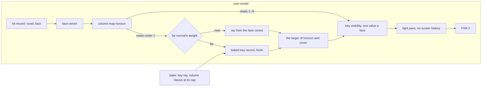

# 0100: A sun fixed in the world: the key shadow a face at a time, the coarse tier held still, and sun under cover

> **Status:** in-progress (approved by the owner 2026-11-24; his answers to the five questions are under "Risks & open questions"). Drafted 2026-11-23 overnight with no interview:
> the guesses and the open questions are under "Risks & open questions", each with a
> recommended option. **Order:** its lane starts when Plan 0098 has merged (its base is the
> calm defaults and Phase 14's dig); it runs **beside Plan 0099** (owner, 2026-11-23), which
> owns `crates/svet-render/src/bake/queue/`; where the two meet is under "Risks".
> **Created:** 2026-11-23
> **Milestone:** M10: Outdoors in [`docs/roadmap.md`](../roadmap.md)
> **Related ADRs:** [ADR-0084](../adrs/0084-the-key-lights-visibility-on-a-world-face-is-fixed-per-face-the-columns-horizon-where-lit-a-cover-source-where-shadowed.md)
> (proposed with this plan; at acceptance it supersedes two clauses of
> [ADR-0079](../adrs/0079-the-key-lights-visibility-is-read-with-no-screen-history-the-record-or-the-column-maps-horizon-at-the-far-a-deterministic-penumbra-near.md)),
> [ADR-0082](../adrs/0082-the-light-pass-keeps-no-screen-history-by-default-and-reads-smooth-sources-to-the-mid-range.md)
> (the calm defaults this builds on),
> [ADR-0076](../adrs/0076-light-stability-rules-world-history-per-source-a-fade-per-transition-and-a-ratcheted-pop-counter.md)
> (rules 2, 3 and 6),
> [ADR-0080](../adrs/0080-the-live-queue-bakes-what-the-image-reads-a-record-by-rule-a-tier-by-size-on-screen-and-a-drain-slice.md)
> (the coarse tier),
> [ADR-0055](../adrs/0055-render-settings-are-one-struct-with-an-apply-class-per-field-and-profiles-are-named-values.md)
> (the settings rows)
> **Source:** [Plan 0098](done/0098-a-calm-light-by-default-no-screen-history-smooth-sources-to-the-mid-range-and-the-fsr-2-turn.md)'s
> window W3 (2026-11-23) and its "Amendment at W3", which outlines this plan; the owner's
> words are in [`logs/0098.md`](logs/0098.md) ("Phase 10: W3's verdicts"), the stills in that
> lane's untracked `live/window98c/`.

## TL;DR

The calm defaults are accepted, and the owner sent three faults they leave to this plan, in
this order. **(1) The noon terraces wobble:** the sun's shadow edge is evaluated at a hit
that moves with the jitter; the spike evaluates it at the voxel face's centre, one value a
face, fixed in the world. **(2) Near trunks and leaves wobble while a face holds its coarse
light record** and stop when the normal tier lands: a reading names the source, then a fix.
**(3) There is no sun under cover:** where the column map reads shadow, a source in the world
adds the light back, a ray from the face's centre near and the baked key record far
(ADR-0084), with the bake's key ray no longer lit at its cap under a roof. Everything before
the owner's one window is exploration: each change behind a flag, named in the banner, read
headless at the owner's poses first. The first thing anyone sees: Plan 0098 Phase 9's
terraces table with a `face` row beside `calm`, at the pose of W3's still.

## Context & problem

Every figure is a reading from the named source unless marked a guess. "RTX" is the NVIDIA
GeForce RTX 3080 Laptop GPU, "RENOIR" the Radeon Cezanne iGPU (RADV RENOIR), which runs the
Portable profile: a march and light pass at 853 x 480, FSR 2 to 1280 x 720, stretched to the
window.

**What the defaults show** (Plan 0098, "Amendment at Phase 4's findings", confirmed in the
shaders there). With light history off, at every opaque cube face and every distance the key
light's visibility is `column_key_visibility` at the hit: the column map's horizon toward the
sun, 0 wherever the hit, lifted along its normal, lies under its own column's top. No ray is
cast for it since Phase 13. The map's cell is 2 voxels (`COLUMN_CELL`).

**The owner's three verdicts at W3**, and what is read about each:

| fault | the owner | the pose | what is read |
|---|---|---|---|
| noon terraces | "light settles on slopes and wobbling"; typed "wobble on slopes" | `--source outdoor --time 12:00`, the eye at x 496.0 y -648.7 z 456.7 voxels, looking down along a stepped slope a few metres off (`2-noon-settled.png`: the slope covered in hard dashes a face deep; the view's angles are not in the HUD) | Plan 0098 Phase 9, at W2's pose (x -299.5 y 0.5 z 549.5): 2.38 / 3.92 / 3.40 % of the step shadows' pixels move over 4 levels a pair at a still camera (far normal's weight 0 / between / 1), 0.00 % with no upscaler and no jitter; of the moved, 22 to 32 % the key value at the jittered hit, 60 to 76 % nothing at the lighting pixel (FSR 2 resolving a one-voxel edge from the half-rate grid) |
| near trunks and leaves | "slight wobble after stop and turn", "on trees, trunks and leaves nearby"; "once coarse light changes to a normal one, wobble stops" | `--source outdoor --spawn forest --trees forest --sun 10,180`, from the spawn, in the first seconds of a fresh start, after a stop and a turn of about 60 degrees; no still | nothing. Three hypotheses in Plan 0098's amendment, none read |
| sun under cover | history on: "overall light looks better, it is comparable to the trees"; then "wobble comes back, and light only visible when I close"; "light only comes when I see it, even after turn looks completely unnatural" | the forest at `--time 15:00`, the eye at x -9.5 y 915.1 z 595.8 (`6a-forest-history-on.png`: sun patches with soft, grainy edges on the floor between the trunks); W1's "light rays are gone when I am distant" at x -622.4 y 607.0 z 608.6; the tunnel's roof slot (`--spawn inside --time 12:00`) was not run | the column map reads 0 under any top (code). The baked key record shows sun under a canopy and leaks: lit at its cap under a closed roof on 64 of 64 faces (Plan 0096 Phase 10c), 12 225 px bright in true shadow through its cell blend (`docs/backlog.md`) |

**What is ruled out.** Light history on, as a default or a remedy (the owner, W3). A screen
accumulation as the estimate (ADR-0076 rule 2). A scene changed so a check passes (the tunnel's
roof slot stays, the trees stay). Waiting for light: a face whose precise value has not landed
shows a stable coarse one (rule 6).

**Budgets touched:** `docs/nfr.md` section 2's lighting line (4.0 ms) on both adapters, the
in-view drain where the key bake's rays change, section 3 if a store word is added, section 7
for every test this adds.

## Decision

**Make the key light's visibility on a world face a value fixed per face in the world, and
let a world source add the sun back where the heightfield cannot see it** (ADR-0084): the
horizon at the face's centre; where it reads shadow, the larger of it and a cover source, a
ray from the face's centre near, the baked key record far; the bake's key ray under a top at
its cap not lit. The coarse tier's wobble is read before any fix is written.

Rejected, inside this plan: the baked record as the near source (a 0.8 m cell cannot hold a
0.1 m shadow; it stays as an arm and as the slow adapter's candidate); a second layer in the
column map (it answers one overhang, not a canopy); a key value baked per face (a moving sun
re-bakes every face); the key term at the full rate as the terraces' fix (2.25 times the
pixels of the light pass on the adapter with no headroom; built only if both face arms fail,
by an amendment); a fix for the coarse tier chosen from the code (Plan 0098's dig was). ADR-0084
has the first three with their reasons.

## Architecture diagram



## Implementation phases

Each phase ships as its own commit. **Phases 1 and 3 to 7 are exploration** (lane rules 2b):
the owner's window is the gate, a phase is done when its change is built behind a flag and
named in the banner, bars are readings, and no image test is written for a mechanism the
window may drop. Phase 2 and Phase 9 are not exploration. Rules that hold in every phase:

- **A reading for a fault starts at the owner's pose** (the table above), in the scene as it
  is. A rig that cannot hold the pose says so and stops.
- **A comparison proves its baseline clean or measures the picture directly.** Each reading
  first shows the fault on the tree as it stands (frames under the untracked `live/`), and
  each "calm" figure is read against the same rig with no upscaler and no jitter, not against
  an arm that may hold the fault.
- **Anything measured is taken headless first**, RTX and RENOIR, exclusive perf lock, the load
  beside it. The RENOIR runs the Portable profile at 1280 x 720.
- **Every flag shows its mode on screen**: the banner and the HUD's lighting row name each
  setting while it is off its default; the debug page flips it live.
- **An arm that costs nothing when off stays a setting** when it is not picked.
- **Order:** 1, 2 and 3 are independent and may run in any order; 4 follows 3; 5 follows 1
  and 2; 6 follows 5; then 7, 8, 9.

Every phase carries exactly one `**Owner skill:**`.

### Phase 1: The key shadow at the face's centre (exploration, a spike)
- **Owner skill:** dev
- **What:** `lighting.key_at`, a setting of three values, default `hit` (today's image to the
  byte). `face`: `column_key_visibility` is evaluated at the centre of the face the hit
  record names (the voxel's centre moved half a voxel along the face normal, at the level
  hit), so every pixel of a face reads one value. `face-smooth`: the horizon at the four
  face-centre lattice points of the face's plane nearest the hit, blended bilinearly: a ramp
  one voxel wide, fixed in the world. Then the reading: Plan 0098 Phase 9's rig
  (`terraces::reading::terraces`) as it stands, with the two arms added and **a second pose,
  W3's** (x 496.0 y -648.7 z 456.7 at 12:00; the dev sets the view to match
  `2-noon-settled.png` and records the angles), each arm at a still camera over the jitter's
  phases and over the slow fly, against `calm` and `calm,native`. The same arms once on the
  forest at `--sun 10,180` for the near trunks' shadow edges (the wobble rig's near class),
  so a pick made on the slope is not blind in the forest.
- **Files touched:** `crates/svet-render/src/shaders/{pair,temporal}.wgsl` (or a new shader
  file: `temporal.wgsl` is 31 lines under the size gate),
  `crates/svet-render/src/frame/settings.rs`, `crates/svet-render/src/frame/settings/sky_light.rs`,
  `crates/svet-render/src/settings.rs`, `apps/flythrough/src/cli/outdoor.rs`,
  `apps/flythrough/src/cli/tests/outdoor.rs`, `apps/flythrough/src/toggles.rs`,
  `apps/flythrough/src/hud/modes.rs`, `apps/flythrough/tests/gpu_wobble/terraces.rs`,
  `docs/flythrough.md`, `docs/plans/logs/0100.md`.
- **Done when:**
  - The log holds Phase 9's table at both poses with the rows `calm`, `face`, `face-smooth`
    and `calm,native` (RTX; still and flying; the three weights apart; the moved pixels split
    by the term that moved), a still of each arm under `live/`, and one line per arm: the
    share of the distance from `calm` to `calm,native` it closes at a still camera, and
    whether the "nothing at the lighting pixel" share (60 to 76 % under `calm`) fell or
    stayed. That last figure answers the spike's question: does an edge on a face's edge
    resolve calmly from the half-rate grid. **If neither arm closes half the distance, the
    dev reports the table and builds nothing more**; the architect amends (the full-rate key
    term, or the terraces go to the window as they are).
  - The light and temporal passes' times a row, RTX and RENOIR at Portable, the three scenes
    of Plan 0098 Phase 4's table (a guess for `face`: no change, the march count is the same;
    for `face-smooth`: up to four marches a lit pixel).
  - CPU (under 1 s, `cli/tests/outdoor.rs` and the settings' tests): `--key-at
    hit|face|face-smooth` parses, the settings table lists `lighting.key_at` with its class,
    the lighting row names the value off its default. With `hit` no golden moves (the phase
    runs no golden; the claim is the byte-identical default, checked by the quick tier's
    settings tests and at the tip's gpu tier).
  - Quick tier, clippy, fmt, the file-size gate over the changed crates.

### Phase 2: The bake's key ray at its cap takes the column clause
- **Owner skill:** dev
- **What:** Not exploration (ADR-0084's last sentence; the defect is confirmed, Plan 0096
  Phase 10c). In `bake.wgsl` a key ray that reaches `job.radius`, an absent chunk or the
  window's side without rock is lit only if its end point is at or above its column's top,
  as the sky rays read ADR-0070's clause; under the top it is not lit. The reading
  `reading::a_key_ray_that_ends_in_air_under_a_roof` becomes an asserting test. Under the
  defaults no pixel reads the key record (`key far column`), so no golden moves; a test that
  pins record bytes or renders under `key far baked` may, and each is named in the log with
  what moved.
- **Files touched:** `crates/svet-render/src/shaders/bake.wgsl`,
  `crates/svet-render/src/bake/{job,pipeline}.rs` (only if the job needs a word it does not
  carry), `apps/flythrough/tests/gpu_bake.rs`, `apps/flythrough/tests/gpu_bake_rule.rs`,
  `docs/plans/logs/0100.md`.
- **Done when:**
  - `gpu_bake`'s `a_key_ray_that_ends_in_air_under_a_roof_is_not_lit` (lavapipe; about 8 s, a
    guess from the reading it replaces; soak-marked and said so if over 10 s): in the closed
    cave whose air is taller than the job's radius, the job's record holds a key visibility
    of 0 on 64 of 64 floor faces (it read 255 on all 64 before), equal to ADR-0080's zero
    record for that chunk; and with the roof removed the same floor reads 255 on all 64 (the
    clause does not darken an open sky).
  - A second claim in the same binary, a slab with one open side at a low sun: a floor face
    whose key ray leaves the window's side above every top stays lit. Its count is the rig's,
    printed and asserted equal before and after the change.
  - The log names every test whose expected bytes or image moved, and Plan 0096 Phase 2's
    bar 1 (the rule's bytes equal a GPU bake's) is re-read with a cave taller than the
    radius: 0 chunks differ.
  - The key bake's cost is unchanged by construction (the same rays); the forest's fresh-start
    drain is read once on the RTX and stated beside Plan 0096's line.
  - The phase's GPU run (lavapipe): `--binaries gpu_bake gpu_bake_rule gpu_bake_tiers
    gpu_queue gpu_sun`, tests run over 0. Quick tier, clippy, fmt.

### Phase 3: The coarse tier's wobble, a reading (exploration)
- **Owner skill:** dev
- **What:** No fix. The wobble rig's near class at the owner's pose (the forest spawn at
  `--sun 10,180`, a turn of 60 degrees after a stop; trunks and leaves within the far
  normal's weight 0), read in two states of the same store: **held coarse** (the live queue
  stopped once every in-view chunk holds its coarse block and none its full one) and
  **landed** (the queue drained). It must first **show the fault**: held coarse moves more
  than landed, pair to pair at a still camera over the jitter's phases, with frames under
  `live/`; the landed state is the clean baseline the owner confirmed by eye and the reading
  confirms or refutes. Then, for the moved pixels of the held-coarse state, a row a source:
  the sky source word (`sky_source`: a block, coarse, the chain, the column), the table word,
  whether the two frames of a pair read different sources or the same source at different
  values, the two records' values where the jittered hit crossed a brick's edge, and the
  smoothed normal's direction weights (`sky_baked_term`) in both frames. Three arms split the
  hypotheses of Plan 0098's amendment: **(H1, the sample count)** the coarse block baked at
  the full tier's count (`--bake-tiers` with the coarse count raised), layout unchanged;
  **(H2, the chain)** the share of moved pixels that read the chain or the column in either
  frame; **(H3, the weights)** `--sky-normal face` against the default `smoothed`.
- **Files touched:** `apps/flythrough/tests/gpu_wobble.rs` (or a sibling under
  `gpu_wobble/`), `apps/flythrough/tests/support/defects.rs`, `docs/plans/logs/0100.md`.
- **Done when:** the log holds, for the RTX and for the RENOIR at Portable, the held-coarse
  and landed shares (near class, over 4 levels a pair), the source table, the three arms, and
  one line naming the source or saying none of the three holds it. **Stop rules:** if held
  coarse does not move more than landed, the pose does not hold the fault and the dev
  reports what it shows (the owner's window is then the instrument, and Phase 4 is not
  built); if the source is none of the three, the dev reports what it is and Phase 4 waits
  for an amendment. Readings only, run by filter with `--run-ignored only`, the count of
  tests run in the log.

### Phase 4: The coarse tier held still, by the reading (exploration)
- **Owner skill:** dev
- **What:** The fix for the source Phase 3 named, behind `lighting.coarse_hold` (default
  `off`, today's image to the byte), one of:
  - **H1, the bake's noise frozen as steps between bricks:** a face on a coarse block reads
    its sky visibility pooled toward its chunk summary's value by a fixed weight (the
    summary is the mean the coarse records scatter about), so two bricks a jitter step apart
    light alike; the weight is read at 0.5 and 1. Not chosen: raising the coarse count (it is
    the drain's budget, ADR-0080).
  - **H2, the chain's binary answer:** where a face on a coarse block holds no value for its
    cell or direction, it shows a held value (its chunk summary's, or Plan 0098 Phase 14's
    held estimate where that built one), never the column's 0 or 1.
  - **H3, the weights:** while a block is coarse the term reads the face's own direction.
  The landing from coarse to full stays the store's one fade. The arm is read on Phase 3's
  rig, held coarse.
- **Files touched:** `crates/svet-render/src/shaders/{temporal,pair}.wgsl` (or the new file),
  `crates/svet-render/src/frame/settings.rs`, `crates/svet-render/src/settings.rs`,
  `apps/flythrough/src/cli/outdoor.rs`, `apps/flythrough/src/cli/tests/outdoor.rs`,
  `apps/flythrough/src/toggles.rs`, `apps/flythrough/src/hud/modes.rs`, `docs/flythrough.md`,
  `docs/plans/logs/0100.md`. **Not** `crates/svet-render/src/bake/queue/` (Plan 0099's): a fix
  that needs the queue or the coarse record's layout stops for an amendment and an ADR.
- **Done when:** the log holds Phase 3's held-coarse share with the arm on beside off and
  beside landed (both adapters), the mean difference in display levels between the
  held-coarse image under the arm and the landed image (the step the landing's fade then
  carries; the arm must not make it larger than off's by more than 1 level, or the log says
  by how much), and the temporal pass's time on and off. The banner names the arm. CPU: the
  flag parses, the settings table lists the field with its class. Quick tier, clippy, fmt.

### Phase 5: Sun under cover, the candidates read against a reference (exploration)
- **Owner skill:** dev
- **What:** No default and no arm yet: an error table, so the mechanism is not chosen from
  the code. A reading rig (`mod reading`, on the wobble rig's frame) at three poses: the
  forest at 15:00 from x -9.5 y 915.1 z 595.8 (W3's still), the same floor from a distance
  (x -622.4 y 607.0 z 608.6, W1's), and the tunnel's roof slot from `--spawn inside --time
  12:00`. **The reference** is the key visibility of each visible face as 64 disc rays from
  the face's centre with no cap short of the window (a slow reading pass, not a frame path).
  Against it, per pose and per class of face (the horizon reads 1; reads 0 under its own
  top; reads under 1 by the horizon), each candidate's value: the horizon at the hit and at
  the face's centre; one centre ray from the face's centre (`disc`) and its closest-approach
  score (`approach`); the record at the face's own cell and through the cell blend, baked
  with Phase 2's clause. It first **confirms the premise**: the count of faces where the
  horizon reads 1 and the reference does not (ADR-0084 rests on that being 0 but for the
  ramp). Then per candidate: the share of the reference's sunlit under-cover area it shows,
  the share of truly shadowed area it brightens by over 4 levels (the leak), the largest
  disagreement between the ray and the record on one face (what a band would have to blend),
  and whether the key words are baked and how long after a fresh start they land in view
  under today's defaults.
- **Files touched:** `apps/flythrough/tests/gpu_wobble.rs` (or a sibling), a reading pass in
  `apps/flythrough/tests/support/`, `docs/plans/logs/0100.md`.
- **Done when:** the log holds the table for the three poses (RTX; the reference pass is
  slow and is not timed), the premise's count, and one line a candidate: what it shows, what
  it leaks, where it is wrong. **Stop rule:** if the horizon reads 1 where the reference
  reads shadow on more than the ramp's faces, "only adds" is unsound and the dev stops for
  an amendment to ADR-0084. If the record's leak is over the ray's by a factor at the far
  pose, the log says so and Phase 6 builds the own-cell read.

### Phase 6: Sun under cover, the arms (exploration)
- **Owner skill:** dev
- **What:** `lighting.key_cover`, default `off` (today's image to the byte). Where the
  horizon (at `key_at`'s point) reads under 1 the shown key visibility is the larger of it
  and the cover source:
  - `ray`: at a face whose far normal's weight is under one half, one ray from the face's
    centre toward the disc's centre, times its transmittance, cast in the light pass with no
    random number and shown with no mean; it honours `lighting.penumbra` (`disc`: the centre
    ray alone; `approach`: the closest-approach score from the same origin) and `key_cap`.
    Past the half, the horizon alone.
  - `record`: at every distance, the store's baked key visibility where the face's cell
    holds a fresh one (the read Phase 5 picked: own cell or blend), else the horizon alone;
    a landing and a re-key ride the key slot's fade (`FADE` frames).
  - `ray-record`: `ray` near, `record` far, the switch by `key_far_mix` (step, or blend if
    Phase 5 read the two apart).
  Entities, field surfaces, `light history on` and `key far ray` behave as today. The light
  pass casts the ray only where the horizon reads under 1 (Phase 13's skip, narrowed, not
  undone). `lighting.key_cover` needs the key bake on under `record` and `ray-record`; the
  phase says in the log whether the queue bakes key words under `key far column` today and
  turns them on with the setting if not.
- **Files touched:** `crates/svet-render/src/shaders/{shade,temporal,pair}.wgsl` (or the new
  file), `crates/svet-render/src/frame/{settings,encode}.rs`,
  `crates/svet-render/src/frame/settings/sky_light.rs`, `crates/svet-render/src/settings.rs`,
  `apps/flythrough/src/cli/outdoor.rs`, `apps/flythrough/src/cli/tests/outdoor.rs`,
  `apps/flythrough/src/toggles.rs`, `apps/flythrough/src/hud/modes.rs`, `docs/flythrough.md`,
  `docs/plans/logs/0100.md`.
- **Done when:**
  - At Phase 5's three poses, a still of each arm under `live/` and its row against the
    reference (the share of sunlit under-cover area shown; the leak), with `key_at face`.
  - **Steady, by the wobble rig:** the sun-patch class (display pixels within 3 px of the
    cover source's edge on the floor) over 4 levels a pair at a still camera, each arm
    against `calm,native` and against `light history on` (the arm the owner rejected, as the
    thing to beat, not as a baseline).
  - **Present after a turn:** a settled pose, a 90-degree turn away, a turn back: the first
    frame back against the settled frame, the share of the class over 4 levels (rule 2), each
    arm; under `ray` it is the upscaler's alone by construction and the reading confirms it.
  - **Present at a distance:** at the far pose, `record` and `ray-record` before the key
    words land and after; the seconds from a fresh start to the patch being there, both
    adapters.
  - The light and temporal passes a arm, the three scenes, RTX at Floor and RENOIR at
    Portable, against section 2's 4.0 ms. A guess, from Phase 13's before and after: `ray`
    costs at most the old disc ray, 0.3 to 1.4 ms on the RTX at Floor; on the RENOIR at
    Portable the old ray read 2.42 ms (hills) and 5.13 ms (forest) for the whole pass, so the
    forest may sit about 1 ms over the line and `record` is that profile's candidate.
  - CPU: `--key-cover off|ray|record|ray-record` parses; the settings table lists the field;
    the banner names it. Quick tier, clippy, fmt, the file-size gate.

### Phase 7: The window rehearsed headless (exploration)
- **Owner skill:** dev
- **What:** The session script for Phase 8 (`live/session100.sh`, on the runner library the
  orchestrator's sessions use) and its rehearsal with no window. For every run of Phase 8:
  the flags parse on the session's binary (`--check-args`); a headless run at the run's
  configuration writes a still at the run's pose and the frame line (frame rate, the light
  pass, in view waiting, the drain) on the adapter the run names; the still shows the thing
  the run asks the owner about (terraces with dashes, a trunk under coarse light, a sun
  patch, the slot's patch) or the run is fixed before the owner sits down. The banner of
  each still names every setting the run flips.
- **Files touched:** `docs/plans/logs/0100.md` (the rehearsal's table; the script and stills
  are under the untracked `live/`).
- **Done when:** the log holds a row a run: flags, adapter, the still's path, frames a
  second, the light pass, the drain, and "shows it" or what was changed until it did. No run
  of Phase 8 starts on a configuration the rehearsal has not rendered. A run whose frame
  rate headless is under 30 on its adapter is flagged in the table before the window, not
  found in it.

### Phase 8: The owner's window
- **Owner skill:** human
- **What:** One session on Linux, every mode on screen, each run a flip on the debug page
  between the default and the arms. The move in each: fly slowly 5 s, stop 5 s, turn about
  60 degrees, hold 5 s.
  1. **The noon terraces** (RTX, x 496.0 y -648.7 z 456.7 at 12:00): `key at hit`, `face`,
     `face-smooth`. Do the dashes hold still? Does a shadow stepped by faces look right, on
     the slope and at a tree's shadow on open ground?
  2. **Near trunks and leaves under coarse light** (RTX, the forest spawn at `--sun 10,180`,
     a fresh start each time): `coarse hold off` against the arm. Still a wobble in the first
     seconds? Does the light change more, or less, when the normal tier lands?
  3. **Sun under the canopy** (RTX, the forest at 15:00, x -9.5 y 915.1 z 595.8): `key cover
     off`, `ray` (with `penumbra disc` and `approach`), `record`, `ray-record`. Are the
     patches there, steady, there after a turn? Then fly back to about 60 m: are they there
     from a distance, and does anything change on the way?
  4. **The tunnel's roof slot** (RTX, `--spawn inside --time 12:00`; W3's 6b): the same arms.
     Sun through the slot onto the floor? Anything blinking on the walls?
  5. **The RENOIR at Portable**, the forest at 15:00 and the noon slope: the arms the
     rehearsal's table shows inside 33.3 ms. Which is acceptable there?
- **Files touched:** `docs/plans/logs/0100.md` (the verdicts, in the owner's words).
- **Done when:** the log holds a pick or a "none" per run and per adapter. A "none" on a
  subject sends it to the backlog with its tables, its arms kept as settings; it does not
  hold the other two.

### Phase 9: The picks become the defaults, with their tests, lines and words
- **Owner skill:** dev
- **What:** Not exploration. The picks become `Lighting::default()` and each profile's row;
  unpicked arms stay settings, off. Then the tests that judge the image, written against the
  picks, the goldens re-blessed on lavapipe, the lines and the documents. Tests for an arm
  that was not picked are not written.
- **Files touched:** `crates/svet-render/src/frame/settings.rs`, `crates/svet-render/src/settings.rs`
  (the profile rows), `crates/svet-render/tests/gpu_sun/key.rs`,
  `apps/flythrough/tests/gpu_wobble.rs`, `apps/flythrough/tests/gpu_wobble/terraces.rs`,
  `apps/flythrough/tests/gpu_outdoor_golden.rs`, `apps/flythrough/tests/golden/`,
  `apps/flythrough/tests/menu.rs`, `apps/flythrough/src/cli/tests/outdoor.rs`,
  `docs/flythrough.md`, `docs/nfr.md`, `docs/nfr/02-frame-budget.md`, `docs/plans/logs/0100.md`.
- **Done when** (each claim only if its subject was picked):
  - **One value a face** (`gpu_sun`, lavapipe, under 10 s, a guess from its sibling
    `the_defaults_near_key_shadow_is_the_column_horizon` at 5.5 to 7.0 s): on the slab-edge
    rig under the defaults with `key jitter` on, every pixel whose hit lies on one face
    shows the same key term, on frames 1, 2 and 3 alike, and two faces either side of the
    slab's shadow edge differ. Under `face-smooth`, if picked: the term is the same on the
    three frames at every pixel and changes by at most the ramp's slope times the hit's
    distance between two pixels of a face (a property, no number invented).
  - **Sun through a slot** (`gpu_sun`, lavapipe, under 10 s, a guess): a slab roof with a
    slot over a floor, the sun slanted so the patch lies under the roof's column tops. Under
    the defaults the floor faces the reference ray reaches show a key term over 0 on frame 1,
    the same on frames 2 and 3; every floor face the reference does not reach shows the
    horizon's value; with `key cover off` the patch is 0. If the far source was picked: at
    the far normal's weight 1 the patch is 0 before the key words land and over 0 after,
    reached in one monotonic fade of at most `FADE` frames.
  - **A turn loses nothing** (`gpu_sun`, same rig): the frame after a 90-degree turn away
    and back equals the settled frame's key term at every floor pixel within 1/512.
  - **The coarse tier holds still**, if Phase 4's arm was picked (`gpu_wobble`, soak, on the
    RTX like its siblings; its wall time is Phase 3's reading run, stated in the log): the
    held-coarse near share over 4 levels at rest is at most the landed state's plus 2 points
    (this plan's tolerance, as Plan 0098's bars; if Phase 3 read the landed state itself over
    2 %, the dev stops and reports, the bar would sit in the noise).
  - **The terraces at rest** (`gpu_wobble`, soak): the step shadows' share over 4 levels at
    a still camera under the defaults is at most `calm,native`'s plus the margin Phase 1's
    two runs support, at both poses; printed beside `key at hit`'s, which must read higher
    (the test sees the fault on the old arm, or it is not done).
  - Goldens re-blessed on lavapipe, each named in the log with before and after stills under
    `live/`; `outdoor_forest_afternoon_golden`'s doc comment says what the image now is.
  - CPU: `menu.rs` and the CLI tests pin the new defaults; each profile's row is asserted
    from the profile, not written into the test.
  - `docs/nfr/02-frame-budget.md` holds the light, temporal and whole-frame rows under the
    new defaults, the three scenes, both adapters, with machine and commit; `docs/nfr.md`
    section 2 says met or missed against 4.0 ms a profile; the in-view drain is re-read on
    the forest fresh start if the key bake's state changed.
  - The gate tier and the whole gpu tier at the tip (lavapipe, exclusive perf lock), clippy,
    fmt, deny, the doc gates; the soak tests above by name. The gate's wall time is stated
    against section 7's line with the count of tests this plan added to it.

## Data shapes

Illustrative; names are the dev's to settle.

```rust
// illustrative
pub enum KeyAt { Hit, Face, FaceSmooth }            // lighting.key_at, default Hit until Phase 9
pub enum KeyCover { Off, Ray, Record, RayRecord }   // lighting.key_cover, default Off until Phase 9
pub enum CoarseHold { Off, /* the arm Phase 3 names */ } // lighting.coarse_hold
```

No store word is added by Phases 1, 2 and 6: the key record's two words exist (ADR-0079).
Phase 2 changes their values where a key ray ends under a top.

**Profile rows.** `lighting.key_at` (`Live`), `lighting.key_cover` (`Live`; `Rebuild` if the
ray compiles a pipeline variant, said in the log), `lighting.coarse_hold` (`Live`). Until
Phase 9 every profile holds `hit`, `off`, `off`. Proposed for Phase 9, the window deciding:
Floor, Performance and High `face`, `ray-record`, the picked hold; Portable `face`, and
`record` or `off` by the RENOIR's reading against 4.0 ms.

## Budgets

- **Lighting, 4.0 ms (section 2).** Today under the defaults: 0.22 to 0.42 ms on the RTX
  and 1.61 to 2.07 ms on the RENOIR at Floor (Plan 0098 Phase 13). `key_at face`: no change
  expected (a guess). `face-smooth`: up to four horizon marches a lit pixel, in the temporal
  pass. `key_cover ray`: at most the ray Phase 13 removed, +0.3 to +1.4 ms on the RTX and
  +4.0 to +9.7 ms on the RENOIR at Floor (arithmetic on Phase 13's table; the RENOIR at
  Floor is over the frame line regardless). At Portable the bound is Plan 0096's reading of
  the whole pass with that ray, 2.42 and 5.13 ms. Measured in Phases 1, 4 and 6 headless and
  pinned in Phase 9 (`flythrough --headless --source outdoor --frames 1500`, the three
  scenes, `--adapter RTX` at Floor and `--adapter RENOIR --profile portable --render
  1280x720`, exclusive perf lock, the median of 30).
- **The in-view drain (section 2, Plan 0096's line; Plan 0099's to move).** Unchanged by
  Phase 2 (the same rays). If `key_cover` turns on a key bake that is off today, the drain
  is re-read in Phase 6 and Phase 9; ADR-0079's Outcome read the key words at about +21 % of
  a dig ring's samples.
- **Memory (section 3).** No new store bytes unless Phase 4's fix needs a word, which is an
  amendment.
- **The gate's wall (section 7).** The gate read 2011.1 s at Plan 0098's tip against a
  19-minute line. This plan adds to the gate: Phase 2's test (about 8 s), Phase 9's three
  `gpu_sun` claims (under 10 s each, guesses) and CPU tests under 1 s; every wobble bar is
  soak.

## Risks & open questions

- **A shadow stepped by faces may read as wrong.** A slanted edge becomes a 10 cm staircase.
  `face-smooth` is the answer in hand; it may draw a dark ramp where a lattice point lies
  under a neighbouring step's column (it would read as a contact shadow or as dirt). The
  window decides; the stills of Phase 1 show it first.
- **The face's centre may not calm the 60 to 76 %.** Then the terraces' wobble is the
  half-rate resolve, the spike stops, and the arm left is the key term at the full rate,
  which the RENOIR cannot pay.
- **Near and far disagree until the far lands.** The seam the owner named at W1, bounded by
  the drain instead of permanent. Phase 6 reads the seconds; Plan 0099 shortens them.
- **The ray on the slow adapter.** If neither `ray` nor `record` is acceptable on the
  RENOIR, Portable stays at `off` and the limit is said in ADR-0084's Outcome.
- **A moving sun.** The ray follows it every frame, so a face's value flips once as the
  edge passes: with `disc` a hard flip a face. The day cycle is off by default; read once
  in Phase 6 under the default day and reported.
- **Phase 3's pose may not hold the fault headless** (Plan 0098's dig did not, at first).
  The stop rule is real: no fix from the code.
- **Determinism.** Nothing here runs on the server side or in `svet-world`. The record's
  bytes stay a function of the world and the key direction; Plan 0099 asserts them equal
  across its modes, which Phase 2 does not disturb (the clause is in the shader both modes
  run).
- **Beside Plan 0099.** That plan owns `bake/queue/`. This plan's shader, settings and test
  files do not meet it; `bake.wgsl` and `bake/job.rs` (Phase 2) may. Phase 2 is small and
  lands first or after Plan 0099's Phase 2, the orchestrator's call; Phase 4 does not touch
  the queue.
- **Plan 0098 Phase 14 is in flight** (a fresh hole's held value). This plan's base is the
  tree that holds it; Phase 4's H2 reuses its estimate if it built one. **2026-11-24 (the
  architect, at Plan 0098's close, v0.72.0):** it landed as Phases 16 and 17: the held value
  is a record in the store made on the CPU at the edit (`bake/held.rs`,
  `held_visibilities`), read by the light pass as any record, and the per-pixel rays of
  Phase 14 are gone; H2 reuses that estimate's form.
- **`temporal.wgsl` is near the file-size gate.** New shader code goes to `pair.wgsl` or a
  file of its own.
- **Threading and memory:** no new thread, no new allocation in the frame path.

**Questions for the owner** (the lane goes by the recommended option once he says go).
**Answered 2026-11-24 (owner):** 1, the fix goes here as Phase 2; 2, he asked which arm is
better for performance, which is `face` (no added cost expected, against up to four horizon
marches a lit pixel for `face-smooth`), so the recommended option stands unless the window
says otherwise; 3, 4 and 5, the recommended options.

1. **Where the bake's key ray fix goes.** Recommended: here, as Phase 2, under ADR-0084,
   because the ADR that supersedes ADR-0079's clause is this plan's and the far cover source
   reads the record; the small plan "The record by rule at every opening" then starts from
   that commit and carries no ADR for the key ray. The other option, which Plan 0096's close
   recommended before this plan existed: the small plan's first phase, and this plan's
   Phases 5 and 6 wait for it to merge.
2. **The default if the window likes both a hard and a soft shadow.** Recommended: `face`
   with `penumbra disc` on every profile (the cheapest that is steady), `face-smooth` and
   `approach` kept as settings. The other option: the soft arm on Floor and above.
3. **Sun under cover on the RENOIR at Portable.** Recommended: decide at the window from
   the rehearsal's table; `record` if it is inside 4.0 ms and the eye takes its 0.8 m
   softness, else `off`. The other option: `ray` with `key_cap`, over the line.
4. **A "none" at the window.** Recommended: a subject with no pick goes to the backlog with
   its tables and does not hold the other two, and the plan closes on what was picked. The
   other option: the plan stays open until all three have a pick.
5. **The order beside Plan 0099.** Recommended: this plan's lane starts when Plan 0098 has
   merged and runs beside Plan 0099's from its Phase 1; the two windows are separate. The
   other option: one shared window for both plans (fewer sittings, a later look).

## What this plan does NOT do

- **The record by rule at every opening** (the buried chunks, Plan 0096's Phase 10b): its own
  small plan ahead of Plan 0099's Phase 1 (`docs/backlog.md`, Next up).
- **The bake step off the main thread, the drain's time, the frame rate while it drains:**
  Plan 0099.
- **The dig** (a fresh hole's value until its bake lands): Plan 0098 Phase 14.
- **The far trees' wobble while moving:** `docs/backlog.md`, "Distant trees that do not
  wobble".
- **A penumbra of the disc's true width**, and a shadow's edge on an entity or a field
  surface (one raw disc ray a frame, unread): the backlog entry "The sun's shadow near under
  the calm defaults" keeps those two lines.
- **The sky term under cover with no store bound** ("a better value before the bake"): the
  same entry.
- **Visible sun beams in the air:** `docs/backlog.md`, "Light shafts inside structures",
  with Plan 0035.
- **Light history on, in any form, as a default.**
- **Any scene, model or material change.**

## Implementation log

> Written by `dev`: one row per phase as its commit lands, then the close block. **The phases
> above are the contract. This section records what happened.** Observations, never conclusions:
> no pass list, no self-assessment. Deviations and unmet done-whens are **always** disclosed.
> Keep it shorter than `## Implementation phases`. Readings, gate counts, attempts, sweeps and
> resume notes go to the plan's readings log, `docs/plans/logs/0100.md` (started from
> `templates/readings-log.md`), and this section links it once it exists.

| phase | owner | state | commit |
|---|---|---|---|
| 1: The key shadow at the face's centre | dev | built; the stop rule holds (neither arm closes half the distance at a still camera at either pose); readings in [`logs/0100.md`](logs/0100.md) | `569bb5f4` |
| 2: The bake's key ray at its cap | dev | done: the closed cave's floor reads key 0 on 64 of 64, the open one 255 on 64, the slab's 64 lit before and after, the rule's 9 chunks equal the job's; no test's bytes moved | committed with this row |
| 3: The coarse tier's wobble, a reading | dev | not started | |
| 4: The coarse tier held still | dev | not started | |
| 5: Sun under cover, the candidates read | dev | not started | |
| 6: Sun under cover, the arms | dev | not started | |
| 7: The window rehearsed headless | dev | not started | |
| 8: The owner's window | human | not started | |
| 9: The picks become the defaults | dev | not started | |

### Notes

_(Deviations from the plan, with the commit, stated without justification. Done-whens not
satisfiable as stated, and what was done instead. Followups noticed and not acted on. One line
each. Empty is fine.)_

- Phase 1: `Params::lighting` has no free bit; `key_at` sets `Params::lighting2` bits 1 and 2
  (`Lighting::flags2`), so `frame/encode.rs` (one line) and `frame/compose.rs` (two WGSL
  constants) changed, outside the phase's files.
- Phase 1: also outside the list: `lib.rs` (the `KeyAt` export), `apps/flythrough/src/cli/mod.rs`
  (the start lighting's field), `apps/flythrough/tests/gpu_wobble.rs` (the `keyat=` token), the
  two settings test files, and `apps/flythrough/src/toggles/cycle.rs` (new: `next_missing_light`
  and `next_reach` moved out of `toggles.rs`, at 1199 of 1200 lines, so the `key at` switch fits).
- Phase 1: the face's centre is the level-0 voxel's behind the hit; the hit record carries no LOD
  level, so "at the level hit" is not read.
- Phase 1: W3's still (`2-noon-settled.png`) is not on disk; the view at W3's eye is the rig's
  rule (the ground 40 voxels down the slope's fall): yaw 34.5, pitch -46.2 degrees.
- Phase 1: the pass times were read with the RTX at Floor 1920 x 1080 (Plan 0098 Phase 4's
  table) and the RENOIR at Portable 1280 x 720.
- Phase 1: the forest arms ran on the wobble rig's near class (all pixels under 6 m); the rig has
  no shadow-edge class for the trunks.
- Phase 1, the stop rule: neither `face` nor `face-smooth` closes half the distance from `calm`
  to `calm,native` at a still camera in every bin at either pose; nothing more is built for
  the terraces until the architect amends.
- Phase 2: both tests live in `gpu_bake_rule.rs` beside the tall cave rig, not in `gpu_bake.rs`;
  `a_key_ray_that_ends_in_air_under_a_roof_is_not_lit` is soak-marked (18.6 to 19.7 s on
  lavapipe).
- Phase 2: the reading hook `job.sky` bit 3 (any end is sky) now also makes any key ray's end
  lit.
- Phase 2: the drain was read loaded (load 12.32): in view 42.9 s and the residency 51.2 s after
  the first world frame, against Plan 0096's quiet 36.5 and 49.1 s.
- Phase 1's RENOIR pass times landed in the readings log with Phase 2's commit.

### Close triggers

_(Facts for the architect. No recommendations, and no suggested version bump.)_

- **What shipped:** feature / fix-only / docs-chore-only
- **Public API changed:** types, traits, functions, shader interfaces, config (list them, or none)
- **Budget readings:** each `nfr.md` figure touched, with its measured value, machine and commit
- **Gate at the tip:** the commands run (build, nextest, doctests, clippy, fmt, deny), exit codes, test counts
- **Outstanding `human` phases:** which, or none

## Followups

_(Empty at draft time.)_

## Amended 2026-11-25 (architect, code reading after Phase 1's stop)

Phase 1 met its stop rule. By the house rule (owner, 2026-11-24) this is a reading of what the
mechanism waits on and what the bar measures, not a further variant. The long form, with file
and line, is in [`logs/0100.md`](logs/0100.md), "The architect's code reading after Phase 1's
stop". Nothing was run; each expectation is a guess until Phase 1b reads it.

**Findings.**

- **The premise was wrong.** The column horizon was already fixed in the world under `hit`: it
  is a function of the position alone, with a ramp the sun's disc wide. `face` moved that step
  at most half a voxel, hence 0.10 % of the display. The fault is the sampling, not the function.
- **The mechanism.** The hit pass's rays are jittered (as FSR 2 asks). The lighting grid is
  half the internal resolution on each edge (640 x 360 under 1280 x 720: a quarter of the
  pixels FSR 2 is fed), fixed on screen, and copies one jittered hit of each 2 x 2. The
  temporal pass reads the horizon at that hit, so a lighting pixel near the edge flips with
  the phase. The key term then passes through the a-trous filter, which with no light history
  takes its variance from the 7 x 7 around a pixel and so treats the hard edge as noise, and
  through the composite's upsample, which gives three internal pixels in four light from
  neighbours. FSR 2 gets an edge that jumps by up to 3 display pixels a phase with motion 0
  and no mask, and cannot converge on it.
- **The bar.** The rig's "none at the lighting pixel" is read before the filter and the
  upsample: it holds the filter, the upsample, the internal pixel's own hit and FSR 2 together,
  and is not a measure of FSR 2. The class is 3 lighting pixels wide on whatever grid the arm
  runs, so shares on different grids are not of the same pixels. W3's w 0 bin is judged on
  about 3 moved pixels a pair.
- **`calm,native` reads 0.00 because nothing depends on the frame index without the jitter**
  (the half-rate grid and the filter are in that arm too). Plan 0102's close review found the
  same under a lamp (`gpu_fsr2`'s shadow-wobble test: 4.5 levels at the boundary under the
  jitter, 0.000 without); it is this mechanism, and against ADR-0076's rule that nothing varies
  at rest.
- **A figure corrected.** "The key term at the full rate (2.25 times the pixels of the light
  pass)" under Decision: the internal grid holds 4 times the lighting grid's pixels; 2.25 is the
  display over the internal. The horizon is the temporal pass's, not the light pass's.
- **Ruled out by the code:** a stable edge through the upsample alone (it has only samples
  that already flip), and a reactive or composition mask for FSR 2 (it would trade the wobble
  for an unaccumulated edge).

### Phase 1b: The split of "none", and the key shadow read at the pixel's centre (exploration)
- **Owner skill:** dev
- **What:** In this order.
  1. **The split, with no production code.** The terraces rig as it stands, both poses, RTX,
     the rows `calm,nofilter`, `calm,full` and `calm,full,nofilter` beside `calm` and
     `calm,native` (the tokens exist). The rig gains one figure a row: the count of display
     pixels over 4 levels a pair over the whole display, the figure rows on different grids
     are compared on. `nofilter` reads what the filter adds; `full,nofilter` is the ceiling of
     any change that keeps the jittered read (every light term at the internal rate,
     unfiltered).
  2. **`lighting.key_at` gains `centre`** (default stays `hit`): the horizon is read at the
     point where the lighting pixel's ray with no jitter (through its internal pixel's centre)
     meets the plane of the face the jittered hit lies on, with that face's normal. One value a
     lighting pixel whatever the phase, while the hit stays on one plane. A hit with no face
     axis reads the hit. The cosine, the face's direction and everything but the horizon's
     point stay the jittered hit's.
  3. **`lighting.key_filter`** (`filtered`, the default, today's image to the byte; `around`):
     where the light pass cast no key ray and the pixel takes no light history, the key term
     joins the stored part the filter passes around, and its luminance stays out of the
     moments. **Built only if** step 1 reads `calm,nofilter`'s whole-display count at a still
     camera at most three quarters of `calm`'s at either pose; else the log says the filter is
     not in it and the setting is not built.
  Then the table with `calm,keyat=centre`, and `calm,keyat=centre,keyfilter=around` if built.
  The banner and the HUD's lighting row name `key at centre` and `key filter around`; the debug
  page's `key at` cycles the four values and a `key filter` row flips.
- **Files touched:** `crates/svet-render/src/shaders/{pair,temporal,atrous}.wgsl` (`temporal.wgsl`
  is near the size gate: the new code goes to `pair.wgsl`),
  `crates/svet-render/src/frame/{settings,encode,compose}.rs`,
  `crates/svet-render/src/frame/settings/{sky_light,tests}.rs`,
  `crates/svet-render/src/{settings,lib}.rs`, `crates/svet-render/src/settings/tests.rs`,
  `apps/flythrough/src/cli/{mod,outdoor}.rs`, `apps/flythrough/src/cli/tests/outdoor.rs`,
  `apps/flythrough/src/toggles.rs`, `apps/flythrough/src/toggles/cycle.rs`,
  `apps/flythrough/src/hud/modes.rs`, `apps/flythrough/tests/gpu_wobble.rs`,
  `apps/flythrough/tests/gpu_wobble/terraces.rs`, `docs/flythrough.md`, `docs/plans/logs/0100.md`.
- **Done when:**
  - The log holds Phase 1's table at both poses with the new rows (RTX; still and flying; the
    three weights; the moved split by term; the whole-display count), a still of each built arm
    under `live/`, and one line an arm: the share of the distance from `calm` to `calm,native`
    it closes at a still camera, whether the "key" share of the moved fell (under `centre` it
    is expected near 0), and the still's difference from `calm`'s (how much softer or more
    stepped the edge is).
  - **The stop rule**, restated: an arm passes if it closes half the distance in every bin
    that moves at least 50 display pixels a pair under `calm` (W3's w 0, about 3, is printed
    and not judged). If `centre`, alone or with `around`, passes, it goes to Phase 8's run 1
    beside `hit`, `face` and `face-smooth`, and Phase 9's "one value a face" claim is rewritten
    for it by the architect at the pick. **If none passes, the dev reports the table and builds
    nothing more**; question 6 below opens with the readings.
  - The forest at `--sun 10,180` once with each built arm (the wobble rig's near class), as
    Phase 1 read it.
  - The temporal and a-trous passes' times a built arm, RTX at Floor and RENOIR at Portable,
    Phase 1's three scenes (a guess: no change for `centre`; `around` the same or less).
  - CPU (under 1 s): `--key-at centre` and `--key-filter filtered|around` parse; the settings
    table lists `lighting.key_at` and, if built, `lighting.key_filter` (`Live`), every profile
    at `hit` and `filtered`; the lighting row names each off its default.
  - Quick tier, clippy, fmt, the file-size gate over the changed crates. Order: before Phase 7;
    independent of Phases 3 to 6.

**Risks.** Under `centre` the shadow edge is not supersampled by the jitter: it is as sharp
as the lighting grid, a stepped ramp of up to 3 display pixels (`native`'s is 2); the stills
show it before the window. At a step's silhouette the point lies on the hit face's plane beyond
its edge; the horizon is defined there, and the lighting pixel still changes when its jittered
hit changes plane, which is geometry for FSR 2. While flying nothing is expected to change.

**Question for the owner, 6 (opens only if Phase 1b's stop rule fires).** No half-rate arm
holds the terraces' shadow still. What then?
  - (a) The key term at the internal rate (read in the composite at every internal pixel's own
    hit) on Floor, Performance and High; Portable keeps the half-rate read. Only if
    `calm,full,nofilter` itself passed the stop rule. Cost, guesses from Phase 1's
    `face-smooth` rows (the same three added marches a pixel): +0.2 to +0.5 ms on the RTX at
    Floor.
  - (b) The same on every profile: +0.57 to +1.45 ms on the RENOIR at Portable (a guess),
    beside a light and temporal pass that read 0.81 and 3.05 ms there (the lighting line is
    4.0 ms).
  - (c) The terraces go to the window as they are, `native` beside them for the eye, and the
    fault goes to the backlog naming FSR 2's resolve; the plan's other two subjects go on.
  - **Recommended:** (a) if `calm,full,nofilter` passed, else (c). Not (b): the slow adapter
    has the least room under the lighting line.
