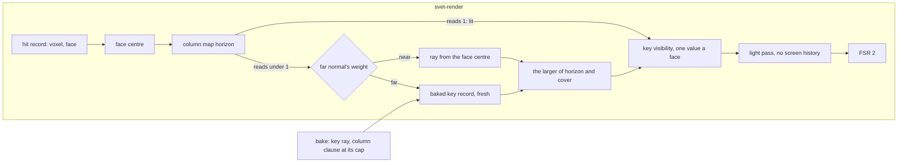

# 0100: A sun fixed in the world: the key shadow a face at a time, the coarse tier held still, and sun under cover

> **Status:** in-progress (approved by the owner 2026-11-24; his answers to the five questions are under "Risks & open questions"). Drafted 2026-11-23 overnight with no interview:
> the guesses and the open questions are under "Risks & open questions", each with a
> recommended option. **Order:** its lane starts when Plan 0098 has merged (its base is the
> calm defaults and Phase 14's dig); it runs **beside Plan 0099** (owner, 2026-11-23), which
> owns `crates/svet-render/src/bake/queue/`; where the two meet is under "Risks".
> **Created:** 2026-11-23
> **Milestone:** M10: Outdoors in [`docs/roadmap.md`](../roadmap.md)
> **Related ADRs:** [ADR-0084](../adrs/0084-the-key-lights-visibility-on-a-world-face-is-fixed-per-face-the-columns-horizon-where-lit-a-cover-source-where-shadowed.md)
> (proposed with this plan; at acceptance it supersedes two clauses of
> [ADR-0079](../adrs/0079-the-key-lights-visibility-is-read-with-no-screen-history-the-record-or-the-column-maps-horizon-at-the-far-a-deterministic-penumbra-near.md)),
> [ADR-0082](../adrs/0082-the-light-pass-keeps-no-screen-history-by-default-and-reads-smooth-sources-to-the-mid-range.md)
> (the calm defaults this builds on),
> [ADR-0076](../adrs/0076-light-stability-rules-world-history-per-source-a-fade-per-transition-and-a-ratcheted-pop-counter.md)
> (rules 2, 3 and 6),
> [ADR-0080](../adrs/0080-the-live-queue-bakes-what-the-image-reads-a-record-by-rule-a-tier-by-size-on-screen-and-a-drain-slice.md)
> (the coarse tier),
> [ADR-0055](../adrs/0055-render-settings-are-one-struct-with-an-apply-class-per-field-and-profiles-are-named-values.md)
> (the settings rows)
> **Source:** [Plan 0098](done/0098-a-calm-light-by-default-no-screen-history-smooth-sources-to-the-mid-range-and-the-fsr-2-turn.md)'s
> window W3 (2026-11-23) and its "Amendment at W3", which outlines this plan; the owner's
> words are in [`logs/0098.md`](logs/0098.md) ("Phase 10: W3's verdicts"), the stills in that
> lane's untracked `live/window98c/`.

## TL;DR

The calm defaults are accepted, and the owner sent three faults they leave to this plan, in
this order. **(1) The noon terraces wobble:** the sun's shadow edge is evaluated at a hit
that moves with the jitter; the spike evaluates it at the voxel face's centre, one value a
face, fixed in the world. **(2) Near trunks and leaves wobble while a face holds its coarse
light record** and stop when the normal tier lands: a reading names the source, then a fix.
**(3) There is no sun under cover:** where the column map reads shadow, a source in the world
adds the light back, a ray from the face's centre near and the baked key record far
(ADR-0084), with the bake's key ray no longer lit at its cap under a roof. Everything before
the owner's one window is exploration: each change behind a flag, named in the banner, read
headless at the owner's poses first. The first thing anyone sees: Plan 0098 Phase 9's
terraces table with a `face` row beside `calm`, at the pose of W3's still.

## Context & problem

Every figure is a reading from the named source unless marked a guess. "RTX" is the NVIDIA
GeForce RTX 3080 Laptop GPU, "RENOIR" the Radeon Cezanne iGPU (RADV RENOIR), which runs the
Portable profile: a march and light pass at 853 x 480, FSR 2 to 1280 x 720, stretched to the
window.

**What the defaults show** (Plan 0098, "Amendment at Phase 4's findings", confirmed in the
shaders there). With light history off, at every opaque cube face and every distance the key
light's visibility is `column_key_visibility` at the hit: the column map's horizon toward the
sun, 0 wherever the hit, lifted along its normal, lies under its own column's top. No ray is
cast for it since Phase 13. The map's cell is 2 voxels (`COLUMN_CELL`).

**The owner's three verdicts at W3**, and what is read about each:

| fault | the owner | the pose | what is read |
|---|---|---|---|
| noon terraces | "light settles on slopes and wobbling"; typed "wobble on slopes" | `--source outdoor --time 12:00`, the eye at x 496.0 y -648.7 z 456.7 voxels, looking down along a stepped slope a few metres off (`2-noon-settled.png`: the slope covered in hard dashes a face deep; the view's angles are not in the HUD) | Plan 0098 Phase 9, at W2's pose (x -299.5 y 0.5 z 549.5): 2.38 / 3.92 / 3.40 % of the step shadows' pixels move over 4 levels a pair at a still camera (far normal's weight 0 / between / 1), 0.00 % with no upscaler and no jitter; of the moved, 22 to 32 % the key value at the jittered hit, 60 to 76 % nothing at the lighting pixel (FSR 2 resolving a one-voxel edge from the half-rate grid) |
| near trunks and leaves | "slight wobble after stop and turn", "on trees, trunks and leaves nearby"; "once coarse light changes to a normal one, wobble stops" | `--source outdoor --spawn forest --trees forest --sun 10,180`, from the spawn, in the first seconds of a fresh start, after a stop and a turn of about 60 degrees; no still | nothing. Three hypotheses in Plan 0098's amendment, none read |
| sun under cover | history on: "overall light looks better, it is comparable to the trees"; then "wobble comes back, and light only visible when I close"; "light only comes when I see it, even after turn looks completely unnatural" | the forest at `--time 15:00`, the eye at x -9.5 y 915.1 z 595.8 (`6a-forest-history-on.png`: sun patches with soft, grainy edges on the floor between the trunks); W1's "light rays are gone when I am distant" at x -622.4 y 607.0 z 608.6; the tunnel's roof slot (`--spawn inside --time 12:00`) was not run | the column map reads 0 under any top (code). The baked key record shows sun under a canopy and leaks: lit at its cap under a closed roof on 64 of 64 faces (Plan 0096 Phase 10c), 12 225 px bright in true shadow through its cell blend (`docs/backlog.md`) |

**What is ruled out.** Light history on, as a default or a remedy (the owner, W3). A screen
accumulation as the estimate (ADR-0076 rule 2). A scene changed so a check passes (the tunnel's
roof slot stays, the trees stay). Waiting for light: a face whose precise value has not landed
shows a stable coarse one (rule 6).

**Budgets touched:** `docs/nfr.md` section 2's lighting line (4.0 ms) on both adapters, the
in-view drain where the key bake's rays change, section 3 if a store word is added, section 7
for every test this adds.

## Decision

**Make the key light's visibility on a world face a value fixed per face in the world, and
let a world source add the sun back where the heightfield cannot see it** (ADR-0084): the
horizon at the face's centre; where it reads shadow, the larger of it and a cover source, a
ray from the face's centre near, the baked key record far; the bake's key ray under a top at
its cap not lit. The coarse tier's wobble is read before any fix is written.

Rejected, inside this plan: the baked record as the near source (a 0.8 m cell cannot hold a
0.1 m shadow; it stays as an arm and as the slow adapter's candidate); a second layer in the
column map (it answers one overhang, not a canopy); a key value baked per face (a moving sun
re-bakes every face); the key term at the full rate as the terraces' fix (2.25 times the
pixels of the light pass on the adapter with no headroom; built only if both face arms fail,
by an amendment); a fix for the coarse tier chosen from the code (Plan 0098's dig was). ADR-0084
has the first three with their reasons.

## Architecture diagram



## Implementation phases

Each phase ships as its own commit. **Phases 1 and 3 to 7 are exploration** (lane rules 2b):
the owner's window is the gate, a phase is done when its change is built behind a flag and
named in the banner, bars are readings, and no image test is written for a mechanism the
window may drop. Phase 2 and Phase 9 are not exploration. Rules that hold in every phase:

- **A reading for a fault starts at the owner's pose** (the table above), in the scene as it
  is. A rig that cannot hold the pose says so and stops.
- **A comparison proves its baseline clean or measures the picture directly.** Each reading
  first shows the fault on the tree as it stands (frames under the untracked `live/`), and
  each "calm" figure is read against the same rig with no upscaler and no jitter, not against
  an arm that may hold the fault.
- **Anything measured is taken headless first**, RTX and RENOIR, exclusive perf lock, the load
  beside it. The RENOIR runs the Portable profile at 1280 x 720.
- **Every flag shows its mode on screen**: the banner and the HUD's lighting row name each
  setting while it is off its default; the debug page flips it live.
- **An arm that costs nothing when off stays a setting** when it is not picked.
- **Order:** 1, 2 and 3 are independent and may run in any order; 4 follows 3; 5 follows 1
  and 2; 6 follows 5; then 7, 8, 9.

Every phase carries exactly one `**Owner skill:**`.

### Phase 1: The key shadow at the face's centre (exploration, a spike)
- **Owner skill:** dev
- **What:** `lighting.key_at`, a setting of three values, default `hit` (today's image to the
  byte). `face`: `column_key_visibility` is evaluated at the centre of the face the hit
  record names (the voxel's centre moved half a voxel along the face normal, at the level
  hit), so every pixel of a face reads one value. `face-smooth`: the horizon at the four
  face-centre lattice points of the face's plane nearest the hit, blended bilinearly: a ramp
  one voxel wide, fixed in the world. Then the reading: Plan 0098 Phase 9's rig
  (`terraces::reading::terraces`) as it stands, with the two arms added and **a second pose,
  W3's** (x 496.0 y -648.7 z 456.7 at 12:00; the dev sets the view to match
  `2-noon-settled.png` and records the angles), each arm at a still camera over the jitter's
  phases and over the slow fly, against `calm` and `calm,native`. The same arms once on the
  forest at `--sun 10,180` for the near trunks' shadow edges (the wobble rig's near class),
  so a pick made on the slope is not blind in the forest.
- **Files touched:** `crates/svet-render/src/shaders/{pair,temporal}.wgsl` (or a new shader
  file: `temporal.wgsl` is 31 lines under the size gate),
  `crates/svet-render/src/frame/settings.rs`, `crates/svet-render/src/frame/settings/sky_light.rs`,
  `crates/svet-render/src/settings.rs`, `apps/flythrough/src/cli/outdoor.rs`,
  `apps/flythrough/src/cli/tests/outdoor.rs`, `apps/flythrough/src/toggles.rs`,
  `apps/flythrough/src/hud/modes.rs`, `apps/flythrough/tests/gpu_wobble/terraces.rs`,
  `docs/flythrough.md`, `docs/plans/logs/0100.md`.
- **Done when:**
  - The log holds Phase 9's table at both poses with the rows `calm`, `face`, `face-smooth`
    and `calm,native` (RTX; still and flying; the three weights apart; the moved pixels split
    by the term that moved), a still of each arm under `live/`, and one line per arm: the
    share of the distance from `calm` to `calm,native` it closes at a still camera, and
    whether the "nothing at the lighting pixel" share (60 to 76 % under `calm`) fell or
    stayed. That last figure answers the spike's question: does an edge on a face's edge
    resolve calmly from the half-rate grid. **If neither arm closes half the distance, the
    dev reports the table and builds nothing more**; the architect amends (the full-rate key
    term, or the terraces go to the window as they are).
  - The light and temporal passes' times a row, RTX and RENOIR at Portable, the three scenes
    of Plan 0098 Phase 4's table (a guess for `face`: no change, the march count is the same;
    for `face-smooth`: up to four marches a lit pixel).
  - CPU (under 1 s, `cli/tests/outdoor.rs` and the settings' tests): `--key-at
    hit|face|face-smooth` parses, the settings table lists `lighting.key_at` with its class,
    the lighting row names the value off its default. With `hit` no golden moves (the phase
    runs no golden; the claim is the byte-identical default, checked by the quick tier's
    settings tests and at the tip's gpu tier).
  - Quick tier, clippy, fmt, the file-size gate over the changed crates.

### Phase 2: The bake's key ray at its cap takes the column clause
- **Owner skill:** dev
- **What:** Not exploration (ADR-0084's last sentence; the defect is confirmed, Plan 0096
  Phase 10c). In `bake.wgsl` a key ray that reaches `job.radius`, an absent chunk or the
  window's side without rock is lit only if its end point is at or above its column's top,
  as the sky rays read ADR-0070's clause; under the top it is not lit. The reading
  `reading::a_key_ray_that_ends_in_air_under_a_roof` becomes an asserting test. Under the
  defaults no pixel reads the key record (`key far column`), so no golden moves; a test that
  pins record bytes or renders under `key far baked` may, and each is named in the log with
  what moved.
- **Files touched:** `crates/svet-render/src/shaders/bake.wgsl`,
  `crates/svet-render/src/bake/{job,pipeline}.rs` (only if the job needs a word it does not
  carry), `apps/flythrough/tests/gpu_bake.rs`, `apps/flythrough/tests/gpu_bake_rule.rs`,
  `docs/plans/logs/0100.md`.
- **Done when:**
  - `gpu_bake`'s `a_key_ray_that_ends_in_air_under_a_roof_is_not_lit` (lavapipe; about 8 s, a
    guess from the reading it replaces; soak-marked and said so if over 10 s): in the closed
    cave whose air is taller than the job's radius, the job's record holds a key visibility
    of 0 on 64 of 64 floor faces (it read 255 on all 64 before), equal to ADR-0080's zero
    record for that chunk; and with the roof removed the same floor reads 255 on all 64 (the
    clause does not darken an open sky).
  - A second claim in the same binary, a slab with one open side at a low sun: a floor face
    whose key ray leaves the window's side above every top stays lit. Its count is the rig's,
    printed and asserted equal before and after the change.
  - The log names every test whose expected bytes or image moved, and Plan 0096 Phase 2's
    bar 1 (the rule's bytes equal a GPU bake's) is re-read with a cave taller than the
    radius: 0 chunks differ.
  - The key bake's cost is unchanged by construction (the same rays); the forest's fresh-start
    drain is read once on the RTX and stated beside Plan 0096's line.
  - The phase's GPU run (lavapipe): `--binaries gpu_bake gpu_bake_rule gpu_bake_tiers
    gpu_queue gpu_sun`, tests run over 0. Quick tier, clippy, fmt.

### Phase 3: The coarse tier's wobble, a reading (exploration)
- **Owner skill:** dev
- **What:** No fix. The wobble rig's near class at the owner's pose (the forest spawn at
  `--sun 10,180`, a turn of 60 degrees after a stop; trunks and leaves within the far
  normal's weight 0), read in two states of the same store: **held coarse** (the live queue
  stopped once every in-view chunk holds its coarse block and none its full one) and
  **landed** (the queue drained). It must first **show the fault**: held coarse moves more
  than landed, pair to pair at a still camera over the jitter's phases, with frames under
  `live/`; the landed state is the clean baseline the owner confirmed by eye and the reading
  confirms or refutes. Then, for the moved pixels of the held-coarse state, a row a source:
  the sky source word (`sky_source`: a block, coarse, the chain, the column), the table word,
  whether the two frames of a pair read different sources or the same source at different
  values, the two records' values where the jittered hit crossed a brick's edge, and the
  smoothed normal's direction weights (`sky_baked_term`) in both frames. Three arms split the
  hypotheses of Plan 0098's amendment: **(H1, the sample count)** the coarse block baked at
  the full tier's count (`--bake-tiers` with the coarse count raised), layout unchanged;
  **(H2, the chain)** the share of moved pixels that read the chain or the column in either
  frame; **(H3, the weights)** `--sky-normal face` against the default `smoothed`.
- **Files touched:** `apps/flythrough/tests/gpu_wobble.rs` (or a sibling under
  `gpu_wobble/`), `apps/flythrough/tests/support/defects.rs`, `docs/plans/logs/0100.md`.
- **Done when:** the log holds, for the RTX and for the RENOIR at Portable, the held-coarse
  and landed shares (near class, over 4 levels a pair), the source table, the three arms, and
  one line naming the source or saying none of the three holds it. **Stop rules:** if held
  coarse does not move more than landed, the pose does not hold the fault and the dev
  reports what it shows (the owner's window is then the instrument, and Phase 4 is not
  built); if the source is none of the three, the dev reports what it is and Phase 4 waits
  for an amendment. Readings only, run by filter with `--run-ignored only`, the count of
  tests run in the log.

### Phase 4: The coarse tier held still, by the reading (exploration)
- **Owner skill:** dev
- **What:** The fix for the source Phase 3 named, behind `lighting.coarse_hold` (default
  `off`, today's image to the byte), one of:
  - **H1, the bake's noise frozen as steps between bricks:** a face on a coarse block reads
    its sky visibility pooled toward its chunk summary's value by a fixed weight (the
    summary is the mean the coarse records scatter about), so two bricks a jitter step apart
    light alike; the weight is read at 0.5 and 1. Not chosen: raising the coarse count (it is
    the drain's budget, ADR-0080).
  - **H2, the chain's binary answer:** where a face on a coarse block holds no value for its
    cell or direction, it shows a held value (its chunk summary's, or Plan 0098 Phase 14's
    held estimate where that built one), never the column's 0 or 1.
  - **H3, the weights:** while a block is coarse the term reads the face's own direction.
  The landing from coarse to full stays the store's one fade. The arm is read on Phase 3's
  rig, held coarse.
- **Files touched:** `crates/svet-render/src/shaders/{temporal,pair}.wgsl` (or the new file),
  `crates/svet-render/src/frame/settings.rs`, `crates/svet-render/src/settings.rs`,
  `apps/flythrough/src/cli/outdoor.rs`, `apps/flythrough/src/cli/tests/outdoor.rs`,
  `apps/flythrough/src/toggles.rs`, `apps/flythrough/src/hud/modes.rs`, `docs/flythrough.md`,
  `docs/plans/logs/0100.md`. **Not** `crates/svet-render/src/bake/queue/` (Plan 0099's): a fix
  that needs the queue or the coarse record's layout stops for an amendment and an ADR.
- **Done when:** the log holds Phase 3's held-coarse share with the arm on beside off and
  beside landed (both adapters), the mean difference in display levels between the
  held-coarse image under the arm and the landed image (the step the landing's fade then
  carries; the arm must not make it larger than off's by more than 1 level, or the log says
  by how much), and the temporal pass's time on and off. The banner names the arm. CPU: the
  flag parses, the settings table lists the field with its class. Quick tier, clippy, fmt.

### Phase 5: Sun under cover, the candidates read against a reference (exploration)
- **Owner skill:** dev
- **What:** No default and no arm yet: an error table, so the mechanism is not chosen from
  the code. A reading rig (`mod reading`, on the wobble rig's frame) at three poses: the
  forest at 15:00 from x -9.5 y 915.1 z 595.8 (W3's still), the same floor from a distance
  (x -622.4 y 607.0 z 608.6, W1's), and the tunnel's roof slot from `--spawn inside --time
  12:00`. **The reference** is the key visibility of each visible face as 64 disc rays from
  the face's centre with no cap short of the window (a slow reading pass, not a frame path).
  Against it, per pose and per class of face (the horizon reads 1; reads 0 under its own
  top; reads under 1 by the horizon), each candidate's value: the horizon at the hit and at
  the face's centre; one centre ray from the face's centre (`disc`) and its closest-approach
  score (`approach`); the record at the face's own cell and through the cell blend, baked
  with Phase 2's clause. It first **confirms the premise**: the count of faces where the
  horizon reads 1 and the reference does not (ADR-0084 rests on that being 0 but for the
  ramp). Then per candidate: the share of the reference's sunlit under-cover area it shows,
  the share of truly shadowed area it brightens by over 4 levels (the leak), the largest
  disagreement between the ray and the record on one face (what a band would have to blend),
  and whether the key words are baked and how long after a fresh start they land in view
  under today's defaults.
- **Files touched:** `apps/flythrough/tests/gpu_wobble.rs` (or a sibling), a reading pass in
  `apps/flythrough/tests/support/`, `docs/plans/logs/0100.md`.
- **Done when:** the log holds the table for the three poses (RTX; the reference pass is
  slow and is not timed), the premise's count, and one line a candidate: what it shows, what
  it leaks, where it is wrong. **Stop rule:** if the horizon reads 1 where the reference
  reads shadow on more than the ramp's faces, "only adds" is unsound and the dev stops for
  an amendment to ADR-0084. If the record's leak is over the ray's by a factor at the far
  pose, the log says so and Phase 6 builds the own-cell read.

### Phase 6: Sun under cover, the arms (exploration)
- **Owner skill:** dev
- **What:** `lighting.key_cover`, default `off` (today's image to the byte). Where the
  horizon (at `key_at`'s point) reads under 1 the shown key visibility is the larger of it
  and the cover source:
  - `ray`: at a face whose far normal's weight is under one half, one ray from the face's
    centre toward the disc's centre, times its transmittance, cast in the light pass with no
    random number and shown with no mean; it honours `lighting.penumbra` (`disc`: the centre
    ray alone; `approach`: the closest-approach score from the same origin) and `key_cap`.
    Past the half, the horizon alone.
  - `record`: at every distance, the store's baked key visibility where the face's cell
    holds a fresh one (the read Phase 5 picked: own cell or blend), else the horizon alone;
    a landing and a re-key ride the key slot's fade (`FADE` frames).
  - `ray-record`: `ray` near, `record` far, the switch by `key_far_mix` (step, or blend if
    Phase 5 read the two apart).
  Entities, field surfaces, `light history on` and `key far ray` behave as today. The light
  pass casts the ray only where the horizon reads under 1 (Phase 13's skip, narrowed, not
  undone). `lighting.key_cover` needs the key bake on under `record` and `ray-record`; the
  phase says in the log whether the queue bakes key words under `key far column` today and
  turns them on with the setting if not.
- **Files touched:** `crates/svet-render/src/shaders/{shade,temporal,pair}.wgsl` (or the new
  file), `crates/svet-render/src/frame/{settings,encode}.rs`,
  `crates/svet-render/src/frame/settings/sky_light.rs`, `crates/svet-render/src/settings.rs`,
  `apps/flythrough/src/cli/outdoor.rs`, `apps/flythrough/src/cli/tests/outdoor.rs`,
  `apps/flythrough/src/toggles.rs`, `apps/flythrough/src/hud/modes.rs`, `docs/flythrough.md`,
  `docs/plans/logs/0100.md`.
- **Done when:**
  - At Phase 5's three poses, a still of each arm under `live/` and its row against the
    reference (the share of sunlit under-cover area shown; the leak), with `key_at face`.
  - **Steady, by the wobble rig:** the sun-patch class (display pixels within 3 px of the
    cover source's edge on the floor) over 4 levels a pair at a still camera, each arm
    against `calm,native` and against `light history on` (the arm the owner rejected, as the
    thing to beat, not as a baseline).
  - **Present after a turn:** a settled pose, a 90-degree turn away, a turn back: the first
    frame back against the settled frame, the share of the class over 4 levels (rule 2), each
    arm; under `ray` it is the upscaler's alone by construction and the reading confirms it.
  - **Present at a distance:** at the far pose, `record` and `ray-record` before the key
    words land and after; the seconds from a fresh start to the patch being there, both
    adapters.
  - The light and temporal passes a arm, the three scenes, RTX at Floor and RENOIR at
    Portable, against section 2's 4.0 ms. A guess, from Phase 13's before and after: `ray`
    costs at most the old disc ray, 0.3 to 1.4 ms on the RTX at Floor; on the RENOIR at
    Portable the old ray read 2.42 ms (hills) and 5.13 ms (forest) for the whole pass, so the
    forest may sit about 1 ms over the line and `record` is that profile's candidate.
  - CPU: `--key-cover off|ray|record|ray-record` parses; the settings table lists the field;
    the banner names it. Quick tier, clippy, fmt, the file-size gate.

### Phase 7: The window rehearsed headless (exploration)
- **Owner skill:** dev
- **What:** The session script for Phase 8 (`live/session100.sh`, on the runner library the
  orchestrator's sessions use) and its rehearsal with no window. For every run of Phase 8:
  the flags parse on the session's binary (`--check-args`); a headless run at the run's
  configuration writes a still at the run's pose and the frame line (frame rate, the light
  pass, in view waiting, the drain) on the adapter the run names; the still shows the thing
  the run asks the owner about (terraces with dashes, a trunk under coarse light, a sun
  patch, the slot's patch) or the run is fixed before the owner sits down. The banner of
  each still names every setting the run flips.
- **Files touched:** `docs/plans/logs/0100.md` (the rehearsal's table; the script and stills
  are under the untracked `live/`).
- **Done when:** the log holds a row a run: flags, adapter, the still's path, frames a
  second, the light pass, the drain, and "shows it" or what was changed until it did. No run
  of Phase 8 starts on a configuration the rehearsal has not rendered. A run whose frame
  rate headless is under 30 on its adapter is flagged in the table before the window, not
  found in it.

### Phase 8: The owner's window
- **Owner skill:** human
- **What:** One session on Linux, every mode on screen, each run a flip on the debug page
  between the default and the arms. The move in each: fly slowly 5 s, stop 5 s, turn about
  60 degrees, hold 5 s.
  1. **The noon terraces** (RTX, x 496.0 y -648.7 z 456.7 at 12:00): `key at hit`, `face`,
     `face-smooth`. Do the dashes hold still? Does a shadow stepped by faces look right, on
     the slope and at a tree's shadow on open ground?
  2. **Near trunks and leaves under coarse light** (RTX, the forest spawn at `--sun 10,180`,
     a fresh start each time): `coarse hold off` against the arm. Still a wobble in the first
     seconds? Does the light change more, or less, when the normal tier lands?
  3. **Sun under the canopy** (RTX, the forest at 15:00, x -9.5 y 915.1 z 595.8): `key cover
     off`, `ray` (with `penumbra disc` and `approach`), `record`, `ray-record`. Are the
     patches there, steady, there after a turn? Then fly back to about 60 m: are they there
     from a distance, and does anything change on the way?
  4. **The tunnel's roof slot** (RTX, `--spawn inside --time 12:00`; W3's 6b): the same arms.
     Sun through the slot onto the floor? Anything blinking on the walls?
  5. **The RENOIR at Portable**, the forest at 15:00 and the noon slope: the arms the
     rehearsal's table shows inside 33.3 ms. Which is acceptable there?
- **Files touched:** `docs/plans/logs/0100.md` (the verdicts, in the owner's words).
- **Done when:** the log holds a pick or a "none" per run and per adapter. A "none" on a
  subject sends it to the backlog with its tables, its arms kept as settings; it does not
  hold the other two.

### Phase 9: The picks become the defaults, with their tests, lines and words
- **Owner skill:** dev
- **What:** Not exploration. The picks become `Lighting::default()` and each profile's row;
  unpicked arms stay settings, off. Then the tests that judge the image, written against the
  picks, the goldens re-blessed on lavapipe, the lines and the documents. Tests for an arm
  that was not picked are not written.
- **Files touched:** `crates/svet-render/src/frame/settings.rs`, `crates/svet-render/src/settings.rs`
  (the profile rows), `crates/svet-render/tests/gpu_sun/key.rs`,
  `apps/flythrough/tests/gpu_wobble.rs`, `apps/flythrough/tests/gpu_wobble/terraces.rs`,
  `apps/flythrough/tests/gpu_outdoor_golden.rs`, `apps/flythrough/tests/golden/`,
  `apps/flythrough/tests/menu.rs`, `apps/flythrough/src/cli/tests/outdoor.rs`,
  `docs/flythrough.md`, `docs/nfr.md`, `docs/nfr/02-frame-budget.md`, `docs/plans/logs/0100.md`.
- **Done when** (each claim only if its subject was picked):
  - **One value a face** (`gpu_sun`, lavapipe, under 10 s, a guess from its sibling
    `the_defaults_near_key_shadow_is_the_column_horizon` at 5.5 to 7.0 s): on the slab-edge
    rig under the defaults with `key jitter` on, every pixel whose hit lies on one face
    shows the same key term, on frames 1, 2 and 3 alike, and two faces either side of the
    slab's shadow edge differ. Under `face-smooth`, if picked: the term is the same on the
    three frames at every pixel and changes by at most the ramp's slope times the hit's
    distance between two pixels of a face (a property, no number invented).
  - **Sun through a slot** (`gpu_sun`, lavapipe, under 10 s, a guess): a slab roof with a
    slot over a floor, the sun slanted so the patch lies under the roof's column tops. Under
    the defaults the floor faces the reference ray reaches show a key term over 0 on frame 1,
    the same on frames 2 and 3; every floor face the reference does not reach shows the
    horizon's value; with `key cover off` the patch is 0. If the far source was picked: at
    the far normal's weight 1 the patch is 0 before the key words land and over 0 after,
    reached in one monotonic fade of at most `FADE` frames.
  - **A turn loses nothing** (`gpu_sun`, same rig): the frame after a 90-degree turn away
    and back equals the settled frame's key term at every floor pixel within 1/512.
  - **The coarse tier holds still**, if Phase 4's arm was picked (`gpu_wobble`, soak, on the
    RTX like its siblings; its wall time is Phase 3's reading run, stated in the log): the
    held-coarse near share over 4 levels at rest is at most the landed state's plus 2 points
    (this plan's tolerance, as Plan 0098's bars; if Phase 3 read the landed state itself over
    2 %, the dev stops and reports, the bar would sit in the noise).
  - **The terraces at rest** (`gpu_wobble`, soak): the step shadows' share over 4 levels at
    a still camera under the defaults is at most `calm,native`'s plus the margin Phase 1's
    two runs support, at both poses; printed beside `key at hit`'s, which must read higher
    (the test sees the fault on the old arm, or it is not done).
  - Goldens re-blessed on lavapipe, each named in the log with before and after stills under
    `live/`; `outdoor_forest_afternoon_golden`'s doc comment says what the image now is.
  - CPU: `menu.rs` and the CLI tests pin the new defaults; each profile's row is asserted
    from the profile, not written into the test.
  - `docs/nfr/02-frame-budget.md` holds the light, temporal and whole-frame rows under the
    new defaults, the three scenes, both adapters, with machine and commit; `docs/nfr.md`
    section 2 says met or missed against 4.0 ms a profile; the in-view drain is re-read on
    the forest fresh start if the key bake's state changed.
  - The gate tier and the whole gpu tier at the tip (lavapipe, exclusive perf lock), clippy,
    fmt, deny, the doc gates; the soak tests above by name. The gate's wall time is stated
    against section 7's line with the count of tests this plan added to it.

## Data shapes

Illustrative; names are the dev's to settle.

```rust
// illustrative
pub enum KeyAt { Hit, Face, FaceSmooth }            // lighting.key_at, default Hit until Phase 9
pub enum KeyCover { Off, Ray, Record, RayRecord }   // lighting.key_cover, default Off until Phase 9
pub enum CoarseHold { Off, /* the arm Phase 3 names */ } // lighting.coarse_hold
```

No store word is added by Phases 1, 2 and 6: the key record's two words exist (ADR-0079).
Phase 2 changes their values where a key ray ends under a top.

**Profile rows.** `lighting.key_at` (`Live`), `lighting.key_cover` (`Live`; `Rebuild` if the
ray compiles a pipeline variant, said in the log), `lighting.coarse_hold` (`Live`). Until
Phase 9 every profile holds `hit`, `off`, `off`. Proposed for Phase 9, the window deciding:
Floor, Performance and High `face`, `ray-record`, the picked hold; Portable `face`, and
`record` or `off` by the RENOIR's reading against 4.0 ms.

## Budgets

- **Lighting, 4.0 ms (section 2).** Today under the defaults: 0.22 to 0.42 ms on the RTX
  and 1.61 to 2.07 ms on the RENOIR at Floor (Plan 0098 Phase 13). `key_at face`: no change
  expected (a guess). `face-smooth`: up to four horizon marches a lit pixel, in the temporal
  pass. `key_cover ray`: at most the ray Phase 13 removed, +0.3 to +1.4 ms on the RTX and
  +4.0 to +9.7 ms on the RENOIR at Floor (arithmetic on Phase 13's table; the RENOIR at
  Floor is over the frame line regardless). At Portable the bound is Plan 0096's reading of
  the whole pass with that ray, 2.42 and 5.13 ms. Measured in Phases 1, 4 and 6 headless and
  pinned in Phase 9 (`flythrough --headless --source outdoor --frames 1500`, the three
  scenes, `--adapter RTX` at Floor and `--adapter RENOIR --profile portable --render
  1280x720`, exclusive perf lock, the median of 30).
- **The in-view drain (section 2, Plan 0096's line; Plan 0099's to move).** Unchanged by
  Phase 2 (the same rays). If `key_cover` turns on a key bake that is off today, the drain
  is re-read in Phase 6 and Phase 9; ADR-0079's Outcome read the key words at about +21 % of
  a dig ring's samples.
- **Memory (section 3).** No new store bytes unless Phase 4's fix needs a word, which is an
  amendment.
- **The gate's wall (section 7).** The gate read 2011.1 s at Plan 0098's tip against a
  19-minute line. This plan adds to the gate: Phase 2's test (about 8 s), Phase 9's three
  `gpu_sun` claims (under 10 s each, guesses) and CPU tests under 1 s; every wobble bar is
  soak.

## Risks & open questions

- **A shadow stepped by faces may read as wrong.** A slanted edge becomes a 10 cm staircase.
  `face-smooth` is the answer in hand; it may draw a dark ramp where a lattice point lies
  under a neighbouring step's column (it would read as a contact shadow or as dirt). The
  window decides; the stills of Phase 1 show it first.
- **The face's centre may not calm the 60 to 76 %.** Then the terraces' wobble is the
  half-rate resolve, the spike stops, and the arm left is the key term at the full rate,
  which the RENOIR cannot pay.
- **Near and far disagree until the far lands.** The seam the owner named at W1, bounded by
  the drain instead of permanent. Phase 6 reads the seconds; Plan 0099 shortens them.
- **The ray on the slow adapter.** If neither `ray` nor `record` is acceptable on the
  RENOIR, Portable stays at `off` and the limit is said in ADR-0084's Outcome.
- **A moving sun.** The ray follows it every frame, so a face's value flips once as the
  edge passes: with `disc` a hard flip a face. The day cycle is off by default; read once
  in Phase 6 under the default day and reported.
- **Phase 3's pose may not hold the fault headless** (Plan 0098's dig did not, at first).
  The stop rule is real: no fix from the code.
- **Determinism.** Nothing here runs on the server side or in `svet-world`. The record's
  bytes stay a function of the world and the key direction; Plan 0099 asserts them equal
  across its modes, which Phase 2 does not disturb (the clause is in the shader both modes
  run).
- **Beside Plan 0099.** That plan owns `bake/queue/`. This plan's shader, settings and test
  files do not meet it; `bake.wgsl` and `bake/job.rs` (Phase 2) may. Phase 2 is small and
  lands first or after Plan 0099's Phase 2, the orchestrator's call; Phase 4 does not touch
  the queue.
- **Plan 0098 Phase 14 is in flight** (a fresh hole's held value). This plan's base is the
  tree that holds it; Phase 4's H2 reuses its estimate if it built one. **2026-11-24 (the
  architect, at Plan 0098's close, v0.72.0):** it landed as Phases 16 and 17: the held value
  is a record in the store made on the CPU at the edit (`bake/held.rs`,
  `held_visibilities`), read by the light pass as any record, and the per-pixel rays of
  Phase 14 are gone; H2 reuses that estimate's form.
- **`temporal.wgsl` is near the file-size gate.** New shader code goes to `pair.wgsl` or a
  file of its own.
- **Threading and memory:** no new thread, no new allocation in the frame path.

**Questions for the owner** (the lane goes by the recommended option once he says go).
**Answered 2026-11-24 (owner):** 1, the fix goes here as Phase 2; 2, he asked which arm is
better for performance, which is `face` (no added cost expected, against up to four horizon
marches a lit pixel for `face-smooth`), so the recommended option stands unless the window
says otherwise; 3, 4 and 5, the recommended options.

1. **Where the bake's key ray fix goes.** Recommended: here, as Phase 2, under ADR-0084,
   because the ADR that supersedes ADR-0079's clause is this plan's and the far cover source
   reads the record; the small plan "The record by rule at every opening" then starts from
   that commit and carries no ADR for the key ray. The other option, which Plan 0096's close
   recommended before this plan existed: the small plan's first phase, and this plan's
   Phases 5 and 6 wait for it to merge.
2. **The default if the window likes both a hard and a soft shadow.** Recommended: `face`
   with `penumbra disc` on every profile (the cheapest that is steady), `face-smooth` and
   `approach` kept as settings. The other option: the soft arm on Floor and above.
3. **Sun under cover on the RENOIR at Portable.** Recommended: decide at the window from
   the rehearsal's table; `record` if it is inside 4.0 ms and the eye takes its 0.8 m
   softness, else `off`. The other option: `ray` with `key_cap`, over the line.
4. **A "none" at the window.** Recommended: a subject with no pick goes to the backlog with
   its tables and does not hold the other two, and the plan closes on what was picked. The
   other option: the plan stays open until all three have a pick.
5. **The order beside Plan 0099.** Recommended: this plan's lane starts when Plan 0098 has
   merged and runs beside Plan 0099's from its Phase 1; the two windows are separate. The
   other option: one shared window for both plans (fewer sittings, a later look).

## What this plan does NOT do

- **The record by rule at every opening** (the buried chunks, Plan 0096's Phase 10b): its own
  small plan ahead of Plan 0099's Phase 1 (`docs/backlog.md`, Next up).
- **The bake step off the main thread, the drain's time, the frame rate while it drains:**
  Plan 0099.
- **The dig** (a fresh hole's value until its bake lands): Plan 0098 Phase 14.
- **The far trees' wobble while moving:** `docs/backlog.md`, "Distant trees that do not
  wobble".
- **A penumbra of the disc's true width**, and a shadow's edge on an entity or a field
  surface (one raw disc ray a frame, unread): the backlog entry "The sun's shadow near under
  the calm defaults" keeps those two lines.
- **The sky term under cover with no store bound** ("a better value before the bake"): the
  same entry.
- **Visible sun beams in the air:** `docs/backlog.md`, "Light shafts inside structures",
  with Plan 0035.
- **Light history on, in any form, as a default.**
- **Any scene, model or material change.**

## Implementation log

> Written by `dev`: one row per phase as its commit lands, then the close block. **The phases
> above are the contract. This section records what happened.** Observations, never conclusions:
> no pass list, no self-assessment. Deviations and unmet done-whens are **always** disclosed.
> Keep it shorter than `## Implementation phases`. Readings, gate counts, attempts, sweeps and
> resume notes go to the plan's readings log, `docs/plans/logs/0100.md` (started from
> `templates/readings-log.md`), and this section links it once it exists.

| phase | owner | state | commit |
|---|---|---|---|
| 1: The key shadow at the face's centre | dev | built; the stop rule holds (neither arm closes half the distance at a still camera at either pose); readings in [`logs/0100.md`](logs/0100.md) | `569bb5f4` |
| 1b: The split of "none", the key shadow at the pixel's centre | dev | built (`centre`); `key_filter` not built by step 1's rule; the restated stop rule holds (no arm, `calm,full,nofilter` included, closes half the distance in every judged bin); readings in [`logs/0100.md`](logs/0100.md) | committed with this row |
| 2: The bake's key ray at its cap | dev | done: the closed cave's floor reads key 0 on 64 of 64, the open one 255 on 64, the slab's 64 lit before and after, the rule's 9 chunks equal the job's; no test's bytes moved | committed with this row |
| 3: The coarse tier's wobble, a reading | dev | read; the stop rule holds (held coarse 0.01 % at weight 0 a still pair, landed 0.00 %, both adapters; what moves is the landings); readings in [`logs/0100.md`](logs/0100.md) | committed with this row |
| 4: The coarse tier held still | dev | not built: Phase 3's stop rule (the pose does not hold the fault) | |
| 5: Sun under cover, the candidates read | dev | read; the stop rule fires (the horizon reads 1 where the reference reads under 0.5 on more faces than the ramp holds: W1's pose 1 054 against 480, the slot 146 against 62; W3's 5 against 63); readings in [`logs/0100.md`](logs/0100.md) | committed with this row |
| 5b: The horizon walked whole, the lift's hole read | dev | step 1 read (CPU); neither stop rule fires (the levelled walk's lit reads at most 3.25 times `march`'s, w3; both lift rows read new dark at the terraces); the contact rows are question 7's figures; readings in [`logs/0100.md`](logs/0100.md); step 2 built (`lighting.key_horizon march|walk`, the three-level walk, the coarse levels in rows under the column map): the shader's `walk` is the CPU's within 2/255 on 100 % of lighting pixels at slot and w3, 99.29 % at w1 (the march's mismatch kind again, 1 404 px); RENOIR temporal +0.10 to +0.16 ms; readings in [`logs/0100.md`](logs/0100.md) | committed with this row |
| 6: Sun under cover, the arms | dev | built (`lighting.key_cover off\|ray\|record\|ray-record`, defaults unchanged: the golden binaries 66 of 66; the settings-rows walk reads it live at `ray-record`); read at Phase 5's three poses under `march` and `walk` off the rendered frames, still and after a turn, the record's landing, the pass times; readings in [`logs/0100.md`](logs/0100.md) | `3221f224`, the readings with this row |
| 7: The window rehearsed headless | dev | done: `live/session100.sh` (untracked draft, 17 launches) rehearsed on the RTX and the RENOIR off `live/bin7/flythrough` (`b36a5232`); no loud line on the final sheets; every launch at least 36 fps headless on its adapter; 1b moved to 1280 x 720, 3c and 4d dropped; readings in [`logs/0100.md`](logs/0100.md) | `b36a5232` (`--eye`), the readings committed with this row |
| 8: The owner's window | human | ran 2026-11-25: no pick on the terraces, the trunks closed with no change, `ray-record` rejected, the rest in "Amended 2026-11-25 (architect, after the window)"; verdicts in [`logs/0100.md`](logs/0100.md) | |
| 8b: The wobble in the owner's move, split by stage | dev | three poses read; ordering 1 shown only at the canopy (terraces: shadowed over sunlit; the still's pose: no sunlit pixel under `calm`), orderings 2 and 3 not shown; the canopy's rows name the hard term at the internal rate (`full` closes 22 % flying); the slot's pose (amendment) left, resume notes in [`logs/0100.md`](logs/0100.md) | committed with this row |
| 8c: The slot's blink, a reading | dev | not started | |
| 9: The close on what the window picked (rewritten) | dev | not started; waits for question 8 and ADR-0084's rewrite | |

### Notes

_(Deviations from the plan, with the commit, stated without justification. Done-whens not
satisfiable as stated, and what was done instead. Followups noticed and not acted on. One line
each. Empty is fine.)_

- Phase 1: `Params::lighting` has no free bit; `key_at` sets `Params::lighting2` bits 1 and 2
  (`Lighting::flags2`), so `frame/encode.rs` (one line) and `frame/compose.rs` (two WGSL
  constants) changed, outside the phase's files.
- Phase 1: also outside the list: `lib.rs` (the `KeyAt` export), `apps/flythrough/src/cli/mod.rs`
  (the start lighting's field), `apps/flythrough/tests/gpu_wobble.rs` (the `keyat=` token), the
  two settings test files, and `apps/flythrough/src/toggles/cycle.rs` (new: `next_missing_light`
  and `next_reach` moved out of `toggles.rs`, at 1199 of 1200 lines, so the `key at` switch fits).
- Phase 1: the face's centre is the level-0 voxel's behind the hit; the hit record carries no LOD
  level, so "at the level hit" is not read.
- Phase 1: W3's still (`2-noon-settled.png`) is not on disk; the view at W3's eye is the rig's
  rule (the ground 40 voxels down the slope's fall): yaw 34.5, pitch -46.2 degrees.
- Phase 1: the pass times were read with the RTX at Floor 1920 x 1080 (Plan 0098 Phase 4's
  table) and the RENOIR at Portable 1280 x 720.
- Phase 1: the forest arms ran on the wobble rig's near class (all pixels under 6 m); the rig has
  no shadow-edge class for the trunks.
- Phase 1, the stop rule: neither `face` nor `face-smooth` closes half the distance from `calm`
  to `calm,native` at a still camera in every bin at either pose; nothing more is built for
  the terraces until the architect amends.
- Phase 2: both tests live in `gpu_bake_rule.rs` beside the tall cave rig, not in `gpu_bake.rs`;
  `a_key_ray_that_ends_in_air_under_a_roof_is_not_lit` is soak-marked (18.6 to 19.7 s on
  lavapipe).
- Phase 2: the reading hook `job.sky` bit 3 (any end is sky) now also makes any key ray's end
  lit.
- Phase 2: the drain was read loaded (load 12.32): in view 42.9 s and the residency 51.2 s after
  the first world frame, against Plan 0096's quiet 36.5 and 49.1 s.
- Phase 1's RENOIR pass times landed in the readings log with Phase 2's commit.
- Phase 3: the reading steps the queue with the fly-through's view (focal length, frustum) and
  bake knobs (coarse 256, full-first 2, the tiers), not the wobble rig's `queue_step` and
  `set_bake_coarse(8, 2)`; the held-coarse state of the plan needs `ff=none` (under the
  fly-through's full-first 2 the weight-0 pixels hold full records at the hold, 0.2 % coarse).
- Phase 3: H1's arm is a coarse pass of 4095 samples (`coarse=4095`): at the near tier's 4096
  the queue takes no coarse pass at all.
- Phase 3: the smoothed normal's direction weights are not read back (no debug target holds
  them); H3's arm alone answers for them.
- Phase 3: the RENOIR ran the rig's sizes (1280 x 720 to 1920 x 1080), not Portable's.
- Phase 3: two of the RTX rows (H1, H3) and the RENOIR `ff=none` row landed by an earlier drain
  rule (600 frames with no block landed), before every weight-0 block refined; their held rows
  stand, their landed rows are partial and say so.
- Merge of main (`bc426d6e`, v0.74.0) into the lane: `60560e14`, no conflicts, committed by git
  with its default message (`Merge branch 'main' into plan-0100`), not `merge: main into
  plan-0100 (...)`; no amend.
- Phase 1b: also outside the list: `crates/svet-render/src/shaders/common.wgsl`
  (`pixel_ray_offset`; `pixel_ray` calls it with the view's jitter).
- Phase 1b: the terraces rig also gained a reading-only split of the key-moved pixels by whether
  the jittered hit stayed on one face plane (`key on one plane`), not named by the amendment.
- Phase 1b: `lighting.key_filter` not built: `calm,nofilter`'s display count read 0.82 (W2) and
  1.91 (W3) of `calm`'s, over the three quarters the amendment sets.
- Phase 1b: every terraces row was read loaded (3.9 to 15.1); no quiet row was taken.
- Phase 5: the reading is `gpu_wobble/cover.rs` with the pass in `tests/support/cover.rs` (and
  `pub mod cover` in `support/mod.rs`); `coarse::step_queue` became `pub(super)`. The reference
  and every candidate but the horizons' GPU check are computed on the CPU over the world's voxels,
  the column map and the store read back; `approach` is a CPU copy of the probes, not the
  shader's bytes.
- Phase 5: W3's view is the rig's rule (the ground 40 voxels north of the eye); W1's eye looks at
  that same point; the slot is the inside spawn facing out at 12:00 with trees sparse.
- Phase 5: "over 4 levels" is read through `G`, the display's levels a unit of key visibility on
  pixels the horizon lights whole (key on against key off, by face direction), not by rendering
  each candidate.
- Phase 5: the landing of the key words is the rig's frames with the queue stepped every frame,
  in wall seconds, not the fly-through's drain.
- Merge of main (`a37265a3`): `023bb342`, no conflicts; `hud_live_tests.rs`'s `hold` gained
  `key_at` and `key_horizon` (`3b33279c`); both rows live in the settings-rows walk.
- Phase 6: also outside the list: `shaders/key_horizon.wgsl` (new: the horizon's functions out
  of `pair.wgsl`, composed into the light pass too), `shaders/common.wgsl` (`KEY_COVER`),
  `frame/{compose,pipelines,mod}.rs`, `lib.rs`, `apps/flythrough/src/{inert.rs,cli/mod.rs,
  run/hud_live_tests.rs,toggles/cycle.rs}`, `apps/flythrough/tests/gpu_wobble{.rs,/cover.rs,
  /cover_arms.rs}`, both settings test files.
- Phase 6: the near ray starts 0.01 voxel off the face's centre, not at `shadow_origin`'s half
  voxel (which lit the slot's stepped wall the reference holds dark).
- Phase 6: the near cover value reaches the temporal pass through the light pass's rgba8unorm
  sample, so it is quantized to 1/255.
- Phase 6: `lighting.key_cover`'s test value is `ray-record`, not the next value `ray`: `ray`
  read 0 px in the settings-rows walk's 128 x 72 image (every face there past the far
  normal's half).
- Phase 6: the leak is read off the frames as the amendment says; "steady" is read on an edge
  class of the arm's own patch, against `off` and `light history on` on the same pixels, not
  through the wobble rig and not against `calm,native`; "after a turn" does not split the
  upscaler's change from the key's.
- Phase 6: "present at a distance" is the rig's fresh start under `record` (wall seconds,
  loaded), not the fly-through's drain, on the RTX only.
- Phase 7: outside the phase's files: `apps/flythrough/src/{cli/outdoor.rs,setup.rs,cli/tests/outdoor.rs}`
  and `docs/flythrough.md` (`--eye`, `b36a5232`), so the runs start at the owner's poses.
- Phase 7: Phase 8's run 3 is not offered `ray` with `penumbra approach`: under `approach` the cover
  ray is not reached near (`key_from_store`), the picture equals `approach` alone (0.007 %), its
  light pass 5.2 ms on the RTX at Floor; `inert.rs` lists `lighting.penumbra` inert under key far
  column without a cover ray, and `approach` alone moves 5.5 % of the pixels at W3's forest eye.
- Phase 7: Phase 8's run 4 launches `off`, `ray` and `record`, not `ray-record` (4b's picture at the
  slot, 0.249 %); run 5's arms on the RENOIR are `off`, `record` and `ray-record` at the canopy and
  `march` and `walk` at the terraces.
- Phase 7: run 1's native reference is `--upscaler off --render 1280x720` (1a's internal grid), not
  the window's size.

### Close triggers

_(Facts for the architect. No recommendations, and no suggested version bump.)_

- **What shipped:** feature / fix-only / docs-chore-only
- **Public API changed:** types, traits, functions, shader interfaces, config (list them, or none)
- **Budget readings:** each `nfr.md` figure touched, with its measured value, machine and commit
- **Gate at the tip:** the commands run (build, nextest, doctests, clippy, fmt, deny), exit codes, test counts
- **Outstanding `human` phases:** which, or none

## Followups

_(Empty at draft time.)_

## Amended 2026-11-25 (architect, code reading after Phase 1's stop)

Phase 1 met its stop rule. By the house rule (owner, 2026-11-24) this is a reading of what the
mechanism waits on and what the bar measures, not a further variant. The long form, with file
and line, is in [`logs/0100.md`](logs/0100.md), "The architect's code reading after Phase 1's
stop". Nothing was run; each expectation is a guess until Phase 1b reads it.

**Findings.**

- **The premise was wrong.** The column horizon was already fixed in the world under `hit`: it
  is a function of the position alone, with a ramp the sun's disc wide. `face` moved that step
  at most half a voxel, hence 0.10 % of the display. The fault is the sampling, not the function.
- **The mechanism.** The hit pass's rays are jittered (as FSR 2 asks). The lighting grid is
  half the internal resolution on each edge (640 x 360 under 1280 x 720: a quarter of the
  pixels FSR 2 is fed), fixed on screen, and copies one jittered hit of each 2 x 2. The
  temporal pass reads the horizon at that hit, so a lighting pixel near the edge flips with
  the phase. The key term then passes through the a-trous filter, which with no light history
  takes its variance from the 7 x 7 around a pixel and so treats the hard edge as noise, and
  through the composite's upsample, which gives three internal pixels in four light from
  neighbours. FSR 2 gets an edge that jumps by up to 3 display pixels a phase with motion 0
  and no mask, and cannot converge on it.
- **The bar.** The rig's "none at the lighting pixel" is read before the filter and the
  upsample: it holds the filter, the upsample, the internal pixel's own hit and FSR 2 together,
  and is not a measure of FSR 2. The class is 3 lighting pixels wide on whatever grid the arm
  runs, so shares on different grids are not of the same pixels. W3's w 0 bin is judged on
  about 3 moved pixels a pair.
- **`calm,native` reads 0.00 because nothing depends on the frame index without the jitter**
  (the half-rate grid and the filter are in that arm too). Plan 0102's close review found the
  same under a lamp (`gpu_fsr2`'s shadow-wobble test: 4.5 levels at the boundary under the
  jitter, 0.000 without); it is this mechanism, and against ADR-0076's rule that nothing varies
  at rest.
- **A figure corrected.** "The key term at the full rate (2.25 times the pixels of the light
  pass)" under Decision: the internal grid holds 4 times the lighting grid's pixels; 2.25 is the
  display over the internal. The horizon is the temporal pass's, not the light pass's.
- **Ruled out by the code:** a stable edge through the upsample alone (it has only samples
  that already flip), and a reactive or composition mask for FSR 2 (it would trade the wobble
  for an unaccumulated edge).

### Phase 1b: The split of "none", and the key shadow read at the pixel's centre (exploration)
- **Owner skill:** dev
- **What:** In this order.
  1. **The split, with no production code.** The terraces rig as it stands, both poses, RTX,
     the rows `calm,nofilter`, `calm,full` and `calm,full,nofilter` beside `calm` and
     `calm,native` (the tokens exist). The rig gains one figure a row: the count of display
     pixels over 4 levels a pair over the whole display, the figure rows on different grids
     are compared on. `nofilter` reads what the filter adds; `full,nofilter` is the ceiling of
     any change that keeps the jittered read (every light term at the internal rate,
     unfiltered).
  2. **`lighting.key_at` gains `centre`** (default stays `hit`): the horizon is read at the
     point where the lighting pixel's ray with no jitter (through its internal pixel's centre)
     meets the plane of the face the jittered hit lies on, with that face's normal. One value a
     lighting pixel whatever the phase, while the hit stays on one plane. A hit with no face
     axis reads the hit. The cosine, the face's direction and everything but the horizon's
     point stay the jittered hit's.
  3. **`lighting.key_filter`** (`filtered`, the default, today's image to the byte; `around`):
     where the light pass cast no key ray and the pixel takes no light history, the key term
     joins the stored part the filter passes around, and its luminance stays out of the
     moments. **Built only if** step 1 reads `calm,nofilter`'s whole-display count at a still
     camera at most three quarters of `calm`'s at either pose; else the log says the filter is
     not in it and the setting is not built.
  Then the table with `calm,keyat=centre`, and `calm,keyat=centre,keyfilter=around` if built.
  The banner and the HUD's lighting row name `key at centre` and `key filter around`; the debug
  page's `key at` cycles the four values and a `key filter` row flips.
- **Files touched:** `crates/svet-render/src/shaders/{pair,temporal,atrous}.wgsl` (`temporal.wgsl`
  is near the size gate: the new code goes to `pair.wgsl`),
  `crates/svet-render/src/frame/{settings,encode,compose}.rs`,
  `crates/svet-render/src/frame/settings/{sky_light,tests}.rs`,
  `crates/svet-render/src/{settings,lib}.rs`, `crates/svet-render/src/settings/tests.rs`,
  `apps/flythrough/src/cli/{mod,outdoor}.rs`, `apps/flythrough/src/cli/tests/outdoor.rs`,
  `apps/flythrough/src/toggles.rs`, `apps/flythrough/src/toggles/cycle.rs`,
  `apps/flythrough/src/hud/modes.rs`, `apps/flythrough/tests/gpu_wobble.rs`,
  `apps/flythrough/tests/gpu_wobble/terraces.rs`, `docs/flythrough.md`, `docs/plans/logs/0100.md`.
- **Done when:**
  - The log holds Phase 1's table at both poses with the new rows (RTX; still and flying; the
    three weights; the moved split by term; the whole-display count), a still of each built arm
    under `live/`, and one line an arm: the share of the distance from `calm` to `calm,native`
    it closes at a still camera, whether the "key" share of the moved fell (under `centre` it
    is expected near 0), and the still's difference from `calm`'s (how much softer or more
    stepped the edge is).
  - **The stop rule**, restated: an arm passes if it closes half the distance in every bin
    that moves at least 50 display pixels a pair under `calm` (W3's w 0, about 3, is printed
    and not judged). If `centre`, alone or with `around`, passes, it goes to Phase 8's run 1
    beside `hit`, `face` and `face-smooth`, and Phase 9's "one value a face" claim is rewritten
    for it by the architect at the pick. **If none passes, the dev reports the table and builds
    nothing more**; question 6 below opens with the readings.
  - The forest at `--sun 10,180` once with each built arm (the wobble rig's near class), as
    Phase 1 read it.
  - The temporal and a-trous passes' times a built arm, RTX at Floor and RENOIR at Portable,
    Phase 1's three scenes (a guess: no change for `centre`; `around` the same or less).
  - CPU (under 1 s): `--key-at centre` and `--key-filter filtered|around` parse; the settings
    table lists `lighting.key_at` and, if built, `lighting.key_filter` (`Live`), every profile
    at `hit` and `filtered`; the lighting row names each off its default.
  - Quick tier, clippy, fmt, the file-size gate over the changed crates. Order: before Phase 7;
    independent of Phases 3 to 6.

**Risks.** Under `centre` the shadow edge is not supersampled by the jitter: it is as sharp
as the lighting grid, a stepped ramp of up to 3 display pixels (`native`'s is 2); the stills
show it before the window. At a step's silhouette the point lies on the hit face's plane beyond
its edge; the horizon is defined there, and the lighting pixel still changes when its jittered
hit changes plane, which is geometry for FSR 2. While flying nothing is expected to change.

**Question for the owner, 6 (opens only if Phase 1b's stop rule fires).** No half-rate arm
holds the terraces' shadow still. What then?
  - (a) The key term at the internal rate (read in the composite at every internal pixel's own
    hit) on Floor, Performance and High; Portable keeps the half-rate read. Only if
    `calm,full,nofilter` itself passed the stop rule. Cost, guesses from Phase 1's
    `face-smooth` rows (the same three added marches a pixel): +0.2 to +0.5 ms on the RTX at
    Floor.
  - (b) The same on every profile: +0.57 to +1.45 ms on the RENOIR at Portable (a guess),
    beside a light and temporal pass that read 0.81 and 3.05 ms there (the lighting line is
    4.0 ms).
  - (c) The terraces go to the window as they are, `native` beside them for the eye, and the
    fault goes to the backlog naming FSR 2's resolve; the plan's other two subjects go on.
  - **Recommended:** (a) if `calm,full,nofilter` passed, else (c). Not (b): the slow adapter
    has the least room under the lighting line.

## Amended 2026-11-25 (architect, code reading after Phase 5's stop)

Phase 5 met its stop rule: the horizon reads lit where the reference reads shadow on more
faces than its ramp holds, at W1's pose and at the slot. This is a reading of the code the
tables stand on, with nothing run; the long form, with file and line, is in
[`logs/0100.md`](logs/0100.md), "The architect's code reading after Phase 5's stop".
ADR-0084 is amended with it (it is proposed, not accepted).

**Findings.**

- **Two faults, of different kinds.** The horizon (`column_key_visibility`, `pair.wgsl:93`)
  reads one map cell at each of 12 distances to 512 voxels and walks 8 cells of one interval:
  at most 21 of the 256 to 362 cells on its line. That is sampling, and it misses a canopy
  between two distances (W1). And it answers for a point lifted 2.5 voxels along the face's
  normal, so a caster within the lift, and the first `2.5 / tan e` voxels of any shadow, are
  not there (the slot). That is the heightfield's form.
- **The 12 distances are a guess nothing protects** ("`COLUMN_KEY_STEPS` (12, a guess)", Plan
  0095 Phase 4), made when the horizon was the far's estimate alone; Plan 0098 made it the
  shadow at every distance. No reading, wobble or pass time set it.
- **The lift protects walls and stepped slopes from stripes.** A face whose air-side point
  shares a 2-voxel map cell with a higher voxel reads 0 by the own-cell rule (Plan 0086 call
  1; "not tuned, the bars met on it"). A smaller lift brings those back, and with them the
  true shadows of one- and two-voxel steps: more of the hard edges Phases 1 and 1b could not
  calm. It is not shortened in the shader.
- **The record's leak is mostly the measure.** The leak's line (a key visibility of 0.02) is
  two lit rays of a cell's 64, so it counts the area a cell's mean touches. In total the
  record holds less light than the reference at both forest poses (0.062 against 0.098 at
  W1). The slot's 64.5 % is a cell's mean against a face's centre at a near pose, where the
  record was never the source. `record` stays the far arm; it is neither cleared nor
  disqualified by this table.
- **The bars.** `G` is the display's response on lit pixels applied to shadowed ones, and the
  leak counts only pixels whose reference is exactly 0 (`disc` puts nearly half its light on
  faces the reference holds part lit, uncounted). "The ramp's faces" is a tolerance, not a
  clean baseline; the every-cell row is the clean one. The port's check differs from the GPU
  on 1 888 lighting pixels at W1, unexplained, up to 45 % of the breaks' area there.
- **A figure of ADR-0084 corrected:** where `ray-record` switches (6 pixels a voxel) a record's
  cell spans 48 internal pixels, not "under the band's pixel size".

**Decision.** Of the dev's options: not (a), a ray on every near sunlit face (the cost Plan
0098 Phase 13 removed). (b) in part: **the march becomes a walk over every cell, as an arm**
(Phase 5b), default off; the smaller lift is read on the CPU only. For the lift's hole, (c)
holds until the owner answers question 7: it is the heightfield's limit, in today's approved
picture, steady in the world. "Only adds" stands for the cover source.

### Phase 5b: The horizon walked whole, and the lift's hole read (exploration)
- **Owner skill:** dev
- **What:** In this order.
  1. **The reading, on Phase 5's CPU pass, no production code.** Phase 5's three poses and the
     noon terraces at W3's eye (Phase 1's pose: what the lift protects). First the port's
     mismatches at W1 are placed (by distance, by class, inside the breaks or not). Then a row
     a horizon: `march` (as built); `walk` (every cell, `horizon_exact`); `walk` at lifts 1.5
     and 0.5; `walk` with a **contact ray** (a voxel walk from the face's centre toward the
     disc's centre, 4, 8 and 16 voxels long; blocked reads 0) on near faces only (the far
     normal's weight under one half). A column each: the breaks (the row reads 1, the
     reference under 0.5, the centre ray blocked) in faces, in pixels and as a share of the
     key-lit pixels; its ramp's faces; **the new dark** (faces the row reads under 0.5 where
     `walk` at 2.5 reads 1 and the reference at least 0.5). A CPU port of the **levelled walk**
     (a coarse map of the largest top of each 8 x 8 cells, entered only where its bound can
     raise the horizon; a third level if the counts ask) is asserted equal to `walk` on every
     face, and the texel reads a face are counted for `march`, `walk` and each levelled form
     (mean, p99, largest; lit and shadowed apart). The record's rows, per pose: the mean
     value it adds on truly shadowed pixels and the shares over 0.02, 0.1 and 0.5; every
     candidate's light over the reference, summed; the own cell against the reference pooled
     over that cell's visible faces of the direction; W1 split by coarse and full blocks.
  2. **`lighting.key_horizon`**, `march` (the default, today's image to the byte) and `walk`:
     the levelled form whose reads were fewest in step 1, to the window's side, ending early
     where the visibility is 0 or no top can reach the disc. The coarse tops are written with
     the map's tiles. The banner and the HUD's lighting row name `key horizon walk`; the debug
     page flips it; `--key-horizon march|walk`. Every profile holds `march` until Phase 9.
  3. **The contact ray as an arm** (`lighting.key_contact`), only on the owner's answer to
     question 7.
- **Files touched:** `apps/flythrough/tests/support/cover.rs`,
  `apps/flythrough/tests/gpu_wobble/cover.rs`, `apps/flythrough/tests/gpu_wobble.rs` (a
  `keyhorizon=` token), `crates/svet-render/src/shaders/pair.wgsl` (or a new file),
  `crates/svet-render/src/gpu_world/columns.rs`, the group 0 layout's files if the coarse map
  is a texture of its own, `crates/svet-render/src/frame/{settings,encode,compose}.rs`,
  `crates/svet-render/src/frame/settings/{sky_light,tests}.rs`,
  `crates/svet-render/src/{settings,lib}.rs`, `crates/svet-render/src/settings/tests.rs`,
  `apps/flythrough/src/cli/{mod,outdoor}.rs`, `apps/flythrough/src/cli/tests/outdoor.rs`,
  `apps/flythrough/src/toggles.rs`, `apps/flythrough/src/hud/modes.rs`, `docs/flythrough.md`,
  `docs/plans/logs/0100.md`.
- **Done when:**
  - Step 1's table is in the log, with one line a row. **Stop rules.** If the levelled walk's
    mean reads on lit faces are over four times `march`'s at any pose, the dev reports the
    counts and step 2 waits for the architect (four marches is `face-smooth`'s cost, the
    largest the RENOIR has been read at). If a lift row reads no new dark at the terraces and
    passes Phase 5's rule at the slot, the dev reports it and builds nothing from it. The
    contact rows are the figures question 7 is answered on.
  - Step 2: at Phase 5's three poses the GPU's key value under `walk` is the CPU `walk`'s
    within 2/255 at every lighting pixel but the placed mismatches; the premise's table with
    the `walk` row from the shader. The terraces rig once, `calm,keyhorizon=walk` beside
    `calm`, both poses at a still camera: the share over 4 levels and the whole-display count
    (the walk adds shadow edges; the log says by how much the class grows or that it does
    not).
  - The temporal and light passes' times, `march` and `walk`, the three scenes, RTX at Floor
    and RENOIR at Portable (Phase 1's script and protocol), the light pass against section
    2's 4.0 ms and the temporal pass's rise stated beside the Denoise line it is already over
    there; the GPU frame against Portable's 33.3 ms. The log says, a profile, whether `walk`
    is proposed for Phase 9's row or the profile keeps `march`.
  - The coarse map's bytes are stated against section 3 (1/64 of the map's by arithmetic).
  - CPU (under 1 s): the flag parses, the settings table lists `lighting.key_horizon`
    (`Live`), every profile at `march`, the lighting row names it off its default. Quick tier,
    clippy, fmt, the file-size gate. No image test (exploration).

**How the later phases follow.** Order: 5b's steps 1 and 2, then 6, 7, 8, 9; none waits for
question 7. **Phase 6** is built as written, with these readings changed: every row is read
under `key horizon march` and `walk`; the record's read is the own cell; the leak is read
off the rendered frames (the arm less `key cover off`, exposure pinned, on the truly
shadowed pixels: the mean in levels and the shares over 4, 16 and 64), not through `G`, and
the light an arm puts over the reference on part-lit faces is printed beside it; one still
an arm where the ray gives way to the record on the forest floor. **Phases 7 and 8:** runs 1,
3 and 4 flip `key horizon`; run 4 asks one more thing, whether a shadow is missing at the
slot's rim and steps. **Phase 9:** if `walk` is picked, the claim that sees the fault on the
old arm (a slab between two of the march's distances: lit under `march`, shadowed under
`walk`) is written by the architect at the pick, and ADR-0084 then supersedes the march's
form in ADR-0079.

**Question for the owner, 7.** The sun's shadow from the height map cannot see a caster
within 2.5 voxels of a face: a rim or a step beside a sunlit face casts nothing on it, and
every shadow starts up to 4 voxels late (the tunnel's slot: 146 faces lit that should be in
shadow, 126 once the walk is in; today about 2 % of the sunlit picture, the same every
frame, in the defaults as they are).
What should close it?
  - (a) The near ray decides wherever it reaches, the horizon only beyond. Exact near. Cost:
    the ray Plan 0098 Phase 13 removed, on every near sunlit face (the RENOIR's light pass
    read 6.0 to 11.3 ms with it, 1.6 to 2.1 without, at Floor).
  - (b) A contact ray: on near sunlit faces a ray a few voxels long from the face's centre
    may darken what the horizon lights (ADR-0084's "only adds" gains that one exception). It
    closes the rim and the steps; cost a guess, a fraction of (a)'s, read before the window.
    It also draws the true shadows of one- and two-voxel steps, hard edges of the kind that
    wobble on the noon terraces today.
  - (c) Nothing: the limit stays, named in ADR-0084; sun under cover goes on as designed.
  - **Recommended:** (c) as the default, and (b) built as an arm, off, shown at the window on
    the slot and the terraces beside it, picked there by eye. Not (a). A stable image is the
    first priority, the missing shadow is steady, and (b)'s edges are not yet.
  - **Before he answers** the lane builds Phase 5b's steps 1 and 2 and Phase 6; step 3 waits.

## Amended 2026-11-25 (architect, after the window)

Phase 8 ran. **The wobble this plan was written to remove is still there, and no arm of this
plan removes it.** The plan stops building variants: two readings with no production code
(Phases 8b and 8c), then a close on what the window picked (Phase 9, rewritten below). The
wobble and the missing near shadow go to a follow-on plan the architect drafts from Phase
8b's table. The owner's words, verbatim, and the code reading behind every line here are in
[`logs/0100.md`](logs/0100.md), "Phase 8: The owner's window" and "The architect's code
reading after the window". Nothing was run for this amendment.

### What the window said, by subject

| subject | the owner | what follows |
|---|---|---|
| 1. noon terraces | the defaults "little wobble"; no upscaler "more wobble on the trees and terrase"; `key horizon walk` "wobble" | no pick. The upscaler is not the cause. To the follow-on plan, by question 4's answer |
| 2. near trunks, fresh start | "no wobble on slop" | closed with no change: Phase 3 read none either; no arm exists. The landings are Plan 0099's |
| 3. sun under the canopy | `off`: "the wobble is located only on sunned parts"; `ray`: "less wobble, almost none on slopes, some on trees", and "3b was the best"; `record`: "sun spots looks nice, a bit squary but I guess fine for now"; `ray-record`: "not acceptable, big change in sun spots when I come near" | `ray-record` rejected. Between `ray`, `record` and `off` his two records differ: question 8 |
| 4. the tunnel's slot | "blinking on all 3. shadow missing. I guesss 4a was best" | not this plan's fault (below); Phase 8c reads it; question 9 |
| 5. the RENOIR at Portable | `record`: "when I move image was better"; "i believe last one is the best, however wobble is hard" | "the last one" is not resolved: question 10 |

A new rule (owner): **never hold the camera in a window run.** `--pre-roll-drain` at a launch
is out of every runner.

### Findings

- **Why only the sunlit parts (established from the code).** The sun's term is the one light
  term in the default frame that is hard-edged and large: `max(n.l, 0)` by the face's own
  normal near (a step at every edge between two faces) times a visibility that is 0 or 1 but
  for the disc's ramp, read at a point lifted along that face's normal (so two faces of one
  step read it 3.5 voxels apart). It is evaluated once for each 2 x 2 internal pixels, at a
  hit the jitter moves at rest and the camera moves in flight, then spread by the filter and
  by an upsample that falls back to the nearest tap's light when no tap shares the face. On a
  face the sun does not reach the visibility is 0 at every sample: the same stages run and
  have no edge to misplace.
- **Why worse with no upscaler (established as a mechanism, its size unread).** With no
  jitter a still frame cannot change, and the owner never held still. In motion the camera
  moves every hit across those edges and nothing accumulates; an edge of the sun's term
  advances a lighting pixel at a time. FSR 2 is the frame's only antialiasing and hides part
  of it. Also, **run 1b was not a like-for-like reference:** the window is 2530 x 1378 (1687
  x 919 internal under FSR 2), and 1b drew 1280 x 720 into it, 58 % of 1a's internal pixels.
- **The half-rate grid is not most of it at rest.** Phase 1b's ceiling arm (every light term
  at the internal rate, unfiltered) left 51 % of the moved display pixels at W2's pose and 92
  % at the terraces eye; under `centre` 97 to 99 % of the key's moves were a hit that changed
  face. What remains is the hard sun term itself under the jitter. Phase 1's amendment named
  the right mechanism and the wrong remedy: no point the horizon is read at removes a hit
  that lands on another face. **In motion no reading exists**: the rig's fly figures hold the
  picture's true motion. This is the gap Phase 8b closes.
- **The picture on a stepped slope is wrong where it holds still.** Phase 5b: at the terraces
  eye the horizon lights 16.4 % of the key-lit pixels where the reference reads shadow (a
  caster within the 2.5-voxel lift). The owner's "shadow missing" at the slot is that hole.
- **Why `ray` read calmer is not established.** By the code it can only calm faces the
  horizon part-shadows and a ray from the face's centre lights (the march's speckle under a
  canopy, the ramp). The runs were not blind and no reading has it.
- **The slot's blinking is not this plan's.** `off` is main's picture to the byte (no default
  moved in any phase). The owner saw a blinking wall in this tunnel at window 97b and at Plan
  0098's W1. The code offers three sources under `off` (the sun term at the own-cell rule's
  edge across the mouth's faces; the sky term's source switching while blocks land; the
  exposure metering a frame half tunnel, half sunlit cut) and does not choose between them.
- **Every reading of this plan ran at 1920 x 1080.** The owner's window is 1.32 times that on
  each edge; the far normal's band sits 1.32 times farther off there.

### Rulings

- **`ray-record` is withdrawn** (the owner: "not acceptable"): the value, its band blend and
  its rows leave in Phase 9, unless question 10's answer is (a), in which case it stays a
  setting, off, never a default.
- **`ray` and `record` stay** as values of `lighting.key_cover`; the default is question 8's.
- **`key horizon walk` stays a setting, default `march`.** It is not inert (3.4 % of the
  canopy's pixels, 0.35 % of the terraces'), it is the form that reads every cell (W1's breaks
  990 to 252 faces), and the owner's "1c wobbles" does not rank it under 1a ("little wobble"
  against "wobble", one launch each). It is not offered again as a remedy for the wobble. Its
  cost when off (the coarse rows' bytes and upload) stays; Phase 7 read it at +1.41 ms of
  temporal pass on the RENOIR at the terraces eye, so no profile takes it without a reading.
- **`key at`:** `centre` is withdrawn (it moved 70 and 93 % more display pixels than `hit` on
  this plan's own bar and was never shown); `face` and `face-smooth` stay settings, default
  `hit`, not offered again for the wobble.
- **`coarse hold` is not built**; Phase 4 is dropped.
- **`penumbra approach` under `key far column` (the wiring fault).** `key_from_store`
  (`shade.wgsl`) excludes the approach penumbra from its no-history clause, so under the calm
  defaults a near face casts the per-pixel approach ray at the hit (5.2 ms of light pass at
  the canopy eye, 5.5 % of its pixels), `key_cover_near`'s approach branch is never reached,
  and `inert.rs` calls the row inert, which holds only in the walk's fixture, where every face
  is far. Ruled: **under `key far column` no key ray is cast at a cube face for the penumbra;
  `approach` scores the cover ray where one is cast and changes nothing else.** That is what
  the menu already says, and what the owner picked at Plan 0098's W1 (one source at every
  distance over a true ray near). Rejected: keeping the near approach ray and correcting the
  table to "live near". The other key far modes are untouched.
- **`the_column_map_is_the_top_of_solid`'s length check** returns to an equality: the map's
  texels plus the coarse rows', computed from the layout's own functions, not "at least".
- **ADR-0084 stays proposed and is rewritten by the architect at question 8's answer**, before
  Phase 9 starts. What stands: a cover source only adds; the bake's key ray takes the column
  clause (Phase 2, landed); the walk as a form of the horizon; the penumbra's ruling above.
  What falls: the face's centre as the horizon's point, and the ray near with the record far.
- **Questions 6 and 7.** Question 6 is withdrawn: (a) and (b) needed the ceiling arm to pass
  and it did not, (c) is what the window did, and its "naming FSR 2's resolve" is wrong (the
  picture is worse without FSR 2). Question 7 is folded into the follow-on plan: the owner has
  now seen the missing shadow, so its contact ray is an arm there, read beside the wobble it
  may add, not a question here.

### Phase 8b: The wobble in the owner's move, split by stage (exploration, a reading)
- **Owner skill:** dev
- **What:** No production code. The wobble rig, in the owner's move and at his window's size,
  with a measure that sees a flicker and not the picture's motion.
  - **The move:** the fly-through's unshifted fly speed forward for 5 s, a stop held 5 s, a
    turn of 60 degrees, held 5 s (frame counts scaled if the dev says by how much). Segments
    read apart: flying, the first 30 frames after the stop, held, turning, held after.
  - **The size:** 2530 x 1378 out under FSR 2 at 1.5 (the rig gains a size token); the RTX.
  - **The poses:** the terraces eye (x 496.0 y -648.7 z 456.7, yaw 34.5, pitch -46.2, 12:00);
    the canopy eye (x -9.5 y 915.1 z 595.8, yaw 90.0, pitch -31.8, 15:00, trees forest); the
    still's pose (x -414.7 y 1036.3 z 520.0, 15:00, trees forest, the view set to match the
    owner's still of the sun patch between two trunks, the angles recorded).
  - **The measure:** a display pixel **reverses** at frame t if its luma moved by over 4
    levels from t-1 to t and by over 4 the other way from t to t+1. The share of a class that
    reverses, a frame, mean and largest over a segment. Classes from the middle frame's
    lighting pixel: sunlit (the key light falls on the face and its key value is at least
    0.5), shadowed (it falls and the value is under 0.5), turned away; each split by ground,
    trunk and leaf (the hit's material) and by the far normal's weight 0, between, 1.
  - **It first shows the fault, in the owner's three orderings**, under `calm`: the sunlit
    class reverses more than the shadowed one at each pose; at the terraces `calm,native`
    reverses at least as much as `calm` while flying (read at 1687 x 919 and at 1280 x 720,
    apart); at the canopy `calm,keycover=ray` reverses less than `calm` on sunlit ground.
  - **Then one row a stage**, each against `calm`: `keyoff` (no sun: the floor for anything
    done to the sun's term); `albedo` (geometry alone); the far normal's band widened until
    its weight is 1 at every hit (the cosine by the smooth normal); `full`; `full,nofilter`;
    `nofilter`; `wnormal`; `keyhorizon=walk`; `keycover=ray`; `keycover=record` (at the still's
    pose also flown toward the patch from 20 m, the record's own change on approach).
- **Files touched:** `apps/flythrough/tests/gpu_wobble.rs` (the size token),
  `apps/flythrough/tests/gpu_wobble/` (a sibling `mod reading`),
  `apps/flythrough/tests/support/defects.rs`, `docs/plans/logs/0100.md`.
- **Done when:** the log holds the table (pose, row, segment, class: the share reversing),
  the three orderings each marked shown or not, a still of each pose under the untracked
  `live/`, the load beside each run, and one line a row: the share of the gap between `calm`
  and `keyoff` it closes on the sunlit class, flying and in the first 30 frames after the
  stop. Then one line naming where the sunlit class's reversals come from in motion: the hard
  term at the internal rate (`full` closes under half), the half-rate grid (`full` closes
  half or more), the cosine's step (the widened band does), the horizon's sampling (`walk` or
  `ray` does), or none of these. **Stop rule:** if the first ordering is not shown (the
  sunlit class does not reverse more than the shadowed one) at a pose, the measure does not
  see what the owner saw there; the dev reports the table for that pose and reads no stage
  rows on it. Readings only, run by filter with `--run-ignored only` under the perf lock;
  quick tier, clippy, fmt over the changed test files.

### Phase 8c: The slot's blink, a reading (exploration)
- **Owner skill:** dev
- **What:** No production code. The slot as the owner had it (`--source outdoor --spawn
  inside --time 12:00`, the defaults, `key cover off`; the eye Phase 5 recorded), at 2530 x
  1378, the RTX, **from a fresh start with the queue stepping as the fly-through steps it and
  no hold**: 60 s of frames at the spawn's view, then Phase 8b's move. An **event** is a
  connected area of at least 400 display pixels whose mean luma moves by over 8 levels within
  30 frames; it is a blink if it returns within 120 frames, a step if it does not. Per event:
  the frame, the area, where on screen, and at its lighting pixels what moved: the key value
  and its slot's source tag, the sky term's source word and the record's value, whether a
  block landed or was re-baked in that step, and the frame's exposure against the frame
  before. The exposure's trace is printed for the whole run. Then the same run under
  `keycover=ray` and `keycover=record`, events only.
- **Files touched:** `apps/flythrough/tests/gpu_wobble/` (a sibling `mod reading`),
  `apps/flythrough/tests/support/defects.rs`, `docs/plans/logs/0100.md`.
- **Done when:** the log holds the events' table for the three runs, a pair of frames under
  the untracked `live/` for the largest blink (or the line "no event in 60 s and the move"),
  and one line naming what blinks under `off`: the sun's term at an edge, the sky term's
  source, the exposure, or nothing shown headless. **Stop rule:** nothing shown is a result;
  the dev builds nothing and the fault waits for the owner's answer to question 9 and a still
  at his next window. Whatever it names, the fix is not this plan's: it goes to the backlog
  under Plan 0098's leftovers, or to the follow-on plan if it is the sun's term.

### Phase 9, rewritten: The close on what the window picked
- **Owner skill:** dev
- **What:** Not exploration. It replaces Phase 9 as first written (its terraces, one-value-a-
  face and coarse-tier claims are dropped with their subjects). It starts after question 8 is
  answered and ADR-0084 is rewritten; it does not wait for Phases 8b and 8c.
  1. **The default** of `lighting.key_cover` by question 8's answer, in `Lighting::default()`
     and each profile's row; every other setting of this plan keeps its default.
  2. **Withdrawn:** `KeyCover::RayRecord` (unless question 10 keeps it) with its band blend in
     `key_cover_near` and `key_cover_far`, its flag value, its inert condition and its menu
     and banner words; `lighting.key_cover`'s test value in the settings-rows walk becomes
     `record`. `KeyAt::Centre` with `key_centre_point`, its flag bit, flag value and words.
  3. **The penumbra's ruling:** under `key far column` `key_from_store`'s no-history clause
     no longer excludes the approach penumbra; `key_cover_near`'s approach branch is then
     reached.
  4. **The length check** of `the_column_map_is_the_top_of_solid` as ruled.
  5. **The image tests of the picked default only**, the goldens it moves re-blessed on
     lavapipe, the frame-budget rows if a default moved.
- **Files touched:** `crates/svet-render/src/shaders/{shade,sky_light,pair,key_horizon,common}.wgsl`,
  `crates/svet-render/src/frame/{settings,encode,compose}.rs`,
  `crates/svet-render/src/frame/settings/{sky_light,tests}.rs`,
  `crates/svet-render/src/{settings,lib}.rs`, `crates/svet-render/src/settings/tests.rs`,
  `crates/svet-render/tests/gpu_sun/`, `apps/flythrough/src/{inert,toggles}.rs`,
  `apps/flythrough/src/toggles/cycle.rs`, `apps/flythrough/src/cli/{mod,outdoor}.rs`,
  `apps/flythrough/src/cli/tests/outdoor.rs`, `apps/flythrough/src/hud/modes.rs`,
  `apps/flythrough/src/run/hud_live_tests.rs`, `apps/flythrough/tests/{menu,gpu_settings_rows}.rs`,
  `apps/flythrough/tests/gpu_wobble.rs` and `gpu_wobble/` (the withdrawn tokens),
  `apps/flythrough/tests/gpu_outdoor_golden.rs` and `golden/` (only if a default moved),
  `docs/flythrough.md`, `docs/nfr.md` and `docs/nfr/02-frame-budget.md` (only if a default
  moved), `docs/plans/logs/0100.md`.
- **Done when:**
  - **The penumbra under the column** (`gpu_sun`, lavapipe, under 10 s, a guess from its
    sibling `the_defaults_near_key_shadow_is_the_column_horizon` at 5.5 to 7.0 s): on the
    slab-edge rig at a near pose (the far normal's weight 0 on the floor), under the defaults
    the key term with `penumbra approach` equals the one with `disc` at every pixel on frames
    1, 2 and 3; under `key cover ray` the two differ at some floor pixel under the slab and
    are equal where the horizon reads 1 (if the rig holds no face the cover ray lights
    beside the slab's edge, the dev says so and uses the slot rig below). CPU: the inert table's `lighting.penumbra` row holds
    under `key far column` without a cover ray and is live under `ray`.
  - **The length check:** the test asserts the read-back length equal to the map's texels
    plus the coarse rows' by `column_coarse_texel`'s layout, at both window sizes it runs.
  - **If `ray` is the default** (`gpu_sun`, lavapipe, under 10 s each, guesses): *sun through
    a slot*, a slab roof with a slot over a floor at a near pose, the sun slanted so the patch
    lies under the roof's column tops: the floor faces a ray from their centres reaches show a
    key term over 0 on frame 1 and the same on frames 2 and 3; every other floor face shows
    the horizon's value; with `key cover off` the patch is 0. *A turn loses nothing*: the
    frame after a 90-degree turn away and back equals the settled frame's key term at every
    floor pixel within 1/512. The profile rows are asserted from the profiles.
  - **If `record` is the default** (the same rig at the far normal's weight 1): the patch is
    0 before the key words land and over 0 after, reached in one monotonic fade of at most
    `FADE` frames; a face whose cell holds no fresh word shows the horizon's value.
  - **If `off` stays:** no image test is added; the golden-holding binaries pass unchanged.
  - CPU (under 1 s each): `--key-cover` and `--key-at` refuse the withdrawn names; the
    settings table, the menu's cycle, the banner and `docs/flythrough.md` hold no withdrawn
    value; `menu.rs` and the CLI tests pin the defaults from the profiles.
  - Goldens re-blessed on lavapipe only if a default moved, each named in the log with before
    and after stills under `live/`; then `docs/nfr/02-frame-budget.md` holds the light and
    temporal rows under the new default, the three scenes, both adapters, machine and commit,
    against section 2's 4.0 ms.
  - The gate tier and the whole gpu tier at the tip (lavapipe, exclusive perf lock), the
    `sole` tests of the changed packages, clippy, fmt, deny, the doc gates. The gate's wall
    time against section 7's line with the count of tests this plan added to it.

### After Phase 9

The close review runs in a fresh session. The follow-on plan (the sun's term at small faces:
the wobble in motion, the near shadow's hole, sun under cover near) is drafted by the
architect from Phase 8b's table, with question 7's contact ray as an arm; its Phase 1 is not
written before that table exists. Its window launches with the camera free and renders its
no-upscaler reference at the window's own internal size.

### Questions for the owner

**8. Sun under cover: which becomes the default?** The runner note says "3b was the best"
(`ray`); the chat says of `record` "sun spots looks nice, a bit squary but I guess fine for
now"; at the tunnel "I guesss 4a was best" (`off`).
  - (a) `ray` on Floor, Performance and High; Portable stays `off`. The calmest by the note,
    and it adds almost no light in true shadow in the forest. Patches exist only within about 6 m, so they appear as the camera
    comes up to them. +0.55 to +0.78 ms of light pass on the RTX in the forests.
  - (b) `record` on every profile. Spots at every distance, the same near and far, at no
    measured cost. 0.8 m squares; they land 13 to 19 s after a fresh start (the rig's time)
    and fade in; at the tunnel it lights about half of the truly shadowed pixels by over 16
    levels.
  - (c) `off` stays the default everywhere; `ray` and `record` stay settings a flag away; sun
    under cover goes to the follow-on plan with the near shadow.
  - **Recommended:** (c). No arm held at every subject: at the tunnel `off` was his guess for
    the best, `ray`'s patches arrive with the camera (the complaint this subject began with),
    and `record` lights shadow. The follow-on plan reworks the near sun, so a default picked
    now is re-blessed twice. If sun under the canopy is wanted now, (a).

**9. At the tunnel, "blinking on all 3": what blinked?**
  - (a) an area of wall or floor going bright and dark again;
  - (b) the edges and dots of shadows shimmering (the wobble's kind);
  - (c) the whole picture's brightness;
  - (d) something that changed once and stayed.
  - **No recommendation:** it is what he saw. Phase 8c runs whatever the answer; the answer
    says which of its events is the one.

**10. On the RENOIR, "i believe last one is the best, however wobble is hard": which run?**
  - (a) 5c, the canopy under `ray-record`;
  - (b) 5e, the terraces under `key horizon walk` (5d was skipped, so it had no before).
  - **Recommended reading:** (b), the last launch; then Portable takes nothing from it and
    `ray-record` is withdrawn. Under (a) `ray-record` stays a setting, off.

## Amended 2026-11-25 (owner: questions 8, 9 and 10 answered)

The three questions of "Amended 2026-11-25 (architect, after the window)" are answered.
Nothing was run for this section. ADR-0084 is rewritten with it (still proposed; the close
accepts it), so Phase 9 no longer waits on anything of the architect's.

### The answers

- **Question 8 (sun under cover, the default): (c)** (owner, 2026-11-25). `off` stays the
  default everywhere; `ray` and `record` stay settings a flag away; sun under cover goes to
  the follow-on plan with the near shadow.
- **Question 9 (at the tunnel, what blinked): (b)** (owner, 2026-11-25). The edges and dots
  of shadows shimmering (the wobble's kind).
- **Question 10 (on the RENOIR, which run was "the best"): (b)** (owner, 2026-11-25). 5e,
  the terraces under `key horizon walk`.

### What follows from question 8: Phase 9's scope, the conditions resolved

"Phase 9, rewritten" already holds every item below behind a condition; this resolves the
conditions and changes nothing else. Its done-when lines "If `ray` is the default" and "If
`record` is the default" do not apply; "If `off` stays" does. The whole of Phase 9:

1. **No default changes.** `Lighting::default()` and every profile's row keep `key_cover
   off`, `key_at hit`, `key_horizon march`. No golden is re-blessed, no frame-budget row
   moves: `gpu_outdoor_golden.rs`, `golden/`, `docs/nfr.md` and `docs/nfr/02-frame-budget.md`
   leave the phase's files.
2. **`ray-record` is withdrawn:** `KeyCover::RayRecord`, its band blend in `key_cover_near`
   and `key_cover_far`, its flag value, its inert condition (`lighting.key_far_mix`'s row
   returns to what it was before Phase 6), its menu and banner words, the rig's token; the
   settings-rows walk's test value for `lighting.key_cover` becomes `record`.
3. **`centre` is withdrawn:** `KeyAt::Centre`, `key_centre_point`, its flag bit, flag value,
   words and the rig's token.
4. **These stay settings, off by default:** `key_cover ray` and `record`; `key_at face` and
   `face-smooth`; `key_horizon walk`.
5. **The penumbra's wiring** under `key far column`, with its `gpu_sun` test and the inert
   table's row, as "Phase 9, rewritten" states them.
6. **The length check** of `the_column_map_is_the_top_of_solid` back to an equality.
7. **No image test** beyond item 5's: no default is picked. The CPU claims stand (the
   withdrawn names are refused; no table, menu, banner or doc holds them; the defaults are
   pinned from the profiles).
8. **The gate** as written: the gate tier and the whole gpu tier at the tip, the `sole`
   tests, clippy, fmt, deny, the doc gates; the golden-holding binaries pass unchanged.

**Order in the lane.** Phase 9 and Phase 8b both edit `apps/flythrough/tests/gpu_wobble.rs`
and `gpu_wobble/`, so Phase 9 starts once Phase 8b's test files are committed (the rows 8b
reads use neither withdrawn token). It does not wait for 8b's table.

### What follows from question 10

`ray-record` leaves (item 2 above; the ruling's "unless question 10's answer is (a)" is
closed). **Portable takes no new value:** what the owner called the best there was the
terraces under `walk`, a launch with no before (5d was skipped) and "wobble is hard" beside
it; `walk` read +1.41 ms of temporal pass on that adapter at that eye. Portable keeps
`march`, `off`, `hit`, as every profile does.

### What follows from question 9: Phase 8c is replaced by a fourth pose of Phase 8b

The earlier reading guessed an area event (the sky term's source switching, or the
exposure) and built Phase 8c's measure for one: connected areas of 400 pixels moving 8
levels. The owner saw edges and dots shimmering. That measure cannot see it, and Phase 8b's
can (a display pixel that reverses). **Ruled: Phase 8c is not run as written.** Its event
table and its exposure trace are dropped; (c) and (d) are not what he saw. What it keeps is
its pose, its fresh start with no hold, and its question, asked with 8b's instrument:

### Phase 8b, the slot's pose (exploration, a reading; replaces Phase 8c)
- **Owner skill:** dev
- **What:** No production code. Phase 8b's move, size, adapter and measure at a fourth pose:
  the tunnel's slot (`--source outdoor --spawn inside --time 12:00`, the eye Phase 5
  recorded, the defaults).
  - **One more class, at this pose:** the **shadow edge**, the display pixels whose lighting
    pixel lies within 3 lighting pixels of a place where the key value crosses 0.5 between
    two neighbours; the rest of the picture beside it. 8b's classes are printed as well.
    (The dev may print the edge class at the other three poses; it is not asked for.)
  - **The rows:** `calm`, `keyoff`, `keycover=ray`, `keycover=record` (the owner's three
    launches and the floor). If the fault is shown, 8b's stage rows too.
  - **The store:** as 8b's other poses hold it, and once more under `calm` alone from a
    fresh start with the queue stepping as the fly-through steps it and no hold: 60 s at
    the spawn's view, then the move (the owner's state; a fade is not a reversal, so the
    landings do not count by themselves).
- **Files touched:** as Phase 8b.
- **Done when:** the log holds the pose's table (row, segment, class: the share reversing),
  a still under the untracked `live/`, the load beside each run, and one line naming what
  shimmers at the slot under `calm`: **the sun's term at an edge** (the edge class reverses
  more than the rest, and `keyoff` removes at least half of its reversals), **not the sun's
  term** (`keyoff` leaves over half: the line names the class that holds them and, at its
  lighting pixels, the sky term's source word in the three frames of a reversal), or
  **nothing shown headless**. **Stop rule:** the fault is shown only if some class at the
  slot under `calm` reverses more, in the same segment, than the canopy pose's shadowed
  class does (where the owner saw no wobble: the measure's floor). If none does, that is the
  result: the table is reported, no stage row is read, nothing is built, and the slot waits
  for a still at the follow-on plan's window. Readings only, run as Phase 8b's.

**Who runs it.** Phase 8b's dev agent takes it as its last pose; if that agent has handed
back, a fresh one runs it on 8b's rig. The Implementation log's 8c row is the dev's to mark
as replaced by this pose. The addition for the orchestrator to hand over:

> Phase 8b gains a fourth pose, the tunnel's slot, and Phase 8c is not run (the plan's
> section "Amended 2026-11-25 (owner: questions 8, 9 and 10 answered)", "Phase 8b, the
> slot's pose"). After your three poses: the same move, size and measure at `--source
> outdoor --spawn inside --time 12:00`, Phase 5's eye; add a shadow-edge class (within 3
> lighting pixels of the key value crossing 0.5); rows `calm`, `keyoff`, `keycover=ray`,
> `keycover=record`; `calm` once more from a fresh start with the queue stepping and no
> hold (60 s, then the move). Done when the log holds the table, a still, and one line:
> the sun's term at an edge (`keyoff` removes at least half of the edge class's
> reversals), not the sun's term (name the class and the sky source word), or nothing
> shown headless (no class reverses more than the canopy's shadowed class: report, read no
> stage rows). No production code.

**Where the slot's fault goes.** By the owner's answer it is the wobble's kind, so it is a
subject of the follow-on plan whatever the pose's line says; the line says whether the sun's
term is its source there. "Under Plan 0098's leftovers" (Phase 8c's last sentence) no longer
applies. `docs/backlog.md`'s entry is refreshed with this.

### After Phase 9, restated

The follow-on plan (`docs/backlog.md`, "The sun's term at small faces") now carries: the
wobble on sunlit faces in motion and at rest; the tunnel slot's shimmer; the near shadow's
hole with the contact ray as an arm; **sun under cover as a default** (`ray`, `record` or a
new source, and whether the key bake runs with no reader); `walk` as a default. It is
drafted from Phase 8b's table, the slot's pose included. Left for the close ceremony: the
file name of ADR-0084 still spells its first title (kept so the links hold); the architect
renames it, or leaves it, when the plan's own move repairs the links.

## Amended 2026-11-25 (architect, Phase 8b did not reproduce the window)

**Phase 8b's measure does not see what the owner saw, so nothing is drafted from its table.
The slot's pose is not run. Plan 0100 closes on Phase 9 alone, and the wobble goes to the
follow-on plan, whose first phases are written here: a clip of the owner's move that he
watches and answers "yes, that is it, there" or "no", and only then a measure, built on the
frames he judged.** Nothing was run for this section. The table and the dev's cautions are in
[`logs/0100.md`](logs/0100.md), "Phase 8b"; the rig is
`apps/flythrough/tests/gpu_wobble/owner_move.rs`; the stills cited are under the lane's
untracked `live/p8b/stills/`.

By the stop rule the phase stopped at two of three poses, and the third (the canopy) passed on
a class of 3 133 pixels (0.09 % of the display). Two of the owner's three orderings came out
reversed or flat. The best-practice rule applies as written: a rig that cannot show the fault
tunes no fix.

### Why the measure and the eye disagree

"Wobble" is the owner's word. Across five subjects it may name two or three artifacts (an
edge of light stepping along a surface as he moves, dots sparkling at leaves, a patch
changing shape, the dash rows of a terraced slope crawling). No reading has asked him which.
What follows is from the rig's code and the stills; each line says how sure.

1. **The measure counts a two-frame flip and nothing slower (established from the code).**
   `reversals` asks for a move of over 4 levels from frame t-1 to t and back from t to t+1: a
   period of two frames, 30 Hz at the rig's step. The eye is least sensitive there and most
   between about 2 and 15 Hz. An edge that advances a lighting pixel every few frames, a patch
   that changes over a quarter second and a dash row that crawls are monotonic over three
   frames and count as nothing. FSR 2's jitter is a source of exactly the two-frame flip. So
   ordering 2 came out reversed for a reason that is the measure's: with no upscaler nothing
   flips (0.000 stopped) and everything steps.
2. **It counts pixels over a threshold, not contrast by area (established).** A change of 5
   levels and one of 120 count the same. FSR 2 spreads a change over several display pixels
   and frames at lower amplitude: more pixels over 4, less to see. Run 1b's pixels were 1280 x
   720 stretched to the window, each 3.9 window pixels in area and unsmoothed; the rig read
   `native` at its own size, never stretched.
3. **The classes cut the picture where the eye does not (established from the stills).** At
   the terraces the whole view is a sunlit slope ruled with dark riser dashes one or two
   pixels wide (`terraces-owner-calm`). The rig calls the dashes "shadowed" and "away" (188 k
   pixels flying) and finds them reversing three to four times the treads. To the owner the
   dashes are the sunlit slope's texture: his "only on sunned parts" was said at the canopy
   (3a), and this plan stretched it to every pose. Ordering 1 at the terraces was not his.
4. **Ordering 3 was read where the two arms are the same picture (established).** `key cover
   ray` changes only faces the horizon shadows and a ray lights; the classes are `calm`'s, so
   "sunlit ground" holds only faces `ray` leaves alone. The first 30 frames after the stop read
   10.370 % under both. Where `ray` does act (the shadowed class) the count doubled (0.155 to
   0.323 %), which may be patches the owner liked.
5. **The rig did not look at what he looked at (likely; not checkable).** He flew freely for
   30 to 90 s a run; only one still records where. The canopy's launch view holds one sun
   patch (`canopy-owner-calm`), the still's pose none under the defaults. The rig flew level
   along the heading, not along the view as W does, and was cut at 245 and 66 frames.
6. **The picture's own motion is in the count (established: the dev's caution).** With no
   light at all (`albedo`) the canopy's sunlit class reverses 25 % of its pixels a frame while
   turning, `keyoff` 49 %. Nothing in the measure removes what the camera does to fine
   geometry.
7. **The rig is not the window (established in part).** It pins the exposure after the
   settle; the window meters every frame. It steps 1/60 s a frame; the window ran near 66
   frames a second with the HUD. Nine attempts were discarded before its bake ran as the
   fly-through's does. None of these explains a reversed ordering; each is a reason a clip
   from the rig may not look like the window.

What stands from Phase 8b: with the camera held and the store settled almost nothing flips
(0.002 to 0.008 % at the terraces), as Phase 1 read; and at the canopy `keyoff` and `albedo`
remove the sunlit class's flips, so there the two-frame flicker is the sun's term. The stage
rows' "gap closed" figures rank stages by a quantity not shown to be the fault: they are
readings, not a basis for a remedy.

### Rulings

- **Phase 8b's slot pose is not run.** Its stop rule takes the canopy's shadowed class as
  "where the owner saw no wobble", its fly would be cut to a few frames in the tunnel, and
  its line would name a source by a measure that failed at two poses of three. The slot
  becomes clip S below. The dev marks the Implementation log's rows (8b: three poses read,
  the slot's pose withdrawn by this section; 8c: replaced, not run) and removes the log's
  resume notes for the slot pose.
- **Plan 0100 closes on Phase 9.** Phase 9 is untouched by this section. The close review
  runs fresh after it; its verdict says in plain words that the wobble the plan was written
  to remove is still there and that no reading of this plan shows it. ADR-0084 is accepted as
  rewritten.
- **"Drafted from Phase 8b's table" is withdrawn** ("After Phase 9" and "After Phase 9,
  restated"). The follow-on plan is drafted from the phases below; its remedy phases are not
  written before Phase F2's answer and Phase F4's result exist.
- **For the close review (a finding to check, not ruled here):** the dev reports that every
  earlier rig of this plan stepped the bake queue with no device wait, under which the queue
  sent almost no submit. The review names which tables of Phases 3, 5, 6 and 7 were read on a
  store that had not baked, and whether any line of Phase 9 or ADR-0084 leans on one.
- **A standing rule for the follow-on plan:** a measure is called a measure of the wobble
  only after it ranks clips the owner has ranked by eye. Until then its figures are readings.

### The follow-on plan's first phases

Written in full here; the architect carries them into the follow-on plan's file unchanged
when it is drafted (the backlog's "The sun's term at small faces"), and the owner's go
starts them. They touch `apps/flythrough/tests/gpu_wobble/`, which Phase 9 edits, so they
start on the lane's tip after Phase 9 is committed. All are exploration (the owner's eye is
the gate; no gpu tier a step).

#### Phase F1: The owner's move as clips he can watch (exploration)
- **Owner skill:** dev
- **What:** No production code. The Phase 8b rig renders the move to lossless video at the
  window's size, as the window drew it.
  - **As the window:** 2530 x 1378, the RTX, the fly-through's bake, the queue stepping with a
    device wait a frame, **the exposure not pinned** (metered as the window meters it), no
    HUD. The settle as Phase 8b's.
  - **The move** (`SVET_MOVE=window`): W as the fly-through flies it, along the view with its
    pitch, until the first solid along the view ray is 60 voxels off or 2 s have passed; then
    level along the heading to 5 s in all; a stop held 3 s; a turn of 60 degrees over 40
    frames; held 3 s. If the clearance rule cuts the fly under 4 s the dev turns the level
    leg's heading by 15-degree steps until 5 s fit, and records the heading. About 12 s.
  - **The frame step is 1/55 s** (three refreshes of the owner's 165 Hz panel a frame, so
    the playback's cadence is even). A guess that an even cadence is the fairer one to judge
    by; the window's own was uneven.
  - **The clips** (five):
    - `T`: the terraces eye, a pair. The defaults, and run 1b as the window drew it:
      upscaler off at 1280 x 720, stretched to 2530 x 1378 by the filter the fly-through's
      present uses (the dev reads which and names it).
    - `C`: the canopy, a pair, the defaults and `key cover ray`. From a start within 30 m of
      the canopy eye that the dev picks by `calm`'s class map so that the view through the
      move holds at least 10 % sunlit ground, 5 % sunlit leaf and 20 % shadowed pixels; the
      eye and angles recorded. If no such start exists the nearest is used and its shares
      said.
    - `S`: the tunnel's slot under the defaults (`--source outdoor --spawn inside --time
      12:00`, Phase 5's eye), one clip.
  - **Blind pairs:** each pair's two files are named `a` and `b` by a coin the runner throws;
    the key goes to `key.txt`, which the owner is not shown until he has answered.
  - **The format:** frames to `ffmpeg` (`libx264rgb -qp 0 -preset ultrafast`, Matroska):
    lossless, RGB, no scaling, so nothing the encoder does can hide or add a shimmer. A GIF
    at this size is not watchable, and `scripts/record-clip.sh`'s MP4 is 4:2:0 and lossy. If
    the decode is too slow the fallback is `-crf 6 -pix_fmt yuv444p -tune fastdecode`, said
    in the log. A sixth file, `card`: 3 s of a one-pixel checkerboard at 2530 x 1378.
  - **The runner and the player**, under the untracked `live/anchor/`: `run.sh` (each clip
    under the perf lock, as `live/p8b/run.sh`), `play.sh` (`mpv --fs --video-unscaled=yes
    --loop-file=inf --video-sync=display-resample --interpolation=no` over the files in the
    order card, T a, T b, C a, C b, S), `ask.txt` (Phase F2's questions and the keys).
  - **Kept for Phase F4:** each clip's camera a frame (eye, yaw, pitch) as text beside it.
- **Files touched:** `apps/flythrough/tests/gpu_wobble.rs`,
  `apps/flythrough/tests/gpu_wobble/owner_move.rs` (or a sibling), the follow-on plan's log.
- **Done when:** the six files exist; `ffprobe` reads 2530 x 1378 at 55 frames a second and
  an RGB pixel format on each; `ffmpeg -benchmark -i <clip> -f null -` decodes each at twice
  real time or more on the dev box (else the fallback, said); frame 1 of each clip decoded
  back equals the rig's own frame byte for byte; the dev has read one decoded frame of each
  clip by eye and says what it shows (the sun's patches there, no unbaked black); the log
  holds the commands of `run.sh` and `play.sh` verbatim, each clip's eye, angles, fly length
  and sunlit share, the stretch filter's name, and the load beside each run. Quick tier,
  clippy and fmt over the changed test files.

#### Phase F2: The owner watches the clips
- **Owner skill:** human
- **What:** The orchestrator runs `live/anchor/play.sh` in the owner's terminal (a video
  player, not a window run of the engine: no camera to hold). Five to ten minutes. Keys:
  Enter the next clip, Space pause, `.` and `,` a frame on and back, `[` half speed, `s` a
  screenshot, `i` the player's statistics.
  - **First, the card:** it shows an even fine grey with no bands, and `i` reads no dropped
    frames. Bands mean the player is scaling; the orchestrator fixes the player before any
    answer is taken.
  - **Asked of each clip** (T a, T b, C a, C b, S): (1) Is the wobble you saw in the window
    in this clip: yes, partly, or no, the window showed something this does not? (2) If yes
    or partly: pause where it is clearest, press `s`, and say where in the picture and when
    (flying, at the stop, turning, held). (3) Which words fit: an edge of light stepping or
    crawling along a surface; dots sparkling; a patch changing shape or brightness; the
    whole picture's brightness; something else.
  - **Asked of each pair:** which of `a` and `b` wobbles more, or the same?
- **Done when:** the follow-on plan's log holds his answers verbatim, the screenshots'
  paths, and `key.txt` opened after. Then one line a subject:
  - **anchored** (a yes or partly with a place): that clip, place and moment are what every
    later measure must rank;
  - **not shown** (a no): Phase F3 runs for that subject;
  - for a pair, the window's ordering **confirmed blind**, **not confirmed** (the same, or
    the other way: that ordering is dropped as never established, and said so), or void (the
    subject not shown).
  If no subject is anchored, Phase F4 does not start.

#### Phase F3: The owner's own flight, recorded and rendered again (exploration; only for a subject Phase F2 marks not shown)
- **Owner skill:** dev
- **What:** The fly-through gains `--track-out FILE` (in a window: every frame's eye, yaw,
  pitch and frame time, and a mark at each press of a key the dev picks, shown on the HUD's
  mode row) and `--track FILE` with `--frames-dir DIR` (headless: the same binary flies the
  recorded cameras with the recorded frame times and writes every frame). No engine crate
  changes. Then one window run a subject not shown, launched with the camera free from the
  first frame, a minute each: the owner flies as he did and presses the key when he sees the
  wobble. The dev renders 5 s each side of every mark from the track, encodes as Phase F1,
  and Phase F2's questions are asked of those clips.
- **Files touched:** `apps/flythrough/src/cli/`, `apps/flythrough/src/run/`,
  `apps/flythrough/src/path.rs` (or a sibling), `docs/flythrough.md`, the follow-on plan's
  log.
- **Done when:** CPU (under 1 s each): a written track parses back equal; `--track` with no
  `--headless` and `--frames-dir` with no `--track` are refused. GPU (lavapipe, under 10 s, a
  guess): a 30-frame track rendered twice headless gives the same last frame where no bake
  lands. The log holds the window's launch lines, the marks, the clips, and the owner's
  answers verbatim with **anchored** or **not shown headless** a subject. A subject not shown
  from his own track is the result: the difference is then between the window's present and
  the headless frame, and the architect is called before anything else is built.

#### Phase F4: A measure that ranks what the owner ranked (exploration, a reading)
- **Owner skill:** dev
- **What:** No production code. Two candidate measures, each computed on the decoded frames
  of the anchored clips (the files the owner judged) with each clip's camera track and the
  rig's world. Neither is known to work; each is a guess at what the eye follows.
  - **Candidate 1, the light of a world point over time.** Points fixed in the world: the
    centres of the faces visible in a clip's first frame, re-seeded each second. Each frame a
    point is projected with the frame's camera, kept while a ray from the eye reaches it,
    and the display's luma is read there, divided by the frame's exposure. On a face under a
    fixed sun that series is flat; the camera's motion is removed by construction. Its
    energy between 1 and 15 Hz, as a contrast against its own mean, is the point's score.
    Scores are summed into screen tiles of 64 x 64 pixels by the area the points cover, and
    printed as a map over a frame and as a total a segment.
  - **Candidate 2, a lit edge's place on its face.** For every face that covers at least 16
    display pixels for at least 30 frames: the share of its pixels over the mid luma between
    the clip's lit and shadowed levels, a frame. Under a fixed sun that share changes only
    with the angle of view, slowly. Its changes of over a tenth between frames a quarter
    second apart are counted, weighted by the face's pixels, a tile and a segment.
  - **Shown as maps the owner's screenshots can be laid on.**
- **Files touched:** `apps/flythrough/tests/gpu_wobble/` (a sibling reading), the follow-on
  plan's log.
- **Done when:** the log holds, a candidate and a clip, the map (under `live/`) and the
  totals by segment, and for each anchored subject three lines, each **holds** or **fails**:
  (a) the place the owner named is among the top tenth of tiles by score at the moment he
  named; (b) every pair he ranked blind is ranked the same way by the clip totals, and a
  pair he called the same differs by under a fifth; (c) a clip he answered "no" to scores
  under every clip he answered "yes" to at the same subject. **A candidate that fails one
  line at an anchored subject is not the measure**, and its stage rows are not read. If one
  holds everywhere it is the follow-on plan's measure, the architect writes the stage split
  and the remedy phases against it, and Phase 8b's stage rows are read again under it. If
  both fail the dev reports both tables and the owner's words beside them, and the architect
  is called: the follow-on plan then gates its remedies on clips and the owner's eye alone,
  with no figure.

### What is not asked of the owner now

No question waits on him before Phase 9 or the close. The viewing step is the ask, when the
follow-on plan reaches it.
