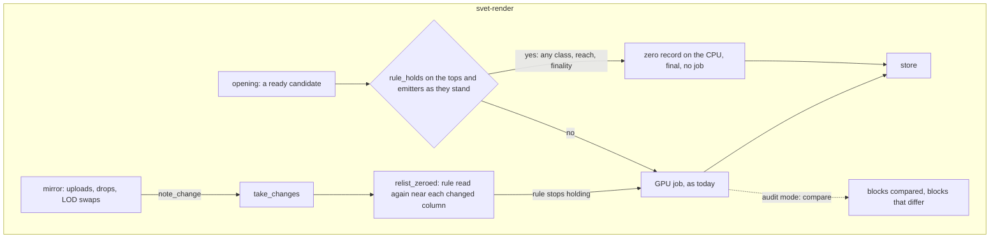

# 0101: The record by rule at every opening: an audit on the real scenes first, then the three exclusions lifted

> **Status:** in-progress, Phase 4 (the fix pass; (a) and (b) landed, (c) owed); the close review of 2026-11-26 found two cases where a
> ruled record is not the one a bake writes, both by reading the code, neither covered by a test
> or by the audit; section "The close review"); Phases 1 to 3 done 2026-11-26 on lane `plan-0101`; approved (owner, 2026-11-24: lane after Plan 0099 closes; drafted 2026-11-24 with no interview; the guesses
> and the open questions are under "Risks & open questions", each with a recommended option).
> **Order (recommended, question 1):** after Plan 0100's Phase 2 and **after Plan 0099 closes**,
> not ahead of its Phase 1 as Plan 0096's close ruled; the reasons are under "The order".
> **Created:** 2026-11-24
> **Milestone:** M10 (the outdoor scenes are where the queue is deep) and cross-cutting, like
> [Plan 0096](done/0096-the-bake-queues-drain-tiers-a-drain-slice-the-step-and-the-slow-adapters-light-pass.md),
> whose Phase 10b this is.
> **Related ADRs:** [ADR-0085](../adrs/0085-the-zero-record-is-ruled-on-the-mirror-as-it-stands-exact-by-the-re-list-not-by-the-columns-finality.md)
> (proposed with this plan; at acceptance it supersedes one sentence of rule 1 of
> [ADR-0080](../adrs/0080-the-live-queue-bakes-what-the-image-reads-a-record-by-rule-a-tier-by-size-on-screen-and-a-drain-slice.md)),
> [ADR-0084](../adrs/0084-the-key-lights-visibility-on-a-world-face-is-fixed-per-face-the-columns-horizon-where-lit-a-cover-source-where-shadowed.md)
> (the bake's key ray at its cap, Plan 0100 Phase 2: this plan's base),
> [ADR-0070](../adrs/0070-sky-light-is-baked-visibility-coloured-at-read-with-a-long-history-ray-where-stale.md)
> (the column clause), [ADR-0076](../adrs/0076-light-stability-rules-world-history-per-source-a-fade-per-transition-and-a-ratcheted-pop-counter.md)
> rule 3 (one fade a landing), ADR-0083 (Plan 0099, the bake thread).
> **Source:** `docs/backlog.md`, "The record by rule at every opening, and the bake's key ray
> at its cap"; Plan 0096's sections "Phase 10", "Phase 10 after its reading" and "The close";
> the readings in [`logs/0096.md`](logs/0096.md), "Phase 10a" and "Phase 10c".

## TL;DR

ADR-0080's rule 1 writes a zero record on the CPU for a chunk buried under the column map
with no emitter in reach, and no GPU job. As built it answers only a first bake with a full
reach under final columns: 266, 241, 3 and 6 chunks on Plan 0096's four runs, while the
chunks it describes take GPU jobs, some twice. This plan lifts the three exclusions, so the
rule is read at every opening on the mirror as it stands (ADR-0085). **The win is bounded
and no budget line changes its standing by it**: about 1.4 s of the RENOIR forest's 27.3 s
to the in-view landing, at most about 4 s of the RTX's 36.5. So the plan is small, runs
after the plan that takes the RTX's real bound (0099), and **proves the rule before it
switches anything**: Phase 1 changes no behaviour and compares, on the forest and the hills
on both adapters, every block a job bakes for a chunk the rule would have answered against
the rule's record; 0 may differ. The first thing anyone sees is that count on the
`bake queue:` line.

## Context & problem

Every figure is a reading from Plan 0096 unless marked arithmetic. "RTX" is the NVIDIA GeForce
RTX 3080 Laptop GPU at the Floor profile, 1920 x 1080; "RENOIR" the AMD Radeon Graphics (RADV
RENOIR), the slow adapter of `docs/nfr.md` section 1, at Portable, 1280 x 720 (FSR 2's
output from a march at 853 x 480).

**What the opening does today** (`crates/svet-render/src/bake/queue/open.rs`): a ready
candidate takes the rule only when `zero_rule && class == 0 && !partial && !provisional &&
rule_holds(..)`. `rule_holds` (`queue/rule.rs`) is `buried` (the chunk's box dilated by the
light radius lies under the lowest column top of every chunk column of the footprint, none
holding a cell with no opaque voxel) and no exposed emitter within the light radius. The
three exclusions:

- **provisional:** a column over the reach is not final (a chunk the streamer will hold is
  not mirrored yet). With `--column-wait off`, the default, the chunk bakes by a job, flagged
  provisional, and bakes again (the catch-up) once the columns are final.
- **partial:** the reach crosses the streamer's full radius (rule 4), so the job casts from
  the chunks resident.
- **class 1:** the chunk holds a block already (a catch-up, a refinement, a re-queue).

**What it costs** (Phase 10a, `--queue-rule-reading`, quiet runs, release `f0b55422`):

| run | zero records by the rule | jobs the rule would have answered: provisional / partial / class 1 | of the jobs opened before the in-view landing | of their samples |
|---|---|---|---|---|
| RTX forest | 266 | 719 / 2 974 / 346 | 1 112 of 9 724, **11.4 %** | 5.1 % |
| RTX hills | 241 | 1 144 / 3 046 / 408 | 958 of 4 781, 20.0 % | 8.9 % |
| RENOIR forest | 3 | 17 / 999 / 0 | 286 of 2 381, **12.0 %** | 5.1 % |
| RENOIR hills | 6 | 60 / 1 030 / 30 | 262 of 2 586, 10.1 % | 6.5 % |

**What it can buy, said plainly (arithmetic, not a reading).** The RENOIR is bound by the
GPU, so its gain is the sample share: 5.1 % of 27.3 s is about 1.4 s of the forest's in-view
landing. The RTX today is bound by the CPU a job opened costs on the render thread, so its
gain is at most the job share: 11.4 % of 36.5 s is 4.2 s, and less, since a ruled chunk still
pays its listing (the backlog's "under 4 s" is this figure rounded down; the sum is 4.2).
Once Plan 0099 has moved that CPU off the render thread the RTX's gain falls toward its own
sample share, 5 to 9 %. The lines of `docs/nfr.md` section 2 keep their standing either way:
the RTX's 10 s stays missed, the RENOIR's 30 s stays met. Over the whole residency the shares
are larger (RTX forest 4 039 of 12 221 jobs; RENOIR forest 1 016 of 4 396 jobs and 11.7 % of
the samples), on a line the RENOIR forest misses (not empty 220 s after the first world
frame against 180); 12 % does not close that either.

**What else it buys.** A buried chunk under a column not final stops baking twice (the
provisional job and its catch-up), which is one fade fewer per such chunk; and a ruled
record's bytes do not depend on what was resident when a partial job would have cast, so the
store is a little less a function of the camera's path.

**Why it was not built in Plan 0096.** Its audit could not be trusted while the bake's key
ray counted lit at its cap in air (Phase 10c: key 255 on 64 of 64 floor faces under a closed
roof where the rule writes 0). Plan 0100's Phase 2 fixes the key ray under ADR-0084 (owner,
2026-11-24). **This plan carries no key-ray work and no ADR for it, and starts from a tree
that holds that commit.**

**The fact exactness rests on, restated** (Plan 0096's ruling 2 of "Phase 10 after its
reading"; the dev's reading is in `logs/0096.md`, "Phase 10b's three facts"; re-read against
the tree at `193cae15` for this draft):

- **(i)** Not "a column's lowest top never falls when a chunk arrives": a full chunk arriving
  over its LOD version replaces a sheet made from level-1 mips (a 2-voxel cell counts as
  solid up to its top voxel, `gpu_world/columns.rs`) and can lower a top. What holds is that
  **every change of a top over the footprint is a mirror change the re-list reads**: a
  sheet changes only at a chunk's upload or drop, each calls `note_change`, the step takes
  the list (`take_changes`, `queue/step.rs`) and `relist_zeroed` reads the rule again on
  every zeroed chunk within the light radius of a changed column (Chebyshev, x and y; every
  one when the list overflowed). A window that moves drops the chunks that leave it through
  the same list.
- **(ii)** `emitters_near` reads the same emitters a job on that reach would sample (the full
  chunks' light lists; an LOD chunk's emitters are in neither).
- **(iii)** A chunk arriving in a ruled chunk's reach with an emitter is an upload, so a
  change the re-list reads, and its lights are registered in the same sync.

It serves the owner's rule "no waiting for light" (ADR-0076 rule 6) and `docs/nfr.md`
section 2's rows "The bake queue's drain and step". No consumer requirement names it.

## Decision

The opening reads the rule on every candidate it is ready to bake, on the column tops and the
emitters as the mirror holds them at that step, whatever the class, the reach or the columns'
finality; a ruled record is final (never flagged provisional or partial) and is undone only by
the re-list (ADR-0085). Before that is switched on, an audit mode with no behaviour change
proves on the real scenes that the rule's record is what the jobs write.

- We rejected **building the mechanism first and auditing after** (Phase 10b as written):
  today every chunk the wider rule would answer is baked by a job anyway, so the comparison
  is free before any behaviour changes, and a block that differs stops a case before it has
  ever darkened a cave.
- We rejected **folding it into Plan 0099**: that plan asserts the store's bytes equal across
  its modes and reads its base in its Phase 1; a rule change inside it would move the base it
  compares against.
- We rejected **dropping it** (ADR-0080's Outcome as the last word): the reading flag and the
  audit make it cheap to settle, and the RENOIR's whole-residency line is missed. It is
  question 1's option (c).

### The order

Plan 0096's close ruled this plan "ahead of Plan 0099's Phase 1, so that plan's base holds
it". Two things have changed since, and the recommendation changes with them:

1. **Its base is now a commit of another lane.** Plan 0100's Phase 2 lives on that plan's
   branch until Plan 0100 closes, which is behind an owner's window. Ahead of Plan 0099's
   Phase 1 would mean this plan stacks on `plan-0100` and Plan 0099 stacks on this one: the
   plan that takes the owner's complaint (about 30 fps while the queue drains, 36.5 s to
   land) would wait on another plan's window to merge.
2. **Plan 0099 changes what this plan is worth on the RTX**, from the job share to the
   sample share. The reading flag is in the tree; reading the shares again on Plan 0099's
   base costs four runs and is Phase 1 here.

So: **Plan 0100's Phase 2 first in its lane** (that plan lets Phases 1 to 3 run in any
order), **Plan 0099 starts without waiting for this plan**, and **this plan runs after Plan
0099 closes**, on a main that holds both. The cost of going later is that the mechanism is
written on Plan 0099's bake half; it is three small changes there (the opening's condition,
the listing's ruled branch, the catch-up), and the rule's reads must exist in that half
anyway, which is a note for Plan 0099 (under "Risks"). If the owner prefers it earlier, the
only other sound slot is **before Plan 0099's Phase 2** (the cut in two halves), stacked on
`plan-0100` at its Phase 2 commit; between Plan 0099's Phases 2 and 6 is the one place it
must not go.

## Architecture diagram



## Implementation phases

Each phase ships as its own commit. `dev` implements all phases in one session; the architect
reviews once at the end, in a fresh session. Every phase carries exactly one
`**Owner skill:**`. No phase is exploration: the store's bytes are asserted, no look is
picked, and there is no owner's window.

**The tree's names win.** Every path and identifier below is as of main `193cae15` (v0.72.0)
and names a mechanism. Plan 0099 cuts `bake/queue/` in two halves before this plan runs (by
the recommended order) and Plan 0087 renames the crates; where the tree differs, dev follows
the tree and notes it. One drift already: Plan 0096 Phase 10b names the buried rig in
`gpu_bake.rs`; it lives in `apps/flythrough/tests/gpu_bake_rule.rs`.

**The base:** a tree that holds Plan 0100's Phase 2 (the bake's key ray takes the column
clause). Dev confirms it before Phase 1 by running that phase's test
(`a_key_ray_that_ends_in_air_under_a_roof_is_not_lit`); without it the plan does not start.

**Rules that hold in every phase:**

- **No scene is simplified.** The readings are the forest and the hills as the owner runs
  them: `--source outdoor --spawn forest --trees forest --time 15:00` and `--source outdoor`
  at noon, from the first world frame; no tree count, radius, tier or sample count is lowered
  for a bar. The audit starts there, not on a rig.
- **Nothing is tuned to make the audit pass.** A block that differs stops its case: dev
  reports the chunk, the words (emitter, sky, key), the case, and that case is not built.
- **Every perf reading** is release, headless, under the exclusive perf lock, with the
  1-minute load logged (under 2 at the start to pin a figure; a loaded run is labelled
  indicative and pins nothing): RTX `--adapter RTX --profile floor` at 1920 x 1080, RENOIR
  `--adapter RENOIR --profile portable` at 1280 x 720, each at its profile's drain value;
  after Plan 0099 each reading names its mode, lockstep or thread.
- **Test cost:** per phase `node scripts/test-changed.mjs --profile quick`, the phase's GPU
  binaries with `--profile gpu --binaries` under the perf lock, clippy and fmt; `cargo
  nextest run --profile gate` once, at the tip. No soak or full tier.

### Phase 1: The audit and the re-read, no behaviour change
- **Owner skill:** dev
- **What:** A reading flag, `--queue-rule-audit` (it implies `--queue-rule-reading`): at an
  opening, every ready candidate on which the rule holds on the tops as they stand takes a
  job, the ones the rule answers today included (in this mode the rule writes no record);
  when such a job's block is placed, not stale, it is compared word for word with
  `zero_block` for the same faces, and the queue counts the blocks compared and the blocks
  that differ, split by the case at the opening (`full`: none of the exclusions;
  `provisional`; `partial`; `class 1`), keeping the first 16 that differ (chunk, case, the
  first differing word's index and both values). The tier field of the head word is
  compared as the tree defines a ruled record's tier; if a job's tier differs by rule 2 dev
  names the field in the log and excludes it, nothing else. The counts go on the
  `bake queue:` line and into `run.json`. Then the runs: the four of Phase 10a with the
  audit on, and the four again with only `--queue-rule-reading` (the shares on this base).
  The three facts above are read again against the tree, one line each in the log.
- **Files touched:** `crates/svet-render/src/bake/queue/{open,list,rule,step,stats,mod}.rs`
  (or their halves after Plan 0099), `crates/svet-render/src/bake/queue/tests.rs`,
  `apps/flythrough/src/run/queue.rs`, `apps/flythrough/src/report.rs`,
  `apps/flythrough/src/cli/queue_flags.rs`, `apps/flythrough/tests/queue_line.rs`,
  `docs/flythrough.md`, `docs/plans/logs/0101.md` (new).
- **Done when:**
  1. `the_audit_counts_a_block_that_differs_from_the_zero_record` (CPU, under 2 s): on the
     queue's CPU rig, a placed block equal to the zero record counts compared 1, differ 0
     under its case; the same block with one sky word changed counts differ 1 and is kept
     with its chunk, its case and that word's index; a block placed stale counts in neither.
  2. `queue_line`'s test reads `compared` and `differ` per case from the line's text and
     from `run.json` (CPU, under 1 s).
  3. **The audit on the real scenes:** the readings log holds, for the forest and the hills
     on the RTX and the RENOIR (from the first world frame to the empty queue; the RENOIR
     forest to its in-view landing plus 60 s, as Phase 10a ran it), the blocks compared by
     case and **0 blocks differ in every case on all four runs**, with at least one block
     compared in each of `provisional` and `partial` on every run (Phase 10a read 17 to
     1 144 and 999 to 3 046 jobs there). A case with a block that differs is not built in
     Phase 2 and the log says which and why; a case with nothing compared on a run is
     reported, not assumed.
  4. **The gate, fixed now (Phase 10a's, unchanged):** Phase 2 proceeds if, in the RTX's or
     the RENOIR's forest, the jobs the rule would have answered before the in-view landing
     are at least 10 % of the jobs, or their samples at least 10 % of the samples, opened
     before that landing. Under it on both, dev stops and reports: the table is the
     disclosure and the owner decides (question 2).
  5. With the flag off, `gpu_bake_rule`, `gpu_queue` and `gpu_bake` pass unchanged
     (lavapipe; no new GPU test in this phase). Binaries: `gpu_bake_rule gpu_queue gpu_bake`.

### Phase 2: The rule at every opening
- **Owner skill:** dev
- **What:** The opening's condition loses `class == 0 && !partial && !provisional` for every
  case Phase 1's audit cleared. **(1)** A candidate that holds a block (a catch-up, a
  re-queue, a refinement) and that the rule answers takes the zero record with no job and
  lands as that class lands today, one fade from the block it held. **(2)** A first opening
  under a column not final reads the rule on the tops as they stand; its record is final:
  not flagged provisional, no catch-up follows. **(3)** A candidate whose reach crosses the
  full radius reads the rule on the chunks resident; its record is not flagged partial and
  no arrival re-queues it but through the re-list. `relist_zeroed` is unchanged in rule; if
  Phase 3's reading shows its cost, it gains an index by column, behind the same answers.
  A dig's jobs, the key-only jobs and the held record of an edit are not listing jobs and
  are untouched. With the audit flag on, the rule is held back as in Phase 1. No setting is
  added (`zero_rule` off is still the arm with no rule), so there is no profile row.
- **Files touched:** `crates/svet-render/src/bake/queue/{open,list,rule,mod,stats}.rs` (or
  their halves), `crates/svet-render/src/bake/queue/tests.rs`,
  `apps/flythrough/tests/gpu_bake_rule.rs`, `docs/plans/logs/0101.md`.
- **Done when:**
  1. `a_catch_up_the_rule_answers_writes_the_zero_record_without_a_job` (CPU, under 2 s): a
     buried chunk baked provisional takes no second job when its columns turn final, its
     block is the zero record, and its fade runs once.
  2. `a_first_opening_under_a_column_not_final_is_ruled_for_good` (CPU, under 2 s): a buried
     chunk with a chunk of a footprint column still waiting to upload, above the tops it is
     under, takes the zero record with 0 jobs, is in neither the provisional nor the partial
     map, and takes no job when that chunk arrives.
  3. `a_ruled_chunk_is_relisted_when_the_rule_stops_holding` (CPU, under 2 s), four cases on
     a chunk ruled under a column not final or a partial reach, each re-listing it with a
     job in the step that reads the change and landing as one fade: a column carved from
     the surface into its reach box; a chunk with an emitter arriving within its reach; the
     chunk over it evicted so the lowest top falls to its box; **a full chunk arriving over
     its LOD version whose top falls to the box** (fact (i) as restated: the rig's LOD sheet
     tops the box by one voxel through a half-filled 2-voxel cell, and the full sheet does
     not).
  4. `gpu_bake_rule` (lavapipe), the buried rig of
     `a_buried_chunk_with_no_emitter_in_reach_gets_the_bakes_bytes_without_a_job` run twice
     more, once with a chunk over the cave still waiting to upload at the opening and once
     with the full radius shrunk so the cave's reach crosses it: the ruled records equal,
     byte for byte, a GPU bake of the same chunks in the whole world, 0 jobs were submitted
     for them, and they are neither provisional nor partial in the queue's maps. About 8 s
     each, a guess from the rig they extend; over the 10 s line they are born
     `#[ignore = "soak"]`, said in the log, and run by name here.
  5. `a_dig_to_the_sky_the_step_after_the_rule_was_read_relists_the_cave` and Plan 0096
     Phase 2's bars 2 and 3 (`queue/tests.rs`, `gpu_bake_rule`) pass unchanged; the still
     camera's store hash test (ADR-0080, "the plan's hash test pins the still case") passes,
     or its pinned value moves only by ruled chunks' words and the log names it.
  6. No golden moves: `gpu_golden` and `gpu_outdoor_golden` are unchanged.
  Binaries: `gpu_bake_rule gpu_bake gpu_bake_tiers gpu_queue gpu_queue_reach`.

### Phase 3: The readings on both adapters, the audit at the tip, and the documents
- **Owner skill:** dev
- **What:** The four runs again on the tip, quiet: once plain (the drain rows and the step)
  and once with `--queue-rule-audit` (the proof on the tree that ships). Two runs of the
  RTX forest from the same start for the bytes. The rows go beside the old in
  `docs/nfr.md` section 2 and `docs/nfr/02-frame-budget.md`; `docs/flythrough.md` gains the
  flag; the gate runs once.
- **Files touched:** `docs/nfr.md`, `docs/nfr/02-frame-budget.md`, `docs/flythrough.md`,
  `docs/plans/logs/0101.md`; `crates/svet-render/src/bake/queue/rule.rs` only if the re-list
  takes its index.
- **Done when:**
  1. **The audit at the tip:** on all four runs with `--queue-rule-audit`, 0 blocks differ
     in every case, with the counts compared in the log.
  2. **The rule answers what it describes:** on all four plain runs with
     `--queue-rule-reading`, the jobs counted as missed read **0 / 0 / 0** (provisional /
     partial / class 1), whole and before the in-view landing; the zero records and the
     jobs opened are stated beside Phase 10a's (266, 241, 3, 6 and 12 221, 12 952, 4 396,
     5 185).
  3. **The drain rows** (in view landed, the whole residency empty) are read on the four
     runs and stated beside the base Phase 1 read on the same tree without the mechanism
     (the audit-off, reading-on runs), with the difference and the load. They are
     readings: the lines of section 2 do not move, and a difference inside the run-to-run
     spread is written as "not separable".
  4. **The step does not pay for it, a stop not a bar:** the step's regime B p50 and p99 and
     the lap that holds the re-list are read on the RTX forest against Phase 1's base. If
     the p50 is over the base by more than 10 %, dev stops and reports the lap's split; the
     re-list then takes an index by column before the plan closes, and the rows are read
     again.
  5. **The bytes:** two runs of the RTX forest from the same start to the empty queue at a
     still camera write the same `--bake-file` hash, and every zeroed chunk's block is equal
     across the two.
  6. The gate at the tip: build, `cargo nextest run --profile gate`, doctests, clippy, fmt,
     `cargo deny check`, the doc gates.

### Phase 4: The fix pass: the verdict read where the record is written, the border faces, the bytes
- **Owner skill:** dev
- **What:** The close review's findings 1 to 3 (section "The close review"), in this order.
  Each of the first two starts with its test, written first and read **red on `111a85d7`**; a
  test that is green there refutes the finding: dev stops that item, says so in the log, and
  builds nothing for it.
  **(a) The verdict at the push.** A listing the pool hands back carries the `ruled` verdict
  its opening read (`Listing::ruled`, `lister.rs`), and `take_listed` writes the record on it
  in a later step. The rule is read again at the push, on the shadow of the step that writes
  the record; where it no longer holds the listing is dropped and the chunk stays a candidate
  (a later opening lists it by a job). Lockstep lists in the opening's own step and does not
  change.
  **(b) The border faces.** A listing reads a neighbour that the world's store does not hold
  as rock (`list_faces_by`, `faces.rs`), so a chunk ruled while one of its six neighbours is
  absent (not streamed in yet, or LOD-only past the full radius) holds no face across that
  border, for good: no catch-up and no partial re-queue lists it again as they did for the job
  it replaces. A ruled chunk remembers which of its six neighbours the shadow did not hold
  full when its record was written; when one of them is held full (a mirror change the step
  reads) the chunk is listed again through the re-list's own path (`reach`, class 1), where
  the rule answers it again with the faces of the world as it stands and no job. A chunk
  ruled with its six neighbours held is never listed again by this. If dev finds a cheaper
  mechanism with the same answers, it is named in the log and the tests decide.
  **(c) The bytes, done-when (5) of Phase 3 restated.** `--queue-rule-reading` writes, once
  the queue is empty (and at the run's end), the zeroed chunks' count and one hash of their
  blocks on the `bake queue:` line, and in `run.json` each zeroed chunk's coordinate and block
  hash (every word but the landing word, `LANDED_AT`). The whole store's hash is printed
  beside it as a reading: a job's record on a partial reach depends on what was resident when
  it cast (ADR-0080 rule 4), which is not this plan's to fix, so that hash is no bar.
- **Files touched:** `crates/svet-render/src/bake/queue/{lister,list,rule,step,mod,stats}.rs`,
  `crates/svet-render/src/bake/queue/split_tests/{rule,lister}.rs`,
  `apps/flythrough/src/report/queue.rs`, `apps/flythrough/src/run/queue.rs`,
  `apps/flythrough/tests/queue_line.rs`, `docs/flythrough.md`, `docs/nfr/02-frame-budget.md`,
  `docs/plans/logs/0101.md`.
- **Done when:**
  1. `a_ruled_verdict_is_read_again_where_its_record_is_written` (CPU, the pooled rig of
     `split_tests/lister.rs`, under 2 s): `C` is ruled at an opening and its listing is in the
     pool's hands; a message lowers a footprint column's top to its reach box before the
     listing is pushed; after the push `C` is not zeroed and holds no zero record, and it
     settles with one job's block. Red on `111a85d7`.
  2. `a_ruled_chunk_lists_its_border_faces_when_the_neighbour_arrives` (CPU, the rule's rig,
     under 2 s): `C` holds rock against a neighbour `N` that holds air there, `N` not in the
     world's store at `C`'s opening; `C` is ruled with 0 jobs. `N` arrives: `C`'s block
     becomes the zero record of its faces listed with `N` present (more faces than before,
     asserted), with 0 jobs, still zeroed, the four flags clear. A second chunk ruled with its
     six neighbours held is not listed again when a chunk outside them arrives. Red on
     `111a85d7`.
  3. Phase 2's three CPU tests, `gpu_bake_rule`, `gpu_queue`, `gpu_bake` and the two soak
     rigs by name pass unchanged (lavapipe). Binaries: `gpu_bake_rule gpu_queue gpu_bake`.
  4. **The bytes on the real scene:** the RTX forest from the same start at a still camera to
     the empty queue, twice in lockstep and twice with `--bake-thread on`: within each pair,
     every chunk zeroed in both runs has the same block hash. The zeroed sets' sizes and their
     difference, and the whole store's hashes, are stated as readings. A block that differs
     stops the plan with the chunk and the first differing word.
  5. **The thread, read at the tip:** one RTX forest run with `--queue-rule-audit
     --bake-thread on` reads 0 blocks that differ in every case; one plain run with
     `--bake-thread on` states the zero records, the re-listed count and the drain rows as
     readings beside the lockstep rows (loaded or quiet, labelled).
  6. **The step does not pay for it** (Phase 3 (4)'s stop, again): RTX forest regime B p50
     within 10 % of Phase 1's base (14.347 ms), with the count of chunks listed again by (b).
  7. Quick tier, clippy, fmt, the doc gates. The gate tier is the re-review's.

## Data shapes

No record, buffer or shader changes. The queue's statistics gain the audit's counts.

```rust
// illustrative
pub struct RuleAudit {
    /// Blocks compared with the zero record, by the case at the opening:
    /// full, provisional, partial, class 1.
    pub compared: [u64; 4],
    pub differ: [u64; 4],
    /// The first 16 that differ: chunk, case, word index, the job's word, the rule's word.
    pub first: Vec<([i32; 3], u8, u32, u32, u32)>,
}
```

## Budgets

`docs/nfr.md` section 2, "The bake queue's drain and step". Every expectation here is
arithmetic from Phase 10a's shares, not a reading; the close measures on the RTX 3080 Laptop
(Floor, 1920 x 1080) and the RADV RENOIR (Portable, 1280 x 720), headless, release, quiet,
with the commit.

| figure | today (Plan 0096, pinned) | expected | how the close measures it |
|---|---|---|---|
| In view landed: RTX at most 10 s, RENOIR at most 30 s | RTX forest 36.5 s, hills 12.2; RENOIR forest 27.1, hills 16.7 | RENOIR forest about 1.4 s less; RTX at most 4.2 s less before Plan 0099, its sample share (5 to 9 %) after. **No line changes standing** | Phase 3 (3), `drain_s` and the in-view count at 0 |
| The whole residency empty: RTX at most 60 s, RENOIR at most 180 s | RTX forest 49.1 s; RENOIR forest not empty at 220 s | up to the whole-run shares (RENOIR forest 11.7 % of the samples); a guess | Phase 3 (3), to depth 0 |
| The queue's step, regime B | as Plan 0099 leaves it | **no rise**: the rule is read on more candidates and the re-list walks a zeroed set about fifteen times larger | Phase 3 (4), a stop at 10 % |
| Section 6, determinism: the record bytes | the still case pinned by the hash test | unchanged where a job wrote zero; a ruled record no longer depends on what was resident | Phase 3 (5), Phase 2 (5) |
| Section 7, the gate | per Plan 0099's close | about 8 s of CPU tests; two lavapipe rigs of about 8 s each, soak-born if over the line; a guess | the tip's gate wall, `test-times.mjs` |

Memory: the zeroed set grows from hundreds to a few thousand chunk coordinates (12 bytes
each and the set's overhead); no VRAM change.

## Risks & open questions

- **A dark cave.** The rule's reach grows about fifteen times; a ruled chunk that should
  have light is black until something re-lists it. That is why the audit comes first, on the
  real scenes, why a differing block stops its case, and why Phase 2's test (3) names all
  four ways the rule can stop holding.
- **The audit cannot see what the scenes do not hold.** Whether the forest and the hills
  hold a closed cave taller than the job's radius, or an emitter underground, is not read;
  Plan 0100 Phase 2's rig and Phase 2's tests (3) and (4) here carry those shapes, so they
  may rest on tests alone.
- **The re-list's cost.** `relisted` walks every zeroed chunk against every changed column
  each step, and reads the rule (81 column lookups at light radius 4, memoised per step) on
  each one near a change; while the world streams in, most are near one. At a few thousand
  zeroed chunks that may be milliseconds on the thread the step runs on. Phase 3 (4) reads
  it and stops; the fix in hand is an index by column.
- **Under Plan 0099's thread** the rule reads the bake half's view of the mirror, one
  message behind the render thread. A change between the message and the write is read by
  the next message's re-list, as a job's stale result is today. The audit and the bytes are
  read in the thread mode as well as lockstep. **A note for Plan 0099's owed re-read:** its
  Phase 2 says the bake half holds no reference to the mirror, but the rule as built already
  reads `GpuWorld::column_lowest` and `GpuWorld::emitters_near` at the opening and in the
  re-list; the shadow it keeps must answer both, or the message must carry them. That plan's
  text does not name either.
- **A changes list that overflowed** re-reads every zeroed chunk in one step (the rule's own
  fallback). Correct, and a spike; counted in Phase 3 (4)'s lap.
- **Determinism.** Nothing here runs on the server side or in `svet-world`. The zero record
  is written on the CPU from the listing, so it is the same bytes on every adapter by
  construction. The order chunks are ruled in follows the opening's order, which is the
  queue's as today.
- **Threading and memory:** no new thread; the audit's compare allocates only in audit mode.
- **GPU features:** none.

**Answered 2026-11-24 (owner): the recommended option on all three.** The plan is worth a
plan and its lane starts after Plan 0099 closes (and after Plan 0100 Phase 2); a gate that
stays shut in Phase 1 closes the plan as a reading; cleared cases are built and the others
disclosed.

**Questions for the owner** (the first option is the recommendation; the plan goes by it
once he says go).

1. **Is the bounded win worth a plan, and when.** (a) Yes, as this small plan, **after Plan
   0099 closes** and after Plan 0100's Phase 2: nothing sits in front of the plan that takes
   the frame rate while draining, and Phase 1 reads the shares on that base before anything
   is built (recommended; reverses "ahead of Plan 0099's Phase 1" from Plan 0096's close).
   (b) Now: stacked on `plan-0100` at its Phase 2 commit and ahead of Plan 0099's Phase 2,
   so that plan's cut holds the rule; Plan 0099 then merges behind Plan 0100's window or
   re-reads its base. (c) Not at all: ADR-0080's Outcome stands as the disclosure, ADR-0085
   is withdrawn and the backlog entry is closed.
2. **If Phase 1's gate stays shut on the new base** (under 10 % of the jobs and of the
   samples on both forests). (a) The plan stops there with the table as the disclosure and
   closes as a reading (recommended). (b) Build it regardless, for the double bakes it
   removes.
3. **If the audit clears some cases and not others.** (a) Build the cleared ones, disclose
   the other with its chunk and words, and route its cause to the backlog (recommended; it
   is Plan 0096's "a false fact drops its case and the others go on"). (b) All or nothing.

## What this plan does NOT do

- **The bake's key ray at its cap:** Plan 0100's Phase 2, under ADR-0084. This plan starts
  from it.
- **The bake step off the main thread, the per-job CPU, the frame rate while draining:**
  Plan 0099.
- **The no-face half of rule 1** (on the stream workers since Plan 0096 Phase 2): unchanged.
- **The tiers, the reach rule, the drain slice, the order's score** (ADR-0080 rules 2 to 4,
  ADR-0048): unchanged. A partial job on a chunk the rule does not answer bakes as today.
- **A rule for a buried chunk with an emitter in reach**, or a per-brick skip inside the
  job's shader (ADR-0080's Alternative C): not here.
- **A dig's ring and the held record** (Plan 0098): their jobs are not listing jobs.
- **Any scene, model or material change.**
- **Windows readings** (owner, 2026-11-15: once in a while, not per plan).

## The close review (2026-11-26, architect): not closed, Phase 4 is owed

Reviewed cold at `111a85d7` (main `69d5ce97` in it). The three phases did what they say, the
tests assert what the done-whens claim, and the nfr rows claim no more than one lockstep run a
scene supports. Two findings need code. **Both come from reading the code, not from a failing
run**, which is why each item of Phase 4 starts with a test that must be red first.

1. **major: a ruled verdict is written on a shadow it was not read on (the bake thread
   only).** The opening reads the rule (`open.rs`, `note_checked`); with the listing pool
   (`lists_off_the_loop`, the bake thread's sliced steps, so the owner's window) the verdict
   rides in `Listing::ruled` and `take_listed` (`lister.rs`) writes the record and adds the
   chunk to `zeroed` one or more steps later, without reading the rule again. A step's order
   is `shadow.take`, `relist_zeroed`, then `take_listed` (`step.rs`): a mirror change that
   arrives between the send and the push is re-listed against a zeroed set that does not hold
   the chunk yet. If no later change lands within the light radius of its column, the chunk
   keeps a zero record the rule no longer answers: ADR-0085's dark cave. The path is Plan
   0099's and held for ADR-0080's narrow rule too; this plan widens it from a dig in the gap
   to every upload and LOD swap while the world streams in. Lockstep lists in the opening's
   step, so no reading or test of Phases 1 to 3 crosses it, and the audit holds the rule back.
2. **major: a ruled record lacks the faces across a neighbour absent at its listing, for
   good.** `list_faces_by` reads an absent neighbour as rock. `bakeable` asks nothing of the
   six neighbours: a chunk whose reach crosses the full radius is ready as soon as nothing in
   its reach is pending in the mirror, with neighbours the streamer has not brought yet or
   holds LOD-only. Before this plan such a chunk baked by a job flagged provisional or
   partial and the catch-up or the re-queue listed it again; a ruled record is final, and the
   re-list reads column tops and emitters, not neighbours. So the record is not the one a
   bake of the whole world writes, its bytes depend on the order the stream brought the
   chunks in, and a border face reads through the no-record chain (the chunk's summary, the
   column, a ray) in place of a record. Read from the shaders that chain answers dark where
   the rule holds, so the image may be the same; that is not measured. The audit compares a
   job's block with the zero record **of the job's own faces**, so it cannot see this. The
   `faceless` set has the same dependence and predates this plan (backlog at the close).
3. **major: done-when (5) of Phase 3 is unmet and cannot be restated on the evidence in
   hand.** `a_tiers_record_bytes_are_the_same_on_every_run` is a bounded lavapipe rig with
   every chunk resident: it defends a job's bytes there, not a ruled record's on a streamed
   scene. "Written on the CPU from the listing" holds for the words, and finding 2 is the
   listing's input it leaves out. Phase 4 (c) restates the bar on the ruled records alone.

Rulings on what the lane left open:

- **The ruled record's tier 0** (the field the audit masked on every block): sound. The
  listing gives it `job_count` `u32::MAX` and `job_coarse` false, so its `block_count` is
  never `below` a band's count and it is not coarse: no refinement lists it, `landed` counts
  it, and a retier withdraws only pending jobs, which it never is. Over a coarse block it
  ends the refinement that block was due, once. The re-list sends it through `reach` to a
  job at its band's count, whose landing replaces the count. The tier bits are read only by
  `record_tier` (the audit, `gpu_bake_tiers`); the image's reads mask them.
- **Phase 2 done-when (3)** stands as built and is restated: the re-list is asserted in the
  step that reads the change (out of `zeroed`, due in `reach` or in a job), the job by the
  queue's order, one job and one fade at the settle. A re-listed chunk is a ring 3
  candidate like any other; the done-when's "with a job in the step" asked for more than the
  queue promises any candidate.
- **The two soak-born rigs:** the gate keeps the claim through the three CPU tests (each red
  with the old condition, read by hand in Phase 2) and the gate's
  `a_buried_chunk_with_no_emitter_in_reach_gets_the_bakes_bytes_without_a_job`, which holds
  `zero_block` against a GPU bake. A gate-sized form of the two rigs goes to the backlog at
  the close.
- **The readings** are lockstep, one run a scene, the RTX rows "not separable": the nfr text
  says so and no line moves. Phase 4 (5) adds the thread's.

The gate on `111a85d7`, the lane's one gate run, is in the readings log ("The close review").
For the close after Phase 4: the backlog entries (a gate-sized rule rig; the `faceless` set's
neighbours; a re-listed chunk's place in the order), ADR-0085's acceptance with its Outcome,
v0.78.0.

## Implementation log

> Written by `dev`: one row per phase as its commit lands, then the close block. **The phases
> above are the contract. This section records what happened.** Observations, never conclusions:
> no pass list, no self-assessment. Deviations and unmet done-whens are **always** disclosed.
> Keep it shorter than `## Implementation phases`. Readings, gate counts, attempts, sweeps and
> resume notes go to the plan's readings log, `docs/plans/logs/0101.md`, and this section links
> it once it exists.

| phase | owner | state | commit |
|---|---|---|---|
| 1: The audit and the re-read, no behaviour change | dev | done: 0 blocks differ in every case on all runs, both forests over the 10 % job line ([readings log](logs/0101.md)) | wip `67062697`; the readings `30e771b9` |
| 2: The rule at every opening | dev | done: the rule on every ready candidate; CPU tests (1)-(3), two soak-born lavapipe rigs (4) ([readings log](logs/0101.md)) | `85bf694d` |
| 3: The readings on both adapters, the audit at the tip, and the documents | dev | done but (5): audit 0 differ on four runs, the step under the base, gate 1 443 of 1 443; the bytes not read ([readings log](logs/0101.md)) | `5312afb7` |
| 4: The fix pass | dev | in progress: (a) the verdict read at the push, (b) the border faces, each red then green; (c) owed ([readings log](logs/0101.md)) | (a) `1c85d787`; (b) committed with this row |

### Notes

_(Deviations from the plan, with the commit, stated without justification. Done-whens not
satisfiable as stated, and what was done instead. Followups noticed and not acted on. One line
each. Empty is fine.)_

- Phase 1 (`67062697`): files outside `Files touched`: the drain text and json are in
  `apps/flythrough/src/report/queue.rs` (no `report.rs`); the flag is wired in
  `apps/flythrough/src/run/loading.rs` and `cli/{mod,parse}.rs`; the pooled listing half is
  `bake/queue/lister.rs`; `svet-render/src/lib.rs` re-exports `RuleAudit`, `AuditDiffer`.
- Phase 1 (`67062697`): the CPU test sits in `bake/queue/split_tests.rs` (the rig with a
  device-free render half), not `queue/tests.rs`; the rig's mirror gained `lowest` and `lr`.
- Phase 1: the rule reads `Shadow` (the bake half's copy), not `GpuWorld`, since Plan 0099; the
  three facts were re-read against it.
- Phase 1: the tier bits (`TIER_SHIFT`, bits 18-19 of each cell record's `VIS_WORD + 1`) are
  masked where the job's tier is not 0; every compared block on every run counted as masked.
- Phase 1: the first RTX forest and RENOIR forest audit runs compared 0 under `provisional`
  (a cold pipeline build of 45.8 s and 4.2 s; the stream was final before the first opening);
  done-when (3) is read from their re-runs, `audit-*-forest-2`, with the first runs kept in the
  log.
- Phase 1: `class 1` compared 0 on the RENOIR forest (both audit runs); the done-when asks for
  `provisional` and `partial` only.
- Phase 1: the RENOIR forest runs end at frame 5 940 before the queue is empty (in-view landing
  at 17.2 to 17.3 s after the first world frame, then about 100 s more).
- Phase 1: the first sitting's runs used a 16G scope and a load1 < 1.8 wait outside the lock
  (two lanes at their start); RTX hills audit and RENOIR forest reading are labelled loaded.
- Main moved to `9b1cd85d` (v0.77.0; Plan 0104 removed `key_at`, `key_horizon`, `key_cover`
  record); not merged into this lane; Phase 1 uses none of them.
- Phase 2: main `5d488cc0` merged into the lane before the phase (`d0fa22c4`, no conflict).
- Phase 2: `gpu_outdoor_golden`'s soak test `the_cave_mouth_is_lit_from_outside` fails on the
  lane with and without the phase's change, the same 99.9531 % of pixels (golden last blessed at
  `a5e5f99b`); not acted on.
- Phase 2: the CPU tests sit in `bake/queue/split_tests/rule.rs` (the bake half's rig), not
  `queue/tests.rs`; `split_tests.rs`'s model mirror and rig widened for them (outside `Files
  touched`). `catch_up` (`mod.rs`) and `requeue_partial` (`reach.rs`) unchanged: they read maps a
  ruled record leaves empty. No change in `rule.rs` or `stats.rs`.
- Phase 2: the CPU rig's column tops are the model mirror's (`Mirror::tops`), not sheets built
  from voxels; done-when (3)'s LOD case sets the LOD top one voxel over the box and the full top
  at it.
- Phase 2: done-when (3)'s "with a job in the step that reads the change" is asserted as the
  re-list in that step (`zero_relisted` 1, not zeroed, due or in a job) and the job by the
  settle; in the emitter case the job opened later (class 0 arrivals ahead of it).
- Phase 2: done-when (4)'s waiting rig also runs the partial reach mode at a full radius of 6
  (a streamed view's reach crosses the window's floor, so a near chunk's reach is never whole);
  its column is not final as well. Both streamed rigs never empty (edge chunks wait), so they
  step 120 steps on instead of a settle. Both are born `#[ignore = "soak"]`.
- Phase 2: `note_rule_missed` is called only under the audit: off it, the reading's missed jobs
  are 0 by construction.
- Phase 3: done-when (5) not met as stated: `--bake-file` is refused since Plan 0059 and no
  fly-through line hashes the store; the two RTX forest runs for the bytes were not taken, nothing
  substituted.
- Phase 3: done-when (2)'s 0 / 0 / 0 is the construction of Phase 2's note above, not a count.
- Phase 3: one run a scene (the RENOIR forest twice: the first had a cold pipeline build of 4.1 s
  and no provisional jobs); the spread for "not separable" is the audit runs of Phases 1 and 3.
- Phase 3: the readings are lockstep (headless default), like Phase 1's base; none in thread mode.
- Phase 3: `docs/flythrough.md` unchanged (the flags' rows landed in Phase 1); `rule.rs`
  unchanged (no index by column).
- Phase 3: the gate's first CPU try failed `the_first_flush_of_the_streamed_window_is_cheap`'s
  1000 ms wall-clock bar (1452.8 ms) at load1 49.4; passed on the re-run at 0.48.
- Phase 4 (a), review finding 1: the test read red on `2ad483fa` (`111a85d7` plus the review's
  docs), not on `111a85d7`; its rig is `split_tests/rule.rs`'s `rule_rig` with the pool started,
  not `lister.rs`'s lone-voxel rig; the rule rig's helpers made `pub(super)`; `step.rs` touched
  (passes the shadow to `take_listed`).
- Phase 4 (a): red in debug on `sync_pool`'s whole-reading check (`queue/mod.rs:803`), not on
  the test's assertion; red on the assertion in release. A pooled ruled push trips that check
  in debug whether or not the rule still holds (readings log); not acted on.
- Phase 4 (b), review finding 2: red on `1c85d787`'s code; the test's second ruled chunk `D`
  is a slab added to `partial_rig`'s world, and `N` is taken out of the world's store and the
  mirror; `QueueStats::zero_border_relisted` added (its assert written after the red read);
  `list.rs`'s `neighbour` made `pub(super)`.

### Close triggers

_(Facts for the architect. No recommendations, and no suggested version bump.)_

- **What shipped:** feature (the record by rule at every opening; the audit and its reading)
- **Public API changed:** `svet_render::{RuleAudit, AuditDiffer}`, `QueueStats::rule_audit`,
  `BakeQueue::rule_audit`; fly-through `--queue-rule-audit`; the `bake queue:` line's `rule
  audit` clause and `run.json`'s `queue.rule_audit`
- **Budget readings:** `docs/nfr.md` section 2 (paragraph "The rule at every opening") and
  `docs/nfr/02-frame-budget.md`: release `85bf694d`, lockstep, RTX 3080 Laptop Floor 1920 x
  1080 and RADV RENOIR Portable 1280 x 720, quiet at the start; in view RTX forest 13.5 s, hills
  11.0, RENOIR forest 14.1, hills 10.2; residency 39.5, 29.1, not empty by frame 5 940, 111.4 s;
  step B RTX forest p50 / p99 13.008 / 33.734 ms (base 14.347 / 28.525); the lines keep their
  standing. Section 6 (bytes across two runs): not read
- **Gate at the tip `85bf694d`:** build exit 0; nextest gate tier in four parts 1 443 run, 1 443
  passed (CPU 1 107, A 108, B 100, C 128; a first CPU try at load1 49.4 failed one wall-clock
  test, passed on re-run); sole 1 of 1; doctests 10 passed; clippy, fmt, deny, doc and tier
  scripts exit 0
- **Outstanding `human` phases:** none are planned

## Followups

- At the close, `docs/adrs/README.md`'s row for ADR-0080 gains "rule 1's finality sentence
  superseded by ADR-0085" (the architect's ceremony).
