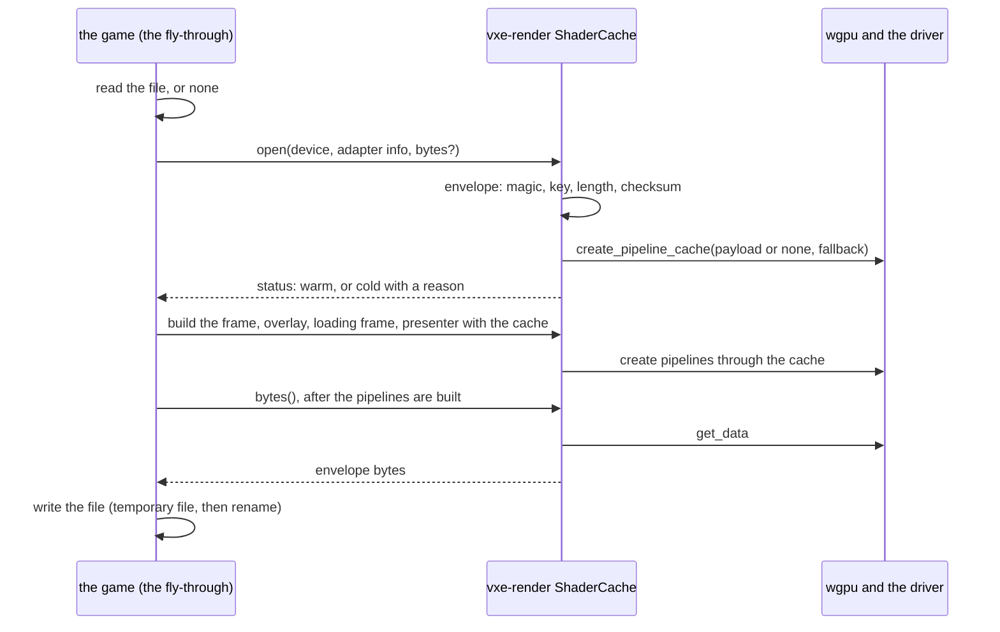

# 0103: A pipeline cache for the renderer: bytes the consumer keeps

> **Status:** draft, parked (owner, 2026-11-24): not approved. A reading taken the same day
> ([logs/0103.md](logs/0103.md)) shows the driver's own disk cache already makes a second start
> warm on both adapters (pipeline creation 0.36 to 0.54 s against 35.5 to 36.7 s cold on the
> RTX and 11.7 to 12.4 s on the Radeon); the plan pays only where the driver's cache fails (a
> forced 1 MB NVIDIA limit left the second start two thirds cold). Pick up if a consumer or a
> tester reports cold second starts. Drafted 2026-11-24 with no interview; the guesses
> and the open questions are under "Risks & open questions", each with a recommended option.
> **Order:** it edits `crates/vxe-render/src/gpu_util.rs`, the constructors of the frame, the
> overlay, the loading frame and the presenter, and the fly-through's start-up
> (`apps/flythrough/src/run/`). It does not run beside Plan 0092 (hot reload, the same
> pipeline builders) or Plan 0102 (`frame/pipelines.rs`); after either is fine. Plans 0099 and
> 0100 do not touch these files.
> **Created:** 2026-11-24
> **Milestone:** cross-cutting: start-up, `docs/nfr.md` section 7 (M7's tooling in
> [`docs/roadmap.md`](../roadmap.md) is the nearest home)
> **Related ADRs:** [ADR-0087](../adrs/0087-the-renderers-pipeline-cache-is-the-drivers-through-wgpu-as-bytes-the-consumer-keeps.md)
> (proposed with this plan),
> [ADR-0055](../adrs/0055-render-settings-are-one-struct-with-an-apply-class-per-field-and-profiles-are-named-values.md)
> (the engine stays file-free),
> [ADR-0059](../adrs/0059-loading-runs-as-time-sliced-steps-on-the-apps-frame-loop-behind-an-engine-loading-frame.md)
> (the pipelines' worker)

## TL;DR

The renderer gets a pipeline cache a game can keep between runs. The engine wraps the driver's
cache (`wgpu::PipelineCache`) in a small envelope of its own and hands it over as bytes: the
consumer passes bytes in when it creates the cache and takes bytes out when the pipelines are
built. The engine opens no file and picks no directory. A cache that is missing, stale,
truncated or refused is a cold start with a stated reason, never a panic. The fly-through is
the first consumer: it keeps the file in the user's cache directory. The first thing the owner
sees is the second start of the fly-through on an emptied driver cache building its pipelines
in well under a second where the first took tens of seconds, and a `start-up:` line that says
`pipeline cache: warm`.

## Context & problem

A cold start compiles every pipeline in the driver. On the RTX 3080 Laptop with an emptied
driver cache, building a frame and its entity pipelines read 29.4 s cold and 0.24 s through a
`wgpu::PipelineCache` (Plan 0094 Phase 2a, `gpu_frame`'s `the_pipeline_cache_pays`, 2.0 MB of
data); its windows read the light stage 16.5 to 18.1 s cold against 0.1 s warm, and a 70 s
cold start with the default-off arms in the loading stage (the owner: "start is slow, 70
sec"). The driver's own disk cache usually hides this, until it does not: on 2026-11-16 the
NVIDIA cache was over its size limit, kept nothing new, and every start recompiled.

**How pipelines are created today (the tree at `193cae15`).** Every compute pipeline of
`vxe-render` goes through `gpu_util::compute_pipeline_with`; three render pipelines are
created in `hud.rs`, `loading.rs` and `present.rs` with `cache: None`. A cache exists only as
a test hook: `vxe_render::debug::set_pipeline_cache` sets one process-wide slot that
`compute_pipeline_with` reads, "one device at a time, as a test process holds it", and the
test support opens it per hardware adapter from a file under `target/vxe-pipeline-cache/`.
The fly-through sets none and does not ask the device for the feature
(`run::device_request_for` asks for timestamp queries only). Its default pipelines are built
on the loading screen's worker (ADR-0059's Outcome), the arms' with them (Plan 0094 Phase 7a).

**What wgpu gives, read in the pinned crates (`wgpu`, `wgpu-core`, `wgpu-hal` `=30.0.1`, under
`~/.cargo/registry`):**

- `Features::PIPELINE_CACHE` is documented as supported on Vulkan and unimplemented on DX12
  and Metal (`wgpu-types`, `features.rs`). The DX12 backend's `create_pipeline_cache` returns
  an empty object; `wgpu::util::pipeline_cache_key` returns a key for Vulkan only.
- `Device::create_pipeline_cache` is `unsafe` and takes `data` and `fallback`; with
  `fallback: true` data that fails validation gives an empty cache.
- `wgpu-core` puts a header before the driver's data and checks it on load: a magic, the
  header version, the pointer width, the backend, an adapter key (vendor and device on
  Vulkan), a validation key from the backend, and the data's length. It does **not** checksum
  the payload; its source says protecting the file is the application's job.
- **Unverified here:** what the Vulkan validation key is made of (presumably the driver's
  pipeline-cache UUID); whether one cache may be used from the worker and the main thread at
  once (the test hook already clones it across threads); what `get_data` costs; whether a
  cache the application supplies still pays when NVIDIA's own disk cache is over its limit
  (the case that raised this; the reading above emptied the driver's cache, which is the
  nearest thing read); the gain on RADV and on a Windows Vulkan driver. Phase 1 and Phase 4
  read the ones a reading can settle.

**The lavapipe gate is not served.** The same reading gave lavapipe 5.85 s cold and 5.68 s
warm with 84 B of data: no compiled code is kept. This plan does not shorten the gate.

It serves `docs/nfr.md` section 7: "Time to first frame in `apps/flythrough` under 3 s"
(a proposal) and "Pipeline creation ... No budget; part of time to first frame".

## Decision

`vxe-render` gains one type, `ShaderCache`, made per device from optional bytes and handed
explicitly to each object that builds pipelines. It wraps the driver's cache through wgpu
inside an engine envelope (a magic, a key over the renderer's composed shader sources and the
crate version, the payload's length and a checksum). `ShaderCache::bytes()` returns the
envelope for the consumer to store wherever it likes. ADR-0087 records it.

We rejected **the engine writing a file** in a directory it picks or is given: the engine is a
library that owns no app directory and stays file-free (ADR-0055); bytes are the smaller
contract. We rejected **an engine-side cache of translated shader modules** (naga's SPIR-V
kept, or shaders precompiled at build time): the 0.24 s warm figure already contains all of
naga's work, so translation is at most that; the tens of seconds are the driver's. We rejected
**promoting today's process-wide slot** to the API: it is hidden state, one device at a time,
and a cache used on another device is a validation error. We rejected **doing nothing** (the
driver's disk cache) because it is the thing that failed.

## Architecture diagram



## Implementation phases

Each phase ships as its own commit. Every phase carries exactly one `**Owner skill:**`. No
phase needs a window: nothing on screen changes.

### Phase 1: `ShaderCache`, its envelope, and the reading through the public type
- **Owner skill:** dev
- **What:** The type, the envelope and its failure reasons in `vxe-render`, the frame taking
  it, and the hardware reading taken through it, so the figure the plan rests on is read on
  the API a game will use.
- **Files touched:** `crates/vxe-render/src/shader_cache.rs` (new), `lib.rs`, `gpu_util.rs`,
  `frame/mod.rs` and the builders it calls (`frame/pipelines.rs`, `frame/marcher.rs`,
  `frame/sky.rs`, `frame/upscale.rs`, `bake/pipeline.rs`, `exposure.rs`, `field.rs`,
  `fsr2/pipelines.rs`), `crates/vxe-render/tests/gpu_cache.rs` (new),
  `crates/vxe-render/tests/gpu_frame.rs` (the reading), `docs/plans/logs/0103.md`.
- **Done when:**
  - **The envelope, CPU tests in `shader_cache.rs`, each under 1 s:** a round trip of a
    payload gives the payload back; bytes that are empty, shorter than the header, with a
    wrong magic, with one flipped payload byte (checksum), with a length that disagrees, or
    with another key each give `Cold` with the matching reason and no panic; the key changes
    when one byte of one composed shader source changes and when the crate version changes,
    and is the same across two runs of the test binary (the hash is written out in the crate,
    FNV-1a 64, not `DefaultHasher`, whose output the standard library does not promise).
  - **The wgpu path on lavapipe, `gpu_cache` (a new binary, about 2 s: one trivial compute
    pipeline, no `Frame`):** with the feature on the device, `open(None)` is `Cold(NoBytes)`;
    a pipeline built through it and `bytes()` taken, then `open` of those bytes on a second
    device of the same adapter is `Warm`; an envelope that is valid but wraps bytes that are
    not a wgpu cache is `Cold(Refused)`; on a device without the feature every `open` is
    `Cold(Unsupported)` and `bytes()` is `None`. In each cold case the pipeline is then built
    and its dispatch gives the same output bytes as with a warm cache.
  - `Frame` has a constructor that takes `&ShaderCache`, and every pipeline the frame builds
    then or later (`prepare_entities`, `prepare_light_arms`, `prepare_bake`, a settings
    change that builds an arm) is created through it. `Frame::new` and `Frame::with_sizes`
    keep their signatures and behave as today (the test hook's slot still serves them).
  - **The reading** (`gpu_frame`, `reading::the_shader_cache_pays`, run by hand under the
    perf lock, release, `#[ignore]` as a reading; it replaces `the_pipeline_cache_pays`): on
    the RTX 3080 Laptop and the RADV RENOIR, a frame at 853 x 480 to 1280 x 720 plus
    `prepare_entities` and `prepare_light_arms`, the driver's own cache emptied or off for
    each run (`__GL_SHADER_DISK_CACHE_PATH` at an empty directory; `MESA_SHADER_CACHE_DISABLE
    =true`): cold ms, warm ms through `bytes()` and `open`, the bytes' size, and `bytes()`'s
    own time. **Bar on the RTX: warm at most 0.1 of cold** (Plan 0094 read 0.008: 236 ms of
    29 436). The RENOIR's figures are a reading, with no bar until it exists.
    **Stop rule:** if the RTX's warm figure is over 0.5 of cold through the public type, the
    plan stops here and the reading goes to the owner.

### Phase 2: The other pipelines, and nothing in the frame path
- **Owner skill:** dev
- **What:** The three render pipelines and their objects take the cache, and the cache is
  provably outside the frame.
- **Files touched:** `crates/vxe-render/src/hud.rs`, `loading.rs`, `present.rs`, `lib.rs`,
  `crates/vxe-render/tests/gpu_cache.rs`, `crates/vxe-render/src/settings.rs` (the setter
  gate's list, if a new `pub fn set_*` appears; none is planned).
- **Done when:**
  - The overlay, the loading frame and the presenter each have a constructor taking
    `&ShaderCache`, and `rg 'cache: None' crates/vxe-render/src` finds nothing.
  - `gpu_cache`: after the three objects and one trivial compute pipeline are built through
    one cache on lavapipe, `bytes()` is `Some` and opens `Warm` on a second device. About 4 s.
  - `ShaderCache::bytes` is called by nothing under `crates/vxe-render/src/frame/` and its doc
    says it is a driver call for the end of loading, not for a frame. A CPU test greps the
    crate's sources for a call inside `frame/` and fails on one (derived from the source, not
    a pinned list).
  - No image changes: `gpu_golden`'s binary passes with no re-bless.

### Phase 3: The fly-through keeps the file
- **Owner skill:** dev
- **What:** The first consumer: the feature asked of the device, the file read before the
  pipelines' worker starts and written after it ends, a flag, and the status on the
  `start-up:` lines and in `run.json`.
- **Files touched:** `apps/flythrough/src/run/mod.rs` (`device_request_for`, the build),
  `apps/flythrough/src/run/` (a new `shader_cache.rs` for the path and the file),
  `apps/flythrough/src/cli/flags.rs`, `cli/mod.rs`, `report.rs`,
  `apps/flythrough/tests/gpu_loading.rs`, `docs/flythrough.md`, `dist/README-TESTER.txt`.
- **Done when:**
  - `--pipeline-cache auto|off|PATH` parses; `auto` (the default) uses the cache on a
    hardware Vulkan adapter only and resolves `<cache dir>/vxe-flythrough/<name>.bin`, where
    the cache dir is `$XDG_CACHE_HOME` or `$HOME/.cache` on Linux and `%LOCALAPPDATA%` on
    Windows, read from the environment with no new dependency, and `<name>` is
    `ShaderCache`'s suggested name (wgpu's adapter key and the engine key). `PATH` uses the
    cache on any adapter whose device has the feature. CPU tests in `cli/tests.rs` and the new
    module, under 1 s each: the three values parse, the path resolves from each variable and
    falls back in that order, and with none set the cache is off with a printed reason.
  - **The file never breaks a start**, CPU tests under 1 s each on the module's file
    functions: a missing file is `None`; an unreadable or zero-length file is `None` with one
    printed line; the write goes to a temporary name and renames; a write that fails (a
    read-only directory) prints one line and the run goes on.
  - The fly-through prints `start-up: pipeline cache: warm, N B` or `cold (<reason>)`, and
    `run.json` carries the status, the reason, the bytes read and written, and the pipelines'
    build time. The file is written once after the loading stage's pipelines are built and
    again at exit only if `compute_pipelines_created()` rose since.
  - **Two starts, on lavapipe, a soak test** (`gpu_loading`,
    `a_second_start_reads_the_first_starts_pipeline_cache`, born `#[ignore = "soak"]`: three
    3-frame headless runs at about 8 s each): with `--pipeline-cache <tmp file>` the first
    run prints `cold (no bytes)` and writes the file; the second prints `warm`; the third,
    after the file is cut to half its length, prints `cold (envelope)` and exits 0 with the
    same three frames. The gate holds the CPU tests above and Phases 1 and 2's `gpu_cache`.
  - `docs/flythrough.md` has the flag's row (from `flythrough --help`), and
    `dist/README-TESTER.txt` names the file and says deleting it is safe.

### Phase 4: The readings, and the line in `docs/nfr.md`
- **Owner skill:** dev
- **What:** Start-up read on both hardware adapters with and without the engine's cache, and
  the budget line that the readings support.
- **Files touched:** `docs/nfr.md` section 7, `docs/plans/logs/0103.md`.
- **Done when:** the readings log and section 7 hold, for the RTX 3080 Laptop and the RADV
  RENOIR, release, `--headless --source outdoor --render 1280x720 --frames 3`, three runs an
  arm, exclusive perf lock, load stated, the pipeline stage's time and the time to the first
  world frame from the `start-up:` lines, in four arms:
  (a) the driver's cache emptied, `--pipeline-cache off`;
  (b) the driver's cache emptied, the engine's file warm;
  (c) both warm;
  (d) arm (b) with `--leaf-shadow absorb`, the arm Plan 0094's window 94b read at 70 s.
  **Bars, RTX:** (b)'s pipeline stage at most 0.1 of (a)'s, and (b)'s first world frame within
  1.0 s of (c)'s. **RENOIR:** readings; the plan states whether the cache pays there (Mesa
  keeps its own cache and RADV's cold compile is small beside NVIDIA's) and, if (b) is not
  under 0.5 of (a), says so in section 7 rather than claiming a line. Section 7 gains the
  line "pipeline creation on a second start with the engine's cache, the driver's cache
  empty", with the RTX's bar as its budget and both adapters' readings; the "time to first
  frame under 3 s" proposal is re-read against (b) and (c) and either kept, re-set or left a
  proposal, with the reading that says which. The file's size on each adapter is recorded.

## Data shapes

```rust
// illustrative
pub struct ShaderCache { /* the wgpu cache or none, the key, the status */ }

pub enum CacheStatus {
    Warm { bytes: usize },
    Cold(ColdReason),
}
pub enum ColdReason { Unsupported, NoBytes, Envelope, Key, Refused }

impl ShaderCache {
    /// `PIPELINE_CACHE` where the adapter offers it, else none: the consumer adds it to
    /// its device request.
    pub fn wanted_features(adapter: &wgpu::Adapter) -> wgpu::Features;
    /// A file name for these bytes (the adapter's key and the engine's key), or `None`
    /// where the backend has no cache. A suggestion: the consumer may ignore it.
    pub fn suggested_name(info: &wgpu::AdapterInfo) -> Option<String>;
    /// Never fails. Bad, stale or absent bytes give a cold cache and a reason.
    pub fn open(device: &wgpu::Device, info: &wgpu::AdapterInfo, bytes: Option<&[u8]>) -> Self;
    pub fn status(&self) -> CacheStatus;
    /// The envelope to store. A driver call: the end of loading, not a frame.
    pub fn bytes(&self) -> Option<Vec<u8>>;
}
```

The envelope, little-endian: an 8-byte magic, a `u32` envelope version, a `u64` key (FNV-1a 64
over every composed shader source's label, text and entry point, in `shader_sources()`'s
order, then the crate version), a `u64` payload length, a `u64` FNV-1a checksum of the
payload, then wgpu's bytes unchanged. 36 bytes of header.

**Validation and invalidation.** The adapter and the driver are wgpu's: its header carries the
backend, the adapter key and the backend's validation key, and Vulkan's driver checks its own
header after that. The shader set and the engine version are the engine's key: another key is
a cold start, which also keeps the file from growing with every shader edit (a driver cache
only grows). Truncation and bit rot are the engine's length and checksum, which is what makes
the `unsafe` call sound: the payload is byte for byte what `get_data` returned, short of
deliberate tampering, which a private directory guards against and the engine does not.

**Profile rows:** none. The cache is not a render setting: it changes no image and has no
value per profile; it is an argument of construction.

## Budgets

- `docs/nfr.md` section 7, **time to first frame under 3 s** (a proposal) and **pipeline
  creation** (no budget): Phase 4 measures both adapters in four arms and adds the line for a
  second start with the engine's cache. Expected on the RTX from Plan 0094's reading: about
  29 s to under 1 s of pipeline creation on an empty driver cache. The RENOIR is a guess
  until read.
- Section 3, **memory**: the cache's bytes are held by the driver; 2.0 MB on the RTX
  (read). The file is the same size plus 36 bytes.
- Section 2, **the frame**: nothing; Phase 2 holds `bytes()` out of the frame path.
- **The gate:** two small binaries' worth of tests (`gpu_cache`, about 6 s on lavapipe in
  all); no saving, since lavapipe keeps no compiled code.

## Risks & open questions

- **Determinism:** none affected. `vxe-world`, `vxe-sim` and `vxe-entity` are not touched,
  and a cached pipeline is the same program; Phase 1 asserts equal output bytes on lavapipe
  cold and warm, which is weak there (nothing is cached) and is a reading on hardware.
- **Failure:** every bad input is a cold cache. The one `unsafe` call is wrapped in `open`
  with a `// SAFETY:` comment naming the checksum and wgpu's header; `fallback` is set.
  `Refused` has to be told from `Warm` without a panic: a first attempt without the fallback
  raises a device error, so it runs inside an error scope, or `dev` reads it another way
  that cannot reach the uncaptured-error handler; Phase 1's `gpu_cache` test holds it.
- **Threading:** the pipelines are built on the loading worker while the main thread draws.
  The cache is created before the worker starts and its bytes are taken after it ends, so no
  two threads use it at once in the fly-through; whether wgpu allows more is unverified and
  the type's doc says to hold to that order.
- **GPU feature availability:** Vulkan only. On DX12 (and on any adapter without the feature)
  the type is inert and says `Unsupported`; nothing branches on the backend in a shader or a
  pass (the feature is checked against the adapter, as best-practices asks).
- **The driver may ignore it** where its own cache is over its limit. Unread; if a tester
  reports it, the `start-up:` line and `run.json` show warm bytes with a slow build.
- **A stale file after a driver update** is wgpu's validation key; after an engine update,
  the engine's key. Both are cold starts that rewrite the file.
- **The test hook stays.** `vxe_render::debug::set_pipeline_cache` keeps serving the test
  support; the explicit cache wins where both are present. Removing the hook means passing a
  cache through every test rig, which is not worth this plan.

**Open owner questions**, each with the recommended option first:

1. **Who keeps the bytes?** (a) The consumer: bytes in, bytes out, the engine opens no file
   (recommended; ADR-0087). (b) The engine reads and writes a path the consumer gives.
2. **The fly-through's default:** (a) on, `auto`, for hardware Vulkan adapters, the file in
   the user's cache directory (recommended; it is what a tester's long start needs). (b) Off
   unless `--pipeline-cache PATH` is given.
3. **A size cap on the file:** (a) none; the key change on a shader edit bounds it, and the
   size is printed and in `run.json` (recommended; 2.0 MB on the RTX). (b) The fly-through
   refuses to write over a cap such as 64 MB.
4. **The default-off arms built after the first world frame** (the second item the backlog
   routed to Plan 0096): (a) leave it in the backlog; with a warm cache the arms cost little,
   and Phase 4's arm (d) says how much cold (recommended). (b) Add it here as a fifth phase.

## What this plan does NOT do

- It does not speed up the lavapipe gate, and it does not change the test support's cache
  under `target/`.
- It does not build the default-off arms in the background (the backlog entry keeps it), and
  it does not touch the light pass's default-on compile cost on lavapipe (the same entry).
- It adds no cache for DX12 or Metal, and no vendor path.
- It does not give the tester launcher or a future consumer a directory policy: each consumer
  picks where its bytes live.
- It does not precompile or ship shaders.

## Implementation log

> Written by `dev`: one row per phase as its commit lands, then the close block. **The phases
> above are the contract. This section records what happened.** Observations, never conclusions:
> no pass list, no self-assessment. Deviations and unmet done-whens are **always** disclosed.
> Keep it shorter than `## Implementation phases`. Readings, gate counts, attempts, sweeps and
> resume notes go to the plan's readings log, `docs/plans/logs/0103.md`, and this section links
> it once it exists.

| phase | owner | state | commit |
|---|---|---|---|
| 1: `ShaderCache`, its envelope, the reading | dev | not started | |
| 2: The other pipelines, nothing in the frame path | dev | not started | |
| 3: The fly-through keeps the file | dev | not started | |
| 4: The readings and the line in `docs/nfr.md` | dev | not started | |

### Notes

_(Empty.)_

### Close triggers

_(Facts for the architect. No recommendations, and no suggested version bump.)_

- **What shipped:** feature / fix-only / docs-chore-only
- **Public API changed:** types, traits, functions, shader interfaces, config (list them, or none)
- **Budget readings:** each `nfr.md` figure touched, with its measured value, machine and commit
- **Gate at the tip:** the commands run (build, nextest, doctests, clippy, fmt, deny), exit codes, test counts
- **Outstanding `human` phases:** which, or none

## Followups

- Plan 0071's render example shows the cache as a consumer uses it, if it runs after this.
- Plan 0092's hot reload builds through the same cache; a reloaded pass is a compile the
  cache has not seen, and the file is rewritten at exit.
