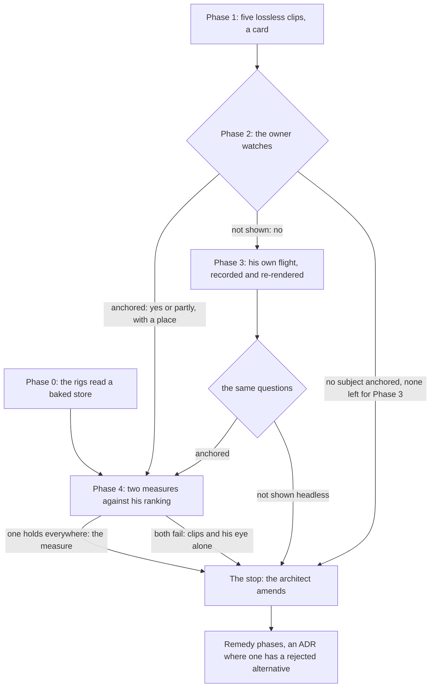

# 0104: The wobble anchored to the owner's eye: clips he ranks, a measure that ranks them, then the remedy

> **Status:** in progress: Phases 0, 1, 2 and 0b landed (2026-11-25); Phase 4 as
> amended next ("Amended 2026-11-25 (architect, after Phases 0 and 2)"; Phase 3 does not
> run: every subject anchored); approved (owner's go, 2026-11-25; drafted the same day with no interview from
> Plan 0100's close; questions 1 to 3 answered (a), (a), (a), recorded under "Risks & open
> questions"). **Order (owner, question 1 (a)):** Phases 0 to 2 and 4 run as a lane beside
> Plan 0099 now; Phase 3 and every remedy phase start on a main that holds Plan 0099.
> **Created:** 2026-11-25
> **Milestone:** M10: Outdoors in [`docs/roadmap.md`](../roadmap.md)
> **Related ADRs:** [ADR-0084](../adrs/0084-the-key-lights-visibility-on-a-world-face-is-fixed-per-face-the-columns-horizon-where-lit-a-cover-source-where-shadowed.md)
> (accepted with an Outcome; it defers the wobble, the near shadow's hole and sun under cover
> as a default to this plan, and names the contact ray as the one exception "a cover source
> only adds" may take),
> [ADR-0082](../adrs/0082-the-light-pass-keeps-no-screen-history-by-default-and-reads-smooth-sources-to-the-mid-range.md)
> (the calm defaults),
> [ADR-0076](../adrs/0076-light-stability-rules-world-history-per-source-a-fade-per-transition-and-a-ratcheted-pop-counter.md)
> (where a history lives, one fade a transition),
> [ADR-0055](../adrs/0055-render-settings-are-one-struct-with-an-apply-class-per-field-and-profiles-are-named-values.md)
> (the settings rows). **No ADR is drafted with this plan**: none is owed until a remedy has
> a rejected alternative, and none is picked here.
> **Source:** [Plan 0100](done/0100-a-sun-fixed-in-the-world-the-key-shadow-a-face-at-a-time-the-coarse-tier-held-still-and-sun-under-cover.md)
> (closed 2026-11-25, v0.75.0), its "Amended 2026-11-25 (architect, Phase 8b did not reproduce
> the window)", which wrote this plan's Phases 1 to 4 as F1 to F4, and its "The close"; the
> readings in [`logs/0100.md`](logs/0100.md): "Phase 8" (the owner's words), "The architect's
> code reading after the window", "Phase 8b", "The close review: the readings taken with no
> device wait".

## TL;DR

The owner sees a wobble on sunlit parts, at rest and in motion, and Plan 0100 closed with it
still there and **with no reading that shows what he sees**. This plan builds no remedy until
that is repaired. It renders his move at his window's size to five lossless clips he watches
in a video player, and he answers of each: is the wobble in it, where, when, in which words;
and he ranks two pairs blind. A subject he answers "no" to gets his own free flight recorded
in a window and rendered again headless. Then two candidate measures are tried against what
he ranked, and each is out at one failure. **After that the plan stops for the architect**:
the remedy phases are written as an amendment from the anchored clips and the measure. The
first thing the owner sees is `live/anchor/play.sh`: a one-pixel checker card, then five
clips, five to ten minutes.

## Context & problem

Four things Plan 0100 left open, all of them the sun's term at small faces (the roadmap's
M10; `docs/nfr.md` is not touched by them yet):

- **The wobble on sunlit parts**, at rest and in motion ("the wobble is located only on
  sunned parts", "more wobble on the trees and terrase" with no upscaler; the owner's words
  are verbatim in `logs/0100.md`, "Phase 8").
- **The tunnel slot's shimmer**: the edges and dots of shadows, which the owner names as the
  wobble's kind (Plan 0100's question 9), under every arm, `off` included.
- **The near shadow's hole** ("shadow missing"): the column horizon is read 2.5 voxels off
  the face, so a caster inside the lift casts nothing; 16.4 % of the terraces' key-lit
  pixels read lit where 64 disc rays read shadow (Plan 0100 Phase 5b, a CPU reading).
- **Sun under cover as a default.** `lighting.key_cover` stays `off` on every profile (his
  question 8, (c)); `ray` read calmest to him under the canopy, not blind.

Why no reading shows it, in short (the long form is the closed plan's "Why the measure and
the eye disagree"): Phase 8b counted a pixel flipping by over 4 levels and back in two
frames. That is a 30 Hz event, it counts pixels and not contrast, its classes cut the
picture where the eye does not, the rig did not fly where he flew, and the camera's own
motion over fine geometry is in the count. Two of his three orderings came out reversed or
flat. "Wobble" is his word and may name two or three artifacts; nobody has asked him which.

So the problem this plan starts with is not the light. It is that there is no artifact, on
disk, of which the owner has said "that is it, there". Every remedy tried so far was judged
by a figure that was never shown to follow his eye.

**What the tree holds** (`02e80ce4`): the fixed rig of Phase 8b is
`apps/flythrough/tests/gpu_wobble/owner_move.rs` (it waits on the device every settle
frame); the other rigs of the `gpu_wobble` binary do not (the close review's table). Plan
0100's Phase 9 removed `ray-record` and `centre` from the code and from the rig's tokens;
`lighting.key_cover off|ray|record`, `lighting.key_at hit|face|face-smooth` and
`lighting.key_horizon march|walk` stand as settings, every profile at the first of each.

## Decision

**Anchor first, measure second, remedy third, and stop between the second and the third.**
Phases 1 to 4 are Plan 0100's F1 to F4, carried over with the adjustments the tree asks for
and no others (each adjustment is marked). The remedy is not chosen here: the candidates
are listed under "After Phase 4" with what each would cost and what would falsify it.

We rejected drafting the remedy phases now from the code reading, because that is what Plan
0100 did three times (the face's centre, the walked horizon, the stage split) and each was
judged by a measure that did not rank what the owner ranked. We rejected a third measure
ahead of the clips for the same reason. We rejected a window session as the anchor, because
a window run leaves nothing to point at afterwards: a clip can be paused, stepped and laid
under a map.

### Rules this plan inherits

- **Never hold the camera in a window run** (owner, 2026-11-25): no `--pre-roll-drain` hold
  at a launch; the camera is free from the first frame. Phases 1 and 2 open no engine
  window at all (the clips play in `mpv`); Phase 3 and every later window obey it.
- **A no-upscaler reference is rendered at the window's own internal size** (1687 x 919
  under FSR 2 at 1.5 in the 2530 x 1378 window), never at a size borrowed from another
  window. Clip `T b` is not a reference: it reproduces his run 1b as the window drew it
  (1280 x 720 stretched), because that is the ordering he gave.
- **Every rig that steps the live bake queue waits on the device each frame and checks the
  store is baked before it reads.** A count of frames is not a measure of baking.
- **A reading starts at the owner's pose**: his eyes, his window's size, his move.
- **Exploration mode** (lane rule 2b, `.claude/skills/orchestrate/references/lane-rules.md`)
  for every phase before a pick: the owner's eye is the gate, bars are readings, checks a
  step are build, clippy, fmt and the quick tier, no gpu tier a step. CPU tests of data and
  API land with their phase.
- **Never simplify a scene so a check passes** (owner, 2026-11-22): the tunnel's roof slot,
  the terraces and the forest stay as they are.
- **A figure is called a measure of the wobble only after it ranks clips the owner ranked by
  eye.** Until then it is a reading.

## Architecture diagram



## Implementation phases

Each phase ships as its own commit. Phases 0 to 4 are exploration. Phase 0's order against
Phase 1 is free: Phase 1 builds on the Phase 8b rig, which already waits on the device, so
**if the owner is at hand the lane does Phase 1 first** and Phase 0 while Phase 2 waits for
him. Phase 0 is committed before Phase 4 starts.

Every phase carries exactly one `**Owner skill:**`: `dev` or `human`.

### Phase 0: The wobble rigs read a baked store (the audit owed by Plan 0100's close)
- **Owner skill:** dev
- **What:** One settle the `gpu_wobble` binary's rigs share, and the readings that say what
  the old settle hid. No engine behaviour changes.
  - **The settle:** the queue stepped with the fly-through's knobs and the view's frustum,
    **a device wait every frame** (`wgpu::PollType::wait_indefinitely`, as
    `support::queue`'s rig and `owner_move.rs` do), ended when no chunk in view waits, no
    job is in flight and no block fades; then **a census of the store** (chunks in view
    that hold a fresh record against chunks in view) printed as one line. A reading whose
    census is not whole says so in its own header line and is not tabled as a baked picture.
    It lives in `apps/flythrough/tests/support/wobble.rs` or a sibling under `support/`;
    **`support/defects.rs` is not edited** (Plan 0099's Phases 1 and 3 change it).
  - **The audit:** every entry of `gpu_wobble.rs`, `gpu_wobble/{terraces,coarse,cover,
    cover_arms,fsr,walked}.rs` and `support/wobble.rs` that steps the queue: how it steps,
    what it checks before it reads, the census under its settle as it stands today, and
    whether it now takes the shared settle. The close review's table in `logs/0100.md` is
    the starting list, not the result.
  - **The two asserting soak tests** of the binary,
    `the_defaults_hold_still_at_rest_and_the_far_holds` and
    `the_far_moves_no_worse_than_the_before` (`SETTLE` and `GATE_SETTLE`, 120 unread frames
    each): the census at their first read under the old settle, then each moved to the
    shared settle and run by name on lavapipe and on the RTX. **Their bars are not retuned
    here.** If a bar fails on a baked store the dev reports the figures and stops: the bar
    is Plan 0098's contract and the architect rules on it.
  - **Plan 0098's Phase 9 table** (2.4 to 3.9 %, read on the same settle): its rows read
    once more under the shared settle and printed beside the old ones, as readings.
  - **The W1 mismatch:** Plan 0100's Phases 5 and 5b read 1 404 to 1 906 lighting pixels
    darker on the GPU than the CPU port of the horizon at W1's eye, every one the GPU under
    the port, most on coarse blocks at 128 to 512 voxels. One reading under the shared
    settle (`gpu_wobble/cover.rs`, `walked.rs`), the mismatches split three ways: by the
    block's tier, by whether the hit's chunk is mirrored whole or as a coarse level, and by
    the distance of the map cell that decides. **Stop rule:** one cause that covers nine
    tenths of them is named, or the three splits are reported with "unexplained". A fault
    of the port is fixed in the port. A fault of the shader is not fixed here: it is a
    finding for the architect.
  - **The comment:** one line at the `LIGHTING2_*` constants saying bit 3 of
    `Params::lighting2` is free (`centre` held it).
  - **Not taken:** the gate-sized rig for the bake's key ray at its cap ("Plan 0100's
    leftovers" in [`docs/backlog.md`](../backlog.md)). It belongs in
    `apps/flythrough/tests/gpu_bake_rule.rs`, which Plan 0101's Phase 2 edits; it stays in
    the backlog for that plan.
- **Files touched:** `apps/flythrough/tests/support/wobble.rs` (or a sibling),
  `apps/flythrough/tests/gpu_wobble.rs`, `apps/flythrough/tests/gpu_wobble/`,
  `crates/svet-render/src/frame/settings.rs` (the comment only), `docs/plans/logs/0104.md`.
- **Done when:** the log holds the audit's table (a row a rig entry: steps how, checks
  what, the census before, converted or why not); for each of the two soak tests the census
  before, and its result on a whole census on lavapipe and on the RTX with the wall time
  (both are soak-marked today and stay so; they are run by name, not as a tier); Plan
  0098's Phase 9 rows old beside new; the W1 line (a cause with its count, or the three
  splits and "unexplained"). No reading of the binary steps the queue without the wait.
  Quick tier, clippy and fmt over the changed files.

### Phase 1: The owner's move as clips he can watch (exploration)
- **Owner skill:** dev
- **What:** No production code. The Phase 8b rig renders the move to lossless video at the
  window's size, as the window drew it.
  - **As the window:** 2530 x 1378, the RTX, the fly-through's bake, the queue stepping with a
    device wait a frame, **the exposure not pinned** (metered as the window meters it), no
    HUD. The settle is Phase 0's where it exists, else `owner_move.rs`'s own (the same
    wait); either way the census line is printed and whole before frame 1. *(Adjusted: the
    census.)*
  - **The bake's mode is said on every clip's header line.** On main today the queue has one
    mode, the step on the calling thread. If the lane's base holds Plan 0099's Phase 3 the
    clips render in lockstep and say so; a window then runs `bake thread on` by default,
    which changes when a landing shows. *(Added: Plan 0099.)*
  - **The move** (`SVET_MOVE=window`): W as the fly-through flies it, along the view with its
    pitch, until the first solid along the view ray is 60 voxels off or 2 s have passed; then
    level along the heading to 5 s in all; a stop held 3 s; a turn of 60 degrees over 40
    frames; held 3 s. If the clearance rule cuts the fly under 4 s the dev turns the level
    leg's heading by 15-degree steps until 5 s fit, and records the heading. About 12 s
    (645 frames at the step below).
  - **The frame step is 1/55 s** (three refreshes of the owner's 165 Hz panel a frame, so
    the playback's cadence is even). A guess that an even cadence is the fairer one to judge
    by; the window's own was uneven.
  - **The clips** (five):
    - `T`: the terraces eye, a pair. The defaults, and run 1b as the window drew it:
      upscaler off at 1280 x 720, stretched to 2530 x 1378 by the filter the fly-through's
      present uses (the dev reads which and names it).
    - `C`: the canopy, a pair, the defaults and `key cover ray`. From a start within 30 m of
      the canopy eye that the dev picks by `calm`'s class map so that the view through the
      move holds at least 10 % sunlit ground, 5 % sunlit leaf and 20 % shadowed pixels; the
      eye and angles recorded. If no such start exists the nearest is used and its shares
      said.
    - `S`: the tunnel's slot under the defaults (`--source outdoor --spawn inside --time
      12:00`, Plan 0100 Phase 5's eye), one clip.
    The eyes are in `logs/0100.md`, "Phase 8" ("The poses").
  - **Blind pairs:** each pair's two files are named `a` and `b` by a coin the runner throws;
    the key goes to `key.txt`, which the owner is not shown until he has answered.
  - **The format:** frames to `ffmpeg` (`libx264rgb -qp 0 -preset ultrafast`, Matroska):
    lossless, RGB, no scaling, so nothing the encoder does can hide or add a shimmer. A GIF
    at this size is not watchable, and `scripts/record-clip.sh`'s MP4 is 4:2:0 and lossy. If
    the decode is too slow the fallback is `-crf 6 -pix_fmt yuv444p -tune fastdecode`, said
    in the log. A sixth file, `card`: 3 s of a one-pixel checkerboard at 2530 x 1378.
    `ffmpeg`, `ffprobe` and `mpv` are tools of the dev box, not dependencies of the
    workspace; the dev records their versions and adds nothing to `Cargo.toml`. *(Added.)*
  - **The frames are written out, and not kept raw.** A frame is 2530 x 1378 x 4 bytes =
    13.9 MB, a clip of 645 frames 9.0 GB, five clips 45 GB: the rig streams a clip's frames
    to the encoder (or writes and deletes a clip at a time) under the untracked `live/`, and
    keeps frame 1 of each as a PNG for the byte check. *(Added: the arithmetic.)*
  - **The runner and the player**, under the untracked `live/anchor/`: `run.sh` (each clip
    under the perf lock, as Plan 0100's `live/p8b/run.sh`), `play.sh` (`mpv --fs
    --video-unscaled=yes --loop-file=inf --video-sync=display-resample --interpolation=no`
    over the files in the order card, T a, T b, C a, C b, S), `ask.txt` (Phase 2's questions
    and the keys).
  - **Kept for Phase 4:** each clip's camera a frame (eye, yaw, pitch) **and the frame's
    exposure** as text beside it. *(Adjusted: the exposure is metered now, and Phase 4's
    first candidate divides by it.)*
- **Files touched:** `apps/flythrough/tests/gpu_wobble/owner_move.rs` and a sibling under
  `gpu_wobble/` (new code goes to the sibling: `gpu_wobble.rs` is near the file-size gate's
  cap), `apps/flythrough/tests/gpu_wobble.rs` (the `mod` line), `docs/plans/logs/0104.md`.
- **Done when:** the six files exist; `ffprobe` reads 2530 x 1378 at 55 frames a second and
  an RGB pixel format on each; `ffmpeg -benchmark -i <clip> -f null -` decodes each at twice
  real time or more on the dev box (else the fallback, said); frame 1 of each clip decoded
  back equals the rig's own frame byte for byte; the dev has read one decoded frame of each
  clip by eye and says what it shows (the sun's patches there, no unbaked black); the log
  holds the commands of `run.sh` and `play.sh` verbatim, each clip's eye, angles, fly length,
  sunlit share, census line and bake mode, the stretch filter's name, the tools' versions,
  and the load beside each run. Quick tier, clippy and fmt over the changed test files.

### Phase 2: The owner watches the clips
- **Owner skill:** human
- **What:** The orchestrator runs `live/anchor/play.sh` in the owner's terminal (a video
  player, not a window run of the engine: no camera to hold). Five to ten minutes. Keys:
  Enter the next clip, Space pause, `.` and `,` a frame on and back, `[` half speed, `s` a
  screenshot, `i` the player's statistics.
  - **First, the card:** it shows an even fine grey with no bands, and `i` reads no dropped
    frames. Bands mean the player is scaling; the orchestrator fixes the player before any
    answer is taken.
  - **Asked of each clip** (T a, T b, C a, C b, S): (1) Is the wobble you saw in the window
    in this clip: yes, partly, or no, the window showed something this does not? (2) If yes
    or partly: pause where it is clearest, press `s`, and say where in the picture and when
    (flying, at the stop, turning, held). (3) Which words fit: an edge of light stepping or
    crawling along a surface; dots sparkling; a patch changing shape or brightness; the
    whole picture's brightness; something else.
  - **Asked of each pair:** which of `a` and `b` wobbles more, or the same?
- **Files touched:** `docs/plans/logs/0104.md` (written by the lane from the orchestrator's
  record).
- **Done when:** the log holds his answers verbatim, the screenshots' paths, and `key.txt`
  opened after. Then one line a subject:
  - **anchored** (a yes or partly with a place): that clip, place and moment are what every
    later measure must rank;
  - **not shown** (a no): Phase 3 runs for that subject;
  - for a pair, the window's ordering **confirmed blind**, **not confirmed** (the same, or
    the other way: that ordering is dropped as never established, and said so), or void (the
    subject not shown).
  If no subject is anchored, Phase 4 does not start.

### Phase 3: The owner's own flight, recorded and rendered again (exploration; only for a subject Phase 2 marks not shown)
- **Owner skill:** dev
- **What:** The fly-through gains `--track-out FILE` (in a window: every frame's eye, yaw,
  pitch and frame time, and a mark at each press of a key the dev picks, **shown on the
  HUD's mode row while it records**, with the count of marks) and `--track FILE` with
  `--frames-dir DIR` (headless: the same binary flies the recorded cameras with the recorded
  frame times and writes every frame). No engine crate changes. Then one window run a
  subject not shown, launched with the camera free from the first frame, a minute each: the
  owner flies as he did and presses the key when he sees the wobble. The dev renders 5 s
  each side of every mark from the track, encodes as Phase 1, and Phase 2's questions are
  asked of those clips.
  - **The track's header names the window's size, its profile and its bake mode**, and the
    headless render names its own. A window on a main that holds Plan 0099 runs `bake
    thread on`; the headless render is lockstep. Where the two differ the log says so
    beside the owner's answer. *(Added: Plan 0099.)*
  - **Its base holds Plan 0099's Phase 3** (question 1): both edit
    `apps/flythrough/src/cli/` and `apps/flythrough/src/run/`. *(Added.)*
- **Files touched:** `apps/flythrough/src/cli/`, `apps/flythrough/src/run/`,
  `apps/flythrough/src/path.rs` (or a sibling), `apps/flythrough/src/hud/` (the row),
  `apps/flythrough/tests/path.rs`, `apps/flythrough/tests/gpu_track.rs` (new),
  `docs/flythrough.md`, `docs/plans/logs/0104.md`.
- **Done when:** CPU (under 1 s each): a written track parses back equal; `--track` with no
  `--headless` and `--frames-dir` with no `--track` are refused; the HUD's mode row holds
  the recording's word and the mark count while `--track-out` is set, and neither without
  it. GPU (binary `gpu_track`, lavapipe, under 10 s, a guess): a 30-frame track rendered
  twice headless gives the same last frame where no bake lands. The log holds the window's
  launch lines, the marks, the clips, and the owner's answers verbatim with **anchored** or
  **not shown headless** a subject. A subject not shown from his own track is the result:
  the difference is then between the window's present and the headless frame (or between
  the two bake modes), and the architect is called before anything else is built.

### Phase 4: A measure that ranks what the owner ranked (exploration, a reading)
- **Owner skill:** dev
- **What:** No production code. Two candidate measures, each computed on the decoded frames
  of the anchored clips (the files the owner judged) with each clip's camera track and the
  rig's world. Neither is known to work; each is a guess at what the eye follows.
  - **Candidate 1, the light of a world point over time.** Points fixed in the world: the
    centres of the faces visible in a clip's first frame, re-seeded each second. Each frame a
    point is projected with the frame's camera, kept while a ray from the eye reaches it,
    and the display's luma is read there, divided by the frame's exposure. On a face under a
    fixed sun that series is flat; the camera's motion is removed by construction. Its
    energy between 1 and 15 Hz, as a contrast against its own mean, is the point's score.
    Scores are summed into screen tiles of 64 x 64 pixels by the area the points cover, and
    printed as a map over a frame and as a total a segment.
  - **Candidate 2, a lit edge's place on its face.** For every face that covers at least 16
    display pixels for at least 30 frames: the share of its pixels over the mid luma between
    the clip's lit and shadowed levels, a frame. Under a fixed sun that share changes only
    with the angle of view, slowly. Its changes of over a tenth between frames a quarter
    second apart are counted, weighted by the face's pixels, a tile and a segment.
  - **Shown as maps the owner's screenshots can be laid on.**
- **Files touched:** `apps/flythrough/tests/gpu_wobble/` (a sibling reading),
  `docs/plans/logs/0104.md`.
- **Done when:** the log holds, a candidate and a clip, the map (under `live/`) and the
  totals by segment, and for each anchored subject three lines, each **holds** or **fails**:
  (a) the place the owner named is among the top tenth of tiles by score at the moment he
  named; (b) every pair he ranked blind is ranked the same way by the clip totals, and a
  pair he called the same differs by under a fifth; (c) a clip he answered "no" to scores
  under every clip he answered "yes" to at the same subject. **A candidate that fails one
  line at an anchored subject is not the measure**, and its stage rows are not read. If one
  holds everywhere it is this plan's measure, and Plan 0100 Phase 8b's stage rows are read
  again under it (the rows only; no remedy). If both fail the dev reports both tables and
  the owner's words beside them. **Either way the dev stops here and the architect is
  called.**

## Amended 2026-11-25 (architect, after Phases 0 and 2)

Three rulings on what Phases 0 and 2 read, from the readings log ("The forest soak test's
time", "The W1 mismatch", "Phase 2") and the rig's code. No GPU run stands behind this
section: every time below that is not quoted from the log is a projection and says so.
**Order: Phase 0b, then Phase 4.** Phase 0b lands before this lane merges into main in any
case: as the tree stands the weekly soak (`soak.yml`, lavapipe) would run a 12 538 s test.

**One rule for every run of this plan from here on (owner, 2026-11-25):** no run is started
that projects past 20 minutes under the perf lock. A run prints its projection from its first
frames (the settle's samples a second against the samples the same settle took on the RTX; a
segment's first 30 frames against its length) and the dev stops it when the projection passes
the cap. The gate tier is the most any step runs.

### Phase 0b: The forest soak test asserts on one baked store (the remedy for its time)
- **Owner skill:** dev
- **Why:** `the_defaults_hold_still_at_rest_and_the_far_holds` reads 771 s on the RTX and
  12 538 s on lavapipe on a whole census (owner: "such long test is exactly what we are
  trying to avoid"). The log's own figures say where the time goes. The test bakes six fresh
  stores from one eye with the same knobs and asserts on two of the six arms (the rest arms,
  `default,pin,nqueue`, at fly 180 and fly 20); the stepping and native arms are printed. It
  reads 5 550 frames after the settles (0.131 s a frame on the RTX, 0.45 s on lavapipe), of
  which the two asserted stops need 1 050. On lavapipe the settle draws 4 727 frames an arm
  because the queue's sample cap a step sits at its floor there (16 384 samples: the slice
  is sized from GPU timestamps, which lavapipe does not give), so about 77 million samples
  go out a floor's worth a drawn frame.
- **What:** No engine behaviour changes; `apps/flythrough/tests/` only. Three levers, all
  three taken, in this order.
  1. **The test runs what it asserts, on one store.** One frame, one settle, then the rest
     protocol twice from the spawn's camera with the queue stopped (fly 180, then fly 20):
     the exposure's pin, the still, the fly, the stop. The protocol ends at the stop: the
     turn and the hold after it assert nothing. With the queue stopped the store does not
     change between the two reads. The four printed arms (`default,pin` and
     `default,pin,native` at both flies) leave the test; they are `reading::wobble` under
     `SVET_WOBBLE`, which exists, and the test's doc comment names the specs.
  2. **The settle's pace is not the fly-through's.** While it settles, `support::baked::
     settle` steps the queue with a slice long enough that a step's sample cap is the
     submit's own (`Budget::PerFrame` raised for the settle, the budget before restored at
     its end, as `wobble_on` already does for `pre=MS`). The knobs that decide what is
     baked (coarse samples, near and full-first radii, tiers by size on screen) stay the
     fly-through's. This changes every rig that takes the shared settle, so it is checked:
     see the done-when's second line.
  3. **On a software adapter the test's frame is half each way** (640 x 360 internal, 960 x
     540 out, the arm's `out=` token; `run_segment` sizes its buffers from the `OUT`
     constant today and must take the arm's). It is the one lever on the cost of a read
     frame there. The near bars are absolute and keep their constants at both sizes; the
     far +30 bar is a constant a size (below).
- **The far +30 bars are re-set.** `REST_FAR30` (9.98 and 11.39, plus 2) was read on a store
  with 5 of 59 chunks baked: it measured the far landing during the stop. On a whole census
  the same figure reads 5.44 and 4.88 on the RTX (5.64 and 4.84 on lavapipe), so the old
  bar would let the far double before it failed. The rule is unchanged (Plan 0098 Phase 11:
  the largest of three readings plus 2 points), the readings are new: at 1080p, the largest
  of three RTX readings on a whole census (Phase 0's and two of this phase's); at the half
  frame, the largest of three lavapipe readings of this phase. From Phase 0's figures alone
  the 1080p bars would be 7.64 (fly 180) and 6.88 (fly 20); the dev writes the constants
  from the three readings and the log holds all of them. `REST_NEAR0` and `REST_NEAR_PAIR`
  are not moved (the readings are 0.00 to 0.05 against 2.05 and 2.5; they are Plan 0095's
  and Plan 0098's bars as written).
- **The 727 s on the RTX after the settles** falls with the arms (lever 1) and is not cut
  further: what is left is the rig's reads a frame (hits, sources, classes), the instrument
  every wobble reading shares, and a leaner second path for the test would be a second
  instrument to keep equal to the first.
- **Rejected:** *the RTX only, with a cheaper lavapipe proxy*: a bar no scheduled machine
  runs goes stale unseen, and the tiers have no class for an asserting test run by hand
  (the weekly soak on lavapipe is the soak mark's meaning); the binary's other soak test
  (`the_far_moves_no_worse_than_the_before`, 101 s on lavapipe) asserts a different claim.
  It is the fallback only if the bar below is missed with all three levers, and then the
  architect rules. *Fewer asserted arms* (dropping fly 20, or a bar): each is a clause of
  Plan 0098's contract, and lever 1 already removes every arm that asserts nothing. *A
  smaller view on both adapters*: 1080p through FSR 2 at 1.5 is the size the contract was
  ruled at, and the RTX pays about 150 s for it. *A shorter stop*: the bars are frame 30
  against frame 300.
- **Files touched:** `apps/flythrough/tests/gpu_wobble.rs`,
  `apps/flythrough/tests/support/baked.rs`, `docs/plans/logs/0104.md`.
- **Done when** (binary `gpu_wobble`, the test by name; it keeps `#[ignore = "soak"]`):
  - the test asserts the three rest bars at fly 180 and fly 20 on one store whose census
    line says whole, and fails when a census is not whole;
  - the faster settle bakes the same store: on the RTX at 1080p the census (chunks in
    view, settled, coarse) equals Phase 0's 60/60 with 54 coarse, and the rest figures read
    within 1 point of Phase 0's (far +30 5.44 and 4.88; near pair and stop +0 near under
    0.1); a difference is reported and the lever withdrawn, not tuned around;
  - **the time bar: 180 s on the RTX and 600 s on lavapipe on the dev box**, wall time of
    the test alone under the perf lock, the load beside it. Projected, not read: the RTX
    about 150 s (1 050 read frames at 0.131 s, a 7 s settle, the forest's generation);
    lavapipe has no projection worth the name until levers 2 and 3 are read, which is why
    the first lavapipe run prints one and is stopped past 20 minutes;
  - the log holds the settle's frames and seconds before and after lever 2 on both
    adapters, three far +30 readings a size, the constants written from them, and the
    reading specs that replace the printed arms. Quick tier, clippy and fmt over the
    changed files. If the lavapipe bar is missed the dev reports the figures and stops.

### The W1 mismatch: one narrower split in Phase 4, with a stop rule
The reading (1 859 lighting pixels where the GPU's key value is under the CPU port's
horizon, inside Plan 0100's 1 404 to 1 906; coarse 1 562, 128 to 512 voxels 1 555) is
unexplained by its three splits, but it carries a lead the splits did not use: **every
mismatch has the key slot's source "the mean"** (`defects::key_slot`'s 0), not "the
horizon" (2). The port is being compared against a value that, at those pixels, the shader
did not read from the horizon. Whether that explains it cannot be said yet, because the
agreeing pixels were not split by source. It is kept in this plan, as one reading added to
Phase 4, because its band (128 to 512 voxels, sunlit, darker than it should be) is where
the owner puts his second artifact ("changing brightness on distant trees that were
lighted").

- **The split (Phase 4, first step, RTX, W1's eye, one run of seconds after its settle):**
  all compared pixels by key slot source against agree or mismatch, by the hit's distance
  band; and, from the shader, which path writes source 0 at 32 to 512 voxels and what it
  averages.
- **Stop rule.** (a) Nine tenths of the pixels with source "the mean" in the band mismatch,
  or the path named is a filtered value the port does not model: the line is closed as a
  difference of sources, the port's comparison is restricted to pixels whose source is the
  horizon, and the count there is the new W1 figure. (b) The path's value can change
  between frames at a fixed world point (it mixes a landing, a history or a jittered read):
  it becomes a seventh candidate in "After Phase 4", and Phase 4's maps say whether the
  owner's places lie on such pixels. (c) Neither: the tables go to
  [`docs/backlog.md`](../backlog.md) under "Plan 0100's leftovers" as unexplained, by the
  architect at the stop, and this plan carries it no further. No shader is changed in any
  case.

### Phase 3 does not run
Every subject is anchored (Phase 2: T, C and S, no "not shown"). Phase 3's `--track-out`
and `--track` flags are not built by this plan. If a remedy later needs the owner's own
flight, the amendment that writes the remedy phases brings Phase 3 back by name.

### Phase 4, amended: two artifacts, each with its own subjects
The owner's words (Phase 2, verbatim in the log): "all wobbles were edge of light stepping
on slopes, and dots sparkling, or maybe its changing brightness on distant trees that were
lighted", and "it was almost good, esp Tb". Phase 4 as written predates them. Its two
candidates do aim at the two artifacts (candidate 2 at the stepping edge, candidate 1 at a
point's brightness), but four things in it would fail a candidate by construction at the
places he named. Phase 4's text above stands; where this section differs, this section
rules.

- **The two artifacts and where they are anchored.**
  - **A, an edge of light stepping on slopes:** `T a`, the top of the picture at about 3 s,
    flying (window 2 to 4 s); `S`, the slopes, slight, in the turn. Pair: `T a` over `T b`.
  - **B, dots sparkling or the brightness of distant sunlit trees changing** (he is not
    sure which; both are read): `C a`, the lit trees in the top left, in the fly; `C b`,
    the sunlit trees, in the turn. Pair: `C a` over `C b` (read from "there is wobble"
    against "a bit", not stated as a ranking: the log says so, and so does the result).
  - **Not classed:** `S`, the change in the shadow at the tunnel's end where it meets the
    ground ("clearly seen"). It is named before it is measured: the dev renders `S`'s track
    again with the queue's counters a frame and says whether the change falls on a frame
    where a block lands or the exposure steps. A landing or an exposure step is not a
    wobble of either kind: it goes to the stop as its own line ("Carried to the amendment"
    already holds both sources) and is left out of both candidates' lines.
- **A candidate is judged an artifact, not over all subjects.** Candidate 2 is tried on A's
  subjects, candidate 1 on B's; each is also printed on the other's, as a reading. "Fails
  one line at an anchored subject" now reads: at a subject of the artifact it is tried on.
  The plan may leave Phase 4 with a measure for one artifact, for both, or for neither.
- **The unit grows to what the eye can resolve.** Candidate 2 as written takes faces of at
  least 16 display pixels, and candidate 1 a face's centre. At the top of `T a` and on
  distant crowns a face is under a pixel, so the first would score nothing at his place and
  the second would read the camera's motion across sub-pixel leaves. For both candidates
  the unit is a face where it covers 16 display pixels, else the visible faces of one normal
  inside a world cube of 2^k voxels, the smallest k at which they cover 16. Candidate 1's
  series is the unit's mean display luma over the exposure; candidate 2's is the unit's lit
  share. For B a second series is printed beside candidate 1: the count of the unit's
  pixels that leave its lit median by over a tenth for one or two frames and return (the
  dots), as a reading with no line of its own unless candidate 1 fails and it holds.
- **Line (a), restated so a region can meet it.** His places are regions (the top third of
  the picture; the top-left ninth), not tiles. (a) holds when, in his moment, the region
  holds at least twice its share of the scored tiles among the top tenth by score.
- **Line (c) is void:** no clip was answered "no". `T b` ("almost no wobble") is already
  the lower side of line (b) at T.
- **The turn is 40 frames (0.73 s).** `C b`'s and `S`'s moment is the turn, where a
  one-second window does not fit: there the series is the segment and the band starts at
  1.4 Hz.
- **The runs, each under the cap** (RTX only, question 2 (a); one clip or one eye a hold of
  the perf lock). Visibility of a unit a frame is read from the rig's hit positions on a
  render of the clip's own track, not from CPU rays (a ray a face a frame over 645 frames
  at 2530 x 1378 is hours). A render is the shared settle (6 to 15 s at these eyes, Phase
  1's table) and at most 645 frames with one read back each: under 5 minutes a clip, a
  guess, projected from its first 30 frames and stopped past the cap. The scoring is CPU
  work outside the lock; its units are sampled by a stride the dev picks so a clip scores
  in under 5 minutes, and the stride is logged. Plan 0100 Phase 8b's stage rows, read
  again only under a candidate that holds, run one arm a hold under the same rule.
- **What "almost good" changes.** The defaults (`T b`) are close to accepted, and A's
  clearest anchor (`T a`) is not a default: it is the no-upscaler arm. The anchors under
  the defaults are `C a` and `S`. Phase 4 runs as amended either way, since a measure is
  what every later light plan lacks; whether a remedy follows is question 4.
- **Done when**, added to Phase 4's: the W1 split with its stop rule's letter; `S`'s shadow
  change named (a landing, an exposure step, or neither) with the frame; for each artifact
  and candidate the lines (a) and (b) as **holds** or **fails** at that artifact's
  subjects; every run's projection and wall time beside its figures.

### Question for the owner (added)

4. **After Phase 4, does a remedy follow?** You called the defaults "almost good, esp Tb".
   (a) Phase 4 runs, then you are shown its maps over your screenshots and decide: a small
   remedy at the canopy and the slot, or the plan closes with the measure and the wobble
   accepted as it is. (b) Stop now: close the plan after Phase 0b with no measure. (c)
   Remedy phases whatever Phase 4 reads. **Recommended: (a).** Phase 4 is rig work on the
   RTX with no window, and it leaves a figure shown to follow your eye, which the next
   light plan needs whether or not this one builds anything.

## After Phase 4: the stop, and the candidate remedies

**The plan stops for the architect after Phase 4** (or earlier, where Phase 2 anchors
nothing and Phase 3 shows nothing headless). The remedy phases are written as an amendment
from the anchored clips and the measure, with an ADR once a remedy has a rejected
alternative. If both measures failed, the amendment gates its remedies on clips and the
owner's eye alone, with no figure. The amendment also writes the plan's last dev phase (the
picks as defaults with their goldens, image bars, budget lines and documents) and the
owner's window before it.

What follows is a list of candidates from Plan 0100's code reading (`logs/0100.md`, "The
architect's code reading after the window"). **None is picked, and the list is not an
order.** A cost marked a guess has no reading behind it.

| candidate | what it would change | what it would cost | what would falsify it |
|---|---|---|---|
| **1. The sun's term at the internal rate** | Today the whole sun term (cosine times visibility) is evaluated once for each 2 x 2 internal pixels, at a hit the jitter or the camera moves. Evaluate it at every internal pixel. | Four times the key term's share of the temporal pass, which is not split out: a guess. The whole lighting reads 0.22 to 0.42 ms on the RTX and 1.61 to 2.07 ms on the RENOIR at Floor (Plan 0098 Phase 13). | A clip under the rig's `full` token (all lighting at the internal rate, its ceiling) that the owner does not rank calmer than the defaults, blind, at an anchored place. |
| **2. The cosine's step at face edges** | `max(n.l, 0)` takes the face's own normal near, so a tread at 0.707 sits beside a riser at 0. Shade the key term's cosine by a normal that changes smoothly across an edge. | The gradient normal's taps at near hits (a guess); and it changes the look of honest cubes, the default the owner picked on 2026-11-01, so it is his call by eye. | A clip with the far normal's weight at 1 everywhere (the rig's `farn` token) not ranked calmer; or the owner refusing the shaded cubes. |
| **3. The 0-or-1 horizon read 2.5 voxels off the face** | The visibility is a hard step read at a point off the face, in a different map cell for each face of one stair, and under `march` its 12 sampled cells change with the hit's place. Make it continuous across a surface, or the same for a face whatever the hit. | `key horizon walk` read +1.41 ms of temporal pass on the RENOIR at the terraces eye (Plan 0100 Phase 7); other forms unread. | Clips under `keyhorizon=walk` and `keyat=face-smooth` not ranked calmer; a clip with the visibility forced to 1 (the cosine alone; a rig token to add) that wobbles the same. |
| **4. `lit_at`'s nearest-tap fallback** | Where all four upsample weights vanish, an internal pixel takes the nearest lighting pixel's light whatever its face. Give those pixels their own term instead. | One key evaluation at the fallback pixels; their share of a frame is unread. | A map of the fallback pixels a frame that does not fall on the places the owner named, or a share too small to see there. |
| **5. FSR 2 as the only antialiasing in motion** | In motion an edge of the sun's term advances a lighting pixel at a time while the geometry under it moves smoothly, and nothing else in the frame antialiases it. Antialias the sun's edge inside the internal pixel, or give FSR 2 inputs that hold it. | Unread. Input tuning costs no time; a coverage term costs a second lookup at edge pixels (a guess). | The owner not ranking `T`'s no-upscaler clip worse, blind (then "the upscaler hides part of it" was never established); a clip rendered at the display's size with FSR 2 at scale 1 not ranked calmer. |
| **6. A contact ray for the near shadow** | A ray a few voxels long from a near face's centre that may darken what the horizon lights: it closes the hole (the terraces' wrongly lit near faces 3 229 to 1 357, the slot's 144 to 31; Plan 0100 Phases 5 and 5b, CPU). It is a remedy for the hole, not for the wobble. | At most the key ray Plan 0098 Phase 13 removed (+0.3 to +1.4 ms on the RTX, +4.0 to +9.7 ms on the RENOIR at Floor); a ray of 4 voxels should cost less: unread. It is the one exception to "a cover source only adds", so it takes an ADR that supersedes that clause of ADR-0084. | It adds shadow edges on the terraces: a clip with it that the owner ranks as wobbling more at an anchored place. |

**One reading cuts across candidates 1 to 3:** a clip with the key light off (`keyoff`). If
the owner still answers "yes, that is it" there, the sun's term is not the source at that
subject and all three fall together. The amendment asks for that clip first.

**Carried to the amendment, behind the wobble:** sun under cover as a default
(`key_cover ray`, `record`, or a new source), with the question whether the key bake runs
while no default pixel reads it; `key horizon walk` as a default; the slot's shimmer, whose
other possible sources (the sky term's source switching while blocks land, the exposure
metering a frame split between a dark tunnel and a sunlit cut) Phase 2's words for clip `S`
choose between.

**Profile rows.** None until a remedy is picked: Phases 0 to 4 add no render setting and
move no profile's value. The amendment names each new row's apply class and its value a
profile (ADR-0055).

**Plan 0100's settings.** `lighting.key_cover ray|record`, `lighting.key_at face|
face-smooth` and `lighting.key_horizon walk` were kept as controls for this plan. **Any of
them this plan does not pick is removed at its close** (ADR-0084: "a setting the follow-on
plan does not pick is removed there, not kept twice"), with its rows, flags, HUD words and
documents. Question 3.

## Data shapes

No engine type changes in Phases 0 to 4. Two text formats, both illustrative; the dev fixes
the spelling:

```text
# a clip's side file (Phase 1), one line a frame
# clip T-a  2530x1378  step 1/55  bake lockstep  census 617/617
frame eye_x eye_y eye_z yaw pitch exposure
0     496.0 -648.7 456.7 34.5 -46.2 0.01834

# a track (Phase 3), one line a frame, a mark where the key was pressed
# track v1  2530x1378  profile floor  bake thread on
frame dt_ms eye_x eye_y eye_z yaw pitch mark
```

## Budgets

- **No `docs/nfr.md` figure is touched by Phases 0 to 4.** No shader and no default changes.
  The remedy's figures (the lighting line of section 2, the frame at Floor and Portable) are
  named by the amendment and measured on the RTX at Floor and the RENOIR at Portable.
- **The gate's wall (section 7).** Phase 3 adds one GPU test under 10 s (a guess) and CPU
  tests under 1 s each. Phase 0 changes two soak tests, which are in no gate; a device wait
  every settle frame makes them slower, and the log holds by how much.
- **Disk, the dev box.** The clips' raw frames are 45 GB if kept (Phase 1's arithmetic), so
  they are not kept; the lossless files' sizes are unread and go in the log.
- **The owner's time.** Phase 2 is five to ten minutes. Phase 3, if it runs, is a minute a
  subject in a window and the same questions again.

## Risks & open questions

**Answered 2026-11-25 (owner, "go with recommended + 3a"):** question 1 **(a)**: Phases 0 to 2
and 4 start now beside Plan 0099; Phase 3 and the remedy phases start on a main that holds
Plan 0099. Question 2 **(a)**: the clips cover the RTX at Floor only. Question 3 **(a)**: a
Plan 0100 setting this plan does not pick is removed at its close (the owner chose this over
his 2026-11-12 rule that cheap unpicked modes stay settings, for these settings).

- **The clip does not show it either** (likely for at least one subject: the rig is not the
  window). That is Phase 3's reason to exist, and a "not shown headless" there is a result:
  it puts the fault between the headless frame and the window's present, or between the
  bake's two modes.
- **The owner's word names more than one artifact.** Phase 2's third question splits them;
  the amendment may then be two remedies with two anchors, or two plans.
- **Neither measure holds.** Then every remedy is judged on blind clip pairs and nothing
  else. Slower, and honest; the plan says so in advance.
- **Plan 0099 changes when light lands in a window.** With `bake thread on` the render
  thread no longer waits for a step, so a landing may show a frame or more later than in
  lockstep. The clips settle the view before frame 1, so the held segments should not
  differ; the flying segment enters chunks whose blocks land during the move, and there the
  two modes can differ. Every clip and track names its mode for that reason.
- **Two lanes on one GPU.** The clip runs and Plan 0099's readings both take the RTX under
  the perf lock; a clip run is minutes, and the lock serialises them.
- **A soak bar fails on a baked store** (Phase 0). Then Plan 0098's rest bars were passed on
  a store of unknown state; the dev stops and the architect rules, before any bar moves.
- **Determinism, memory, GPU features:** nothing in `svet-world`, no new buffer, no adapter
  feature. Phase 3's track holds frame times read from the window's clock in the app; the
  headless replay reads them from the file, so the replay is reproducible.

### Questions for the owner

1. **Does this plan's lane start now, beside Plan 0099?** (a) Phases 0 to 2 and 4 now,
   beside Plan 0099 (they are rig and clip work under `apps/flythrough/tests/` and `live/`,
   plus one comment line); Phase 3 and the remedy phases start on a main that holds Plan
   0099. (b) The whole plan waits for Plan 0099's close. (c) The whole plan now, Phase 3
   included, merging Plan 0099 in as it lands. **Recommended: (a).** The viewing is the
   slowest step and needs nothing of Plan 0099; Phase 3 edits the same app directories as
   Plan 0099's flag, and a remedy is judged in a window that by then runs `bake thread on`.
2. **Do the clips also cover the Radeon at Portable?** (a) The RTX at Floor only, the five
   clips as written. (b) Add one canopy clip rendered on the RENOIR at Portable at 1280 x
   720 ("wobble is hard", your note 5). **Recommended: (a).** Portable took nothing from
   Plan 0100's window, the anchor is about what the wobble is and not which card shows
   more of it, and a sixth clip lengthens the viewing.
3. **Plan 0100's settings this plan does not pick: removed at its close, or kept?** (a)
   Removed, as ADR-0084 says. (b) Those that cost nothing when off stay settings (your rule
   of 2026-11-12), and only `key horizon walk`, which uploads its coarse rows when off, is
   removed if unpicked. **Recommended: (a).** They were kept as this plan's controls, not
   as modes anyone runs, and each is a row the settings walk, the menu and the documents
   carry.

## What this plan does NOT do

- **Pick or build a remedy.** Not before the stop; the candidates' table is not a design.
- **The gate-sized rig for the bake's key ray at its cap.** It stays in the backlog ("Plan
  0100's leftovers") for Plan 0101, which works in that file.
- **Retune a bar of Plan 0098**, or any golden. Phase 0 reports; the architect rules.
- **Touch `crates/svet-render/src/bake/queue/` or the fly-through's frame path** in Phases
  0 to 2 and 4 (Plan 0099's ground).
- **Distant trees under FSR 2** (the backlog's "Distant trees that do not wobble", Plan
  0033's re-read), unless Phase 2's words put the owner's wobble there.
- **A penumbra of the disc's true width, entities' and field surfaces' shadow edges, the
  sky term under cover** (the backlog's "The sun's shadow near under the calm defaults").
- **A Windows run** (owner, 2026-11-15).
- **A quiet re-read of the gate tier** (the backlog, "Plan 0100's leftovers").

## Implementation log

> Written by `dev`: one row per phase as its commit lands, then the close block. **The phases
> above are the contract. This section records what happened.** Observations, never conclusions:
> no pass list, no self-assessment. Deviations and unmet done-whens are **always** disclosed.
> Keep it shorter than `## Implementation phases`. Readings, gate counts, attempts, sweeps and
> resume notes go to the plan's readings log, `docs/plans/logs/0104.md` (started from
> `templates/readings-log.md`), and this section links it once it exists.

| phase | owner | state | commit |
|---|---|---|---|
| 0: the wobble rigs read a baked store | dev | done: the shared settle (`support/baked.rs`); both soak tests pass on a whole census on the RTX and lavapipe (the forest one 12 538 s on lavapipe); W1 unexplained; readings in [`logs/0104.md`](logs/0104.md) | 565bdee2, 0bc94eb4, e42f5e8a |
| 1: the owner's move as clips | dev | done: six files under `live/anchor/`, readings in [`logs/0104.md`](logs/0104.md) | 31d18c4e |
| 2: the owner watches the clips | human | done: T, C, S anchored; T and C orders confirmed blind; answers in [`logs/0104.md`](logs/0104.md) | f8dd1fac, a183ddd6 |
| 0b: the forest soak test asserts on one baked store ("Amended 2026-11-25") | dev | done: one store, two rest protocols; settle at the submit's cap; half frame on lavapipe; 113 to 146 s RTX, 250 to 255 s lavapipe (410 s loaded); far +30 bars 5.52 / 4.88 (1080p), 8.99 / 8.30 (960x540); readings in [`logs/0104.md`](logs/0104.md) | committed with this row |
| 3: the owner's own flight, recorded and rendered again (only for a subject not shown) | dev | does not run: every subject anchored ("Amended 2026-11-25"; row marked by the architect) | |
| 4: a measure that ranks what the owner ranked | dev | not started | |
| the stop: the architect's amendment (the remedy phases) | - | not written | |

### Notes

_(Deviations from the plan, with the commit, stated without justification. Done-whens not
satisfiable as stated, and what was done instead. Followups noticed and not acted on. One line
each. Empty is fine.)_

- Phase 1: Phase 0's settle does not exist yet; the clips use their own (a device wait every
  frame, then a census of hit chunks against `BakeQueue::settled`), whole on every clip.
- Phase 1: no canopy start within 30 m holds 10 / 5 / 20 % (800 read); the nearest to holding
  them is used (sunlit ground 5.3 %, leaf 2.4 %, shadowed 68.4 %); its fly is 1.85 s, cut by the
  clearance rule, and no 15-degree turn of the level leg fits 4 s. The slot's fly is 3.51 s, the
  same way. Where no turn fits, the heading stays as it was.
- Phase 1: the level leg's clearance is the Phase 8b rule (no solid within 8 voxels of the eye);
  a heading turn moves the eye along the turned heading and leaves the camera's yaw.
- Phase 1: `libx264rgb` stores `gbrp` (planar RGB) from the `rgb24` input; frame 1 decodes back
  byte-identical on all five clips.
- Phase 0b: the RTX census at the settle's end reads 59/59 (53 coarse), 61/61 (55) and 60/60
  (54) on three runs with lever 2, and 61/61 (55) on one without it, the samples drawn equal
  (346 782 647) on all four: the done-when's "equals Phase 0's 60/60 with 54 coarse" is met on
  one run of three. On lavapipe (960x540) it reads 58/58 (54) on every run with lever 2 and
  59/59 (55) without, equal samples (236 349 415). Lever 2 is kept; the architect rules.
- Phase 0b: the second rest protocol keeps the exposure pinned by the first (read once after
  the settle) and runs its 32 frames at the spawn; the test runs no read frames before the
  settle (at least 120 unread frames instead).
- Phase 1: `play.sh` adds `--input-conf` (`[` half speed, `]` normal, Enter next) and a
  screenshot directory to the plan's `mpv` line.

### Close triggers

_(Facts for the architect. No recommendations, and no suggested version bump.)_

- **What shipped:**
- **Public API changed:**
- **Budget readings:**
- **Gate at the tip:**
- **Outstanding `human` phases:**

## Followups

_(Empty at the draft.)_
