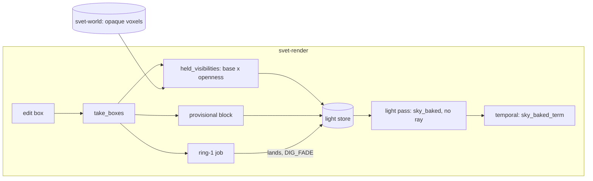

# 0105: The dig's flash at depth: a held estimate that follows the hole's own light

> **Status:** in-progress (Phase 7c stopped for the architect 2026-11-27: test 1, `gpu_sun`'s shaft, passes on lavapipe (no dug cell over its landed byte, the box's peak -3.63 levels; red under `surface`), committed; test 2's forest hold passed 20 minutes on lavapipe in the drain alone (25.5 min, debug build), no dig read, not committed, the ratchet not set; Phase 7b4 looked 2026-11-27, confirmed: blind, the owner reads session 6's binary as flashing less ("a") and accepts the present one ("b is acceptable as well"); `depth` as built at `e1060437` is the default; the difference is not explained and is a backlog entry; ruled 2026-11-27: next 7c (the asserting tests, restated), 7d (the readings and the tip), the fresh close review; Phase 7b3c done 2026-11-27: the burst on `live/bin/p7b3/flythrough` (`e1060437`) reads outcome E against session 6's binary; Reading 18, the gpu tier, `gpu_settings_rows` and the two soak tests as 7a5; the temporal pass +0.007 ms over the dig frames; next 7b4, the owner's third look; Phase 7b3b done 2026-11-27: a marked dig face leaves the temporal pass with the moments' w 2 and its mark reads under `SKY_STALE`; step 1's count 780 at D5+0 on the tree before, 0 after; B's ring at D5+0 / D5+1 0.46 / 0.43 %, white over 8 / 16 0.32 / 0.11 %, black over 32 1.37 %, worst ring D5+2 1.21 %, all as before the fix; the bars asserted in the soak test; B dig 4 reads 0.17 % at D+0; next 7b3c; ruled 2026-11-27 on Phase 7b3's two moved figures: F4 stands; the ring at D5+0 0.46 % is 7a4a's group back, no pixel of it reads the mark, and 7a4b's 0.06 % was held up by the white F4 removes; proven fault: a marked face is still counted as cast by the filter; next 7b3b (that fix, the read without `SKY_STALE`, the bars asserted in the soak test), 7b3c (the burst on the new binary, 7a5's re-reads), 7b4; Phase 7b3 steps 1 to 5 done 2026-11-27: the hole's white bar over 8 and 16 levels in the soak test, red on B at 0.57 / 0.53 %, green after F4 at 0.32 / 0.11 %; T3's ring at D5+0 0.46 %; step 6, 7a5's re-reads, owed; Phase 7b2 read 2026-11-27: outcome E, the two binaries he saw equal on a burst of four digs, lockstep `p7b` whiter than `p6` over 16 levels in the dig's region at 0.001 % of the frame at most against the control's 0.015 %, on the thread 0.000 % within the runs' spread; next 7b3; Phase 7b looked 2026-11-27, not confirmed: the owner reads the default `depth` as flashing a bit where session 6's did not, `surface` as "big flashes"; `depth` stays the default and the plan does not close on it; ruled 2026-11-27: the ordinary dig takes session 6's bytes by the code, so Phase 7b2 reads the two binaries on a burst, Phase 7b3 bounds and removes the whole dig's white (F4), Phase 7b4 is the side-by-side look; next 7b2; Phase 7b-prep done 2026-11-27: the fly-through's `dig settled: rings 1 and 2` line prints `digs whole N` for each dig, so 7b's fly-fast dig is on the record; next 7b; Phase 7a5 done 2026-11-27: the re-reads on `6dfc0b1a` moved nothing: Reading 18 `down` lockstep `depth` on the RTX, at 5 m every frame on a record, B1 from 2 m, 1 m -4.554; `gpu_queue`, `gpu_queue_reach`, `gpu_lights`, `gpu_outdoor` 39/39, `gpu_sun` 35/35, the two soak tests and Phase 5's CPU test pass; 7b's binary at `live/bin/p7b/flythrough`; next 7b; Phase 7a4b done 2026-11-27: under `depth` a held record moves only the dig's faces; at D5+0 and D5+1 the ring 0.06 % and 0.02 %, group 2 3 and 5; the soak test `a_fresh_hole_holds_its_value_until_its_light_lands` passes under the default, B's ring 1.20 % at most, no frame over 2 %; 7a4c not built; next 7a5; Phase 7a4a done 2026-11-27: a whole dig's summary is `SKY_STALE` from the put to the landing; at D5+0 and D5+1 the whole chunk's group 912 and 857 dark pixels, none `own summary`; ring 3.50 % and 3.05 %, group 2 6094 and 5257; next 7a4b (F1); Phase 7a3's result ruled 2026-11-27 under "Amended 2026-11-27 (architect, Phase 7a3's result ...)": next Phase 7a4a (F2), then 7a4b (F1), 7a4c (F3) only if the ring is still over 2 %, 7a5, 7b; Phase 7a3 read 2026-11-27: of the ring's dark pixels at D5+0, 2695 (31 %) are outcome A (the whole chunk's untouched bricks, sky source to `own summary`, its summary `VIS_BAKED`, not stale, sky 0) and 6133 (69 %) outcome E (dug chunks with a block, bricks dig 5 does not touch, the sky ray cast at every pixel, `record stale` in both frames); the tables go back to the architect before 7a4; Phase 7a2's stop ruled 2026-11-27 under "Amended 2026-11-27 (architect, Phase 7a2's stop ...)": the first ruling's cause is not what the reading shows; one more reading, Phase 7a3, then the fix 7a4 and the re-reads 7a5, before 7b; Phase 7a2 stopped for the architect 2026-11-27 at step 2: B's dig 5 is a whole dig, but none of the ring's dark pixels at D5+0 and D5+1 lies in a touched brick of a chunk with no block (66 to 70 % in touched bricks of chunks with a block); the CPU test is in, red on clauses 1 and 3; no fix built; Phase 7a's stop ruled 2026-11-26 under "Amended 2026-11-26 (architect, Phase 7a's stop ...)": a fault in `depth`'s hold of a chunk with no block, which writes over faces the dig did not make; Phase 7a2 fixes it before 7b, the ring bar stands, 7c is cut into 7c and 7d; Phase 7a read 2026-11-26 and stopped for the architect: under the default `depth`, `gpu_outdoor`'s soak test `a_fresh_hole_holds_its_value_until_its_light_lands` misses its ring bar in sequence B, 4.42 % of the ring darker by over 4 levels against 2 %, at the fifth dig's D+0 and D+1, and passes under `surface`; `gpu_sun`'s rule 3 holds; Phase 6 done by the owner 2026-11-26: `depth` is the default; Phase 5 done 2026-11-26: the 5 m dig into a chunk with no block is held on a record under `depth`, both modes, no casting frame; B2's under clause at `down` 1 m stays the window's case; Phase 4c read 2026-11-26 and stopped for the architect: B2's restated second clause missed at `down` 1 m, lockstep, -4.53 mean under `S` at D+0, the first of six holds; the five others read after the stop (Reading 17): `wide` meets it, the `down` bake thread misses the same way; Phase 4b done 2026-11-26: `side` lockstep `depth`, B1 met at 2, 3, 5 and 7 m against `S`, no part from 2 m over its landed byte; 4c not started; Phase 4 read 2026-11-26 and stopped for the architect: B1 missed at `side` 2 m, +9.9 mean, and B2's second clause at `down` 1 m, 8.0 levels under `surface` at D+0; Phase 3 done 2026-11-26; Phase 1 done 2026-11-26; the phases after it are rewritten under "Amended 2026-11-26 (architect)": the held floor is the flash; Phase 2 read 2026-11-26 and stopped for the architect: the exposure at D-1 is not within 1 % of D+60's at 6 of 20 read digs); approved (owner, 2026-11-26: go; his four answers are under "Amended 2026-11-26 (owner)" and bind Phase 1's sites and the remedy's bars; drafted from the owner's report after Plan 0099's window, with
> his three answers and no further interview; the questions left are under "Risks & open
> questions", each with a recommended option). Starts on a main that holds Plan 0099.
> **Created:** 2026-11-26
> **Milestone:** M10: Outdoors in [`docs/roadmap.md`](../roadmap.md)
> **Related ADRs:** [ADR-0082](../adrs/0082-the-light-pass-keeps-no-screen-history-by-default-and-reads-smooth-sources-to-the-mid-range.md)
> (the dig's held record: "the sky visibility of the surface the dig cut through, times a near
> openness"; this plan changes the estimate inside that mechanism, so no new ADR, and ADR-0082
> takes a dated Outcome note at the close if the default estimate changes),
> [ADR-0076](../adrs/0076-light-stability-rules-world-history-per-source-a-fade-per-transition-and-a-ratcheted-pop-counter.md) (rule 3: the history is the store's provisional record, one
> fade a switch), [ADR-0083](../adrs/0083-the-live-bake-queue-runs-on-a-bake-thread-the-render-thread-applies-its-write-lists-and-issues-its-submits.md) (the bake thread; the flash is the same with
> it off).

## TL;DR

A freshly dug face shows for a blink brighter than it settles, "as if lit with the surface's
light" (owner, 2026-11-26): unnoticed near the surface in sunlight, bothering past 2 to 3 m
deep, the same with the bake thread off. The code reading below says what the face shows in
those frames: a record made on the CPU at the edit whose base is the **surface's** sky
visibility (the nearest record above the cell, else the chunk's summary, which a surface
chunk's lit ground dominates) times the square root of an openness that looks only 1.6 m far.
Neither term knows how deep the hole is. Phase 1 reproduces the blink headless at depth and
reads, per frame, the new faces' brightness and which write gave it. The fix phases then make
the held estimate follow the hole's own baked light, one change a phase, behind a setting the
owner compares in a window before it becomes the default.

## Context & problem

The owner's report (forest scene, `--source outdoor --spawn forest --trees forest --time
15:00`, RTX 3080 Laptop, `--profile floor`, binary at `cde2e966`): "it flashes with light when
digging, it is mostly fine when near the surface and sunlight, but when I dig deeper, more
than 2-3 meters it is already bothers". His answers: the same with the bake thread off;
"bright than darker, I think it is lights with surface light"; "one blink".

It is the remainder ADR-0082 disclosed ("the slight colour change the owner names at a landing
is the held estimate's distance from the baked record"), accepted at the surface in Plan
0098's window 98e and parked in the backlog ("A dig's landing"). At depth the distance is no
longer slight. The owner's rules that bind the remedy: a stable image first; no waiting for
light (a stable approximation while the bake runs is the accepted route); a scene is never
simplified for a test; a remedy that can change the look is shown in a window first.

### The code reading (architect, 2026-11-26, at `0d4e4b77`; read from code unless marked)

**What a dug face shows from the edit to its landing, under the default `DigHold::On`:**

1. *At the edit* (`BakeQueue::take_boxes`, `bake/queue/digs.rs`): each chunk holding a brick
   the box touches takes a provisional block (`provisional_block`, `bake/summary.rs`: a kept
   brick's record, a new brick the mean of the records within one or two bricks), and each
   touched brick's cells then take a **held record** (`held_visibilities` and `apply_held`,
   `bake/held.rs`): six sky visibilities with `VIS_BAKED` and no `SKY_STALE`, the key words
   cleared.
2. *In the light pass* (`sky_baked`, `shaders/shade.wgsl`): the held record reads as a fresh
   record, so no sky ray is cast; `temporal.wgsl` shows `sky_baked_term` of it. The key
   light, with `KEY_BAKED` clear, falls to the column map's horizon (`key_cover_far`,
   `shaders/pair.wgsl`; `column_key_visibility`, `shaders/key_horizon.wgsl`).
3. *At ring 1's landing* (one or two frames after the dig in lockstep per ADR-0082; about 95
   to 170 ms on the bake thread per Plan 0099's log) the store fades from the held record to
   the job's over `DIG_FADE` = 4 frames. That is the blink's length in either mode.

**The held value** of a dug face of direction `f` is
`max(min(own_f, up) * sqrt(open), HELD_FLOOR)`:

- `up` is the up visibility of the nearest record at or above the cell within `HELD_CELLS`
  = 4 cells, **else the chunk summary's** (`SUMMARY_AT`, the mean by direction of the chunk's
  brick records, `block_summary`). A floor cell in the middle of a pit has air above it, so
  it takes the summary; in the chunk that holds the ground, that is mostly the lit surface's
  value. This is literally "the surface's light", and it does not fall with depth inside a
  chunk (6.4 m tall).
- `open` is the share of 12 fixed rays that leave `HELD_REACH` = 16 voxels (1.6 m) without
  meeting rock. Past 1.6 m of depth a ray that clears the reach counts as sky whatever is
  beyond it, and the square root lifts a small share (1 ray of 12 gives 0.29).
- Derived, not read: the rays' rings stand 24, 45 and 66 degrees off the face's normal, so
  over 16 voxels they run 6.5, 11.3 and 14.6 voxels sideways. A floor in a pit of 1 m radius
  keeps the inner ring open (`open` 4/12, a held value of 0.58 `up`), while the true
  cosine-weighted visibility of the pit's mouth from the floor's centre is
  `r^2 / (r^2 + d^2)`: 0.50 at 1 m, 0.10 at 3 m, 0.04 at 5 m. At the default dig radius
  (0.5 m, `DIG_RADIUS`) a single straight shaft closes every ray and holds the floor value,
  so the flash needs a hole wider than one dig, which several digs make.

**Three mechanisms can give "bright for a blink, then darker" at depth:**

| | mechanism | where | the owner's answers |
|---|---|---|---|
| M1 | The held record over the baked one: the base is the surface's (the summary) and the openness sees 1.6 m | `bake/held.rs` | **Favoured by all three**: bright then darker, "the surface's light", one blink (the fade), the same in lockstep, fine near the surface (within the rays' reach the openness is true) |
| M2 | A chunk that held no block before the dig (solid rock has no face) is a "whole" dig: `take_boxes` gives it no provisional block and no held record. Its faces read no record: the sky ray is cast, and its mean is seeded each frame from the column's answer (`column_estimate`: 1 above the column's top, so 1 in an open pit). `pair_step`'s arithmetic is not traced | `bake/queue/digs.rs` (the `continue` for a chunk with no block), `shaders/temporal.wgsl`, `shaders/pair.wgsl` | Fits the direction and "deep", but happens once a chunk entered, not at every dig |
| M3 | The key light from the column horizon at a held record | `shaders/key_horizon.wgsl` | **Not favoured**: a point under its column's top reads 0, and a pit's walls stand in the horizon, so it errs dark; in the window the sun is what hides the flash near the surface |

A fourth candidate, the source fade at a chunk's first landing (`source_faded`), is off by
default (`Lighting::source_fade`) and is not pursued.

## Decision

Measure first, then change the held estimate, not the mechanism. The dig keeps ADR-0082's
shape: a record made on the CPU at the edit, read as any record, one fade to the job's
record. What changes is what the record holds at depth: the base comes from the hole's own
baked light (the nearest record of the same direction about the cell) before the chunk's
summary, and, if that is not enough, an open ray must reach the sky, not 1.6 m. A chunk with
no block takes a held record too if Phase 1 shows M2 on screen. The new estimate is a
setting; the old one stays as the before arm and stays a setting after the pick (cheap modes
stay settings).

Rejected here, already rejected or parked by ADR-0082 and Plan 0098's "Amendment at window
98d": the dig delayed until its light is ready (staged mirror records, a plan with its own
ADR, backlog "A dig's landing"); a screen history in the dig's box; `DigHold::Rays` as the
default (the cast rays' noise is what Plan 0098 removed). A longer fade is rejected too: it
shows the wrong value for longer.

## Architecture diagram



## Implementation phases

Each phase ships as its own commit. **Phases 1 to 4 are exploration** (lane rules 2b): they
name readings, not image tests; CPU tests of data stay with their phase. Phase 6 writes the
asserting tests against the owner's pick. No run under the perf lock passes 20 minutes: the
dev projects a run's time from its first arm and, past that, stops and goes to the architect.
The gate tier is the most any step runs.

Every phase carries exactly one `**Owner skill:**`: `dev` or `human`.

### Phase 1: The blink reproduced headless at depth (exploration, a reading)
- **Owner skill:** dev
- **What:** One reading in the `gpu_outdoor` binary (a new file beside
  `gpu_outdoor/dig_line.rs`, built on its `dig_timeline` and `support::defects`' dig
  helpers; run by name, soak-marked, never a gate), on the real forest scene at 15:00 with
  the floor profile's settings. No engine behaviour changes.
  - **The sites, in the scene as it is:** (P) a pit dug from the forest spawn's ground
    straight down by digs in a row, wide enough to stand in (the default radius, 0.5 m, with
    the digs spread as `B_AIMS` spreads them, and one arm at 1.0 m), read at each dig whose
    floor is about 1, 2, 3, 5 and 7 m under the ground (7 m crosses the ground chunk's
    floor; the reading prints which digs opened a chunk that held no block,
    `QueueStats::digs_whole`); (S) a sloped tunnel, 30 degrees down from the same ground,
    read at the same depths; (T) a dig into the wall and the floor from the tunnel's eye
    (`--spawn inside`), under cover.
  - **Per read dig:** the queue settled first (no dig waits, no block fades), then the dig,
    and frames D-1 to D+24 with the bake thread off and on. Per frame, over the pixels
    whose hit lies in the dig's box: the mean and the 95th percentile of the output's
    luminance in display levels against the settled frame's (D+60); the sky term, the key
    term and the stored part apart (`support::terms`); the sky term's source shares
    (`sky_source` under `COUNT_STORE`: record, stale record, summary, column, cast); and
    the pool's state (`support::queue::dig_held`, `ring1_landed`), so each frame's value
    is tied to the write it came from (the held record, the fade, the job's record).
  - **The CPU table:** per dug cell and direction of each read dig, the held value with
    its parts (the base and where it came from: a record above at which cell, the chunk's
    summary, or the cell's own cap; the openness) beside the job's landed value. A trace
    out of `held_visibilities` for readings only.
- **Files touched:** `apps/flythrough/tests/gpu_outdoor.rs`, a new
  `apps/flythrough/tests/gpu_outdoor/dig_depth.rs`, `apps/flythrough/tests/support/`
  (a sibling file; no more than four `SVET_*` variables in a file, `SVET_DIG` reused),
  `crates/svet-render/src/bake/held.rs` and its reading accessor, `docs/plans/logs/0105.md`.
- **Done when:** the log holds, per site, depth and thread mode, the frames from the dig to
  ring 1's landing, the peak of the new faces over their settled value (levels and ratio)
  with its frame and the write that frame showed, and the term that carries it; and the CPU
  table's summary (held over landed by depth, split by the base's source). The log then
  names what carries the blink: M1 (and which part, base or openness), M2, M3, or something
  else. **Stops:** the blink not reproduced at 3 m or deeper on any site (peak under 4
  levels over settled): the dev reports the sites tried and stops, and the owner is asked
  for his eye and dig radius (`--eye`); M3 or an unnamed source dominant: stop, the
  architect amends. Quick tier, clippy and fmt over the changed files. Binary: `gpu_outdoor`.

### Phase 2: The base from the hole's own light (exploration, the first fix)
- **Owner skill:** dev
- **What:** Only if Phase 1 names M1 with the base as a part. A setting
  `Lighting::dig_estimate` (`surface`, today's and the default; `depth`) with the
  fly-through's `--dig-estimate surface|depth`, its value in the banner's and the HUD's mode
  rows. Under `depth` a dug face's base is the nearest baked record of its own direction
  about the cell (the hole's floor and walls as the earlier digs' jobs left them, a stale
  mark not excluding them), capped by today's `up`; the chunk's summary answers only where
  no such record lies within reach. The reach and the walk's order are the dev's, fitted on
  Phase 1's CPU table, not on the image.
- **Files touched:** `crates/svet-render/src/bake/held.rs`, `bake/queue/digs.rs`,
  `crates/svet-render/src/frame/settings.rs`, `frame/settings/sky_light.rs`,
  `crates/svet-render/src/settings.rs`, `frame/baked.rs`, `apps/flythrough/src/cli/`,
  `apps/flythrough/src/hud/modes.rs`, `docs/flythrough.md`, `docs/plans/logs/0105.md`.
- **Done when:** Phase 1's reading, both arms side by side: under `depth` the new faces'
  peak over settled at every read depth of 2 m and more is at most the same run's peak at
  the 1 m dig under `surface` (the case the owner calls fine), and the 1 m dig's own frames
  move by at most 4 display levels between the arms (the accepted surface look holds). A
  CPU test in `bake::held::tests` (under 1 s): a dug floor under a pit whose walls hold
  records of up visibility 0.1 and whose chunk summary holds 0.9 takes a base of at most
  0.1 under `depth` and 0.9 under `surface`. The mode row reads the setting's value
  (`gpu_settings_rows`, the row's test). The D+0 step's time for the same digs before and
  after (`QueueStats::stages`), printed. **Stops:** the bar missed with the base alone:
  Phase 3; an edit's wait as section 4 of `docs/nfr.md` pins it no longer met: stop, the
  architect rules. Binaries: `gpu_outdoor`, `gpu_settings_rows`.

### Phase 3: An openness that reaches the sky (exploration; only if Phase 2's bar is missed, or Phase 1 names the openness alone)
- **Owner skill:** dev
- **What:** Under `depth`, a ray that clears `HELD_REACH` counts as open only if it goes on
  to leave the ground (a coarser march over the opaque masks until it stands above its
  column's top, or a far cap the dev sets and states), and the square root is dropped or
  kept by its fit to Phase 1's landed values, stated in the log with the fit. One change;
  the base stays Phase 2's.
- **Files touched:** `crates/svet-render/src/bake/held.rs`, `docs/plans/logs/0105.md`.
- **Done when:** Phase 2's bar, read the same way, with this arm; the CPU table's held over
  landed by depth for the three forms (today's, Phase 2's, this); a CPU test in
  `bake::held::tests` (under 1 s): a floor 40 voxels down a pit 20 voxels wide with rock
  above the pit's mouth holds the floor value under `depth`, and with the mouth open holds
  more than the floor value. The D+0 step's time before and after. **Stops:** the bar
  still missed: stop, the architect amends (the remaining routes are the backlog's staged
  records, or a held record that errs dark on purpose, owner question 2); the edit's wait
  no longer met: stop. Binary: `gpu_outdoor`.

### Phase 4: A chunk with no block holds the dig too (exploration; only if Phase 1 shows M2 on screen)
- **Owner skill:** dev
- **What:** Under `depth`, a dig into a chunk that held no block gives it a provisional
  block and held records at the edit, as a chunk with a block takes them, the base from the
  records across the chunk's faces. One change.
- **Files touched:** `crates/svet-render/src/bake/queue/digs.rs`, `bake/summary.rs`,
  `bake/held.rs`, `docs/plans/logs/0105.md`.
- **Done when:** Phase 1's reading at the digs it marked whole: no frame between the dig
  and the landing shows a sky source of `column` or `cast` at the new faces under `depth`,
  and their peak over settled meets Phase 2's bar. The pool's words at the edit for such a
  dig, before and after, printed (the provisional block is placed one landing early; the
  pool's cap is not raised). **Stops:** `PoolFull` counted at a read dig that did not count
  it before: stop, the architect rules. Binaries: `gpu_outdoor`, `gpu_queue`.

### Phase 5: The owner's window
- **Owner skill:** human
- **What:** The owner digs in the forest scene as in his report, down past 3 m, a pit and
  a tunnel, with `--dig-estimate surface` (the before arm) and `depth`, the bake thread on;
  the mode shown in the banner and the HUD. **No camera hold: no `--pre-roll-drain`.** The
  fly-through's stdout stays visible. Linux only.
- **Done when:** the owner says, per arm, whether the flash at depth bothers, and whether
  the dig near the surface looks as before; he picks the default, or names what is still
  wrong (then the architect amends).

### Phase 6: The pick as the default, with its tests
- **Owner skill:** dev
- **What:** The picked estimate as `Lighting::dig_estimate`'s default in every profile; the
  other stays a setting. The asserting tests, the docs and the readings.
- **Files touched:** `crates/svet-render/src/frame/settings.rs`,
  `crates/svet-render/tests/gpu_sun/` (the synthetic pit), `apps/flythrough/tests/gpu_outdoor/`,
  `apps/flythrough/tests/gpu_settings_rows.rs`, `docs/nfr/04-edits.md`, `docs/flythrough.md`,
  `CHANGELOG.md` is the architect's at the close.
- **Done when:** (1) a GPU test in `gpu_sun` on a synthetic pit 40 voxels deep under an
  open sky: each dug cell's held up visibility under the default lies within the bar Phase
  2's or 3's log read between held and landed there (the dev states the figure from the
  log; expected under 10 s on lavapipe, a guess; over it the test is born
  `#[ignore = "soak"]`); (2) the forest reading of Phase 1 as a soak-marked image test
  (`gpu_outdoor`, over 10 s on lavapipe, born `#[ignore = "soak"]`, not a gate): the new
  faces' peak over settled at the 3 m and 5 m digs under the default is at most the 1 m
  dig's under `surface`; (3) `every_profile_holds_the_calm_picks` reads `dig_estimate`
  (and `dig_hold`, the backlog's owed row, if it is one line); (4) the edit's readings in
  `docs/nfr/04-edits.md`: the D+0 step and an edit's wait before and after, machine and
  commit; (5) the gate tier at the tip under the perf lock, clippy, fmt, deny, the doc
  gates. Binaries: `gpu_sun`, `gpu_outdoor`, `gpu_settings_rows`; the gpu tier at the tip.

## Amended 2026-11-26 (owner)

The owner gave the go and answered the questions (2026-11-26, his words):

1. The go: "go".
2. Which way a new face may err: "slightly dark, and I think we should keep depth in mind. If
   deep enough, no flash should happen - like in a cave, as there is no chance of sunlight".
3. The accepted surface dig stays as it is: "yes".
4. Which hole: "pit dig looking down or to the side, narrow, i think it was 1 dig wide. but
   not 100% sure".

What the answers change:

- **Answer 4 runs against the code reading's caveat** (a single straight shaft at the default
  dig radius closes every ray and holds the floor value, so M1 should not flash there). The
  reading is a reading, not a measurement, and the owner is not certain of the width, so
  neither is taken as settled. **Phase 1's first site is his: a pit one dig wide at the
  default radius, dug looking down, and the same dug to the side from the pit's wall, at 1 to
  7 m, before the wider pits.** If the one-dig shaft flashes, Phase 1 names what wrote the
  bright frames there (M2's chunk with no block, the faces at the shaft's rim or wall, or a
  source the reading did not name) and stops for the architect before Phase 2: the first fix
  is then chosen for that cause, not for M1 by default. If it does not flash there and does
  in the wider hole, that is reported with both, and Phase 2 goes on as written.
- **Answer 2 adds a bar to the fix phases and to Phase 6's tests: at depth no flash at all.**
  Where the landed light of the new faces is dark (the cave and the tunnel away from the
  mouth, and a pit deep enough that the sky's share is under the held floor), no frame from
  the dig to the landing shows the new faces brighter than their settled value by more than
  the 4 levels the surface dig is held to. A new face may start under its settled value and
  rise. The depth is to be read by the estimate (how far the hole's own light and the open
  sky are), not assumed from the surface's light.
- **Answer 3** is the plan's bar as written (the 1 m surface dig within 4 levels, the before
  arm at the window).

No other phase text changes. Phase 5's window shows him a narrow one-dig pit at depth first.

## Amended 2026-11-26 (architect)

After Phase 1's readings ([the log](logs/0105.md), "What the architect inherits"; code read at
`56e34b50`). **This section replaces Phases 2 to 6 above**; they stay as the record of the
draft. The Implementation log's rows 2 to 6 are rewritten by `dev` to the phases below at the
first commit under this amendment. The owner's bars (his amendment above) bind every phase.

### The cause

**The flash is the held record's floor: `HELD_FLOOR`, 0.02 of the open sky, written into every
direction of every dug cell, where the hole's own baked light is 0.** In a hole the sky's
irradiance times 0.02 is not "just above black": it is the 3.8 to 4.4 the stored part shows at
the peak at every depth of both sites, against 0.0 to 0.5 settled from 3 m. The same 4 units
are +12 levels under the surface eye's exposure (`down`, 1.37e-2) and +78 to +100 under an eye
in the hole (`side`, lockstep, 1.7e-1). The owner's cave is the worst case of a floor above
black, not an edge of it.

Measured (Phase 1, RTX 3080 Laptop):

- The peak is on the held record in every read (D+0; D+0 and D+1 with the bake thread), falls
  through the four fade frames and is gone at the job's record. Key term 0, direct 0, every
  stored direction value 0.0000 from every source: the stored part is the no-ray sky term
  alone.
- From 2 m every traced held value sits at the floor (0.020), at the estimate where it is
  higher (to 0.040, `side`), or under the floor by the mean with kept faces; the landed
  values are 0.000 to 0.008.
- At `down` 5 m the dig enters a chunk with no block (`digs_whole` 1): 10 % of the box's
  lighting pixels have no record and cast, in the held frames only.

Read from code and derived from Phase 1's tables, not measured:

- **The 8.5 against 3.6 at `down` 3 m needs no other source.** `Lighting::sky_bounce` is 0 by
  default, so `sky_baked_term` is only the smoothed normal's mix: the sum over the directions
  the normal leans toward of that direction's visibility times its open irradiance. The
  pair's x is the hit face's own direction alone. In the settled frame only the floor's up
  direction holds anything (0.008) and the mix dilutes it with wall directions at 0.000 (a
  sphere's floor is a bowl; its smoothed normals lean to the walls). In the held frame every
  direction the mix can reach holds 0.016 to 0.020, the directions with no face too
  (`apply_held` sets all six in the mask, at the mean of the held ones). The term is linear
  in the cell's six held values, so the split between the hit face and the mixed directions
  does not change the fix and is **not read apart**.
- **The estimate under the floor is second in size and errs bright too.** Recomputed from
  Phase 1's traced parts with the floor at 0 (quantised to the record's byte): at `down` the
  parts over their landed value fall from all of them to 2 or 3 a depth from 3 m, each by one
  byte; at `side` 3 to 6 parts a depth stay over by up to 0.06. Those take the surface's
  light as the base (the chunk summary, 0.125 to 0.137, at 3 and 5 m; a record one to three
  cells above, 0.07 to 0.17, at 1 and 2 m) times the square root of a share of rays that
  cleared 1.6 m **up the shaft**, which is not the sky. That is the draft's M1 (base and
  openness), behind the floor.
- **One byte matters in the dark.** A byte of visibility (1/255) is about 0.85 of the stored
  part here (0.0196 gives 4.2). Under the `side` eye's exposure that is of the order of ten
  levels or more at the pixels that read it (derived from +78 for 3.9; the display curve is
  not linear). So where the landed value is 0 the held value must be 0, not small.
- **The +28 at `down` 5 m is two things.** About +11 is the floor, as at 3 and 7 m (its D+1
  is +10.7). The rest, about +15, is the draft's M2: `take_boxes` gives a chunk with no block
  no provisional block and no held record (the `continue` for a whole dig), so its new faces
  cast, and a reset pair's seed with no record is `column_estimate`, 1 in a column open to
  the sky, which a straight shaft is. The box's mean x of 0.109 with 10 % of the pixels
  casting puts those pixels near 0.9: the open sky at 5 m down, the p95 of +158. It needs a
  shaft under an open column and a chunk entered: once every 6.4 m down. A side dig under
  rock reads 0 there.
- **`side` is larger than `down` by the exposure, not by the light:** the stored part is the
  same 3.8 to 4.3.

### The decision

The held record keeps ADR-0082's shape (a record made at the edit, read as any record, one
fade). Under a setting, `Lighting::dig_estimate = depth`, **the held value is a lower bound of
the hole's own light, and 0 where no ray reaches the light it is scaled from**: no floor; a
ray counts open only where it rises to the height its base was read at; a chunk with no block
holds the dig as any chunk. A new face may then start dark and rise through the fade, never
bright then dark (the owner's answer 2). Depth is read by the rays, not assumed.

Rejected:

- **A smaller floor (one byte, 0.004).** One byte over a landed 0 is still a flash under an
  eye in the hole (above).
- **A floor scaled by the base.** The base at depth is the surface's (the summary); it is not
  0 where the light is.
- **Black for every new face.** It passes at depth by the tables, and starts the 1 m dig at
  about half its light (derived: 0.44 of 0.82 summed over the traced parts), against the
  owner's answer 3.
- **The draft's Phase 2 as the first fix (the base from the nearest record of the face's own
  direction).** At `down` the base already is the hole's own record (the cell's or the one
  above) and the values sit at the floor regardless; it would have changed nothing there. It
  stays the architect's next route if Phase 4 misses by parts whose base is the summary.
- **A seed for the cast pair that knows depth (the shader's `column_estimate`)** for M2: it
  changes every face with no record in the world, and leaves the dig on two mechanisms.
- A shorter or longer fade, the cast rays (`DigHold::Rays`), a screen history, the dig
  delayed until its light is ready: as in the Decision above.

**No new ADR.** The mechanism is ADR-0082's; the clause the default would change is "at least
a floor above black". At the close, if the owner picks `depth`, ADR-0082 takes this dated
Outcome note (draft): "Plan 0105: the held record's floor above black read as the dig's flash
at depth (0.02 of the open sky over a landed 0: +12 display levels from the surface, +78 to
+100 under an eye in the hole, RTX 3080 Laptop). The default estimate holds no floor, counts a
ray open only where it reaches the height its base was read at, and gives a chunk with no
block a held record; a new face may start dark and rise. The earlier estimate stays a setting
(`dig_estimate = surface`)."

### The bars (every fix phase reads them the same way)

Phase 1's rig, sites `down` and `side`, radius 5, lockstep and the bake thread on, at 1, 2, 3,
5 and 7 m, the frames from D+0 to the first frame on the job's record, the mean and the p95
over the box's pixels against D+60:

- **B1, no flash at depth:** at 2 m and deeper no frame's mean is over the settled frame by
  more than 4 levels, and no frame's p95 by more than 8 (the 1 m dig's p95 under `surface`,
  the dig the owner calls fine).
- **B2, the shallow dig holds:** at 1 m no frame's mean is over settled by more than 4, and
  each frame's mean under `depth` is within 4 levels of the same frame's under `surface`.
- **B3, dark then up:** the lowest mean under settled per depth is printed (a reading; the
  owner judges it in the window).
- `side` counts only with the exposure settled before the dig (Phase 2 makes the rig do it).
- No run under the perf lock passes 20 minutes; a site is one hold of the lock.
- **A missed bar stops the phase and goes to the architect. No second variant, no tuned
  constant, no loosened figure, no changed scene.**

Phases 2 to 5 are exploration (lane rules 2b): readings and CPU tests of data; the asserting
image tests are Phase 7's.

### Phase 2: The before arm on a settled exposure, and the wide pit (exploration, a reading)
- **Owner skill:** dev
- **What:** No engine behaviour changes. (1) The rig holds the eye at each read dig's place
  until the auto exposure is still (it moves under 1 % over 24 frames; the dev states the
  rule it used) before D-1, at every site; the table prints the exposure at D-1, D+0 and
  D+60. (2) `side` in lockstep and with the thread on, under today's estimate: the before arm
  in display levels. (3) `wide` at radius 5, both modes: whether the hole several digs wide
  flashes, by how much, and which base its parts take. `slope` and `tunnel` stay unread (the
  window walks them).
- **Files touched:** `apps/flythrough/tests/gpu_outdoor/dig_depth.rs`,
  `apps/flythrough/tests/support/` if the stillness check lives there, `docs/plans/logs/0105.md`.
- **Done when:** the log holds, for `side` and `wide` in both modes, Phase 1's table a depth
  with the exposure at D-1 within 1 % of D+60's at every read dig, and the lockstep CPU
  table for `wide`. **Stops:** the exposure not still within 600 frames at a read place:
  stop, the architect rules; `wide` shows a term other than the held record's sky term
  (key, direct or a stored direction value over 0): stop. Quick tier, clippy and fmt over
  the changed files. Binary: `gpu_outdoor`.

### Phase 3: No floor under the held value (exploration, the first fix)
- **Owner skill:** dev
- **What:** The setting `Lighting::dig_estimate` (`surface`, today's and the default until
  the window; `depth`), the fly-through's `--dig-estimate surface|depth`, its value in the
  banner's and the HUD's mode rows, and the rig's arm as a fourth field of `SVET_DIG`. Under
  `depth` the held value takes no floor on any path of `held_visibilities`: a dig's face
  holds `base * sqrt(open)` as it is, 0 included; a direction with no face holds the mean of
  those with one, and a cell with none its base, neither raised. Nothing else changes: the
  base, the rays and their reach are today's.
- **Files touched:** `crates/svet-render/src/bake/held.rs`, `bake/queue/digs.rs`,
  `crates/svet-render/src/frame/settings.rs`, `frame/settings/sky_light.rs`,
  `crates/svet-render/src/settings.rs`, `frame/baked.rs`, `apps/flythrough/src/cli/`,
  `apps/flythrough/src/hud/modes.rs`, `apps/flythrough/tests/gpu_outdoor/dig_depth.rs`,
  `docs/flythrough.md`, `docs/plans/logs/0105.md`.
- **Done when:** at `down`, both modes, under `depth`: B1 at 2, 3 and 7 m, and at 5 m in
  every frame whose pixels all read a record (the casting frames there are Phase 5's and are
  printed); B2 at 1 m. At `side`, both modes, both arms printed side by side with the parts
  still over their landed value listed by base and openness; `side` has no bar in this
  phase (the derivation above expects parts over, Phase 4's). A CPU test in
  `bake::held::tests` (under 1 s, no GPU): a floor face at the centre of a shaft 10 voxels
  wide and 40 deep, base 0.9, holds `HELD_FLOOR` under `surface` and exactly 0 under `depth`
  (the inner ring runs 6.5 voxels sideways in 16, the wall is at most 5.5 away, so every ray
  closes). The mode row reads the setting (`gpu_settings_rows`). The D+0 step's time for the
  same digs in both arms (`QueueStats::stages`), printed. **Stops:** a bar missed at `down`.
  Binaries: `gpu_outdoor`, `gpu_settings_rows`.

### Phase 4: A ray is open where it reaches its base's height (exploration, the second fix)
- **Owner skill:** dev
- **What:** Under `depth` a ray that clears `HELD_REACH` goes on, and counts open only where
  it rises, with no opaque voxel on its way, to the height the face's base was read at: the
  top of the cell whose record gave the base (a ray from a face whose base is its own cell's
  record is today's), the chunk's top for the summary, which is the chunk's mean and the
  ground's faces dominate it. A ray that leaves the opacity grid before that height is
  closed; the grid about the touched bricks grows to hold the march, read lazily as today.
  The held value is then the base times the share of rays that reach it. **The form over
  that share (today's square root, or the share itself) is fitted on the CPU table, not on
  the image:** the trace prints both, and the phase takes the square root if, at 2 m and
  deeper on `down`, `side` and `wide`, no traced part's held value is over its landed value
  by more than one byte and at most one part in ten is over at all; else the share itself;
  the pick and the table go in the log. One change: no base changes source.
- **Files touched:** `crates/svet-render/src/bake/held.rs`, `bake/queue/digs.rs` (the grid's
  extent), `apps/flythrough/tests/gpu_outdoor/dig_depth.rs` (the trace's columns),
  `docs/plans/logs/0105.md`.
- **Done when:** B1, B2 and B3 at `down` and `side`, both modes (5 m at `down` as in Phase
  3), and B1 at `wide` from 2 m; the CPU table's held against landed per depth for the three
  forms (today's, Phase 3's, this). CPU tests in `bake::held::tests` (under 1 s): a floor 40
  voxels down a pit 20 voxels wide under an open sky whose base is the summary's 0.9 holds
  more than 0.4 under `surface` (the inner ring's four rays clear 16 voxels: 0.9 times the
  root of 4/12 is 0.52) and exactly 0 under `depth` (a ray 24 degrees off the vertical runs
  17.9 voxels sideways in 40 and the wall is at most 10.5 away); the same pit 8 voxels deep
  holds more than 0 under `depth`. The D+0 step's time in both arms, printed, with the edit's
  wait. **Stops:** a bar missed (the routes left are the architect's: the base from the
  hole's own direction records, or the staged records of the backlog); the edit's wait as
  section 4 of `docs/nfr.md` pins it no longer met. Binary: `gpu_outdoor`.

### Phase 5: A chunk with no block holds the dig too (exploration, the third fix)
- **Owner skill:** dev
- **What:** Under `depth`, a dig into a chunk that held no block gives it a provisional
  block and held records at the edit, as a chunk with a block takes them. The base is the
  walk's as it is (it crosses the chunk's face into the hole's records above); a cell with
  no record within the walk and no summary holds 0, not no record. The chunk's job then
  lands on that block through the dig's fade. Starts on a branch that holds main (Plan 0101
  edits `bake/queue/open.rs` and `list.rs`).
- **Files touched:** `crates/svet-render/src/bake/queue/digs.rs`, `bake/summary.rs`,
  `bake/held.rs`, `docs/plans/logs/0105.md`.
- **Done when:** at `down` 5 m (the dig Phase 1 marked whole), both modes, under `depth`: no
  frame from the dig to the landing shows a sky source of `column`, `cast` or no value at
  the new faces, and B1 holds in every frame; B1 and B2 still hold at the other depths and
  at `side`. A CPU test in the queue's tests (under 1 s): a box into a chunk with no block
  leaves a block whose touched bricks hold records with `VIS_BAKED` and no `SKY_STALE`. The
  pool's words at the edit for that dig in both arms, printed (the block is placed one
  landing early; the pool's cap is not raised). **Stops:** a bar missed; `PoolFull` counted
  at a read dig that did not count it before; the whole dig's job cannot land on the held
  block without a change outside the files named. Binaries: `gpu_outdoor`, `gpu_queue`.

### Phase 6: The owner's window
- **Owner skill:** human
- **What:** The forest scene as in his report (`--source outdoor --spawn forest --trees
  forest --time 15:00`, `--profile floor`, the bake thread on). **First the narrow pit: one
  dig wide, straight down past 5 m, then digs to the side from inside it**, with
  `--dig-estimate surface` (the before arm) and `depth`; then a wider pit and a tunnel as he
  likes. The mode shows in the banner and the HUD. **No camera hold: no `--pre-roll-drain`.**
  The fly-through's stdout stays visible. Linux only.
- **Done when:** the owner says, per arm, whether anything flashes at depth, whether a new
  face's dark start bothers, and whether the dig near the surface looks as before; he picks
  the default, or names what is still wrong (then the architect amends).

### Phase 7: The pick as the default, with its tests
- **Owner skill:** dev
- **What:** The picked estimate as `Lighting::dig_estimate`'s default in every profile; the
  other stays a setting. The asserting tests, the docs and the readings.
- **Files touched:** `crates/svet-render/src/frame/settings.rs`,
  `crates/svet-render/tests/gpu_sun/` (the synthetic shaft), `apps/flythrough/tests/gpu_outdoor/`,
  `apps/flythrough/tests/gpu_settings_rows.rs`, `docs/nfr/04-edits.md`, `docs/flythrough.md`;
  `CHANGELOG.md` and ADR-0082's Outcome note are the architect's at the close.
- **Done when:** (1) a GPU test in `gpu_sun` on lavapipe, a synthetic shaft 10 voxels wide
  dug to 40 voxels under an open sky, the last dig read in lockstep: no dug cell's held
  visibility is over its landed one by more than one byte, and no frame from the dig to the
  landing shows the box's mean over its settled frame by more than 4 display levels
  (expected under 10 s on lavapipe, a guess; over it the test is born `#[ignore = "soak"]`);
  (2) Phase 1's forest reading as a soak-marked image test (`gpu_outdoor`, over 10 s on
  lavapipe, born `#[ignore = "soak"]`, not a gate): B1 at 3 and 5 m at `down` and `side`
  under the default, B2 at 1 m; (3) `every_profile_holds_the_calm_picks` reads
  `dig_estimate` (and `dig_hold`, the backlog's owed row, if it is one line); (4) the
  edit's readings in `docs/nfr/04-edits.md`: the D+0 step and an edit's wait before and
  after, machine and commit; (5) the gate tier at the tip under the perf lock, clippy, fmt,
  deny, the doc gates. Binaries: `gpu_sun`, `gpu_outdoor`, `gpu_settings_rows`; the gpu tier
  at the tip.

### What this changes elsewhere in the plan

- **Budgets:** Phase 4's longer rays march at most a chunk's height more for the rays that
  clear the near reach (a few of twelve a face in a hole; a guess, read in Phase 4), and the
  opacity grid grows upward with them. Phase 5's block is the draft's Phase 4 line.
- **Risks:** the far rays under the forest's canopy are stopped at the base's height so the
  canopy is not counted twice (the base already holds it); if B2 misses at 1 m all the same,
  the stop is the architect's, and question 2 below is then live.

### Questions for the owner (none blocks the phases)

1. **A dig to the side at 1 to 2 m under the mouth may show black for the fade's frames
   (about five) and then rise to its dim light.** Recommended: (a) accept it and judge it in
   the window (it is your "slightly dark, then up"); (b) hold out for a start nearer the
   settled value, which needs the hole's own direction records as the base (one more phase).
2. **If no flash at depth and the unchanged surface dig cannot both hold, which wins?**
   Recommended: (a) neither is given up yet: the phase stops and the architect looks for a
   form that keeps both; (b) no flash at depth wins and the surface dig may start a little
   darker; (c) the surface dig wins.
3. **The wider pit, the slope and the tunnel are read less than your narrow pit** (the wide
   pit headless, the other two only in the window). Recommended: (a) as written; (b) all
   three headless before the window (about 20 minutes more under the GPU lock).

## Amended 2026-11-26 (owner, the architect's three questions)

1. **A side dig 1 to 2 m under the mouth that shows black for about five frames and then rises is accepted** ("better than white flash"); he judges it in Phase 6's window. No further phase takes the base from the hole's own direction records unless the window asks for it.
2. **If no flash at depth and the unchanged surface dig cannot both hold, neither is given up:** the phase stops and the architect looks for a form that keeps both.
3. **The wide pit is read headless; the slope and the tunnel only in the window,** as written.

## Amended 2026-11-26 (architect, the exposure check)

After Phase 2's readings ([the log](logs/0105.md), readings 6 to 9 and "Done-when, as read";
rig read at `d5160368`). **The dig's frames stay the eye's (auto exposure, as rendered); the
settled frame they are measured against is the landed light at the exposure the eye had at
D-1.** Phase 2 is closed as read, its readings stand as the before arm, no further reading
phase is owed, and Phase 3 starts now with the rig change below. Earlier sections stand except
the two clauses named here.

### What Phase 2's failed check was

"The exposure at D-1 within 1 % of D+60's" was the architect's stand-in for "the settled frame
is seen by the same eye as the dig's frames". It cannot hold where the dig itself changes the
view: at `side` 1 m the box before the dig is +14.8 levels over its settled state, and the
auto exposure answers that over the next second (about 0.3 % a frame), as it does for any
change of view. That motion is not a flash and is not the estimate's. The clause is
**withdrawn as a wrong check**, not relaxed: it is replaced by a reference whose exposure is
D-1's by construction.

- **The dig's frames were never in doubt.** From D+0 to the landing the exposure stays within
  1.2 % of D-1's at every read dig (the largest: `side` 1 m, 1.654e-1 to 1.635e-1 at D+1).
  Those frames are what the owner sees.
- **The reference was.** D+60 under auto is the same light seen by an eye one second on. At
  `side` 1 m that reads, measured: the frames on the landed light at -1.9 levels under D+60
  (the B3 column, both modes), with no light under its settled value. Elsewhere it is small,
  derived from that ratio and not measured: 1.3 % at a settled luma of 5.6 to 7.2 is under
  0.1 level.
- **The stillness rule stays as Phase 2 wrote it** (under 1 % over 24 frames, cap 600; the
  dev's option (c) is not taken: a stricter rule cannot remove the exposure's answer to the
  dig). Option (a) (D-1 against D+0) is true and already read; it does not give a reference.
  Option (b) (the exposure fixed from D-1 through the dig) takes the eye out of the dig's
  frames; the form below fixes it only for the reference.

### The bars restated: B1 to B3 against the settled frame at D-1's exposure

The rig, per read dig, after the D+60 frame (auto exposure throughout, as Phase 2):

1. sets `Exposure::Manual` at D+60's own exposure, steps 16 frames, reads the box: **the
   check frame**. Its mean is within 0.5 level of D+60's, or the read is not valid;
2. sets `Exposure::Manual` at D-1's exposure, steps 16 frames, reads the box: **the settled
   frame `S`**;
3. sets the auto exposure back; the next read dig's hold stills it as before. The dev states
   in the log what the adapted level does across the switch.

B1, B2 and B3 are read as written above with `S` in the place of D+60: the mean and the p95
of each frame from D+0 to the first frame on the job's record, against `S`. The table keeps
the D+60 column (the eye a second on) and the exposure at D-1, D+0, each frame to the landing
and D+60, as readings.

**Why it is the same claim, and not a looser one.** The owner's bar is "no frame from the dig
to the landing shows the new faces brighter than their settled value by more than 4 levels".
The frames are his frames; the settled value is the landed light as his eye, adapted as it
was when he dug, sees it. At each of the six digs that failed the check the exposure rises
after the dig, so D+60 is brighter than `S` and a frame reads higher over `S` than over
D+60: the restated bar is the stricter of the two there (by about 2 levels at `side` 1 m),
and equal where the exposure does not move (`down`, `wide` from 2 m). The 4 and the 8 do not
change. The auto exposure stays in the bar where the eye meets it (the dig's frames) and in
Phase 6's window, which runs it and holds nothing.

B2's second clause (a frame under `depth` within 4 levels of the same frame under `surface`)
compares two runs: the table prints both arms' exposure at D+0, and a depth where they differ
by more than 2 % is not compared and stops the phase.

### Phase 2's readings as the before arm

They stand. Every `side` peak is +62 to +102 over D+60 against a bar of 4; against `S` the
figures move by about 2 levels at 1 m and under 0.3 elsewhere (derived). Lockstep and the
thread agree within 1.2 levels. `wide` reads +3 to +20 at an exposure that does not move from
2 m. `down` under the hold is not owed apart: its exposure was one value in every frame of
Phase 1, and Phase 3 reads it with the hold. **The before arm under `S` is Phase 3's
`surface` arm**, which that phase prints beside `depth` anyway; no run is added for it.

### The queue at D-1

Not a condition of a valid read. The owner digs on a queue that is never quiet, and a rig
that waits for a quiet queue did not get one in 600 frames at `side` (Phase 2's first
attempt). What Phase 2 shows: the peaks agree in two modes whose holds were busy for
different shares of their frames; every read walks held, four fades, the job's record; the
frames on the job's record read +0.0 to +0.3 over D+60 where the exposure is still. What it
does not show is where those fades are. A dig into a chunk that is itself fading is the
backlog's switch with no fade ("A dig's landing"), which this plan does not fix and which
could miss a bar for a reason that is not the estimate. So Phase 3's rig prints, per read
dig, the fades at D-1 and whether one is on a chunk the dig's box touches (the queue's
stats, or a reading-only accessor as the held trace's is; no behaviour change). A bar missed
at such a dig stops the phase as any miss does, reported with that line; the architect
separates the two. No hold is added to make the queue quiet.

### Phase 3 and later, as changed

Phase 3's text stands. Added to its done-when, and to Phases 4 and 5 by the bars:

- The rig change above, in `apps/flythrough/tests/gpu_outdoor/dig_depth.rs` only.
- **The runs:** `down` and `side`, lockstep and the thread, `surface` and `depth`: eight
  holds of the perf lock, one site, mode and arm each, the lock released between. The first
  is `side`, lockstep, `surface`; its time projects the rest (Phase 2: 278 to 698 s a hold,
  plus 32 frames a read dig). A hold projected over 20 minutes is not started: stop.
- **The rig's own check, on that first run:** each depth's peak mean against D+60 is within
  3 levels of reading 6's, and B3 at 1 m against `S` reads within 1 level of 0 (it read -1.9
  against D+60). Else stop: the rig, not the light, moved.
- **Stops added:** the check frame over 0.5 level from D+60 at a read dig; the two arms'
  exposure at D+0 over 2 % apart at a depth; the manual switch needing a change outside the
  rig's file.

### Question for the owner (does not block)

**The headless bars measure a dig's frames against the settled light as the eye saw it when
it dug, not as it sees it a second later once the exposure has followed the new view.**
Recommended: (a) as ruled, and the window judges the slow change after a dig with the
exposure live; (b) the slow change after a dig gets its own bar (a later amendment names
it).

## Amended 2026-11-26 (architect, Phase 4's two misses)

After Phase 4's readings ([the log](logs/0105.md), readings 13 and 14; code read at
`21324b90`; the traced tables `live/p0105/p4-*-lock-depth.txt` recomputed offline, no run).
**Phase 4's far rays stay. Two changes follow, one a phase: (4b) under `depth` a held value
under one byte of the record is written as 0; (4c) the form over the share of reach slides
from the share to its square root between one and two rays in twelve.** B2's second clause is
restated against `S`. Phase 5 follows once main holds Plan 0101; the window and Phase 7
stand. Earlier sections stand except the clauses named here.

The recomputation rebuilds each traced part's held value from its printed base, shares and
face counts (the base and the shares snap to the record's byte and to the ray count); under
Phase 4's form it reproduces the D+0 byte of every traced part of the fifteen read digs, so
the other forms below are computed on the same parts. They are derived, not measured.

### Miss 1: `side` 2 m is the record's byte, rounded up over a landed 0

- **The cause is the rounding to the nearest byte.** The three parts over their landed 0 hold,
  in real numbers, 0.84, 0.69 and 0.54 of a byte (`[-1, 9, 8]` slot 255 face 3, `[-1, 10, 8]`
  slot 135 face 5 and slot 198 face 1), and `visibility_words` writes each as 1. The landed
  values are under half a byte and are written as 0. The held estimate is within a third of
  a byte of the truth; the byte puts the two on opposite sides.
- **The kept faces are not a cause of their own.** They carry 0.77 of slot 255's 0.84 and 0.45
  of slot 135's 0.69; slot 198 has none and still rounds up (base above 3, 0.102, times a
  reach of 2 rays in 96). With the kept faces at the dig faces' value the three read 0.10,
  0.28 and 0.54: one part still over. No rule on kept faces is taken.
- **The fade is not a cause, and it explains the shape** (read from `fade_mix` and
  `DIG_FADE`, consistent with the stored column, not read apart). The visibility bytes mix
  at t = 1/4, 1/2, 3/4 and 1 and round half up: at t = 1/2 (D+2) a byte going 0 to 1 already
  shows 1 and a byte going 1 to 0 still shows 1, so every one-byte difference in either
  direction sits at its higher byte (stored 0.305 against 0.260 at D+0); at t = 3/4 (D+3)
  both are at their landed byte (0.073, the settled value). With no held byte over its
  landed byte every faded byte lies at or under the landed one, so the fade needs no change.
- **Not the exposure** (2.1472e-1 to 2.1505e-1 through the window, D-1 2.1464e-1) **and not
  the smoothed normal's mix apart**: it is linear in the cell's six values and has nothing
  to mix where they are 0.
- **With those parts at 0** every traced D+0 byte at `side` 2 m is at or under its landed
  byte (three are under: 0 against 1 twice, 1 against 3). Key, direct and the direction
  values are 0, so the stored part is at most the settled 0.073 in every frame and the box
  reads between -5.5 (black; `S` is 5.5) and 0.0 over `S`. The size of the dark start is not
  derivable without the pixels; Phase 4b reads it.
- **The fix: under `depth` a held value under one byte holds 0.** The record cannot hold less
  than a byte, and a byte over a landed 0 is the flash under an eye in the hole (the p95 of
  +28 is the pixels that read it). Recomputed on every read dig: from 2 m no part is over
  its landed byte at `down` and `side`; `wide` keeps one part a depth at 2 and 3 m over a
  landed 2 to 10 bytes, as Phase 4 read it under B1. Rounding every held value down was
  weighed and not taken: it changes nothing more from 2 m on these tables and takes about a
  sixth more off the 1 m dig's walls at `down`.

### Miss 2 and B3: what the shallow bar defends, and the form

**B2's second clause is restated: at 1 m, at `down` and `wide`, no frame's mean is under `S`
by more than 4 levels** (with the first clause: within 4 of `S` on either side). `side` at
1 m is the side dig under the mouth the owner accepted black for the fade's frames; its
lowest mean stays a reading. B3 from 2 m stays a reading for the window (down to -7.2 there:
black then up, the side he asked to err on).

Why this is the owner's claim. He compared no two arms. He said the dig near the surface is
mostly fine and must stay so, and that dark is the side to err on. Every bar of this plan
measures "fine" as the distance of a dig's frames from where they settle, 4 levels. The
clause as written measured the distance from today's frames instead, and today's frames are
themselves off: +3.0 over `S` at `down` 1 m, +63.6 at `side` 1 m. So it refused a frame 1.1
under `S` at `down` (nearer the settled look than today's dig) and, at `side`, could only be
met by keeping the flash. That is the exposure check's fault again: a stand-in that binds
the new estimate to something that is not the owner's.

**It is looser than the written clause on the dark side, by today's own bright error** (the
floor moves from 1.0 under `S` to 4.0 under at D+0), and that is said plainly: the owner's
"yes" was to the architect's wording, so the restatement is his question below. It passes
nothing: **Phase 4 misses it at `down` 1 m (-5.0, by 1.0) and at `wide` 1 m (-4.1, by 0.1)**,
and 4b's rule takes the 1 m dig a little further down. The form changes.

**The form, from the traced parts.** For every dig direction whose faces are mostly the
dig's and whose base is at least 4 bytes, the landed value the dig faces need over their
base, against the share of rays that reach the base's height:

| share of reach | parts | landed over base: p25 / median / p75 | the share / its root at the median | under the root |
|---|---|---|---|---|
| 0 | 37 | 0 / 0 / 0 | 0 / 0 | 0 |
| up to 1 ray in 12 | 55 | 0.00 / 0.07 / 0.20 | 0.07 / 0.26 | 45 |
| between 1 and 2 in 12 | 25 | 0.25 / 0.50 / 0.73 | 0.14 / 0.37 | 7 |
| 2 in 12 and more | 13 | 0.36 / 0.63 / 0.79 | 0.21 / 0.46 | 4 |

Up to one ray in twelve the share is the landed light and the root is over it at 45 parts of
55 (Phase 3's flash at `side`, and its parts over at `down` 2 m). From two rays in twelve
the landed light is three times the share and still over the root's median: the base's
light comes from the directions that still leave a shallow hole, not evenly from the sky
the rays sample. The depth is read by the share itself: at `down` it is 0.14 to 0.23 on the
1 m floor and at most 1 in 12 from 2 m.

**The form: `base * s^e`, e = 1 for s up to 1/12, 1/2 from 1/6, linear in s between.** The
two anchors are one and two of the face's twelve rays, not fitted figures; the form is
continuous and rises with s. Rejected, each recomputed: the root everywhere (parts over by
more than a byte at `down` 2 m and `side` 1 and 2 m); the root on up faces only (four parts
3 to 9 bytes over at `side` 1 m); the root where the base is the cell's own record (parts
over at `down` and `side` 2 m); a step at 1 in 8 (the same table, a cliff between two digs).

What it does with 4b's rule, per site and depth (dug up faces / walls, bytes summed, against
landed; Phase 4's in brackets):

- **`down` and `side` from 2 m, `wide` 5 and 7 m: no part over its landed byte.** `down` 2 m
  holds 2 / 0 of 32 / 12 (6 / 3): the frames start darker than Phase 4's -5.7, black then up.
- **`down` 1 m: 52 / 40 of 75 / 66 (25 / 46).** Phase 3's root read -1.0 and Phase 4's share
  -5.0 at D+0; a two-weight fit on those two arms puts this form at about -3.7. The fit
  under-reads the landed frame by 11 % and today's by 21 %, so the figure is a guess with
  more than a level either way: the phase reads it.
- **`wide` 1 m: 60 / 67 of 67 / 92 (37 / 69)**, one up part 6 bytes over a landed 4. `wide` 2
  and 3 m: 12 / 4 of 34 / 21 and 18 / 2 of 19 / 10, two or three parts 1 to 2 bytes over a
  landed 2 to 11.
- **`side` 1 m: 8 / 8 of 4 / 16 (7 / 10)**, two up parts 1 and 3 bytes over (Phase 4: one, 2
  over; it read +0.7 at its highest). The share there is 0.094, just past one ray in twelve.

If 4c misses the restated B2, the routes left are not another form over the same rays: the
table holds no quantity that tells the 1 m floor from the 2 m floor other than the share.

### The step's cost

**It belongs to Phase 7's nfr readings, with one reading owed in Phase 4c before the
window.** Reading 14's D+0 step does not show a cost of the estimate: 50 to 83 ms appears in
both arms and both phases at changing depths (`surface` 68.5 ms at 7 m in reading 10, 49.6
at 1 m in reading 14), the `depth` run that shows most of it held load1 14.45, and `wide`
under `depth`, the most parts and far rays, reads 18 to 23 ms flat against `surface`'s 17 to
22 at `down` from 2 m. `stages.total_ms` is the whole step and `dig_ns` is the budget's cost a sample
of a dig's job, not the held estimate's time, so no column in hand times it. Section 4 of
`docs/nfr.md` pins the edit's wait against lockstep's bake call on the same dig frames;
both sides hold the estimate, so that line cannot see it grow. Phase 4c prints the held
estimate's own time a read dig; Phase 7 puts both arms in `docs/nfr/04-edits.md`.

### Phase 4b: A held value under one byte holds 0 (exploration, a fix)
- **Owner skill:** dev
- **What:** Under `depth`, each of the six values a dug cell's held record takes (a
  direction's mean over its faces, the fill of a direction with no face, a cell with no
  face) is written as 0 where it is under 1/255; from 1/255 up it rounds as every record
  does. `surface` is unchanged. Nothing else: the form is Phase 4's share.
- **Files touched:** `crates/svet-render/src/bake/held.rs`, `docs/plans/logs/0105.md`.
- **Done when:** at `side`, lockstep, under `depth`: B1 at 2, 3, 5 and 7 m (at 2 m no frame's
  mean over `S` by more than 4 and no p95 by more than 8, where Phase 4 read +9.9 / +28),
  and the trace lists no part from 2 m whose D+0 byte is over its landed byte; 1 m printed.
  CPU tests in `bake::held::tests` (under 1 s): values of 0.54, 0.69 and 0.84 of a byte
  hold 0 and 1.10 holds one byte under `depth`; a direction of 24 kept faces at 2 bytes
  beside 38 dig faces whose rays all close holds 0 under `depth` (48 / 62 is 0.77 of a
  byte) and more than 0 under `surface`. Quick tier, clippy, fmt. **Stops:** a bar missed;
  a part from 2 m still over its landed byte. One hold of the lock (`side`: 459 s in
  Phase 4). Binary: `gpu_outdoor`.

### Phase 4c: The share slides to its root between one and two rays in twelve (exploration, a fix)
- **Owner skill:** dev
- **What:** `depth_form` as above, on Phase 4's share of reach, with 4b's rule. The rig's
  `forms over landed` row prints this form beside the four it has. A reading-only stat, the
  held estimate's own time at the edit (the calls of `held_visibilities` of a step, summed),
  printed a read dig in the bars line; no behaviour change.
- **Files touched:** `crates/svet-render/src/bake/held.rs`, `bake/queue/digs.rs` and
  `bake/queue/stats.rs` (the stat), `apps/flythrough/tests/gpu_outdoor/dig_depth.rs`,
  `docs/plans/logs/0105.md`.
- **Done when:** under `depth` against `S`: **B1** at `down`, `side` and `wide` from 2 m (5 m
  at `down` and `wide` on the frames all on a record, the casting frames printed); **B2 as
  restated** at `down` and `wide` 1 m (no frame's mean over `S` by more than 4 or under it by
  more than 4) and its first clause at `side` 1 m; B3 printed at every depth. Lockstep at
  the three sites, the bake thread at `down` and `side`. The held estimate's time under
  `depth` at every read dig, and under `surface` at `down` (one more hold; its frames repeat
  reading 14's). CPU tests (under 1 s): `depth_form` gives 1/12 at 1/12, 0.210 at 1/8
  (the exponent is 0.75), 0.408 at 1/6, 0.577 at 1/3, 0 at 0, and never falls over k/96 for
  k from 0 to 96; Phase 4's pit test still holds (exactly 0 at 40 voxels down). Quick tier,
  clippy, fmt. **Stops:** a bar missed (no second form, no moved anchor); the held
  estimate's time under `depth` over 2 ms at the median read dig or 5 ms at any one with
  load1 under 4 at the lock (proposed lines, a guess at what a dig's frame can carry; the
  architect rules on a miss); a hold projected over 20 minutes is not started. Six holds,
  one site, mode and arm each (Phase 4: 347 to 683 s). Binary: `gpu_outdoor`.

### Phases 5, 6 and 7, as changed

- **Phase 5 runs after 4c and only once main holds Plan 0101 and is merged into the lane.**
  It can pass or miss without the form (its frames are the casting ones), but its landing
  runs through the queue files Plan 0101's lane edits (`bake/queue/step.rs`, `mod.rs`,
  `open.rs`, `list.rs`, `split_tests.rs`, by that lane's diff against main; this lane is
  behind main), and 4b and 4c touch none of those.
  If 4c is read before Plan 0101 lands, the lane waits; Phase 5 is not started on a tree
  without it. Its done-when reads B2 as restated here; the rest of its text stands.
- **Phase 6, the window, stands** (the narrow one-dig pit past 5 m first, then side digs
  from inside it, no camera hold, stdout visible). Each run's text names its arm
  (`--dig-estimate surface`, then `depth`): the HUD shows the row only off the default.
- **Phase 7 stands**, with B2 as restated in its soak-marked reading and the held
  estimate's time among its readings in `docs/nfr/04-edits.md`. ADR-0082's Outcome note
  draft gains "a held value under one byte holds 0" and the form at the close.
- The Implementation log takes rows 4b and 4c from `dev` at the first commit under this
  amendment.

### Question for the owner (does not block 4b; 4c is read against the answer)

**The shallow dig's bar: your "yes" was to "the new estimate may not move the 1 m dig by
more than 4 levels", which the architect wrote against today's frames.** Recommended: (a) as
restated: the 1 m dig within 4 levels of its settled look on either side, so it may start
up to 4 under where today's starts 3 over; (b) as written: within 4 of today's frames, so no
more than 1 under settled at the dig's first frame, which on these tables needs the root on
every face and brings back parts over their landed light at 2 m.

## Amended 2026-11-26 (owner, the shallow dig's bar)

The owner took option (a) of the question under "Phase 4's two misses": **the 1 m dig stays within 4 levels of its settled look, on either side.** It may start up to 4 levels dark where today's dig starts 3 levels bright; B2 reads as restated in that section, and Phase 4c is judged against it. The earlier wording (within 4 levels of today's frames) is withdrawn.

## Amended 2026-11-26 (owner, Phase 4c's miss goes to the window)

Phase 4c read the 1 m dig at `down` 4.53 levels under `S` at its first frame, against B2's floor of 4 (reading 16), and the architect had said no other form over the same rays is left. The owner's answer: **"take it to the window"**. The form stays as Phase 4c built it; no further architect round runs before the window. B2's under clause at 1 m is judged by his eye in Phase 6, with the measured series (D+0 to D+5) printed in the run's text; the headless figure stays in the log as a miss by 0.53, not restated as a pass. Phase 4c's five remaining holds are taken as readings (reading 17). If the window refuses the shallow dig's dark start, the next step is the architect's (a mechanism near the mouth), not a tuned anchor.

## Amended 2026-11-26 (owner, the window's verdict: `depth` is the default)

**The pick: `--dig-estimate depth` becomes the default; `surface` stays a render setting**
(an arm that costs nothing when off stays a setting, the owner's standing rule). Phase 6 is
done. Phase 7 is re-cut below into 7a (the default flips), 7b (a second, short look) and 7c
(the asserting tests and the readings).

### What was shown

Live window "session 6", 2026-11-26, RTX 3080 Laptop, Linux, the forest at 15:00, `--profile
floor`, the bake thread on, no camera hold. The binary is `cargo build --release -p
flythrough` at `7b1725c2`, which holds the render code of `a35a08d8` (Phase 4c): **it predates
the merge of main and Phase 5.** The session's record is `live/session6.log` in the lane
(untracked; the runner is `live/session6.sh`). Four runs:

1. the narrow pit, one dig wide, past 5 m, under `surface`;
2. the same under `depth`;
3. digs to the side from inside the pit, and caves, under `surface`;
4. the same under `depth`.

### The owner's words

His notes as the session recorded them (1a/1b are runs 1 and 2; 2a/2b are runs 3 and 4):

- "1a/1b. In the narrow pit: does anything flash at depth, surface vs depth?: 1a flashes, 1b not"
- "1a/1b. Under depth: does a new face's dark start bother (the first metre included)?: nope"
- "1a/1b. Near the surface (the first metre): does depth look as surface did?: almost on 1b"
- "2a/2b. Side digs (and the wide pit or tunnel): does anything flash at depth, surface vs depth?: 2a flashes, 2b not"
- "2a/2b. Under depth: does a new face's dark start bother at the side digs?: not on 2b"
- The pick's field was left blank in the session.

To the orchestrator afterwards, by run: "1 dig blinks", "2 almost good", "3 flashes,
underground in caves flashes badly (blue color)", "4 is fine". Asked what "almost" meant and
whether `depth` becomes the default with `surface` kept as a setting: "yes, dark start is not
visible at all and doesnt register. it really looks good".

### What the verdict settles, and what it does not

- **Settled:** nothing flashes at depth under `depth`, in the narrow pit and at the side
  digs and caves; `surface` flashes at both, badly and blue in the caves. A new face's dark
  start under `depth` does not bother, the first metre included.
- **B2's under clause at 1 m is accepted by his eye, and stays a measured miss.** The
  headless figure (`down` 1 m, 4.53 levels under the settled look at the dig's first frame
  against a floor of 4, Reading 16; 4.55 on the bake thread, Reading 17) is a miss by 0.53
  in the log and in every later text. No phase restates it as met, and no test asserts B2's
  under clause at 4 at that site (Phase 7c says what it asserts instead). The step named
  under "Phase 4c's miss goes to the window" (a mechanism near the mouth) is not taken.
- **Not judged:** the casting frame at the 5 m dig into a chunk with no block. Phase 5
  holds that dig on a record under `depth`, and Phase 5 was not in the binary. Phase 7b
  shows it.
- **Not judged either:** a tree that holds main (Plans 0101, 0104's close and 0106's first
  phase are not in the binary). Phase 7b's binary holds it.

### Phase 7a: `depth` is the default (the flip, and the tests the default moves)
- **Owner skill:** dev
- **What:** `Lighting::dig_estimate` defaults to `DigEstimate::Depth`, so every named
  profile holds it (ADR-0055: a profile is a named value over the defaults; none overrides
  the field). The live queue's own starting value follows the same default. `surface` stays
  as the setting and the flag. The banner and the HUD's lighting row name the arm only off
  the default, so they now read `dig estimate surface` under `surface` and nothing under
  `depth`: the code that compares against the default does not change, its tests and the
  docs do. Starts once Phase 5's owed runs (`surface` after, `gpu_outdoor`, `gpu_queue`) are
  in its row. No new image test, no golden written: those are Phase 7c's, after the look.
- **Files touched:** `crates/svet-render/src/frame/settings.rs` (the default and its doc
  line), `crates/svet-render/src/frame/settings/sky_light.rs` (the enum's doc),
  `crates/svet-render/src/bake/queue/mod.rs` (the queue's starting value),
  `crates/svet-render/src/settings/tests.rs`, `apps/flythrough/src/cli/outdoor.rs` (the
  flag's help), `apps/flythrough/src/cli/tests/outdoor.rs`,
  `apps/flythrough/src/run/hud_live_tests.rs`, `docs/flythrough.md` (the `--dig-estimate`
  row: `[depth]`, the row's text names `surface`, and one clause that `surface` flashes at
  depth by the owner's window), `docs/plans/logs/0105.md`. A test under `crates/` or `apps/`
  that this phase pins or re-reads is named in the log.
- **Done when:**
  1. `every_profile_holds_the_calm_picks` asserts `dig_estimate` is `Depth` and `dig_hold`
     is `On` on `Lighting::default()` and on every profile of `Profile::ALL` (under 1 s).
  2. `dig_estimate_is_surface_or_depth_and_names_itself`, flipped: with no flag the
     lighting holds `Depth` and the banner holds no `dig estimate`; `--dig-estimate surface`
     sets `Surface` and the banner and the lighting row hold `dig estimate surface, `;
     `--dig-estimate depth` sets the default; `--dig-estimate maybe` is refused (under 1 s).
     `lighting_flags_parse_and_refuse_unknown_values` passes with its default line unchanged.
  3. `gpu_settings_rows` passes with `lighting.dig_estimate`'s row as it is (its test value
     is now `surface`).
  4. `flythrough --help` and `docs/flythrough.md` name `depth` as the default.
  5. **Re-read under the new default, each named in the log with its result:** every test
     that reads a frame between a dig and its landing with the lighting's defaults. By a
     grep at this amendment: `gpu_sun`'s dig tests (the switch without a dip, the ring's
     dots and the hole's light, ADR-0076's rule 3 over the hole's floor), `gpu_queue`'s dig
     tests, and the soak-marked dig tests of `gpu_lights` and `gpu_outdoor`, which are run
     once by name (time projected from the first; the soak tier itself is not run). `dev`
     greps again and the log's list is the source.
  6. The quick tier over the changed crates, clippy, fmt.
- **Goldens:** **no stored golden is expected to move** (the architect's reading, not a
  run): the held estimate lives only from an edit to its landing, and the stored stills are
  of settled frames. If a stored image does move, `dev` names the image, the frames and the
  difference in the log and stops; nothing is blessed before the architect reads it. A bless
  the architect then rules is `dev`'s, on lavapipe, as every golden is.
- **A test that fails under `depth` is one of two kinds, and `dev` says which in the log.**
  A test whose claim is the `surface` estimate itself (the 0.02 floor, the surface's base)
  sets `surface` by name and keeps its assertion. A test whose claim is a bar on the
  default's picture (no dip, no dots, rule 3's band, a held frame's level) is read under
  `depth` as it stands. **Stops:** such a bar missed under `depth` (the frames' series
  printed; the assertion is not loosened and the test is not moved to `surface`); a stored
  golden moved; a named soak test projected past 20 minutes under the lock. The risk the
  architect names beforehand: `gpu_sun`'s rule 3 reads a 1 m dig against a band of 4
  levels, the size of the forest's miss at 1 m, on another rig (an open floor under a
  uniform sky); whether it holds is not known until it is read.
- Binaries: `gpu_sun`, `gpu_queue`, `gpu_outdoor`, `gpu_lights`, `gpu_settings_rows`.

### Phase 7b: The second look, short (the 5 m crossing)
- **Owner skill:** human
- **What:** One short session on Linux, on a binary built at Phase 7a's commit (it holds
  main, Phase 5 and the new default). The forest as in Phase 6 (`--source outdoor --spawn
  forest --trees forest --time 15:00 --profile floor`, the bake thread on, no camera hold,
  no `--pre-roll-drain`, stdout visible). Two runs of the narrow pit, one dig wide, straight
  down past 5 m, so the dig crosses into the chunk that holds no block: first with no flag
  (the default, `depth`; the banner names no estimate), then `--dig-estimate surface` (the
  banner and the HUD read `dig estimate surface`). Each run's text names its arm and prints
  Reading 18's 5 m series. Nothing else is on the list: the side digs and the first metre
  were judged in Phase 6.
- **Done when:** the owner says whether anything flashes at the 5 m crossing under the
  default, and whether the default's dig still looks as it did in Phase 6's runs 2 and 4;
  he confirms the pick, or names what is wrong (then the architect amends, before 7c).

### Phase 7c: The default's tests and readings
- **Owner skill:** dev
- **What:** Phase 7 as written under "Amended 2026-11-26 (architect)", less its item (3)
  (done in 7a), against the default the owner confirmed in 7b: the synthetic shaft's GPU
  test, the forest's soak-marked image test, the edit's readings, the gate at the tip.
- **Files touched:** Phase 7's list, less `frame/settings.rs`.
- **Done when:** Phase 7's items (1), (2), (4) and (5), with these three readings of them.
  Item (2)'s forest test asserts B1 at 3 and 5 m at `down` and `side` (5 m now on every
  frame from the dig to the landing, Phase 5's claim), and at 1 m B2's first clause (the
  new faces no brighter than the settled look by more than 4 levels). **It does not assert
  B2's under clause at `down` 1 m as met.** That site's first-frame level under the settled
  look is read on lavapipe in this phase and held as a ratchet at that reading rounded up
  to the next whole level, named in the test as the owner's accepted look of 2026-11-26 and
  a miss of B2's floor of 4, not as B2; a lavapipe reading over 6 levels under stops for
  the architect (the RTX read 4.53 and 4.55; lavapipe's figure is not known). Item (4)'s
  readings carry the held estimate's time and state the 1 m miss by 0.53 beside the
  owner's acceptance. Item (5) is the gate tier at the tip under the perf lock, clippy, fmt,
  deny and the doc gates.
- Binaries: `gpu_sun`, `gpu_outdoor`, `gpu_settings_rows`; the gpu tier at the tip.

### What this changes elsewhere in the plan

- **ADR-0082 is not edited now.** It is accepted with an Outcome whose dig rule names the
  held record as "the sky visibility of the surface the dig cut through, times a near
  openness". The default's change is a change inside that mechanism, so the ADR takes a
  dated addition to its Outcome at this plan's close (the architect's, append-only): the
  default estimate is `depth`, with no floor, a held value under one byte holding 0, the
  share's form, and a chunk with no block held at the edit; `surface` stays a setting; the
  1 m dig starts 4.53 levels dark against a bar of 4, accepted by the owner's eye. ADR-0055
  is untouched: no profile overrides the field.
- **The Implementation log:** row 6 is done by the owner. Row 7 is split by `dev` into 7a,
  7b and 7c at 7a's commit, as rows 4b and 4c were.
- **`surface`'s flash in the caves ("badly", "blue color") is not chased:** it is the arm
  not picked. `docs/flythrough.md` says it flashes at depth (Phase 7a).

## Amended 2026-11-26 (architect, Phase 7a's stop: the whole hold moves faces the dig did not make)

**The ruling: a fault in the `depth` arm, fixed before the second look. The ring bar stands
as written** (`c.ring[1] <= 2.0`: it reads faces the dig did not make, so it is no arm's
picture). Nothing goes to the owner as a question. Phase 7a2 below is the fix; 7b and 7c
follow it, 7c cut in two. A reading from the code at `92f3aff5` and from `live/p7a/`'s logs;
nothing was run.

### The miss

`flicker::a_fresh_hole_holds_its_value_until_its_light_lands`, sequence B, lavapipe, the
default `depth`: at the fifth dig's D+0 and D+1, 4.4 % and 4.0 % of the ring is darker than
both its before and its after frame by over 4 levels (bar 2 %). Those are the two frames
before dig 5's ring 1 lands (D+2, the only dig of B that lands at D+2); from the landing
the ring is under the bar. Sequence A (three digs to 3 m down one ray) and B's digs 1 to 4
and 6 read 0.03 %. Under `surface` B reads 0.14 %.

### The mechanism (read from the code; one link is inferred, and named)

**Read.** Two things under `depth` alone give a face the dig did not make a value that is
not its own, both in `bake/held.rs`' `held_visibilities`:

1. **The split of a cell's faces into kept and dug needs an old record.** A face outside
   every edit box dilated by one voxel counts as kept only where its cell's record held the
   direction (`own_f.is_some() && ...`). In a chunk that held no block no cell has a record,
   so every face of every touched brick is taken as the dig's, the ground beside the hole
   included (a touched brick is 8 voxels wide; the box dilated by one voxel only has to
   touch it).
2. **A cell with no base is written 0 in all six directions before the split** (Phase 5's
   rule, "0, not no record"). A chunk that held no block has no summary, and a surface cell
   has no record straight above it, so in such a chunk every touched cell takes 0: the
   whole sky term of its faces, kept or dug.

Phase 5's `holds_whole` is what brings a chunk with no block to this code (`digs.rs`,
`take_boxes`): before it, and under `surface` still, such a chunk takes no block at the edit
and its faces read as the frame before (the cast ray or the column prior) until the job
lands. Phase 5's CPU test and Reading 18 read a chunk of solid rock, where the dig's faces
are the only faces, so neither met a kept face.

The other faces of that chunk are not moved: a brick the box does not touch takes
`provisional_block`'s guess with no `VIS_BAKED`, which the light pass reads as it read no
block (the same summary test, the same column prior); the stored part goes through the same
missing-light chain.

> **Corrected 2026-11-27** (see "Amended 2026-11-27 (architect, Phase 7a2's stop ...)"). The
> paragraph above is wrong in the code: `Store::put` summarises the provisional block, so a
> chunk that held none gains a summary made from its held cells alone, not `SKY_STALE`, which
> its untouched bricks then read as their sky; and their stored part reads the guess record,
> not the chain. The inference below is refuted by Phase 7a2's reading as far as the ring
> goes: dig 5 is a whole dig, but no dark ring pixel was counted in a touched brick of a
> chunk with no block. Faults 1 and 2 above are real (the CPU test is red on them).

**Inferred, not read.** That dig 5 is such a dig. The signs: it is the first dig of B into
two chunks no earlier dig touched (`[0, 10, 8]` and `[-1, 10, 8]`, Plan 0099's timeline of
the same rig on the RTX, `docs/plans/logs/0099.md`); they hold the ground it digs (its four
ring-1 chunks are all on that layer); the lavapipe rig has baked 17 chunks of 405 at the
dig, so a chunk with ground and no block is the common case there; a whole dig bakes every
listed brick, which fits the one D+2 landing; and the mixing of dug and kept faces in one
cell of a chunk with a block, the only other route, is at its strongest in A at 3 m and
reads 0.03 %. The run printed no `digs whole` and no dark pixel's chunk. Phase 7a2's first
reading settles it and stops if it is another thing.

**So the ring is darkened by the held estimate itself**, written over kept faces that had
no record, not by a neighbour's record and not by how the test draws its ring.

### What can and cannot be said about the eye

- By the code, where it fires the ground in every touched brick of the unbaked chunk loses
  its sky term (visibility 0) from the dig's frame to the landing, then fades back over
  `DIG_FADE`: a dark patch up to a brick wide around the hole.
- The run reads its size only as a share over 4 levels (4.4 % of the ring, two frames). The
  ring's shares over 8, 16 and 32 levels were not printed; the hole's, over B's frames
  before the landing and the fade, were 8.50 %, 1.59 % and 0.25 %.
- It needs a dig into a chunk that holds ground and no block: in a window, the first
  seconds at a place the queue has not reached. Phase 6's window dug baked ground and its
  binary predates Phase 5, so the owner has not seen it.
- **Not provable invisible, so it is not argued invisible: it is removed.** After the fix
  what is left in such a chunk is in the hole alone and is named under the phase.

### The two soak tests that fail apart from the flip

- **`gpu_sun` `a_reset_pixel_starts_from_its_record`: Plan 0098's, already ruled and fixed
  on main.** Plan 0098 Phase 14 (`aeb23c3f`, 2026-11-23) made `DigHold::On` the default; a
  held face casts no ray, so the set the test counts is empty by construction. Plan 0106's
  Ruling 2 read it and its Phase 9 pinned the test to `DigHold::Off` (`2c9389b7`, on main,
  v0.79.0). The lane is behind main; the merge Phase 7a2 starts on brings it. No entry owed.
- **`gpu_outdoor` `flicker::a_dig_changes_nothing_outside_its_reach`: Plan 0098's, owned by
  nobody until now; a backlog chore.** It asserts `Params.history == 0b11` at the dig's
  frame. The word read, `0b10100010`, is bit 1 (the upscaler's history holds), bits 5 and 7
  (`hold_digs` under `DigHold::On`), and bit 0 clear (no light history by default, ADR-0082):
  the defaults Plan 0098 shipped, the same word before the dig. Its picture bars pass. Main
  holds the same assertion. Recorded in `docs/backlog.md`, "A soak dig test red since Plan
  0098's defaults", with the restated clause. Not this plan's: no phase here edits it.

### Phase 7a2: A held record moves only the dig's faces

> **Changed 2026-11-27:** steps 1 and 2 are done and its second stop fired. Steps 3 to 5 are
> withdrawn as written: the fix is Phase 7a4 (which keeps (i) to (iv) below and adds to
> them), the re-reads are Phase 7a5, and Phase 7a3's reading comes first.

- **Owner skill:** dev
- **What:** Under `depth`, a face the dig did not make reads after the edit what it read
  the frame before. In `held_visibilities`, under `DigEstimate::Depth` only:
  (i) a face outside every edit box dilated by one voxel is a kept face whether or not its
  cell held a record;
  (ii) a kept face whose cell's record held the direction keeps that value, also in a cell
  with no base (the 0 of a cell with no base goes to the dig's faces, after the split);
  (iii) a direction of a cell with a kept face and no record's value for it takes **no held
  value**: the held record lacks that direction, so the light pass reads those faces as it
  read them with no block. The dig's faces of that direction in that cell then read the
  same way until the landing; that is the cost, and it is `surface`'s read there;
  (iv) a direction whose faces are all the dig's holds as today (the base times the form;
  no base, 0); a direction with no face fills from the held ones as today; a cell with no
  held direction takes no held record.
  The suggested encoding of (iii), `dev`'s to confirm against `temporal.wgsl`'s
  `store_sky_cell` and `store_cell` and `shade.wgsl`'s `sky_baked`: the direction's bit
  left out of the record's mask in `apply_held`. **`surface` is not touched: its values are
  byte for byte today's.**
- **Starts on main merged into the lane** (the soak image test steps in the device-wait
  mode there, Plan 0106; `a_reset_pixel_starts_from_its_record` is pinned there).
- **Files touched:** `crates/svet-render/src/bake/held.rs`,
  `crates/svet-render/src/bake/queue/split_tests/whole.rs`,
  `apps/flythrough/tests/gpu_outdoor/dig_line.rs` (the reading's print, kept),
  `docs/plans/logs/0105.md`. `digs.rs` only if the encoding needs it, named in the log.
- **Steps, in order:**
  1. **The CPU test, red first** (`split_tests::whole`, under 1 s):
     `a_whole_dig_moves_no_face_it_did_not_make`. A chunk whose ground was never baked (faces, no
     block), a box cut into it at one place, `Depth`. It asserts: a touched cell's direction
     that has a face outside the box dilated by one voxel reads `record_visibility` `None`;
     a touched cell's direction whose faces are all inside it holds a value with
     `VIS_BAKED` and no `SKY_STALE`; and, in a chunk with a block whose summary holds no up
     visibility, a kept face's direction keeps its old byte. It fails on the tree as it is
     (the first two read 0 with `VIS_BAKED`); the log holds the failing lines.
  2. **The reading that settles the inferred link** (one hold: `hold_histogram`, or the soak
     test by name; lavapipe, about 6 minutes, projected from the first sequence). Printed
     per dig: `QueueStats::digs_whole`' change at D+0. Printed per frame over the ring's
     bar: the dark ring pixels by the table word of their chunk in the dig's before frame
     (none, a block, coarse; `HoleFrame::table`), by whether their brick is one the box
     dilated by one voxel touches, and their shares over 8, 16 and 32 levels.
  3. The fix; the CPU test passes; broken by hand once per clause.
  4. **The soak test by name under the default, as written:** every bar holds, the ring's
     among them. The print of step 2 stays in the test's text.
  5. **What must not move, each re-read and named in the log:** Reading 18's `down`
     lockstep `depth` hold on the RTX (about 90 s): at 5 m every frame from the dig to the
     landing on a record, no `column`, `cast` or no value at the new faces, B1 from 2 m,
     the 1 m figure within 0.1 level of -4.55; `gpu_queue` and `gpu_outdoor` (gpu tier);
     `gpu_sun` (gpu tier) and its soak `a_dig_leaves_no_dots` by name; `gpu_lights`' soak
     `a_fresh_hole_holds_one_value_between_black_and_white` by name;
     `a_box_into_a_chunk_with_no_block_holds_records_under_depth`; the quick tier over the
     changed crates, clippy, fmt.
- **Done when:** steps 1 to 5 as stated, and the log's row for B under the default reads
  the ring's dark share at or under 2 % in every frame, with the hole's shares at dig 5
  over 8, 16 and 32 levels before and after the fix beside it (a reading).
- **Stops:** step 2 shows dig 5 is no whole dig, or under half of the dark ring pixels lie
  in a touched brick of a chunk that held no block (the miss is another thing: the print,
  and nothing more is built); the merged tree no longer misses the ring bar before the fix
  (the CPU test still stands; report it and go on to step 3 only with the CPU test red);
  the ring bar missed after the fix; a kept face that cannot be made to read as the frame
  before through the record's mask (its source word at D+0 against D-1 printed); any bar of
  step 5 moved; a hold projected past 20 minutes. No bar is loosened, the test is not moved
  to `surface`, no scene or rig is changed.
- **What is left after it, named, not chased here:** in a chunk with ground and no block,
  a dug face that shares a cell and a direction with unrecorded ground casts until its
  landing (as under `surface`), and a dug face alone in its cell starts at 0. Both are in
  the hole, under the hole's bars, which B passes today.
- Binaries: `gpu_outdoor`, `gpu_queue`, `gpu_sun`, `gpu_lights`.

### Phase 7b, as changed
- The binary is built at Phase 7a2's commit, not 7a's. The two runs and the done-when
  stand.
- **One thing more in run 1 (the default), ten seconds:** after the pit, fly fast in a
  straight line for about ten seconds, stop, and dig once at the ground at once (the queue
  may not have reached it). The run's text prints `digs whole` for that dig, so the record
  says whether the dig met a chunk with no block. The question, beside the two that stand:
  **"dug at once at a new place: does the ground around the hole darken for a moment, or
  the hole flash?"** If `digs whole` printed 0 the case was not shown, and Phase 7a2's
  headless bar is what defends it; the session is not repeated for it.

### Phase 7c, cut in two

**Phase 7c: the default's asserting tests.** Phase 7c as written, less item (4)'s
readings and item (5)'s gate: the synthetic shaft's GPU test and the forest's soak-marked
image test with the 1 m ratchet, against the default the owner confirmed in 7b. Files:
`crates/svet-render/tests/gpu_sun/`, `apps/flythrough/tests/gpu_outdoor/`,
`docs/plans/logs/0105.md`. Done when: items (1) and (2) with 7c's three readings of them;
the quick tier over the changed crates, clippy, fmt. Its stop stands (a lavapipe reading
over 6 levels under at `down` 1 m). Binaries: `gpu_sun`, `gpu_outdoor`.

### Phase 7d: The edit's readings and the tip
- **Owner skill:** dev
- **What:** Item (4), the edit's readings in `docs/nfr/04-edits.md` (the D+0 step and an
  edit's wait before and after, the held estimate's time, the 1 m miss by 0.53 beside the
  owner's acceptance, machine and commit), and item (5), the gate tier at the tip under the
  perf lock, clippy, fmt, deny and the doc gates. Phase 5's `surface` after at `down` and
  `wide`, still owed, is read here (two holds, about 90 s and 7 minutes).
- **Files touched:** `docs/nfr/04-edits.md`, `docs/plans/logs/0105.md`.
- **Done when:** the readings are in the section with machine and commit; the gate tier
  passes at the tip, its wall time and load in the log.
- Binaries: `gpu_outdoor` for the readings; the gate tier at the tip.

### What this changes elsewhere in the plan

- **The Implementation log** takes a row for 7a2 and one for 7d from `dev` at 7a2's commit;
  row 7a's state stands as written (read, stopped).
- **ADR-0082's Outcome addition at the close** gains one clause: under `depth` a held
  record holds the dig's faces alone; a face the dig did not make keeps its record's value,
  or no held value where it had none.
- **Phase 5's rule is narrowed, not withdrawn:** "a cell with no base holds 0" is true of
  the dig's faces. Its done-when (the 5 m crossing on a record in every frame) is re-read
  in step 5.

## Amended 2026-11-27 (architect, Phase 7a2's stop: the ring is not darkened where the first ruling said)

**The ruling: one more reading, then the fix. Phase 7a3 reads what darkens the ring by the
light's own words, not by where a pixel lies; Phase 7a4 fixes it; Phase 7a5 re-reads what
must not move. The ring bar stands as written, the test stays under `depth`, no scene or rig
is changed, and nothing goes to the owner as a question.** The first ruling named a fault
that is real and is fixed here, but it is not shown to be what darkens this ring, and the fix
as Phase 7a2 wrote it would leave at least the second population below as it is. A reading
from the code at `4b33eb1e` and from `live/p7a2/fresh-depth.log`; nothing was built or run.

### What Phase 7a2 read

- The CPU test is red on clauses 1 and 3: in `held_visibilities` under `depth` a kept face in
  a cell with no record counts as the dig's, and a cell with no base writes 0 over a kept
  face's byte. **Proven, in the code and by the test.**
- Dig 5 of B is a whole dig (`digs_whole` +1). Of the ring's dark pixels at D5+0 and D5+1
  (8828 and 7963), by the print: none in a touched brick of a chunk with no block; 66 to 70 %
  in touched bricks of chunks with a block; 30 to 34 % in untouched bricks of chunks with no
  block. The ring's share over 8 / 16 / 32 levels: 2.16 / 1.02 / 0.93 % at D5+0, 1.57 / 1.05
  / 0.95 % at D5+1.
- **So the place the first ruling named holds no dark ring pixel**, and its stop was right to
  fire.

### What the code says about each population

**The untouched bricks of a chunk with no block (30 to 34 %). Two routes, both read in the
code; which one carries the pixels is not read.** A whole dig under `holds_whole` puts a
provisional block for the whole chunk (`take_boxes`, `provisional_block`, `Store::put`), and
that moves faces the box never touched in two ways the first ruling missed:

1. **The summary answers the sky.** `Store::put` calls `summarise`: the summary is the mean
   over the block's records (`block_summary`, `RecordMean`), and its sky bytes are the mean
   over the records that hold `VIS_BAKED`. In a chunk that held no block those are the held
   cells alone. `summarise` marks the summary `SKY_STALE` only where a cell is stale, and no
   cell is (there was no block for `mark_sky_stale` to mark). So the chunk gains a summary
   with `VIS_BAKED`, not stale, whose sky is the held cells' mean: the hole's dark values, or
   0. Every face of the chunk in an untouched brick has no baked sky of its own, so
   `store_sky_fallback` (and shade's `sky_chained`) now reads that summary where it read the
   column prior the frame before. The rule the shader states ("the chunk's own summary's
   while no dig job is queued for the chunk") is broken: a dig job is queued.
2. **The stored part leaves the chain.** An untouched brick takes `provisional_block`'s
   guess with every direction in its mask, so `store_cell` answers and the missing-light
   chain is no longer read; a brick with no record near it holds a zero mask and falls to
   `store_fallback`, which now finds the chunk's own new summary first. The new summary also
   enters the parents and the six face neighbours' chain (`LightSummaries::set`).

   The sky's no-ray value rides one fade of `FADE_F` = 16 frames at a pixel that keeps its
   history (`no_ray_fade`), and a ring pixel is outside the edit's kill box. So route 1 moves
   such a pixel by a sixteenth of its sky term at D5+0 and two at D5+1; route 2 has no fade.
   **Inferred from that, not read:** the pixels over 32 levels (about 1860 of the ring at
   D5+0, about 1900 at D5+1, steady over the two frames as this population is: 2689, 2675)
   are more likely route 2, or pixels whose pair was reset. The log cannot say.

**The touched bricks of chunks with a block (66 to 70 %). Not explained.** In a chunk with a
block the two arms differ only in the held values. The routes that reach a kept face there
are: the cell with no base (clause 3; it needs a summary with no up visibility, not expected
of a baked ground chunk); a kept face in a cell whose record lacks the direction (clause 1);
and the mean over kept and dug faces of one cell and direction, which is by design in both
arms and is darker under `depth` because the dug value is. None of them is particular to dig
5, and digs 1 to 4 and sequence A read 0.03 %. What is particular to dig 5 is the whole dig
and the landing at D+2. **No route from the whole chunk's block into a neighbour's touched
bricks was found in the code** beyond the shader's 2 x 2 taps across the chunk's border,
which reach half a cell. An earlier dig's held record rewritten by dig 5 does not fit either:
ring 1 of digs 1 to 4 landed at D+1 and its fade of 4 frames ended before dig 5 (the gap is
8).

**The print's limits, which is why it cannot settle this.** Three, the first new:

- It takes a pixel's voxel as the hit point's floor. An up face's hit lies on the plane
  between its voxel and the one above, so a face at the top of a brick or a chunk can be
  counted in the brick or chunk above it. The populations may be misplaced by that.
- "Touched" is any box of digs 1 to 5, so the 66 to 70 % may lie about the earlier holes.
- The chunk's word is read off the before frame's pixels, and no line names the whole chunk.

### What the fix as Phase 7a2 wrote it would reach

- **Clauses 1 and 3 ((i) to (iv)) are a route to the first population only if a touched cell
  there has no base or no record of the direction.** That is possible and not shown; if the
  pixels are the plain mean over kept and dug faces, or about an earlier hole, (i) to (iv)
  do not touch them.
- **(i) to (iv) do not reach the second population at all.** They change values inside
  touched bricks. After them a whole chunk's held cells are the dig's faces alone, darker
  still on the mean, and the summary made of them still answers the sky of every untouched
  brick; the guess records and the summary's stored part are as before.
- So the fix as written removes neither population for certain, and one of them for certain
  not. It is kept as a part (its fault is real) and is not the fix.

### Phase 7a3: What darkens the ring, by the light's own words (a reading)
- **Owner skill:** dev
- **What:** One reading test, `dig_line`'s `mod reading`, `#[ignore = "reading"]`:
  sequence B alone on the waiting queue, the default arm, device-wait lockstep as the soak
  test runs it, with the stages read (`hole_frame`'s switch) and `trace_held` on. Nothing is
  asserted and no production value changes; a reading-only field on `HeldPart` is allowed.
  A pixel's voxel is the solid voxel under its face (of the two across the hit's face plane,
  read from the world), not the point's floor. It prints three tables.
  - **T1, the edit (CPU), for dig 5 and for dig 4 as the control.** Each chunk dig's box
    dilated by one voxel touches: whether the store held a block before the dig and after
    its step (so the whole chunk is named), the faces and bricks listed, the touched bricks
    that list faces. For each block put at the edit (`read_store_block` after the step): its
    records by kind (held with `VIS_BAKED`; of those, all six bytes 0; kept and stale; kept
    and fresh; no `VIS_BAKED` with a mask; a zero mask), and the summary's mask, `VIS_BAKED`,
    `SKY_STALE` and six sky bytes. For the whole chunk and its six face neighbours: the
    chain's luminance by direction (`LightSummaries::chain`) before the dig and after it,
    and the mean luminance of the whole chunk's guess records.
  - **T2, the held trace (CPU), digs 4 and 5, by chunk.** The parts (a cell and a direction)
    with kept faces: how many, the mean of the old value and of the written one, and how
    many are written over 4 bytes under the old value. The parts whose faces outside every
    dilated box were counted with the dig's (no old value): how many, and their written
    mean.
  - **T3, the pixels, at D5+0 and D5+1.** The ring's dark pixels (the set the bar counts),
    grouped by the kind of their chunk (the whole chunk; a chunk dig 5 dug that held a
    block; any other) and by whether **dig 5's** box alone, dilated by one voxel, touches
    their brick. Per group: the count and the count over 32 levels; the sky source word in
    the before frame against the frame's (each pair with its count); the means in the before
    frame, the frame and the after frame of the shown sky visibility (`pair` x), the stored
    stage and the direct stage (over the exposure, as `HoleFrame` holds them); the share
    with a sky ray cast; the pair's mean age. Beside the table, the exposure of the three
    frames.
- **Files touched:** `apps/flythrough/tests/gpu_outdoor/dig_line.rs`,
  `apps/flythrough/tests/support/defects.rs`, `crates/svet-render/src/bake/held.rs` (the
  trace's field, if taken), `docs/plans/logs/0105.md`.
- **Wall time:** one hold of the exclusive perf lock on lavapipe, about 4 minutes (B alone
  is about half of the soak test's 338 s; the stage reads add to it): a guess, projected
  by `dev` from the frames before the first dig.
- **Done when:** the three tables are in the log with the hold's time and load, and the
  log names, for every group of T3 holding 1000 or more of D5+0's dark pixels (half a
  percent of the ring), which of the outcomes below it is, with the figures that say so.
  The quick tier over the changed crates, clippy, fmt.
- **Stops:** the hold projected past 8 minutes (stop it; print T1 and T2 from a run cut
  after D5+1); the ring no longer over 2 % at D5+0 (report it, nothing more); T3's groups
  holding 1000 pixels sum to under two thirds of the dark pixels. Nothing is fixed in this
  phase, whatever the tables show.
- Binaries: `gpu_outdoor`.

### The outcomes, and what each leads to

A group is read by what moved between the before frame and the frame:

| outcome | the group's sign | leads to |
|---|---|---|
| **A** | the whole chunk, bricks dig 5 does not touch; the sky source goes to `own summary`; T1 shows the summary with `VIS_BAKED` and not stale | F2 of Phase 7a4 |
| **B** | bricks dig 5 touches; the source is `record` in both frames and the shown visibility falls; T1 or T2 shows held cells all 0, or kept faces counted with the dig's | F1 of Phase 7a4 |
| **C** | the shown visibility holds within 0.02 and the stored stage falls; T1 shows the chain against the guess records or the new summary | the architect, for F3: what a whole chunk's untouched bricks and summary hold for the stored part, and what the landing fades from |
| **D** | bricks dig 5 touches; the source is `record` in both frames, the visibility falls, and T2 shows it in parts with kept and dug faces together, written over 4 bytes under the old value | the architect: the rule for a direction a kept face shares with the dig's moves the hole's bars |
| **E** | a sky ray cast at over half the group, or the source `record stale`; or the direct stage falls; or the exposure differs by over 1 % between the two frames; or none of A to D | the architect, with the tables |

- **Every group A or B: Phase 7a4 starts on the orchestrator's go, with no further ruling.**
- **Any group C, D or E: the tables come back to the architect**, who adds the part to
  Phase 7a4 before it starts. F1 and F2 are built in either case: their faults are in the
  code whatever the ring shows.
- A reading in which a group is over 32 levels and its shown visibility has moved by a
  sixteenth or less is outcome C or E, not A: the sky's fade cannot give it.

### Phase 7a4: A whole dig moves only the dig's faces (the fix)

> **Changed 2026-11-27** (see "Amended 2026-11-27 (architect, Phase 7a3's result ...)"): cut
> into Phases 7a4a (F2), 7a4b (F1) and 7a4c (F3, only if needed). The texts of F1 and F2 below
> stand; the steps, done-when and stops are those of the three phases.

- **Owner skill:** dev
- **What:** Under `depth`, after an edit a face the dig did not make reads what it read the
  frame before, in a touched brick and in every other brick of a chunk the dig holds whole.
  Two parts, and a third only if Phase 7a3's outcome added one. **`surface` is not touched:
  its values and blocks are byte for byte today's.**
  - **F1, the kept faces of a touched cell:** Phase 7a2's (i) to (iv) as written. One
    case named more closely: leaving a direction's bit out of the record's mask also takes
    that direction's stored value out (`store_cell` reads the same mask). In a chunk that
    held no block that is what the face read before. Where the old record held the
    direction's stored value and no sky byte, the cell takes no held record at all, and
    the dig's faces in it read as under `surface` until the landing.
  - **F2, the summary of a chunk held whole:** the provisional block of a chunk that held
    no block answers no sky from its summary. Its summary record is written `SKY_STALE` at
    the edit's put (a dig job is queued for the chunk, the shader's own rule), so
    `store_sky_fallback` and shade's `sky_chained` read at the chunk's untouched bricks what
    they read with no block, until the job's block lands and its summary is made from baked
    cells. `dev` names in the log every site that rewrites that summary between the put and
    the landing and shows it stays stale there.
- **Files touched:** `crates/svet-render/src/bake/held.rs`,
  `crates/svet-render/src/bake/queue/digs.rs`, `crates/svet-render/src/bake/store.rs` or
  `summary.rs` (F2's mark, the one `dev` picks, named in the log),
  `crates/svet-render/src/bake/queue/split_tests/whole.rs`, `docs/plans/logs/0105.md`.
- **Steps, in order:**
  1. **The CPU tests** (`split_tests::whole`, under 1 s each).
     `a_whole_dig_moves_no_face_it_did_not_make` loses its `should_panic` mark and passes
     on its three clauses. A new one, red first, `a_whole_digs_block_answers_no_sky_outside_its_bricks`:
     the ground rig of clause 1 (a chunk with faces and no block, `Depth`, one box); after
     the edit the chunk's summary reads no fresh sky (`SKY_STALE` set, or no `VIS_BAKED`),
     and a brick the box does not touch reads `record_visibility` `None` in all six
     directions. Each clause broken by hand once, the failing lines in the log.
  2. **The soak test by name under the default, as written** (lavapipe, about 6 minutes):
     every bar holds, the ring's among them. Phase 7a2's print stays in its text.
- **Done when:** steps 1 and 2 as stated; the log's row for B reads the ring's dark share at
  or under 2 % in every frame, with the hole's shares at dig 5 over 8, 16 and 32 levels
  before and after the fix beside it (a reading); the quick tier over the changed crates,
  clippy, fmt.
- **Stops:** the ring bar missed after the fix (Phase 7a3's reading test run once more on
  the fixed tree, its T3 in the log, and nothing more is built); a kept face that cannot be
  made to read as the frame before through the record's mask (its source word at D+0
  against D-1 printed); a hold projected past 20 minutes. No bar is loosened, the test is
  not moved to `surface`, no scene or rig is changed.
- **What is left after it, named, not chased here:** as Phase 7a2 names it (a dug face that
  shares a cell and a direction with unrecorded ground casts until its landing; a dug face
  alone in its cell starts at 0), in the hole and under the hole's bars. If Phase 7a3 reads
  no outcome C, the stored part of a whole chunk's untouched bricks still reads a guess
  record where it read the chain: no pixel of the ring's bar by that reading, recorded in
  the close triggers for the review.
- Binaries: `gpu_outdoor` (the soak test by name).

### Phase 7a5: What the fix must not move (re-reads)
- **Owner skill:** dev
- **What:** Phase 7a2's step 5, as written there, on Phase 7a4's commit: Reading 18's `down`
  lockstep `depth` hold on the RTX (about 90 s: at 5 m every frame from the dig to the
  landing on a record, no `column`, `cast` or no value at the new faces, B1 from 2 m, the
  1 m figure within 0.1 level of -4.55); `gpu_queue` and `gpu_outdoor` (gpu tier);
  `gpu_sun` (gpu tier) and its soak `a_dig_leaves_no_dots` by name; `gpu_lights`' soak
  `a_fresh_hole_holds_one_value_between_black_and_white` by name;
  `a_box_into_a_chunk_with_no_block_holds_records_under_depth`. No code changes.
- **Files touched:** `docs/plans/logs/0105.md`.
- **Done when:** each is re-read and named in the log with its figures; none moved.
- **Stops:** any of them moved (the figures, and nothing is changed to meet them); a hold
  projected past 20 minutes.
- Binaries: `gpu_outdoor`, `gpu_queue`, `gpu_sun`, `gpu_lights`.

### The red CPU test

`a_whole_dig_moves_no_face_it_did_not_make` stays in the tree as it is, under
`#[should_panic(expected = "failed clauses [1, 3]")]`, through Phase 7a3. **Its fault is
fixed in this plan, in Phase 7a4 (F1), whatever Phase 7a3 reads**: this plan's Phase 5 made
the route and this plan makes `depth` the default, so it does not go to the backlog.

### The owner

**No question for the owner.** A darkening of ground the dig did not touch is a fault by his
own rule (a stable image first), not a look to judge, and it is removed, not shown. Phase
7b's added item stands as written (fly fast, stop, dig at once, with `digs whole` printed);
its binary is built at Phase 7a5's commit.

### What this changes elsewhere in the plan

- **Phase 7a2** ends at its step 2. Its steps 3 to 5 are Phases 7a4 and 7a5.
- **The first ruling's mechanism** stands for faults 1 and 2 and is corrected in place by a
  dated note for the two things the code and the reading refute.
- **The Implementation log** takes a row each for 7a3, 7a4 and 7a5 from `dev`; row 7a2's
  state stands as written.
- **ADR-0082's Outcome addition at the close** gains a second clause beside the first
  ruling's: a chunk held whole answers no sky from its summary until its job lands.
- **Phase 7b** follows 7a5; 7c and 7d as they are.

## Amended 2026-11-27 (architect, Phase 7a3's result: the held cells answer their neighbours' taps)

**The ruling: both groups are faults of the `depth` arm and both are removed. Phase 7a4 is cut
in three, one fix a phase, each followed by Phase 7a3's reading test (99 s): 7a4a is F2, 7a4b
is F1, 7a4c is a new part F3 and is built only if the ring is still over 2 % after the first
two. The ring bar stands as written, the test stays under `depth`, no scene or rig is changed,
and nothing goes to the owner as a question.** A reading from the code at `d5062533` and from
`live/p7a3/whole.txt`; nothing was built or run.

### Group 1 (2695 px, the whole chunk's untouched bricks): outcome A, as read

Nothing to add: the source goes to `own summary`, the summary is `VIS_BAKED`, not stale, six
sky bytes 0, no ray is cast, the shown visibility falls 0.5604 to 0.0000. F2 as Phase 7a4
wrote it is the fix. **Proven by T1 and T3.**

### Group 2 (6133 px, untouched bricks of the three dug chunks that held a block)

**Proven, by the code and the tables:**

1. **The ray is cast and thrown away; the pixel shows its record's estimate.** A face whose
   own cell holds a stale record casts the sky ray, but under the dig hold with no light
   history its pair is set to the record's estimate at the cap (`temporal.wgsl`, the
   `dig_ring_held` branch; `pair.wgsl`'s `dig_ring_held`). So `cast 100 %` and `record stale`
   in both frames are the expected state of a ring-2 brick, not a sign: a split chunk's ring-1
   job re-bakes its ring-1 bricks alone and "keeps every other record (ring 2's stale ones
   too, which the ring's hold shows)" (`digs.rs`, `open_digs`), so these bricks were stale
   since digs 1 to 4, whose ring 2 had not landed.
2. **The stored stage's fall is the same fall, not a second one.** At such a pixel the stored
   part carries the sky term in the baked term's form with the pair's value as the visibility
   (`temporal.wgsl`, `t_baked`, the moments' kind 2). The two ratios agree: 0.0802 / 0.0965 =
   0.831 against 9.1711 / 10.9946 = 0.834 at D5+0, 0.846 against 0.850 at D5+1. The chain and
   the stored light are 0.0000 here (T1). **Outcome C's sign is a false sign at a stale face:
   there is no stored-part fault in this group, and no F3 of the kind the outcome table
   named.**
3. **The estimate is the 2 x 2 bilinear over cell records, and the pixel's own record did not
   change.** The estimate is `store_sky_visibility`: the face's own cell and the three other
   cells about the voxel's centre in the face's plane (`hitrec.wgsl`, `store_tap`), over those
   that hold the direction with `VIS_BAKED`, stale or not. It reads no summary and no chain.
   The own cell's bytes are the frame before's: `provisional_block` copies a kept brick's
   record, and `mark_sky_stale` sets a flag. So the fall of 0.0163 came through the other
   three cells, which reach half a cell (4 voxels) into the brick beside.
4. **The only cell records an edit rewrites are the held cells** (`apply_held`), and it writes
   them with `VIS_BAKED`, no `SKY_STALE`, **every direction in the mask**: a direction with no
   face takes the mean of the held ones (`held_visibilities`' fill), and a cell with no base
   takes 0 in all six. So a held cell answers a neighbour's tap in directions it did not hold
   the frame before, and with the hole's dark value in those it did.
5. **F2 does not reach group 2.** The summary is not a cell record, and no face with a record
   reads it. After F2 alone the ring at D5+0 is expected at about 3.1 % (6133 of 199926) and
   the bar is still missed.
6. **F1 reaches group 2 only through the whole chunk's two held cells** (their ground
   directions lose the bit under (iii)). In the three chunks with a block T2 reads no part
   with outside faces counted as the dig's, and no cell with no base, so (i) to (iv) change
   nothing there.

**Inferred, not read:** which held cells and directions carry the fall.

- The parts with kept faces are excluded: T2 reads them written at most 4 bytes under their
  old value, and a tap's weight is under one half, so under 2 bytes at the pixel.
- The whole chunk's two all-0 cells can be tapped from a brick dig 5 does not touch in a
  chunk with a block only across the corner (a quarter of a brick each side, weight at most
  0.19): a few tens of faces. Too few for 6133 pixels unless a face covers over a hundred;
  the reading has no pixel scale, so this is not excluded.
- What is left is a held cell of the three chunks answering in a direction it did not hold
  before, or holds now by the dig's faces alone or by the fill. A fall of 0.0163 on 0.0965 at
  a mean weight near a quarter needs a tapped value near 0.03 to 0.04 joining faces near 0.10,
  which is what T2's held values are. Under `surface` the same cells hold the removed
  surface's value, near their neighbours', which fits its 0.14 %.
- Not excluded by a table, and unlikely: a fade still running in one of the three chunks
  that dig 5's put ended (`take_boxes` removes the chunk's fade). It moves fresh cells toward
  their landed values in both arms.

**A fault, plainly.** These are faces the dig did not make, in bricks it did not touch. A
real hole opens sky to the ground beside it, and the settled value says so (0.1050 after,
0.0965 before): a dip for two frames before a rise is the wrong direction. It is the held
estimate, which errs dark by design inside the hole, leaking half a cell into the ground
through the bilinear taps. The owner accepted the dark start in the hole; nobody accepted
it beside the hole, and the ring's bar is what says so.

### F3: a held cell answers another cell's tap as its record did the frame before

Built only if Phase 7a4b's reading still reads the ring over 2 %. Under `depth` only: the
held flag is set by that arm alone, so **`surface`'s blocks stay byte for byte today's** and
the shader's new branch is never taken there.

- **The rule.** A held cell holds two answers until its landing's fade ends: for a face of
  its own cell, the held values as today; for a tap from a face of another cell, the six
  values and the mask its record held before the edit (no answer in a direction it did not
  hold, and none at all where the chunk held no block or the brick no record).
- **Through the landing.** While the dig's fade runs the cell stays held to its neighbours:
  the tap value moves from the old value to the landed one by the fade's share in the
  directions both hold; the last frame writes the landed record. A direction only the old
  record held answers its old value until the last frame; one only the landed record holds
  joins at the last frame. Those two are steps the 2 x 2 weights cannot fade; the ring's bar
  reads them, as every frame of B.
- **A cell held again before its landing** (B's sixth dig) keeps the tap answer it had.
- **Suggested encoding, `dev`'s to confirm:** a held cell's key words are free (`apply_held`
  clears them and `KEY_BAKED` stays clear, so no key reader takes them): the old six sky bytes
  go there, the old mask and old `VIS_BAKED` in spare bits of the second key word, and one
  free flag of the second sky word marks the cell held (bits 16 to 19 are taken: `VIS_BAKED`,
  `SKY_STALE`, the tier). In `temporal.wgsl` `store_sky_visibility`'s tap loop reads the old
  answer where the tapped cell is held and is not the face's own cell; `store_sky_cell` for
  the own cell, `sky_cell_mean`, `shade.wgsl`'s `sky_baked` and the key readers are not
  changed. `fade_mix` carries the flag and moves the tap bytes; `fill_directions`,
  `block_summary` and `record_visibility` read the sky words as today. No record, block or
  buffer changes size.
- **Rejected:** (a) a tap skips a held cell: one flag and no old bytes, but the neighbour
  loses the old cell's weight and moves the other way where the old cell differed from the
  ground about it (B's dig 5 taps dig 1's cells, 0.035 to 0.049 against 0.0965: a white ring
  in place of a black one); (b) no fill and no all-0 cell, the dig's directions left as they
  are: no shader change, but a direction the dig's faces hold still leaks, bounded by nothing
  but this rig's T2; (c) call it the estimate's look: it is not in the hole, and it dips
  before a rise.
- **ADR:** no new ADR. ADR-0082 owns the held record; its Outcome addition at the close gains
  a third clause (below) that names rejected (a) and (b).

### Phase 7a4a: A chunk held whole answers no sky from its summary (F2)
- **Owner skill:** dev
- **What:** F2 as Phase 7a4 states it: the summary of a chunk that took its first block as a
  whole dig's provisional block is `SKY_STALE` from the edit's put until its job's block
  lands, through every site that rewrites it (`Store::put`, `show`, `mark_sky_stale`,
  `summarise`; `dev` names each in the log). `surface` is not touched.
- **Files touched:** `crates/svet-render/src/bake/store.rs` or `summary.rs` and
  `bake/queue/digs.rs` (the mark, where `dev` puts it, named in the log),
  `crates/svet-render/src/bake/queue/split_tests/whole.rs`, `docs/plans/logs/0105.md`.
- **Steps:** (1) the CPU test, red first, under 1 s:
  `a_whole_digs_block_answers_no_sky_outside_its_bricks` on clause 1's ground rig: after the
  edit the chunk's summary reads no fresh sky (`SKY_STALE`, or no `VIS_BAKED`); it still does
  after a second box in the same chunk and after a `show` of the block; a brick the box does
  not touch reads `record_visibility` `None` in six directions; after the job lands the
  summary is fresh. The failing line in the log, the mark broken by hand once. (2) Phase
  7a3's reading test once (`whole_dig_ring`, lavapipe, one hold, about 100 s), T1 and T3 in
  the log.
- **Done when:** the CPU test passes; T1 reads the whole chunk's summary `SKY_STALE`; in T3
  at D5+0 and D5+1 the whole chunk's group holds under 1000 dark pixels and no pixel of it
  reads `own summary`; the ring's share at both frames is in the log beside group 2's count
  (expected about 3.1 % and 6133: a reading, not a bar). The quick tier over the changed
  crates, clippy, fmt.
- **Stops:** the whole chunk's group still over 1000 (its sources printed; nothing more is
  built); the hold projected past 8 minutes. Group 2 under half of 6133 is not a stop: it is
  reported (point 5 above is then wrong) and 7a4b follows.
- Binaries: `gpu_outdoor` (the reading by name). The soak test is not run in this phase.

### Phase 7a4b: A held record moves only the dig's faces (F1)
- **Owner skill:** dev
- **What:** F1 as Phase 7a4 states it (Phase 7a2's (i) to (iv), and the case of a record
  that held a direction's stored value and no sky byte). `surface` is not touched.
- **Files touched:** `crates/svet-render/src/bake/held.rs`, `bake/queue/digs.rs` only if
  the encoding needs it, `bake/queue/split_tests/whole.rs`, `docs/plans/logs/0105.md`.
- **Steps:** (1) `a_whole_dig_moves_no_face_it_did_not_make` loses its `should_panic` mark
  and passes its three clauses, each broken by hand once. (2) The reading test once, T2 and
  T3 in the log. (3) **Only if T3 reads the ring at or under 2 % at D5+0 and D5+1:** the soak
  test by name under the default, as written (lavapipe, about 6 minutes).
- **Done when:** step 1; step 2's tables in the log with, per group, the count against
  7a4a's; and either step 3 with every bar held and the row for B reading the ring at or
  under 2 % in every frame (then **Phase 7a4c is not built**, and F3 goes to the close
  triggers as a fault read in the code and carried by no pixel of the bar), or the ring over
  2 % in step 2 (then Phase 7a4c follows on the orchestrator's go, with no further ruling).
  The hole's shares at dig 5 over 8, 16 and 32 levels beside it. The quick tier, clippy, fmt.
- **Stops:** a kept face that cannot be made to read as the frame before through the
  record's mask (its source word at D+0 against D-1 printed); step 3 missing a bar other
  than the ring's (the figures; nothing is changed to meet it); a hold projected past 20
  minutes.
- Binaries: `gpu_outdoor` (the reading, and the soak test by name in step 3).

### Phase 7a4c: A held cell answers its neighbours as before (F3; only if 7a4b leaves the ring over 2 %)
- **Owner skill:** dev
- **What:** F3 as stated above.
- **Files touched:** `crates/svet-render/src/bake/held.rs`, `bake/record.rs` (the flag and
  the tap answer's accessor), `bake/summary.rs` (`fade_mix`, `fill_directions` if needed),
  `crates/svet-render/src/shaders/temporal.wgsl`,
  `crates/svet-render/src/bake/queue/split_tests/whole.rs`, `docs/plans/logs/0105.md`.
- **Steps:** (1) the CPU test, red first, under 1 s:
  `a_held_cell_answers_its_neighbours_as_before`, through a CPU accessor that reads a record
  as another cell's tap does. In a settled chunk with a block, after a box: a touched cell's
  tap answer is its old record's in each direction (`None` where the old record held none,
  the fill's directions among them) while `record_visibility` reads the held value; in a
  chunk that held no block the tap answer is `None` in six directions; at the fade's half
  the tap answer of a direction both hold is midway between the old and the landed byte
  (within one); after the last fade frame the record is the landed one with no held flag. A
  second box on a held cell leaves its tap answer. Each clause broken by hand once. (2) The
  reading test once, T3 in the log. (3) The soak test by name under the default, as written.
- **Done when:** steps 1 to 3; the row for B reads the ring's dark share at or under 2 % in
  every frame and every other bar of the test holds; the hole's shares at dig 5 over 8, 16
  and 32 levels before and after beside it (a reading); the quick tier, clippy, fmt.
- **Stops:** the ring bar missed after it. Then one more print in the reading test and
  nothing more is built: for group 2's pixels at D5+0, the estimate made on the CPU from the
  pool's copy before the edit's step and after the D+0 frame (their means against T3's
  0.0965 and 0.0802), and the difference summed by the tapped cell that changed (a held cell
  of a chunk with a block, of the whole chunk, any other) and by its direction's kind (kept
  faces, the dig's alone, the fill, no base). Also: a hold projected past 20 minutes; the
  temporal pass's time on lavapipe up by over 5 % in the reading's print (reported; 7a5 reads
  it on the RTX).
- Binaries: `gpu_outdoor`.

### Phase 7a5, as changed
- On the last of 7a4a to 7a4c built. Its list stands. **If 7a4c was built, one thing more:**
  the temporal pass's time at Reading 18's `down` hold on the RTX before and after F3 (the
  binary at 7a4b's commit against 7a4c's), in the log; over 0.05 ms more is a stop.

### What this changes elsewhere in the plan

- **Phase 7a4** as one phase is withdrawn; its F1 and F2 texts stand and are cited by 7a4a
  and 7a4b. Its "what is left" stands, and gains: with F3 not built, a held cell's value in a
  direction its neighbours' faces share reaches half a cell into the ground beside the hole
  until the landing.
- **The outcome table** is spent. Its outcome C does not hold at a stale face: the stored
  stage there carries the sky term.
- **The Implementation log** takes a row each for 7a4a, 7a4b and, if built, 7a4c.
- **ADR-0082's Outcome addition at the close** gains, if 7a4c is built, a third clause: a held
  cell answers its own faces with the held value and another cell's tap with what its record
  held before the edit, through the landing's fade; rejected, a tap that skips a held cell
  and a held record with no filled direction.
- **Budgets:** with F3 the temporal pass tests one flag a tap (a guess: under 0.01 ms on the
  RTX 3080 Laptop); Phase 7a5 reads it. No VRAM.
- **Phase 7b** follows 7a5, its binary built there. No owner step is added.

## Amended 2026-11-27 (architect, the owner's second look: `depth` flashes a bit)

**The ruling: `depth` stays the default, the pick is not confirmed, and the plan does not close
until the owner's eye says `depth` is back to session 6's picture. What he saw is not explained
by the code, so nothing is built against it blind: Phase 7b2 reads the two binaries he looked at
against each other, headless, on a burst of digs. One regression is proven, at a whole dig, and
it passed under a bar that was too loose: Phase 7b3 tightens that bar and fixes it (F4). Phase
7b4 is his next look: the two binaries side by side, one question.** His words and the
session's facts are in the readings log ("Phase 7b, the owner's second look, 2026-11-27"). A
reading from the code at `526bee74` against `a35a08d8` (session 6's render code) and from
`live/session6.log` and `live/session7.log`; nothing was built or run.

### What is proven, and what is not

**Proven from the code: at an ordinary dig the present `depth` writes what session 6's did.**
`held_visibilities` and `apply_held` at `526bee74`, read branch by branch against `a35a08d8`:
for a cell of a chunk that held a block, with a base (a record's up within `HELD_CELLS`, or the
summary's), whose kept faces' directions all hold a sky value in its old record, the split, the
sum, the base, the form, the fill and the mask are the same (the mask is every direction, as
`0x3F` was). The record's cell is the brick (`BRICK_CELL`, one cell a brick), so a listed brick
has a face and the "cell with no face" change does not arise. The four things that differ need,
each, a state an ordinary dig into baked ground does not hold:

| change | needs | at an ordinary dig |
|---|---|---|
| F1 (i), (iii): a kept face with no sky value in its cell's old record drops its direction | a face that stood before this step's boxes and whose cell holds no `VIS_BAKED` or lacks its bit | none found: a baked record holds every direction its cell has a face of; an earlier dig's faces not yet landed sit in a held record that holds them |
| F1's closer case: no held record at all | an old record with the direction's bit and no `VIS_BAKED` | only a guess record of `provisional_block` (`0x3F`, no sky), and every new brick's guess is written over by its held record at the same edit |
| F1 (ii), Phase 5's 0: a cell with no base | no record's up within four cells above and no summary's | a chunk with a block has a summary |
| Phase 5's hold, F2's mark | `store.blocks` holds none for the chunk (`had.is_none()`, `whole`) | not taken |

**The readings agree.** Sequence A of the soak test (three ordinary digs) reads the same hole
shares before and after F1 and F2 (over 8 levels 0.07 / 25.41 %, over 16 0.01 / 5.50 %, as in
7a); Phase 7a3's T2 reads no part with outside faces counted as the dig's in the three chunks
with a block, before or after; Reading 18's parts and 1, 2, 3 and 7 m frames are row for row
Phase 5's. So the question "how many of a pit's new faces fall under (iii) in the usual case"
has the answer **none**, by the code and by T2, and session 6's binary held those faces with the
same bytes.

**Proven, and not what he saw: F1 made the hole whiter at a whole dig.** Sequence B's hole,
white share before the landing: over 8 levels 0.32 to 0.57 %, over 16 levels 0.11 to 0.53 %,
over 32 levels 0.00 to 0.02 % (7a against 7a4b). B's dig 5 is the whole dig. In its chunk the
dig's faces share a brick and a direction with ground that has no record, (iii) drops that
direction, and those faces cast their sky ray until the landing: `surface`'s read, the cost the
first ruling named and left "under the hole's bars". The bars did not bound it (below).
Attributed to (iii) by the code; the soak test was not run between F2 and F1, so F2's share of
the rise is not read (F2 changes untouched bricks, which are ring, not hole).

**Not proven: why run 1 "flashes a bit".** By `digs whole 0` on every line no dig of the window
was whole, so by the table above his digs took session 6's bytes. Ruled out from the code and
logs: F2 and Phase 5's `holds_whole` (both behind `had.is_none()`); a slower landing (rings 1
and 2 settle in 11 frames at the median against session 6's 13); the shaders main brought
(Plan 0104 removed unpicked key settings; the defaults `Hit` and `March` are the code that
stayed); the 5 m crossing (not shown: no whole dig; where it is shown headless, Reading 18,
the present tree is 16 levels darker at D+0 than session 6's, not whiter). **Left, none of them
read:**

1. A whole dig, or a kept face with no sky value, that the window meets and the print or the
   rigs do not: the print's path with the bake thread on has no headless test.
2. A burst. Both sessions dug 2 to 5 times a second, each dig landing among the fades and stale
   rings of the last; every rig digs into a settled store. The code path is the same in both
   binaries by the table, and no reading has compared them there.
3. The bake thread after the second merge of main and after F1 and F2: Phase 5 read `down` on
   the thread clean; Phase 7a5 re-read lockstep alone.
4. The look itself. Session 6 showed `depth` after `surface` each time; session 7 showed it
   first, against a memory a night old, with the question "does anything flash?". His session 6
   words for the pit were "almost good".

### Why the headless bars did not catch it

- **For what he saw: no bar reads it, because no rig digs as he does.** The soak sequences and
  Reading 18 dig into a settled store, eight frames or more apart, lockstep. Phase 7b2 is the
  first reading of a burst, and of the two binaries he looked at.
- **For the whole dig's white: the bar was too loose to see a five-fold rise.**
  `a_fresh_hole_holds_its_value_until_its_light_lands` asserts the hole before the landing over
  32 levels alone; over 8 and 16 it prints. His eye rejects white and accepts dark (session 6:
  the dark start "is not visible at all"), so the bar that defends it is on the white share at
  the levels where the rise was: **the hole's white share before the landing, over 8 and over
  16 levels, a sequence.** The figures are Phase 7a's run, the last tree before F1 and F2: at an
  ordinary dig it is session 6's bytes by the table above, and at dig 5 it holds on a record
  where session 6's binary cast, so it is the tighter of the two. Read there: A 0.07 % and
  0.01 %, B 0.32 % and 0.11 %. **The bars: A at most 0.10 % over 8 and 0.05 % over 16 levels; B
  at most 0.40 % over 8 and 0.15 % over 16.** On the present tree B reads 0.57 % and 0.53 %: red.
  The black shares stay printed, not asserted: the dark start is the accepted look. Session 6's
  own mechanism was never run on this sequence on lavapipe; the figures say so in the test.

### F4: a dig's face holds its value beside ground that has no record

Under `depth` only; **`surface` stays byte for byte today's.** F1's (i) to (iv) stand: a kept
face reads after the edit what it read before, and the ring bar stands as written.

- **The rule.** A direction (iii) drops stays out of the record's mask, so the kept faces of
  that direction, every other cell's tap, the stored value and the summary read the cell as
  today. The held value of the dig's faces of that direction (the base times the form; 0 with
  no base) is kept beside it, marked for the dig's faces alone, and the light reads it only at
  a pixel whose face lies inside a held dig box dilated by one voxel (the boxes the encode
  already keeps for the hold, `hold_digs`, `edits.held`). So one cell answers its dig faces and
  its kept faces differently, by where the pixel is, not by a second record.
- **Suggested encoding, `dev`'s to confirm against `temporal.wgsl` and `shade.wgsl`:** the sky
  byte of a dropped direction holds the held value (today 0), and six bits of the held cell's
  first key word (cleared by `apply_held`, `KEY_BAKED` clear, so no key reader takes it) name
  the directions held for the dig's faces alone. `store_sky_visibility` for a pixel's own cell,
  where the plain read finds no direction, takes that byte if the bit is set and the hit lies
  in a held box; no 2 x 2 tap reads it. Under `DigHold::On` `in_dig_hold` answers false by
  design; the new test reads the same boxes. Where the light pass has no edit boxes bound it
  may still cast the ray, which the temporal pass then does not show (as at a stale ring face):
  `dev` names which in the log.
- **Not reached, named:** the closer case (an old record with the direction's bit and no sky
  value takes no held record): its key words are not free. A chunk that held no block has no
  old record, so the whole dig is reached in full. A box past `MAX_EDITS` is not held and its
  faces cast. The stored value of such a face reads as with no record.
- **Rejected:** (a) (iii) withdrawn, the direction held for every face as session 6 did: the
  ring's fault back (7a4a to 7a4b: 3.50 % to 0.06 %); (b) F3 as shelved: it answers another
  cell's tap, and here the kept and the dug faces are in one cell; (c) the kept faces given a
  CPU guess of what they showed and meaned with the dig's: it moves faces the dig did not make,
  by an amount no bar bounds; (d) the cost left as named: white, five times, under his rule.
- **ADR:** no new ADR. ADR-0082's Outcome addition at the close gains a clause: under `depth`
  a dig's face whose direction its cell shares with ground that holds no record holds its value
  for pixels inside the held boxes alone; rejected, (a) and (c).

### Phase 7b2: The two binaries he saw, on a burst (a reading; no build)
- **Owner skill:** dev
- **What:** `live/bin/p6/flythrough` with `--dig-estimate depth` against
  `live/bin/p7b/flythrough` with no flag, both headless at 640x360 with the sessions' flags
  (`--source outdoor --spawn forest --trees forest --time 15:00 --profile floor`), a burst of
  four digs two frames apart down one ray (`--dig-at`, the first at frame 50 or where the
  rehearsals put it), the last frame written by `--still`. One run a still, since a run writes
  its last frame: lockstep (`--bake-thread off`), the frame before the first dig and the last
  dig's D+0, D+1, D+2, D+3, D+5 and D+20, each binary (14 runs); then `--bake-thread on`, D+0
  and D+2, each binary twice (8 runs). A script under `live/p7b2/` (untracked) compares the
  stills; nothing under `crates/` or `apps/` changes. Printed per pair (the two binaries at one
  frame): the share of pixels where `p7b` is whiter, and darker, than `p6` by over 8, 16 and 32
  levels, inside the dig's region (pixels a binary's own D+20 moves by over 8 levels from its
  frame before the dig) and outside it; and each binary's own white share of that region against
  its D+20. The control is the pair before the dig and the pair at D+20; on the thread, the
  spread between a binary's two runs.
- **Files touched:** `docs/plans/logs/0105.md`.
- **Wall time:** one hold of the exclusive perf lock on the RTX, about 4 minutes (22 runs near
  10 s each by rehearsal 6's times): a guess, projected from the first run.
- **Done when:** the table is in the log with the hold's time and load, and the log names the
  outcome below with the figures that say so.
- **Stops:** the hold projected past 8 minutes (the thread runs are dropped first); a binary
  that refuses a flag (the run line and the refusal, nothing rebuilt); the pair before the dig
  differing by over 1 % of the pixels over 8 levels (the binaries do not start from one picture:
  report it, and compare each binary against itself alone).

| outcome | sign | leads to |
|---|---|---|
| **E**, equal | lockstep: at every frame, inside the region, `p7b` whiter than `p6` over 16 levels at no more than the control's share plus 0.05 % of the frame; thread: within the two runs' spread | no fix for the ordinary dig; 7b3, then 7b4 |
| **W**, whiter | lockstep: `p7b` whiter over 16 levels past that, at any frame | the stills and the table to the architect before 7b3: a regression the code reading missed, and its frames |
| **T**, the thread | lockstep equal; on the thread `p7b` whiter past the spread at D+0 or D+2 | the architect: the edit against the held block's arrival on the thread, with the two runs |

### Phase 7b3: The whole dig's white, bounded and removed (F4)
- **Owner skill:** dev
- **What:** the tightened bar, then F4. Starts on outcome E, or on W or T once ruled.
- **Files touched:** `apps/flythrough/tests/gpu_outdoor/dig_line.rs` (the bar),
  `crates/svet-render/src/bake/held.rs`, `bake/record.rs` (the mark and its CPU accessor),
  `crates/svet-render/src/shaders/temporal.wgsl`, `shade.wgsl` only if the cast is cut there,
  `crates/svet-render/src/bake/queue/split_tests/whole.rs`, `docs/plans/logs/0105.md`.
- **Steps, in order:**
  1. **The bar, red first.** The soak test asserts the hole's white share before the landing
     over 8 and 16 levels at the figures above, named in the test as Phase 7a's reading. Run by
     name (lavapipe, about 5 minutes): it fails on B alone, near 0.57 % and 0.53 %; the failing
     line in the log.
  2. **The CPU test, red first** (`split_tests::whole`, under 1 s):
     `a_dig_face_beside_unrecorded_ground_holds_its_value`, on
     `a_whole_dig_moves_no_face_it_did_not_make`'s ground rig. For each of the twelve
     directions with a kept face: `record_visibility` reads `None` (as today), and the new
     accessor (a record read as a dig's face inside a held box reads it) reads the held value
     with the mark, 0 where the cell has no base; for a direction all the dig's the accessor and
     `record_visibility` agree; under `Surface` no record holds the mark. Each clause broken by
     hand once.
  3. F4. `a_whole_dig_moves_no_face_it_did_not_make`,
     `a_kept_face_with_no_sky_value_takes_no_held_value_under_depth`,
     `a_whole_digs_block_answers_no_sky_outside_its_bricks` and Phase 5's CPU test pass
     unchanged.
  4. The reading test once (`whole_dig_ring`, about 100 s): T3's ring at D5+0 and D5+1 against
     7a4b's 0.06 % and 0.02 %.
  5. The soak test by name under the default: every bar holds, the new ones among them; B's ring
     at or under 2 % in every frame.
  6. **7a5's re-reads, each named in the log with its figures:** Reading 18 `down` lockstep
     `depth` on the RTX (5 m every frame on a record, B1 from 2 m, 1 m within 0.1 of -4.55) and
     the temporal pass's time there against `live/bin/p7a5/gpu_outdoor`; `gpu_queue`,
     `gpu_outdoor`, `gpu_lights`, `gpu_sun` (gpu tier); the two soak tests by name;
     `gpu_settings_rows` (`surface` byte for byte: its row as it is). The quick tier over the
     changed crates, clippy, fmt.
- **Done when:** steps 1 to 6; the log's row for B reads the hole's white share over 8, 16 and
  32 levels before and after F4 beside the ring's.
- **Stops:** a new bar still missed after F4 (the reading test's T3 for the hole's pixels by
  source, and nothing more is built); the ring over 2 % in any frame, or T3's ring over 0.5 %
  at D5+0 (F4 moved a kept face: the source word of the dark pixels printed); the temporal pass
  over 0.05 ms more on the RTX; any re-read moved; a hold projected past 20 minutes; the phase
  past about 170k tokens (commit what holds, resume notes in the log, a fresh agent). No bar is
  loosened, no test is moved to `surface`, no scene or rig is changed.
- Binaries: `gpu_outdoor`, `gpu_queue`, `gpu_sun`, `gpu_lights`, `gpu_settings_rows`.

### Phase 7b4: The owner's third look, one minute, side by side
- **Owner skill:** human
- **What:** One session on Linux, two launches of about 30 s each at the spawn, the forest as
  before (the bake thread on, no camera hold, no `--pre-roll-drain`, stdout visible), `depth`
  in both: session 6's binary (`live/bin/p6/flythrough --dig-estimate depth`) and the binary
  built at Phase 7b3's commit (no flag). The runner shows them as A and B and records which is
  which; the order is drawn by the runner. In each: one narrow pit beside the spawn, dug as he
  digs. Nothing else is on the list: `surface` was seen twice, and the 5 m crossing and the dig
  at a new place are defended by Reading 18 and the soak test's bars, not by a third flight.
- **Done when:** the owner answers one question: **"A or B: which dig flashes less, or are they
  the same?"** The same, or the new one: the pick is confirmed, 7c follows. Session 6's: the
  architect amends, with Phase 7b2's table beside it, before 7c.

### What this changes elsewhere in the plan

- **Phase 7b** is done as a look and failed as a confirmation; 7c and 7d wait on 7b4.
- **Phase 7a4c (F3)** stays not built; F4 is not F3.
- **Phase 7a4's "what is left"** loses its first item once F4 lands (a dug face beside
  unrecorded ground no longer casts); the closer case and a box past `MAX_EDITS` take its place.
- **The Implementation log** takes a row each for 7b2, 7b3 and 7b4 from `dev` as they land.
- **Budgets:** F4 adds one box test at a pixel whose own cell lacks its direction (a guess:
  under 0.01 ms on the RTX 3080 Laptop); Phase 7b3 reads it. No VRAM.

## Amended 2026-11-27 (architect, Phase 7b3's two moved figures: F4 stands, its cast is not yet out of the filter)

**The ruling: F4 stands. The ring's rise at dig 5 is not the mark read by ground: no pixel of the
917 takes the held value. It is Phase 7a4a's group back, and 7a4b's 0.06 % was held up by the
white F4 removes; the two figures are one trade and the white is the one his rule rejects. One
fault is proven in F4 as built and is fixed before he looks (Phase 7b3b): a marked face is still
counted as cast by the filter. The bars are restated at what the tree reads and asserted in the
soak test; the burst is read again on the new binary (Phase 7b3c) before Phase 7b4.** A reading
from the code at `595d211a` and from `live/p7b3/whole.txt`, `whole-before.txt` and `soak.log`;
nothing was built or run.

### MOVED 1: the ring at D5+0 and D5+1, 0.06 / 0.02 % to 0.46 / 0.43 %

**Proven, from the code and the tables:**

1. **None of the 917 reads a mark.** A pixel that takes `store_dig_held`'s value has its
   `sky_cast` cleared before `sky_source` is called with `record` true, so its source word is
   `record` (`temporal.wgsl`, `pair.wgsl`). All 917 read `no value` at the frame (45 + 872), which
   needs no record and no chain. So neither candidate holds: no ground pixel takes the held value,
   and the pass clears the cast at none of them.
2. **No brick the reading calls untouched holds a mark.** `held_cells` sets a direction's dig
   value only where the cell has a face inside a box dilated by one voxel (`!new.is_empty()`),
   and the reading's `brick_touched` is the same dilated test by brick. The shader's test is by
   the hit's voxel, not by its cell (`in_held_box(store_voxel)`), over the same integer bounds
   as the CPU split. So "a ground face in a marked cell near the box" is already excluded: such
   a face lies outside every dilated box and reads no mark.
3. **Between 7a4b and this tree one set of pixels changed its own value:** the faces of a
   dropped direction whose voxel lies in a held box dilated by one voxel, in the whole chunk's
   two touched bricks. They cast and showed the ray's path; they now hold 0 with no ray. The
   record bytes are the same (the dig value with no base is 0, the byte 7a4b wrote); the mark's
   bits sit in a word no reader takes with `KEY_BAKED` clear (the log's reading, not re-read
   here). Every other pixel that moved, moved through a pass that mixes pixels.
4. **The 917 are 7a4a's 912.** Sources 45 + 872 against 45 + 867, over 32 levels 187 against
   182, sky x and stored the same to two digits. 7a4b's 117 are a subset: their stored light
   before the dig sums to what the 917's does (117 x 3.74 against 917 x 0.477), so the other
   800 hold no stored light and a pair near 0 **before the dig and at the frame**. Their own
   inputs did not move in any of the three trees.
5. **Group 2 holds at 7a4b's figure:** 3 and 5 pixels (7a4a 6094 and 5257). That is F1's work
   on the ring, and F4 does not touch it.

**Inferred, not read:** the 800 are ground in a chunk with no block whose own answer is the
column's 0. What they showed before the dig came through the filter from cast neighbours in
the area dig 5 opened (`atrous.wgsl` filters a cast pixel's sky term over cast taps alone). In
7a4b the dig's faces there still cast and showed the column's 1, the white, and kept lending
it; in 7a4a and now they lend none. So **the earlier ruling credited F1 with 800 pixels it
removed by leaving the dig's faces white**, and 0.06 % is not a figure a tree without that
white reaches by a change to a record.

**So: not a fault of the mark, and not fixed by moving its test.** What is left is ground the
dig did not make, darker for two frames, 0.46 % of the ring, at a whole dig alone. Rejected:
(a) F4 withdrawn (ring 0.06 %, white 0.57 / 0.53 %): white, under his rule; (b) the held faces
lend the column's value to their neighbours: the same white, shown beside the hole; (c) a base
for a chunk that has none: Phase 5's 0 is the accepted dark start. Phase 7b3b confirms the
inference with one print and bounds the figure where a tier runs it.

### The fault that is proven: a marked face is still a cast pixel to every pass after

Deviation (d) is half built. The temporal pass shows a marked face from its record and clears
its own `sky_cast`, but the light pass's flag (`vis_in`'s a) still says cast, and the moments'
w it writes is 1. Read in `atrous.wgsl` and `composite.wgsl`:

- `variance` adds `sky_pair_term` of the pair's x at a pixel with w under 1.5 and the flag
  set. The marked pixel's pair x is its held value and its stored part already carries that
  value's baked term: **where the held value is over 0 its sky term is shown twice.** With no
  base the value is 0 and nothing is added, which is why sequence B does not show it. A base
  over 0 beside a dropped direction needs a record above within `HELD_CELLS` (a whole chunk
  under a baked one), so it is rare, and it is white.
- `filtered_cast` counts it with the cast pixels: it lends its 0 to the cast ground beside it
  and takes their filtered light, where a held record's pixel does neither. `pooled_pair`
  takes it as a tap at the cap's weight.
- With the filter off, `irradiance_at` adds the pair's term by the flag alone.

### MOVED 2: B's hole, black over 32 levels before the landing, 0.01 to 1.37 %

**By construction it is the intended trade, and no value is wrong.** A dropped direction's dig
value is the base times the form wherever the cell has a base; 0 is written only with no base
or under one byte (`held_cells`, `HeldAt::estimate`). In B the marks are the whole chunk's (T1:
no chunk with a block holds a record with a mask and no `VIS_BAKED`; the whole chunk pushes no
part). So these are dig faces that showed the ray under F1 and hold 0 now: black where white.

**Not explained: why it reads over Phase 7a's 0.25 %.** Phase 7a held the same 0 at the same
faces and more. The one difference at those pixels is the fault above (7a's light pass did not
cast there). Phase 7b3b reads it again after the fix; if it stays, it comes from the ground
about the hole (cast since F1 and F2, held dark in 7a) and is a reading for the close.

**The owner.** He accepted a dark start on lit ground at an ordinary dig (A: black over 32
levels 0.00 %). 1.37 % of a hole over 32 levels is the same direction and more of it, at a
whole dig alone, a look he has not seen in any session (session 6's binary cast at a whole
dig; sessions 6 and 7 read `digs whole 0` on every line). **It is not added to 7b4's
question:** it is dark, it does not arise at the spawn's pit, and staging it needs a flight to
unbaked ground. It is bounded below and named at the close as seen by no one.

### The deviations

| | as built | ruling |
|---|---|---|
| (a) | a cell that takes no held record (every faced direction dropped) keeps its guess record and takes the mark and the byte | **accepted**: its dig faces cast otherwise, F4's own case; the guess record holds no `VIS_BAKED` and no key words, so no other reader changes. Named cost: its landing is a step, not a fade (`fade_mix` mixes only where both blocks hold `VIS_BAKED`) |
| (b) | the integer voxel test of the CPU split, read under `DigHold::On` | **accepted**: the faces that read a mark must be the split's dig faces, and only the same test gives that. A face inside another held dig's box is that dig's face by its own split |
| (c) | the read asks for no `SKY_STALE` | **changed in 7b3b**: a held cell that a later dig's ring marks stale keeps showing its masked directions' held value (the stale ring's hold); its marked directions fall back to the ray, white, in a burst over unbaked ground. The read drops the term, in the shader and in `record_dig_visibility` |
| (d) | the cast is not cut in `shade.wgsl`; the temporal pass discards it | **the place accepted** (the light pass binds no edit boxes), **the build completed in 7b3b** (above). The rays cast and thrown away are a cost read in 7b3c |
| (e) | the landing's `fade_mix` fades a dropped direction from the held byte | **accepted**: for the dig's faces it fades from what was shown, where it stepped from the ray to 0. A kept face of that direction steps at the landing from its ray to the fade's record, as it has since F1 (from 0 then, from the dig's value now; the same 0 with no base). No bar reads that step but the ring's 4 levels in every frame; 7b3b names the frame of B's worst |

### The bars, restated

The 0.5 % stop let an eightfold rise through because it was a stop on a printed reading. From
7b3b the figures are assertions in the soak test `a_fresh_hole_holds_its_value_until_its_light_lands`
(the soak tier and the phases run it; the gate does not, by the test tiers' rule), each named in
the test with the reading it comes from:

| what | bar | read |
|---|---|---|
| B, dig 5, the ring's black share at 4 levels at D+0 / D+1 | 0.55 % / 0.50 % | 0.46 / 0.43 (7a4a's group; 7a4b 0.06 / 0.02 with the white) |
| every other dig of A and B, the same two frames | the reading rounded up to 0.05 % plus 0.05 % | printed first in 7b3b |
| the ring's worst frame at 4 levels | A 0.10 %, B 1.35 % (was 2 %) | 0.03, 1.21 (7a4b 1.20) |
| the hole's black over 32 levels before the landing | A 0.10 %, B 1.55 % (was 2 %) | 0.00, 1.37 |
| the hole's white over 8 / 16 levels before the landing | as Phase 7b3 set | A 0.07 / 0.01, B 0.32 / 0.11 |

The reading `whole_dig_ring` asserts the split the soak test cannot see, when run by name: at
D5+0 and D5+1 group 2 at most 20 pixels (3 and 5), the whole chunk's group at most 1000 (917
and 863), and no dark ring pixel of the whole chunk with the source `record` or `own summary`.
Where 7b3b's fix moves a figure down, its bar follows by the second row's rule; no bar rises.

### Phase 7b3b: A marked face is no cast pixel, and the bars asserted
- **Owner skill:** dev
- **What:** (1) A pixel that takes `store_dig_held`'s value leaves the temporal pass as a held
  record's pixel does: the moments' w says its sky term rides the stored part (2, at both of
  the pass's writes), so `variance`, `filtered_cast` and `pooled_pair` take it as not cast;
  with the filter off its stored part carries the baked term less the pair's term, as the
  stale ring's does. `dev` names every reader of that w and of `vis_in`'s a in the log. (2)
  Deviation (c). (3) The bars above. `surface` is not touched.
- **Files touched:** `crates/svet-render/src/shaders/temporal.wgsl`, `pair.wgsl`,
  `crates/svet-render/src/bake/record.rs`, `bake/queue/split_tests/whole.rs`,
  `apps/flythrough/tests/gpu_outdoor/flicker.rs`, `dig_line.rs`, `docs/plans/logs/0105.md`.
- **Steps, in order:**
  1. **Red first, on the tree as it is** (`whole_dig_ring`, about 100 s): a new line at D5+0,
     the light pixels with the source `record`, the cast flag set and the moments' w under
     1.5. It reads the marked faces on screen, over 0; the count in the log. Beside it, for
     the whole chunk's dark group: how many hold a pair and a stored value within 0.01 and
     0.05 of the frame before's (expected near 800 of 917: the inference above).
  2. The CPU clause, red first: `record_dig_visibility` of a marked record with `SKY_STALE`
     set reads the dig value (today `None`).
  3. The fix and (c). The count of step 1 reads 0.
  4. The reading again: T3 with its new assertions.
  5. The soak test by name with the per-dig ring lines printed, then the bars set by the
     table and asserted; each new assertion broken by hand once (its bar halved).
- **Wall time:** lavapipe, the reading twice (about 100 s each) and the soak test once (about
  5 minutes); each hold projected from its first sequence.
- **Done when:** steps 1 to 5; the log's row for B reads the ring at D5+0 / D5+1, the hole's
  white over 8 / 16 and black over 32 before and after the fix, and names the frame of B's
  worst ring. The quick tier over the changed crates, clippy, fmt.
- **Stops:** a bar of the table missed after the fix (the figures; no bar is raised); the
  white bars missed; group 2 over 20; step 1's count 0 on the tree as it is (no marked face
  is on screen: point 3 above is then wrong, and nothing more is built); a hold projected
  past 20 minutes; the phase past about 170k tokens. A dig other than 5 whose ring reads over
  0.15 % at D+0 or D+1 is reported, not a stop.
- Binaries: `gpu_outdoor`.

### Phase 7b3c: The burst on the new binary, and 7a5's re-reads
- **Owner skill:** dev
- **What:** no code. (1) A release fly-through at 7b3b's commit, `live/bin/p7b3/flythrough`.
  (2) Phase 7b2 again as written, with it in `p7b`'s place: the outcome must be E. (3) Phase
  7b3's step 6 as written, with the temporal pass's time against `live/bin/p7a5/gpu_outdoor`.
- **Files touched:** `docs/plans/logs/0105.md`.
- **Wall time:** the burst one hold of about 4 minutes on the RTX; the re-reads as Phase 7a5
  took them, a hold a binary.
- **Done when:** the burst's table and outcome and each re-read's figures are in the log.
- **Stops:** outcome W or T (the stills and the table to the architect; 7b4 does not run);
  the temporal pass over 0.05 ms more; any re-read moved; a hold projected past 20 minutes.
- Binaries: `gpu_outdoor`, `gpu_queue`, `gpu_sun`, `gpu_lights`, `gpu_settings_rows`.

### Phase 7b4, as changed
- The new binary is `live/bin/p7b3/flythrough`, and it is shown only after 7b3b and 7b3c
  with no stop fired. The runner records each launch's `digs whole`. The session, the one
  pit and the one question stand.

### What this changes elsewhere in the plan

- **Phase 7b3** is done at step 5; its step 6 is 7b3c's. Its 0.5 % stop is spent.
- **The amendment on 7a3's result:** F1's effect on the ring is group 2's; the whole chunk's
  group fell in 7a4b by the white of the dig's faces, not by F1's mask.
- **Phase 7a4's "what is left"** gains: at a whole dig the ground beside the hole in the
  chunk that held no block dims for two frames (0.46 % of the ring); a marked cell with no
  held record lands by a step; a kept face of a dropped direction steps at the landing.
- **The Implementation log** takes a row each for 7b3b and 7b3c from `dev`.
- **ADR-0082's Outcome addition at the close:** F4's clause gains "and no later pass counts
  that pixel as cast"; rejected (a) and (b) above beside it.
- **Budgets:** no new figure; 7b3c reads the temporal pass with the wasted rays in it.

## Amended 2026-11-27 (architect, the blind look: `depth` as built is accepted)

**The ruling: the pick is confirmed. `depth` as built at `e1060437` is the default, by the
owner's eye; the plan goes on to Phase 7c (the asserting tests), Phase 7d (the edit's readings
and the tip) and the fresh close review. The slight difference he read between the two binaries
is not explained and is not chased in this plan: it is a backlog entry with the candidates and
the reading that would find it.** His two answers, the draw, the durations, the `digs whole`
series and the series table are in the readings log ("Phase 7b4, the blind look, 2026-11-27").
A reading from `live/session9.log`, `live/session7.log`, `live/session6.log` and the code at
`e1060437` against `7b1725c2`; nothing was built or run.

### The owner's answers

Blind, A = session 6's binary (`live/bin/p6/flythrough`), B = `live/bin/p7b3/flythrough`:
**"a"** flashes less. Told which was which: **"i guess we can leave it as is, b is acceptable
as well"**. So he prefers session 6's binary slightly and accepts the present one. He did not
take the unlit-ground launch.

### What the look does and does not show

- **It does not isolate the binary.** By the launches' own stdout they were two flights: A's
  pit at the spawn was dug with the lamp on, 46 s after the start, on an idle queue; every dig
  of B was dug with the lamp off, from 27 s, on a queue 2500 to 4500 deep, and B's last 24
  carves came after he stepped the time of day round to 09:59, among 4403 key-only jobs, with
  no dig settling before the exit. The log's table has each. This is recorded as what a
  reproduction must hold equal, not as the cause: session 7 read the same way ("flashes a
  bit") on `526bee74`, and session 6's run 4 dug 13 s after its start on a queue 7000 deep
  under the old binary and read "not".
- **The whole dig.** Launch B held one dig whole (its third settled line, carves 10 and 11,
  the first to touch eight chunks). Launch A made the same kind of carve four times under the
  binary that casts there, and he still read A as flashing less, so the evidence does not say
  the old cast is what he judges by, and it does not single out F4's trade either: one line
  of thirty, among a hundred digs, in a launch he then accepted. **F4's look at a whole dig
  (the hole dark, the ground beside it 0.46 % darker for two frames) is accepted inside
  launch B and has not been judged on purpose.** The close names it so.
- **The bytes at an ordinary dig** are the two binaries' own by the earlier ruling and by
  outcome E twice; nothing in this reading contradicts it. The headless bursts ran with the
  lamp on (the default), four digs into a settled store, the spawn's camera.

### The candidates (none read; the backlog entry carries them)

| candidate | where | on screen, if it is the one |
|---|---|---|
| The dig's frame is longer: the render thread's wait for the dig's step reads 9 to 10 ms at the median and 13 to 17 at most under `p6`, 13 to 19 and 45 to 53 under the new binaries, its `step_rest` part 3 to 4 ms against 5 to 7 (p99 7 to 8 against 24 to 29); the headless bursts agree in sign | the queue's step at an edit: main's Plan 0101 (`bake/queue/rule.rs` `relist_zeroed` at every mirror change, the rule at every opening in `open.rs`, `list.rs`), Phase 5's `dug.push` of a whole chunk (`bake/queue/digs.rs`), `bake/thread.rs` | a held frame at the dig, two to four frames long at the tail: a hitch that can read as a blink |
| The queue behind a dig is deeper: `ring 3` waits on about 2000 chunks against 340; a walk re-lists zeroed chunks at the border (1654 by 33 s), a dig re-lists zeroed chunks whole (140) | `rule.rs` `relist_zeroed`, `list_zeroed_again` | nothing at the dig; ring 3's landings later and longer, small steps in the ground around the pit seconds after |
| `store_dig_held` answers a pixel at an ordinary dig: it is read wherever a pixel inside a held box finds no sky value in its own cell, and returns a byte where the record's `KEY_BAKED` is clear and a low bit of its first key word is set. `write_held` clears the word; no reading says every other writer does | `shaders/pair.wgsl` `store_dig_held`, `temporal.wgsl`'s `dig_held` path (the moments' w 2, the cast cleared) | a face steady at a wrong byte with no ray, bright or dark, until the landing, where `p6` cast |
| F1's drop in a burst: a kept face whose cell's old record holds no sky value drops its direction, and those faces cast until the landing. Ruled absent at an ordinary dig into a settled store; not read where the old record is the last dig's held or guess block, or the start's provisional one (B dug with 2543 chunks provisional, A with 20) | `bake/held.rs` (`own_f.is_none()` with a kept face) | white speckle on the faces beside the new hole for the frames to the landing |
| Chains: a dig joined before the last settled holds its estimate 0.4 to 1.3 s (half of B's lines, two of A's) | the flight, not the binary, unless the first candidate lengthens a landing past the gap between digs | the dark start held longer, then a fade |

Read and set aside: the landing's speed (10 to 12 frames in all four runs, the old binary at
both ends); the shaders main brought (`key_horizon_at` reads the hit in both where no
removed setting was on; the column map lost its coarse rows, read by the removed walk alone).

### Whether reverting is separable (asked, answered, not done)

Session 6's bytes at a chunk with a block and the later work at a whole chunk alone is
separable in code (`held_cells` knows whether the chunk held a block: `words.get(c)`; the
partition and the drop at `held.rs` are one branch; `store_dig_held` reads marks only a drop
writes). It would change nothing he can have seen if the bytes are equal at an ordinary dig,
which is the standing reading, and F1's drop was built for chunks with a block at a whole dig
(group 2's 6133 pixels). Not built.

### Phase 7b4: done

Looked 2026-11-27 (session 9), confirmed by the owner's second answer. No further owner look
is asked by this plan.

### Phase 7c, restated: the default's asserting tests
- **Owner skill:** dev
- **What it no longer has to add.** The fresh hole's bars are assertions since 7b3b: the soak
  test `a_fresh_hole_holds_its_value_until_its_light_lands` (the ring per dig and at its worst
  frame, the hole's black over 32 levels, its white over 8 and 16, sequences A and B), the
  reading `whole_dig_ring`'s split when run by name, the CPU tests of
  `bake/queue/split_tests/whole.rs` and `gpu_queue`'s dig line. 7c changes none of them and
  loosens none.
- **What it adds, two tests under the default `depth`:**
  1. `gpu_sun`, lavapipe: a synthetic shaft 10 voxels wide dug to 40 voxels under an open sky,
     the last dig read in lockstep. No dug cell's held visibility is over its landed one by
     more than one byte, read as a dig's face reads it (`record_dig_visibility`; a cell that
     takes no held record is counted and printed, and its faces are read from the frames);
     no frame from the dig to the landing shows the box's mean over its settled frame by more
     than 4 display levels. Expected under 10 s on lavapipe (a guess); over the soak line it
     is born `#[ignore = "soak"]`. Broken by hand once (the estimate forced to `surface`).
  2. `gpu_outdoor`, a soak-marked image test (`#[ignore = "soak"]`, not a gate; minutes on
     lavapipe, projected from its first site): the forest reading of Reading 18 at `down` and
     `side`. B1 at 3 and 5 m (5 m on a record in every frame from the dig to the landing);
     at 1 m B2's first clause (the new faces no brighter than the settled look by more than 4
     levels). **B2's under clause at `down` 1 m is not asserted as met:** its first-frame level
     under the settled look is read on lavapipe here and held as a ratchet at that reading
     rounded up to the next whole level, named in the test as the owner's accepted look of
     2026-11-26 and a miss of B2's floor of 4.
- **One reading more, no stop attached** (the backlog entry's third candidate): where test 2's
  frames already hold the temporal pass's moments, print per site the count of pixels that
  left the pass by the `dig_held` path (the moments' w 2 to 3) in the frames from the dig to
  the landing, beside `digs whole`. At a site with `digs whole 0` the entry expects 0; the
  count goes to the log whatever it is. If the frames do not hold the moments, the line is
  left out and the log says so.
- **Files touched:** `crates/svet-render/tests/gpu_sun/`, `apps/flythrough/tests/gpu_outdoor/`,
  `docs/plans/logs/0105.md`. Nothing under `src/`.
- **Done when:** both tests pass by name on lavapipe with their figures in the log, each
  broken by hand once; the quick tier over the changed crates, clippy, fmt, the doc gates.
- **Stops:** the 1 m level over 6 levels under on lavapipe (the RTX read 4.53 to 4.55); a
  shaft cell over its landed byte by more than one; a hold projected past 20 minutes; the
  phase past about 170k tokens (commit what holds, resume notes in the log, a fresh agent).
  No bar is loosened, no scene or rig is changed, no test is moved to `surface`.
- Binaries: `gpu_sun`, `gpu_outdoor`.

### Phase 7d, as changed
- Its text stands: the edit's readings in `docs/nfr/04-edits.md` (the D+0 step and an edit's
  wait before and after, the held estimate's time, the 1 m miss beside the owner's
  acceptance, machine and commit), Phase 5's owed `surface` after-runs at `down` and `wide`,
  the gate tier at the tip under the perf lock, clippy, fmt, deny and the doc gates.
- **One reading more, no stop attached** (the entry's first candidate): beside the edit's
  wait, the dig frame's `bake dig call` and `step_rest` (p50, p99, the frames counted) of
  `live/bin/p6/flythrough` against `live/bin/p7b3/flythrough`, copied from the logs the
  bursts already wrote (`live/p7b2/thr-*.log`, `live/p7b3c/thr-*.log`) and from session 9's
  two launches; no new run. The section states the figure as read on loaded holds of four
  dig frames each, and that the wait before is the old binary's.
- The temporal pass's time in the section is `dig_timeline`'s, as 7b3c read it (+0.007 ms
  over the dig frames); Reading 18's run, which the plan named, prints no pass time.

### For the close review (named here so none is lost)

- F4's trade at a whole dig is a look no one judged on purpose (above).
- The hole's black share at a whole dig, over 32 levels before the landing: 1.37 % against
  Phase 7a's 0.25 %. The bar is asserted at 1.55 %; the rise is not explained.
- Sequence B's dig 4 reads a ring of 0.17 % at D+0, over the 0.15 % the amendment before
  asked to be reported.
- The temporal pass's time was read from a different run than the plan named.
- ADR-0082's Outcome addition carries F4's clause and "no later pass counts that pixel as
  cast", with the rejected options of the two amendments before.
- The backlog entry "`depth` on the present tree flashes slightly more than on 2026-11-26's
  binary" stays open past the close; 7c's and 7d's two readings are added to it there.

### What this changes elsewhere in the plan

- **Phase 7b4** is done. The stop "session 6's: the architect amends before 7c" is met by
  this amendment.
- **Phase 7c** is as restated here; "Phase 7c, cut in two" and Phase 7's items (1) and (2)
  are its sources and are superseded where they differ. **Phase 7d** gains one reading.
- **The Implementation log** takes the row for 7b4 here; 7c and 7d from `dev`.
- **Budgets:** no new figure. The dig frame's longer wait is read in 7d, not bounded.

## Amended 2026-11-27 (architect, after Phase 7c's stop)

**The ruling: the forest's bars at depth are not a soak test. They are asserted by name on the
RTX, inside the reading that produced them (Phase 7c2, below); lavapipe keeps test 1, which is
committed, and the tests it already had. What is given up is a weekly machine check of the
forest at depth: a fault there is seen only when someone runs the reading by name.** The
`dig_held` count (reading 3) is still owed and moves into the same run. A reading of
`apps/flythrough/tests/gpu_outdoor/dig_depth.rs`, `dig_line.rs`, `flicker.rs`,
`crates/svet-render/tests/gpu_sun/shaft.rs`, `bake/budget.rs`, `bake/queue/tiers.rs`, the
log's "Phase 7c" and `live/p7c/down1.log`; nothing was built or run.

### Why the forest's start is 25 minutes on lavapipe

- **What it waits on.** `Session::new` steps the forest at the floor profile's sizes (1920 x
  1080, internal 1280 x 720), the device waited every frame, until `drain_waiting == 0` (no
  chunk in view waits for its band's record; at most 30 000 frames), then 240 frames more.
  The queue bakes by time: 1.5 ms of bake a frame (`Budget::PerFrame`, the floor's `Drain`).
  On the RTX that slice lands the view in 640 frames (Reading 1). On lavapipe a sample costs
  far more of the slice, so the view lands over many more frames, each of them a 1080p frame
  on the CPU. `flicker.rs` says so of the same forest at a quarter of the pixels: "600 frames
  in: lavapipe's rig never drains, 161 chunks in view waiting", which is why
  `a_fresh_hole_holds_its_value_until_its_light_lands` runs on a waiting queue and never
  asks for a drained one.
- **What was read, and what was not.** One line: `drained and settled` at 13:31:17, 1534 s
  after the lock, load1 2.54 rising to 14.60 with other lanes building (lavapipe shares the
  CPU with them). The frame count of the drain was not printed (it goes to the session's
  text, written at the end), so the split between frames and seconds a frame is unread.
- **The reading mod does the same.** `reading::dig_depth` and test 2 share `Session::new`;
  no run of either on lavapipe is in the log before this one. Every figure of Readings 1 to
  18 is the RTX's: 84 to 93 s a run on an optimised test build, 217 to 698 s on a debug one.
- **The rest of the run would not fit either.** After the start, `down` steps five read digs
  (a settle, 24 frames, the exposure's hold of 24 or more, 25 read frames, 36 to D+60, two
  manual frames of 16 each: 170 frames or more a read) and the unread digs between them: more
  frames than the 240 of the settle several times over, at the same cost a frame. A subset of
  depths does not help; the start alone is past the rule.

### What test 2 defends that nothing on lavapipe does

| claim | test 1 (`gpu_sun`, synthetic shaft, 4 m) | `a_fresh_hole_holds_its_value...` and `whole_dig_ring` (forest, from above, the surface) | the CPU tests (`split_tests/whole.rs`) | test 2 alone |
|---|---|---|---|---|
| a held value is not over its landed one at depth | yes: bytes per cell, and the box's mean at most 4 over | no (no depth) | the record's flags, not its level against a landing | under the forest's sky at 15:00 (sun, canopy, the key term), at 3 and 5 m, mean 4 / p95 8 |
| a dig into a chunk with no block shows a record, no cast | no (`whole digs 0`) | yes: B's dig 5 is a whole dig; white over 8 and 16, the ring, black over 32 | yes: the held block in the edit's step | seen down the shaft at 5 m, a record in every frame |
| the shallow dig's dark start does not deepen | D+0 -7.2 printed, not bounded | black over 32 bounded as a share of the frame | no | the 1 m level under `S` as a ratchet |
| a dig into the shaft's wall from inside it | no | no | no | `side`, all depths |

So test 2's own ground is three things: the forest's sky terms at depth, the 1 m ratchet, and
`side`. **`side` was last read at Phase 5; four commits under `src/` followed (`55432ec1`,
`6dfc0b1a`, `595d211a`, `e1060437`), and 7a5 and 7b3c re-read `down` alone.** That is the
part of the stop that matters: the run is owed whatever its mark.

### The options, and the one taken

1. **Taken: the bars asserted by name on the RTX, in `mod reading`.** `whole_dig_ring` is the
   precedent (a reading that asserts when run by name). The rig is Reading 18's, unchanged:
   the forest, the floor's sizes, a drained queue. Cost: the patch as written, re-marked,
   and three RTX holds. Given up: no CI run sees it.
2. **Rejected: the same forest at `flicker.rs`' sizes (960 x 540) as a soak test.** Not an
   edited scene, but its time is a guess (a quarter of the pixels, an unread drain count),
   CI's lavapipe is about six times slower by the soak line's own ratio, and a hole 7 m down
   a one-dig shaft is a few dozen pixels at that size. A soak test nobody has timed is the
   run this stop forbids.
3. **Rejected: a second synthetic rig on lavapipe.** What it could assert (a whole dig at
   depth on a record) the CPU test and B's dig 5 already hold; what test 2 owns (the
   forest's sky, the wall from inside) a rock floor under a uniform sky does not have.
4. **Rejected: a subset of depths** (the start alone is 25 minutes) **and dropping it**
   (`side` is unread across four source commits).

### Reading 3 (the `dig_held` count): owed, in Phase 7c2's run

The amendment before let it be left out where the frames hold no moments. That clause is
withdrawn: the drained forest on the RTX is the one rig where the backlog entry's expectation
is defined (0 pixels at a read with `digs whole 0`), because on lavapipe's waiting queue a
face beside unrecorded ground takes F4's mark by design. It costs one read-back a window
frame in a run that is already owed. No stop is attached to its value.

### Phase 7c2: the forest's bars at depth, by name on the RTX (a reading that asserts)
- **Owner skill:** dev
- **What:** Apply `live/p7c/test2-dig_depth.patch` (235 lines against `b27c897f`; the tip
  `4bb26a71` adds `gpu_sun/shaft.rs` alone, so it applies). Then:
  1. Move its two tests from `mod soak` into the file's `mod reading`, marked
     `#[ignore = "reading"]`, names and bars as written (`misses`: B1 at 3 and 5 m, 5 m on a
     record in every window frame, B2's first clause at 1 m, each read landed by D+24, the
     check frame within 0.5 level, the `down` 1 m ratchet). Their doc comments say "run by
     name on the RTX" and drop "Soak".
  2. Reading 3: in `dig_read`, for the frames D+0 to D+24, read the temporal pass's moments
     (`Frame::moments`, as `whole_dig_ring` does) and count the lighting pixels whose w is 2
     or more and under 3; print per read `dig_held pixels` by frame to the landing beside
     `digs whole`. Printed, not asserted.
  3. Build the optimised test binary outside the lock, as `live/p7b3c/r18.sh` does (4 jobs,
     the 6 GiB cap); freeze it under `live/bin/p7c2/`.
  4. Three holds of the exclusive perf lock, `SVET_TEST_ADAPTER=rtx`, each test by name:
     `down`; `side`; then `down` again with the estimate forced to `surface` by hand (the
     break; removed after, never committed). The break's text is saved: it is Phase 5's owed
     `surface` after-run at `down`.
  5. The ratchet `DOWN_1M_UNDER` from this `down` run's 1 m level, rounded up to the next
     whole level (the RTX read -4.53 to -4.55: 5.0), its comment naming the RTX and the
     owner's accepted look of 2026-11-26.
  6. The log: the three holds' table (asked, lock, end, load1), every read's figures, `side`
     against Phase 5's after-table depth by depth, the `dig_held` counts, the break's misses.
- **Files touched:** `apps/flythrough/tests/gpu_outdoor/dig_depth.rs`,
  `docs/plans/logs/0105.md`, the plan's Implementation log row. Nothing under `src/`,
  nothing under `crates/`.
- **Done when:** `a_dig_down_at_depth_holds_no_flash` and
  `a_dig_into_the_wall_at_depth_holds_no_flash` pass by name on the RTX 3080 Laptop with
  their figures in the log; the break is red on B1 at 3 or 5 m; the quick tier over the
  changed crates, clippy, fmt and every `scripts/check-*.mjs` exit 0 (`check-test-tiers`
  among them: a reading sits in `mod reading`).
- **Lock budget (projected, from 7a5's and 7b3c's runs on the same build kind):** about 90 s
  a `down` hold and 2 to 4 minutes for `side` (unread on an optimised build; 278 to 436 s on
  a debug one): 6 to 8 minutes in all, no hold over 10.
- **Stops (the architect; nothing loosened, no rig or scene changed, no test moved to
  `surface`):** a hold with no `drained and settled` line 5 minutes after its lock, or
  projected past 20; any bar missed at `down` or `side` under the default; the 1 m level
  over 6 under; a `side` depth moved from Phase 5's after-table by more than 0.5 level
  (reported as MOVED even where its bar passes); the phase past about 170k tokens (commit
  what holds, resume notes in the log, a fresh agent). A `dig_held` count over 0 at a read
  with `digs whole 0` is no stop: it is logged in bold.
- Binaries: `gpu_outdoor` (by name, the RTX); no lavapipe hold.

### Phase 7d, confirmed with one change

- Its list stands: the edit's readings in `docs/nfr/04-edits.md` (machine and commit, the
  1 m miss beside the owner's acceptance), the dig frame's wait of `p6` against `p7b3` from
  the logs already written (no new run), the gate tier at the tip under the perf lock,
  clippy, fmt, deny, the doc gates.
- **Changed:** of Phase 5's owed `surface` after-runs it reads `wide` alone (one RTX hold,
  about 7 minutes as last read); `down` is 7c2's break. If 7c2 did not save that text, 7d
  reads both.
- The gate tier does not run test 1 (a soak mark); 7c's reading of it by name stands.

### For the close review, added

- The forest at depth is asserted on the RTX by name and by no CI run; the backlog entry
  "The forest dig at depth is checked by name on the RTX alone" carries the gap.
- `side` went unread from Phase 5 to 7c2 across four source commits; 7c2's table against
  Phase 5's is the evidence that it held.
- Test 1's time (10.5 s loaded) is over the soak line by half a second; it stays a soak
  test, not trimmed to fit the gate.

### What this changes elsewhere in the plan

- **Phase 7c** is done as far as it goes: test 1 at `4bb26a71`. Its item 2 and its "one
  reading more" are Phase 7c2; "the ratchet read on lavapipe" becomes the RTX's.
- **The Implementation log** takes a row for 7c2 from `dev`; row 7c stands as written.
- **Budgets:** no new figure.

## Data shapes

```rust
// illustrative
pub enum DigEstimate {
    /// The removed surface's up visibility times a near openness (ADR-0082). The default
    /// until the window's pick.
    Surface,
    /// The hole's own baked light about the cell, and an openness that reaches the sky.
    Depth,
}
```

No record, block or buffer changes shape: the held record is the store's record as it is.

## Budgets

- **VRAM:** none. The held record lives in the dug chunk's block as today. Phase 4 places a
  block one landing earlier in a chunk that takes one anyway; the pool's cap stands.
- **Frame time (section 2 of `docs/nfr.md`):** none on the GPU; the light pass reads a held
  record as it does today, and under Phase 4 casts fewer sky rays in the dig's frames.
- **Edit cost (section 4, the dig's frame and an edit's wait as Plan 0099 pins them):** the
  held estimate runs in the queue's step at the edit. Guesses, not measurements: Phase 2's
  lookups are under 0.1 ms a dig; Phase 3's longer rays a few tenths of a millisecond at
  the default radius. Each fix phase reads the D+0 step before and after on the RTX 3080
  Laptop's CPU (Ryzen 9 5900HS), and Phase 6 puts the readings in `docs/nfr/04-edits.md`.
  The 100-carve cost line is `svet-world`'s and is not touched.
- **Determinism:** `svet-render` only; `svet-world` is read, not changed.

## Risks & open questions

- **The reading may not reproduce it.** The owner's hole and eye are not recorded. Phase 1
  reads a pit, a slope and the tunnel at two radii before it stops and asks.
- **The fix may trade a flash for a dip.** A base from the hole's own light can start a new
  face darker than it settles (a floor newly opened to more sky). Small and in the
  direction light arrives; the window judges it (question 2).
- **The surface dig's accepted look** (window 98e) must not move: Phase 2's 4-level bar on
  the 1 m dig defends it, and the old estimate stays the before arm.
- **Threading:** the held estimate runs where the queue's step runs (the bake thread when
  on); the longer rays of Phase 3 read the world's chunks under their read locks, as the
  near rays do. No lock is held across a job.
- **Plan 0104** (the wobble) edits the key light's shaders, not `bake/held.rs`; the two do
  not meet unless Phase 1 names M3.

### Questions for the owner

1. **The hole when it bothers: a pit dug looking down, or a tunnel walked into, and at
   which dig radius?** Recommended: (a) no answer needed, Phase 1 reads both at 0.5 and
   1.0 m; (b) he names it and the reading takes his.
2. **If the fix cannot be exact, which way may a new face err?** Recommended: (a) slightly
   dark, then up to its light (reads as light arriving); (b) today's, bright then down.
3. **The surface dig, accepted as it is: hold it unchanged?** Recommended: (a) yes, the
   new estimate may not move the 1 m dig by more than 4 levels; (b) let it move if the
   deep dig needs it, judged in the window.

## What this plan does NOT do

- The dig delayed until its light is ready (staged mirror records): backlog, "A dig's
  landing", a plan with its own ADR.
- The two switches with no fade (a new dig into a fading chunk, a stale ring record's
  step): the same backlog entry.
- The key light at a dug face (the column horizon under cover): Plan 0104's ground unless
  Phase 1 names it, and then by amendment.
- Ring 1's landing time on the bake thread, the row a dig finds taken, the step against
  the frame: Plan 0099's and the backlog's "The bake thread's feed".
- No scene is edited, no camera is held, no light history returns.

## Implementation log

> Written by `dev`: one row per phase as its commit lands, then the close block. **The phases
> above are the contract. This section records what happened.** Observations, never conclusions:
> no pass list, no self-assessment. Deviations and unmet done-whens are **always** disclosed.
> Keep it shorter than `## Implementation phases`. Readings, gate counts, attempts, sweeps and
> resume notes go to the plan's readings log, `docs/plans/logs/0105.md` (started from
> `templates/readings-log.md`), and this section links it once it exists.

| phase | owner | state | commit |
|---|---|---|---|
| 1: the blink reproduced headless at depth | dev | done; stopped for the architect (the one-dig shaft flashes at `down` and `side`, both modes; the held record's sky term, M1's floor; M2 at `down` 5 m only; no M3). `wide`, `slope`, `tunnel` and lavapipe not read. Readings in [the log](logs/0105.md) | 56e34b50 |
| 2: the before arm on a settled exposure, and the wide pit | dev | read; stopped for the architect (the exposure at D-1 against D+60 over 1 % at `side` 1 and 2 m both modes, `side` 3 m and `wide` 1 m thread; the holds were still by the stated rule). `side` before arm with the exposure held: +62 to +102 mean levels, the same in both modes; `wide` +3 to +20 from 1 m, key, direct and direction values 0. Readings in [the log](logs/0105.md) | bd5429b9 |
| 3: no floor under the held value | dev | done (`down`, both modes, under `depth` against `S`: B1 at 2, 3 and 7 m, and at 5 m in the frames all on a record; the casting frames at 5 m printed; B2 at 1 m, its second clause 3.99 levels at D+0 to three decimals). `side` printed, no bar: `depth` +15.7 to +30.4 mean at 1 to 5 m, 0 at 7 m. The rig's own check, the check frames and the exposures within their stops. Readings 10 to 12 in [the log](logs/0105.md) | abcc40aa, 3250031c, 5cbe305c |
| 4: a ray is open where it reaches its base's height | dev | read; stopped for the architect (lockstep, RTX: B1 missed at `side` 2 m, +9.9 mean / +28 p95 against `S`, parts one byte over a landed 0; B2's second clause missed at `down` 1 m, depth 8.0 levels under `surface` at D+0, and at `side` 1 m against Phase 3's surface at +2.0 % exposure). Form picked by the CPU table: the share. B1 met at `down` and `wide` from 2 m (5 m on the frames all on a record), `side` 3 to 7 m. The thread runs not read. Readings 13 and 14 in [the log](logs/0105.md) | f310ff93, 21324b90 |
| 4b: a held value under one byte holds 0 | dev | done (`side`, lockstep, RTX, `depth`, against `S`: B1 at 2, 3, 5 and 7 m, +0.0 / +0 each; no part from 2 m over its landed byte, 3 at 2 m in Phase 4; 1 m printed, +0.8 / +8, one part 3 bytes over a landed 1). Run at load1 30.52 at the lock. Reading 15 in [the log](logs/0105.md) | a861fd0d |
| 4c: the share slides to its root between one and two rays in twelve | dev | read; stopped for the architect (`down`, lockstep, RTX, `depth`, against `S`: B2's restated second clause missed at 1 m, -4.53 mean at D+0, its first clause -0.0; B1 at 2, 3 and 7 m, and 5 m on the frames all on a record; no part from 2 m over its landed byte, 4 at 1 m). The held estimate 0.34 to 0.45 ms a read dig at load1 3.71 at the start. The five other holds after the stop: `down` bake thread misses the same way (-4.55 at D+0 and D+1); `wide` lockstep meets the restated B2 at 1 m (-2.19 at D+0) and B1 from 2 m (5 m on the frames on a record); `side` both modes B1 at 2 to 7 m, first frames -5.5 to -8.7 at 1 to 3 m and the exposure at 1 m 12.9 % under D+60's (flags for the architect); `surface` lockstep the held estimate 0.34 to 0.47 ms. Largest held estimate 0.769 ms (`wide` 5 m). The bake thread prints no part trace or `forms over landed` row. Readings 16 and 17 in [the log](logs/0105.md) | a35a08d8, 42487613 |
| 5: a chunk with no block holds the dig too | dev | read (lockstep, RTX, `depth`, against `S`: at `down` 5 m, both modes, every frame from the dig to the landing on a record, no `column`, `cast` or no value; -3.71 / +0 at D+0 where the merged tree read +12.84 / +157; `wide` 5 m lockstep -3.41 / +0 where it read +9.41 / +154; B1 at `down`, `side` and `wide` from 2 m, both modes where read; B2's first clause at 1 m everywhere, its under clause missed at `down` 1 m as before, -4.55, the window's case). The held block takes 535 pool words at the edit; no place refused. The `wide` 5 m held estimate read 7.76 ms (D+0 step 25.0 ms) at a loaded start and 0.739 ms (4.29 ms) on a re-read; `surface` after not run. `gpu_outdoor` and `gpu_queue` 15 of 15. Reading 18 in [the log](logs/0105.md) | 7786593a, then the re-read and the gpu tier |
| 6: the owner's window | human | done by the owner 2026-11-26 (session 6, RTX 3080 Laptop, the binary at `7b1725c2`, before the merge of main and Phase 5): `surface` flashes in the pit and at the side digs, `depth` does not; the dark start "is not visible at all"; the pick is `depth` as the default, `surface` kept as a setting. The 5 m crossing not judged (Phase 7b). His words are under "Amended 2026-11-26 (owner, the window's verdict: `depth` is the default)" | |
| 7a: `depth` is the default | dev | read; stopped for the architect (lavapipe, every hold loaded: `gpu_outdoor`'s soak `a_fresh_hole_holds_its_value_until_its_light_lands` misses `c.ring[1] <= 2.0` in sequence B under `depth`, 4.42 % (D5+0 ring 4.4 / hole 15.5 %, D5+1 4.0 / 14.0 % darker by over 4 levels), and passes under `surface` (0.14 %). The flip, the profile and CLI tests flipped and broken by hand once; `gpu_sun` 35/35, `a_dig_leaves_no_dots` (rule 3) passes; `gpu_queue` and `gpu_queue_reach` 30/30; `gpu_lights` 8/8; `gpu_outdoor` 1/1; `gpu_settings_rows` 1/1; the other soak dig tests pass but two that fail the same under `surface` or before the dig (`a_reset_pixel_starts_from_its_record`, `a_dig_changes_nothing_outside_its_reach`). No golden read. Phase 7a's section in [the log](logs/0105.md) | 92f3aff5 |
| 7a2: a held record moves only the dig's faces | dev | steps 1 and 2 read; stopped at step 2 (lavapipe, loaded): the CPU test red on clauses 1 and 3 (kept-face directions 0 with `VIS_BAKED`; the kerb's `+x` 0 against 0.502), clause 2 holds; marked `should_panic` on those clauses, not `#[ignore]` (the tier gate refuses it). B's dig 5 is whole (+1 at D+0); of the dark ring pixels at D5+0 and D5+1, 0 in a touched brick of a chunk with no block in the before frame, 66 to 70 % in a touched brick of a chunk with a block, 30 to 34 % in an untouched brick of one with none: the second stop. Steps 3 to 5 not started. Phase 7a2's section in [the log](logs/0105.md) | 2ef9f782, 4b33eb1e |
| 7a3: what darkens the ring, by the light's own words | dev | read (lavapipe, B alone, waiting, `depth`, device-wait lockstep, stages and held trace on; one hold of 99 s, loaded). D5+0 ring 4.42 % (8828 dark px, as in 7a2); two groups hold all of them: the whole chunk's bricks dig 5 does not touch, 2695, outcome A; chunks dig 5 dug that held a block, bricks it does not touch, 6133, outcome E (cast at 100 %, `record stale` both frames; visibility -0.016, stored stage -17 %). No stop fired. A reading-only field `HeldPart::outside`; `line_run` takes a tap. Phase 7a3's section in [the log](logs/0105.md) | d5062533 |
| 7a4a: a chunk held whole answers no sky from its summary (F2) | dev | done (lavapipe, one hold of 102 s, loaded). The mark `Store::held_whole`: `summarise` marks the summary `SKY_STALE` from the whole dig's put to its job's landing (`put`, `show`, `mark_sky_stale`, a key-only landing); the landing frame's `show(from)` keeps it (Phase 5's `fade.from == held`). CPU test red at the edit's clause, broken by hand twice. T1 summary `SKY_STALE` 1; D5+0 / D5+1 whole group 912 / 857, no `own summary`; ring 3.50 / 3.05 %; group 2 6094 / 5257. Phase 7a4a's section in [the log](logs/0105.md) | 55432ec1 |
| 7a4b: a held record moves only the dig's faces (F1) | dev | done (lavapipe, holds of 146 s and 274 s, loaded). `held_visibilities` under `depth`: kept faces split by the dilated boxes alone; a no-base cell keeps its kept faces' values; a kept face with no sky value drops its direction (NaN, out of `apply_held`'s mask), or the whole cell where the old record held its stored value; a cell with no held direction (one with no face among them) holds no record. The CPU test passes without `should_panic`; a held unit test added; five hand breaks red. D5+0 / D5+1 ring 0.06 / 0.02 %, group 2 3 / 5; the soak test passes, B ring 1.20 %. 7a4c not built. Phase 7a4b's section in [the log](logs/0105.md) | 6dfc0b1a |
| 7a5: what the fix must not move (re-reads) | dev | done (on `6dfc0b1a`, every hold loaded; no code). Reading 18 `down` lockstep `depth`, RTX: at 5 m D+0 to the job every frame `record 100`, cast 0 %, -3.648 / +0 at D+0, pool -9 490 words; B1 at 2, 3, 5, 7 m; 1 m D+0 -4.554 (Phase 5 -4.550); parts and `slide` row for row as Phase 5. Lavapipe: `gpu_queue`, `gpu_queue_reach`, `gpu_lights`, `gpu_outdoor` 39/39, sole 1/1; `gpu_sun` 35/35; `a_dig_leaves_no_dots` and `a_fresh_hole_holds_one_value_between_black_and_white` pass with 7a's figures; Phase 5's CPU test passes. 7b's binary `live/bin/p7b/flythrough`. Phase 7a5's section in [the log](logs/0105.md) | committed with this row |
| 7b-prep: `digs whole` on the run's text | dev | done (no window opened). The `dig settled: rings 1 and 2 ...` line gains `digs whole N` (`QueueStats::digs_whole` from the dig's watch to its settling); the edit's `carved:` line cannot carry it (the queue reads the box a step later, with the bake thread on a frame or more later); with the thread on the line waits for the box's books (it settled on the books before them); `gpu_queue`'s `the_dig_line_counts_the_chunks_with_no_block_a_dig_reached`, lockstep, lavapipe: `digs whole 0` into a baked chunk, `1` into one with no block ([readings log](logs/0105.md)) | this commit |
| 7b: the second look, short (the 5 m crossing) | human | looked 2026-11-27, not confirmed (session 7, RTX 3080 Laptop, the binary at `526bee74`): the default "flashes a bit" and session 6's "was better"; `surface` "big flashes"; the dig at a new place "almost none"; `digs whole 0` on every line, so no whole dig was shown; the closing notes left empty. Ruled 2026-11-27: 7b2 (a reading), 7b3 (F4 and the hole's white bar), 7b4 (the third look) | |
| 7b2: the two binaries he saw, on a burst | dev | read, outcome E (no build; RTX, one hold of 205 s, load1 0.74 at the hold, 8.14 at the end; 22 runs, four digs at frames 50, 52, 54, 56 from the spawn's camera, the same carves in both). Lockstep, inside the dig's region (5.39 % of the frame): `p7b` whiter than `p6` over 16 levels at 0.001 % of the frame at most, the control before the dig 0.015 %; thread 0.000 % at D+0 and D+2, spread 0.005 %. Phase 7b2's section in [the log](logs/0105.md) | `0fc63bbd` |
| 7b3: the whole dig's white, bounded and removed (F4), steps 1 to 5 | dev | done to step 5; step 6 (7a5's re-reads) owed. The bar (B white over 8 / 16 levels) red at 0.57 / 0.53 %; F4 built: B 0.32 / 0.11 %, A 0.07 / 0.01 %, every bar holds, B's ring 1.21 %, B's black over 32 1.37 % (7a4b 0.01). T3's ring 0.46 / 0.43 % at D5+0 / D5+1 (7a4b 0.06 / 0.02). Deviations: `flicker.rs`, `queue/digs.rs`, `lib.rs`, `pair.wgsl` touched; corner cells with no held record marked; the light pass still casts there. Phase 7b3's section in [the log](logs/0105.md) | `595d211a` |
| 7b3b: a marked face is no cast pixel, and the bars asserted | dev | done. Step 1: 780 / 768 marked faces counted as cast at D5+0 / D5+1 before, 0 after; whole-chunk group 872 of 917 steady. CPU clause 5 red then green. B before / after: ring D5+0 / D5+1 0.46 / 0.43 %, white over 8 / 16 0.32 / 0.11 %, black over 32 1.37 %, worst ring D5+2 1.21 % (unchanged). B dig 4 0.17 % at D+0. Deviations: the bars in `dig_line::hold::bar_misses` (`flicker.rs` cap); T3 asserts the step-1 count. Phase 7b3b's section in [the log](logs/0105.md) | `e1060437` |
| 7b3c: the burst on the new binary, and 7a5's re-reads | dev | done (no code; `live/bin/p7b3/flythrough` sha256 `b1c9dc0a...`). Burst, outcome E: lockstep `p7b3` whiter than `p6` over 16 levels at 0.002 % at most, control 0.000 %; thread 0.001 % within the spreads. Reading 18 `down`: 5 m every frame `record 100`, B1 from 2 m, 1 m -4.533. Temporal pass (`dig_timeline`, not Reading 18's run: it prints no pass time) +0.007 ms over the dig frames, three quiet rounds. Gpu tier 40/40 and 35/35, sole 1/1, both soak tests pass. Phase 7b3c's section in [the log](logs/0105.md) | committed with this row |
| 7b4: the owner's third look, side by side | human | looked 2026-11-27, confirmed (session 9, RTX 3080 Laptop; blind, A `live/bin/p6/flythrough` at `7b1725c2`, B `live/bin/p7b3/flythrough` at `e1060437`, 117 s and 83 s, 80 and 101 carves): "a" flashes less; told which was which, "i guess we can leave it as is, b is acceptable as well". B's `digs whole` 1 on its third line of 30, else 0. The launches were two flights (lamp, the start's queue, the time of day in B); the difference is not explained and is a backlog entry. Ruled 2026-11-27: `depth` as built is the default; next 7c, 7d, the close. Record in [the log](logs/0105.md) | (no commit) |
| 7c: the default's tests and readings | dev | stopped for the architect (lavapipe, loaded). Test 1 `gpu_sun` `a_dig_at_depth_holds_no_light_over_its_landing` (soak, 10.5 s): 20 dug cells, none over landed, 0 without a held record; box peak -3.632 at D+1; red under `surface` (18 cells, +11.55). Test 2 (`down`/`side` forest): the hold's drain alone 25.5 min, killed; not committed (patch `live/p7c/`); ratchet unset; `dig_held` count left out (no moments in its frames). Phase 7c's section in [the log](logs/0105.md) | committed with this row |
| 7d: the edit's readings and the tip | dev | not started | |

### Notes

_(Deviations from the plan, with the commit, stated without justification. Done-whens not
satisfiable as stated, and what was done instead. Followups noticed and not acted on. One line
each. Empty is fine.)_

- Phase 1's reading is `#[ignore = "reading"]` in `mod reading` (the sibling `dig_line`'s
  mark), not soak-marked; `dig_line.rs`'s `B_AIMS`, `RingRecords` and `pool_ring` made
  visible to it; the held trace's accessor is a pair of `BakeQueue` fields (`trace_held`,
  `held_trace`) and `queue/digs.rs` passes it; the runs are on the RTX 3080 Laptop (the
  owner's adapter), none yet on lavapipe.
- Phase 1 adds a reading-only source to the held trace (`HeldPart::radiance_from`,
  `old_radiance`, `RadianceFrom`): where the provisional block's direction value comes from;
  nothing the dig writes changes.
- Phase 2's stillness rule (in the log) does not restart on a queue that holds a fade; a
  first build that restarted ran 600 frames at `side` 3 m with the exposure unchanged, and
  was dropped before the four runs. Phase 2's runs are on the RTX 3080 Laptop only; `down`
  was not re-read under the hold.
- Phase 3 (`abcc40aa`): the setting's plumbing also edits `bake/queue/message.rs`
  (`StepSettings`), `bake/queue/mod.rs` (the queue's field), `bake/queue/split_tests.rs` (its
  `StepSettings`), `crates/svet-render/src/lib.rs` (the export),
  `apps/flythrough/src/cli/tests/outdoor.rs` (the flag's test) and
  `apps/flythrough/src/run/hud_live_tests.rs` (the args from a lighting); no fly-through key
  cycles it (`toggles.rs` not touched). The row names `dig estimate depth` only off the
  default, as `dig hold`'s does: a row for `surface` changed the cave's default line that
  `lighting_flags_parse_and_refuse_unknown_values` asserts.
- Phase 3's rig change and the setting landed in one commit (`abcc40aa`), not the rig first;
  the rig's own check ran on the rig-only build (`live/bin/p3a`) and counts as the `side`
  lockstep `surface` run (the `surface` path is unchanged by the setting). That run's hold
  spanned a machine suspend (11:58 to about 14:20) at load1 35. The D+0 step column was added
  after it (`3250031c`), so that run has none.
- Phase 3's fades line: lockstep names the queue's own sets (`fades` among them) for each
  touched chunk; the thread names only the books' sets (`busy`), no fade set; the `fading`
  count is both modes'. `QueueStats::dig_ns` read 0.00 at every read dig.
- Phase 3 reads `down` 1 m four more times (reading 11) from a build that prints the luma
  means to three decimals, to resolve B2's second clause that read 4.0 at one decimal.
- Phase 4: the opacity grid is kept by brick in a map with the last brick cached, for both
  arms (was a dense vector over the box); the `down` surface arm repeats Phase 3's figures on
  it. The rig's `forms over landed` row is its own function (`forms_row`). The phase's runs are
  lockstep only: it stopped at the first missed bars, and the thread runs were not started.
- Phase 4b: the traced part's `value` is the written value (after the cut); the fill of a
  direction with no face is the mean of the directions' values before the cut. Phase 4b's one
  run is from a binary built before `rustfmt` rewrapped one line of `held.rs`.
- Phase 4c: the timer is `QueueStats::held_ns`, a total since the queue started (each
  `held_visibilities` call timed on its listing thread, `Opaque::about` outside it, summed at
  the edit); the rig prints its change from D-1 to D+60. The rig's `forms over landed` row
  writes its four depth forms with 4b's byte cut (today's without), and its B2 verdict judges
  the under clause at every site (at `side` it is a reading). The run is from an optimised test
  build (`cargo test --release`, thin LTO), the earlier phases' from debug test builds. The
  quick tier's six castle tests timed out at 30 s at load1 about 40 and passed on a re-run at
  load1 4.46.
- Phase 5: files outside its list: `apps/flythrough/tests/gpu_outdoor/dig_depth.rs` (a
  reading-only print of the pool's free words at the edit and the places refused, for the
  done-when's "printed"), `bake/queue/split_tests.rs` (`mod whole;`) and the new
  `bake/queue/split_tests/whole.rs` (the queue's CPU test); `summary.rs` not changed. The
  readings are lockstep and the bake thread at `down`, `side`, lockstep at `wide`; `surface`
  after was not run (withdrawn for the owner's window); the gpu binaries and the `wide` re-read
  ran after the window, in the commit after `7786593a`.
- Open for the close review (Phase 5, not acted on): the first `wide` 5 m read gave a held
  estimate of 7.76 ms with a 25 ms D+0 step, over the 5 ms per-dig line, on a hold whose lock was
  taken at load1 7.74; the re-read gave 0.739 ms and 4.29 ms with the same frames.
- Phase 7a: `Lighting::default()` and the queue's starting value read `DigEstimate::default()`
  (the enum's `#[default]` moved to `Depth`); `hud_live_tests.rs` not changed. Two soak tests
  fail on this tree independent of the flip, not changed: `gpu_sun`'s
  `a_reset_pixel_starts_from_its_record` (no pixel in the box casts at frame 1, the same under
  `surface`) and `gpu_outdoor`'s `flicker::a_dig_changes_nothing_outside_its_reach` (the history
  bits 0b10100010 against 0b11, the same word from N - 8, before the dig). Phase 5's `surface`
  after still not run.
- Phase 7a2 (`2ef9f782`): the CPU test's third clause is set up by hand (the summary's and the kerb
  cell's up bits cleared, its `+x` byte set); the red mark is `#[should_panic(expected = "failed
  clauses [1, 3]")]`. Step 2's print is `dig_line::hold::whole_text`, in `claims`' text; its
  "touched" is any dig's box by the frame, not dig 5's alone.

### Close triggers

_(Facts for the architect. No recommendations, and no suggested version bump.)_

- **What shipped:**
- **Public API changed:**
- **Budget readings:**
- **Gate at the tip:**
- **Outstanding `human` phases:**

## Followups

_(Empty at the draft.)_
