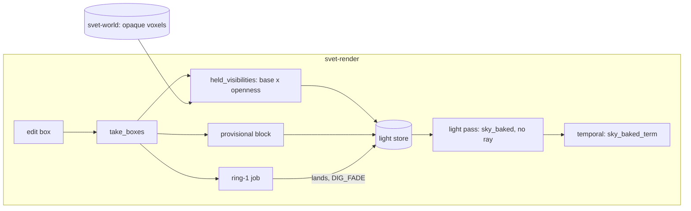

# 0105: The dig's flash at depth: a held estimate that follows the hole's own light

> **Status:** in-progress (Phase 7a read 2026-11-26 and stopped for the architect: under the default `depth`, `gpu_outdoor`'s soak test `a_fresh_hole_holds_its_value_until_its_light_lands` misses its ring bar in sequence B, 4.42 % of the ring darker by over 4 levels against 2 %, at the fifth dig's D+0 and D+1, and passes under `surface`; `gpu_sun`'s rule 3 holds; Phase 6 done by the owner 2026-11-26: `depth` is the default; Phase 5 done 2026-11-26: the 5 m dig into a chunk with no block is held on a record under `depth`, both modes, no casting frame; B2's under clause at `down` 1 m stays the window's case; Phase 4c read 2026-11-26 and stopped for the architect: B2's restated second clause missed at `down` 1 m, lockstep, -4.53 mean under `S` at D+0, the first of six holds; the five others read after the stop (Reading 17): `wide` meets it, the `down` bake thread misses the same way; Phase 4b done 2026-11-26: `side` lockstep `depth`, B1 met at 2, 3, 5 and 7 m against `S`, no part from 2 m over its landed byte; 4c not started; Phase 4 read 2026-11-26 and stopped for the architect: B1 missed at `side` 2 m, +9.9 mean, and B2's second clause at `down` 1 m, 8.0 levels under `surface` at D+0; Phase 3 done 2026-11-26; Phase 1 done 2026-11-26; the phases after it are rewritten under "Amended 2026-11-26 (architect)": the held floor is the flash; Phase 2 read 2026-11-26 and stopped for the architect: the exposure at D-1 is not within 1 % of D+60's at 6 of 20 read digs); approved (owner, 2026-11-26: go; his four answers are under "Amended 2026-11-26 (owner)" and bind Phase 1's sites and the remedy's bars; drafted from the owner's report after Plan 0099's window, with
> his three answers and no further interview; the questions left are under "Risks & open
> questions", each with a recommended option). Starts on a main that holds Plan 0099.
> **Created:** 2026-11-26
> **Milestone:** M10: Outdoors in [`docs/roadmap.md`](../roadmap.md)
> **Related ADRs:** [ADR-0082](../adrs/0082-the-light-pass-keeps-no-screen-history-by-default-and-reads-smooth-sources-to-the-mid-range.md)
> (the dig's held record: "the sky visibility of the surface the dig cut through, times a near
> openness"; this plan changes the estimate inside that mechanism, so no new ADR, and ADR-0082
> takes a dated Outcome note at the close if the default estimate changes),
> [ADR-0076](../adrs/0076-light-stability-rules-world-history-per-source-a-fade-per-transition-and-a-ratcheted-pop-counter.md) (rule 3: the history is the store's provisional record, one
> fade a switch), [ADR-0083](../adrs/0083-the-live-bake-queue-runs-on-a-bake-thread-the-render-thread-applies-its-write-lists-and-issues-its-submits.md) (the bake thread; the flash is the same with
> it off).

## TL;DR

A freshly dug face shows for a blink brighter than it settles, "as if lit with the surface's
light" (owner, 2026-11-26): unnoticed near the surface in sunlight, bothering past 2 to 3 m
deep, the same with the bake thread off. The code reading below says what the face shows in
those frames: a record made on the CPU at the edit whose base is the **surface's** sky
visibility (the nearest record above the cell, else the chunk's summary, which a surface
chunk's lit ground dominates) times the square root of an openness that looks only 1.6 m far.
Neither term knows how deep the hole is. Phase 1 reproduces the blink headless at depth and
reads, per frame, the new faces' brightness and which write gave it. The fix phases then make
the held estimate follow the hole's own baked light, one change a phase, behind a setting the
owner compares in a window before it becomes the default.

## Context & problem

The owner's report (forest scene, `--source outdoor --spawn forest --trees forest --time
15:00`, RTX 3080 Laptop, `--profile floor`, binary at `cde2e966`): "it flashes with light when
digging, it is mostly fine when near the surface and sunlight, but when I dig deeper, more
than 2-3 meters it is already bothers". His answers: the same with the bake thread off;
"bright than darker, I think it is lights with surface light"; "one blink".

It is the remainder ADR-0082 disclosed ("the slight colour change the owner names at a landing
is the held estimate's distance from the baked record"), accepted at the surface in Plan
0098's window 98e and parked in the backlog ("A dig's landing"). At depth the distance is no
longer slight. The owner's rules that bind the remedy: a stable image first; no waiting for
light (a stable approximation while the bake runs is the accepted route); a scene is never
simplified for a test; a remedy that can change the look is shown in a window first.

### The code reading (architect, 2026-11-26, at `0d4e4b77`; read from code unless marked)

**What a dug face shows from the edit to its landing, under the default `DigHold::On`:**

1. *At the edit* (`BakeQueue::take_boxes`, `bake/queue/digs.rs`): each chunk holding a brick
   the box touches takes a provisional block (`provisional_block`, `bake/summary.rs`: a kept
   brick's record, a new brick the mean of the records within one or two bricks), and each
   touched brick's cells then take a **held record** (`held_visibilities` and `apply_held`,
   `bake/held.rs`): six sky visibilities with `VIS_BAKED` and no `SKY_STALE`, the key words
   cleared.
2. *In the light pass* (`sky_baked`, `shaders/shade.wgsl`): the held record reads as a fresh
   record, so no sky ray is cast; `temporal.wgsl` shows `sky_baked_term` of it. The key
   light, with `KEY_BAKED` clear, falls to the column map's horizon (`key_cover_far`,
   `shaders/pair.wgsl`; `column_key_visibility`, `shaders/key_horizon.wgsl`).
3. *At ring 1's landing* (one or two frames after the dig in lockstep per ADR-0082; about 95
   to 170 ms on the bake thread per Plan 0099's log) the store fades from the held record to
   the job's over `DIG_FADE` = 4 frames. That is the blink's length in either mode.

**The held value** of a dug face of direction `f` is
`max(min(own_f, up) * sqrt(open), HELD_FLOOR)`:

- `up` is the up visibility of the nearest record at or above the cell within `HELD_CELLS`
  = 4 cells, **else the chunk summary's** (`SUMMARY_AT`, the mean by direction of the chunk's
  brick records, `block_summary`). A floor cell in the middle of a pit has air above it, so
  it takes the summary; in the chunk that holds the ground, that is mostly the lit surface's
  value. This is literally "the surface's light", and it does not fall with depth inside a
  chunk (6.4 m tall).
- `open` is the share of 12 fixed rays that leave `HELD_REACH` = 16 voxels (1.6 m) without
  meeting rock. Past 1.6 m of depth a ray that clears the reach counts as sky whatever is
  beyond it, and the square root lifts a small share (1 ray of 12 gives 0.29).
- Derived, not read: the rays' rings stand 24, 45 and 66 degrees off the face's normal, so
  over 16 voxels they run 6.5, 11.3 and 14.6 voxels sideways. A floor in a pit of 1 m radius
  keeps the inner ring open (`open` 4/12, a held value of 0.58 `up`), while the true
  cosine-weighted visibility of the pit's mouth from the floor's centre is
  `r^2 / (r^2 + d^2)`: 0.50 at 1 m, 0.10 at 3 m, 0.04 at 5 m. At the default dig radius
  (0.5 m, `DIG_RADIUS`) a single straight shaft closes every ray and holds the floor value,
  so the flash needs a hole wider than one dig, which several digs make.

**Three mechanisms can give "bright for a blink, then darker" at depth:**

| | mechanism | where | the owner's answers |
|---|---|---|---|
| M1 | The held record over the baked one: the base is the surface's (the summary) and the openness sees 1.6 m | `bake/held.rs` | **Favoured by all three**: bright then darker, "the surface's light", one blink (the fade), the same in lockstep, fine near the surface (within the rays' reach the openness is true) |
| M2 | A chunk that held no block before the dig (solid rock has no face) is a "whole" dig: `take_boxes` gives it no provisional block and no held record. Its faces read no record: the sky ray is cast, and its mean is seeded each frame from the column's answer (`column_estimate`: 1 above the column's top, so 1 in an open pit). `pair_step`'s arithmetic is not traced | `bake/queue/digs.rs` (the `continue` for a chunk with no block), `shaders/temporal.wgsl`, `shaders/pair.wgsl` | Fits the direction and "deep", but happens once a chunk entered, not at every dig |
| M3 | The key light from the column horizon at a held record | `shaders/key_horizon.wgsl` | **Not favoured**: a point under its column's top reads 0, and a pit's walls stand in the horizon, so it errs dark; in the window the sun is what hides the flash near the surface |

A fourth candidate, the source fade at a chunk's first landing (`source_faded`), is off by
default (`Lighting::source_fade`) and is not pursued.

## Decision

Measure first, then change the held estimate, not the mechanism. The dig keeps ADR-0082's
shape: a record made on the CPU at the edit, read as any record, one fade to the job's
record. What changes is what the record holds at depth: the base comes from the hole's own
baked light (the nearest record of the same direction about the cell) before the chunk's
summary, and, if that is not enough, an open ray must reach the sky, not 1.6 m. A chunk with
no block takes a held record too if Phase 1 shows M2 on screen. The new estimate is a
setting; the old one stays as the before arm and stays a setting after the pick (cheap modes
stay settings).

Rejected here, already rejected or parked by ADR-0082 and Plan 0098's "Amendment at window
98d": the dig delayed until its light is ready (staged mirror records, a plan with its own
ADR, backlog "A dig's landing"); a screen history in the dig's box; `DigHold::Rays` as the
default (the cast rays' noise is what Plan 0098 removed). A longer fade is rejected too: it
shows the wrong value for longer.

## Architecture diagram



## Implementation phases

Each phase ships as its own commit. **Phases 1 to 4 are exploration** (lane rules 2b): they
name readings, not image tests; CPU tests of data stay with their phase. Phase 6 writes the
asserting tests against the owner's pick. No run under the perf lock passes 20 minutes: the
dev projects a run's time from its first arm and, past that, stops and goes to the architect.
The gate tier is the most any step runs.

Every phase carries exactly one `**Owner skill:**`: `dev` or `human`.

### Phase 1: The blink reproduced headless at depth (exploration, a reading)
- **Owner skill:** dev
- **What:** One reading in the `gpu_outdoor` binary (a new file beside
  `gpu_outdoor/dig_line.rs`, built on its `dig_timeline` and `support::defects`' dig
  helpers; run by name, soak-marked, never a gate), on the real forest scene at 15:00 with
  the floor profile's settings. No engine behaviour changes.
  - **The sites, in the scene as it is:** (P) a pit dug from the forest spawn's ground
    straight down by digs in a row, wide enough to stand in (the default radius, 0.5 m, with
    the digs spread as `B_AIMS` spreads them, and one arm at 1.0 m), read at each dig whose
    floor is about 1, 2, 3, 5 and 7 m under the ground (7 m crosses the ground chunk's
    floor; the reading prints which digs opened a chunk that held no block,
    `QueueStats::digs_whole`); (S) a sloped tunnel, 30 degrees down from the same ground,
    read at the same depths; (T) a dig into the wall and the floor from the tunnel's eye
    (`--spawn inside`), under cover.
  - **Per read dig:** the queue settled first (no dig waits, no block fades), then the dig,
    and frames D-1 to D+24 with the bake thread off and on. Per frame, over the pixels
    whose hit lies in the dig's box: the mean and the 95th percentile of the output's
    luminance in display levels against the settled frame's (D+60); the sky term, the key
    term and the stored part apart (`support::terms`); the sky term's source shares
    (`sky_source` under `COUNT_STORE`: record, stale record, summary, column, cast); and
    the pool's state (`support::queue::dig_held`, `ring1_landed`), so each frame's value
    is tied to the write it came from (the held record, the fade, the job's record).
  - **The CPU table:** per dug cell and direction of each read dig, the held value with
    its parts (the base and where it came from: a record above at which cell, the chunk's
    summary, or the cell's own cap; the openness) beside the job's landed value. A trace
    out of `held_visibilities` for readings only.
- **Files touched:** `apps/flythrough/tests/gpu_outdoor.rs`, a new
  `apps/flythrough/tests/gpu_outdoor/dig_depth.rs`, `apps/flythrough/tests/support/`
  (a sibling file; no more than four `SVET_*` variables in a file, `SVET_DIG` reused),
  `crates/svet-render/src/bake/held.rs` and its reading accessor, `docs/plans/logs/0105.md`.
- **Done when:** the log holds, per site, depth and thread mode, the frames from the dig to
  ring 1's landing, the peak of the new faces over their settled value (levels and ratio)
  with its frame and the write that frame showed, and the term that carries it; and the CPU
  table's summary (held over landed by depth, split by the base's source). The log then
  names what carries the blink: M1 (and which part, base or openness), M2, M3, or something
  else. **Stops:** the blink not reproduced at 3 m or deeper on any site (peak under 4
  levels over settled): the dev reports the sites tried and stops, and the owner is asked
  for his eye and dig radius (`--eye`); M3 or an unnamed source dominant: stop, the
  architect amends. Quick tier, clippy and fmt over the changed files. Binary: `gpu_outdoor`.

### Phase 2: The base from the hole's own light (exploration, the first fix)
- **Owner skill:** dev
- **What:** Only if Phase 1 names M1 with the base as a part. A setting
  `Lighting::dig_estimate` (`surface`, today's and the default; `depth`) with the
  fly-through's `--dig-estimate surface|depth`, its value in the banner's and the HUD's mode
  rows. Under `depth` a dug face's base is the nearest baked record of its own direction
  about the cell (the hole's floor and walls as the earlier digs' jobs left them, a stale
  mark not excluding them), capped by today's `up`; the chunk's summary answers only where
  no such record lies within reach. The reach and the walk's order are the dev's, fitted on
  Phase 1's CPU table, not on the image.
- **Files touched:** `crates/svet-render/src/bake/held.rs`, `bake/queue/digs.rs`,
  `crates/svet-render/src/frame/settings.rs`, `frame/settings/sky_light.rs`,
  `crates/svet-render/src/settings.rs`, `frame/baked.rs`, `apps/flythrough/src/cli/`,
  `apps/flythrough/src/hud/modes.rs`, `docs/flythrough.md`, `docs/plans/logs/0105.md`.
- **Done when:** Phase 1's reading, both arms side by side: under `depth` the new faces'
  peak over settled at every read depth of 2 m and more is at most the same run's peak at
  the 1 m dig under `surface` (the case the owner calls fine), and the 1 m dig's own frames
  move by at most 4 display levels between the arms (the accepted surface look holds). A
  CPU test in `bake::held::tests` (under 1 s): a dug floor under a pit whose walls hold
  records of up visibility 0.1 and whose chunk summary holds 0.9 takes a base of at most
  0.1 under `depth` and 0.9 under `surface`. The mode row reads the setting's value
  (`gpu_settings_rows`, the row's test). The D+0 step's time for the same digs before and
  after (`QueueStats::stages`), printed. **Stops:** the bar missed with the base alone:
  Phase 3; an edit's wait as section 4 of `docs/nfr.md` pins it no longer met: stop, the
  architect rules. Binaries: `gpu_outdoor`, `gpu_settings_rows`.

### Phase 3: An openness that reaches the sky (exploration; only if Phase 2's bar is missed, or Phase 1 names the openness alone)
- **Owner skill:** dev
- **What:** Under `depth`, a ray that clears `HELD_REACH` counts as open only if it goes on
  to leave the ground (a coarser march over the opaque masks until it stands above its
  column's top, or a far cap the dev sets and states), and the square root is dropped or
  kept by its fit to Phase 1's landed values, stated in the log with the fit. One change;
  the base stays Phase 2's.
- **Files touched:** `crates/svet-render/src/bake/held.rs`, `docs/plans/logs/0105.md`.
- **Done when:** Phase 2's bar, read the same way, with this arm; the CPU table's held over
  landed by depth for the three forms (today's, Phase 2's, this); a CPU test in
  `bake::held::tests` (under 1 s): a floor 40 voxels down a pit 20 voxels wide with rock
  above the pit's mouth holds the floor value under `depth`, and with the mouth open holds
  more than the floor value. The D+0 step's time before and after. **Stops:** the bar
  still missed: stop, the architect amends (the remaining routes are the backlog's staged
  records, or a held record that errs dark on purpose, owner question 2); the edit's wait
  no longer met: stop. Binary: `gpu_outdoor`.

### Phase 4: A chunk with no block holds the dig too (exploration; only if Phase 1 shows M2 on screen)
- **Owner skill:** dev
- **What:** Under `depth`, a dig into a chunk that held no block gives it a provisional
  block and held records at the edit, as a chunk with a block takes them, the base from the
  records across the chunk's faces. One change.
- **Files touched:** `crates/svet-render/src/bake/queue/digs.rs`, `bake/summary.rs`,
  `bake/held.rs`, `docs/plans/logs/0105.md`.
- **Done when:** Phase 1's reading at the digs it marked whole: no frame between the dig
  and the landing shows a sky source of `column` or `cast` at the new faces under `depth`,
  and their peak over settled meets Phase 2's bar. The pool's words at the edit for such a
  dig, before and after, printed (the provisional block is placed one landing early; the
  pool's cap is not raised). **Stops:** `PoolFull` counted at a read dig that did not count
  it before: stop, the architect rules. Binaries: `gpu_outdoor`, `gpu_queue`.

### Phase 5: The owner's window
- **Owner skill:** human
- **What:** The owner digs in the forest scene as in his report, down past 3 m, a pit and
  a tunnel, with `--dig-estimate surface` (the before arm) and `depth`, the bake thread on;
  the mode shown in the banner and the HUD. **No camera hold: no `--pre-roll-drain`.** The
  fly-through's stdout stays visible. Linux only.
- **Done when:** the owner says, per arm, whether the flash at depth bothers, and whether
  the dig near the surface looks as before; he picks the default, or names what is still
  wrong (then the architect amends).

### Phase 6: The pick as the default, with its tests
- **Owner skill:** dev
- **What:** The picked estimate as `Lighting::dig_estimate`'s default in every profile; the
  other stays a setting. The asserting tests, the docs and the readings.
- **Files touched:** `crates/svet-render/src/frame/settings.rs`,
  `crates/svet-render/tests/gpu_sun/` (the synthetic pit), `apps/flythrough/tests/gpu_outdoor/`,
  `apps/flythrough/tests/gpu_settings_rows.rs`, `docs/nfr/04-edits.md`, `docs/flythrough.md`,
  `CHANGELOG.md` is the architect's at the close.
- **Done when:** (1) a GPU test in `gpu_sun` on a synthetic pit 40 voxels deep under an
  open sky: each dug cell's held up visibility under the default lies within the bar Phase
  2's or 3's log read between held and landed there (the dev states the figure from the
  log; expected under 10 s on lavapipe, a guess; over it the test is born
  `#[ignore = "soak"]`); (2) the forest reading of Phase 1 as a soak-marked image test
  (`gpu_outdoor`, over 10 s on lavapipe, born `#[ignore = "soak"]`, not a gate): the new
  faces' peak over settled at the 3 m and 5 m digs under the default is at most the 1 m
  dig's under `surface`; (3) `every_profile_holds_the_calm_picks` reads `dig_estimate`
  (and `dig_hold`, the backlog's owed row, if it is one line); (4) the edit's readings in
  `docs/nfr/04-edits.md`: the D+0 step and an edit's wait before and after, machine and
  commit; (5) the gate tier at the tip under the perf lock, clippy, fmt, deny, the doc
  gates. Binaries: `gpu_sun`, `gpu_outdoor`, `gpu_settings_rows`; the gpu tier at the tip.

## Amended 2026-11-26 (owner)

The owner gave the go and answered the questions (2026-11-26, his words):

1. The go: "go".
2. Which way a new face may err: "slightly dark, and I think we should keep depth in mind. If
   deep enough, no flash should happen - like in a cave, as there is no chance of sunlight".
3. The accepted surface dig stays as it is: "yes".
4. Which hole: "pit dig looking down or to the side, narrow, i think it was 1 dig wide. but
   not 100% sure".

What the answers change:

- **Answer 4 runs against the code reading's caveat** (a single straight shaft at the default
  dig radius closes every ray and holds the floor value, so M1 should not flash there). The
  reading is a reading, not a measurement, and the owner is not certain of the width, so
  neither is taken as settled. **Phase 1's first site is his: a pit one dig wide at the
  default radius, dug looking down, and the same dug to the side from the pit's wall, at 1 to
  7 m, before the wider pits.** If the one-dig shaft flashes, Phase 1 names what wrote the
  bright frames there (M2's chunk with no block, the faces at the shaft's rim or wall, or a
  source the reading did not name) and stops for the architect before Phase 2: the first fix
  is then chosen for that cause, not for M1 by default. If it does not flash there and does
  in the wider hole, that is reported with both, and Phase 2 goes on as written.
- **Answer 2 adds a bar to the fix phases and to Phase 6's tests: at depth no flash at all.**
  Where the landed light of the new faces is dark (the cave and the tunnel away from the
  mouth, and a pit deep enough that the sky's share is under the held floor), no frame from
  the dig to the landing shows the new faces brighter than their settled value by more than
  the 4 levels the surface dig is held to. A new face may start under its settled value and
  rise. The depth is to be read by the estimate (how far the hole's own light and the open
  sky are), not assumed from the surface's light.
- **Answer 3** is the plan's bar as written (the 1 m surface dig within 4 levels, the before
  arm at the window).

No other phase text changes. Phase 5's window shows him a narrow one-dig pit at depth first.

## Amended 2026-11-26 (architect)

After Phase 1's readings ([the log](logs/0105.md), "What the architect inherits"; code read at
`56e34b50`). **This section replaces Phases 2 to 6 above**; they stay as the record of the
draft. The Implementation log's rows 2 to 6 are rewritten by `dev` to the phases below at the
first commit under this amendment. The owner's bars (his amendment above) bind every phase.

### The cause

**The flash is the held record's floor: `HELD_FLOOR`, 0.02 of the open sky, written into every
direction of every dug cell, where the hole's own baked light is 0.** In a hole the sky's
irradiance times 0.02 is not "just above black": it is the 3.8 to 4.4 the stored part shows at
the peak at every depth of both sites, against 0.0 to 0.5 settled from 3 m. The same 4 units
are +12 levels under the surface eye's exposure (`down`, 1.37e-2) and +78 to +100 under an eye
in the hole (`side`, lockstep, 1.7e-1). The owner's cave is the worst case of a floor above
black, not an edge of it.

Measured (Phase 1, RTX 3080 Laptop):

- The peak is on the held record in every read (D+0; D+0 and D+1 with the bake thread), falls
  through the four fade frames and is gone at the job's record. Key term 0, direct 0, every
  stored direction value 0.0000 from every source: the stored part is the no-ray sky term
  alone.
- From 2 m every traced held value sits at the floor (0.020), at the estimate where it is
  higher (to 0.040, `side`), or under the floor by the mean with kept faces; the landed
  values are 0.000 to 0.008.
- At `down` 5 m the dig enters a chunk with no block (`digs_whole` 1): 10 % of the box's
  lighting pixels have no record and cast, in the held frames only.

Read from code and derived from Phase 1's tables, not measured:

- **The 8.5 against 3.6 at `down` 3 m needs no other source.** `Lighting::sky_bounce` is 0 by
  default, so `sky_baked_term` is only the smoothed normal's mix: the sum over the directions
  the normal leans toward of that direction's visibility times its open irradiance. The
  pair's x is the hit face's own direction alone. In the settled frame only the floor's up
  direction holds anything (0.008) and the mix dilutes it with wall directions at 0.000 (a
  sphere's floor is a bowl; its smoothed normals lean to the walls). In the held frame every
  direction the mix can reach holds 0.016 to 0.020, the directions with no face too
  (`apply_held` sets all six in the mask, at the mean of the held ones). The term is linear
  in the cell's six held values, so the split between the hit face and the mixed directions
  does not change the fix and is **not read apart**.
- **The estimate under the floor is second in size and errs bright too.** Recomputed from
  Phase 1's traced parts with the floor at 0 (quantised to the record's byte): at `down` the
  parts over their landed value fall from all of them to 2 or 3 a depth from 3 m, each by one
  byte; at `side` 3 to 6 parts a depth stay over by up to 0.06. Those take the surface's
  light as the base (the chunk summary, 0.125 to 0.137, at 3 and 5 m; a record one to three
  cells above, 0.07 to 0.17, at 1 and 2 m) times the square root of a share of rays that
  cleared 1.6 m **up the shaft**, which is not the sky. That is the draft's M1 (base and
  openness), behind the floor.
- **One byte matters in the dark.** A byte of visibility (1/255) is about 0.85 of the stored
  part here (0.0196 gives 4.2). Under the `side` eye's exposure that is of the order of ten
  levels or more at the pixels that read it (derived from +78 for 3.9; the display curve is
  not linear). So where the landed value is 0 the held value must be 0, not small.
- **The +28 at `down` 5 m is two things.** About +11 is the floor, as at 3 and 7 m (its D+1
  is +10.7). The rest, about +15, is the draft's M2: `take_boxes` gives a chunk with no block
  no provisional block and no held record (the `continue` for a whole dig), so its new faces
  cast, and a reset pair's seed with no record is `column_estimate`, 1 in a column open to
  the sky, which a straight shaft is. The box's mean x of 0.109 with 10 % of the pixels
  casting puts those pixels near 0.9: the open sky at 5 m down, the p95 of +158. It needs a
  shaft under an open column and a chunk entered: once every 6.4 m down. A side dig under
  rock reads 0 there.
- **`side` is larger than `down` by the exposure, not by the light:** the stored part is the
  same 3.8 to 4.3.

### The decision

The held record keeps ADR-0082's shape (a record made at the edit, read as any record, one
fade). Under a setting, `Lighting::dig_estimate = depth`, **the held value is a lower bound of
the hole's own light, and 0 where no ray reaches the light it is scaled from**: no floor; a
ray counts open only where it rises to the height its base was read at; a chunk with no block
holds the dig as any chunk. A new face may then start dark and rise through the fade, never
bright then dark (the owner's answer 2). Depth is read by the rays, not assumed.

Rejected:

- **A smaller floor (one byte, 0.004).** One byte over a landed 0 is still a flash under an
  eye in the hole (above).
- **A floor scaled by the base.** The base at depth is the surface's (the summary); it is not
  0 where the light is.
- **Black for every new face.** It passes at depth by the tables, and starts the 1 m dig at
  about half its light (derived: 0.44 of 0.82 summed over the traced parts), against the
  owner's answer 3.
- **The draft's Phase 2 as the first fix (the base from the nearest record of the face's own
  direction).** At `down` the base already is the hole's own record (the cell's or the one
  above) and the values sit at the floor regardless; it would have changed nothing there. It
  stays the architect's next route if Phase 4 misses by parts whose base is the summary.
- **A seed for the cast pair that knows depth (the shader's `column_estimate`)** for M2: it
  changes every face with no record in the world, and leaves the dig on two mechanisms.
- A shorter or longer fade, the cast rays (`DigHold::Rays`), a screen history, the dig
  delayed until its light is ready: as in the Decision above.

**No new ADR.** The mechanism is ADR-0082's; the clause the default would change is "at least
a floor above black". At the close, if the owner picks `depth`, ADR-0082 takes this dated
Outcome note (draft): "Plan 0105: the held record's floor above black read as the dig's flash
at depth (0.02 of the open sky over a landed 0: +12 display levels from the surface, +78 to
+100 under an eye in the hole, RTX 3080 Laptop). The default estimate holds no floor, counts a
ray open only where it reaches the height its base was read at, and gives a chunk with no
block a held record; a new face may start dark and rise. The earlier estimate stays a setting
(`dig_estimate = surface`)."

### The bars (every fix phase reads them the same way)

Phase 1's rig, sites `down` and `side`, radius 5, lockstep and the bake thread on, at 1, 2, 3,
5 and 7 m, the frames from D+0 to the first frame on the job's record, the mean and the p95
over the box's pixels against D+60:

- **B1, no flash at depth:** at 2 m and deeper no frame's mean is over the settled frame by
  more than 4 levels, and no frame's p95 by more than 8 (the 1 m dig's p95 under `surface`,
  the dig the owner calls fine).
- **B2, the shallow dig holds:** at 1 m no frame's mean is over settled by more than 4, and
  each frame's mean under `depth` is within 4 levels of the same frame's under `surface`.
- **B3, dark then up:** the lowest mean under settled per depth is printed (a reading; the
  owner judges it in the window).
- `side` counts only with the exposure settled before the dig (Phase 2 makes the rig do it).
- No run under the perf lock passes 20 minutes; a site is one hold of the lock.
- **A missed bar stops the phase and goes to the architect. No second variant, no tuned
  constant, no loosened figure, no changed scene.**

Phases 2 to 5 are exploration (lane rules 2b): readings and CPU tests of data; the asserting
image tests are Phase 7's.

### Phase 2: The before arm on a settled exposure, and the wide pit (exploration, a reading)
- **Owner skill:** dev
- **What:** No engine behaviour changes. (1) The rig holds the eye at each read dig's place
  until the auto exposure is still (it moves under 1 % over 24 frames; the dev states the
  rule it used) before D-1, at every site; the table prints the exposure at D-1, D+0 and
  D+60. (2) `side` in lockstep and with the thread on, under today's estimate: the before arm
  in display levels. (3) `wide` at radius 5, both modes: whether the hole several digs wide
  flashes, by how much, and which base its parts take. `slope` and `tunnel` stay unread (the
  window walks them).
- **Files touched:** `apps/flythrough/tests/gpu_outdoor/dig_depth.rs`,
  `apps/flythrough/tests/support/` if the stillness check lives there, `docs/plans/logs/0105.md`.
- **Done when:** the log holds, for `side` and `wide` in both modes, Phase 1's table a depth
  with the exposure at D-1 within 1 % of D+60's at every read dig, and the lockstep CPU
  table for `wide`. **Stops:** the exposure not still within 600 frames at a read place:
  stop, the architect rules; `wide` shows a term other than the held record's sky term
  (key, direct or a stored direction value over 0): stop. Quick tier, clippy and fmt over
  the changed files. Binary: `gpu_outdoor`.

### Phase 3: No floor under the held value (exploration, the first fix)
- **Owner skill:** dev
- **What:** The setting `Lighting::dig_estimate` (`surface`, today's and the default until
  the window; `depth`), the fly-through's `--dig-estimate surface|depth`, its value in the
  banner's and the HUD's mode rows, and the rig's arm as a fourth field of `SVET_DIG`. Under
  `depth` the held value takes no floor on any path of `held_visibilities`: a dig's face
  holds `base * sqrt(open)` as it is, 0 included; a direction with no face holds the mean of
  those with one, and a cell with none its base, neither raised. Nothing else changes: the
  base, the rays and their reach are today's.
- **Files touched:** `crates/svet-render/src/bake/held.rs`, `bake/queue/digs.rs`,
  `crates/svet-render/src/frame/settings.rs`, `frame/settings/sky_light.rs`,
  `crates/svet-render/src/settings.rs`, `frame/baked.rs`, `apps/flythrough/src/cli/`,
  `apps/flythrough/src/hud/modes.rs`, `apps/flythrough/tests/gpu_outdoor/dig_depth.rs`,
  `docs/flythrough.md`, `docs/plans/logs/0105.md`.
- **Done when:** at `down`, both modes, under `depth`: B1 at 2, 3 and 7 m, and at 5 m in
  every frame whose pixels all read a record (the casting frames there are Phase 5's and are
  printed); B2 at 1 m. At `side`, both modes, both arms printed side by side with the parts
  still over their landed value listed by base and openness; `side` has no bar in this
  phase (the derivation above expects parts over, Phase 4's). A CPU test in
  `bake::held::tests` (under 1 s, no GPU): a floor face at the centre of a shaft 10 voxels
  wide and 40 deep, base 0.9, holds `HELD_FLOOR` under `surface` and exactly 0 under `depth`
  (the inner ring runs 6.5 voxels sideways in 16, the wall is at most 5.5 away, so every ray
  closes). The mode row reads the setting (`gpu_settings_rows`). The D+0 step's time for the
  same digs in both arms (`QueueStats::stages`), printed. **Stops:** a bar missed at `down`.
  Binaries: `gpu_outdoor`, `gpu_settings_rows`.

### Phase 4: A ray is open where it reaches its base's height (exploration, the second fix)
- **Owner skill:** dev
- **What:** Under `depth` a ray that clears `HELD_REACH` goes on, and counts open only where
  it rises, with no opaque voxel on its way, to the height the face's base was read at: the
  top of the cell whose record gave the base (a ray from a face whose base is its own cell's
  record is today's), the chunk's top for the summary, which is the chunk's mean and the
  ground's faces dominate it. A ray that leaves the opacity grid before that height is
  closed; the grid about the touched bricks grows to hold the march, read lazily as today.
  The held value is then the base times the share of rays that reach it. **The form over
  that share (today's square root, or the share itself) is fitted on the CPU table, not on
  the image:** the trace prints both, and the phase takes the square root if, at 2 m and
  deeper on `down`, `side` and `wide`, no traced part's held value is over its landed value
  by more than one byte and at most one part in ten is over at all; else the share itself;
  the pick and the table go in the log. One change: no base changes source.
- **Files touched:** `crates/svet-render/src/bake/held.rs`, `bake/queue/digs.rs` (the grid's
  extent), `apps/flythrough/tests/gpu_outdoor/dig_depth.rs` (the trace's columns),
  `docs/plans/logs/0105.md`.
- **Done when:** B1, B2 and B3 at `down` and `side`, both modes (5 m at `down` as in Phase
  3), and B1 at `wide` from 2 m; the CPU table's held against landed per depth for the three
  forms (today's, Phase 3's, this). CPU tests in `bake::held::tests` (under 1 s): a floor 40
  voxels down a pit 20 voxels wide under an open sky whose base is the summary's 0.9 holds
  more than 0.4 under `surface` (the inner ring's four rays clear 16 voxels: 0.9 times the
  root of 4/12 is 0.52) and exactly 0 under `depth` (a ray 24 degrees off the vertical runs
  17.9 voxels sideways in 40 and the wall is at most 10.5 away); the same pit 8 voxels deep
  holds more than 0 under `depth`. The D+0 step's time in both arms, printed, with the edit's
  wait. **Stops:** a bar missed (the routes left are the architect's: the base from the
  hole's own direction records, or the staged records of the backlog); the edit's wait as
  section 4 of `docs/nfr.md` pins it no longer met. Binary: `gpu_outdoor`.

### Phase 5: A chunk with no block holds the dig too (exploration, the third fix)
- **Owner skill:** dev
- **What:** Under `depth`, a dig into a chunk that held no block gives it a provisional
  block and held records at the edit, as a chunk with a block takes them. The base is the
  walk's as it is (it crosses the chunk's face into the hole's records above); a cell with
  no record within the walk and no summary holds 0, not no record. The chunk's job then
  lands on that block through the dig's fade. Starts on a branch that holds main (Plan 0101
  edits `bake/queue/open.rs` and `list.rs`).
- **Files touched:** `crates/svet-render/src/bake/queue/digs.rs`, `bake/summary.rs`,
  `bake/held.rs`, `docs/plans/logs/0105.md`.
- **Done when:** at `down` 5 m (the dig Phase 1 marked whole), both modes, under `depth`: no
  frame from the dig to the landing shows a sky source of `column`, `cast` or no value at
  the new faces, and B1 holds in every frame; B1 and B2 still hold at the other depths and
  at `side`. A CPU test in the queue's tests (under 1 s): a box into a chunk with no block
  leaves a block whose touched bricks hold records with `VIS_BAKED` and no `SKY_STALE`. The
  pool's words at the edit for that dig in both arms, printed (the block is placed one
  landing early; the pool's cap is not raised). **Stops:** a bar missed; `PoolFull` counted
  at a read dig that did not count it before; the whole dig's job cannot land on the held
  block without a change outside the files named. Binaries: `gpu_outdoor`, `gpu_queue`.

### Phase 6: The owner's window
- **Owner skill:** human
- **What:** The forest scene as in his report (`--source outdoor --spawn forest --trees
  forest --time 15:00`, `--profile floor`, the bake thread on). **First the narrow pit: one
  dig wide, straight down past 5 m, then digs to the side from inside it**, with
  `--dig-estimate surface` (the before arm) and `depth`; then a wider pit and a tunnel as he
  likes. The mode shows in the banner and the HUD. **No camera hold: no `--pre-roll-drain`.**
  The fly-through's stdout stays visible. Linux only.
- **Done when:** the owner says, per arm, whether anything flashes at depth, whether a new
  face's dark start bothers, and whether the dig near the surface looks as before; he picks
  the default, or names what is still wrong (then the architect amends).

### Phase 7: The pick as the default, with its tests
- **Owner skill:** dev
- **What:** The picked estimate as `Lighting::dig_estimate`'s default in every profile; the
  other stays a setting. The asserting tests, the docs and the readings.
- **Files touched:** `crates/svet-render/src/frame/settings.rs`,
  `crates/svet-render/tests/gpu_sun/` (the synthetic shaft), `apps/flythrough/tests/gpu_outdoor/`,
  `apps/flythrough/tests/gpu_settings_rows.rs`, `docs/nfr/04-edits.md`, `docs/flythrough.md`;
  `CHANGELOG.md` and ADR-0082's Outcome note are the architect's at the close.
- **Done when:** (1) a GPU test in `gpu_sun` on lavapipe, a synthetic shaft 10 voxels wide
  dug to 40 voxels under an open sky, the last dig read in lockstep: no dug cell's held
  visibility is over its landed one by more than one byte, and no frame from the dig to the
  landing shows the box's mean over its settled frame by more than 4 display levels
  (expected under 10 s on lavapipe, a guess; over it the test is born `#[ignore = "soak"]`);
  (2) Phase 1's forest reading as a soak-marked image test (`gpu_outdoor`, over 10 s on
  lavapipe, born `#[ignore = "soak"]`, not a gate): B1 at 3 and 5 m at `down` and `side`
  under the default, B2 at 1 m; (3) `every_profile_holds_the_calm_picks` reads
  `dig_estimate` (and `dig_hold`, the backlog's owed row, if it is one line); (4) the
  edit's readings in `docs/nfr/04-edits.md`: the D+0 step and an edit's wait before and
  after, machine and commit; (5) the gate tier at the tip under the perf lock, clippy, fmt,
  deny, the doc gates. Binaries: `gpu_sun`, `gpu_outdoor`, `gpu_settings_rows`; the gpu tier
  at the tip.

### What this changes elsewhere in the plan

- **Budgets:** Phase 4's longer rays march at most a chunk's height more for the rays that
  clear the near reach (a few of twelve a face in a hole; a guess, read in Phase 4), and the
  opacity grid grows upward with them. Phase 5's block is the draft's Phase 4 line.
- **Risks:** the far rays under the forest's canopy are stopped at the base's height so the
  canopy is not counted twice (the base already holds it); if B2 misses at 1 m all the same,
  the stop is the architect's, and question 2 below is then live.

### Questions for the owner (none blocks the phases)

1. **A dig to the side at 1 to 2 m under the mouth may show black for the fade's frames
   (about five) and then rise to its dim light.** Recommended: (a) accept it and judge it in
   the window (it is your "slightly dark, then up"); (b) hold out for a start nearer the
   settled value, which needs the hole's own direction records as the base (one more phase).
2. **If no flash at depth and the unchanged surface dig cannot both hold, which wins?**
   Recommended: (a) neither is given up yet: the phase stops and the architect looks for a
   form that keeps both; (b) no flash at depth wins and the surface dig may start a little
   darker; (c) the surface dig wins.
3. **The wider pit, the slope and the tunnel are read less than your narrow pit** (the wide
   pit headless, the other two only in the window). Recommended: (a) as written; (b) all
   three headless before the window (about 20 minutes more under the GPU lock).

## Amended 2026-11-26 (owner, the architect's three questions)

1. **A side dig 1 to 2 m under the mouth that shows black for about five frames and then rises is accepted** ("better than white flash"); he judges it in Phase 6's window. No further phase takes the base from the hole's own direction records unless the window asks for it.
2. **If no flash at depth and the unchanged surface dig cannot both hold, neither is given up:** the phase stops and the architect looks for a form that keeps both.
3. **The wide pit is read headless; the slope and the tunnel only in the window,** as written.

## Amended 2026-11-26 (architect, the exposure check)

After Phase 2's readings ([the log](logs/0105.md), readings 6 to 9 and "Done-when, as read";
rig read at `d5160368`). **The dig's frames stay the eye's (auto exposure, as rendered); the
settled frame they are measured against is the landed light at the exposure the eye had at
D-1.** Phase 2 is closed as read, its readings stand as the before arm, no further reading
phase is owed, and Phase 3 starts now with the rig change below. Earlier sections stand except
the two clauses named here.

### What Phase 2's failed check was

"The exposure at D-1 within 1 % of D+60's" was the architect's stand-in for "the settled frame
is seen by the same eye as the dig's frames". It cannot hold where the dig itself changes the
view: at `side` 1 m the box before the dig is +14.8 levels over its settled state, and the
auto exposure answers that over the next second (about 0.3 % a frame), as it does for any
change of view. That motion is not a flash and is not the estimate's. The clause is
**withdrawn as a wrong check**, not relaxed: it is replaced by a reference whose exposure is
D-1's by construction.

- **The dig's frames were never in doubt.** From D+0 to the landing the exposure stays within
  1.2 % of D-1's at every read dig (the largest: `side` 1 m, 1.654e-1 to 1.635e-1 at D+1).
  Those frames are what the owner sees.
- **The reference was.** D+60 under auto is the same light seen by an eye one second on. At
  `side` 1 m that reads, measured: the frames on the landed light at -1.9 levels under D+60
  (the B3 column, both modes), with no light under its settled value. Elsewhere it is small,
  derived from that ratio and not measured: 1.3 % at a settled luma of 5.6 to 7.2 is under
  0.1 level.
- **The stillness rule stays as Phase 2 wrote it** (under 1 % over 24 frames, cap 600; the
  dev's option (c) is not taken: a stricter rule cannot remove the exposure's answer to the
  dig). Option (a) (D-1 against D+0) is true and already read; it does not give a reference.
  Option (b) (the exposure fixed from D-1 through the dig) takes the eye out of the dig's
  frames; the form below fixes it only for the reference.

### The bars restated: B1 to B3 against the settled frame at D-1's exposure

The rig, per read dig, after the D+60 frame (auto exposure throughout, as Phase 2):

1. sets `Exposure::Manual` at D+60's own exposure, steps 16 frames, reads the box: **the
   check frame**. Its mean is within 0.5 level of D+60's, or the read is not valid;
2. sets `Exposure::Manual` at D-1's exposure, steps 16 frames, reads the box: **the settled
   frame `S`**;
3. sets the auto exposure back; the next read dig's hold stills it as before. The dev states
   in the log what the adapted level does across the switch.

B1, B2 and B3 are read as written above with `S` in the place of D+60: the mean and the p95
of each frame from D+0 to the first frame on the job's record, against `S`. The table keeps
the D+60 column (the eye a second on) and the exposure at D-1, D+0, each frame to the landing
and D+60, as readings.

**Why it is the same claim, and not a looser one.** The owner's bar is "no frame from the dig
to the landing shows the new faces brighter than their settled value by more than 4 levels".
The frames are his frames; the settled value is the landed light as his eye, adapted as it
was when he dug, sees it. At each of the six digs that failed the check the exposure rises
after the dig, so D+60 is brighter than `S` and a frame reads higher over `S` than over
D+60: the restated bar is the stricter of the two there (by about 2 levels at `side` 1 m),
and equal where the exposure does not move (`down`, `wide` from 2 m). The 4 and the 8 do not
change. The auto exposure stays in the bar where the eye meets it (the dig's frames) and in
Phase 6's window, which runs it and holds nothing.

B2's second clause (a frame under `depth` within 4 levels of the same frame under `surface`)
compares two runs: the table prints both arms' exposure at D+0, and a depth where they differ
by more than 2 % is not compared and stops the phase.

### Phase 2's readings as the before arm

They stand. Every `side` peak is +62 to +102 over D+60 against a bar of 4; against `S` the
figures move by about 2 levels at 1 m and under 0.3 elsewhere (derived). Lockstep and the
thread agree within 1.2 levels. `wide` reads +3 to +20 at an exposure that does not move from
2 m. `down` under the hold is not owed apart: its exposure was one value in every frame of
Phase 1, and Phase 3 reads it with the hold. **The before arm under `S` is Phase 3's
`surface` arm**, which that phase prints beside `depth` anyway; no run is added for it.

### The queue at D-1

Not a condition of a valid read. The owner digs on a queue that is never quiet, and a rig
that waits for a quiet queue did not get one in 600 frames at `side` (Phase 2's first
attempt). What Phase 2 shows: the peaks agree in two modes whose holds were busy for
different shares of their frames; every read walks held, four fades, the job's record; the
frames on the job's record read +0.0 to +0.3 over D+60 where the exposure is still. What it
does not show is where those fades are. A dig into a chunk that is itself fading is the
backlog's switch with no fade ("A dig's landing"), which this plan does not fix and which
could miss a bar for a reason that is not the estimate. So Phase 3's rig prints, per read
dig, the fades at D-1 and whether one is on a chunk the dig's box touches (the queue's
stats, or a reading-only accessor as the held trace's is; no behaviour change). A bar missed
at such a dig stops the phase as any miss does, reported with that line; the architect
separates the two. No hold is added to make the queue quiet.

### Phase 3 and later, as changed

Phase 3's text stands. Added to its done-when, and to Phases 4 and 5 by the bars:

- The rig change above, in `apps/flythrough/tests/gpu_outdoor/dig_depth.rs` only.
- **The runs:** `down` and `side`, lockstep and the thread, `surface` and `depth`: eight
  holds of the perf lock, one site, mode and arm each, the lock released between. The first
  is `side`, lockstep, `surface`; its time projects the rest (Phase 2: 278 to 698 s a hold,
  plus 32 frames a read dig). A hold projected over 20 minutes is not started: stop.
- **The rig's own check, on that first run:** each depth's peak mean against D+60 is within
  3 levels of reading 6's, and B3 at 1 m against `S` reads within 1 level of 0 (it read -1.9
  against D+60). Else stop: the rig, not the light, moved.
- **Stops added:** the check frame over 0.5 level from D+60 at a read dig; the two arms'
  exposure at D+0 over 2 % apart at a depth; the manual switch needing a change outside the
  rig's file.

### Question for the owner (does not block)

**The headless bars measure a dig's frames against the settled light as the eye saw it when
it dug, not as it sees it a second later once the exposure has followed the new view.**
Recommended: (a) as ruled, and the window judges the slow change after a dig with the
exposure live; (b) the slow change after a dig gets its own bar (a later amendment names
it).

## Amended 2026-11-26 (architect, Phase 4's two misses)

After Phase 4's readings ([the log](logs/0105.md), readings 13 and 14; code read at
`21324b90`; the traced tables `live/p0105/p4-*-lock-depth.txt` recomputed offline, no run).
**Phase 4's far rays stay. Two changes follow, one a phase: (4b) under `depth` a held value
under one byte of the record is written as 0; (4c) the form over the share of reach slides
from the share to its square root between one and two rays in twelve.** B2's second clause is
restated against `S`. Phase 5 follows once main holds Plan 0101; the window and Phase 7
stand. Earlier sections stand except the clauses named here.

The recomputation rebuilds each traced part's held value from its printed base, shares and
face counts (the base and the shares snap to the record's byte and to the ray count); under
Phase 4's form it reproduces the D+0 byte of every traced part of the fifteen read digs, so
the other forms below are computed on the same parts. They are derived, not measured.

### Miss 1: `side` 2 m is the record's byte, rounded up over a landed 0

- **The cause is the rounding to the nearest byte.** The three parts over their landed 0 hold,
  in real numbers, 0.84, 0.69 and 0.54 of a byte (`[-1, 9, 8]` slot 255 face 3, `[-1, 10, 8]`
  slot 135 face 5 and slot 198 face 1), and `visibility_words` writes each as 1. The landed
  values are under half a byte and are written as 0. The held estimate is within a third of
  a byte of the truth; the byte puts the two on opposite sides.
- **The kept faces are not a cause of their own.** They carry 0.77 of slot 255's 0.84 and 0.45
  of slot 135's 0.69; slot 198 has none and still rounds up (base above 3, 0.102, times a
  reach of 2 rays in 96). With the kept faces at the dig faces' value the three read 0.10,
  0.28 and 0.54: one part still over. No rule on kept faces is taken.
- **The fade is not a cause, and it explains the shape** (read from `fade_mix` and
  `DIG_FADE`, consistent with the stored column, not read apart). The visibility bytes mix
  at t = 1/4, 1/2, 3/4 and 1 and round half up: at t = 1/2 (D+2) a byte going 0 to 1 already
  shows 1 and a byte going 1 to 0 still shows 1, so every one-byte difference in either
  direction sits at its higher byte (stored 0.305 against 0.260 at D+0); at t = 3/4 (D+3)
  both are at their landed byte (0.073, the settled value). With no held byte over its
  landed byte every faded byte lies at or under the landed one, so the fade needs no change.
- **Not the exposure** (2.1472e-1 to 2.1505e-1 through the window, D-1 2.1464e-1) **and not
  the smoothed normal's mix apart**: it is linear in the cell's six values and has nothing
  to mix where they are 0.
- **With those parts at 0** every traced D+0 byte at `side` 2 m is at or under its landed
  byte (three are under: 0 against 1 twice, 1 against 3). Key, direct and the direction
  values are 0, so the stored part is at most the settled 0.073 in every frame and the box
  reads between -5.5 (black; `S` is 5.5) and 0.0 over `S`. The size of the dark start is not
  derivable without the pixels; Phase 4b reads it.
- **The fix: under `depth` a held value under one byte holds 0.** The record cannot hold less
  than a byte, and a byte over a landed 0 is the flash under an eye in the hole (the p95 of
  +28 is the pixels that read it). Recomputed on every read dig: from 2 m no part is over
  its landed byte at `down` and `side`; `wide` keeps one part a depth at 2 and 3 m over a
  landed 2 to 10 bytes, as Phase 4 read it under B1. Rounding every held value down was
  weighed and not taken: it changes nothing more from 2 m on these tables and takes about a
  sixth more off the 1 m dig's walls at `down`.

### Miss 2 and B3: what the shallow bar defends, and the form

**B2's second clause is restated: at 1 m, at `down` and `wide`, no frame's mean is under `S`
by more than 4 levels** (with the first clause: within 4 of `S` on either side). `side` at
1 m is the side dig under the mouth the owner accepted black for the fade's frames; its
lowest mean stays a reading. B3 from 2 m stays a reading for the window (down to -7.2 there:
black then up, the side he asked to err on).

Why this is the owner's claim. He compared no two arms. He said the dig near the surface is
mostly fine and must stay so, and that dark is the side to err on. Every bar of this plan
measures "fine" as the distance of a dig's frames from where they settle, 4 levels. The
clause as written measured the distance from today's frames instead, and today's frames are
themselves off: +3.0 over `S` at `down` 1 m, +63.6 at `side` 1 m. So it refused a frame 1.1
under `S` at `down` (nearer the settled look than today's dig) and, at `side`, could only be
met by keeping the flash. That is the exposure check's fault again: a stand-in that binds
the new estimate to something that is not the owner's.

**It is looser than the written clause on the dark side, by today's own bright error** (the
floor moves from 1.0 under `S` to 4.0 under at D+0), and that is said plainly: the owner's
"yes" was to the architect's wording, so the restatement is his question below. It passes
nothing: **Phase 4 misses it at `down` 1 m (-5.0, by 1.0) and at `wide` 1 m (-4.1, by 0.1)**,
and 4b's rule takes the 1 m dig a little further down. The form changes.

**The form, from the traced parts.** For every dig direction whose faces are mostly the
dig's and whose base is at least 4 bytes, the landed value the dig faces need over their
base, against the share of rays that reach the base's height:

| share of reach | parts | landed over base: p25 / median / p75 | the share / its root at the median | under the root |
|---|---|---|---|---|
| 0 | 37 | 0 / 0 / 0 | 0 / 0 | 0 |
| up to 1 ray in 12 | 55 | 0.00 / 0.07 / 0.20 | 0.07 / 0.26 | 45 |
| between 1 and 2 in 12 | 25 | 0.25 / 0.50 / 0.73 | 0.14 / 0.37 | 7 |
| 2 in 12 and more | 13 | 0.36 / 0.63 / 0.79 | 0.21 / 0.46 | 4 |

Up to one ray in twelve the share is the landed light and the root is over it at 45 parts of
55 (Phase 3's flash at `side`, and its parts over at `down` 2 m). From two rays in twelve
the landed light is three times the share and still over the root's median: the base's
light comes from the directions that still leave a shallow hole, not evenly from the sky
the rays sample. The depth is read by the share itself: at `down` it is 0.14 to 0.23 on the
1 m floor and at most 1 in 12 from 2 m.

**The form: `base * s^e`, e = 1 for s up to 1/12, 1/2 from 1/6, linear in s between.** The
two anchors are one and two of the face's twelve rays, not fitted figures; the form is
continuous and rises with s. Rejected, each recomputed: the root everywhere (parts over by
more than a byte at `down` 2 m and `side` 1 and 2 m); the root on up faces only (four parts
3 to 9 bytes over at `side` 1 m); the root where the base is the cell's own record (parts
over at `down` and `side` 2 m); a step at 1 in 8 (the same table, a cliff between two digs).

What it does with 4b's rule, per site and depth (dug up faces / walls, bytes summed, against
landed; Phase 4's in brackets):

- **`down` and `side` from 2 m, `wide` 5 and 7 m: no part over its landed byte.** `down` 2 m
  holds 2 / 0 of 32 / 12 (6 / 3): the frames start darker than Phase 4's -5.7, black then up.
- **`down` 1 m: 52 / 40 of 75 / 66 (25 / 46).** Phase 3's root read -1.0 and Phase 4's share
  -5.0 at D+0; a two-weight fit on those two arms puts this form at about -3.7. The fit
  under-reads the landed frame by 11 % and today's by 21 %, so the figure is a guess with
  more than a level either way: the phase reads it.
- **`wide` 1 m: 60 / 67 of 67 / 92 (37 / 69)**, one up part 6 bytes over a landed 4. `wide` 2
  and 3 m: 12 / 4 of 34 / 21 and 18 / 2 of 19 / 10, two or three parts 1 to 2 bytes over a
  landed 2 to 11.
- **`side` 1 m: 8 / 8 of 4 / 16 (7 / 10)**, two up parts 1 and 3 bytes over (Phase 4: one, 2
  over; it read +0.7 at its highest). The share there is 0.094, just past one ray in twelve.

If 4c misses the restated B2, the routes left are not another form over the same rays: the
table holds no quantity that tells the 1 m floor from the 2 m floor other than the share.

### The step's cost

**It belongs to Phase 7's nfr readings, with one reading owed in Phase 4c before the
window.** Reading 14's D+0 step does not show a cost of the estimate: 50 to 83 ms appears in
both arms and both phases at changing depths (`surface` 68.5 ms at 7 m in reading 10, 49.6
at 1 m in reading 14), the `depth` run that shows most of it held load1 14.45, and `wide`
under `depth`, the most parts and far rays, reads 18 to 23 ms flat against `surface`'s 17 to
22 at `down` from 2 m. `stages.total_ms` is the whole step and `dig_ns` is the budget's cost a sample
of a dig's job, not the held estimate's time, so no column in hand times it. Section 4 of
`docs/nfr.md` pins the edit's wait against lockstep's bake call on the same dig frames;
both sides hold the estimate, so that line cannot see it grow. Phase 4c prints the held
estimate's own time a read dig; Phase 7 puts both arms in `docs/nfr/04-edits.md`.

### Phase 4b: A held value under one byte holds 0 (exploration, a fix)
- **Owner skill:** dev
- **What:** Under `depth`, each of the six values a dug cell's held record takes (a
  direction's mean over its faces, the fill of a direction with no face, a cell with no
  face) is written as 0 where it is under 1/255; from 1/255 up it rounds as every record
  does. `surface` is unchanged. Nothing else: the form is Phase 4's share.
- **Files touched:** `crates/svet-render/src/bake/held.rs`, `docs/plans/logs/0105.md`.
- **Done when:** at `side`, lockstep, under `depth`: B1 at 2, 3, 5 and 7 m (at 2 m no frame's
  mean over `S` by more than 4 and no p95 by more than 8, where Phase 4 read +9.9 / +28),
  and the trace lists no part from 2 m whose D+0 byte is over its landed byte; 1 m printed.
  CPU tests in `bake::held::tests` (under 1 s): values of 0.54, 0.69 and 0.84 of a byte
  hold 0 and 1.10 holds one byte under `depth`; a direction of 24 kept faces at 2 bytes
  beside 38 dig faces whose rays all close holds 0 under `depth` (48 / 62 is 0.77 of a
  byte) and more than 0 under `surface`. Quick tier, clippy, fmt. **Stops:** a bar missed;
  a part from 2 m still over its landed byte. One hold of the lock (`side`: 459 s in
  Phase 4). Binary: `gpu_outdoor`.

### Phase 4c: The share slides to its root between one and two rays in twelve (exploration, a fix)
- **Owner skill:** dev
- **What:** `depth_form` as above, on Phase 4's share of reach, with 4b's rule. The rig's
  `forms over landed` row prints this form beside the four it has. A reading-only stat, the
  held estimate's own time at the edit (the calls of `held_visibilities` of a step, summed),
  printed a read dig in the bars line; no behaviour change.
- **Files touched:** `crates/svet-render/src/bake/held.rs`, `bake/queue/digs.rs` and
  `bake/queue/stats.rs` (the stat), `apps/flythrough/tests/gpu_outdoor/dig_depth.rs`,
  `docs/plans/logs/0105.md`.
- **Done when:** under `depth` against `S`: **B1** at `down`, `side` and `wide` from 2 m (5 m
  at `down` and `wide` on the frames all on a record, the casting frames printed); **B2 as
  restated** at `down` and `wide` 1 m (no frame's mean over `S` by more than 4 or under it by
  more than 4) and its first clause at `side` 1 m; B3 printed at every depth. Lockstep at
  the three sites, the bake thread at `down` and `side`. The held estimate's time under
  `depth` at every read dig, and under `surface` at `down` (one more hold; its frames repeat
  reading 14's). CPU tests (under 1 s): `depth_form` gives 1/12 at 1/12, 0.210 at 1/8
  (the exponent is 0.75), 0.408 at 1/6, 0.577 at 1/3, 0 at 0, and never falls over k/96 for
  k from 0 to 96; Phase 4's pit test still holds (exactly 0 at 40 voxels down). Quick tier,
  clippy, fmt. **Stops:** a bar missed (no second form, no moved anchor); the held
  estimate's time under `depth` over 2 ms at the median read dig or 5 ms at any one with
  load1 under 4 at the lock (proposed lines, a guess at what a dig's frame can carry; the
  architect rules on a miss); a hold projected over 20 minutes is not started. Six holds,
  one site, mode and arm each (Phase 4: 347 to 683 s). Binary: `gpu_outdoor`.

### Phases 5, 6 and 7, as changed

- **Phase 5 runs after 4c and only once main holds Plan 0101 and is merged into the lane.**
  It can pass or miss without the form (its frames are the casting ones), but its landing
  runs through the queue files Plan 0101's lane edits (`bake/queue/step.rs`, `mod.rs`,
  `open.rs`, `list.rs`, `split_tests.rs`, by that lane's diff against main; this lane is
  behind main), and 4b and 4c touch none of those.
  If 4c is read before Plan 0101 lands, the lane waits; Phase 5 is not started on a tree
  without it. Its done-when reads B2 as restated here; the rest of its text stands.
- **Phase 6, the window, stands** (the narrow one-dig pit past 5 m first, then side digs
  from inside it, no camera hold, stdout visible). Each run's text names its arm
  (`--dig-estimate surface`, then `depth`): the HUD shows the row only off the default.
- **Phase 7 stands**, with B2 as restated in its soak-marked reading and the held
  estimate's time among its readings in `docs/nfr/04-edits.md`. ADR-0082's Outcome note
  draft gains "a held value under one byte holds 0" and the form at the close.
- The Implementation log takes rows 4b and 4c from `dev` at the first commit under this
  amendment.

### Question for the owner (does not block 4b; 4c is read against the answer)

**The shallow dig's bar: your "yes" was to "the new estimate may not move the 1 m dig by
more than 4 levels", which the architect wrote against today's frames.** Recommended: (a) as
restated: the 1 m dig within 4 levels of its settled look on either side, so it may start
up to 4 under where today's starts 3 over; (b) as written: within 4 of today's frames, so no
more than 1 under settled at the dig's first frame, which on these tables needs the root on
every face and brings back parts over their landed light at 2 m.

## Amended 2026-11-26 (owner, the shallow dig's bar)

The owner took option (a) of the question under "Phase 4's two misses": **the 1 m dig stays within 4 levels of its settled look, on either side.** It may start up to 4 levels dark where today's dig starts 3 levels bright; B2 reads as restated in that section, and Phase 4c is judged against it. The earlier wording (within 4 levels of today's frames) is withdrawn.

## Amended 2026-11-26 (owner, Phase 4c's miss goes to the window)

Phase 4c read the 1 m dig at `down` 4.53 levels under `S` at its first frame, against B2's floor of 4 (reading 16), and the architect had said no other form over the same rays is left. The owner's answer: **"take it to the window"**. The form stays as Phase 4c built it; no further architect round runs before the window. B2's under clause at 1 m is judged by his eye in Phase 6, with the measured series (D+0 to D+5) printed in the run's text; the headless figure stays in the log as a miss by 0.53, not restated as a pass. Phase 4c's five remaining holds are taken as readings (reading 17). If the window refuses the shallow dig's dark start, the next step is the architect's (a mechanism near the mouth), not a tuned anchor.

## Amended 2026-11-26 (owner, the window's verdict: `depth` is the default)

**The pick: `--dig-estimate depth` becomes the default; `surface` stays a render setting**
(an arm that costs nothing when off stays a setting, the owner's standing rule). Phase 6 is
done. Phase 7 is re-cut below into 7a (the default flips), 7b (a second, short look) and 7c
(the asserting tests and the readings).

### What was shown

Live window "session 6", 2026-11-26, RTX 3080 Laptop, Linux, the forest at 15:00, `--profile
floor`, the bake thread on, no camera hold. The binary is `cargo build --release -p
flythrough` at `7b1725c2`, which holds the render code of `a35a08d8` (Phase 4c): **it predates
the merge of main and Phase 5.** The session's record is `live/session6.log` in the lane
(untracked; the runner is `live/session6.sh`). Four runs:

1. the narrow pit, one dig wide, past 5 m, under `surface`;
2. the same under `depth`;
3. digs to the side from inside the pit, and caves, under `surface`;
4. the same under `depth`.

### The owner's words

His notes as the session recorded them (1a/1b are runs 1 and 2; 2a/2b are runs 3 and 4):

- "1a/1b. In the narrow pit: does anything flash at depth, surface vs depth?: 1a flashes, 1b not"
- "1a/1b. Under depth: does a new face's dark start bother (the first metre included)?: nope"
- "1a/1b. Near the surface (the first metre): does depth look as surface did?: almost on 1b"
- "2a/2b. Side digs (and the wide pit or tunnel): does anything flash at depth, surface vs depth?: 2a flashes, 2b not"
- "2a/2b. Under depth: does a new face's dark start bother at the side digs?: not on 2b"
- The pick's field was left blank in the session.

To the orchestrator afterwards, by run: "1 dig blinks", "2 almost good", "3 flashes,
underground in caves flashes badly (blue color)", "4 is fine". Asked what "almost" meant and
whether `depth` becomes the default with `surface` kept as a setting: "yes, dark start is not
visible at all and doesnt register. it really looks good".

### What the verdict settles, and what it does not

- **Settled:** nothing flashes at depth under `depth`, in the narrow pit and at the side
  digs and caves; `surface` flashes at both, badly and blue in the caves. A new face's dark
  start under `depth` does not bother, the first metre included.
- **B2's under clause at 1 m is accepted by his eye, and stays a measured miss.** The
  headless figure (`down` 1 m, 4.53 levels under the settled look at the dig's first frame
  against a floor of 4, Reading 16; 4.55 on the bake thread, Reading 17) is a miss by 0.53
  in the log and in every later text. No phase restates it as met, and no test asserts B2's
  under clause at 4 at that site (Phase 7c says what it asserts instead). The step named
  under "Phase 4c's miss goes to the window" (a mechanism near the mouth) is not taken.
- **Not judged:** the casting frame at the 5 m dig into a chunk with no block. Phase 5
  holds that dig on a record under `depth`, and Phase 5 was not in the binary. Phase 7b
  shows it.
- **Not judged either:** a tree that holds main (Plans 0101, 0104's close and 0106's first
  phase are not in the binary). Phase 7b's binary holds it.

### Phase 7a: `depth` is the default (the flip, and the tests the default moves)
- **Owner skill:** dev
- **What:** `Lighting::dig_estimate` defaults to `DigEstimate::Depth`, so every named
  profile holds it (ADR-0055: a profile is a named value over the defaults; none overrides
  the field). The live queue's own starting value follows the same default. `surface` stays
  as the setting and the flag. The banner and the HUD's lighting row name the arm only off
  the default, so they now read `dig estimate surface` under `surface` and nothing under
  `depth`: the code that compares against the default does not change, its tests and the
  docs do. Starts once Phase 5's owed runs (`surface` after, `gpu_outdoor`, `gpu_queue`) are
  in its row. No new image test, no golden written: those are Phase 7c's, after the look.
- **Files touched:** `crates/svet-render/src/frame/settings.rs` (the default and its doc
  line), `crates/svet-render/src/frame/settings/sky_light.rs` (the enum's doc),
  `crates/svet-render/src/bake/queue/mod.rs` (the queue's starting value),
  `crates/svet-render/src/settings/tests.rs`, `apps/flythrough/src/cli/outdoor.rs` (the
  flag's help), `apps/flythrough/src/cli/tests/outdoor.rs`,
  `apps/flythrough/src/run/hud_live_tests.rs`, `docs/flythrough.md` (the `--dig-estimate`
  row: `[depth]`, the row's text names `surface`, and one clause that `surface` flashes at
  depth by the owner's window), `docs/plans/logs/0105.md`. A test under `crates/` or `apps/`
  that this phase pins or re-reads is named in the log.
- **Done when:**
  1. `every_profile_holds_the_calm_picks` asserts `dig_estimate` is `Depth` and `dig_hold`
     is `On` on `Lighting::default()` and on every profile of `Profile::ALL` (under 1 s).
  2. `dig_estimate_is_surface_or_depth_and_names_itself`, flipped: with no flag the
     lighting holds `Depth` and the banner holds no `dig estimate`; `--dig-estimate surface`
     sets `Surface` and the banner and the lighting row hold `dig estimate surface, `;
     `--dig-estimate depth` sets the default; `--dig-estimate maybe` is refused (under 1 s).
     `lighting_flags_parse_and_refuse_unknown_values` passes with its default line unchanged.
  3. `gpu_settings_rows` passes with `lighting.dig_estimate`'s row as it is (its test value
     is now `surface`).
  4. `flythrough --help` and `docs/flythrough.md` name `depth` as the default.
  5. **Re-read under the new default, each named in the log with its result:** every test
     that reads a frame between a dig and its landing with the lighting's defaults. By a
     grep at this amendment: `gpu_sun`'s dig tests (the switch without a dip, the ring's
     dots and the hole's light, ADR-0076's rule 3 over the hole's floor), `gpu_queue`'s dig
     tests, and the soak-marked dig tests of `gpu_lights` and `gpu_outdoor`, which are run
     once by name (time projected from the first; the soak tier itself is not run). `dev`
     greps again and the log's list is the source.
  6. The quick tier over the changed crates, clippy, fmt.
- **Goldens:** **no stored golden is expected to move** (the architect's reading, not a
  run): the held estimate lives only from an edit to its landing, and the stored stills are
  of settled frames. If a stored image does move, `dev` names the image, the frames and the
  difference in the log and stops; nothing is blessed before the architect reads it. A bless
  the architect then rules is `dev`'s, on lavapipe, as every golden is.
- **A test that fails under `depth` is one of two kinds, and `dev` says which in the log.**
  A test whose claim is the `surface` estimate itself (the 0.02 floor, the surface's base)
  sets `surface` by name and keeps its assertion. A test whose claim is a bar on the
  default's picture (no dip, no dots, rule 3's band, a held frame's level) is read under
  `depth` as it stands. **Stops:** such a bar missed under `depth` (the frames' series
  printed; the assertion is not loosened and the test is not moved to `surface`); a stored
  golden moved; a named soak test projected past 20 minutes under the lock. The risk the
  architect names beforehand: `gpu_sun`'s rule 3 reads a 1 m dig against a band of 4
  levels, the size of the forest's miss at 1 m, on another rig (an open floor under a
  uniform sky); whether it holds is not known until it is read.
- Binaries: `gpu_sun`, `gpu_queue`, `gpu_outdoor`, `gpu_lights`, `gpu_settings_rows`.

### Phase 7b: The second look, short (the 5 m crossing)
- **Owner skill:** human
- **What:** One short session on Linux, on a binary built at Phase 7a's commit (it holds
  main, Phase 5 and the new default). The forest as in Phase 6 (`--source outdoor --spawn
  forest --trees forest --time 15:00 --profile floor`, the bake thread on, no camera hold,
  no `--pre-roll-drain`, stdout visible). Two runs of the narrow pit, one dig wide, straight
  down past 5 m, so the dig crosses into the chunk that holds no block: first with no flag
  (the default, `depth`; the banner names no estimate), then `--dig-estimate surface` (the
  banner and the HUD read `dig estimate surface`). Each run's text names its arm and prints
  Reading 18's 5 m series. Nothing else is on the list: the side digs and the first metre
  were judged in Phase 6.
- **Done when:** the owner says whether anything flashes at the 5 m crossing under the
  default, and whether the default's dig still looks as it did in Phase 6's runs 2 and 4;
  he confirms the pick, or names what is wrong (then the architect amends, before 7c).

### Phase 7c: The default's tests and readings
- **Owner skill:** dev
- **What:** Phase 7 as written under "Amended 2026-11-26 (architect)", less its item (3)
  (done in 7a), against the default the owner confirmed in 7b: the synthetic shaft's GPU
  test, the forest's soak-marked image test, the edit's readings, the gate at the tip.
- **Files touched:** Phase 7's list, less `frame/settings.rs`.
- **Done when:** Phase 7's items (1), (2), (4) and (5), with these three readings of them.
  Item (2)'s forest test asserts B1 at 3 and 5 m at `down` and `side` (5 m now on every
  frame from the dig to the landing, Phase 5's claim), and at 1 m B2's first clause (the
  new faces no brighter than the settled look by more than 4 levels). **It does not assert
  B2's under clause at `down` 1 m as met.** That site's first-frame level under the settled
  look is read on lavapipe in this phase and held as a ratchet at that reading rounded up
  to the next whole level, named in the test as the owner's accepted look of 2026-11-26 and
  a miss of B2's floor of 4, not as B2; a lavapipe reading over 6 levels under stops for
  the architect (the RTX read 4.53 and 4.55; lavapipe's figure is not known). Item (4)'s
  readings carry the held estimate's time and state the 1 m miss by 0.53 beside the
  owner's acceptance. Item (5) is the gate tier at the tip under the perf lock, clippy, fmt,
  deny and the doc gates.
- Binaries: `gpu_sun`, `gpu_outdoor`, `gpu_settings_rows`; the gpu tier at the tip.

### What this changes elsewhere in the plan

- **ADR-0082 is not edited now.** It is accepted with an Outcome whose dig rule names the
  held record as "the sky visibility of the surface the dig cut through, times a near
  openness". The default's change is a change inside that mechanism, so the ADR takes a
  dated addition to its Outcome at this plan's close (the architect's, append-only): the
  default estimate is `depth`, with no floor, a held value under one byte holding 0, the
  share's form, and a chunk with no block held at the edit; `surface` stays a setting; the
  1 m dig starts 4.53 levels dark against a bar of 4, accepted by the owner's eye. ADR-0055
  is untouched: no profile overrides the field.
- **The Implementation log:** row 6 is done by the owner. Row 7 is split by `dev` into 7a,
  7b and 7c at 7a's commit, as rows 4b and 4c were.
- **`surface`'s flash in the caves ("badly", "blue color") is not chased:** it is the arm
  not picked. `docs/flythrough.md` says it flashes at depth (Phase 7a).

## Data shapes

```rust
// illustrative
pub enum DigEstimate {
    /// The removed surface's up visibility times a near openness (ADR-0082). The default
    /// until the window's pick.
    Surface,
    /// The hole's own baked light about the cell, and an openness that reaches the sky.
    Depth,
}
```

No record, block or buffer changes shape: the held record is the store's record as it is.

## Budgets

- **VRAM:** none. The held record lives in the dug chunk's block as today. Phase 4 places a
  block one landing earlier in a chunk that takes one anyway; the pool's cap stands.
- **Frame time (section 2 of `docs/nfr.md`):** none on the GPU; the light pass reads a held
  record as it does today, and under Phase 4 casts fewer sky rays in the dig's frames.
- **Edit cost (section 4, the dig's frame and an edit's wait as Plan 0099 pins them):** the
  held estimate runs in the queue's step at the edit. Guesses, not measurements: Phase 2's
  lookups are under 0.1 ms a dig; Phase 3's longer rays a few tenths of a millisecond at
  the default radius. Each fix phase reads the D+0 step before and after on the RTX 3080
  Laptop's CPU (Ryzen 9 5900HS), and Phase 6 puts the readings in `docs/nfr/04-edits.md`.
  The 100-carve cost line is `svet-world`'s and is not touched.
- **Determinism:** `svet-render` only; `svet-world` is read, not changed.

## Risks & open questions

- **The reading may not reproduce it.** The owner's hole and eye are not recorded. Phase 1
  reads a pit, a slope and the tunnel at two radii before it stops and asks.
- **The fix may trade a flash for a dip.** A base from the hole's own light can start a new
  face darker than it settles (a floor newly opened to more sky). Small and in the
  direction light arrives; the window judges it (question 2).
- **The surface dig's accepted look** (window 98e) must not move: Phase 2's 4-level bar on
  the 1 m dig defends it, and the old estimate stays the before arm.
- **Threading:** the held estimate runs where the queue's step runs (the bake thread when
  on); the longer rays of Phase 3 read the world's chunks under their read locks, as the
  near rays do. No lock is held across a job.
- **Plan 0104** (the wobble) edits the key light's shaders, not `bake/held.rs`; the two do
  not meet unless Phase 1 names M3.

### Questions for the owner

1. **The hole when it bothers: a pit dug looking down, or a tunnel walked into, and at
   which dig radius?** Recommended: (a) no answer needed, Phase 1 reads both at 0.5 and
   1.0 m; (b) he names it and the reading takes his.
2. **If the fix cannot be exact, which way may a new face err?** Recommended: (a) slightly
   dark, then up to its light (reads as light arriving); (b) today's, bright then down.
3. **The surface dig, accepted as it is: hold it unchanged?** Recommended: (a) yes, the
   new estimate may not move the 1 m dig by more than 4 levels; (b) let it move if the
   deep dig needs it, judged in the window.

## What this plan does NOT do

- The dig delayed until its light is ready (staged mirror records): backlog, "A dig's
  landing", a plan with its own ADR.
- The two switches with no fade (a new dig into a fading chunk, a stale ring record's
  step): the same backlog entry.
- The key light at a dug face (the column horizon under cover): Plan 0104's ground unless
  Phase 1 names it, and then by amendment.
- Ring 1's landing time on the bake thread, the row a dig finds taken, the step against
  the frame: Plan 0099's and the backlog's "The bake thread's feed".
- No scene is edited, no camera is held, no light history returns.

## Implementation log

> Written by `dev`: one row per phase as its commit lands, then the close block. **The phases
> above are the contract. This section records what happened.** Observations, never conclusions:
> no pass list, no self-assessment. Deviations and unmet done-whens are **always** disclosed.
> Keep it shorter than `## Implementation phases`. Readings, gate counts, attempts, sweeps and
> resume notes go to the plan's readings log, `docs/plans/logs/0105.md` (started from
> `templates/readings-log.md`), and this section links it once it exists.

| phase | owner | state | commit |
|---|---|---|---|
| 1: the blink reproduced headless at depth | dev | done; stopped for the architect (the one-dig shaft flashes at `down` and `side`, both modes; the held record's sky term, M1's floor; M2 at `down` 5 m only; no M3). `wide`, `slope`, `tunnel` and lavapipe not read. Readings in [the log](logs/0105.md) | 56e34b50 |
| 2: the before arm on a settled exposure, and the wide pit | dev | read; stopped for the architect (the exposure at D-1 against D+60 over 1 % at `side` 1 and 2 m both modes, `side` 3 m and `wide` 1 m thread; the holds were still by the stated rule). `side` before arm with the exposure held: +62 to +102 mean levels, the same in both modes; `wide` +3 to +20 from 1 m, key, direct and direction values 0. Readings in [the log](logs/0105.md) | bd5429b9 |
| 3: no floor under the held value | dev | done (`down`, both modes, under `depth` against `S`: B1 at 2, 3 and 7 m, and at 5 m in the frames all on a record; the casting frames at 5 m printed; B2 at 1 m, its second clause 3.99 levels at D+0 to three decimals). `side` printed, no bar: `depth` +15.7 to +30.4 mean at 1 to 5 m, 0 at 7 m. The rig's own check, the check frames and the exposures within their stops. Readings 10 to 12 in [the log](logs/0105.md) | abcc40aa, 3250031c, 5cbe305c |
| 4: a ray is open where it reaches its base's height | dev | read; stopped for the architect (lockstep, RTX: B1 missed at `side` 2 m, +9.9 mean / +28 p95 against `S`, parts one byte over a landed 0; B2's second clause missed at `down` 1 m, depth 8.0 levels under `surface` at D+0, and at `side` 1 m against Phase 3's surface at +2.0 % exposure). Form picked by the CPU table: the share. B1 met at `down` and `wide` from 2 m (5 m on the frames all on a record), `side` 3 to 7 m. The thread runs not read. Readings 13 and 14 in [the log](logs/0105.md) | f310ff93, 21324b90 |
| 4b: a held value under one byte holds 0 | dev | done (`side`, lockstep, RTX, `depth`, against `S`: B1 at 2, 3, 5 and 7 m, +0.0 / +0 each; no part from 2 m over its landed byte, 3 at 2 m in Phase 4; 1 m printed, +0.8 / +8, one part 3 bytes over a landed 1). Run at load1 30.52 at the lock. Reading 15 in [the log](logs/0105.md) | a861fd0d |
| 4c: the share slides to its root between one and two rays in twelve | dev | read; stopped for the architect (`down`, lockstep, RTX, `depth`, against `S`: B2's restated second clause missed at 1 m, -4.53 mean at D+0, its first clause -0.0; B1 at 2, 3 and 7 m, and 5 m on the frames all on a record; no part from 2 m over its landed byte, 4 at 1 m). The held estimate 0.34 to 0.45 ms a read dig at load1 3.71 at the start. The five other holds after the stop: `down` bake thread misses the same way (-4.55 at D+0 and D+1); `wide` lockstep meets the restated B2 at 1 m (-2.19 at D+0) and B1 from 2 m (5 m on the frames on a record); `side` both modes B1 at 2 to 7 m, first frames -5.5 to -8.7 at 1 to 3 m and the exposure at 1 m 12.9 % under D+60's (flags for the architect); `surface` lockstep the held estimate 0.34 to 0.47 ms. Largest held estimate 0.769 ms (`wide` 5 m). The bake thread prints no part trace or `forms over landed` row. Readings 16 and 17 in [the log](logs/0105.md) | a35a08d8, 42487613 |
| 5: a chunk with no block holds the dig too | dev | read (lockstep, RTX, `depth`, against `S`: at `down` 5 m, both modes, every frame from the dig to the landing on a record, no `column`, `cast` or no value; -3.71 / +0 at D+0 where the merged tree read +12.84 / +157; `wide` 5 m lockstep -3.41 / +0 where it read +9.41 / +154; B1 at `down`, `side` and `wide` from 2 m, both modes where read; B2's first clause at 1 m everywhere, its under clause missed at `down` 1 m as before, -4.55, the window's case). The held block takes 535 pool words at the edit; no place refused. The `wide` 5 m held estimate read 7.76 ms (D+0 step 25.0 ms) at a loaded start and 0.739 ms (4.29 ms) on a re-read; `surface` after not run. `gpu_outdoor` and `gpu_queue` 15 of 15. Reading 18 in [the log](logs/0105.md) | 7786593a, then the re-read and the gpu tier |
| 6: the owner's window | human | done by the owner 2026-11-26 (session 6, RTX 3080 Laptop, the binary at `7b1725c2`, before the merge of main and Phase 5): `surface` flashes in the pit and at the side digs, `depth` does not; the dark start "is not visible at all"; the pick is `depth` as the default, `surface` kept as a setting. The 5 m crossing not judged (Phase 7b). His words are under "Amended 2026-11-26 (owner, the window's verdict: `depth` is the default)" | |
| 7a: `depth` is the default | dev | read; stopped for the architect (lavapipe, every hold loaded: `gpu_outdoor`'s soak `a_fresh_hole_holds_its_value_until_its_light_lands` misses `c.ring[1] <= 2.0` in sequence B under `depth`, 4.42 % (D5+0 ring 4.4 / hole 15.5 %, D5+1 4.0 / 14.0 % darker by over 4 levels), and passes under `surface` (0.14 %). The flip, the profile and CLI tests flipped and broken by hand once; `gpu_sun` 35/35, `a_dig_leaves_no_dots` (rule 3) passes; `gpu_queue` and `gpu_queue_reach` 30/30; `gpu_lights` 8/8; `gpu_outdoor` 1/1; `gpu_settings_rows` 1/1; the other soak dig tests pass but two that fail the same under `surface` or before the dig (`a_reset_pixel_starts_from_its_record`, `a_dig_changes_nothing_outside_its_reach`). No golden read. Phase 7a's section in [the log](logs/0105.md) | committed with this row |
| 7b: the second look, short (the 5 m crossing) | human | not started | |
| 7c: the default's tests and readings | dev | not started | |

### Notes

_(Deviations from the plan, with the commit, stated without justification. Done-whens not
satisfiable as stated, and what was done instead. Followups noticed and not acted on. One line
each. Empty is fine.)_

- Phase 1's reading is `#[ignore = "reading"]` in `mod reading` (the sibling `dig_line`'s
  mark), not soak-marked; `dig_line.rs`'s `B_AIMS`, `RingRecords` and `pool_ring` made
  visible to it; the held trace's accessor is a pair of `BakeQueue` fields (`trace_held`,
  `held_trace`) and `queue/digs.rs` passes it; the runs are on the RTX 3080 Laptop (the
  owner's adapter), none yet on lavapipe.
- Phase 1 adds a reading-only source to the held trace (`HeldPart::radiance_from`,
  `old_radiance`, `RadianceFrom`): where the provisional block's direction value comes from;
  nothing the dig writes changes.
- Phase 2's stillness rule (in the log) does not restart on a queue that holds a fade; a
  first build that restarted ran 600 frames at `side` 3 m with the exposure unchanged, and
  was dropped before the four runs. Phase 2's runs are on the RTX 3080 Laptop only; `down`
  was not re-read under the hold.
- Phase 3 (`abcc40aa`): the setting's plumbing also edits `bake/queue/message.rs`
  (`StepSettings`), `bake/queue/mod.rs` (the queue's field), `bake/queue/split_tests.rs` (its
  `StepSettings`), `crates/svet-render/src/lib.rs` (the export),
  `apps/flythrough/src/cli/tests/outdoor.rs` (the flag's test) and
  `apps/flythrough/src/run/hud_live_tests.rs` (the args from a lighting); no fly-through key
  cycles it (`toggles.rs` not touched). The row names `dig estimate depth` only off the
  default, as `dig hold`'s does: a row for `surface` changed the cave's default line that
  `lighting_flags_parse_and_refuse_unknown_values` asserts.
- Phase 3's rig change and the setting landed in one commit (`abcc40aa`), not the rig first;
  the rig's own check ran on the rig-only build (`live/bin/p3a`) and counts as the `side`
  lockstep `surface` run (the `surface` path is unchanged by the setting). That run's hold
  spanned a machine suspend (11:58 to about 14:20) at load1 35. The D+0 step column was added
  after it (`3250031c`), so that run has none.
- Phase 3's fades line: lockstep names the queue's own sets (`fades` among them) for each
  touched chunk; the thread names only the books' sets (`busy`), no fade set; the `fading`
  count is both modes'. `QueueStats::dig_ns` read 0.00 at every read dig.
- Phase 3 reads `down` 1 m four more times (reading 11) from a build that prints the luma
  means to three decimals, to resolve B2's second clause that read 4.0 at one decimal.
- Phase 4: the opacity grid is kept by brick in a map with the last brick cached, for both
  arms (was a dense vector over the box); the `down` surface arm repeats Phase 3's figures on
  it. The rig's `forms over landed` row is its own function (`forms_row`). The phase's runs are
  lockstep only: it stopped at the first missed bars, and the thread runs were not started.
- Phase 4b: the traced part's `value` is the written value (after the cut); the fill of a
  direction with no face is the mean of the directions' values before the cut. Phase 4b's one
  run is from a binary built before `rustfmt` rewrapped one line of `held.rs`.
- Phase 4c: the timer is `QueueStats::held_ns`, a total since the queue started (each
  `held_visibilities` call timed on its listing thread, `Opaque::about` outside it, summed at
  the edit); the rig prints its change from D-1 to D+60. The rig's `forms over landed` row
  writes its four depth forms with 4b's byte cut (today's without), and its B2 verdict judges
  the under clause at every site (at `side` it is a reading). The run is from an optimised test
  build (`cargo test --release`, thin LTO), the earlier phases' from debug test builds. The
  quick tier's six castle tests timed out at 30 s at load1 about 40 and passed on a re-run at
  load1 4.46.
- Phase 5: files outside its list: `apps/flythrough/tests/gpu_outdoor/dig_depth.rs` (a
  reading-only print of the pool's free words at the edit and the places refused, for the
  done-when's "printed"), `bake/queue/split_tests.rs` (`mod whole;`) and the new
  `bake/queue/split_tests/whole.rs` (the queue's CPU test); `summary.rs` not changed. The
  readings are lockstep and the bake thread at `down`, `side`, lockstep at `wide`; `surface`
  after was not run (withdrawn for the owner's window); the gpu binaries and the `wide` re-read
  ran after the window, in the commit after `7786593a`.
- Open for the close review (Phase 5, not acted on): the first `wide` 5 m read gave a held
  estimate of 7.76 ms with a 25 ms D+0 step, over the 5 ms per-dig line, on a hold whose lock was
  taken at load1 7.74; the re-read gave 0.739 ms and 4.29 ms with the same frames.
- Phase 7a: `Lighting::default()` and the queue's starting value read `DigEstimate::default()`
  (the enum's `#[default]` moved to `Depth`); `hud_live_tests.rs` not changed. Two soak tests
  fail on this tree independent of the flip, not changed: `gpu_sun`'s
  `a_reset_pixel_starts_from_its_record` (no pixel in the box casts at frame 1, the same under
  `surface`) and `gpu_outdoor`'s `flicker::a_dig_changes_nothing_outside_its_reach` (the history
  bits 0b10100010 against 0b11, the same word from N - 8, before the dig). Phase 5's `surface`
  after still not run.

### Close triggers

_(Facts for the architect. No recommendations, and no suggested version bump.)_

- **What shipped:**
- **Public API changed:**
- **Budget readings:**
- **Gate at the tip:**
- **Outstanding `human` phases:**

## Followups

_(Empty at the draft.)_
