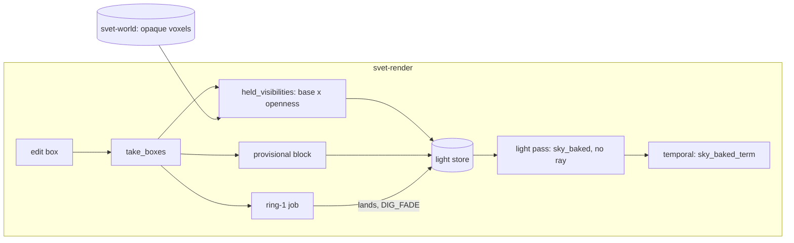

# 0105: The dig's flash at depth: a held estimate that follows the hole's own light

> **Status:** in-progress (Phase 1 done 2026-11-26; the phases after it are rewritten under "Amended 2026-11-26 (architect)": the held floor is the flash; Phase 2 read 2026-11-26 and stopped for the architect: the exposure at D-1 is not within 1 % of D+60's at 6 of 20 read digs); approved (owner, 2026-11-26: go; his four answers are under "Amended 2026-11-26 (owner)" and bind Phase 1's sites and the remedy's bars; drafted from the owner's report after Plan 0099's window, with
> his three answers and no further interview; the questions left are under "Risks & open
> questions", each with a recommended option). Starts on a main that holds Plan 0099.
> **Created:** 2026-11-26
> **Milestone:** M10: Outdoors in [`docs/roadmap.md`](../roadmap.md)
> **Related ADRs:** [ADR-0082](../adrs/0082-the-light-pass-keeps-no-screen-history-by-default-and-reads-smooth-sources-to-the-mid-range.md)
> (the dig's held record: "the sky visibility of the surface the dig cut through, times a near
> openness"; this plan changes the estimate inside that mechanism, so no new ADR, and ADR-0082
> takes a dated Outcome note at the close if the default estimate changes),
> [ADR-0076](../adrs/0076-light-stability-rules-world-history-per-source-a-fade-per-transition-and-a-ratcheted-pop-counter.md) (rule 3: the history is the store's provisional record, one
> fade a switch), [ADR-0083](../adrs/0083-the-live-bake-queue-runs-on-a-bake-thread-the-render-thread-applies-its-write-lists-and-issues-its-submits.md) (the bake thread; the flash is the same with
> it off).

## TL;DR

A freshly dug face shows for a blink brighter than it settles, "as if lit with the surface's
light" (owner, 2026-11-26): unnoticed near the surface in sunlight, bothering past 2 to 3 m
deep, the same with the bake thread off. The code reading below says what the face shows in
those frames: a record made on the CPU at the edit whose base is the **surface's** sky
visibility (the nearest record above the cell, else the chunk's summary, which a surface
chunk's lit ground dominates) times the square root of an openness that looks only 1.6 m far.
Neither term knows how deep the hole is. Phase 1 reproduces the blink headless at depth and
reads, per frame, the new faces' brightness and which write gave it. The fix phases then make
the held estimate follow the hole's own baked light, one change a phase, behind a setting the
owner compares in a window before it becomes the default.

## Context & problem

The owner's report (forest scene, `--source outdoor --spawn forest --trees forest --time
15:00`, RTX 3080 Laptop, `--profile floor`, binary at `cde2e966`): "it flashes with light when
digging, it is mostly fine when near the surface and sunlight, but when I dig deeper, more
than 2-3 meters it is already bothers". His answers: the same with the bake thread off;
"bright than darker, I think it is lights with surface light"; "one blink".

It is the remainder ADR-0082 disclosed ("the slight colour change the owner names at a landing
is the held estimate's distance from the baked record"), accepted at the surface in Plan
0098's window 98e and parked in the backlog ("A dig's landing"). At depth the distance is no
longer slight. The owner's rules that bind the remedy: a stable image first; no waiting for
light (a stable approximation while the bake runs is the accepted route); a scene is never
simplified for a test; a remedy that can change the look is shown in a window first.

### The code reading (architect, 2026-11-26, at `0d4e4b77`; read from code unless marked)

**What a dug face shows from the edit to its landing, under the default `DigHold::On`:**

1. *At the edit* (`BakeQueue::take_boxes`, `bake/queue/digs.rs`): each chunk holding a brick
   the box touches takes a provisional block (`provisional_block`, `bake/summary.rs`: a kept
   brick's record, a new brick the mean of the records within one or two bricks), and each
   touched brick's cells then take a **held record** (`held_visibilities` and `apply_held`,
   `bake/held.rs`): six sky visibilities with `VIS_BAKED` and no `SKY_STALE`, the key words
   cleared.
2. *In the light pass* (`sky_baked`, `shaders/shade.wgsl`): the held record reads as a fresh
   record, so no sky ray is cast; `temporal.wgsl` shows `sky_baked_term` of it. The key
   light, with `KEY_BAKED` clear, falls to the column map's horizon (`key_cover_far`,
   `shaders/pair.wgsl`; `column_key_visibility`, `shaders/key_horizon.wgsl`).
3. *At ring 1's landing* (one or two frames after the dig in lockstep per ADR-0082; about 95
   to 170 ms on the bake thread per Plan 0099's log) the store fades from the held record to
   the job's over `DIG_FADE` = 4 frames. That is the blink's length in either mode.

**The held value** of a dug face of direction `f` is
`max(min(own_f, up) * sqrt(open), HELD_FLOOR)`:

- `up` is the up visibility of the nearest record at or above the cell within `HELD_CELLS`
  = 4 cells, **else the chunk summary's** (`SUMMARY_AT`, the mean by direction of the chunk's
  brick records, `block_summary`). A floor cell in the middle of a pit has air above it, so
  it takes the summary; in the chunk that holds the ground, that is mostly the lit surface's
  value. This is literally "the surface's light", and it does not fall with depth inside a
  chunk (6.4 m tall).
- `open` is the share of 12 fixed rays that leave `HELD_REACH` = 16 voxels (1.6 m) without
  meeting rock. Past 1.6 m of depth a ray that clears the reach counts as sky whatever is
  beyond it, and the square root lifts a small share (1 ray of 12 gives 0.29).
- Derived, not read: the rays' rings stand 24, 45 and 66 degrees off the face's normal, so
  over 16 voxels they run 6.5, 11.3 and 14.6 voxels sideways. A floor in a pit of 1 m radius
  keeps the inner ring open (`open` 4/12, a held value of 0.58 `up`), while the true
  cosine-weighted visibility of the pit's mouth from the floor's centre is
  `r^2 / (r^2 + d^2)`: 0.50 at 1 m, 0.10 at 3 m, 0.04 at 5 m. At the default dig radius
  (0.5 m, `DIG_RADIUS`) a single straight shaft closes every ray and holds the floor value,
  so the flash needs a hole wider than one dig, which several digs make.

**Three mechanisms can give "bright for a blink, then darker" at depth:**

| | mechanism | where | the owner's answers |
|---|---|---|---|
| M1 | The held record over the baked one: the base is the surface's (the summary) and the openness sees 1.6 m | `bake/held.rs` | **Favoured by all three**: bright then darker, "the surface's light", one blink (the fade), the same in lockstep, fine near the surface (within the rays' reach the openness is true) |
| M2 | A chunk that held no block before the dig (solid rock has no face) is a "whole" dig: `take_boxes` gives it no provisional block and no held record. Its faces read no record: the sky ray is cast, and its mean is seeded each frame from the column's answer (`column_estimate`: 1 above the column's top, so 1 in an open pit). `pair_step`'s arithmetic is not traced | `bake/queue/digs.rs` (the `continue` for a chunk with no block), `shaders/temporal.wgsl`, `shaders/pair.wgsl` | Fits the direction and "deep", but happens once a chunk entered, not at every dig |
| M3 | The key light from the column horizon at a held record | `shaders/key_horizon.wgsl` | **Not favoured**: a point under its column's top reads 0, and a pit's walls stand in the horizon, so it errs dark; in the window the sun is what hides the flash near the surface |

A fourth candidate, the source fade at a chunk's first landing (`source_faded`), is off by
default (`Lighting::source_fade`) and is not pursued.

## Decision

Measure first, then change the held estimate, not the mechanism. The dig keeps ADR-0082's
shape: a record made on the CPU at the edit, read as any record, one fade to the job's
record. What changes is what the record holds at depth: the base comes from the hole's own
baked light (the nearest record of the same direction about the cell) before the chunk's
summary, and, if that is not enough, an open ray must reach the sky, not 1.6 m. A chunk with
no block takes a held record too if Phase 1 shows M2 on screen. The new estimate is a
setting; the old one stays as the before arm and stays a setting after the pick (cheap modes
stay settings).

Rejected here, already rejected or parked by ADR-0082 and Plan 0098's "Amendment at window
98d": the dig delayed until its light is ready (staged mirror records, a plan with its own
ADR, backlog "A dig's landing"); a screen history in the dig's box; `DigHold::Rays` as the
default (the cast rays' noise is what Plan 0098 removed). A longer fade is rejected too: it
shows the wrong value for longer.

## Architecture diagram



## Implementation phases

Each phase ships as its own commit. **Phases 1 to 4 are exploration** (lane rules 2b): they
name readings, not image tests; CPU tests of data stay with their phase. Phase 6 writes the
asserting tests against the owner's pick. No run under the perf lock passes 20 minutes: the
dev projects a run's time from its first arm and, past that, stops and goes to the architect.
The gate tier is the most any step runs.

Every phase carries exactly one `**Owner skill:**`: `dev` or `human`.

### Phase 1: The blink reproduced headless at depth (exploration, a reading)
- **Owner skill:** dev
- **What:** One reading in the `gpu_outdoor` binary (a new file beside
  `gpu_outdoor/dig_line.rs`, built on its `dig_timeline` and `support::defects`' dig
  helpers; run by name, soak-marked, never a gate), on the real forest scene at 15:00 with
  the floor profile's settings. No engine behaviour changes.
  - **The sites, in the scene as it is:** (P) a pit dug from the forest spawn's ground
    straight down by digs in a row, wide enough to stand in (the default radius, 0.5 m, with
    the digs spread as `B_AIMS` spreads them, and one arm at 1.0 m), read at each dig whose
    floor is about 1, 2, 3, 5 and 7 m under the ground (7 m crosses the ground chunk's
    floor; the reading prints which digs opened a chunk that held no block,
    `QueueStats::digs_whole`); (S) a sloped tunnel, 30 degrees down from the same ground,
    read at the same depths; (T) a dig into the wall and the floor from the tunnel's eye
    (`--spawn inside`), under cover.
  - **Per read dig:** the queue settled first (no dig waits, no block fades), then the dig,
    and frames D-1 to D+24 with the bake thread off and on. Per frame, over the pixels
    whose hit lies in the dig's box: the mean and the 95th percentile of the output's
    luminance in display levels against the settled frame's (D+60); the sky term, the key
    term and the stored part apart (`support::terms`); the sky term's source shares
    (`sky_source` under `COUNT_STORE`: record, stale record, summary, column, cast); and
    the pool's state (`support::queue::dig_held`, `ring1_landed`), so each frame's value
    is tied to the write it came from (the held record, the fade, the job's record).
  - **The CPU table:** per dug cell and direction of each read dig, the held value with
    its parts (the base and where it came from: a record above at which cell, the chunk's
    summary, or the cell's own cap; the openness) beside the job's landed value. A trace
    out of `held_visibilities` for readings only.
- **Files touched:** `apps/flythrough/tests/gpu_outdoor.rs`, a new
  `apps/flythrough/tests/gpu_outdoor/dig_depth.rs`, `apps/flythrough/tests/support/`
  (a sibling file; no more than four `SVET_*` variables in a file, `SVET_DIG` reused),
  `crates/svet-render/src/bake/held.rs` and its reading accessor, `docs/plans/logs/0105.md`.
- **Done when:** the log holds, per site, depth and thread mode, the frames from the dig to
  ring 1's landing, the peak of the new faces over their settled value (levels and ratio)
  with its frame and the write that frame showed, and the term that carries it; and the CPU
  table's summary (held over landed by depth, split by the base's source). The log then
  names what carries the blink: M1 (and which part, base or openness), M2, M3, or something
  else. **Stops:** the blink not reproduced at 3 m or deeper on any site (peak under 4
  levels over settled): the dev reports the sites tried and stops, and the owner is asked
  for his eye and dig radius (`--eye`); M3 or an unnamed source dominant: stop, the
  architect amends. Quick tier, clippy and fmt over the changed files. Binary: `gpu_outdoor`.

### Phase 2: The base from the hole's own light (exploration, the first fix)
- **Owner skill:** dev
- **What:** Only if Phase 1 names M1 with the base as a part. A setting
  `Lighting::dig_estimate` (`surface`, today's and the default; `depth`) with the
  fly-through's `--dig-estimate surface|depth`, its value in the banner's and the HUD's mode
  rows. Under `depth` a dug face's base is the nearest baked record of its own direction
  about the cell (the hole's floor and walls as the earlier digs' jobs left them, a stale
  mark not excluding them), capped by today's `up`; the chunk's summary answers only where
  no such record lies within reach. The reach and the walk's order are the dev's, fitted on
  Phase 1's CPU table, not on the image.
- **Files touched:** `crates/svet-render/src/bake/held.rs`, `bake/queue/digs.rs`,
  `crates/svet-render/src/frame/settings.rs`, `frame/settings/sky_light.rs`,
  `crates/svet-render/src/settings.rs`, `frame/baked.rs`, `apps/flythrough/src/cli/`,
  `apps/flythrough/src/hud/modes.rs`, `docs/flythrough.md`, `docs/plans/logs/0105.md`.
- **Done when:** Phase 1's reading, both arms side by side: under `depth` the new faces'
  peak over settled at every read depth of 2 m and more is at most the same run's peak at
  the 1 m dig under `surface` (the case the owner calls fine), and the 1 m dig's own frames
  move by at most 4 display levels between the arms (the accepted surface look holds). A
  CPU test in `bake::held::tests` (under 1 s): a dug floor under a pit whose walls hold
  records of up visibility 0.1 and whose chunk summary holds 0.9 takes a base of at most
  0.1 under `depth` and 0.9 under `surface`. The mode row reads the setting's value
  (`gpu_settings_rows`, the row's test). The D+0 step's time for the same digs before and
  after (`QueueStats::stages`), printed. **Stops:** the bar missed with the base alone:
  Phase 3; an edit's wait as section 4 of `docs/nfr.md` pins it no longer met: stop, the
  architect rules. Binaries: `gpu_outdoor`, `gpu_settings_rows`.

### Phase 3: An openness that reaches the sky (exploration; only if Phase 2's bar is missed, or Phase 1 names the openness alone)
- **Owner skill:** dev
- **What:** Under `depth`, a ray that clears `HELD_REACH` counts as open only if it goes on
  to leave the ground (a coarser march over the opaque masks until it stands above its
  column's top, or a far cap the dev sets and states), and the square root is dropped or
  kept by its fit to Phase 1's landed values, stated in the log with the fit. One change;
  the base stays Phase 2's.
- **Files touched:** `crates/svet-render/src/bake/held.rs`, `docs/plans/logs/0105.md`.
- **Done when:** Phase 2's bar, read the same way, with this arm; the CPU table's held over
  landed by depth for the three forms (today's, Phase 2's, this); a CPU test in
  `bake::held::tests` (under 1 s): a floor 40 voxels down a pit 20 voxels wide with rock
  above the pit's mouth holds the floor value under `depth`, and with the mouth open holds
  more than the floor value. The D+0 step's time before and after. **Stops:** the bar
  still missed: stop, the architect amends (the remaining routes are the backlog's staged
  records, or a held record that errs dark on purpose, owner question 2); the edit's wait
  no longer met: stop. Binary: `gpu_outdoor`.

### Phase 4: A chunk with no block holds the dig too (exploration; only if Phase 1 shows M2 on screen)
- **Owner skill:** dev
- **What:** Under `depth`, a dig into a chunk that held no block gives it a provisional
  block and held records at the edit, as a chunk with a block takes them, the base from the
  records across the chunk's faces. One change.
- **Files touched:** `crates/svet-render/src/bake/queue/digs.rs`, `bake/summary.rs`,
  `bake/held.rs`, `docs/plans/logs/0105.md`.
- **Done when:** Phase 1's reading at the digs it marked whole: no frame between the dig
  and the landing shows a sky source of `column` or `cast` at the new faces under `depth`,
  and their peak over settled meets Phase 2's bar. The pool's words at the edit for such a
  dig, before and after, printed (the provisional block is placed one landing early; the
  pool's cap is not raised). **Stops:** `PoolFull` counted at a read dig that did not count
  it before: stop, the architect rules. Binaries: `gpu_outdoor`, `gpu_queue`.

### Phase 5: The owner's window
- **Owner skill:** human
- **What:** The owner digs in the forest scene as in his report, down past 3 m, a pit and
  a tunnel, with `--dig-estimate surface` (the before arm) and `depth`, the bake thread on;
  the mode shown in the banner and the HUD. **No camera hold: no `--pre-roll-drain`.** The
  fly-through's stdout stays visible. Linux only.
- **Done when:** the owner says, per arm, whether the flash at depth bothers, and whether
  the dig near the surface looks as before; he picks the default, or names what is still
  wrong (then the architect amends).

### Phase 6: The pick as the default, with its tests
- **Owner skill:** dev
- **What:** The picked estimate as `Lighting::dig_estimate`'s default in every profile; the
  other stays a setting. The asserting tests, the docs and the readings.
- **Files touched:** `crates/svet-render/src/frame/settings.rs`,
  `crates/svet-render/tests/gpu_sun/` (the synthetic pit), `apps/flythrough/tests/gpu_outdoor/`,
  `apps/flythrough/tests/gpu_settings_rows.rs`, `docs/nfr/04-edits.md`, `docs/flythrough.md`,
  `CHANGELOG.md` is the architect's at the close.
- **Done when:** (1) a GPU test in `gpu_sun` on a synthetic pit 40 voxels deep under an
  open sky: each dug cell's held up visibility under the default lies within the bar Phase
  2's or 3's log read between held and landed there (the dev states the figure from the
  log; expected under 10 s on lavapipe, a guess; over it the test is born
  `#[ignore = "soak"]`); (2) the forest reading of Phase 1 as a soak-marked image test
  (`gpu_outdoor`, over 10 s on lavapipe, born `#[ignore = "soak"]`, not a gate): the new
  faces' peak over settled at the 3 m and 5 m digs under the default is at most the 1 m
  dig's under `surface`; (3) `every_profile_holds_the_calm_picks` reads `dig_estimate`
  (and `dig_hold`, the backlog's owed row, if it is one line); (4) the edit's readings in
  `docs/nfr/04-edits.md`: the D+0 step and an edit's wait before and after, machine and
  commit; (5) the gate tier at the tip under the perf lock, clippy, fmt, deny, the doc
  gates. Binaries: `gpu_sun`, `gpu_outdoor`, `gpu_settings_rows`; the gpu tier at the tip.

## Amended 2026-11-26 (owner)

The owner gave the go and answered the questions (2026-11-26, his words):

1. The go: "go".
2. Which way a new face may err: "slightly dark, and I think we should keep depth in mind. If
   deep enough, no flash should happen - like in a cave, as there is no chance of sunlight".
3. The accepted surface dig stays as it is: "yes".
4. Which hole: "pit dig looking down or to the side, narrow, i think it was 1 dig wide. but
   not 100% sure".

What the answers change:

- **Answer 4 runs against the code reading's caveat** (a single straight shaft at the default
  dig radius closes every ray and holds the floor value, so M1 should not flash there). The
  reading is a reading, not a measurement, and the owner is not certain of the width, so
  neither is taken as settled. **Phase 1's first site is his: a pit one dig wide at the
  default radius, dug looking down, and the same dug to the side from the pit's wall, at 1 to
  7 m, before the wider pits.** If the one-dig shaft flashes, Phase 1 names what wrote the
  bright frames there (M2's chunk with no block, the faces at the shaft's rim or wall, or a
  source the reading did not name) and stops for the architect before Phase 2: the first fix
  is then chosen for that cause, not for M1 by default. If it does not flash there and does
  in the wider hole, that is reported with both, and Phase 2 goes on as written.
- **Answer 2 adds a bar to the fix phases and to Phase 6's tests: at depth no flash at all.**
  Where the landed light of the new faces is dark (the cave and the tunnel away from the
  mouth, and a pit deep enough that the sky's share is under the held floor), no frame from
  the dig to the landing shows the new faces brighter than their settled value by more than
  the 4 levels the surface dig is held to. A new face may start under its settled value and
  rise. The depth is to be read by the estimate (how far the hole's own light and the open
  sky are), not assumed from the surface's light.
- **Answer 3** is the plan's bar as written (the 1 m surface dig within 4 levels, the before
  arm at the window).

No other phase text changes. Phase 5's window shows him a narrow one-dig pit at depth first.

## Amended 2026-11-26 (architect)

After Phase 1's readings ([the log](logs/0105.md), "What the architect inherits"; code read at
`56e34b50`). **This section replaces Phases 2 to 6 above**; they stay as the record of the
draft. The Implementation log's rows 2 to 6 are rewritten by `dev` to the phases below at the
first commit under this amendment. The owner's bars (his amendment above) bind every phase.

### The cause

**The flash is the held record's floor: `HELD_FLOOR`, 0.02 of the open sky, written into every
direction of every dug cell, where the hole's own baked light is 0.** In a hole the sky's
irradiance times 0.02 is not "just above black": it is the 3.8 to 4.4 the stored part shows at
the peak at every depth of both sites, against 0.0 to 0.5 settled from 3 m. The same 4 units
are +12 levels under the surface eye's exposure (`down`, 1.37e-2) and +78 to +100 under an eye
in the hole (`side`, lockstep, 1.7e-1). The owner's cave is the worst case of a floor above
black, not an edge of it.

Measured (Phase 1, RTX 3080 Laptop):

- The peak is on the held record in every read (D+0; D+0 and D+1 with the bake thread), falls
  through the four fade frames and is gone at the job's record. Key term 0, direct 0, every
  stored direction value 0.0000 from every source: the stored part is the no-ray sky term
  alone.
- From 2 m every traced held value sits at the floor (0.020), at the estimate where it is
  higher (to 0.040, `side`), or under the floor by the mean with kept faces; the landed
  values are 0.000 to 0.008.
- At `down` 5 m the dig enters a chunk with no block (`digs_whole` 1): 10 % of the box's
  lighting pixels have no record and cast, in the held frames only.

Read from code and derived from Phase 1's tables, not measured:

- **The 8.5 against 3.6 at `down` 3 m needs no other source.** `Lighting::sky_bounce` is 0 by
  default, so `sky_baked_term` is only the smoothed normal's mix: the sum over the directions
  the normal leans toward of that direction's visibility times its open irradiance. The
  pair's x is the hit face's own direction alone. In the settled frame only the floor's up
  direction holds anything (0.008) and the mix dilutes it with wall directions at 0.000 (a
  sphere's floor is a bowl; its smoothed normals lean to the walls). In the held frame every
  direction the mix can reach holds 0.016 to 0.020, the directions with no face too
  (`apply_held` sets all six in the mask, at the mean of the held ones). The term is linear
  in the cell's six held values, so the split between the hit face and the mixed directions
  does not change the fix and is **not read apart**.
- **The estimate under the floor is second in size and errs bright too.** Recomputed from
  Phase 1's traced parts with the floor at 0 (quantised to the record's byte): at `down` the
  parts over their landed value fall from all of them to 2 or 3 a depth from 3 m, each by one
  byte; at `side` 3 to 6 parts a depth stay over by up to 0.06. Those take the surface's
  light as the base (the chunk summary, 0.125 to 0.137, at 3 and 5 m; a record one to three
  cells above, 0.07 to 0.17, at 1 and 2 m) times the square root of a share of rays that
  cleared 1.6 m **up the shaft**, which is not the sky. That is the draft's M1 (base and
  openness), behind the floor.
- **One byte matters in the dark.** A byte of visibility (1/255) is about 0.85 of the stored
  part here (0.0196 gives 4.2). Under the `side` eye's exposure that is of the order of ten
  levels or more at the pixels that read it (derived from +78 for 3.9; the display curve is
  not linear). So where the landed value is 0 the held value must be 0, not small.
- **The +28 at `down` 5 m is two things.** About +11 is the floor, as at 3 and 7 m (its D+1
  is +10.7). The rest, about +15, is the draft's M2: `take_boxes` gives a chunk with no block
  no provisional block and no held record (the `continue` for a whole dig), so its new faces
  cast, and a reset pair's seed with no record is `column_estimate`, 1 in a column open to
  the sky, which a straight shaft is. The box's mean x of 0.109 with 10 % of the pixels
  casting puts those pixels near 0.9: the open sky at 5 m down, the p95 of +158. It needs a
  shaft under an open column and a chunk entered: once every 6.4 m down. A side dig under
  rock reads 0 there.
- **`side` is larger than `down` by the exposure, not by the light:** the stored part is the
  same 3.8 to 4.3.

### The decision

The held record keeps ADR-0082's shape (a record made at the edit, read as any record, one
fade). Under a setting, `Lighting::dig_estimate = depth`, **the held value is a lower bound of
the hole's own light, and 0 where no ray reaches the light it is scaled from**: no floor; a
ray counts open only where it rises to the height its base was read at; a chunk with no block
holds the dig as any chunk. A new face may then start dark and rise through the fade, never
bright then dark (the owner's answer 2). Depth is read by the rays, not assumed.

Rejected:

- **A smaller floor (one byte, 0.004).** One byte over a landed 0 is still a flash under an
  eye in the hole (above).
- **A floor scaled by the base.** The base at depth is the surface's (the summary); it is not
  0 where the light is.
- **Black for every new face.** It passes at depth by the tables, and starts the 1 m dig at
  about half its light (derived: 0.44 of 0.82 summed over the traced parts), against the
  owner's answer 3.
- **The draft's Phase 2 as the first fix (the base from the nearest record of the face's own
  direction).** At `down` the base already is the hole's own record (the cell's or the one
  above) and the values sit at the floor regardless; it would have changed nothing there. It
  stays the architect's next route if Phase 4 misses by parts whose base is the summary.
- **A seed for the cast pair that knows depth (the shader's `column_estimate`)** for M2: it
  changes every face with no record in the world, and leaves the dig on two mechanisms.
- A shorter or longer fade, the cast rays (`DigHold::Rays`), a screen history, the dig
  delayed until its light is ready: as in the Decision above.

**No new ADR.** The mechanism is ADR-0082's; the clause the default would change is "at least
a floor above black". At the close, if the owner picks `depth`, ADR-0082 takes this dated
Outcome note (draft): "Plan 0105: the held record's floor above black read as the dig's flash
at depth (0.02 of the open sky over a landed 0: +12 display levels from the surface, +78 to
+100 under an eye in the hole, RTX 3080 Laptop). The default estimate holds no floor, counts a
ray open only where it reaches the height its base was read at, and gives a chunk with no
block a held record; a new face may start dark and rise. The earlier estimate stays a setting
(`dig_estimate = surface`)."

### The bars (every fix phase reads them the same way)

Phase 1's rig, sites `down` and `side`, radius 5, lockstep and the bake thread on, at 1, 2, 3,
5 and 7 m, the frames from D+0 to the first frame on the job's record, the mean and the p95
over the box's pixels against D+60:

- **B1, no flash at depth:** at 2 m and deeper no frame's mean is over the settled frame by
  more than 4 levels, and no frame's p95 by more than 8 (the 1 m dig's p95 under `surface`,
  the dig the owner calls fine).
- **B2, the shallow dig holds:** at 1 m no frame's mean is over settled by more than 4, and
  each frame's mean under `depth` is within 4 levels of the same frame's under `surface`.
- **B3, dark then up:** the lowest mean under settled per depth is printed (a reading; the
  owner judges it in the window).
- `side` counts only with the exposure settled before the dig (Phase 2 makes the rig do it).
- No run under the perf lock passes 20 minutes; a site is one hold of the lock.
- **A missed bar stops the phase and goes to the architect. No second variant, no tuned
  constant, no loosened figure, no changed scene.**

Phases 2 to 5 are exploration (lane rules 2b): readings and CPU tests of data; the asserting
image tests are Phase 7's.

### Phase 2: The before arm on a settled exposure, and the wide pit (exploration, a reading)
- **Owner skill:** dev
- **What:** No engine behaviour changes. (1) The rig holds the eye at each read dig's place
  until the auto exposure is still (it moves under 1 % over 24 frames; the dev states the
  rule it used) before D-1, at every site; the table prints the exposure at D-1, D+0 and
  D+60. (2) `side` in lockstep and with the thread on, under today's estimate: the before arm
  in display levels. (3) `wide` at radius 5, both modes: whether the hole several digs wide
  flashes, by how much, and which base its parts take. `slope` and `tunnel` stay unread (the
  window walks them).
- **Files touched:** `apps/flythrough/tests/gpu_outdoor/dig_depth.rs`,
  `apps/flythrough/tests/support/` if the stillness check lives there, `docs/plans/logs/0105.md`.
- **Done when:** the log holds, for `side` and `wide` in both modes, Phase 1's table a depth
  with the exposure at D-1 within 1 % of D+60's at every read dig, and the lockstep CPU
  table for `wide`. **Stops:** the exposure not still within 600 frames at a read place:
  stop, the architect rules; `wide` shows a term other than the held record's sky term
  (key, direct or a stored direction value over 0): stop. Quick tier, clippy and fmt over
  the changed files. Binary: `gpu_outdoor`.

### Phase 3: No floor under the held value (exploration, the first fix)
- **Owner skill:** dev
- **What:** The setting `Lighting::dig_estimate` (`surface`, today's and the default until
  the window; `depth`), the fly-through's `--dig-estimate surface|depth`, its value in the
  banner's and the HUD's mode rows, and the rig's arm as a fourth field of `SVET_DIG`. Under
  `depth` the held value takes no floor on any path of `held_visibilities`: a dig's face
  holds `base * sqrt(open)` as it is, 0 included; a direction with no face holds the mean of
  those with one, and a cell with none its base, neither raised. Nothing else changes: the
  base, the rays and their reach are today's.
- **Files touched:** `crates/svet-render/src/bake/held.rs`, `bake/queue/digs.rs`,
  `crates/svet-render/src/frame/settings.rs`, `frame/settings/sky_light.rs`,
  `crates/svet-render/src/settings.rs`, `frame/baked.rs`, `apps/flythrough/src/cli/`,
  `apps/flythrough/src/hud/modes.rs`, `apps/flythrough/tests/gpu_outdoor/dig_depth.rs`,
  `docs/flythrough.md`, `docs/plans/logs/0105.md`.
- **Done when:** at `down`, both modes, under `depth`: B1 at 2, 3 and 7 m, and at 5 m in
  every frame whose pixels all read a record (the casting frames there are Phase 5's and are
  printed); B2 at 1 m. At `side`, both modes, both arms printed side by side with the parts
  still over their landed value listed by base and openness; `side` has no bar in this
  phase (the derivation above expects parts over, Phase 4's). A CPU test in
  `bake::held::tests` (under 1 s, no GPU): a floor face at the centre of a shaft 10 voxels
  wide and 40 deep, base 0.9, holds `HELD_FLOOR` under `surface` and exactly 0 under `depth`
  (the inner ring runs 6.5 voxels sideways in 16, the wall is at most 5.5 away, so every ray
  closes). The mode row reads the setting (`gpu_settings_rows`). The D+0 step's time for the
  same digs in both arms (`QueueStats::stages`), printed. **Stops:** a bar missed at `down`.
  Binaries: `gpu_outdoor`, `gpu_settings_rows`.

### Phase 4: A ray is open where it reaches its base's height (exploration, the second fix)
- **Owner skill:** dev
- **What:** Under `depth` a ray that clears `HELD_REACH` goes on, and counts open only where
  it rises, with no opaque voxel on its way, to the height the face's base was read at: the
  top of the cell whose record gave the base (a ray from a face whose base is its own cell's
  record is today's), the chunk's top for the summary, which is the chunk's mean and the
  ground's faces dominate it. A ray that leaves the opacity grid before that height is
  closed; the grid about the touched bricks grows to hold the march, read lazily as today.
  The held value is then the base times the share of rays that reach it. **The form over
  that share (today's square root, or the share itself) is fitted on the CPU table, not on
  the image:** the trace prints both, and the phase takes the square root if, at 2 m and
  deeper on `down`, `side` and `wide`, no traced part's held value is over its landed value
  by more than one byte and at most one part in ten is over at all; else the share itself;
  the pick and the table go in the log. One change: no base changes source.
- **Files touched:** `crates/svet-render/src/bake/held.rs`, `bake/queue/digs.rs` (the grid's
  extent), `apps/flythrough/tests/gpu_outdoor/dig_depth.rs` (the trace's columns),
  `docs/plans/logs/0105.md`.
- **Done when:** B1, B2 and B3 at `down` and `side`, both modes (5 m at `down` as in Phase
  3), and B1 at `wide` from 2 m; the CPU table's held against landed per depth for the three
  forms (today's, Phase 3's, this). CPU tests in `bake::held::tests` (under 1 s): a floor 40
  voxels down a pit 20 voxels wide under an open sky whose base is the summary's 0.9 holds
  more than 0.4 under `surface` (the inner ring's four rays clear 16 voxels: 0.9 times the
  root of 4/12 is 0.52) and exactly 0 under `depth` (a ray 24 degrees off the vertical runs
  17.9 voxels sideways in 40 and the wall is at most 10.5 away); the same pit 8 voxels deep
  holds more than 0 under `depth`. The D+0 step's time in both arms, printed, with the edit's
  wait. **Stops:** a bar missed (the routes left are the architect's: the base from the
  hole's own direction records, or the staged records of the backlog); the edit's wait as
  section 4 of `docs/nfr.md` pins it no longer met. Binary: `gpu_outdoor`.

### Phase 5: A chunk with no block holds the dig too (exploration, the third fix)
- **Owner skill:** dev
- **What:** Under `depth`, a dig into a chunk that held no block gives it a provisional
  block and held records at the edit, as a chunk with a block takes them. The base is the
  walk's as it is (it crosses the chunk's face into the hole's records above); a cell with
  no record within the walk and no summary holds 0, not no record. The chunk's job then
  lands on that block through the dig's fade. Starts on a branch that holds main (Plan 0101
  edits `bake/queue/open.rs` and `list.rs`).
- **Files touched:** `crates/svet-render/src/bake/queue/digs.rs`, `bake/summary.rs`,
  `bake/held.rs`, `docs/plans/logs/0105.md`.
- **Done when:** at `down` 5 m (the dig Phase 1 marked whole), both modes, under `depth`: no
  frame from the dig to the landing shows a sky source of `column`, `cast` or no value at
  the new faces, and B1 holds in every frame; B1 and B2 still hold at the other depths and
  at `side`. A CPU test in the queue's tests (under 1 s): a box into a chunk with no block
  leaves a block whose touched bricks hold records with `VIS_BAKED` and no `SKY_STALE`. The
  pool's words at the edit for that dig in both arms, printed (the block is placed one
  landing early; the pool's cap is not raised). **Stops:** a bar missed; `PoolFull` counted
  at a read dig that did not count it before; the whole dig's job cannot land on the held
  block without a change outside the files named. Binaries: `gpu_outdoor`, `gpu_queue`.

### Phase 6: The owner's window
- **Owner skill:** human
- **What:** The forest scene as in his report (`--source outdoor --spawn forest --trees
  forest --time 15:00`, `--profile floor`, the bake thread on). **First the narrow pit: one
  dig wide, straight down past 5 m, then digs to the side from inside it**, with
  `--dig-estimate surface` (the before arm) and `depth`; then a wider pit and a tunnel as he
  likes. The mode shows in the banner and the HUD. **No camera hold: no `--pre-roll-drain`.**
  The fly-through's stdout stays visible. Linux only.
- **Done when:** the owner says, per arm, whether anything flashes at depth, whether a new
  face's dark start bothers, and whether the dig near the surface looks as before; he picks
  the default, or names what is still wrong (then the architect amends).

### Phase 7: The pick as the default, with its tests
- **Owner skill:** dev
- **What:** The picked estimate as `Lighting::dig_estimate`'s default in every profile; the
  other stays a setting. The asserting tests, the docs and the readings.
- **Files touched:** `crates/svet-render/src/frame/settings.rs`,
  `crates/svet-render/tests/gpu_sun/` (the synthetic shaft), `apps/flythrough/tests/gpu_outdoor/`,
  `apps/flythrough/tests/gpu_settings_rows.rs`, `docs/nfr/04-edits.md`, `docs/flythrough.md`;
  `CHANGELOG.md` and ADR-0082's Outcome note are the architect's at the close.
- **Done when:** (1) a GPU test in `gpu_sun` on lavapipe, a synthetic shaft 10 voxels wide
  dug to 40 voxels under an open sky, the last dig read in lockstep: no dug cell's held
  visibility is over its landed one by more than one byte, and no frame from the dig to the
  landing shows the box's mean over its settled frame by more than 4 display levels
  (expected under 10 s on lavapipe, a guess; over it the test is born `#[ignore = "soak"]`);
  (2) Phase 1's forest reading as a soak-marked image test (`gpu_outdoor`, over 10 s on
  lavapipe, born `#[ignore = "soak"]`, not a gate): B1 at 3 and 5 m at `down` and `side`
  under the default, B2 at 1 m; (3) `every_profile_holds_the_calm_picks` reads
  `dig_estimate` (and `dig_hold`, the backlog's owed row, if it is one line); (4) the
  edit's readings in `docs/nfr/04-edits.md`: the D+0 step and an edit's wait before and
  after, machine and commit; (5) the gate tier at the tip under the perf lock, clippy, fmt,
  deny, the doc gates. Binaries: `gpu_sun`, `gpu_outdoor`, `gpu_settings_rows`; the gpu tier
  at the tip.

### What this changes elsewhere in the plan

- **Budgets:** Phase 4's longer rays march at most a chunk's height more for the rays that
  clear the near reach (a few of twelve a face in a hole; a guess, read in Phase 4), and the
  opacity grid grows upward with them. Phase 5's block is the draft's Phase 4 line.
- **Risks:** the far rays under the forest's canopy are stopped at the base's height so the
  canopy is not counted twice (the base already holds it); if B2 misses at 1 m all the same,
  the stop is the architect's, and question 2 below is then live.

### Questions for the owner (none blocks the phases)

1. **A dig to the side at 1 to 2 m under the mouth may show black for the fade's frames
   (about five) and then rise to its dim light.** Recommended: (a) accept it and judge it in
   the window (it is your "slightly dark, then up"); (b) hold out for a start nearer the
   settled value, which needs the hole's own direction records as the base (one more phase).
2. **If no flash at depth and the unchanged surface dig cannot both hold, which wins?**
   Recommended: (a) neither is given up yet: the phase stops and the architect looks for a
   form that keeps both; (b) no flash at depth wins and the surface dig may start a little
   darker; (c) the surface dig wins.
3. **The wider pit, the slope and the tunnel are read less than your narrow pit** (the wide
   pit headless, the other two only in the window). Recommended: (a) as written; (b) all
   three headless before the window (about 20 minutes more under the GPU lock).

## Amended 2026-11-26 (owner, the architect's three questions)

1. **A side dig 1 to 2 m under the mouth that shows black for about five frames and then rises is accepted** ("better than white flash"); he judges it in Phase 6's window. No further phase takes the base from the hole's own direction records unless the window asks for it.
2. **If no flash at depth and the unchanged surface dig cannot both hold, neither is given up:** the phase stops and the architect looks for a form that keeps both.
3. **The wide pit is read headless; the slope and the tunnel only in the window,** as written.

## Data shapes

```rust
// illustrative
pub enum DigEstimate {
    /// The removed surface's up visibility times a near openness (ADR-0082). The default
    /// until the window's pick.
    Surface,
    /// The hole's own baked light about the cell, and an openness that reaches the sky.
    Depth,
}
```

No record, block or buffer changes shape: the held record is the store's record as it is.

## Budgets

- **VRAM:** none. The held record lives in the dug chunk's block as today. Phase 4 places a
  block one landing earlier in a chunk that takes one anyway; the pool's cap stands.
- **Frame time (section 2 of `docs/nfr.md`):** none on the GPU; the light pass reads a held
  record as it does today, and under Phase 4 casts fewer sky rays in the dig's frames.
- **Edit cost (section 4, the dig's frame and an edit's wait as Plan 0099 pins them):** the
  held estimate runs in the queue's step at the edit. Guesses, not measurements: Phase 2's
  lookups are under 0.1 ms a dig; Phase 3's longer rays a few tenths of a millisecond at
  the default radius. Each fix phase reads the D+0 step before and after on the RTX 3080
  Laptop's CPU (Ryzen 9 5900HS), and Phase 6 puts the readings in `docs/nfr/04-edits.md`.
  The 100-carve cost line is `svet-world`'s and is not touched.
- **Determinism:** `svet-render` only; `svet-world` is read, not changed.

## Risks & open questions

- **The reading may not reproduce it.** The owner's hole and eye are not recorded. Phase 1
  reads a pit, a slope and the tunnel at two radii before it stops and asks.
- **The fix may trade a flash for a dip.** A base from the hole's own light can start a new
  face darker than it settles (a floor newly opened to more sky). Small and in the
  direction light arrives; the window judges it (question 2).
- **The surface dig's accepted look** (window 98e) must not move: Phase 2's 4-level bar on
  the 1 m dig defends it, and the old estimate stays the before arm.
- **Threading:** the held estimate runs where the queue's step runs (the bake thread when
  on); the longer rays of Phase 3 read the world's chunks under their read locks, as the
  near rays do. No lock is held across a job.
- **Plan 0104** (the wobble) edits the key light's shaders, not `bake/held.rs`; the two do
  not meet unless Phase 1 names M3.

### Questions for the owner

1. **The hole when it bothers: a pit dug looking down, or a tunnel walked into, and at
   which dig radius?** Recommended: (a) no answer needed, Phase 1 reads both at 0.5 and
   1.0 m; (b) he names it and the reading takes his.
2. **If the fix cannot be exact, which way may a new face err?** Recommended: (a) slightly
   dark, then up to its light (reads as light arriving); (b) today's, bright then down.
3. **The surface dig, accepted as it is: hold it unchanged?** Recommended: (a) yes, the
   new estimate may not move the 1 m dig by more than 4 levels; (b) let it move if the
   deep dig needs it, judged in the window.

## What this plan does NOT do

- The dig delayed until its light is ready (staged mirror records): backlog, "A dig's
  landing", a plan with its own ADR.
- The two switches with no fade (a new dig into a fading chunk, a stale ring record's
  step): the same backlog entry.
- The key light at a dug face (the column horizon under cover): Plan 0104's ground unless
  Phase 1 names it, and then by amendment.
- Ring 1's landing time on the bake thread, the row a dig finds taken, the step against
  the frame: Plan 0099's and the backlog's "The bake thread's feed".
- No scene is edited, no camera is held, no light history returns.

## Implementation log

> Written by `dev`: one row per phase as its commit lands, then the close block. **The phases
> above are the contract. This section records what happened.** Observations, never conclusions:
> no pass list, no self-assessment. Deviations and unmet done-whens are **always** disclosed.
> Keep it shorter than `## Implementation phases`. Readings, gate counts, attempts, sweeps and
> resume notes go to the plan's readings log, `docs/plans/logs/0105.md` (started from
> `templates/readings-log.md`), and this section links it once it exists.

| phase | owner | state | commit |
|---|---|---|---|
| 1: the blink reproduced headless at depth | dev | done; stopped for the architect (the one-dig shaft flashes at `down` and `side`, both modes; the held record's sky term, M1's floor; M2 at `down` 5 m only; no M3). `wide`, `slope`, `tunnel` and lavapipe not read. Readings in [the log](logs/0105.md) | 56e34b50 |
| 2: the before arm on a settled exposure, and the wide pit | dev | read; stopped for the architect (the exposure at D-1 against D+60 over 1 % at `side` 1 and 2 m both modes, `side` 3 m and `wide` 1 m thread; the holds were still by the stated rule). `side` before arm with the exposure held: +62 to +102 mean levels, the same in both modes; `wide` +3 to +20 from 1 m, key, direct and direction values 0. Readings in [the log](logs/0105.md) | committed with this row |
| 3: no floor under the held value | dev | not started | |
| 4: a ray is open where it reaches its base's height | dev | not started | |
| 5: a chunk with no block holds the dig too | dev | not started | |
| 6: the owner's window | human | not started | |
| 7: the pick as the default, with its tests | dev | not started | |

### Notes

_(Deviations from the plan, with the commit, stated without justification. Done-whens not
satisfiable as stated, and what was done instead. Followups noticed and not acted on. One line
each. Empty is fine.)_

- Phase 1's reading is `#[ignore = "reading"]` in `mod reading` (the sibling `dig_line`'s
  mark), not soak-marked; `dig_line.rs`'s `B_AIMS`, `RingRecords` and `pool_ring` made
  visible to it; the held trace's accessor is a pair of `BakeQueue` fields (`trace_held`,
  `held_trace`) and `queue/digs.rs` passes it; the runs are on the RTX 3080 Laptop (the
  owner's adapter), none yet on lavapipe.
- Phase 1 adds a reading-only source to the held trace (`HeldPart::radiance_from`,
  `old_radiance`, `RadianceFrom`): where the provisional block's direction value comes from;
  nothing the dig writes changes.
- Phase 2's stillness rule (in the log) does not restart on a queue that holds a fade; a
  first build that restarted ran 600 frames at `side` 3 m with the exposure unchanged, and
  was dropped before the four runs. Phase 2's runs are on the RTX 3080 Laptop only; `down`
  was not re-read under the hold.

### Close triggers

_(Facts for the architect. No recommendations, and no suggested version bump.)_

- **What shipped:**
- **Public API changed:**
- **Budget readings:**
- **Gate at the tip:**
- **Outstanding `human` phases:**

## Followups

_(Empty at the draft.)_
