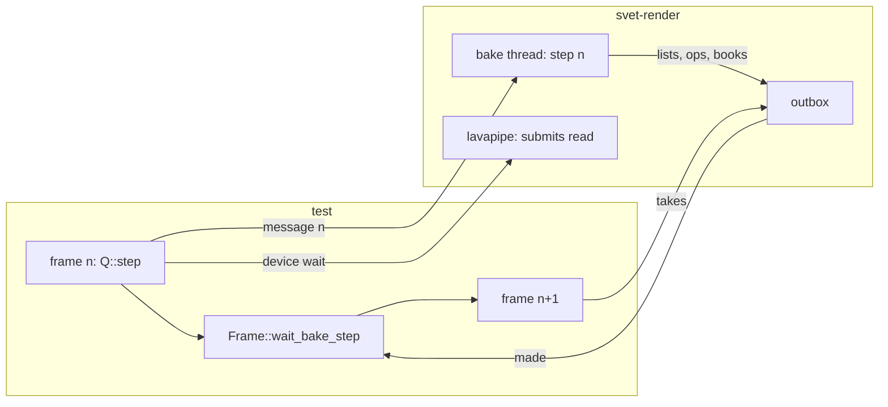

# 0106: No gate test passes by a clock: the red dig test stepped by count, the sweep, and a gate script

> **Status:** in-progress (2026-11-26): Phase 1, the fix for main's red CI, done and merged on its own. Phases 2 to 4 approved (owner, 2026-11-26), with the soak tier's sweep added as Phases 5 and 6. Phases 1 to 4, 7 and 9 done. Phases 8, 10 and 11 read; Ruling 4 corrected by Ruling 5 and Phase 12 withdrawn into Plan 0109 ("Amended 2026-11-26 (architect, Phase 11's reading)"). Owed: Phases 5, 6, then the close.
> **Created:** 2026-11-26
> **Milestone:** none (harness; follows Plan 0099, `docs/roadmap.md` M9's bake thread)
> **Related ADRs:** [ADR-0083](../adrs/0083-the-live-bake-queue-runs-on-a-bake-thread-the-render-thread-applies-its-write-lists-and-issues-its-submits.md) (the bake thread; not changed)

## TL;DR

CI's push run of the Plan 0099 merge failed one gate test that counts frames paced by a sleep while the bake thread works at its own pace. The owner asked how many tests are like it. A reading of every gate-tier test (not soak-marked, not a reading) found **16 whose pass depends on a count or an order that a clock or a second thread can move** (class A, the failing one among them, four of them unsure) and **about 23 that assert a wall-clock bound** (class B), beside about 31 HUD tests with an implicit 3 s bound; about 100 more use a worker or a time budget safely and about 15 read a clock only to print. Phase 1 turns main green: one wait on `Frame` for the bake thread's step, the dig test stepped by count with its assertions unchanged. Phases 2 and 3 apply the same remedy to the rest (wait for the worker, count steps, compare a clock only with itself), and Phase 4 adds the script that keeps the class from coming back.

## Context & problem

**The failure.** GitHub run 45773388342 (the push of `e1628197`), `flythrough::gpu_queue the_edits_frame_holds_the_dig_and_ring_1_lands_in_either_mode`, panicked at `t.ring1 <= l.ring1 + 2`: ring 1 at D+5 with the thread, D+1 in lockstep, 17.2 s. The same commit's tag run passed. `dig_reads` pads each frame with `thread::sleep` and replays the threaded arm at lockstep's mean frame, measured earlier in the same test. With the thread on a frame runs no step, so `ring1` counts how many sleeps fit into one bake step; the step slows under CI's parallel GPU tests and the sleep does not. Plan 0099's log read the same D+5 at a fixed pace under load 8 to 20 (Phase 3b, "Pacing"), and its close review named the line as a minor.

**The rule that was broken.** A frame count at a wall pace is a reading of the machine. Plan 0099's Phases 3g and 6a already fixed two tests of this kind (a held step waits on a gate the test releases, frames are stepped by count, no duration is compared with a constant, no assertion is loosened), and a third shipped anyway: the rule needs a mechanism.

**The sweep** (2026-11-26, at `9b1cd85d`, by reading; nothing was run, so every margin is from the logs or says "not read"). Classes: **A** asserts a count or an order that wall time or another thread can change; **B** asserts a wall-clock bound; **C** reads a clock only to print or store; **D** uses a worker or a time budget and asserts only after a wait that blocks until the work is done.

| class | gate tests | where |
|---|---|---|
| A | 16: the red one, 7 firm and 2 unsure under `crates/`, 4 firm and 2 unsure under `apps/` | the tables below |
| B | about 23 (16 under `crates/`, 7 under `apps/`; 5 of them are also in A) and about 31 HUD tests with an implicit 3 s bound | the tables below |
| C | about 15 under `crates/`; under `apps/` none of its own (the lockstep rig stores each step's ms, two tests assert on it and are B) | fine as they are |
| D | about 49 under `crates/`, about 54 under `apps/` | fine as they are; why, below |

**Why most of the tree is D.** The fly-through's lockstep rig (`apps/flythrough/tests/support/queue.rs`, `Q::step_with`) runs the queue's step inside the call and then waits on the device, and its device asks for no timestamp feature, so the sample cap stays a fixed count (`bake/queue/step.rs`: "without timestamps it stays at the first guess"): a step count there is causal, and every `< MAX_STEPS` is a give-up guard on a count. The streamer's tests block in `Streamer::wait_idle`; the lister's in `wait_listed`; children are waited with no timeout; scoped threads are joined. **This stops holding if the rig's device gains timestamps or loses its wait**; Phase 4's script pins both.

**Class A** (the remedy's phase in the last column).

| test | where | what can move it | phase |
|---|---|---|---|
| `the_edits_frame_holds_the_dig_and_ring_1_lands_in_either_mode` | `apps/flythrough/tests/gpu_queue.rs`, `dig_reads` | frames paced by a sleep against the bake thread's step | 1 |
| `the_outbox_stops_at_its_cap_and_the_bake_thread_waits` | `crates/svet-render/src/bake/thread.rs`, tests | ten sends 2 ms apart must make 4 steps; a descheduled thread coalesces them | 2 |
| `the_outbox_is_bounded_and_the_bake_side_waits` | `bake/queue/split_tests/thread.rs` | "stopped" is 200 sleeps of 1 ms with no new step; a 200 ms stall reads as stopped | 2 |
| `a_wait_ends_on_a_panic_and_a_full_outbox_does_not_hold_it` | same file | the same window | 2 |
| `a_waiting_box_ends_the_opening` | same file | up to 400 unpaced frames for the box's books | 2 |
| `the_listing_pool_drains_to_the_blocks_the_step_lists` | `bake/queue/split_tests/lister.rs` | gives up after 4000 frames with a 200 us sleep while the pool lists | 2 |
| `a_full_chunk_landing_outside_its_band_is_demoted_by_the_next_poll` | `crates/svet-world/tests/stream.rs` | a million polls with a yield while a worker generates | 2 |
| `the_frame_s_timers_and_store_counts_read_back_without_waiting` | `crates/svet-render/tests/gpu_frame.rs` | five frames submitted with no wait; a set must have mapped by the fifth | 2 |
| `dropping_the_streamer_mid_flight_returns_within_bound`, `..._before_the_world_...` | `apps/flythrough/tests/gpu_shutdown.rs`, `fly_and_dig` | 24 updates with a 5 ms sleep must leave work in flight | 2 |
| `a_sliced_pre_roll_bakes_what_an_unsliced_one_bakes` | `apps/flythrough/tests/gpu_loading.rs` | two child runs paced differently compared for equal steps; the pre-roll has wall-time ends | 2 (read first) |
| `a_source_switch_shows_the_loading_frames_before_the_new_world` | same file | a loading frame is logged per 25 ms of wall; a stage inside one slice is never named | 2 (read first) |
| unsure: `sky_empty_noon_golden`, `sky_empty_sunset_and_night_goldens` | `apps/flythrough/tests/gpu_outdoor_golden.rs` | the exposure readout is one poll with no wait after eight frames; its value pins the golden's exposure | 2 (read first) |
| unsure: `the_sky_term_switches_without_a_dip` | `crates/svet-render/tests/gpu_sun/dig.rs`, `dig_run` | frames stepped with no device wait before the dig | 2 (read first) |
| unsure: `the_cycle_parts_sum_to_the_time_between_two_steps` | `bake/queue/split_tests/thread/cycle.rs` | "at least 8 of 12 cycles"; every frame waits for its step, so likely structural | 2 (read first) |

**Class B** (G: a give-up guard, not the claim; C: the bound is the claim).

| test | where | bound | margin read | phase |
|---|---|---|---|---|
| `quitting_while_loading_tears_down_within_bound` | `gpu_shutdown.rs`, `RUN_BOUND` | G, 120 s kill; C, the teardown's 5 s | **107.7 s under load 10 to 12** (Plan 0104's log), 1.7 s quiet on the RTX | 3 |
| `a_mirror_that_cannot_sync_exits_1_after_the_teardown` | same | G, 120 s | **93.8 s** under the same load | 3 |
| `a_replay_log_that_does_not_read_exits_1_after_the_teardown` | same | G, 120 s | not read (exits before a world) | 3 |
| the two streamer drops | `gpu_shutdown.rs`, `DROP_BOUND` | C, 5 s | not read | fine: ADR-level claim (a drop returns), stays; logged in 3 |
| `the_step_s_stages_sum_to_its_time` | `gpu_queue_reach.rs` | C, laps within 5 % of an outside clock | 0.07 % (Plan 0067's log) | 3 |
| `the_stages_split_by_opening` | same | C, the same per side | **2.9 % of 5 % on the thin side: 55 us of preemption fails it** | 3 |
| `the_sync_stages_sum_to_its_wall` | `crates/svet-render/tests/gpu_mirror_budget.rs` | C, within 10 % of an outside clock | not read | 3 |
| `the_first_flush_of_the_streamed_window_is_cheap` | `gpu_world/columns.rs` | C, under 1000 ms (the old form took 48 s) | not read | 3 |
| `the_render_calls_return_while_a_step_is_held` | `bake/thread.rs` | C, 100 calls under 0.5 s | not read | 3 |
| `the_render_side_returns_with_the_bake_side_stalled`, `the_edits_frame_waits_for_its_list_and_no_other_frame_does` | `split_tests/thread.rs` | C, "100 frames within 2 s"; the second's `waited >= 0.1` is safe (a sleep never returns early) | not read | 3 |
| `dropping_the_queue_joins_the_bake_thread`, `a_panic_on_the_bake_thread_is_the_next_steps_error` | same | C, under 1 s from before the rig is built | not read | 3 |
| `the_edits_frame_does_not_wait_for_the_books` | `split_tests/thread/books.rs` | C, under 1 s against a 2 s hold | not read | 3 |
| five more device-less thread tests (`frame_stepped`, `within`, `recv_timeout`) | `split_tests/thread.rs`, `books.rs`, `cycle.rs`, `bake/thread.rs` | G, 1 s each | not read | 3 (the blocking wait replaces them) |
| `a_lap_takes_the_calls_inside_it` | `bake/stages.rs` | C, a lap of at least the 2 ms it sleeps | safe by construction | fine |
| `timers_are_always_ready_and_never_wait` | `crates/svet-script-wasm/tests/determinism.rs` | C, under 5 s against the guest's 30 s sleeps, two compiles inside the bound | not read | 3 |
| the HUD's banner tests (about 31) | `apps/flythrough/src/run/*tests.rs`, `viewer.rs` | implicit: a banner lives `BANNER_MS` (3 s) of wall after `crate::now()` | microseconds against 3 s | fine; listed with its reason in Phase 4's allow-list |

## Decision

**A gate test waits for the worker it depends on and counts what the code counts.** Three forms cover every row: (1) step by count and block until the other thread has done the step (the red test, the "stopped" windows, the give-up loops); (2) compare a clock only with itself (a sum of laps against the span between the same clock's own first and last reads, within a tick, as `the_cycle_parts_sum_to_the_time_between_two_steps` does); (3) state a "does not block" claim causally (the calls return while the step is still held, read from the gate, not from a duration). A kill guard on a child stays a guard and is sized from a loaded reading with a stated margin. A measurement that only a wall pace can make becomes a `reading`.

Rejected: **retries** in nextest (hides the class and the next real race with it); **soak-marking the failing tests** (the weekly run fails falsely the same way, and the gate loses the claim); **widening the bounds** (`+ 2` to `+ 5`, 2 s to 10 s: loosens the assertion and still fails at some load); **pacing by lockstep's measured frame** (what the red test did: two arms minutes apart do not see the same load).



## Implementation phases

### Phase 1: the red test steps by count (main green)
- **Owner skill:** dev
- **What:** One public wait on `Frame` for the bake thread's step, and the dig test stepped by it; the wall-paced form kept as a reading. Two commits (`feat(render)`, then `test(flythrough)`).
- **The seam.** Nothing public waits for the bake thread today: `ThreadLink::steps` and `BakeThread::waiting` are `#[cfg(test)]` and crate-private; `QueueStats::steps`, `Frame::bake_thread_cycles` and `bake_frame_wait_span` show only what a frame's take already took; only an edit's frame waits (ADR-0083). The seam is `Frame::wait_bake_step(&self)`, **a product-surface addition with no change to any existing path**: at once in lockstep; with the thread running it blocks until the thread has stepped every message sent to it and handed in that step's last entries, or waits at the outbox's cap, or has ended. No timeout, no sleep: it blocks on the outbox's condition variable (`made`), which a put and the thread's end already notify. No frame path calls it; its doc says a test's and a headless tool's wait. Under it `BakeThread` knows "idle": `Shared::steps` already counts steps under the outbox's lock; a count of messages picked beside it gives `picked == steps` with the inbox empty (one atomic add a message is the cost). The shape is the dev's; the contract is the bar.
- **The test.** `support::queue::Q` gains the stepped frame (`Q::step`, which already waits on the device, then `wait_bake_step`). In `dig_reads`, from the edit's frame to ring 1 applied, both arms use it; `FRAME`, `clock`, the `frame` argument and the sleep leave the gate test. The loops before the edit stay (they assert no count). **Every assertion stays as written**, `t.ring1 <= l.ring1 + 2` with it; the doc comments are restated (the claim is the hand-off's depth: with the thread, ring 1 costs at most two frames more than lockstep when each frame finds the last one's step made). Derived, not run: ring 1 goes in the edit's one submit on this rig and the cap is a fixed count, so lockstep reads D+1 and the thread D+2 (issued at D+0, its read-back in D+1's message, the list applied at D+2), the same on every dig and every run. The wall-paced form moves, unchanged, to `reading::ring_1_at_a_window_pace` (`#[ignore]` in `mod reading`): it prints both arms' frames and ms and asserts nothing.
- **Files touched:** `crates/svet-render/src/bake/thread.rs`, `bake/link.rs`, `frame/bake_thread.rs`; `apps/flythrough/tests/support/queue.rs`, `apps/flythrough/tests/gpu_queue.rs`.
- **Done when:** (a) A device-less test in `bake/thread.rs`'s rig (CPU, under 1 s): a step held on a gate the test releases from a second thread; `wait` returns only after the release (the release's instant at or before the return, no duration against a constant); it returns at once with nothing sent, and after the thread ended by a panic. 40 runs by name beside a running quick tier, 0 failed. (b) The dig test by name, 20 runs on lavapipe from one `cargo nextest archive` beside a running quick tier (Phase 3g's rig), under the perf lock: 20 passed, and the printed counts are **the same in all 20** (expected D+1 lockstep, D+2 thread, three digs). Its wall is under 10 s alone on the dev reference (it read 6.5 s with the sleeps), so it stays in the gate. (c) `node scripts/test-changed.mjs --profile gpu --binaries gpu_queue` under the lock, `--profile quick`, `--clippy`, `cargo fmt --all --check`, every `scripts/check-*.mjs` exit 0. (d) After the merge, CI's push run is green on both arms.
- **Stops (report, change nothing to pass):** the stepped threaded count over lockstep's plus 2, or differing between runs: log each frame's take, issue and read-back for that dig (`Frame::bake_frame_issue`, `bake_thread_cycles`, the stats' `steps`) and stop; the bound is not widened, the rig's world, counts and digs are not changed, no retry is added. The wait needing a timeout, a sleep, or a call from a frame path. Lockstep's count moving.

### Phase 2: class A, the rest
- **Owner skill:** dev
- **What:** Each class A row waits for its worker. One commit a crate.
- **Remedies.** The two "stopped" windows and the ten paced sends: the outbox's "waits at the cap" becomes a state the test reads and blocks on (the same state `wait_bake_step` returns on), so "the steps stopped" is "the thread waits at the cap", and the sends wait for each step. `a_waiting_box_ends_the_opening`: the frames after the box's step use the blocking wait. The lister's drain: `wait_listed` between steps, as its six neighbours do. The streamer's poll loop: `wait_idle`, or a blocking receive of the one landing. `gpu_frame`'s timers: the device waited between frames outside the frame call, as `gpu_exposure`'s `the_readout_arrives_within_four_frames_without_waiting` does; the claim (the frame's own calls do not wait) stays. `fly_and_dig`: the precondition "work in flight" is made by holding the workers on a gate, or the assert on it is read as the rig's precondition from the streamer's own counts at the drop. **The four unsure rows and the two `gpu_loading` rows are read first**: the dev states, from the code, whether the count can move; a row that cannot is recorded with the reason and left; one that can gets the device wait before its read (the goldens' exposure readout, `dig_run`'s frames) or a count of loading steps in place of wall slices. A golden that moves is a stop.
- **Also here (the leftover that shares the struct):** the bake thread's one condition variable waited on under two mutexes becomes two (`arrived` for the inbox, `room` for the outbox), `halt` notifying both (`docs/backlog.md`, "The bake thread's leftovers"), as its own commit.
- **Files touched:** `crates/svet-render/src/bake/thread.rs`, `bake/queue/split_tests/thread.rs`, `split_tests/lister.rs`, `split_tests/thread/cycle.rs`; `crates/svet-world/tests/stream.rs`; `crates/svet-render/tests/gpu_frame.rs`, `gpu_sun/dig.rs`; `apps/flythrough/tests/gpu_shutdown.rs`, `gpu_loading.rs`, `gpu_outdoor_golden.rs`.
- **Done when:** No test named in the class A table sleeps, yields in a counted loop, or polls without a wait before a count it asserts; each changed test's assertions are the ones it had (a diff of the assertion lines is in the readings log). Each changed CPU test 40 times by name beside the quick tier, 0 failed; each changed GPU test 10 times by name on lavapipe under the lock, 0 failed (`gpu_frame`, `gpu_sun`, `gpu_shutdown`, `gpu_loading`, `gpu_outdoor_golden`; each under 10 s or already soak-marked). No golden moved. The quick tier, the named gpu binaries, clippy, fmt, the check scripts.

### Phase 3: class B
- **Owner skill:** dev
- **What:** Each bound that is the claim is restated without a duration, or kept with its margin read; each guard is sized from a loaded reading.
- **Remedies.** The stage sums (`gpu_queue_reach`'s two, `gpu_mirror_budget`'s one): the laps are compared with the span between the step's own first and last clock reads, within a tick; the outside `Instant` leaves the assertion (it may print). "Returns while held" (the device-less thread tests' 0.5 s, 1 s and 2 s): the assertion reads the gate (the step is still held when the calls have returned), then releases; `waited >= 0.1` stays. The 1 s guards (`within`, `frame_stepped`, `recv_timeout`): the blocking wait where the thread's state gives one; a guard that stays is named in Phase 4's list with its reason. `the_first_flush_of_the_streamed_window_is_cheap`: a count of the work (the tiles or bytes the flush writes) in place of the 1000 ms. `RUN_BOUND`: read each of the three child tests ten times on lavapipe beside a running quick tier, then the guard is at least ten times the slowest (the child's time under load is pipeline compilation, which the test does not claim); `DROP_BOUND`'s two claims stay and their loaded time is logged. `timers_are_always_ready_and_never_wait`: the clock starts after the two loads.
- **Files touched:** `apps/flythrough/tests/gpu_queue_reach.rs`, `gpu_shutdown.rs`; `crates/svet-render/tests/gpu_mirror_budget.rs`; `crates/svet-render/src/gpu_world/columns.rs`, `bake/thread.rs`, `bake/queue/split_tests/thread.rs`, `split_tests/thread/books.rs`; `crates/svet-script-wasm/tests/determinism.rs`.
- **Done when:** No assertion in the class B table compares a duration with a constant or with a second clock, but the rows the table marks fine and the guards Phase 4's list names. The same run counts as Phase 2 (40 CPU, 10 GPU, by name, loaded), 0 failed. The readings log holds, per guard that stays, its bound, the slowest loaded reading and the ratio (at least 10).
- **Stops:** a claim that cannot be stated without a duration goes to the architect with the test's text, not to a wider bound.

### Phase 4: the gate script
- **Owner skill:** dev
- **What:** `scripts/check-test-clocks.mjs`, in CI's doc gates beside `check-test-tiers.mjs`.
- **Rules** (comments and string literals blanked, as `check-test-tiers.mjs` does; test code is a file under `tests/`, a `*tests*.rs` file or module under `src/`, or a `#[cfg(test)]` item). Outside `mod reading` and outside a test marked `#[ignore = "soak"]`, a finding is: (1) `thread::sleep`, `yield_now`, `recv_timeout`, `wait_timeout`, `park_timeout`; (2) a comparison of a duration inside an `assert!` family macro or an `if` that panics (`elapsed()`, `duration_since`, `as_secs*`, `as_millis`, a name the file bound to one of them, against a literal or a constant); (3) `Frame::set_bake_thread(.., true)` or a `--bake-thread on` child in a file that never names `wait_bake_step`; (4) `TIMESTAMP_QUERY` requested by a device a non-reading test steps a queue on. A site passes only when listed in `scripts/test-clocks-allow.txt`: file, test name, the token, one line of reason (a sleep that is the claim's own delay; a kill guard with its ratio; the banner's 3 s). The list starts with the rows Phases 2 and 3 left and nothing else.
- **Files touched:** `scripts/check-test-clocks.mjs`, `scripts/test-clocks-allow.txt`, `scripts/fixtures/test-clocks/` (a seeded tree, one finding a rule, and the README's expected findings), `.github/workflows/ci.yml`. (The `CLAUDE.md` scripts row is the architect's at the close.)
- **Done when:** `node scripts/check-test-clocks.mjs` exits 0 on the tree and names every seeded finding on the fixture (`--self-test`), one a rule and one for a stale allow-list row (a row whose site is gone is a finding). Run against `9b1cd85d`'s tree (a `git worktree` at that commit, no build) it names the red test's sleep and every class A and B site of this plan's tables that rules 1 and 2 can see; the ones it cannot see (a give-up loop with no sleep, a poll with no wait) are listed in the readings log as what the script does not catch. Under 5 s.

## Amended 2026-11-26 (owner)

The owner read the draft and answered "all recommended":

- **Phases 2 to 4 have the go.** Phase 1 merges into main on its own first (it is the fix for main's red CI); the lane then continues from the merged tip, one phase per dev brief.
- **The weekly soak tier gets the same sweep** (the open question under Risks), as later phases of this plan, after Phase 4 so the script's rules are fixed before they are widened. The line "The soak tier's and the readings' clocks" under "What this plan does NOT do" now stands for the readings only.

### Phase 5: the soak tier, the reading
- **Owner skill:** dev
- **What:** The reading the Context section made of the gate tier, repeated on every test marked `#[ignore = "soak"]`: each one that sleeps, polls, counts frames beside a second thread or compares a duration, classed A (a count or an order a clock or a thread can move), B (a wall-clock bound) or fine, with the remedy this plan's Phases 2 and 3 used for the same shape. No test is changed. `the_threaded_queue_drains_to_the_lockstep_store` and the two headless teardown runs are read first.
- **Files touched:** `docs/plans/logs/0106.md`.
- **Done when:** The readings log holds the table (file, test, class, the line that makes it so, the remedy), and a list of the soak tests whose claim is itself a duration (a soak test may time a long run; those stay and are named with their reason). A test whose remedy is not one of Phases 2 and 3's goes to the architect with its text.

### Phase 6: the soak tier, the fixes, and the script over it
- **Owner skill:** dev
- **What:** Phase 5's class A and B rows take their remedies, assertions unchanged. `check-test-clocks.mjs` loses its exemption for `#[ignore = "soak"]` tests; the rows that stay go on the allow-list with their reasons.
- **Files touched:** the test files Phase 5's table names, `scripts/check-test-clocks.mjs`, `scripts/test-clocks-allow.txt`, `scripts/fixtures/test-clocks/`, `docs/plans/logs/0106.md`.
- **Done when:** Each changed soak test passes by name (`--run-ignored only`, the test's name; never the whole soak tier) three times on lavapipe under the perf lock, 0 failed, each run projected from its start and stopped past 20 minutes; a diff of the assertion lines is in the readings log; the script exits 0 on the tree with the soak exemption gone and its self-test names a seeded soak finding. The quick tier, clippy, fmt, the check scripts.
- **Stops:** a soak test that cannot be run by name inside 20 minutes under the lock is reported with its projected time, not run.

## Amended 2026-11-26 (architect)

Three things Phase 2 left, read from the code at `eac1d05e` (nothing was run; every "derived" below says so). Phases 7 to 11 are new, one dev brief each; the dev adds their rows to the Implementation log as they land. Order: Phase 7 any time after Phase 3; Phases 8 and 9 before Phase 6 (they share its rig); Phase 10 any time, alone under the lock.

### Ruling 1: the sliced pre-roll against the unsliced one

**The reading holds, on both counts.** (1) `PreRoll::decide` ends the coarse pass when `work_ms - near_ms > box_ms` and the pre-roll when `work_ms > cap_ms` (`bake/pre_roll.rs`); the fly-through passes `work_ms` as the sum of each step's wall time (`run/loading.rs`, `pre_roll_stage`: `p.work_ms += ms_since(t)`), with `COARSE_PRE_ROLL_MS` 5000 and `PRE_ROLL_CAP_MS` 120 000. (2) Both arms are lockstep (`Args::bake_thread` is off under `--headless`). A lockstep step polls the device without waiting (`GpuHalf::poll`) and its `collect` takes a read-back only where it has mapped, waiting only past the depth (`bake/issue.rs`); `loading_frame` waits on the device before its slice, `load_all` loops `load_step` with no wait. So at a 0.05 ms slice the on arm reads every earlier submit at each step and the off arm reads what lavapipe has finished by then. The listing is not a third clock: the pre-roll passes `samples`, so the opening lists in its own step, not in the pool (`queue/step.rs`, `pooled`).

**What the test claims.** ADR-0059's consequence, "a sliced pre-roll bakes what an unsliced one bakes on a level", as equal steps, chunks and samples of two processes. The design makes the two arms equal in **the sequence of steps** (one `load_step` body, the box counting work time only, which `the_box_and_the_cap_count_work_time_only` defends on the CPU with no device). It never made them equal in **when a read-back is read** or in **how long a step takes**; the test's equality holds while lavapipe keeps pace and the 26-chunk room ends by its chunks before the box. The claim is right and stays; the two arms were not stepped alike.

**Decision: (a), narrowed to a flag.** A headless-only fly-through flag steps the pre-roll by count: a device wait before every pre-roll step in either driver, and no box and no cap. The test passes it to both arms; `assert_eq!(on, off)` and every other assertion stay as written. Rejected: **(b) restating the claim** (any weaker form, such as equal chunks only, or equal unless a run was boxed, loosens the assertion or passes by pace); **(c) a reading** (the gate loses ADR-0059's claim on the two drivers, the escape the Decision section refuses); **a device wait in `load_all` for every run** (headless runs take `load_all` by default, so every headless pre-roll, golden and pinned reading would move for one test); **`--coarse 0` in the test** (no box, but no coarse pass either: a simpler scene, and the read-back order would still differ).

**The wall-clock box is a finding of its own, and not a fault.** The box and the cap are start-up time budgets by decision (ADR-0059): a slower machine bakes less before its first frame and the live queue takes the rest. `svet-render` is not under `svet-world`'s determinism rule. The finding is what follows from it: **a headless run's pre-roll counts, and whatever a test reads in the first frames after one, depend on the machine's pace wherever the box can fire or a read-back can lag**, and the module doc of `pre_roll.rs` says more than the code does ("stops at the same step"). Routed: the doc sentence is corrected in Phase 7; [Plan 0108](0108-the-start-up-readings-a-shorter-pre-roll-and-the-cold-pipelines-split.md), which reads and re-cuts the pre-roll's end, takes the finding as a note on its readings (amended there); whether a headless run should pre-roll by count by default is parked in `docs/backlog.md` (it would move goldens and pins: the owner's call, not this plan's).

### Phase 7: the pre-roll stepped by count, and the two arms compared on it
- **Owner skill:** dev
- **What:** `--pre-roll-stepped` (the name is the dev's; the contract is the bar): refused without `--headless` with a message (so no window shows it and no on-screen mode is owed); off by default, and then every path is as today. On: `pre_roll_stage` waits on the device (`PollType::wait_indefinitely`) before `PreRoll::step`, under `load_all` and under `loading_frame` alike, and `enter_pre_roll` builds the `PreRollConfig` with `box_ms` and `cap_ms` infinite, so the pre-roll ends when its coarse pass has passed and by nothing else. `a_sliced_pre_roll_bakes_what_an_unsliced_one_bakes` passes the flag in both arms; no other line of the test changes. `pre_roll.rs`'s module doc is restated (a comment only): the box and the cap read the caller's summed step time, so the time between slices is not counted; a step's own time and the step at which a read-back is read are the machine's.
- **Derived, not run:** with the device waited before a step, every submit an earlier step issued has mapped at that step's poll, so `collect` reads the same read-backs at the same step in both arms; the sample count is the fixed `PRE_ROLL_SAMPLES`; no end reads a clock. Not derived: whether the on arm's first upload, synced under a 0.05 ms budget, leaves the mirror in the off arm's order. The ten runs read it.
- **Files touched:** `apps/flythrough/src/cli/loading.rs` (the flag and its CLI test), `cli/mod.rs` or `cli/parse.rs` (the refusal), `run/loading.rs`, `docs/flythrough.md` (one row), `apps/flythrough/tests/gpu_loading.rs`, `crates/svet-render/src/bake/pre_roll.rs` (the module doc only), `docs/plans/logs/0106.md`.
- **Done when:** (a) the CLI test: the flag parses with `--headless`, is refused without it, is off by default (CPU, under 0.1 s). (b) The test by name ten times on lavapipe under the perf lock beside a running quick tier (`gpu_loading`): 10 passed, and the printed `pre-roll off (..), on (..)` triples are **equal between the arms and the same in all ten runs**. Its wall alone is logged; about 14 s is expected (`docs/nfr/07-startup-and-build.md` lists it there, over the line before this plan and kept in the gate by that file's reason). (c) Without the flag: a headless room run prints the same `pre-roll:` fields as before the phase, the fly-through's default golden (`gpu_golden`, by name) is byte-identical, and the three other gate tests of `gpu_loading` pass by name once. The quick tier, clippy, fmt, the check scripts.
- **Stops (report, change nothing to pass):** the triples differing between the arms or between runs with the flag on: log each step's settled, baked and samples for both arms and stop; the assertion, the room and the slice are not changed. The flag needing a code change in `svet-render` beyond the doc sentence. The test's wall alone over 20 s.

### Ruling 2: `a_reset_pixel_starts_from_its_record` fails at the base

**The reading.** The test counts, at the dig's frame, the `+z` pixels inside the dig's box dilated by one voxel **that cast the sky ray**, and asserts that some of them hold a record (`with_record > 0`) and read it at `SEED_AGE`. When it last passed (Plan 0094 Phase 7a's log) those were faces with a stale record: stale, so the ray was cast and the reset pair seeded from the record. Plan 0098 Phase 14 (`aeb23c3f`, 2026-11-23) made `DigHold::On` the default: at the edit each touched brick (a brick the box dilated by one voxel touches, so the whole counted region) takes a held record "which the light pass reads as any record (no ray cast, no pair kept)" (`frame/settings/sky_light.rs`, `bake/queue/digs.rs` `take_boxes`). Under the default a face in the region that holds a record casts no ray, so it is never in the set the test counts: `with_record` is 0 by construction, while the faces whose held cell is empty still cast and are counted (`plus_z > 0`). The rig takes the default (`dig_frame`: `..f.lighting()`). Neither the bake thread (the rig is lockstep) nor Plan 0104's removals (`key_at`, `key_horizon`, `key_cover record` are the key light's; the rig's lamp is off and it reads the sky term) is on this path. The test's assertions before the failing one (`summary_stale`, `unanswered == 0`) pass in the dev's run, which fits.

**Ruling: most likely stale against the default, not an engine fault; one reading tells.** The seed's path the test defends is still shipped, under `DigHold::Off` ("the cast rays' seed until the landing") and `Rays`, and an unpicked arm that stays a setting keeps its test. The default's own claim (a held hole shows no ray's noise) is `gpu_lights`' Plan 0098 Phase 14 test, not this one. Rejected: **deleting the test or the failing clause** (loosens it); **fixing it inside Phase 6** (Phase 6 changes clocks, and a red test cannot show its rig change harmless); **a fix pass on Plan 0098** (closed; this lane already holds the rig).

### Phase 8: the reset seed under each dig hold (a reading)
- **Owner skill:** dev
- **What:** `a_reset_pixel_starts_from_its_record` by name (`--run-ignored only`, lavapipe, under the lock, about 13 s a run), three arms: the tree as it is, then `dig_frame`'s lighting with `dig_hold: DigHold::Off`, then `DigHold::Rays`, the last two as a local edit that is **not committed**. No test or code change lands.
- **Files touched:** `docs/plans/logs/0106.md`.
- **Done when:** the log holds, per arm, the test's three `frame 1:` lines and its means line, and either "passed" or the first failing assertion with its message.
- **Stops:** the default arm printing `with a record` above 0 (the reading above is then wrong: report the lines, run nothing more).

### Phase 9: the reset seed's test runs under the hold it defends
- **Owner skill:** dev
- **What:** By Phase 8's reading. If the `Off` arm passed whole: the test's dig run takes `DigHold::Off` (`dig_run_with` gains the lighting, or the hold, as an argument; `dig_run`'s other callers keep the default), every assertion as written, and the doc comment names the setting and why (under `On` a face with a record casts no ray and keeps no pair, ADR-0082). If `Off` failed and `Rays` passed whole: the same with `Rays`. The open-floor clause at the test's head is not touched.
- **Files touched:** `crates/svet-render/tests/gpu_sun/dig.rs`, `docs/plans/logs/0106.md`.
- **Done when:** the test passes by name three times on lavapipe under the lock (`--run-ignored only`), the printed `with a record` count above 0 and the same in all three; a diff of its assertion lines in the log shows none changed; `a_dig_leaves_no_dots` (soak, by name, once) and `the_sky_term_switches_without_a_dip` (by name, once) pass with their printed values unchanged from Phase 2's. `--binaries gpu_sun`'s build, the quick tier, clippy, fmt.
- **Stops:** both arms failing in Phase 8, or an arm passing only with an assertion changed: to the architect with Phase 8's lines (the seed's path is then broken on the tree, an engine finding for a fix pass, not for this plan).

### Ruling 3: the source switch at 60 to 66 s

**The reading.** The test is the gate's only test of the in-process switch and stays in the gate at 17 to 18 s by `docs/nfr/07-startup-and-build.md`'s stated reason (one fly-through process, nothing to overlap). The kept gate logs read it at 16.5 to 17.7 s on 2026-11-20 and 21 and **17.1 s on the tree of `db9c170a` (2026-11-25 03:53)**; Phase 2 read 60.6 s at its base form. Nothing in the test changed between. Three merges touch `apps/` or `crates/` in that window: `02e80ce4` (Plan 0100), `e1628197` (Plan 0099), `9b1cd85d` (Plan 0104). Phase 2's own change is the smaller part (60.6 to 66.5 s, one step a loading frame). This test has caught an engine fault by its time before (200.2 s back to 16.9 s at the column map's flush, `docs/nfr.md` section 7, Plan 0086's reading).

**Decision: left in the gate, unmarked, until its time is attributed; the growth is a finding, read in Phase 10.** A load on lavapipe that takes 3.5 times longer than two days ago with no change of scene is a start-up reading of the tree before it is a tier question. Rejected: **the soak mark now** (`docs/nfr.md` section 7's rule would give it, but the mark takes the one switch test out of the gate while what it signals is unread, and a gate-sized form of a run that loads two worlds in a child process does not exist under 10 s: its floor is the 17 s the exception already accepts); **cutting it down** (a cheaper next source or a smaller residency is a simpler scene for a check, and cuts the signal); **leaving it with no reading** (a minute in every gate, unexplained). The tier is ruled when Phase 10 returns: back near its listed time by a fix, it stays under the exception; the scene's honest cost with nothing to fix, it takes the mark and section 7's list is corrected at the close. That phase is written then, not now: no fix is written for a source no reading has named.

### Phase 10: where the source switch's 43 s went (a reading)
- **Owner skill:** dev
- **What:** The test's own command line run by hand (headless, lavapipe, `RUST_LOG=flythrough=info`, alone under the exclusive lock, stdout and stderr kept), at the lane's tip and at `db9c170a` (a `git worktree` with its own target directory, built outside the lock). Per run, for the showcase's load and the switched run's: each stage's loading frames, steps and ms from the run's own lines (`loading:`, `pre-roll:`, `mirror:`, the `diag:` stamps), and the run's wall. If one stage holds the growth, the same run at `02e80ce4` and, if needed, `e1628197`, to name the merge. At most four builds; each run projected from its first stage's stamp and stopped past 5 minutes.
- **Files touched:** `docs/plans/logs/0106.md`.
- **Done when:** the log holds the two stage tables side by side, the stage or stages that hold the growth with their step counts and per-step ms at both trees, and the merge at which the time entered, or the statement that four builds did not name it. Nothing is changed.
- **Stops:** `db9c170a`'s tree reading over 30 s on the same day (the growth is then the machine's, not the tree's: report both walls). Everything else returns to the architect with the tables; the dev marks, cuts and fixes nothing.

Phases 11 and 12 are under "Amended 2026-11-26 (architect, Phase 10's reading)" below: Phase 10 returned, and the stub that stood here (the tier, written when it did) is replaced there.

## Amended 2026-11-26 (architect, Phase 3's two leftovers)

Phase 3 came back with every class B site restated but two (`ee3accbd`, the readings log's Phase 3 section).

- **The three stage sums take two reading-only production edits (dev's option (a)).** Phase 3's remedy ("the laps are compared with the span between the step's own first and last clock reads") cannot be written from the test files: `StepStages::total_ms` is read by a clock call after the last lap (`bake/queue/step.rs`), and `SyncStats` carries each stage's truncated microseconds and no span (`StageClock::stop`, `gpu_world/window.rs`). Phase 3's files gain those two: `total_ms` is taken from the last lap's own instant, and `SyncStats` gains the span between its first and last clock reads. No behaviour moves: no frame path reads either figure but the readings lines, and no new clock call is added (one is removed). Rejected: leaving the three bounds (the claim then still compares two clocks), and a second amendment round for two fields. **Stop:** if either figure is read by anything but a readings line or a test, dev reports the reader and changes nothing.
- **`RUN_BOUND` is sized after Phase 10, not before.** The child runs read 26 to 36 s loaded (11 runs) and 107.7 s once in Plan 0104's log; ten times that is a kill guard of 6 to 18 minutes, sized on a start-up that Ruling 3 says grew threefold on lavapipe inside two days. A guard sized on a regression would hide it. So Phase 3 closes without the resize: the bound stays 120 s, the readings are logged as they are, and the ten loaded runs a child and the resize join Phase 11, read on the tree Phase 10's finding leaves. Until then `RUN_BOUND` is the known next false red (the plan's Context already says so).

## Amended 2026-11-26 (architect, Phase 10's reading)

Phase 10 came back (`79b0744c`, the readings log's Phase 10 section). The code was read at that tip; nothing was run. Each statement below says whether it is from the code, from Phase 10's files (`live/p10/` in the lane's worktree) or a guess.

### Ruling 4: the switched run's pre-roll has two lengths, and the listing pool is not why

**From the code.**
- **The listing pool is not on this path.** Every run prints `bake thread off` for both loads (`Args::bake_thread` is off under `--headless`); the pool starts only with the thread (`frame/bake_thread.rs`, `start_lister`), and a pre-roll step passes `samples`, so it would not list through it anyway (`queue/step.rs`, `pooled`). The run line's "listed from the workers" is `QueueStats::prepared`: the jobs listed from the **stream workers'** prepared masks (`queue/list.rs`), a count of what was opened, not a feed that holds the end back. Phase 10's inference is refuted as worded.
- **The end condition.** With `--near 0 --coarse 0` the pre-roll ends at the first step where the camera's chunk is settled (`PreRoll::decide`: `settled >= of`, then the coarse pass is empty), and by nothing else short of the 120 s cap. Settled is a block at the full count and no job, dig or due entry for the chunk (`queue/reads.rs`, `settled`).
- **What holds it.** An opening that finds a candidate's reach or lights not ready marks it blocked at that step and skips it for `QUEUE_RECHECK` steps, 30 (`queue/open.rs`, `queue/mod.rs`). The reach is not ready while any chunk within the light radius waits to upload or, on a streamed world, is not resident full and mirrored (`queue/reach.rs`). The constant is a count of steps written for frames; a pre-roll step here takes 0.1 to 0.35 s.
- **What runs meanwhile.** The opening lists every other ready candidate up to two caps of samples at each step, the near setting notwithstanding: the pre-roll's `near` only names the chunks whose settling ends it.

**From Phase 10's files.** The short mode is 32 steps on every tree: the camera's chunk blocked at the first opening (the stream has only begun), checked again 30 steps on, baked, settled. The long modes read 95 and 98 steps at `e1628197` and 129 at the tip: three and four more waits of 30, then a few steps behind the jobs opened meanwhile (the long runs print 48 and 15 steps "with no table slot free"). After a short pre-roll the queue's line reads `waiting reach` above 0 and `lights 0`: what blocks is the reach. The chunks baked (256 to 789) and the samples follow from the wait: 30 steps of two-cap openings a failed check.

**So, derived, not read step by step:** the pre-roll's length after a switch is 2 steps plus 30 for every check of the camera's chunk that finds its reach not ready, and whether a check finds it ready is a race between the step count and the stream workers and the mirror's upload. That is a second clock inside the pre-roll, on a path `--pre-roll-stepped` does not reach (it waits on the device, not on the streamer).

**Guesses, named as such.** Which chunk of the reach is not ready at step 31 and why (waiting to upload, not yet full, LOD-only). Why the odds moved at `e1628197` (before it, every run on record is short): the merge changed what the queue reads of the mirror (a per-step shadow of it) and of the residency (a snapshot), and either could change what a check sees; nothing here shows which. Whether the long mode exists on the RTX host or in a window (no reading; a window steps the pre-roll the same way but its steps are shorter).

**Verdict: an engine finding in the start-up path, not a test fault and not the bake thread.** Start-up on a streamed world can take 30 steps of unasked baking per unlucky check: tens of seconds on lavapipe before the first frame, unpredictably. It is the complaint Plan 0108 reads (the pre-roll's length) and the owner's standing one (waiting for light). **It is not this plan's to fix**: this plan changes how tests wait, and the fix changes what a start-up shows. Rejected: **fixing it here** (a start-up behaviour change inside a harness plan, with no reading of the cause); **a fix plan drafted now** (the two guesses above decide its shape: a shorter recheck helps only if the reach is ready a step or two late, not if a chunk never uploads in time); **the soak mark now** (as Ruling 3: the test is what shows the finding); **passing `--pre-roll-stepped` or a quieter next source in the test** (the first does not reach the streamer, the second is a scene made simpler for a check). Routed: `docs/backlog.md`, "The pre-roll's end on a streamed world rides a 30-step recheck"; the fix plan is drafted when Phase 11 returns.

**The 40.5 s reading at `db9c170a`: accepted as the machine's.** The stop was written on the run's wall, which was the wrong figure for a shared machine (the architect's wording). Its purpose was to tell the tree from the machine, and the stage table does: that run's switched pre-roll is 32 steps and 9 chunks like the two quiet runs, and its excess is the showcase's pipeline build (21.0 s at load 22 to 30 against 6.8 s quiet), which moves the same way at the tip. No repeat is owed.

**Readings owed, and not owed.** Owed (Phase 11): the per-step trace that confirms or refutes the grid of 30 and names what blocks; the same at `c87bf7a6`; a few RTX runs. Not owed: `9b1cd85d` on its own (the tip's longer long mode is one more wait of 30, which the trace reads directly); quiet repeats of the walls (the finding is the step count, which the load does not make: the long mode read at load 1 and at load 8).

### Phase 11: the camera's chunk through the switched pre-roll, step by step (a reading)
- **Owner skill:** dev
- **What:** A local trace, **not committed**, in the lane's tree: for each pre-roll step of the switched run, the step's number and ms; whether the opening checked the camera's chunk and what it found (reach ready, or the first chunk of the reach that is not and why: waiting to upload, not resident full, not mirrored, LOD-only; lights ready or not); whether a job for it is in the loop; the streamer's full chunks, the mirror's chunks waiting to upload, the jobs listed and the samples submitted that step. The shape is the dev's. Runs, each alone under the exclusive lock with its load1 logged: (1) Phase 10's command line on lavapipe at the tip, repeated until two short and two long pre-rolls are in hand, at most eight runs (27 to 60 s each as read); (2) the same trace on a worktree at `c87bf7a6` with its own target directory, built outside the lock, two runs; (3) Phase 10's untraced tip binary on the RTX adapter (the same command line without `--adapter`), five runs, reading the switched run's `pre-roll:` and `bake queue:` lines only. Every run is projected from its first stage's stamp and stopped past 5 minutes; the phase holds the lock under 15 minutes in all.
- **Files touched:** `docs/plans/logs/0106.md`.
- **Done when:** the log holds, per traced run, the steps at which the camera's chunk was checked with each check's finding, and the step it was opened and settled; one sentence each, from those rows, on (a) whether the checks fall 30 steps apart and a long pre-roll is one or more checks that found the reach not ready, (b) which chunk blocked at each such check and in what state, and whether it was ready one step later or many, (c) what the check at `c87bf7a6` saw at the same step; and the five RTX lines with their steps, chunks and ms. The trace's diff is in the log or beside the raw files, and `git status` shows no code change.
- **Stops (report, change nothing):** the checks not falling 30 steps apart, or a long pre-roll whose camera chunk was never found blocked (the reading above is then wrong: log the trace of that run and run nothing more); the trace not applying at `c87bf7a6` without more than its print lines changing (skip that arm and say so); eight tip runs with no long pre-roll (report the eight). The dev fixes, marks and resizes nothing.

### Phase 12: reserved for the switch test's tier and `RUN_BOUND`
- **Owner skill:** dev
- **What:** Written by the architect when Phase 11 returns and the fix's plan exists: the switch test's tier (Ruling 3's two outcomes stand), and `RUN_BOUND`'s ten loaded runs a child and its resize, which the amendment "Phase 3's two leftovers" moved to "Phase 11" and which now wait here, on the tree the fix leaves. Not started before that.
- **Files touched:** named then.
- **Done when:** stated then. Until it is, the source switch stays in the gate, unmarked, reading 27 to 60 s on lavapipe by the pre-roll's two lengths; Phase 6's and the close's `test-times.mjs` name it as over the line with Rulings 3 and 4 as the reason, and `RUN_BOUND` stays 120 s.

**For the Implementation log** (the dev's, with Phase 11's commit): row 11 is renamed to this Phase 11 and a row 12 is added for the reserved phase.

**Owner questions** (the first is a stability question and is not decided here; the second takes the recommendation unless the owner says otherwise):
1. When the camera's chunk cannot bake at a start because its surroundings are still streaming in: does the first frame **wait for it** (as now, with the wait cut to the least the stream allows), or does start-up **end on a bound and show the frame with that chunk's light still landing**? The second is faster and shows light arriving in view; Plan 0108 Phase 2 (the owner looks at the start) is where it can be seen. Recommended to look before choosing; the fix plan carries both arms until then.
2. The fix as its own small plan (next free number in `docs/plans/README.md`), drafted after Phase 11, not as phases of Plan 0108 (a chore of readings whose outdoor starts would read two lengths until the fix lands). **Recommended and taken.**

## Amended 2026-11-26 (architect, Phase 11's reading)

Phase 11 came back (`e9e40e6b`, the readings log's Phase 11 section) with part of Ruling 4 contradicted. The code was read at that tip and the raw step tables in the lane's `live/p11/` (`node live/p11/steps.mjs <tag> --all`); nothing was run. Ruling 4 stays as written above; this corrects it. Each statement says whether it is from the code, from the rows, or a guess.

### Ruling 5: what holds the camera's chunk is the age of its blocked mark, not what blocked it

**Ruling 4 was wrong on one count and right on two.** Wrong: "what blocks is the reach". Only the check at step 1 fails on the reach; every later failed check has the reach ready and the lights ready, and fails on the columns. Right: the grid of 30, and a long pre-roll as one or two failed rechecks. The run line's `waiting reach` counts every refusal of `bakeable`, reach or columns (`queue/open.rs`), which is how the two were read as one.

**From the code.**
- **The mark is cleared by age only.** A candidate `bakeable` or `lights_ready_near` refuses is stamped with the step (`BakeQueue::blocked`) and skipped by every opening until `QUEUE_RECHECK` (30) steps have passed (`queue/open.rs`, `queue/list.rs`). The stamp leaves early only when the chunk itself leaves the mirror, its own prepared masks arrive, or an edit box touches it (`queue/step.rs` `forget_unheld`, `queue/message.rs`). A change in the chunk's reach drops its cached reach verdict (`drop_reach`) and **not** its stamp: nothing rechecks a chunk because what blocked it has cleared.
- **The column check is wider than the reach.** With `column_wait` off (the default), `bakeable` passes a chunk whose columns are not final only if no chunk waits to upload in any column over its reach footprint, **at any height of the mirror's window** (`queue/mod.rs`, `reach_columns_final` over `column_final(.., None)`); the block is then provisional. The reach walk covers 613 chunks; the footprint's columns cover the window's whole height.
- **Why chunks wait to upload at all.** A sync writes at most `SYNC_BUDGET_MIB` (2 MiB) and defers the rest, nearest first (`gpu_world/window.rs` `select`, `apps/flythrough/src/streaming.rs`); the pre-roll runs one sync a step (`PreRoll::step`). So chunks are pending whenever a step's arrivals from the stream workers outrun one sync.
- **The bake thread, its lister pool, the shadow and the residency snapshot are not what a check reads wrongly.** The runs are lockstep; the shadow's pending count equals the mirror's in every row (Phase 11); the snapshot is taken each step from the streamer after its poll (`run/loading.rs`).

**From the rows.**
- **The chunk was bakeable within the first six steps of every traced tip run, long or short.** The reach reads ready from step 4 to 6 (t2 to t8), and the mirror has 0 chunks pending at steps 4 to 13 (t2), 3 to 10 and 12 to 14 and 19 to 27 (t3), 3 to 10 and 14 to 15 and 21 to 27 (t4), so no column of the footprint can hold one. At `c87bf7a6` it was bakeable from step 12 or 14. Every run then waits for step 31. **The long mode is the same wait taken twice or three times**: by step 31 the tip's stream has delivered five times the chunks `c87bf7a6`'s has (6000 to 7000 full against 1361) and is in a standing upload backlog (37 to 876 pending from about step 28 on), so the check lands in it.
- **`c87bf7a6` is not immune, it is early.** Its steps are short (26 to 107 ms with no job open), each receives 20 to 80 chunks, under one sync's worth (about 216 to 230 chunks a step, read where a backlog drains), so nothing is pending at 2 to 31. At step 32, after a burst of 594 chunks, it reads 378 pending and 98 of them in the camera's footprint columns: one step after its check.
- **A step's time follows its arrivals in both trees**: about 1 ms a chunk (0.9 at the tip, 1.4 at `c87bf7a6`), 130 to 290 ms and 100 to 250 chunks a step at the tip against 26 to 107 ms and 20 to 80. A long step is followed by a burst and a backlog (t4: 416 ms, then 428 chunks and 194 pending; 814 ms, then 716 and 876).

**Guesses, named as such.**
- **Why a step costs three times as much since `e1628197`.** The rows give the loop (a longer step receives more chunks, and a step's main-thread work is by the chunk) and not what lengthened it first. The merge added per-change work to the lockstep step (the shadow's notes, with a column's lowest top per changed chunk; the frame's message), and a small added cost is amplified by that loop; no trace printed the step's stages, so this is not read. It is a finding of its own: a streamed start's main-thread step grew threefold on lavapipe at a merge that was meant to move work off that thread. [Plan 0109](0109-a-blocked-chunk-is-checked-again-when-its-blocker-clears-the-start-on-a-streamed-world.md) Phase 3 reads it.
- **Which chunk held a footprint column at the failed checks.** Not named, and **not owed**: any pending chunk in those columns does it, and the fix does not depend on which.
- Whether the RTX host's chunk is bakeable as early as lavapipe's (its five runs are untraced; the 32 and 95 step counts match).

**Verdict: the defect is the recheck by age.** A chunk that is bakeable at step 5 is opened at step 31 on every tree and every adapter read; the pending uploads only decide how often the check at 31 (and 61) fails too, and the merge moved those odds by making the steps longer. Rejected as the cause to fix: **the pending uploads** (a 2 MiB sync against a stream in full flow is the budget working); **the column rule** (ADR-0070's amendment: the sky rays read the column map, so a top about to change is not baked under); **a smaller constant** (still an age: a check that misses by a step waits the whole of it again).

**No further reading is owed before the fix.** The blocked mark's rule is in the code, and the rows show the chunk bakeable 25 steps before its check in all eight tip runs and both base runs. The fix is drafted as Plan 0109; its first phase carries its own before and after on these same command lines.

### What a start pays today (derived, not measured in a window)

Every chunk found blocked at its first opening waits 30 steps, and at a streamed start the camera's chunk always is (its reach is not resident at step 1 in all ten traced runs). On the RTX host, headless, at load 10 to 18: a short start is 32 steps in 5.8 to 6.8 s (about 0.2 s a step), of which about 25 steps (about 5 s) are the wait if the chunk is bakeable as early as on lavapipe (unread there); the long start, 1 run of 5, is 95 steps and 31 s. A window start with the default near shell waits on every near chunk, so it pays at least the one wait whenever any of them is blocked at its first check. A quiet machine's step time and a window's are unread: [Plan 0108](0108-the-start-up-readings-a-shorter-pre-roll-and-the-cold-pipelines-split.md) Phase 1 reads them (amended there).

### Phase 12 is withdrawn into Plan 0109

The switch test's tier and `RUN_BOUND`'s ten loaded runs and resize are read on the tree the fix leaves, so they are Plan 0109 Phase 6, not a phase of this plan held open across another plan's lane. This plan closes without them: the source switch stays in the gate, unmarked; the close's `test-times.mjs` names it as over the line with Rulings 3 to 5 as the reason; `RUN_BOUND` stays 120 s and is the known next false red until Plan 0109 Phase 6. Rejected: **holding this plan open** (its harness work is separable and its script should reach main); **the soak mark at the close** (Ruling 3 stands: the test is what showed the finding, and the fix should bring it back near its listed time).

### What proceeds now

Nothing left in this plan waits for Plan 0109. Order, one dev brief each, as the amendments above set: **Phase 8** (the next brief: the reset seed under each dig hold, three arms by name on lavapipe under the lock), **Phase 9** by its reading, **Phase 5** (the soak tier's reading, no run), **Phase 6**, then the fresh-session close review, which accepts or rejects the allow-list's rows beyond Phases 2 and 3's leftovers (the Implementation log's Phase 4 notes).

**For the Implementation log** (the dev's, with its next commit): row 12 reads "withdrawn into Plan 0109 Phase 6 (amendment of Phase 11's reading)".

**Owner questions.** Question 1 above (wait for the camera's chunk, or end on a bound) stays open and is carried by Plan 0109 as its two arms; it is not decided here. Plan 0109 needs the owner's go.

## Data shapes

```rust
// illustrative
impl Frame {
    /// Blocks until the bake thread has stepped every message sent to it and handed in that
    /// step's entries, or waits at the outbox's cap, or has ended; at once in lockstep.
    /// A test's and a headless tool's wait: no frame path calls it.
    pub fn wait_bake_step(&self);
}
```

## Budgets

`docs/nfr.md` section 7 (the gate tier's wall and the soak line). The red test loses its sleeps (it read 6.5 s alone on the dev reference's lavapipe, 17.2 s on CI); Phases 2 and 3 remove sleeps and add blocking waits, so no test should grow. The close runs `node scripts/test-times.mjs` on the gate's log and names any changed test over the line. No frame, memory or edit figure moves: `wait_bake_step` is called by no frame path, and the one atomic add a message is on the bake thread.

## Risks & open questions

- **The derived counts are not run.** If the stepped threaded arm does not read D+2 on every run, something else on the path is paced by a clock (the lister pool does not serve a dig's ring 1, which `open_digs` lists on the bake thread; the cap is a fixed count on this device). Phase 1's stop covers it.
- **A blocking wait can hang a test** where a guard used to fail it in a second. The profiles' `slow-timeout` with `terminate-after` is the net; a hang is then a 30 s to 10 min failure with the test's name, not a false red.
- **Threading:** the condition-variable split changes who is woken; its two tests exist and the wait's test in Phase 1 adds a third waiter's case.
- **The script reads text, not types.** It cannot see a give-up loop that counts frames with no sleep. The allow-list and the rig's pinned device (rule 4) are what it can hold; the rest is the review's.
- **Open, for the owner:** whether the weekly soak tier gets the same sweep (this plan reads the gate tier only; `the_threaded_queue_drains_to_the_lockstep_store` and the two headless teardown runs are soak and wall-coupled).

## What this plan does NOT do

- The soak tier's and the readings' clocks (a reading may time anything).
- The gate-sized forms of the two soak tests that prove the thread end to end, and the over-cap write list dropped in release (`docs/backlog.md`, "The bake thread's leftovers").
- A headless run stepped by `wait_bake_step` (a repeatable threaded `run.json`): an idea, not asked for.
- Injecting a clock into the HUD's banner; the 31 tests keep `crate::now()` under the allow-list's one row.
- Any retry, any widened bound, any scene made simpler.

## Implementation log

> Written by `dev`: one row per phase as its commit lands, then the close block. Readings, run
> counts and attempts go to `docs/plans/logs/0106.md`.

| phase | owner | state | commit |
|---|---|---|---|
| 1: the red test steps by count | dev | done; readings in [the log](logs/0106.md#phase-1-the-red-test-steps-by-count); the wall-paced reading's `ms` is taken after each frame's pad, not after the last pool read | 4c90a671, then committed with this row |
| 2: class A, the rest | dev | done but one row; readings in [the log](logs/0106.md#phase-2-class-a-the-rest). `a_sliced_pre_roll_bakes_what_an_unsliced_one_bakes` left unchanged, a question for the architect (Notes); the source switch reads 66.5 s alone, over the 10 s line (60.6 s at its base form); `take` and `take_until` also clear `at_cap` | 8d9fe04d, then committed with this row |
| 3: class B | dev | done; readings in [the log](logs/0106.md#phase-3-class-b). `RUN_BOUND` stays 120 s, its ten loaded runs a child and its resize moved to Phase 11 (amendment "Phase 3's two leftovers"); the stage sums on two reading-only fields, with `gpu_world/mod.rs` (the field) and `bake/stages.rs` (a doc line) outside the phase's files; `split_tests/thread/fade.rs` changed (outside the phase's files: called by a table row) | b2a1c70d, 446453ad, a06b3d2a, ee3accbd, 99da6459, 797b769d, then committed with this row |
| 4: the gate script | dev | done; readings in [the log](logs/0106.md#phase-4-the-gate-script). Allow-list rows beyond the brief's list: 8 rows (12 sites) the plan classes fine or D, or D sites its tables did not name (Notes); `STOPPED_SENDS` and the HUD banner have no row (the script does not see them) | committed with this row |
| 5: the soak tier, the reading | dev | not started | |
| 6: the soak tier, the fixes | dev | not started | |
| 7: the pre-roll stepped by count | dev | done; readings in [the log](logs/0106.md#phase-7-the-pre-roll-stepped-by-count). Taken before Phases 4 to 6; one quick tier ran beside runs 1 to 3 of the ten, not looped | committed with this row |
| 8: the reset seed under each dig hold | dev | read; readings in [the log](logs/0106.md#phase-8-the-reset-seed-under-each-dig-hold). `On` (the tree) fails at `with_record > 0` with 0 cast `+z` pixels (Ruling 2's `plus_z > 0` reads 0); `Off` and `Rays` pass whole, 366 cast, 204 with a record, the same lines | committed with this row |
| 9: the reset seed's test under its hold | dev | done; readings in [the log](logs/0106.md#phase-9-the-reset-seeds-test-runs-under-the-hold-it-defends). Takes `DigHold::Off` through an optional hold on `dig_run_with`; 3 of 3 passed, `with a record` 204 each; no assertion changed; the two other dig-rig tests print as in Phase 2. Phase 8's two notes carried in the log for the close | 2c9389b7, then committed with this row |
| 10: where the source switch's 43 s went | dev | read; readings in [the log](logs/0106.md#phase-10-where-the-source-switchs-43-s-went). The growth is the switched run's pre-roll and enters at `e1628197` (sometimes 256 to 260 chunks, 27 s, against 9 chunks before); two modes at the tip (32/9 in 7 to 8 s, or 789 chunks in 44.7 s). One `db9c170a` run over the 30 s stop at load 22 to 30, read as load. Returned to the architect, no fix made | committed with this row |
| 11: the camera's chunk through the switched pre-roll, step by step | dev | read; readings in [the log](logs/0106.md#phase-11-the-cameras-chunk-through-the-switched-pre-roll-step-by-step). Checks at 1, 31, 61 and the first opening from 91; long runs are 1 or 2 failed rechecks; after the first check the reach was ready and the footprint's columns were not (a chunk pending upload), against Ruling 4's "the reach"; `c87bf7a6` checked at 31 and found it ready, 0 chunks pending at every step; long mode on the RTX 1 of 5. The column chunk is not named (eight-run cap). Returned to the architect | committed with this row |
| 12: reserved for the switch test's tier and `RUN_BOUND` | dev | withdrawn into Plan 0109 Phase 6 (amendment of Phase 11's reading) | |

### Notes

- Phase 2: `a_sliced_pre_roll_bakes_what_an_unsliced_one_bakes` can move (the pre-roll's 5 s box and 120 s cap on summed wall step time; the off arm steps with no device wait while the on arm's loading frames wait, so lockstep's `collect` reads read-backs at different steps) and its test file cannot change that; left as written, for the architect.
- Phase 2: `a_source_switch_shows_the_loading_frames_before_the_new_world` takes `--load-slice 0.05`; it reads 66.5 s alone at the tip, 60.6 s at its base form, both over the 10 s line.
- Phase 3: the three stage sums first stopped (their claim needed a span neither figure carried); after the architect's amendment they compare the stages with `StepStages::total_ms` (now the last lap's instant) and the new `SyncStats::span_us`. `gpu_world/mod.rs` and `bake/stages.rs` changed outside the phase's files (the new field, a doc line).
- Phase 3: `split_tests/thread/fade.rs` changed (its `within`s and the held step's wait): it is the tail of `the_edits_frame_waits_for_its_list_and_no_other_frame_does`.
- Phase 7: the refusal is `LoadingArgs::check` in `cli/loading.rs`, called from `cli/parse.rs`; `cli/mod.rs` unchanged.
- Phase 7: "the fly-through's default golden (`gpu_golden`)" read as `primary_golden_shows_the_carve`; "the three other gate tests of `gpu_loading`" are two in the tree (the streamed load is soak-marked).
- Phase 7: `gpu_loading.rs`'s doc comment of the pre-roll test does not name the flag (no other line of the test changed).
- Phase 2: the soak test `a_reset_pixel_starts_from_its_record` (on `dig_run_with`, which now waits on the device each frame) fails at `with_record > 0`, at the tip and at the base form alike (one run each).
- Phase 4: the allow-list holds rows beyond Phases 2 and 3's leftovers: `a_lap_takes_the_calls_inside_it` (class B, fine), `the_cycle_parts_sum_...` (`span`, a clock against itself), `gpu_frame.rs` `timed_device` (rule 4; the timers are the claim), and unbounded spins in `svet-audio/tests/stream.rs`, `svet-world/tests/persist.rs` and `svet-world/tests/stream.rs` (D; none in the plan's tables). No row for `STOPPED_SENDS` or the HUD banner (no token the rules read).
- Phase 4: the script reads more than the rule text: declared modules as test code, soak-only helpers exempt, clock functions bound tree-wide, zero not a bound, `wait_bake_step` through declared modules (readings log).

### Close triggers

## Followups
