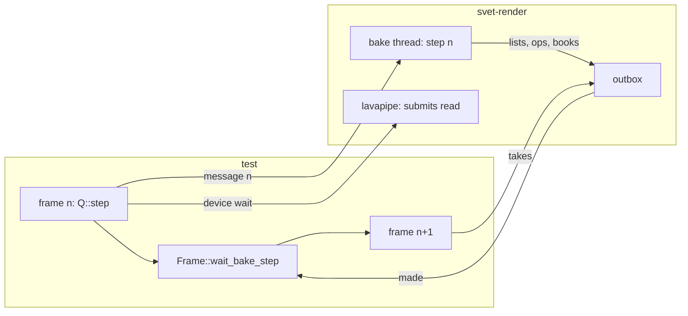

# 0106: No gate test passes by a clock: the red dig test stepped by count, the sweep, and a gate script

> **Status:** in-progress (2026-11-26): Phase 1, the fix for main's red CI, done and merged on its own. Phases 2 to 4 approved (owner, 2026-11-26), with the soak tier's sweep added as Phases 5 and 6.
> **Created:** 2026-11-26
> **Milestone:** none (harness; follows Plan 0099, `docs/roadmap.md` M9's bake thread)
> **Related ADRs:** [ADR-0083](../adrs/0083-the-live-bake-queue-runs-on-a-bake-thread-the-render-thread-applies-its-write-lists-and-issues-its-submits.md) (the bake thread; not changed)

## TL;DR

CI's push run of the Plan 0099 merge failed one gate test that counts frames paced by a sleep while the bake thread works at its own pace. The owner asked how many tests are like it. A reading of every gate-tier test (not soak-marked, not a reading) found **16 whose pass depends on a count or an order that a clock or a second thread can move** (class A, the failing one among them, four of them unsure) and **about 23 that assert a wall-clock bound** (class B), beside about 31 HUD tests with an implicit 3 s bound; about 100 more use a worker or a time budget safely and about 15 read a clock only to print. Phase 1 turns main green: one wait on `Frame` for the bake thread's step, the dig test stepped by count with its assertions unchanged. Phases 2 and 3 apply the same remedy to the rest (wait for the worker, count steps, compare a clock only with itself), and Phase 4 adds the script that keeps the class from coming back.

## Context & problem

**The failure.** GitHub run 45773388342 (the push of `e1628197`), `flythrough::gpu_queue the_edits_frame_holds_the_dig_and_ring_1_lands_in_either_mode`, panicked at `t.ring1 <= l.ring1 + 2`: ring 1 at D+5 with the thread, D+1 in lockstep, 17.2 s. The same commit's tag run passed. `dig_reads` pads each frame with `thread::sleep` and replays the threaded arm at lockstep's mean frame, measured earlier in the same test. With the thread on a frame runs no step, so `ring1` counts how many sleeps fit into one bake step; the step slows under CI's parallel GPU tests and the sleep does not. Plan 0099's log read the same D+5 at a fixed pace under load 8 to 20 (Phase 3b, "Pacing"), and its close review named the line as a minor.

**The rule that was broken.** A frame count at a wall pace is a reading of the machine. Plan 0099's Phases 3g and 6a already fixed two tests of this kind (a held step waits on a gate the test releases, frames are stepped by count, no duration is compared with a constant, no assertion is loosened), and a third shipped anyway: the rule needs a mechanism.

**The sweep** (2026-11-26, at `9b1cd85d`, by reading; nothing was run, so every margin is from the logs or says "not read"). Classes: **A** asserts a count or an order that wall time or another thread can change; **B** asserts a wall-clock bound; **C** reads a clock only to print or store; **D** uses a worker or a time budget and asserts only after a wait that blocks until the work is done.

| class | gate tests | where |
|---|---|---|
| A | 16: the red one, 7 firm and 2 unsure under `crates/`, 4 firm and 2 unsure under `apps/` | the tables below |
| B | about 23 (16 under `crates/`, 7 under `apps/`; 5 of them are also in A) and about 31 HUD tests with an implicit 3 s bound | the tables below |
| C | about 15 under `crates/`; under `apps/` none of its own (the lockstep rig stores each step's ms, two tests assert on it and are B) | fine as they are |
| D | about 49 under `crates/`, about 54 under `apps/` | fine as they are; why, below |

**Why most of the tree is D.** The fly-through's lockstep rig (`apps/flythrough/tests/support/queue.rs`, `Q::step_with`) runs the queue's step inside the call and then waits on the device, and its device asks for no timestamp feature, so the sample cap stays a fixed count (`bake/queue/step.rs`: "without timestamps it stays at the first guess"): a step count there is causal, and every `< MAX_STEPS` is a give-up guard on a count. The streamer's tests block in `Streamer::wait_idle`; the lister's in `wait_listed`; children are waited with no timeout; scoped threads are joined. **This stops holding if the rig's device gains timestamps or loses its wait**; Phase 4's script pins both.

**Class A** (the remedy's phase in the last column).

| test | where | what can move it | phase |
|---|---|---|---|
| `the_edits_frame_holds_the_dig_and_ring_1_lands_in_either_mode` | `apps/flythrough/tests/gpu_queue.rs`, `dig_reads` | frames paced by a sleep against the bake thread's step | 1 |
| `the_outbox_stops_at_its_cap_and_the_bake_thread_waits` | `crates/svet-render/src/bake/thread.rs`, tests | ten sends 2 ms apart must make 4 steps; a descheduled thread coalesces them | 2 |
| `the_outbox_is_bounded_and_the_bake_side_waits` | `bake/queue/split_tests/thread.rs` | "stopped" is 200 sleeps of 1 ms with no new step; a 200 ms stall reads as stopped | 2 |
| `a_wait_ends_on_a_panic_and_a_full_outbox_does_not_hold_it` | same file | the same window | 2 |
| `a_waiting_box_ends_the_opening` | same file | up to 400 unpaced frames for the box's books | 2 |
| `the_listing_pool_drains_to_the_blocks_the_step_lists` | `bake/queue/split_tests/lister.rs` | gives up after 4000 frames with a 200 us sleep while the pool lists | 2 |
| `a_full_chunk_landing_outside_its_band_is_demoted_by_the_next_poll` | `crates/svet-world/tests/stream.rs` | a million polls with a yield while a worker generates | 2 |
| `the_frame_s_timers_and_store_counts_read_back_without_waiting` | `crates/svet-render/tests/gpu_frame.rs` | five frames submitted with no wait; a set must have mapped by the fifth | 2 |
| `dropping_the_streamer_mid_flight_returns_within_bound`, `..._before_the_world_...` | `apps/flythrough/tests/gpu_shutdown.rs`, `fly_and_dig` | 24 updates with a 5 ms sleep must leave work in flight | 2 |
| `a_sliced_pre_roll_bakes_what_an_unsliced_one_bakes` | `apps/flythrough/tests/gpu_loading.rs` | two child runs paced differently compared for equal steps; the pre-roll has wall-time ends | 2 (read first) |
| `a_source_switch_shows_the_loading_frames_before_the_new_world` | same file | a loading frame is logged per 25 ms of wall; a stage inside one slice is never named | 2 (read first) |
| unsure: `sky_empty_noon_golden`, `sky_empty_sunset_and_night_goldens` | `apps/flythrough/tests/gpu_outdoor_golden.rs` | the exposure readout is one poll with no wait after eight frames; its value pins the golden's exposure | 2 (read first) |
| unsure: `the_sky_term_switches_without_a_dip` | `crates/svet-render/tests/gpu_sun/dig.rs`, `dig_run` | frames stepped with no device wait before the dig | 2 (read first) |
| unsure: `the_cycle_parts_sum_to_the_time_between_two_steps` | `bake/queue/split_tests/thread/cycle.rs` | "at least 8 of 12 cycles"; every frame waits for its step, so likely structural | 2 (read first) |

**Class B** (G: a give-up guard, not the claim; C: the bound is the claim).

| test | where | bound | margin read | phase |
|---|---|---|---|---|
| `quitting_while_loading_tears_down_within_bound` | `gpu_shutdown.rs`, `RUN_BOUND` | G, 120 s kill; C, the teardown's 5 s | **107.7 s under load 10 to 12** (Plan 0104's log), 1.7 s quiet on the RTX | 3 |
| `a_mirror_that_cannot_sync_exits_1_after_the_teardown` | same | G, 120 s | **93.8 s** under the same load | 3 |
| `a_replay_log_that_does_not_read_exits_1_after_the_teardown` | same | G, 120 s | not read (exits before a world) | 3 |
| the two streamer drops | `gpu_shutdown.rs`, `DROP_BOUND` | C, 5 s | not read | fine: ADR-level claim (a drop returns), stays; logged in 3 |
| `the_step_s_stages_sum_to_its_time` | `gpu_queue_reach.rs` | C, laps within 5 % of an outside clock | 0.07 % (Plan 0067's log) | 3 |
| `the_stages_split_by_opening` | same | C, the same per side | **2.9 % of 5 % on the thin side: 55 us of preemption fails it** | 3 |
| `the_sync_stages_sum_to_its_wall` | `crates/svet-render/tests/gpu_mirror_budget.rs` | C, within 10 % of an outside clock | not read | 3 |
| `the_first_flush_of_the_streamed_window_is_cheap` | `gpu_world/columns.rs` | C, under 1000 ms (the old form took 48 s) | not read | 3 |
| `the_render_calls_return_while_a_step_is_held` | `bake/thread.rs` | C, 100 calls under 0.5 s | not read | 3 |
| `the_render_side_returns_with_the_bake_side_stalled`, `the_edits_frame_waits_for_its_list_and_no_other_frame_does` | `split_tests/thread.rs` | C, "100 frames within 2 s"; the second's `waited >= 0.1` is safe (a sleep never returns early) | not read | 3 |
| `dropping_the_queue_joins_the_bake_thread`, `a_panic_on_the_bake_thread_is_the_next_steps_error` | same | C, under 1 s from before the rig is built | not read | 3 |
| `the_edits_frame_does_not_wait_for_the_books` | `split_tests/thread/books.rs` | C, under 1 s against a 2 s hold | not read | 3 |
| five more device-less thread tests (`frame_stepped`, `within`, `recv_timeout`) | `split_tests/thread.rs`, `books.rs`, `cycle.rs`, `bake/thread.rs` | G, 1 s each | not read | 3 (the blocking wait replaces them) |
| `a_lap_takes_the_calls_inside_it` | `bake/stages.rs` | C, a lap of at least the 2 ms it sleeps | safe by construction | fine |
| `timers_are_always_ready_and_never_wait` | `crates/svet-script-wasm/tests/determinism.rs` | C, under 5 s against the guest's 30 s sleeps, two compiles inside the bound | not read | 3 |
| the HUD's banner tests (about 31) | `apps/flythrough/src/run/*tests.rs`, `viewer.rs` | implicit: a banner lives `BANNER_MS` (3 s) of wall after `crate::now()` | microseconds against 3 s | fine; listed with its reason in Phase 4's allow-list |

## Decision

**A gate test waits for the worker it depends on and counts what the code counts.** Three forms cover every row: (1) step by count and block until the other thread has done the step (the red test, the "stopped" windows, the give-up loops); (2) compare a clock only with itself (a sum of laps against the span between the same clock's own first and last reads, within a tick, as `the_cycle_parts_sum_to_the_time_between_two_steps` does); (3) state a "does not block" claim causally (the calls return while the step is still held, read from the gate, not from a duration). A kill guard on a child stays a guard and is sized from a loaded reading with a stated margin. A measurement that only a wall pace can make becomes a `reading`.

Rejected: **retries** in nextest (hides the class and the next real race with it); **soak-marking the failing tests** (the weekly run fails falsely the same way, and the gate loses the claim); **widening the bounds** (`+ 2` to `+ 5`, 2 s to 10 s: loosens the assertion and still fails at some load); **pacing by lockstep's measured frame** (what the red test did: two arms minutes apart do not see the same load).



## Implementation phases

### Phase 1: the red test steps by count (main green)
- **Owner skill:** dev
- **What:** One public wait on `Frame` for the bake thread's step, and the dig test stepped by it; the wall-paced form kept as a reading. Two commits (`feat(render)`, then `test(flythrough)`).
- **The seam.** Nothing public waits for the bake thread today: `ThreadLink::steps` and `BakeThread::waiting` are `#[cfg(test)]` and crate-private; `QueueStats::steps`, `Frame::bake_thread_cycles` and `bake_frame_wait_span` show only what a frame's take already took; only an edit's frame waits (ADR-0083). The seam is `Frame::wait_bake_step(&self)`, **a product-surface addition with no change to any existing path**: at once in lockstep; with the thread running it blocks until the thread has stepped every message sent to it and handed in that step's last entries, or waits at the outbox's cap, or has ended. No timeout, no sleep: it blocks on the outbox's condition variable (`made`), which a put and the thread's end already notify. No frame path calls it; its doc says a test's and a headless tool's wait. Under it `BakeThread` knows "idle": `Shared::steps` already counts steps under the outbox's lock; a count of messages picked beside it gives `picked == steps` with the inbox empty (one atomic add a message is the cost). The shape is the dev's; the contract is the bar.
- **The test.** `support::queue::Q` gains the stepped frame (`Q::step`, which already waits on the device, then `wait_bake_step`). In `dig_reads`, from the edit's frame to ring 1 applied, both arms use it; `FRAME`, `clock`, the `frame` argument and the sleep leave the gate test. The loops before the edit stay (they assert no count). **Every assertion stays as written**, `t.ring1 <= l.ring1 + 2` with it; the doc comments are restated (the claim is the hand-off's depth: with the thread, ring 1 costs at most two frames more than lockstep when each frame finds the last one's step made). Derived, not run: ring 1 goes in the edit's one submit on this rig and the cap is a fixed count, so lockstep reads D+1 and the thread D+2 (issued at D+0, its read-back in D+1's message, the list applied at D+2), the same on every dig and every run. The wall-paced form moves, unchanged, to `reading::ring_1_at_a_window_pace` (`#[ignore]` in `mod reading`): it prints both arms' frames and ms and asserts nothing.
- **Files touched:** `crates/svet-render/src/bake/thread.rs`, `bake/link.rs`, `frame/bake_thread.rs`; `apps/flythrough/tests/support/queue.rs`, `apps/flythrough/tests/gpu_queue.rs`.
- **Done when:** (a) A device-less test in `bake/thread.rs`'s rig (CPU, under 1 s): a step held on a gate the test releases from a second thread; `wait` returns only after the release (the release's instant at or before the return, no duration against a constant); it returns at once with nothing sent, and after the thread ended by a panic. 40 runs by name beside a running quick tier, 0 failed. (b) The dig test by name, 20 runs on lavapipe from one `cargo nextest archive` beside a running quick tier (Phase 3g's rig), under the perf lock: 20 passed, and the printed counts are **the same in all 20** (expected D+1 lockstep, D+2 thread, three digs). Its wall is under 10 s alone on the dev reference (it read 6.5 s with the sleeps), so it stays in the gate. (c) `node scripts/test-changed.mjs --profile gpu --binaries gpu_queue` under the lock, `--profile quick`, `--clippy`, `cargo fmt --all --check`, every `scripts/check-*.mjs` exit 0. (d) After the merge, CI's push run is green on both arms.
- **Stops (report, change nothing to pass):** the stepped threaded count over lockstep's plus 2, or differing between runs: log each frame's take, issue and read-back for that dig (`Frame::bake_frame_issue`, `bake_thread_cycles`, the stats' `steps`) and stop; the bound is not widened, the rig's world, counts and digs are not changed, no retry is added. The wait needing a timeout, a sleep, or a call from a frame path. Lockstep's count moving.

### Phase 2: class A, the rest
- **Owner skill:** dev
- **What:** Each class A row waits for its worker. One commit a crate.
- **Remedies.** The two "stopped" windows and the ten paced sends: the outbox's "waits at the cap" becomes a state the test reads and blocks on (the same state `wait_bake_step` returns on), so "the steps stopped" is "the thread waits at the cap", and the sends wait for each step. `a_waiting_box_ends_the_opening`: the frames after the box's step use the blocking wait. The lister's drain: `wait_listed` between steps, as its six neighbours do. The streamer's poll loop: `wait_idle`, or a blocking receive of the one landing. `gpu_frame`'s timers: the device waited between frames outside the frame call, as `gpu_exposure`'s `the_readout_arrives_within_four_frames_without_waiting` does; the claim (the frame's own calls do not wait) stays. `fly_and_dig`: the precondition "work in flight" is made by holding the workers on a gate, or the assert on it is read as the rig's precondition from the streamer's own counts at the drop. **The four unsure rows and the two `gpu_loading` rows are read first**: the dev states, from the code, whether the count can move; a row that cannot is recorded with the reason and left; one that can gets the device wait before its read (the goldens' exposure readout, `dig_run`'s frames) or a count of loading steps in place of wall slices. A golden that moves is a stop.
- **Also here (the leftover that shares the struct):** the bake thread's one condition variable waited on under two mutexes becomes two (`arrived` for the inbox, `room` for the outbox), `halt` notifying both (`docs/backlog.md`, "The bake thread's leftovers"), as its own commit.
- **Files touched:** `crates/svet-render/src/bake/thread.rs`, `bake/queue/split_tests/thread.rs`, `split_tests/lister.rs`, `split_tests/thread/cycle.rs`; `crates/svet-world/tests/stream.rs`; `crates/svet-render/tests/gpu_frame.rs`, `gpu_sun/dig.rs`; `apps/flythrough/tests/gpu_shutdown.rs`, `gpu_loading.rs`, `gpu_outdoor_golden.rs`.
- **Done when:** No test named in the class A table sleeps, yields in a counted loop, or polls without a wait before a count it asserts; each changed test's assertions are the ones it had (a diff of the assertion lines is in the readings log). Each changed CPU test 40 times by name beside the quick tier, 0 failed; each changed GPU test 10 times by name on lavapipe under the lock, 0 failed (`gpu_frame`, `gpu_sun`, `gpu_shutdown`, `gpu_loading`, `gpu_outdoor_golden`; each under 10 s or already soak-marked). No golden moved. The quick tier, the named gpu binaries, clippy, fmt, the check scripts.

### Phase 3: class B
- **Owner skill:** dev
- **What:** Each bound that is the claim is restated without a duration, or kept with its margin read; each guard is sized from a loaded reading.
- **Remedies.** The stage sums (`gpu_queue_reach`'s two, `gpu_mirror_budget`'s one): the laps are compared with the span between the step's own first and last clock reads, within a tick; the outside `Instant` leaves the assertion (it may print). "Returns while held" (the device-less thread tests' 0.5 s, 1 s and 2 s): the assertion reads the gate (the step is still held when the calls have returned), then releases; `waited >= 0.1` stays. The 1 s guards (`within`, `frame_stepped`, `recv_timeout`): the blocking wait where the thread's state gives one; a guard that stays is named in Phase 4's list with its reason. `the_first_flush_of_the_streamed_window_is_cheap`: a count of the work (the tiles or bytes the flush writes) in place of the 1000 ms. `RUN_BOUND`: read each of the three child tests ten times on lavapipe beside a running quick tier, then the guard is at least ten times the slowest (the child's time under load is pipeline compilation, which the test does not claim); `DROP_BOUND`'s two claims stay and their loaded time is logged. `timers_are_always_ready_and_never_wait`: the clock starts after the two loads.
- **Files touched:** `apps/flythrough/tests/gpu_queue_reach.rs`, `gpu_shutdown.rs`; `crates/svet-render/tests/gpu_mirror_budget.rs`; `crates/svet-render/src/gpu_world/columns.rs`, `bake/thread.rs`, `bake/queue/split_tests/thread.rs`, `split_tests/thread/books.rs`; `crates/svet-script-wasm/tests/determinism.rs`.
- **Done when:** No assertion in the class B table compares a duration with a constant or with a second clock, but the rows the table marks fine and the guards Phase 4's list names. The same run counts as Phase 2 (40 CPU, 10 GPU, by name, loaded), 0 failed. The readings log holds, per guard that stays, its bound, the slowest loaded reading and the ratio (at least 10).
- **Stops:** a claim that cannot be stated without a duration goes to the architect with the test's text, not to a wider bound.

### Phase 4: the gate script
- **Owner skill:** dev
- **What:** `scripts/check-test-clocks.mjs`, in CI's doc gates beside `check-test-tiers.mjs`.
- **Rules** (comments and string literals blanked, as `check-test-tiers.mjs` does; test code is a file under `tests/`, a `*tests*.rs` file or module under `src/`, or a `#[cfg(test)]` item). Outside `mod reading` and outside a test marked `#[ignore = "soak"]`, a finding is: (1) `thread::sleep`, `yield_now`, `recv_timeout`, `wait_timeout`, `park_timeout`; (2) a comparison of a duration inside an `assert!` family macro or an `if` that panics (`elapsed()`, `duration_since`, `as_secs*`, `as_millis`, a name the file bound to one of them, against a literal or a constant); (3) `Frame::set_bake_thread(.., true)` or a `--bake-thread on` child in a file that never names `wait_bake_step`; (4) `TIMESTAMP_QUERY` requested by a device a non-reading test steps a queue on. A site passes only when listed in `scripts/test-clocks-allow.txt`: file, test name, the token, one line of reason (a sleep that is the claim's own delay; a kill guard with its ratio; the banner's 3 s). The list starts with the rows Phases 2 and 3 left and nothing else.
- **Files touched:** `scripts/check-test-clocks.mjs`, `scripts/test-clocks-allow.txt`, `scripts/fixtures/test-clocks/` (a seeded tree, one finding a rule, and the README's expected findings), `.github/workflows/ci.yml`. (The `CLAUDE.md` scripts row is the architect's at the close.)
- **Done when:** `node scripts/check-test-clocks.mjs` exits 0 on the tree and names every seeded finding on the fixture (`--self-test`), one a rule and one for a stale allow-list row (a row whose site is gone is a finding). Run against `9b1cd85d`'s tree (a `git worktree` at that commit, no build) it names the red test's sleep and every class A and B site of this plan's tables that rules 1 and 2 can see; the ones it cannot see (a give-up loop with no sleep, a poll with no wait) are listed in the readings log as what the script does not catch. Under 5 s.

## Amended 2026-11-26 (owner)

The owner read the draft and answered "all recommended":

- **Phases 2 to 4 have the go.** Phase 1 merges into main on its own first (it is the fix for main's red CI); the lane then continues from the merged tip, one phase per dev brief.
- **The weekly soak tier gets the same sweep** (the open question under Risks), as later phases of this plan, after Phase 4 so the script's rules are fixed before they are widened. The line "The soak tier's and the readings' clocks" under "What this plan does NOT do" now stands for the readings only.

### Phase 5: the soak tier, the reading
- **Owner skill:** dev
- **What:** The reading the Context section made of the gate tier, repeated on every test marked `#[ignore = "soak"]`: each one that sleeps, polls, counts frames beside a second thread or compares a duration, classed A (a count or an order a clock or a thread can move), B (a wall-clock bound) or fine, with the remedy this plan's Phases 2 and 3 used for the same shape. No test is changed. `the_threaded_queue_drains_to_the_lockstep_store` and the two headless teardown runs are read first.
- **Files touched:** `docs/plans/logs/0106.md`.
- **Done when:** The readings log holds the table (file, test, class, the line that makes it so, the remedy), and a list of the soak tests whose claim is itself a duration (a soak test may time a long run; those stay and are named with their reason). A test whose remedy is not one of Phases 2 and 3's goes to the architect with its text.

### Phase 6: the soak tier, the fixes, and the script over it
- **Owner skill:** dev
- **What:** Phase 5's class A and B rows take their remedies, assertions unchanged. `check-test-clocks.mjs` loses its exemption for `#[ignore = "soak"]` tests; the rows that stay go on the allow-list with their reasons.
- **Files touched:** the test files Phase 5's table names, `scripts/check-test-clocks.mjs`, `scripts/test-clocks-allow.txt`, `scripts/fixtures/test-clocks/`, `docs/plans/logs/0106.md`.
- **Done when:** Each changed soak test passes by name (`--run-ignored only`, the test's name; never the whole soak tier) three times on lavapipe under the perf lock, 0 failed, each run projected from its start and stopped past 20 minutes; a diff of the assertion lines is in the readings log; the script exits 0 on the tree with the soak exemption gone and its self-test names a seeded soak finding. The quick tier, clippy, fmt, the check scripts.
- **Stops:** a soak test that cannot be run by name inside 20 minutes under the lock is reported with its projected time, not run.

## Data shapes

```rust
// illustrative
impl Frame {
    /// Blocks until the bake thread has stepped every message sent to it and handed in that
    /// step's entries, or waits at the outbox's cap, or has ended; at once in lockstep.
    /// A test's and a headless tool's wait: no frame path calls it.
    pub fn wait_bake_step(&self);
}
```

## Budgets

`docs/nfr.md` section 7 (the gate tier's wall and the soak line). The red test loses its sleeps (it read 6.5 s alone on the dev reference's lavapipe, 17.2 s on CI); Phases 2 and 3 remove sleeps and add blocking waits, so no test should grow. The close runs `node scripts/test-times.mjs` on the gate's log and names any changed test over the line. No frame, memory or edit figure moves: `wait_bake_step` is called by no frame path, and the one atomic add a message is on the bake thread.

## Risks & open questions

- **The derived counts are not run.** If the stepped threaded arm does not read D+2 on every run, something else on the path is paced by a clock (the lister pool does not serve a dig's ring 1, which `open_digs` lists on the bake thread; the cap is a fixed count on this device). Phase 1's stop covers it.
- **A blocking wait can hang a test** where a guard used to fail it in a second. The profiles' `slow-timeout` with `terminate-after` is the net; a hang is then a 30 s to 10 min failure with the test's name, not a false red.
- **Threading:** the condition-variable split changes who is woken; its two tests exist and the wait's test in Phase 1 adds a third waiter's case.
- **The script reads text, not types.** It cannot see a give-up loop that counts frames with no sleep. The allow-list and the rig's pinned device (rule 4) are what it can hold; the rest is the review's.
- **Open, for the owner:** whether the weekly soak tier gets the same sweep (this plan reads the gate tier only; `the_threaded_queue_drains_to_the_lockstep_store` and the two headless teardown runs are soak and wall-coupled).

## What this plan does NOT do

- The soak tier's and the readings' clocks (a reading may time anything).
- The gate-sized forms of the two soak tests that prove the thread end to end, and the over-cap write list dropped in release (`docs/backlog.md`, "The bake thread's leftovers").
- A headless run stepped by `wait_bake_step` (a repeatable threaded `run.json`): an idea, not asked for.
- Injecting a clock into the HUD's banner; the 31 tests keep `crate::now()` under the allow-list's one row.
- Any retry, any widened bound, any scene made simpler.

## Implementation log

> Written by `dev`: one row per phase as its commit lands, then the close block. Readings, run
> counts and attempts go to `docs/plans/logs/0106.md`.

| phase | owner | state | commit |
|---|---|---|---|
| 1: the red test steps by count | dev | done; readings in [the log](logs/0106.md#phase-1-the-red-test-steps-by-count); the wall-paced reading's `ms` is taken after each frame's pad, not after the last pool read | 4c90a671, then committed with this row |
| 2: class A, the rest | dev | done but one row; readings in [the log](logs/0106.md#phase-2-class-a-the-rest). `a_sliced_pre_roll_bakes_what_an_unsliced_one_bakes` left unchanged, a question for the architect (Notes); the source switch reads 66.5 s alone, over the 10 s line (60.6 s at its base form); `take` and `take_until` also clear `at_cap` | 8d9fe04d, then committed with this row |
| 3: class B | dev | not started | |
| 4: the gate script | dev | not started | |
| 5: the soak tier, the reading | dev | not started | |
| 6: the soak tier, the fixes | dev | not started | |

### Notes

- Phase 2: `a_sliced_pre_roll_bakes_what_an_unsliced_one_bakes` can move (the pre-roll's 5 s box and 120 s cap on summed wall step time; the off arm steps with no device wait while the on arm's loading frames wait, so lockstep's `collect` reads read-backs at different steps) and its test file cannot change that; left as written, for the architect.
- Phase 2: `a_source_switch_shows_the_loading_frames_before_the_new_world` takes `--load-slice 0.05`; it reads 66.5 s alone at the tip, 60.6 s at its base form, both over the 10 s line.
- Phase 2: the soak test `a_reset_pixel_starts_from_its_record` (on `dig_run_with`, which now waits on the device each frame) fails at `with_record > 0`, at the tip and at the base form alike (one run each).

### Close triggers

## Followups
