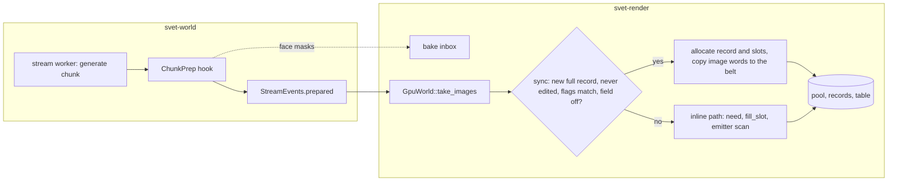

# 0107: The mirror's slot image packed on the stream workers

> **Status:** in-progress (Phases 1-4 done; Phase 5 next). Approved (owner, 2026-11-26: "go on both, all recommended, do not start until these lanes finish"; see "Amended 2026-11-26 (owner)"). Drafted from
> [the review of 2026-11-26](../reviews/2026-11-26-work-off-the-render-thread.md) on the owner's
> "all recommended" (its question 1: draft now, Phase 1 the re-read), with no further interview;
> the guesses and the questions left are under "Risks & open questions", each with a recommended
> option. **Lane order:** the lane starts after Plans 0101 and 0105 merge (Phase 3 edits
> `crates/svet-render/src/bake/faces.rs`, which both touch). Phase 1 is a reading with no engine
> change and may run beside them.
> **Created:** 2026-11-26
> **Milestone:** cross-cutting: the streaming line of `docs/nfr.md` sections 2 and 5 (M10's
> performance work in [`docs/roadmap.md`](../roadmap.md) is the nearest home)
> **Related ADRs:** [ADR-0056](../adrs/0056-the-mirrors-slot-image-is-packed-on-the-stream-workers-and-the-render-thread-only-allocates-and-copies.md)
> (accepted; this plan builds it, and it takes a dated Outcome note at the close),
> [ADR-0017](../adrs/0017-mirror-cpu-work-bounded-in-the-frame-loop-narrowing-on-stream-workers.md)
> (one owner of the mirror's allocation and deferral rules, on the render thread; the
> `ChunkPrep` hook), [ADR-0022](../adrs/0022-mirror-uploads-through-a-staging-belt-and-copy-commands.md)
> (the staging belt), [ADR-0083](../adrs/0083-the-live-bake-queue-runs-on-a-bake-thread-the-render-thread-applies-its-write-lists-and-issues-its-submits.md)
> (the bake thread, whose readers now share the chunk locks). No new ADR: the one choice inside
> ADR-0056 that this plan makes (how a stale image is told) is in "Decision".

## TL;DR

While the camera moves, the mirror's `sync` packs every arriving chunk's bricks on the render
thread, and that is the largest part of the frame's CPU tail. The stream worker that just
generated the chunk already runs a hook over it for the bake's face masks. This plan has the
same hook make the chunk's **slot image** (the slot words of each brick, their sizes and the
chunk's emissive samples), and has the render thread only allocate and copy it. No new thread,
no new dependency, and the mirror's bytes are identical whichever thread packed them, by test.
Phase 1 is a re-read of the sync's stages at the current tip with the bake thread on, and it
can stop the plan. The first thing the owner sees is a glide through the cave and the forest
with the packing switched between `inline` and `workers` by a key, and whether the hitching
changes.

## Context & problem

The readings (each is in the tree; "RTX host" is the dev box, Ryzen 9 5900HS, 16 logical
CPUs, RTX 3080 Laptop; "RENOIR" is its AMD iGPU):

- `update + poll + sync` p99 reads 15.7 to 23.7 ms in motion against the 16.6 ms line
  (`docs/nfr.md` sections 2 and 5, Plans 0074 and 0088, both adapters). At rest it is 0.03 to
  0.09 ms p50: the cost exists only while chunks arrive.
- The tester's cave bench, RTX host, [Plan 0096](done/0096-the-bake-queues-drain-tiers-a-drain-slice-the-step-and-the-slow-adapters-light-pass.md):
  at its Phase 7 `alloc` p99 9.4 ms of a sync p99 of 19.4; at its close (quiet) `alloc` p99
  6.42 ms against a line of 3.0, sync p99 12.5, `update + poll + sync` p99 14.82. `size` p99
  2.9 to 3.0 ms beside it. The forest at leaf fill 128 read a sync p99 of 7.28 to 7.46 ms
  against 6.
- The profile of `alloc` ([logs/0096.md](logs/0096.md), Phase 7; samples of the main thread
  under `upload_record`, 3 502 in all): the brick loop's own body 1 274, `upload_brick`'s own
  471, `fill_slot` 463, `stage` 473, `stage_record` 218, `PoolAlloc::alloc` 54. "No single
  item holds a third": the cost is the per-brick path as a whole, about 9.5 µs a brick at
  13 383 bricks in the slowest sync.

**What that profile means for this plan, stated plainly:** the pure packing (`fill_slot`) is
about 13 % of `alloc`'s samples; the staging copy, the record's stage and the allocator
(together about 21 %) stay on the render thread whatever this plan does. The rest (the loop's
own body, the rescan set, the emissive check, `upload_brick`'s branches) leaves only as far as
a per-chunk copy replaces a per-brick walk. So the gain in `alloc` is **between about 13 % and
about 79 % of it, and which end is a guess until Phase 5 reads it.** `size` (the `need` pass)
and `light_note` (the emitter scan) leave whole for a chunk with an image. The review's
"most of `alloc`, `size` and `light_note` leave the tail" is derived, not measured.

New since ADR-0056 was deferred: the bake thread and its listing pool read chunks under the
same locks the sync takes. `SyncStats::lock_us` counts the sync's wait and has no reading with
the thread on, and `poll` applies every finished chunk in one frame with no cap. Neither has a
pinned figure. Phase 1 reads both, because either could be the larger part of the tail now.

**The floor has no idle core.** On 8 logical CPUs the process runs 4 stream workers, 2 listers,
the render thread and the bake thread. Work moved to the workers is not free there: it delays
the chunk's arrival. Plan 0099's pinned run (a stand-in, `taskset -c 0-7`, not the floor)
already showed the background work falling behind (4 328 chunks resident after the pre-roll's
5 s against 17 077 unpinned). So what the packing costs the workers is a reading with a stop
(Phase 5), not an assumption.

It serves the consumer's streaming requirement (`project-context.md`: a streamed world walked
without hitches) and touches `docs/nfr.md` section 2 (the streaming lines of Plan 0096's
table), section 3 (RAM held between the worker and the sync) and section 5 (residency).

## Decision

One `ChunkPrep` on the stream workers makes, for each full chunk it loads, the face masks (as
today) and a **slot image**: per brick its entry word without the slot's unit, per `Full`
brick its slot words padded to its bin, the per-bin counts and bytes that `need` returns for a
new record, and the chunk's exposed emissive samples. The image reaches the render thread in
`StreamEvents::prepared`, as the masks do. `sync` uses it for a chunk that takes a **new full
record**: it allocates the record and the slots, copies each brick's words from the image into
the staging belt, and takes the emitter lists as they are. Selection, allocation, deferral,
the reservation's backstop, the light placement and the copy stay on the render thread, one
owner (ADR-0017).

An image is used only when all of these hold, checked under the chunk's write lock at the
upload; otherwise the chunk takes today's inline path, whole:

- the chunk has never been edited (`Chunk::is_edited()` is false). It is a sticky flag every
  write path sets (edits, stamps, collapse, a restored spill), so "edited since the image was
  made" needs no new state in `svet-world`. A chunk restored from persistence is edited by
  definition and packs inline, as today;
- the image was packed under the mirror's own material flags (a key over the translucent,
  emissive and opaque bits, compared once an image);
- the field surface is off (its band slots read neighbours and are allocated; ADR-0041's
  repair stays as it is). The field is opt-in; with it on, no image is used;
- the record is new and full. A chunk already mirrored takes the dirty-brick path, which is
  already bounded by the bricks an edit touched. LOD records pack from mips and are not
  touched.

Rejected, in one sentence each: **a revision counter in `Chunk`** bumped by every dirty mark,
compared with the image's (exact for a restored chunk too, but a new field in the world's
chunk that must stay out of equality, the hash, the wire and the spill format, for a case, a
restored chunk's first upload, no reading asks for; it is the fallback if Phase 3's test finds
a writer that does not set `edited`); **telling an edit from the mirror's dirty set** (a load
and an edit before the next sync are one entry there); **a second hook on the streamer** (one
hook already runs per chunk; a composite keeps one read lock and one event). ADR-0056's own
alternatives (a time budget, an upload thread, packing on the GPU) stay rejected there.

The packing has a lockstep mode by construction: with the setting at `inline` the same
functions run on the render thread, and every test but the identity test runs so.

## Architecture diagram



## Implementation phases

Each phase ships as its own commit, one phase a dev brief. Every phase carries exactly one
`**Owner skill:**`. No gate test in this plan passes by a clock: every time is a printed
reading, and every assertion is on bytes, counts or text. No scene is simplified for a test
or a reading. Runs under the perf lock are projected from their first arm; one projected past
20 minutes is split or goes back to the architect.

### Phase 1: The sync's stages re-read at the tip, with the bake thread on (a reading; it can stop the plan)
- **Owner skill:** dev
- **What:** Two short headless release runs on the RTX host at the current main, both with
  `--bake-thread on` (the headless default is off): the tester's cave bench
  (`--headless --path cave --report DIR`, 1920 x 1080, the Floor profile) and the forest glide
  (`--headless --source outdoor --spawn forest --glide 30 --frames 2400`). No engine behaviour
  changes. If `run.json` or the `sync:` line does not carry `lock_us`'s p99 and `poll`'s p99
  (`stages_ms`), the phase adds them to the report, as readings.
- **Files touched:** `docs/plans/logs/0107.md` (new, from the readings-log template); only if
  the two figures are missing from the report: `apps/flythrough/src/report.rs`,
  `apps/flythrough/src/streaming.rs` and their unit tests of the report's fields.
- **Done when:** the log holds, per run, with the commit, the load at the lock and the
  clocksource: `update + poll + sync` p50 and p99; `poll` p99; the sync's p99 and each stage's
  p99 (`select`, `size`, `pack`, `light place`, `light_note`, `copy`, `alloc`, `lock`); the
  slowest sync's stage breakdown and its packed bricks; and two derived figures for the
  slowest sync, both named as derived: **movable low** = `size + light_note + 0.13 x alloc`
  and **movable high** = `size + light_note + 0.79 x alloc` (the fractions are the Phase 7
  profile's, above). Arithmetic on Plan 0096's close reading as the worked example (cave,
  slowest sync 15.05 ms with `alloc` 8.02; `size` about 2.9 and `light_note` about 1.6 taken
  from the p99s, so indicative): low = 2.9 + 1.6 + 1.0 = 5.5 ms, high = 2.9 + 1.6 + 6.3 =
  10.8 ms, of 15.05.
  **The stop line ("not worth it", the plan closes with these figures recorded and the
  backlog entry updated):** on both runs, movable high is under a quarter of the slowest
  sync, **or** `update + poll + sync` p99 is under 10 ms (the line is met with room and the
  tail is not the sync's). **The order changes (stop, the architect amends):** `lock` or
  `poll` p99 is larger than movable high on either run; then the lock's holders or `poll`'s
  cap come first. Otherwise the plan goes on. Two runs of one to two minutes each under the
  exclusive perf lock; no test tier (no code), or the quick tier over `flythrough` if the
  report gained fields.

### Phase 2: The slot image as a pure function, with the inline path calling the same code
- **Owner skill:** dev
- **What:** A new `crates/svet-render/src/gpu_world/image.rs`: `SlotImage::of(coord, chunk,
  flags)` makes a chunk's image with no `GpuWorld` and no device. The per-brick packing
  (`fill_slot`, `fill_uniform_slot`, `slot_units`, the emissive check, the emitter scan) moves
  to free functions over `MaterialFlags` that both the image and the inline path call, so
  there is one packing code, not two. The mirror's behaviour does not change; nothing uses an
  image yet. A bench prints what an image costs to make.
- **Files touched:** `crates/svet-render/src/gpu_world/image.rs` (new), `gpu_world/slot.rs`,
  `gpu_world/emitters.rs`, `gpu_world/lights.rs` (the scan's entry point only),
  `gpu_world/mod.rs`, `crates/svet-render/benches/slot_image.rs` (new, in the crate's bench
  list), `docs/plans/logs/0107.md`.
- **Done when:** the CPU test `an_image_holds_the_inline_paths_words_sizes_and_emitters`
  (`gpu_world/image.rs`, no device, under 1 s) passes: over 64 seeded chunks that between
  them hold every packed class (each planar plane count, wide ids), uniform opaque, uniform
  translucent and air bricks, bricks with a translucent voxel, and emissive voxels at brick
  faces and inside, each brick's image words equal `fill_slot`'s output padded to its bin,
  each brick's bin equals `bin_of(slot_units)`, the image's per-bin counts and bytes equal
  `need`'s for a new record with no band, and the image's emitter lists equal
  `scan_emitters`' per brick, slot by slot. It bites: with the translucent unit left out of
  the image the test fails. The existing slot tests (`gpu_mirror_alloc`, the unit tests of
  `slot.rs` and `emitters.rs`) pass unchanged. The log holds the bench's reading on the RTX
  host, quiet: microseconds an image for a solid chunk, a surface chunk of the cave and a
  forest canopy chunk, and the image's bytes for each. Quick tier over `svet-render`;
  `gpu_mirror_alloc` by name under the perf lock (lavapipe; its time is the log's).

### Phase 3: The mirror takes an image for a new record, behind a setting that is off
- **Owner skill:** dev
- **What:** The hook, the hand-over and the upload's brick loop. `FacePrep` becomes one part
  of a composite hook (working name `ChunkWork`: the masks as today, and the image when the
  setting is on and the held bytes are under the cap); the result is a typed struct instead
  of two meanings of one `Arc<dyn Any>`, and the bake's reader takes its part.
  `GpuWorld::take_images` receives `StreamEvents::prepared` beside `apply_events`; an image
  waits by coordinate until its chunk is uploaded, evicted or leaves the window. In
  `upload_record`, a chunk that passes the four conditions of "Decision" copies each brick's
  words from the image to the belt instead of packing them. Sizes and emitters still come
  from the inline code in this phase (Phase 4 moves them). `MirrorConfig::packing`
  (`Inline`, the default, or `Workers`); the fly-through's `--mirror-pack inline|workers`
  [inline], shown in the banner's mirror row and the HUD's as `mirror pack inline` or
  `mirror pack workers`, and bound to a key that flips it live (the mirror then ignores or
  uses the images that arrive; the hook follows at the next chunk).
- **Files touched:** `crates/svet-render/src/bake/faces.rs`, `bake/queue/message.rs` and the
  lister's reader of the prepared masks, `gpu_world/image.rs`, `gpu_world/slot.rs`,
  `gpu_world/window.rs`, `gpu_world/mod.rs`, `crates/svet-render/src/lib.rs` (the hook's
  public name), `crates/svet-world/src/stream/workers.rs` (the hook's doc only: "a caller
  throws a result away once the chunk is edited" names `is_edited`),
  `apps/flythrough/src/setup.rs`, `run/frame.rs`, `run/loading.rs`, the flag table and the
  key table, `docs/flythrough.md`, `crates/svet-render/tests/gpu_mirror_image.rs` (new),
  `apps/flythrough/src/cli/tests.rs`.
- **Done when:**
  - `the_mirror_is_byte_identical_whichever_thread_packed` (`gpu_mirror_image`, lavapipe,
    expected under 10 s: a guess, read in the phase; over the line it is born
    `#[ignore = "soak"]` and a smaller world takes its place in the gate): one streamed world
    (the fly-through's cave source at a small residency, real generation, `wait_idle` so both
    arms see the same arrival order) mirrored twice, `Inline` and `Workers`. After the last
    sync the two mirrors' pool shards, records buffer and table, read back, are equal byte
    for byte; `live_units`, `live_bricks`, `mirror_bytes` and `allocated_bytes` are equal
    (VRAM unchanged, asserted); the `Workers` arm's stats show at least one image used and
    the `Inline` arm's none. It bites: an image whose padding word differs fails it.
  - `an_edited_chunk_ignores_its_image` (the same binary, under 5 s): a chunk carved between
    its load and its first sync is uploaded from the chunk, the bytes equal the inline arm's
    after the same carve, and the stats count one image dropped as edited.
  - `an_image_under_other_flags_is_ignored` and `no_image_is_used_with_the_field_surface_on`
    (the same binary): bytes equal the inline arm's, the stats name the reason.
  - A debug-only check: with `debug_assertions`, an upload that uses an image also packs the
    brick inline and asserts equality, so every debug test run with `Workers` verifies it.
  - The held images are capped: the hook counts the bytes of the images alive (made, not yet
    dropped) and makes none past the cap (a proposal: 64 MiB, about 1 300 chunks at the
    50 KB average ADR-0056 records; Phase 5 reads the peak and the refusals).
    `the_hook_makes_no_image_past_the_cap` (a CPU test, under 1 s) asserts it with a cap of
    one image.
  - The CLI test asserts the flag's two values and the banner row's two texts; a headless run
    with each value prints its row.
  - Quick tier over the changed crates; `gpu_mirror_image`, `gpu_mirror_alloc`,
    `gpu_mirror_budget` and `gpu_bake_rule` by name under the perf lock.

### Phase 4: The sizes and the emitters from the image
- **Owner skill:** dev
- **What:** For a chunk whose image is usable, selection takes the image's per-bin counts and
  bytes instead of `need` (no read lock, no `size` pass), the upload's backstop takes them
  under the write lock after the four conditions pass, and `upload_record` takes the image's
  emissive flag and emitter lists instead of the rescan set and `note_lights`' scan. The
  backstop stays exact: the image's counts are the counts of the bytes it then writes.
- **Files touched:** `gpu_world/window.rs`, `gpu_world/slot.rs`, `gpu_world/lights.rs`,
  `gpu_world/image.rs`, `crates/svet-render/tests/gpu_mirror_image.rs`,
  `crates/svet-render/tests/gpu_mirror_budget.rs` (only if a helper is shared).
- **Done when:** Phase 3's identity test still passes and now also asserts that the two
  arms' light-sample buffer and each chunk's emitter lists are equal, on a world whose source
  holds emissive bricks (the fly-through's cave ores); `SyncStats` of the `Workers` arm shows
  `sized_chunks` and `light_bricks` at zero for the syncs whose chunks all had images (the
  stages are gone, by count, not by a clock);
  `a_deferred_chunk_with_an_image_is_deferred_whole` (`gpu_mirror_image`, under 5 s): with
  the pool too small for the nearest chunk, the `Workers` arm defers the same chunks in the
  same order as `Inline` and writes nothing of a deferred chunk (the reservation rule's one
  owner, asserted). Quick tier; `gpu_mirror_image`, `gpu_mirror_budget`, `gpu_mirror_tiers`
  and `gpu_lights` by name.

### Phase 5: The readings: the frame's tail, the workers' cost, the held bytes (it can stop the default)
- **Owner skill:** dev
- **What:** `inline` against `workers`, release, the bake thread on, the same binary, the
  arms alternated in one hold of the exclusive perf lock.
  (a) RTX host, unpinned: the cave bench and the forest glide of Phase 1, two runs an arm.
  (b) RENOIR (`--adapter RENOIR --profile portable --render 1280x720`): the cave bench, one
  run an arm.
  (c) The eight-CPU stand-in, `taskset -c 0-7` (4 cores, 8 logical CPUs; a stand-in, not the
  floor): the cave bench and a fresh start of the forest, one run an arm.
- **Files touched:** `docs/plans/logs/0107.md`; `apps/flythrough/src/report.rs` and
  `streaming.rs` if a figure below is not yet printed (the hook's mean time per chunk split
  into masks and image, images made, used, refused by the cap, dropped as edited, the peak of
  held image bytes).
- **Done when:** the log holds, per run: `update + poll + sync` p50 and p99, the sync's and
  each stage's p99, the slowest sync's breakdown, `lock` and `poll` p99, the wall's p50 and
  p99; the hook's mean time a chunk (masks, image); residency p95 and max; for (c)'s fresh
  start, the chunks resident at 5 s and at 15 s after the first frame; the image counters and
  the peak of held bytes; `VmHWM`.
  **Bars (the lines of `docs/nfr.md` section 2, RTX host, cave bench):** `alloc` p99 at most
  3.0 ms; `update + poll + sync` p99 at most 16.6 ms; the forest at leaf fill 128 a sync p99
  of at most 6 ms (one more run, `--leaf-fill 128`, if the default forest does not read it).
  Each is reported met or missed with its figure; a miss does not stop the plan by itself.
  **Stops:**
  - **No gain:** `workers` cuts the sync's p99 by less than 20 % of `inline`'s on both
    RTX scenes. The setting stays in the tree at `inline` (an arm that costs nothing when
    off stays a setting), Phases 6 and 7 still run, Phase 8 is skipped, and the plan closes
    with the reading.
  - **The workers pay too much (stand-in, (c)):** residency p95 grows by more than 10 %, or
    the chunks resident at 5 s fall by more than 10 %, against `inline`. Stop; the architect
    amends (the candidates: an image only for chunks inside the mirror's near band, or a
    smaller cap). Both thresholds are the architect's lines, not measured needs; the
    reading may move them.
  - **The held bytes:** a peak over the cap is a bug, a stop. The refusals by the cap are a
    reading: if over a third of the glide's chunks were refused, the cap's size is the
    architect's question.
  About twelve runs of one to two minutes: projected from the first arm, split into two
  holds if past 20 minutes. No test tier beyond the quick tier over `flythrough` if the
  report changed.

### Phase 6: The light placement's wanted set kept in order across syncs
- **Owner skill:** dev
- **What:** Plan 0096's first leftover, routed here by the backlog: `place_lights` collects
  the wanted set (58 % of its time) and sorts it (40 %) at every sync that walks. Keep the
  set ordered across syncs: re-sort only when the focus chunk or the held radius moves, and
  insert or remove a chunk's entry when its lists change. Outcomes identical.
- **Files touched:** `crates/svet-render/src/gpu_world/lights.rs` and its `lights/` tests,
  `docs/plans/logs/0107.md`.
- **Done when:** a CPU test, `the_kept_wanted_set_places_what_the_rebuilt_one_places`
  (under 2 s): over 1 000 seeded sequences of focus moves, list changes, evictions and
  refusals, the kept set's write walk produces the same ranges, the same evictions in the
  same order and the same refused chunks as the set rebuilt and sorted from scratch at every
  step (the existing oracle of Phase 7b's test, extended). It bites: with the insert keyed
  on the stale distance the test fails. One reading: the eviction glide of Plan 0096's bar 2
  (`--headless --frames 18000 --glide 300 --light-samples 65536`, RTX host, about five
  minutes; projected from its first 2 000 frames) prints `light place` p50 and p99 before
  and after, against "under 2 ms in a glide that evicts" (2.16 / 6.19 ms on record in the
  owner's windowed glide). Met or missed is reported; a miss is a followup, not a stop. Quick
  tier over `svet-render`; `gpu_lights` by name.

### Phase 7: The thread counts in one place
- **Owner skill:** dev
- **What:** The owner's answer 3: the two formulas that fill the floor agree by comment only
  (`default_workers` in the fly-through, `lister_threads` in `svet-render`). One public
  function in `svet-render` (working name `ThreadPlan::for_logical(logical, workers)`) hands
  out the stream workers' default, the listers' count for the workers actually chosen, and
  the sum with the render and bake threads. The fly-through takes its default from it and
  passes its chosen worker count to the renderer; the lister pool reads the plan instead of
  the CPU count. The start-up prints one line with the sum.
- **Files touched:** `crates/svet-render/src/bake/queue/lister.rs`, a small new module for
  the plan and `crates/svet-render/src/lib.rs`, the setter the frame gives the bake,
  `apps/flythrough/src/setup.rs`, `apps/flythrough/src/cli/tests.rs`, `docs/flythrough.md`
  (`--workers`' row).
- **Done when:** the CPU test `the_thread_plan_fills_the_floor_exactly` asserts: 8 logical
  CPUs give 4 workers and 2 listers, a sum of 8 with the render and bake threads; 16 give 8
  and 6, a sum of 16; 4 give 2 and 1 (the lister's floor of one), a sum of 5, reported as
  over by 1; with 6 workers chosen on 8 the listers are 1 and the sum 9, over by 1. The
  defaults are today's on every count (no behaviour change at the default), asserted against
  the two old formulas over 1 to 64 logical CPUs. A headless start prints
  `threads: 8 workers + 6 listers + render + bake = 16 of 16 logical CPUs` on the RTX host,
  and with `--workers 15` it prints `threads: 15 workers + 1 listers + render + bake = 18 of
  16 logical CPUs (over by 2)` (16 - 15 - 2 is under the listers' floor of one). The CLI
  test asserts both texts from fixed counts, not from the machine's. Quick tier over the
  changed crates.

### Phase 8: The owner's window: does the hitching change
- **Owner skill:** human
- **What:** Only if Phase 5 did not stop the default. The owner moves through the cave and
  the forest in a window at his own speed (no camera hold, no `--pre-roll-drain`), flipping
  `mirror pack` between `inline` (the before arm, named so on screen) and `workers` with its
  key; the stdout stays visible, with the `sync:` line. The orchestrator pings when the
  binary is ready.
- **Files touched:** `docs/plans/logs/0107.md` (the owner's words, dated).
- **Done when:** the owner says which arm is the default, or that he sees no difference (then
  the readings of Phase 5 decide: `workers` if it met the 20 % cut with no stop).

### Phase 9: The pick as the default, and the lines
- **Owner skill:** dev
- **What:** The default of `MirrorConfig::packing` and of `--mirror-pack` set to the pick;
  the other value stays a setting. The readings into `docs/nfr.md` section 2's streaming
  lines and the readings file of section 5, with machine and commit; the RAM line of section
  3 gains the held images' cap and its measured peak.
- **Files touched:** `crates/svet-render/src/gpu_world/mod.rs`, `apps/flythrough/src/cli/`,
  `docs/flythrough.md`, `docs/nfr.md`, `docs/nfr/02-frame-budget.md`, `docs/nfr/03-memory.md`,
  `CHANGELOG.md` is the architect's at the close.
- **Done when:** the CLI test asserts the new default and both banner texts; the fly-through's
  default golden (`gpu_golden`, by name) is byte-identical to the one before the flip (the
  bytes of the mirror do not depend on the arm); the gate tier passes at the tip under the
  perf lock, with clippy, fmt and `cargo deny`.

## Data shapes

```rust
// illustrative
pub(crate) struct SlotImage {
    flags_key: u64,            // the material flags it was packed under
    entries: [u32; 512],       // per brick: a uniform brick's entry word, or FULL_BIT | flag | class, no unit
    bins: [u8; 512],           // per Full brick its bin; NONE for a uniform brick
    words: Vec<u32>,           // each Full brick's slot words padded to its bin, in slot order
    new: [u64; BIN_COUNT],     // what `need` returns for a new record with no band
    bytes: u64,
    emits: bool,
    lights: Vec<(u16, Vec<LightSample>)>, // exposed emitters by brick slot, ascending
    ns: u64,                   // the worker's time over it, a reading
}
pub enum Packing { Inline, Workers }   // MirrorConfig::packing
```

Sizes, from ADR-0056's record: about 50 KB an image on average (0.87 GB live over about
17 000 full chunks), 512 KiB at worst for the words (512 `Full` bricks at 1 KiB) plus 2.5 KiB
of entries and bins. The cap of 64 MiB holds about 1 300 average images or 127 worst ones.
At a fresh start thousands of chunks wait at once, so most of the start's chunks pack inline
as today: the plan's gain is in motion, not at the start, and Phase 5's counters say how
many.

## Budgets

| Figure (`docs/nfr.md`) | Expected | How the close reads it |
|---|---|---|
| Section 2: `update + poll + sync` p99 at most 16.6 ms, `alloc` p99 at most 3.0 ms (cave bench, RTX host); the forest at leaf fill 128, sync p99 at most 6 ms | lower; by how much is a guess between 13 % and 79 % of `alloc` plus `size` and `light_note` | Phase 5 (a), both arms alternated, the perf lock, load stated |
| Section 2: the same on the RENOIR | lower (the cost is the CPU's) | Phase 5 (b) |
| Section 3: VRAM, the mirror's live and allocated bytes | unchanged | asserted equal in `gpu_mirror_image` |
| Section 3: RAM held between a worker and the sync | at most the cap (64 MiB, a proposal) | Phase 5's peak counter and `VmHWM` |
| Section 5: residency p95, the start's fill, on the eight-CPU stand-in | not worse by more than 10 % (the architect's line) | Phase 5 (c), `taskset -c 0-7` |
| The hook's time a chunk (177.8 µs mean for the masks on record) | higher by the image's time: unread, Phase 2's bench is the first figure | Phase 2 (bench), Phase 5 (in the app) |
| Section 2: `light place` under 2 ms in a glide that evicts | lower | Phase 6's glide |

## Risks & open questions

- **Two paths that must agree.** One packing code called from both (Phase 2), the identity
  test, and the debug check on every image used. A divergence is a stop, as ADR-0056 says.
- **A writer that changes a resident chunk without setting `edited`.** `Chunk::set_brick` is
  public and marks dirty, not edited; today's production callers are generation sources and
  the write paths that set `edited` beside it. Phase 3 greps the callers and says so in the
  log; a writer found outside those is a stop, and the revision counter of "Decision" is the
  fallback the architect then writes in.
- **Threading.** The image is made under the read lock the hook already holds, before the
  chunk is in the store; nothing else can write it then. A placement blitted at the insert
  already drops the chunk's prepared result in the streamer (`apply`), and sets `edited`.
  The render thread applies the image at one point (the upload), under the chunk's write
  lock: the second rule of the 2026-11-26 review.
- **The floor.** The workers' time is the chunk's arrival time. Phase 5 (c) reads it with a
  stop. The stand-in is not the floor (same cores, faster memory, no thermal limit); the
  floor's own reading is owed when the machine exists.
- **Determinism.** Nothing in `svet-world` changes but a doc line; the image is a pure
  function of the chunk and the flags, with no clock in its bytes (`ns` is a reading beside
  them).
- **Memory.** The cap bounds it; a peak over the cap is a bug.
- **The material table rewritten at runtime.** `GpuWorld::rewrite_materials` keeps the first
  sync's flags, so the key holds; a later plan that lets the flags change must drop the
  images.
- **GPU features.** None; no shader or layout changes.
- **Owner question 1 (the default under `--headless` and in tests).** (a) **Recommended:**
  `workers` everywhere after the pick; the bytes are identical, so no golden or reading
  depends on the arm, and `inline` stays the setting and the path every unit test of the
  mirror uses. (b) `workers` in a window and `inline` under `--headless`, as the bake
  thread's flag does.
- **Owner question 2 (the cap).** (a) **Recommended:** 64 MiB as a proposal, re-set by
  Phase 5's refusal count. (b) No cap: up to about 0.85 GB of RAM at a fresh start by
  ADR-0056's average, for a start that then packs nothing on the render thread.
- **Owner question 3 (the RENOIR and the stand-in in Phase 5).** (a) **Recommended:** both,
  one run an arm. (b) The RTX host only; the stand-in at the close.

## What this plan does NOT do

- **No new thread, no job system, no `rayon`, no new dependency** (the owner's answer 3).
- **No change to allocation, deferral, the reservation or the byte budget.** One owner, on
  the render thread (ADR-0017).
- **No image for an edited or restored chunk, a LOD record, or with the field surface on.**
  Each packs inline as today; Phase 5's counters say how many. A reading that shows one of
  them holding the tail is a follow-on.
- **No cap on `poll`'s inserts a frame and no change to the chunk locks.** Phase 1 reads
  both; if either leads, the architect amends before Phase 2.
- **No cut of the staging copy** (`stage`, the belt's view drop, about an eighth of
  `upload_record` in the profile). A copy of a chunk's words as one run a bin is a follow-on
  if Phase 5 shows the copy leading.
- **Nothing for the start-up.** That is [Plan 0108](done/0108-the-start-up-readings-a-shorter-pre-roll-and-the-cold-pipelines-split.md).
- **No frame profiler scopes** (Plan 0091); the sync's stage clocks are enough here.

## Amended 2026-11-26 (owner)

The owner: "go on both, all recommended, do not start until these lanes finish".

- **The go stands.** The lane does not start, Phase 1 included, until the lanes open on
  2026-11-26 have finished (Plans 0101, 0105, 0093 and 0106); this replaces "Phase 1 may run
  beside them".
- **Question 1:** after the pick the default is `workers` everywhere, headless and tests
  included, the bytes being identical by test.
- **Question 2:** the held images are capped at 64 MiB as a proposal, re-set by Phase 5's
  refusal count.
- **Question 3:** Phase 5 reads the RENOIR and the eight-CPU stand-in as well, one run an arm.

## Implementation log

> Written by `dev`: one row per phase as its commit lands, then the close block. **The phases
> above are the contract. This section records what happened.** Observations, never conclusions:
> no pass list, no self-assessment. Deviations and unmet done-whens are **always** disclosed.
> Keep it shorter than `## Implementation phases`. Readings, gate counts, attempts, sweeps and
> resume notes go to the plan's readings log, `docs/plans/logs/0107.md` (started from
> `templates/readings-log.md`), and this section links it once it exists.

| phase | owner | state | commit |
|---|---|---|---|
| 1: the sync's stages re-read, the bake thread on | dev | done; neither the stop line nor the order line fires (loaded); readings in [logs/0107.md](logs/0107.md) | dd905d22 |
| 2: the slot image as a pure function | dev | done; bench read loaded | 6afbb90c |
| 3: the mirror takes an image, behind a setting | dev | done; gpu readings loaded | 68513d6e |
| (merge of main v0.82.0, no conflicts) | dev | done | 344ec173 |
| 4: the sizes and the emitters from the image | dev | done; gpu readings loaded | committed with this row |
| 5: the readings (tail, workers, held bytes) | dev | not started | |
| 6: the wanted set kept in order | dev | not started | |
| 7: the thread counts in one place | dev | not started | |
| 8: the owner's window (only if 5 did not stop the default) | human | not started | |
| 9: the pick as the default, and the lines | dev | not started | |

### Notes

_(Deviations from the plan, with the commit, stated without justification. Done-whens not
satisfiable as stated, and what was done instead. Followups noticed and not acted on. One line
each. Empty is fine.)_

- Phase 1: `poll`'s figure went to the `frames:` exit line (`apps/flythrough/src/run/hud_feed.rs`,
  `run/frame.rs`), not to `report.rs` / `streaming.rs`; `run.json` does not carry it.
- Phase 1: both readings were taken loaded (load1 8 to 14, another lane building).
- Phase 2: the bench is `apps/flythrough/benches/slot_image.rs` (in the fly-through's bench
  list), not `crates/svet-render/benches/`: the cave and forest sources are the fly-through's.
- Phase 2: `crates/svet-render/src/lib.rs` (outside the phase's list) exports the doc-hidden
  `slot_image_maker` in `internals` for the bench; `apps/flythrough/Cargo.toml` gains the bench.
- Phase 2: `need`'s count became the free `need_of` (`slot.rs`), which the image test calls as
  `need`'s oracle; `emitters.rs` is unchanged.
- Phase 2: the bench reading was taken loaded (load1 4.9 to 5.5).
- Phase 3: `gpu_mirror_image` streams a test-local source of 40 rows (`Rich`), not the
  fly-through's cave source, which `svet-render`'s tests cannot reach.
- Phase 3: `apply_events` calls `take_images` itself; `run/loading.rs` and `run/frame.rs` are
  unchanged.
- Phase 3: outside the phase's list: `apps/flythrough/src/{app.rs, streaming.rs, run/mod.rs,
  run/keys.rs, run/hud_feed.rs, hud/modes.rs, toggles.rs, cli/{mod,parse,flags}.rs}`,
  `cli/tests/mirror_pack.rs` (new; `cli/tests.rs` is at 1183 lines),
  `apps/flythrough/tests/menu.rs` (`SHORTCUTS`), `crates/svet-render/src/settings.rs`
  (`NOT_SETTINGS`), `bake/queue/split_tests/thread/books.rs` (a test helper).
- Phase 3: `SlotImage` has no `ns`; the hook's `ImageHookStats::ns` total is the time reading.
- Phase 3: the banner row shows on every streamed run; `U` is a new shortcut in ADR-0061's
  key table.
- Phase 3: the gpu runs were taken loaded (load1 up to 19.9).
- Phase 4: `select` reads the material flags at its start when no row is written yet
  (`window.rs`): a mirror's first selection now sizes under the table's flags, not the
  unread (all clear) ones; the read in `sync` after it stays.
- Phase 4: `GpuWorld::emitter_lists` (doc-hidden, public, `lights.rs`) is new, for the test.
- Phase 4: a record from an image counts no `light_bricks`, `light_emitter_bricks` or
  `rescan_inserts`; with `debug_assertions` its light lists are checked against a scan.
- Phase 4: the gpu runs were taken loaded (load1 5.3 to 19.2).

### Close triggers

_(Facts for the architect. No recommendations, and no suggested version bump.)_

- **What shipped:**
- **Public API changed:**
- **Budget readings:**
- **Gate at the tip:**
- **Outstanding `human` phases:**

## Followups

_(Empty at the draft.)_
