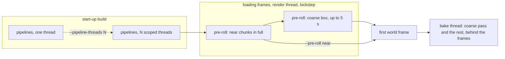

# 0108: The start-up readings: a shorter pre-roll, and the cold pipelines split

> **Status:** approved (owner, 2026-11-26: "go on both, all recommended, do not start until these lanes finish"; see "Amended 2026-11-26 (owner)"). Drafted from
> [the review of 2026-11-26](../reviews/2026-11-26-work-off-the-render-thread.md) on the owner's
> "all recommended" (its question 2: the pre-roll reading now as a chore beside Plan 0093, the
> cold-pipeline split before the next tester archive), with no further interview; the guesses
> and the questions left are under "Risks & open questions". **Order:** Phases 1 and 2 may run
> now, beside Plan 0093 (the overlaps are under "Beside Plans 0093 and 0103"). Phase 3 runs
> before the next tester archive is cut and may wait until then. It is a chore of readings: a
> start-up plan follows only if the readings and the owner's eye say so.
> **Created:** 2026-11-26
> **Milestone:** cross-cutting: start-up, `docs/nfr.md` section 7 (M7's tooling in
> [`docs/roadmap.md`](../roadmap.md) is the nearest home)
> **Related ADRs:** [ADR-0059](../adrs/0059-loading-runs-as-time-sliced-steps-on-the-apps-frame-loop-behind-an-engine-loading-frame.md)
> (the loading stages and the steppable pre-roll),
> [ADR-0083](../adrs/0083-the-live-bake-queue-runs-on-a-bake-thread-the-render-thread-applies-its-write-lists-and-issues-its-submits.md)
> (the bake thread; the pre-roll stays lockstep),
> [ADR-0076](../adrs/0076-light-stability-rules-world-history-per-source-a-fade-per-transition-and-a-ratcheted-pop-counter.md)
> (what a surface shows before its record lands, and that a landing fades),
> [ADR-0087](../adrs/0087-the-renderers-pipeline-cache-is-the-drivers-through-wgpu-as-bytes-the-consumer-keeps.md)
> (proposed, Plan 0103's: the cache beside the split). No new ADR: nothing is decided here,
> two things are read.

## TL;DR

Every start waits 5.7 to 7 s for the light pre-roll before the first world frame, and a
first-ever start waits another 36 s (RTX) or 12 s (RENOIR) for pipelines. Both were measured
before the bake thread existed, or have never been split. This chore takes two readings.
**One:** a setting, `--pre-roll full|near|off`, ends the pre-roll at the near chunks and lets
the bake thread finish the rest behind the first frame; headless runs read how much sooner
the first frame comes and what it shows, and then the owner looks at the start in a window
and says whether a darker or popping first picture is acceptable for the seconds saved (3 to
5 s is a guess until read). **Two:** a cold start with the pipelines built on 1, 2 and 4
threads says whether the drivers compile in parallel at all. The defaults change only on the
owner's pick and only where the readings pay.

## Context & problem

- **The pre-roll** ([Plan 0103's log](logs/0103.md), loaded, indicative): with warm pipelines
  the first world frame comes at 6.5 to 9.5 s on the RTX 3080 Laptop and 6.8 to 7.1 s on the
  RENOIR, 5.7 to 7 s of it the pre-roll's two stages, against the 3 s proposal of
  `docs/nfr.md` section 7. The pre-roll runs in lockstep on the render thread behind the
  loading frames: first the chunks within `--near` (2) of the camera's chunk are baked in
  full, then a coarse pass runs for up to 5 s of work time (`COARSE_PRE_ROLL_MS`) over the
  chunks mirrored at that moment. So the coarse box is at most 5 s of the 5.7 to 7.
- **What changed:** with the bake thread on, every in-view chunk of the forest has some
  light about 8 s after the first frame, at an 8.3 ms frame
  ([Plan 0099's log](logs/0099.md), RTX host). The coarse pass no longer has to hold the
  first frame to be affordable. Whether the first picture holds without it is the owner's
  first rule (a stable image; no waiting for light, but no unlit first picture either), and
  only his eye decides it. The pop counter that would count it (Plan 0090) is not built.
- **No flag shortens the pre-roll alone today.** `--near` and `--coarse` also change the
  live queue after the first frame; `--pre-roll-drain` lengthens the bake after the first
  frame and holds the camera, the opposite. So the reading needs one small setting.
- **The cold pipelines** (the same log): the pipeline span reads 35.5 to 36.7 s cold on the
  RTX and 11.7 to 12.4 s on the RENOIR; the first world frame about 46 s and 20 s. The
  start-up build is already off the render thread, as one thread creating pipelines in turn.
  `wgpu`'s device is shared across threads, so the build can be split; whether the NVIDIA and
  RADV compilers then run in parallel is **unread**, and the gain is a guess between nothing
  and the thread count. A default start builds no default-off arm (the log's finding); an
  arm picked live compiles on the render thread at its first use (`absorb`'s cold start read
  70 s at Plan 0094's window).

It touches `docs/nfr.md` section 7 (time to first frame, a proposal of 3 s) and nothing
else. The consumer's side is `project-context.md`'s start of a run: a first start that takes
most of a minute is what a tester sees first.

## Decision

Read before deciding. The chore adds two settings whose defaults are today's behaviour, takes
the readings, shows the owner the start, and writes down what was picked. It builds no
background pipeline mechanism and no cache. We rejected **shortening the pre-roll by
default now** (a darker first picture is the owner's call, and unread); and **a start-up plan
drafted now** (its mechanism depends on both readings).

## Architecture diagram



## Implementation phases

Each phase ships as its own commit, one phase a dev brief. No test here passes by a clock:
every time is a printed reading. No scene is changed for a reading. Each hold of the perf
lock is projected from its first arm; one projected past 20 minutes is split. The gate tier
is the most any step runs.

### Phase 1: `--pre-roll full|near|off`, and what the first frames show (a reading)
- **Owner skill:** dev
- **What:** A fly-through setting, default `full` (today's behaviour, byte for byte):
  `near` ends the pre-roll when the near chunks hold their light (the coarse box at 0 ms;
  the coarse pass then runs in the live queue behind the first frame, on the bake thread
  where it is on); `off` skips the near chunks too (a reading's arm: the darkest start
  there is). The engine's `PreRoll` already takes the box and the near list, so the setting
  is the fly-through's. **Its mode shows in the window:** the banner's queue row and the
  HUD's queue row read `pre-roll full`, `pre-roll near` or `pre-roll off`, beside
  `bake thread on|off`. The first world frame prints, once, the in-view chunks still
  waiting (blank and coarse, the `bake queue view:` line's counts) as `first frame light:`.
- **Files touched:** `apps/flythrough/src/cli/outdoor.rs` (the flag, beside
  `--pre-roll-drain`), `cli/mod.rs`, `cli/parse.rs`, `cli/tests/outdoor.rs`,
  `run/loading.rs`, `run/queue.rs`, `run/hud_feed.rs` (the row), `docs/flythrough.md` (one
  row), `crates/svet-render/tests/gpu_loading.rs`, `docs/plans/logs/0108.md` (new).
- **Done when:**
  - The CLI test asserts the three values, the default, a refused fourth value, and the
    three row texts. `--pre-roll near` with `--pre-roll-drain` is refused with a message
    (the two pull opposite ways).
  - `a_pre_roll_boxed_at_zero_ends_at_the_near_chunks` (`gpu_loading`, lavapipe, expected
    under 10 s: a guess, read in the phase): a `PreRoll` with `box_ms` 0 is `Done` no later
    than the step after the near chunks' moment, with every near chunk settled and
    `coarse_chunks` 0; with an empty near list and `box_ms` 0 it ends at its first step. Counts and states only; the pre-roll reads the work time it is passed, not
    a clock.
  - A headless run with the default prints the same `pre-roll:` summary line fields as
    before the phase (the default is unchanged), and the fly-through's default golden
    (`gpu_golden`, by name) is byte-identical.
  - **The readings**, in the log, release, pipelines warm, `--bake-thread on`, on the RTX
    3080 Laptop (Floor) and the RENOIR (`--adapter RENOIR --profile portable --render
    1280x720`), on two scenes: the forest (`--source outdoor --spawn forest`) and the
    showcase's hall (`--source showcase --shot hall`, lit only by emitters, where an
    unbaked surface is darkest). Per adapter, scene and arm (`full` named the before,
    `near`, `off`): (1) three starts of `--headless --frames 3`: the time to the first
    world frame (`first frame after`), the pre-roll stages' ms (`load_stages`), and the
    `first frame light:` counts; (2) the first picture as stills (`--still`, one run a
    still): frame 0 for every arm, and for `full` and `near` the frames nearest 1, 2 and
    5 s after the first frame, picked from the arm's own frame time in (1), with the wall
    time each still came from printed beside it (a reading; headless frames are not paced
    as a window's are, so the times are indicative and Phase 2 is the judge). One sheet per
    adapter and scene: arms in rows, times in columns. If Plan 0093's `--still-at` is on
    main when this phase starts, one run an arm writes its stills with it; this plan adds no
    still flag of its own.
  - **Stop:** `near` brings the first world frame less than 2.0 s sooner than `full` on
    both adapters and both scenes. Then the pre-roll half ends here with the figures
    recorded, Phase 2 is skipped, and the backlog's entry says so. (The coarse box is at
    most 5.0 s of work time, so the most `near` can save is about 5 s plus the loading
    frames' overhead around it.)
  - About 72 starts of 10 s or less: two holds of the exclusive perf lock, one an adapter,
    each projected from its first arm. Quick tier over `flythrough`; `gpu_loading` and
    `gpu_golden` by name.

### Phase 2: The owner looks at the start
- **Owner skill:** human
- **What:** Windowed starts of the forest and the hall on the RTX, the owner moving as he
  likes from the first frame (no camera hold: no `--pre-roll-drain`, nothing that locks the
  view), stdout visible. First `--pre-roll full`, named on screen and by the orchestrator as
  the before; then `near`; `off` only if he asks. Phase 1's sheets are shown first, so the
  window opens on what the headless runs already say. The orchestrator pings when the
  binary and the sheets are ready.
- **Files touched:** `docs/plans/logs/0108.md` (the owner's words, dated).
- **Done when:** the owner says one of: `near` is the start's default in a window; `full`
  stays; or something between (a shorter coarse box, in seconds: then the architect amends
  the setting to take it and Phase 1's readings are repeated for that value only). His eye
  decides; the seconds saved are Phase 1's figures, not this draft's guess.

### Phase 3: The cold pipelines on 1, 2 and 4 threads (a reading, before the next tester archive)
- **Owner skill:** dev
- **What:** A start-up setting, `--pipeline-threads N` (1 to 8, default 1: today's
  behaviour): the start-up build creates the non-lazy pipelines on `N` scoped threads
  (`std::thread::scope` over the pass table; no pool, no dependency), each pipeline still
  built once. The `start-up:` lines print `pipelines on N threads` and the per-pass times as
  today. Cold starts are taken with the drivers' caches pointed at an emptied scratch
  directory (`__GL_SHADER_DISK_CACHE_PATH` and `MESA_SHADER_CACHE_DIR`, as Plan 0103's log
  did); the owner's real caches are never read or touched.
- **Files touched:** `crates/svet-render/src/frame/pipelines.rs` (the build loop),
  the entity and bake pipelines' build entry the start-up thread calls,
  `apps/flythrough/src/run/mod.rs` (`build_gfx`), `run/loading.rs`, `cli/` (the flag and its
  test), `docs/flythrough.md` (one row), `docs/plans/logs/0108.md`.
- **Done when:**
  - The CLI test asserts the flag's range and default and the `start-up:` text for 1 and 4.
    `the_passes_built_on_four_threads_are_the_passes_built_on_one` (`gpu_frame`, lavapipe,
    expected under 10 s: a guess; lavapipe compiles slowly, so over the line it is born
    `#[ignore = "soak"]` and named so): a frame built with 4 threads and one built with 1
    render the same first frame of a fixed scene byte for byte, and every non-lazy pass
    reports built in both. The default golden is byte-identical.
  - **The readings**, in the log, release, `--headless --source outdoor --frames 3`, each
    start cold on a fresh scratch cache: `N` = 1, 2, 4 on the RTX and on the RENOIR, two
    starts each (12 starts: about 46 s each on the RTX and 20 s on the RENOIR on record, so
    about 6.5 minutes), the pipeline span and the per-pass times; one start at `N` = 2 under
    `taskset -c 0-7` on each adapter (the eight-CPU stand-in: world generation runs on its
    own threads at the same time, and the floor has no idle core); and, RTX only, the
    start with a default-off arm picked (`--leaf-shadow absorb`) at `N` = 1 and 4, cold
    (two starts, about 70 s each on record): the arms stage's time. The log says, from the
    per-pass times, whether the passes' own times grow as `N` grows (a driver that
    serialises its compiler shows the same span and longer passes).
  - **The line:** `N` = 4 cuts the cold pipeline span by under 25 % against `N` = 1 on
    both adapters: the drivers do not compile in parallel enough to pay; the setting stays
    at 1 and the reading is recorded. Otherwise Phase 4 sets the default (below). On the
    stand-in, a start at `N` = 2 that reaches its first world frame later than `N` = 1 by
    more than 10 % is reported, and the default then stays 1 until the architect amends
    (a default that follows the logical CPU count).
  - About 11 minutes of starts in one hold of the exclusive perf lock, projected from the
    first. Quick tier over the changed crates; `gpu_frame` by name.

### Phase 4: The picks written down
- **Owner skill:** dev
- **What:** The defaults set to what Phase 2 and Phase 3 picked, and the lines. If the owner
  picked `near`: it is the default **in a window**, and `full` stays the default under
  `--headless` (owner question 1), so every golden, every reading on record and Plan 0093's
  shots start as they do today. If Phase 3's line was met: `--pipeline-threads` defaults to
  2 (the listing pool's count on 8 logical CPUs: the listers are idle while the start-up
  builds, so the floor's sum holds), or to 4 where the logical CPUs are 16 or more and
  Phase 3 read 4 faster than 2; else it stays 1. When Plan 0107's thread plan exists the
  default reads it.
- **Files touched:** `apps/flythrough/src/cli/`, `run/loading.rs`, `docs/flythrough.md`,
  `docs/nfr.md` section 7 and `docs/nfr/07-startup-and-build.md` (the time to the first
  frame warm and cold on both adapters, with machine and commit; the 3 s proposal kept,
  re-set or left a proposal, with the reading that says which).
- **Done when:** the CLI tests assert the defaults (a window's and `--headless`'s) and the
  banner rows; a headless default start prints `pre-roll full`; the default golden is
  byte-identical; section 7 holds the readings. The gate tier passes at the tip under the
  perf lock, with clippy, fmt and `cargo deny`. With no pick changing a default, the phase
  is the nfr lines alone.

## Beside Plans 0093 and 0103

- **Plan 0093** (the README's shots; approved, its lane open) edits the fly-through's still
  path and CLI: `apps/flythrough/src/cli/parse.rs`, `cli/still.rs`, `cli/outdoor.rs`,
  `run/still.rs`, `run/frame.rs`, `run/mod.rs`, `docs/flythrough.md`. This chore edits
  `cli/outdoor.rs` (one flag beside `--pre-roll-drain`), `cli/mod.rs`, `cli/parse.rs` (one
  default), `run/loading.rs`, `run/queue.rs`, `run/hud_feed.rs`, and later `run/mod.rs`
  (`build_gfx`). The overlaps are textual: the flag table, `cli/parse.rs`'s defaults,
  `docs/flythrough.md`'s rows, the changelog. Whichever merges second merges main first. No
  behaviour overlaps: this chore adds no still flag and does not touch the still's
  read-back; Plan 0093's shots run headless, where the pre-roll's default stays `full`.
- **Plan 0103** (the pipeline cache; a draft, parked) edits the same pipeline builders
  (`gpu_util.rs`, the frame's, overlay's, loading frame's and presenter's constructors, the
  fly-through's start-up). The two are beside each other, not instead: a cache warms a
  second start where the driver's own cache fails, and does nothing for a first start; the
  split shortens a first start and is irrelevant once anything is warm. They do not run at
  the same time (the same files). Phase 3 lands first, since Plan 0103 is parked; if Plan
  0103 is picked up, it takes the split as it finds it and passes its one cache handle to
  every build thread (whether `wgpu::PipelineCache` may be shared across threads is to be
  checked there, not assumed here), and its Phase 4 re-reads the time to the first frame on
  top of this chore's figures.

## Data shapes

```rust
// illustrative: the fly-through's settings, not the engine's
enum PreRollMode { Full, Near, Off }   // --pre-roll, default Full
// Near: PreRollConfig { box_ms: 0.0, .. }; Off: also near: vec![]
// --pipeline-threads N: 1..=8, default 1
```

## Budgets

| Figure (`docs/nfr.md`) | Expected | How the close reads it |
|---|---|---|
| Section 7: time to the first frame, 3 s (a proposal); 6.5 to 9.5 s warm on record | with `near`, sooner by up to about 5 s: a guess | Phase 1, three starts an arm, both adapters, the perf lock, load stated |
| Section 7: the cold first start, 46 s (RTX) and 20 s (RENOIR) on record; no line | with the split, between no change and a cut by the thread count: a guess | Phase 3, cold on a scratch cache, both adapters |
| Section 2: the frame while the view waits (8.3 ms on the RTX with the thread on) | unchanged; with `near` the wait starts at the first frame instead of behind the bar | Phase 1's runs print the frames' wall p50 for the first 5 s |
| VRAM, RAM | unchanged | not read; nothing is allocated |

## Risks & open questions

- **The picture.** A first frame that is dark past the near chunks, or that pops as the
  coarse pass lands, breaks the owner's first rule. That is why the default does not move
  without Phase 2, and why `full` is named the before.
- **The headless stills are not the window.** Headless frames run unpaced, so the bake
  thread shares the CPU with a busier render thread and lands on a different schedule. The
  stills are indicative; the owner's window is the judge.
- **Threading.** The pre-roll stays lockstep (ADR-0083); `near` only ends it sooner. The
  build's threads are scoped and end with the build; they write nothing the image reads
  (each fills a `OnceLock` once). No new long-lived thread, so the floor's thread sum does
  not change; during the build they compete with world generation, which is Phase 3's
  stand-in reading.
- **Determinism.** With `near` and the bake thread on, what the first frames show is not
  reproducible run to run (as every frame's landing already is with the thread). Tests and
  headless runs keep `full` and lockstep.
- **Drivers.** Whether a driver compiles in parallel is exactly what is unread; RADV and
  NVIDIA may differ, and the reading keeps them apart. Nothing branches on the backend: one
  default from the thread plan, or 1.
- **Owner question 1 (where `near` becomes the default, if he picks it).** (a)
  **Recommended:** in a window only; `--headless` keeps `full`, as `--bake-thread` does, so
  goldens, readings and the README's shots do not move. (b) Everywhere, with every golden
  that starts from the pre-roll re-blessed.
- **Owner question 2 (the tester build).** (a) **Recommended:** the tester's scenes take
  the same default as the fly-through's window after Phase 2. (b) The tester keeps `full`
  until testers have seen one archive with `near` behind a menu entry.
- **Owner question 3 (when Phase 3 runs).** (a) **Recommended:** right after Phase 2, in
  the same lane, so the next tester archive already has the figure. (b) Only when the
  archive is being cut.

## What this plan does NOT do

- **No default-off arm built behind the first world frame**, with the old pipeline drawing
  meanwhile. Phase 3 sizes the stall; the mechanism is a start-up plan's, if the owner asks.
- **No pipeline cache** (Plan 0103, parked).
- **No change to the pre-roll's near stage, the coarse pass's samples or the queue's
  order.** One box is switched; the queue behind the first frame is the one that runs today.
- **No census-driven pruning of which pipelines a default start builds.** The per-pass
  times of Phase 3 are the census; acting on it is the start-up plan's.
- **Nothing for the scene switch's join on the render thread** (the backlog's entry; picked
  up with a start-up plan).
- **No Windows run.** The owner checks Windows once in a while, not per plan.

## Amended 2026-11-26 (owner)

The owner: "go on both, all recommended, do not start until these lanes finish".

- **The go stands.** The lane does not start until the lanes open on 2026-11-26 have
  finished (Plans 0101, 0105, 0093 and 0106); this replaces "Phases 1 and 2 can run now
  beside Plan 0093".
- **Question 1:** if he picks `near` at Phase 2 it becomes the default in a window only;
  `--headless` keeps `full`, so no golden changes.
- **Question 2:** the tester build takes the same default as the fly-through's window after
  Phase 2.
- **Question 3:** Phase 3 runs right after Phase 2, in the same lane.

## Implementation log

> Written by `dev`: one row per phase as its commit lands, then the close block. **The phases
> above are the contract. This section records what happened.** Observations, never conclusions:
> no pass list, no self-assessment. Deviations and unmet done-whens are **always** disclosed.
> Keep it shorter than `## Implementation phases`. Readings, gate counts, attempts, sweeps and
> resume notes go to the plan's readings log, `docs/plans/logs/0108.md` (started from
> `templates/readings-log.md`), and this section links it once it exists.

| phase | owner | state | commit |
|---|---|---|---|
| 1: `--pre-roll`, and what the first frames show | dev | not started | |
| 2: the owner looks at the start (skipped if 1 stops) | human | not started | |
| 3: the cold pipelines on 1, 2 and 4 threads | dev | not started | |
| 4: the picks written down | dev | not started | |

### Notes

_(Deviations from the plan, with the commit, stated without justification. Done-whens not
satisfiable as stated, and what was done instead. Followups noticed and not acted on. One line
each. Empty is fine.)_

### Close triggers

_(Facts for the architect. No recommendations, and no suggested version bump.)_

- **What shipped:**
- **Public API changed:**
- **Budget readings:**
- **Gate at the tip:**
- **Outstanding `human` phases:**

## Followups

_(Empty at the draft.)_
