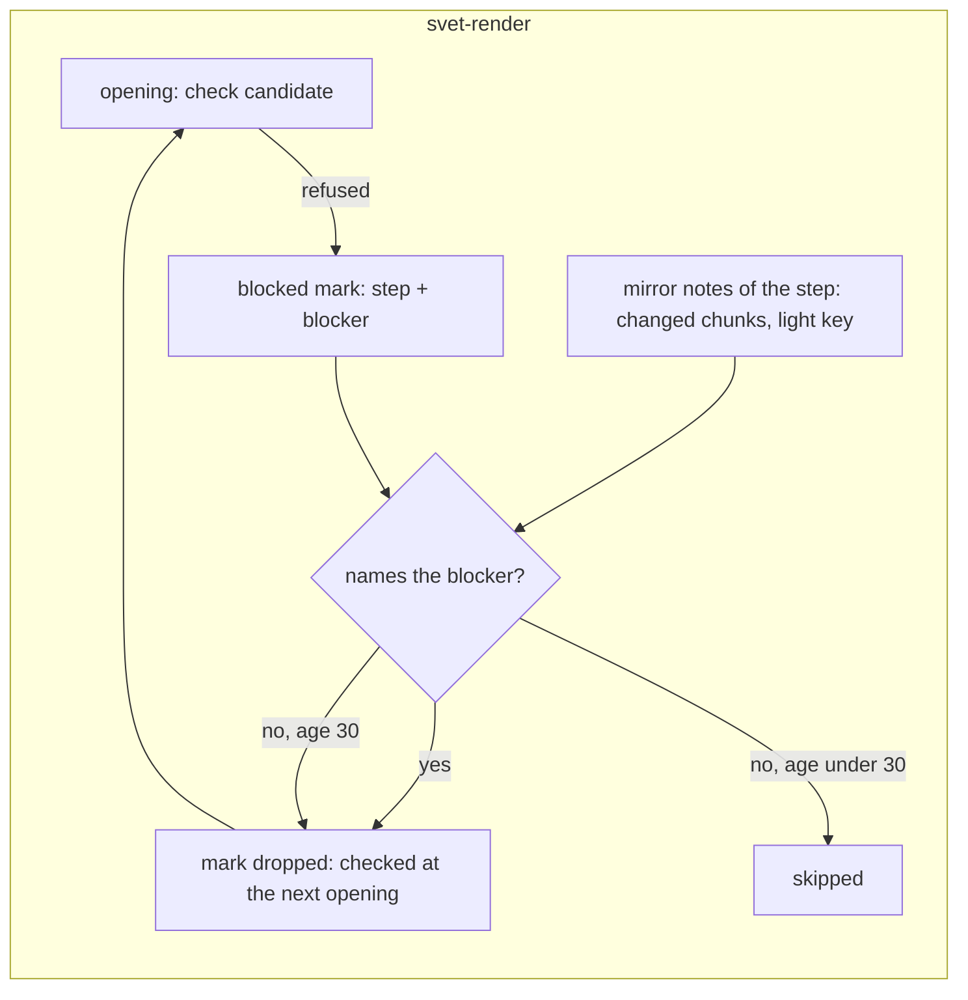

# 0109: A blocked chunk is checked again when its blocker clears: the start on a streamed world

> **Status:** in-progress (2026-11-26, owner's go): Phase 1 and 1b done, Phases 2, 2b and 2c read, Phase 2d done (the pre-roll counts a full-count block held whether a catch-up is due or in a job). Ruled 2026-11-27 (Rulings 5 to 8). Phase 2c read 0 cells changed at both spawns (rows to the architect before 2e or Phase 4). Phase 3a read (the tip's step by part). Phase 4a read (the window's lines headless, thread on, release: no stop). Phase 3b read (the base's step by part and the comparison). Phase 4 answered 2026-11-27 (W1 stands, no Phase 5). Phase 6a done (the switch test stays in the gate at 12.8 s; `RUN_BOUND` 440 s). Phase 6b done (the outdoor child's guard 400 s). Next: the close review.
> **Created:** 2026-11-26
> **Milestone:** none (a fix in the start-up path; follows Plan 0099, `docs/roadmap.md` M9's bake thread)
> **Related ADRs:** [ADR-0059](../adrs/0059-loading-runs-as-time-sliced-steps-on-the-apps-frame-loop-behind-an-engine-loading-frame.md) (the pre-roll and its start-up budgets; not changed unless the owner picks the bound, and then by a new ADR, see Phase 5), ADR-0070's amendment (the column rule; not changed), ADR-0046 (the reach rule; not changed)

## TL;DR

The live bake queue skips a chunk it found not ready for 30 steps, whatever happens to what blocked it. At a start on a streamed world the camera's chunk is always blocked at step 1 and is ready about four steps later, so every start waits about 25 steps for nothing, and when the check at step 31 lands in an upload backlog it waits 30 more, once or twice (26 to 45 s on lavapipe, 25 s on the RTX host in one run of five). This plan makes the queue check a blocked chunk again at the first opening after its blocker clears, with the 30 steps kept as the longest it goes unchecked. First observable: the switched outdoor run's pre-roll ends within a few steps of the camera's chunk becoming bakeable, in every run, where it reads 32, 62 or 95 steps today.

## Context & problem

Read in [Plan 0106](done/0106-no-gate-test-passes-by-a-clock-the-red-dig-test-stepped-by-count-the-sweep-and-a-gate-script.md), Rulings 3 to 5, from its Phases 10 and 11 (`docs/plans/logs/0106.md`). What is established there, and by what:

- **From the code:** a candidate refused by `bakeable` or `lights_ready_near` is stamped with the step and skipped until `QUEUE_RECHECK` (30) steps have passed (`bake/queue/open.rs`, `list.rs`, `mod.rs`); the stamp leaves early only when the chunk leaves the mirror, its own prepared masks arrive or an edit box touches it. A change in its reach drops its cached reach verdict and not the stamp.
- **From the rows:** in all eight traced tip runs and both runs at `c87bf7a6` the camera's chunk is bakeable 17 to 27 steps before the check at 31 opens it; the long pre-rolls are that check, and the next, failing on a chunk waiting to upload in a column over the reach footprint.
- **Derived, not measured in a window:** a start pays the wait on every adapter (Plan 0106, "What a start pays today").

The owner's standing complaint is the wait for light at a start (2026-11-20). The constant is a count of steps written for frames of a few milliseconds; a pre-roll step on a streamed start takes 0.1 to 0.3 s.

Two things this plan does **not** assume. Which chunk held a column at the failed checks is unnamed and does not matter to the fix. Why a streamed start's lockstep step costs about three times as much since `e1628197` (65 ms against 152 to 303 ms a step on lavapipe) is unread: Phase 3 reads it and fixes nothing.

**Open, the owner's (a stability question, not decided here):** when the camera's chunk cannot bake at a start because its surroundings are still streaming in, does the first frame **wait for it**, with the wait cut to the least the stream allows (arm A), or does start-up **end on a bound** and show the frame with that chunk's light still landing in view (arm B)? Phases 1 to 3 are the wait cut to its least and serve both arms. Phase 4 is where the owner looks and answers. Phase 5 is arm B and is written only if he picks it.

## Decision

A blocked mark records what blocked it, and the candidate is checked again at the first opening after that blocker's state changes; the age of 30 steps stays as the longest a blocked candidate goes unchecked. The opening's count of checks a step is unchanged.

Rejected:
- **A smaller `QUEUE_RECHECK`.** Still an age: a check that misses by one step waits the whole of it again, and the constant guards the check budget for the candidates behind (the comment at the opening's walk).
- **Checking every blocked candidate at every opening.** At a streamed world's edge thousands of candidates are blocked; the nearest would spend every check every step and the ready ones behind them would never be reached.
- **Dropping the stamp on any mirror change within the reach.** While a world streams in, some chunk in a near candidate's reach changes at almost every step: this is the previous option for the near candidates.
- **Raising the sync's budget in the pre-roll, or baking under a column with an upload pending.** The first moves the backlog, not the wait (the short mode has no backlog and waits 25 steps); the second is ADR-0070's amendment reversed.
- **A special case for the pre-roll's near chunks.** The live queue has the same wait at a streamed edge in flight; one rule for both.

No ADR: the rule replaces a constant's use with the event the constant stood in for, and the rejected options above are recorded here. An ADR is owed only if the owner picks arm B (it changes ADR-0059's rule for what the first frame waits for).

## Architecture diagram



## Implementation phases

One dev brief a phase. Every GPU run alone under the exclusive perf lock, its load1 logged, projected from its first stage's stamp and stopped past 5 minutes; a phase holds the lock under 15 minutes in all. No scene, source, flag or assertion of an existing test is changed to make a bar.

### Phase 1: a blocked chunk is checked again when its blocker clears
- **Owner skill:** dev
- **What:** The stamp in `BakeQueue::blocked` carries its blocker: the first chunk of the reach found waiting to upload or not resident full (`reach_by` already stops there), or the first chunk that holds a footprint column from final (`column_final`'s first failing chunk), or the lights. The step drops the stamp of every candidate whose blocker the step's mirror notes name as changed (a chunk blocker), or when the light key changed (a lights blocker), so the next opening checks it; a check that finds another blocker stamps it again with that one. `QUEUE_RECHECK` stays as the age at which a stamp is dropped with no event. The count of checks an opening makes (`QUEUE_CHECKS`, `QUEUE_CHECKS_UNSLICED`) and the walk's order are unchanged. The books' copy of the blocked set (`queue/books.rs`) keeps its meaning (a set of chunks). The shape of the index from blocker to candidates is the dev's.
- **Files touched:** `crates/svet-render/src/bake/queue/{mod,open,list,step,reach,message,books}.rs`, `crates/svet-render/src/gpu_world/columns.rs` (only if the first failing chunk needs a reading form of `column_is_final`), `crates/svet-render/src/bake/queue/tests.rs`, `docs/plans/logs/0109.md`.
- **Done when:** Four tests beside `a_chunk_absent_high_in_a_column_holds_the_bake` (`queue/tests.rs`, on that rig and in its tier; each under 1 s, stated with its wall in the log), each stepping the queue by count:
  (a) a candidate whose reach is ready and whose only blocker is one chunk waiting to upload in a footprint column **outside its reach** is refused at step 1; the chunk uploads before step `k` for `k` = 3 and `k` = 17; the candidate's job is opened by the opening of step `k`, not at step 31.
  (b) two blockers: the first clears at step 3 and the candidate is checked at step 3, refused and stamped with the second; no job; the second clears at step 9 and the job opens at step 9.
  (c) no event: with the blocker unchanged through steps 2 to 30 the candidate is checked at no opening before step 31 (`QueueStats::reach_checks` and the refusals counted do not move for it) and is checked at step 31.
  (d) the check budget: with more blocked candidates than an opening's checks and one ready candidate behind them in the order, an event that clears one blocker leaves the ready candidate opened no later than it is before this phase (the step is asserted equal to the step read on the base, stated in the test).
  Then the reading that the rule reaches the run: Plan 0106 Phase 11's command line (`--headless --adapter llvmpipe --source showcase --frames 3 --switch-at 0 --render 64x36 --near 0 --coarse 0 --loading-screen on`) eight times on lavapipe; the log holds each run's `pre-roll:` line, the full chunks streamed at its end, and whether the camera's chunk's block is provisional at frame 0. **Bar:** no run's pre-roll is over 31 steps (the least any run reads today is 32), and the eight step counts are given as they fall with their spread; a run over 31 is logged with its `bake queue:` line and is a stop. The quick tier, `--binaries` for the queue's gpu binaries the dev names, clippy, fmt, the check scripts.
- **Stops (report, change nothing to pass):** the mirror's notes not naming a chunk whose pending state changed (the event the rule needs is then missing: report what the notes carry); test (d) moving the ready candidate later; any golden or pinned count elsewhere in the gate moving (name the test and both values: a start that opens the camera's chunk 25 steps sooner can move what a later frame reads, and that is the architect's to rule, not a bar to re-bless).

### Phase 2: the switched start before and after, on both adapters
- **Owner skill:** dev
- **What:** A reading on the tree Phase 1 leaves, no code change: the same command line five times on the RTX adapter (without `--adapter`) and, for the default start a window makes, `--source` the outdoor world started directly with the default near shell and coarse pass, headless, three times on each adapter. Per run: the `pre-roll:` and `bake queue:` lines, the steps, chunks baked and ms, the count of near chunks stamped blocked at step 1 and the step each was opened (a local print, **not committed**), and the chunks provisional at frame 0 with the catch-ups queued in the first 120 frames.
- **Files touched:** `docs/plans/logs/0109.md`.
- **Done when:** the log holds the runs beside Plan 0106 Phase 11's rows for the same command line (32 and 95 steps on the RTX, 32 to 97 on lavapipe), one sentence on whether any run still waits on an age of 30, and one on what the first frames show that they did not before (provisional blocks re-baked in view, or none), as counts. A run that still reads over 31 steps is reported with its trace and nothing is changed.

### Phase 3: where the lockstep step's time went since the bake thread's merge (a reading)
- **Owner skill:** dev
- **What:** The switched run's pre-roll at the tip and on a worktree at `c87bf7a6` (its own target directory, built outside the lock), two runs each on lavapipe, with a local print, **not committed**, of each pre-roll step's parts: the streamer's update and poll, `apply_events`, `take_prepared`, the sync (its `SyncStats` stages and chunks), the mirror's notes, the queue step's own stages (`StepStages`), and the chunks that arrived that step. At most two builds.
- **Files touched:** `docs/plans/logs/0109.md`.
- **Done when:** the log holds, per tree, the median of each part over the steps before the first job opens and the part or parts that hold the growth from about 65 ms to 150 to 300 ms a step, each as ms a step and ms a chunk arrived; or the statement that the parts printed do not hold it. Nothing is fixed: a part named goes to the architect, who routes it (Plan 0107 reads the sync and may already own it).
- **Stops:** the print not applying at `c87bf7a6` without more than print lines changing (read the tip alone and say so).
- **Amended 2026-11-27:** two briefs, 3a and 3b ("Phase 3, cut in two" below).

### Phase 4: the owner looks at the start and answers
- **Owner skill:** human
- **What:** On Linux, with Phase 2's rows in hand and in the same sitting as [Plan 0108](0108-the-start-up-readings-a-shorter-pre-roll-and-the-cold-pipelines-split.md) Phase 2 if that lane has reached it: the outdoor world started in a window on the tree Phase 1 leaves. The owner answers the open question: the first frame waits for the camera's chunk (arm A: this plan's dev work is then done), or start-up ends on a bound with that chunk's light landing in view (arm B: Phase 5 is written).
- **Files touched:** none (the architect records the answer as a dated amendment).
- **Done when:** the answer is recorded in this plan. No camera hold and no drained pre-roll in the window run.
- **Amended 2026-11-27:** what is shown and asked is "Phase 4, restated" below; the two arms above are superseded.

### Phase 5: arm B, start-up ends on a bound (written only if the owner picks it)
- **Owner skill:** dev
- **What:** Not written. If the owner picks arm B the architect writes it with its ADR (what the first frame waits for, against ADR-0059) from Phase 2's rows: the bound's unit (steps, not wall time, after Plan 0106's Ruling 1), what the frame shows for a near chunk with no block, and the image bar that defends "no flicker" on it. Under arm A this phase is struck.
- **Files touched:** named then.
- **Done when:** stated then.

### Phase 6: the switch test's tier and `RUN_BOUND`
- **Owner skill:** dev
- **What:** What Plan 0106 reserved as its Phase 12, on the tree this plan leaves (after Phase 1 under arm A, after Phase 5 under arm B). `a_source_switch_shows_the_loading_frames_before_the_new_world` (`gpu_loading`) by name five times alone on lavapipe; then ten loaded runs of a `gpu_shutdown` child, and `RUN_BOUND` resized by the rule Plan 0106 Phase 3 used for its kill guards.
- **Files touched:** `apps/flythrough/tests/gpu_shutdown.rs` (the constant and its comment), `apps/flythrough/tests/gpu_loading.rs` (the soak mark, only under the second outcome below), `docs/nfr/07-startup-and-build.md` (the test's listed time), `scripts/test-clocks-allow.txt` (the guard's row, if its ratio changes), `docs/plans/logs/0109.md`.
- **Done when:** the log holds the five walls and the ten child walls with their loads. Tier, by Plan 0106's Ruling 3: at or under 20 s alone in all five, the test stays in the gate under `docs/nfr/07-startup-and-build.md`'s exception with its listed time corrected to the median; over that in any run, the five walls go to the architect with each run's `pre-roll:` line and the test is **not** marked by the dev. `RUN_BOUND` is set from the slowest of the ten loaded child runs by that rule, with the ratio in its comment; the quick tier, clippy, fmt, the check scripts.
- **Amended 2026-11-27:** cut in two (6a, 6b) with the allow-list row's stale text and the outdoor child's guard: "Phase 6, cut in two" below.

## Amended 2026-11-26 (architect, Phase 1's stop)

Phase 1 came back at `f082adb4` stopped on its third stop. Read for this: the commit's code, the moved test and its rig (`apps/flythrough/tests/gpu_queue_reach.rs`, `row_n`), the lane's raw files (`live/p1/`), and the raw `pre-roll:` lines of Plan 0106's Phases 10 and 11 (`live/p10/`, `live/p11/` in that lane). Nothing was run. Each statement says whether it is from the code, from the rows, or derived.

### Ruling 1: the moved order is the rule's correct consequence; the pin is rewritten, not the rule

`an_opening_without_a_mirror_event_rebuilds_nothing` pinned `[2, 3, 1, 4, 0, 7, 5, 6]` and reads `[2, 3, 1, 4, 0, 5, 6, 7]`.

- **From the code and the rig.** The row has eight chunks, the camera in chunk 2, and chunk 7 waiting to upload. Chunks 5 and 6 hold chunk 7 in their reach, so their reach walk stops at it and their marks read `Chunk(7)`. `sync_one` uploads chunk 7; the mirror's change list names it; the forget stage drops both marks; the next openings take the three candidates in the order's own sequence, nearest first: 5, 6, 7. That is this plan's Decision applied to its own textbook case.
- **The old order was the defect, pinned.** The test's comment says so: "5 and 6 were found blocked at the last openings and wait out the recheck: 7 first". A farther chunk opened before two nearer ready ones because of the age.
- **The name's claim still holds and is still asserted.** `rebuilt == 0` is asserted at every step of all three loops, `visited == 7` and `checks == 7` over the stretch, and the arrival scoring exactly 3; the run failed at the last line only (`gpu2.log`: 7 scored, 7 reach walks, 3 scored from the arrival).
- **How the test reads after Phase 1b.** The pin is `[2, 3, 1, 4, 0, 5, 6, 7]`. The comment above it: "Chunk 7's upload is what refused 5 and 6 (their reach walk stopped at it): their marks drop with it and the openings take the three nearest first." The doc comment's last sentence ("7 opens, then 5 and 6 once their last check is old enough to be read again") becomes: "Chunk 7's upload drops the blocked marks of 5 and 6, so the three open nearest first: 5, 6, 7." No other line of the test changes.
- **Not established:** only `gpu_queue`, `gpu_queue_reach`, `gpu_bake_tiers` and `gpu_loading` were run. Pins and goldens in the rest of the gate are unread until the tip's gate; the phase's stop rule stands for them.

### Ruling 2: what the start shows now, against before

- **From the rows, before.** In all 24 runs of Plan 0106's Phases 10 and 11 (every tree, both adapters) the switched pre-roll's line reads every baked chunk provisional: 9 of 9, 24 of 24, 49 of 49, 258 of 258, 402 of 402, 789 of 789, and "0 catch-ups queued". The camera's chunk is among the baked, so **it was provisional at frame 0 before this plan** (derived from the equal counts: no run printed that chunk's set).
- **From the rows, now.** Eight of eight: the camera's chunk provisional at frame 0 (printed), 1 chunk baked where the short runs baked 9, 0 catch-ups queued, 1438 to 1732 full chunks streamed at the pre-roll's end against 6000 to 7000 at step 31 before (Plan 0106's Ruling 5).
- **From the code.** A provisional block had its whole light reach resident and uploaded (`bakeable` refuses otherwise in the near band); what it lacks is the chunks still to arrive in the columns over its reach footprint above and below the reach, which the sky rays read through the column map. The catch-up bakes it again when those columns are final, and the new values fade in over `FADE` frames.
- **Derived, unmeasured.** With a quarter of the chunks streamed, the camera's block is baked under less complete columns than before, so its catch-up is likelier to change what is seen, and by more. No run read how much, or when the catch-up lands: every run is 3 frames long.
- **Also changed on this command line:** the first frame has 1 lit chunk around the camera where it had 9 or more. The other 8 were never the pre-roll's contract (`--near 0`: the camera's chunk alone); they baked during the 30-step wait. A default start (near shell 2, coarse pass) is unread.
- **Has Phase 1 moved the start to arm B before the owner chose? No in kind, possibly in degree.** The first frame still waits until the camera's chunk holds a block, and that block was provisional before as it is now. What moved is how early, and so how incomplete, the world under it is. The plan's Risks named this ("Earlier is not the same picture"); it is not a pass and not a fault until Phase 2 counts it. The two arms as first written do not separate "holds a block" from "holds its final block", so the owner question gains an arm (below).

### Ruling 3: the mechanism choices

- **A drop by an event lets that step open (`quiet_until` reset): accepted.** Without it "the first opening after" can be `QUEUE_QUIET` steps late, which is the wait again in small. The step already opens when the mirror's chunk count moves; this covers a change that leaves the count equal.
- **An untracked step drops every chunk mark: accepted, and it is not the rejected option by another door.** The rejected options drop or recheck on ordinary steps, every step. A step is untracked only when the change list is unknown: the mirror's first `take_changes`, where a new queue holds no mark, and after more than `CHANGES_MAX` (65 536) changes between two steps (`gpu_world/window.rs`); the first live step of r1 read 1717 changes. On that branch the queue already clears its whole reach cache for the same reason. Unread: how many untracked steps a start has (expected 1, with no mark to drop); Phase 2 prints it.
- **A reach blocker cleared by the streamer's residency alone waits for the age: accepted as the bound working.** A chunk that arrives is queued for upload, which is a mirror change, so the common case is an event. Phase 2's sentence on whether any run still waits on an age names this case if it shows.
- **`Blocked::default()` as `{0, Lights}`: rejected.** A mark with no step and an invented blocker exists only for one line of `split_tests.rs`. Phase 1b removes `Default` from `Blocker` and `Blocked`; that test names its mark.
- **Flapping, from the rows:** 223 to 398 marks dropped and 187 to 284 checks spent on them over the process in runs of 5 to 10 steps. Bounded by the opening's checks and defended in order by test (d); whether a ready candidate waits behind rechecks in a real start is unread. Phase 2 counts it.

### Ruling 4: the housekeeping

- **Outside `Files touched`:** the one re-export line in `gpu_world/mod.rs` and the new `queue/blocked_tests.rs` are accepted (the reading form needs the first; `tests.rs` is 1077 lines against the 1200 cap).
- **One `wip(render)` commit holding code, tests, log and row:** stands; history is not rewritten. A stopped phase commits as it is. Phase 1b's commit is the phase's completion, and the Implementation log's row 1 names both hashes.
- **The bare `git stash`:** the stash list is empty and the lane's tree is clean at this reading; no damage. Not to be repeated (a temporary commit, or a second worktree for a base reading).

### Phase 1b: the pin as ruled, and the default removed
- **Owner skill:** dev
- **What:** (1) `an_opening_without_a_mirror_event_rebuilds_nothing`: the pinned order, the comment above it and the doc comment's last sentence as Ruling 1 words them; no other line. (2) `Default` leaves `Blocker` and `Blocked`; `split_tests.rs` spells its mark. No other code change.
- **Files touched:** `apps/flythrough/tests/gpu_queue_reach.rs`, `crates/svet-render/src/bake/queue/{reach.rs,split_tests.rs}`, `docs/plans/logs/0109.md`.
- **Done when:** the test passes reading `[2, 3, 1, 4, 0, 5, 6, 7]`, with its `rebuilt`, `visited`, `checks` and arrival assertions untouched (the diff of the test shows the three places only); `--binaries gpu_queue,gpu_queue_reach,gpu_bake_tiers,gpu_loading` on lavapipe under the lock with `--no-fail-fast`: every test passes (about 160 s as last read; stopped past 5 minutes); the quick tier, clippy, fmt, the check scripts. The log's Phase 1 section gains the run's counts.
- **Stops (report, change nothing to pass):** any other test of the four binaries failing; the re-pinned test reading a third order.

### Phase 2 as amended: what the first frames show, counted before and after

Phase 2's text above stands. Added, so the owner can judge at Phase 4:

- **A before column.** One build of `61ddaaa1` in its own worktree and target directory (outside the lock) with the same local print, **not committed**; two runs a side on lavapipe of the switch command line with `--frames` raised until the camera's chunk is final, capped at 600 frames. The first run's wall projects the rest; a run past 5 minutes is stopped and reported.
- **Per run, both sides:** at frames 0, 1, 2 and each 30th: the chunks holding a block, the chunks provisional, the catch-ups queued and landed; the step and the frame at which the camera's chunk's catch-up opens and at which its fade ends (**the time until the camera's chunk is final in view**, in frames and ms from frame 0); the full chunks streamed at frame 0 and at that frame.
- **How much the catch-up changes it:** between the camera's chunk's provisional block and its final one, the share of its records that change and the largest and mean change, by a local print if one can read both blocks; if not, the log says so and gives the counts alone.
- **The rule's cost in a real start:** untracked steps a run; the most times one candidate was marked again; per opening, the checks spent on candidates an event freed against the opening's total; `starved_openings`.
- **The default start's rows** (near shell 2, coarse pass) carry the same counts for every near chunk, not only the camera's.
- **Lock:** Phase 2 holds it under 20 minutes in all; if the first runs project past that, the default start's lavapipe arm is dropped first and the log says so.
- **Done when**, added: the log states, as counts and with no verdict, whether the camera's chunk is re-baked in view after the first frame before and after, how many frames after frame 0 it is final on each side, and how much its block changed.

### The owner question, restated with a third arm (a stability question: not decided here)

> **Superseded 2026-11-27** ("Phase 4, restated"): arm A1's catch-up does not land in view on the tree (Ruling 5). Kept as written.

When the camera's chunk cannot hold its final light at a start because its surroundings are still streaming in, the first frame:

- **A1, waits for a block (as built, and as it was before this plan).** The shortest wait. The block is provisional and is baked again in view, fading over 16 frames, once its columns are in.
- **A2, waits for the final block.** Nothing near the camera is re-baked in view by the stream. The wait is as long as the stream takes to fill the footprint's columns; its length is unread (Phase 2's "final in view" figure is its first measure). It needs a rule for the pre-roll's near chunks and its own phase.
- **B, ends on a bound.** As first written: the frame shows with that chunk's light still landing.

Phase 4 is where the owner looks, with Phase 2's rows, and picks. Until then the tree is A1 and no phase assumes the answer.

### What proceeds now

Phase 1b (one short dev brief), then Phase 2 as amended, then Phase 3 as written. **For the Implementation log** (the dev's, with Phase 1b's commit): row 1 reads done with both commits and points at Rulings 1 to 4.

**Recorded, the recommended option taken** (none a stability question): the re-pin (Ruling 1), the three mechanism choices accepted and the default rejected (Ruling 3), the files and the commit accepted (Ruling 4).

## Amended 2026-11-27 (architect, Phase 2's flag)

Phase 2 came back at `594eccf5` with a flag: no catch-up lands after frame 0 in any of its 15 runs, before or after Phase 1, so the owner question's arm A1 ("baked again in view, fading over 16 frames, once its columns are in") describes something the tree does not do. Read for this: the queue's opening, pool, catch-up and forget stages (`bake/queue/{open,mod,step,list,reads}.rs`), the pre-roll's end (`bake/pre_roll.rs`, `apps/flythrough/src/run/loading.rs`), the column rule (`gpu_world/columns.rs`), the radius rule (`apps/flythrough/src/streaming.rs`), and the lane's raw files (`live/p2/runs/*.out`, the print diffs). Nothing was run. Each statement says whether it is from the code, from the rows, or derived.

### Ruling 5: why a catch-up queues and never opens

- **From the code, the order.** A due catch-up is a candidate of class 1 (`candidacy`: class is "holds a block"), with every coarse block waiting for its refinement. The fly-through's default order is `refine tier`, and under it `open` walks class 1 only in an opening that found **no class 0 candidate ready** (`stops`: `class == 1 && ready0 > 0`), or whose 16 class 0 checks were all refused. Nothing bounds how many openings that takes. This is ADR-0070's amendment as written ("re-baked once, behind the first bakes").
- **From the code, the mark.** The due mark leaves only when the chunk leaves the mirror or turns LOD-only (`forget_unheld`) or its job is pushed (`push_listed`). Chunk events do not drop and re-make it, and the rows agree: `catch-ups queued` counts first inserts and stands still once reached (365, 420, 531 to the last frame).
- **From the rows, the backlog.** At every `bake queue:` line after frame 0 on the RTX the queue holds 8676 to 9083 candidates and first bakes land (blocks 358 to 1023 over 600 frames in `a-rtx-def1`), with an opening in 38 to 47 of each 60 steps. On lavapipe the default start's pre-roll leaves 90 jobs in the loop and the live slice makes **no opening at all** for the first 360 frames (`opened 0 of 60 steps`), then 12 to 17 in 60.
- **Derived, not counted.** That each of those openings found a class 0 candidate ready follows from the tier rule and the blocks rising at every row; no run printed `ready0` or whether an opening reached class 1. Phase 2b counts it.
- **A second delay, from the rows.** The catch-up is first *due* 168 to 429 frames after frame 0 on the RTX (21 to 49 s at the print's 100 ms frames): a chunk's columns are final only when every chunk the streamer holds in them is mirrored, and the mirror's upload trails the stream. That pace is the sync's ([Plan 0107](0107-the-mirrors-slot-image-packed-on-the-stream-workers.md) reads it), not the queue's.
- **`starved_openings` 0 says nothing here:** it counts the near shell starving the coarse front (`note_starved`), not a catch-up waiting.
- **Every Phase 2 run is `bake thread off`** (the headless default; its `light:` line). A window runs it on. The tier rule is the same code on both; the openings' pace is not, and is unread with the thread on.

**Whose fault.** Inherited, not made here: `b-lvp-sw2` (before) reads 206 queued and 0 landed. It is the intended priority with a missing bound: the amendment was written against a pre-roll that baked the near chunks behind a loading frame, not against 9000 first bakes in view. Phase 1 moved it in degree only (a shorter pre-roll leaves more of the wait in view).

### Ruling 6: the one run where catch-ups landed is the same rule seen from the pre-roll, and it makes the start a race

- **From the code.** The pre-roll counts a near chunk settled through `QueueRead::settled`, which reads a chunk with a due catch-up as busy. So if a near chunk's columns turn final **before** the near stage ends, the pre-roll holds until its catch-up lands, and the catch-up waits behind every ready first bake.
- **From the rows.** `a-lvp-def2`: the near stage ends at 54262 ms after 2054 chunks; `a-lvp-def1` and `def3`: 30080 and 32640 ms after 105 and 118. The near chunks' catch-ups open at steps 270 and 300. The start paid about 22 s and 1900 first bakes for 93 re-bakes that changed 0 cells.
- **Derived.** In `def3` the 294 catch-ups queued in the pre-roll were queued after the near stage ended (in the 5 s coarse box), so they held nothing. Which side of the line a start falls on is the stream's pace against the near bakes'. Unread: what let class 1 open at step 270, and the step at which each catch-up was queued (Phase 2b prints both).
- **So the tree is not A1.** It is "waits for a block" or "waits for the final block" by a race: the final block in one of three lavapipe default runs, in none of three on the RTX. The owner cannot be shown a start that is one arm or another by chance: Phase 2d makes it A1 in every run. A2 stays reachable (`--column-wait on`).

### Ruling 7: what the eye sees

- **From the code.** A provisional block is drawn as any block: the flag lives in the queue, and neither the store nor a shader reads it. The eye sees a difference only when a catch-up lands with other values (one fade over `FADE` frames), and never when it lands with the same.
- **When the two are equal (derived from the rule, the bake's rays not read).** A provisional block baked with its whole reach resident (light radius 4 chunks, 25.6 m, each way). What it could not read is the top of a footprint column where a chunk above or below the reach had not arrived. It equals its final block wherever no opaque voxel stands in a footprint column above the reach, and the column's top is not below it. On open ground under less than 25.6 m of relief that is everywhere.
- **When not.** Under terrain or a structure that rises more than the reach above the chunk within the footprint (a cliff foot, a shaft, a tunnel under a hill: the amendment's "a provisional sky underground"). There the provisional block holds more sky than is true, and under Ruling 5 it holds it until the first-bake backlog lets class 1 open: minutes at the read pace, then one fade.
- **The one data point is not an accident, and not general.** 0 cells of 93 chunks at the default spawn (open hillside) is what the rule predicts there. No run read a start under cover. Phase 2c reads `--spawn inside`.
- **What does change in view after frame 0** is not the catch-up: it is the first bakes landing beyond the near shell, for as long as the backlog lasts. That is the settle time the owner named on 2026-11-20, and it is the queue's throughput against 17077 chunks; this plan does not change it.

### Ruling 8: the three things Phase 2 left unexplained

- **The falling full-chunk count is the testbed's radius rule, from the runs' own lines.** `radius: r_full 16 -> 15 at mirror pressure 0.909` every 30 frames down to 6. On lavapipe the mirror reserves 63550 records and the outdoor defaults hold 17077 full and 40700 LOD-only chunks: 57777 of 63550 is 0.909, over the rule's 0.9. A chunk demoted from full keeps a record, so the record term never falls and the radius walks to its floor. The RTX reserves more and reads 0.620. Not this plan's: a backlog entry (below). It taints any lavapipe reading of this start past about 30 frames after full residency.
- **`a-rtx-sw1`'s 54 s to frame 0** is its `loading:` line: `building the pipelines 51112.3` ms against 1308.8 in `a-rtx-sw2`. The first RTX run of a new binary; its pre-roll was 6 steps. [Plan 0108](0108-the-start-up-readings-a-shorter-pre-roll-and-the-cold-pipelines-split.md) owns the cold pipelines.
- **Marks dropped equal marks made** in the switched runs is the rule working (every mark left by an event), not churn of the due mark (Ruling 5).

### Phase 2b: the tier counted, the race printed, the thread on
- **Owner skill:** dev
- **What:** A reading, no code change. One build of the tip with Phase 2's print (`live/p2/print.py`) and three lines added, **not committed**: (1) per opening after frame 0, the class 0 candidates found ready and whether the walk reached class 1; (2) the queue step at which each near chunk's catch-up is queued; (3) per pre-roll step, the near chunks unsettled **only** by a due catch-up or its job. Two runs on the RTX of Phase 2's default line (`--headless --source outdoor --frames 600 --render 64x36 --loading-screen on`): one as it is, one with `--bake-thread on`.
- **Files touched:** `docs/plans/logs/0109.md`.
- **Done when:** the log holds, per run: openings after frame 0, those with no class 0 ready, those that reached class 1, class 1 jobs opened; the candidates waiting at frame 0 and at the last frame; the frame the camera chunk's catch-up is queued and (if any) opened; the pre-roll steps on which count (3) is over 0. One sentence each, as counts: whether any opening after frame 0 reached class 1, and whether the thread on changes that. Lock: about 3 minutes (each run about 75 s as Phase 2 read them); the second run is projected from the first.
- **Stops:** the print not applying to the tip without more than print lines (say so, read what applies).

### Phase 2c: is a provisional block ever different from its final one
- **Owner skill:** dev
- **What:** A reading, no code change. The same build with one more local print: at frame 0, for each near chunk, its sets and its block's cell words (the words Phase 2's `reading_diff` compares, not the landing word), written to a file a run; a run given another's file prints `reading_diff` per chunk against it. On the RTX, `--frames 3`, at the default spawn and at `--spawn inside`: `--column-wait on` twice (the final blocks, and the control), then `--column-wait off` once (the provisional blocks). Six runs.
- **Files touched:** `docs/plans/logs/0109.md`.
- **Done when:** per spawn the log holds: the control (the two wait-on runs differ in 0 cells of every near chunk; **if they differ the method is void: stop and say so**); wait off against wait on, per near chunk flagged provisional at frame 0: chunks that differ, cells that differ, the largest and mean level change, the sky visibility bytes changed; and each run's `pre-roll:` line and `first frame after` ms (the wait-on runs are arm A2's first measured wait). A near chunk final at frame 0 in the wait-off run (the race of Ruling 6) is counted apart. Lock: about 5 minutes, projected from the first run; a wait-on run past 3 minutes is stopped and reported.
- **Stops:** `--spawn inside` giving no near chunk provisional at frame 0 (report the sets; the architect names another pose with `--eye`).

### Phase 2d: the pre-roll waits for a block, not for a catch-up
- **Owner skill:** dev
- **What:** The pre-roll counts a near chunk done when it holds its block at the full count, whether or not a catch-up is due or in a job for it. `QueueRead::settled` keeps its meaning for every other caller; the shape (a second reading form, or an argument) is the dev's. Nothing changes under `--column-wait on` (no block is provisional there).
- **Files touched:** `crates/svet-render/src/bake/pre_roll.rs`, `crates/svet-render/src/bake/queue/{reads,books}.rs`, the frame's `bake_settled` (where it lives), the tests beside them, `docs/flythrough.md` only if a printed line changes, `docs/plans/logs/0109.md`.
- **Done when:** two CPU tests (each under 1 s, walls in the log): (a) a near chunk holding a full-count provisional block with its catch-up due counts done for the pre-roll, and the pre-roll leaves its near stage at that step; the test states the base's reading (it stays in the near stage); (b) the same with the catch-up's job in the loop. (c) `settled` reads as before for a chunk with a due catch-up (asserted; its other callers listed in the log). Then the default line three times on the RTX and three on lavapipe with `--frames 3`: the log holds each `bake queue: the camera's chunk ..` line; with the near stage's chunks and ms as they fall (Phase 2 read 105 to 118 chunks, and 2054 in the run that held). **Bar:** no run's near stage ends with a near chunk short of its full-count block; a near stage that bakes over four times the least run's chunks is reported with its lines and is a stop. `--binaries gpu_loading,gpu_queue` on lavapipe (the dev names any other binary the change reaches), the quick tier, clippy, fmt, the check scripts. Lock under 10 minutes.
- **Stops (report, change nothing to pass):** a golden or a pinned count anywhere moving (name the test and both values); a test that asserted final near blocks at frame 0.
- **Goes unless** Phase 2b's count (3) is 0 on every step of a run whose near stage ran long: then the attribution of Ruling 6 is wrong and it returns here.

### Phase 2e: the catch-up's place in the order, as a setting (written only if Phase 2c finds a difference)
- **Owner skill:** dev
- **What:** Not written. If Phase 2c reads a start where provisional blocks differ from their final ones, the architect writes this phase from its rows: a render setting, default as built (`behind`), whose other arm opens a due catch-up near the camera among the first bakes by its own score, so the owner can be shown both at Phase 4; its mode shows in the window. An exploration phase: readings, no image test. If Phase 2c reads 0 cells at both spawns this phase is struck, the missing bound goes to `docs/backlog.md` and the question below loses its last arm.
- **Files touched:** named then.
- **Done when:** stated then.

### Phase 3, cut in two

Phase 3's text above stands, in two briefs: **3a** the tip alone (the print, two lavapipe runs, each part's median over the steps before the first job opens); **3b** the worktree at `c87bf7a6` (the same print, two runs) and the comparison. 3b's stop is Phase 3's. Both run with `--frames 3` (the radius rule of Ruling 8 does not reach a pre-roll). Phase 3 does not gate Phase 4.

### Phase 4, restated: what the owner is shown and asked (supersedes the question of 2026-11-26)

**What the tree does at a start on a streamed world**, after Phase 2d: the first frame waits until the camera's chunk and the near shell around it hold their light at the full count (94 of the 125 near chunks hold any at the default spawn). Those blocks may be provisional. Nothing near the camera is baked again in the first minutes: the one more bake a provisional block is owed waits behind every first bake that is ready (8986 chunks waiting at frame 0 in `a-rtx-def1`). When it lands it fades once; at the default spawn it changes nothing (0 cells of 93 chunks, one run), and under cover as Phase 2c reads. What the eye sees change after frame 0 is light landing on chunks beyond the near shell.

The window (Linux, the outdoor source, the default spawn and `--spawn inside`, the terminal's lines visible, no camera hold, no drained pre-roll), one launch an arm:

- **W1, as built** (the defaults). To see: the seconds to the first frame (`first frame after`), what is lit in it, what changes in the first 30 s standing still and walking.
- **W2, the first frame waits for final light** (`--column-wait on`; every chunk waits, the near ones included). To see: the same three things; the start is longer by Phase 2c's figure and no block is ever baked twice by the stream. The owner picked `off` on 2026-11-18 after one window (ADR-0070's amendment); this is the same setting on today's tree.
- **W3, the first frame waits for the camera's chunk only** (`--near 0 --coarse 0`). To see: the shortest start the tree has (5 to 6 pre-roll steps, about 1 s, against 92 to 135 steps and 17 to 24 s on the RTX headless) and the near shell's light landing in view after it (1 block at frame 0, 33 to 133 by frame 30 in Phase 2's runs).
- **W4, only if Phase 2e is built:** W1 with the catch-up near the camera opened among the first bakes, at the spawn where Phase 2c read a difference. To see: the false sky corrected in the first seconds by one fade in view, against W1 holding it for minutes.

**Asked** (stability questions, the owner's; not answered here):

1. Which start: W1, W2 or W3. Arm B as first written (start-up ends on a bound, the camera's own chunk still unlit) is not built and has no window; W3 is its nearest built relative. If the owner wants B after W3, Phase 5 is written.
2. Only if W4 exists: a provisional block that is wrong is corrected as soon as its columns are in, in view (W4), or behind the first bakes (W1).

Phase 4's **Done when** stands: the answers are recorded here as a dated amendment.

### Phase 6, cut in two, with Plan 0106's two notes

- **6a** is Phase 6 as written, plus: the allow-list row `apps/flythrough/tests/gpu_shutdown.rs | headless_run | elapsed` says its resize "is deferred to Phase 11"; the row is rewritten with the bound and ratio this phase sets and names no phase.
- **6b, the outdoor child's guard** (Plan 0106 Ruling 9). **Owner skill:** dev. `apps/flythrough/tests/gpu_outdoor.rs`'s `run` kills its child at 300 s, 4.8 times the slowest wall read. The two soak tests on it (`a_source_switch_leaves_nothing_behind` and its 60-frame form) by name, three loaded runs each on lavapipe under the lock, projected from the first; the guard is set to ten times the slowest child, and the row `gpu_outdoor.rs | run | sleep` states the bound, the slowest and the ratio. No `elapsed` row is added: the script does not read a duration compared with a parameter, a blind spot Plan 0106's readings log names. **Files touched:** `apps/flythrough/tests/gpu_outdoor.rs` (the bound and its comment), `scripts/test-clocks-allow.txt`, `docs/plans/logs/0109.md`. **Done when:** the log holds the six walls with their loads; the guard and the row agree; `check-test-clocks.mjs` exits 0. A failing assertion in either test is logged and not fixed (`docs/backlog.md`, "The outdoor soak goldens are red on the tree"); the wall is the child's either way.

### What proceeds now

In order, one brief each: **2b**, **2c**, **2d**, **3a**, **3b**; **2e** if the architect writes it after 2c; then Phase 4; then 5 if picked, 6a, 6b. Phase 2c's rows come to the architect before 2e or Phase 4; 2d and Phase 3 do not wait for that reading.

**Recorded, the recommended option taken** (none a stability question): the pre-roll waits for a block and not for a catch-up (Ruling 6, Phase 2d: the arm the plan already called "as built", made true in every run); the radius rule's walk goes to the backlog (Ruling 8); Phases 3 and 6 cut in two. **Left to the owner:** the two questions of Phase 4.

## Amended 2026-11-27, second (architect, Phase 2c's rows)

Phases 2b, 2c and 2d came back (`6eff62e9`, `023633c9`, `796e0202`). Read for this: their sections of `docs/plans/logs/0109.md`, `Frame::bake_settled` and `bake_held_for_start` (`frame/baked.rs`), the outdoor source's spawns (`apps/flythrough/src/outdoor.rs`), and [Plan 0108](0108-the-start-up-readings-a-shorter-pre-roll-and-the-cold-pipelines-split.md). Nothing was run. Every figure below is the log's: the RTX host, headless at 64x36, a dev-profile build, the bake thread off unless said, the host loaded (load1 4.7 to 14.6).

### Ruling 9: Phase 2e is struck by its own condition; the missing bound is parked

- **From the rows.** Provisional against final: 0 of 94 near chunks differ at the default spawn (7699 cells) and 0 of 95 at `--spawn inside` (8610 cells), every word equal, the control 0. Phase 2e's condition ("0 cells at both spawns") is met: **struck**. W4 and the second question leave Phase 4.
- **From the rows, Ruling 5 confirmed.** After frame 0 no opening reached class 1 in 45 s: 0 of 359 with the thread off, 0 of 223 with it on, every one with a class 0 candidate ready; the 94 near catch-ups were due from 21.5 s (off) and 25.8 s (on) and none opened. The thread does not change the rule; it opens more first bakes in the same wall (3007 against 575).
- **Not established.** Whether any pose reads a difference. `--spawn inside` stands about 3 m into the tunnel (`INSIDE_RUN`, 29 voxels at a slope of about 1 in 4), under a few metres of hill; whether a footprint column rises more than the light reach (4 chunks, 25.6 m) above one of its near chunks is unmeasured, and by the constants it looks unlikely (derived, not read: the chamber itself lies 15 m under its own column). So 0 of 95 there does not test Ruling 7's "when not".
- **Where it goes.** `docs/backlog.md`, "A due catch-up waits behind every ready first bake, with no bound": what would reopen it and the reading that finds such a start. Nothing is built for a case no run has shown.

### Ruling 10: Phase 2d is accepted; its new read is defended by the CPU tests only

- **From the rows.** Seven runs after the change and no near stage ran long (105 to 118 chunks; lavapipe 29.5 to 30.8 s where Phase 2's held run read 54.3 s); 0 catch-ups queued in any pre-roll, so no run entered Ruling 6's race and `held_for_start` decided nothing in a run. The two tests (`split_tests/start.rs`) are red on the base and each broken by hand both ways: accepted as the defence. The lavapipe run that held is one of three before and none of three after: consistent with the fix, not proof of it.
- **The files beyond the list** (`split_tests.rs`, `split_tests/rule.rs`, `split_tests/start.rs`) and the extra wait-on run are accepted.
- **`Frame::bake_settled` with no caller: kept, no change owed.** It is the render crate's public read of "this chunk's light has no work left" beside `bake_queue().settled`, a consumer's loading frame is its reader, and `bake_held_for_start` is documented against it.

### Phase 4, restated again (supersedes "Phase 4, restated" above; W4 and its question are gone)

**What the tree does at a start on a streamed world**, after Phase 2d: the first frame waits until the camera's chunk and the near shell hold their light at the full count (94 or 95 of the 125 near chunks hold any at the two spawns). Those blocks are provisional, and at both spawns read they are bit-identical to the final ones. Nothing near the camera is baked again in the first 45 s, thread on or off. What changes in view after frame 0 is light landing on chunks beyond the near shell (8900 to 9000 candidates waiting at frame 0).

| arm | launch | seconds to the first frame (`first frame after`) | what it waits for |
|---|---|---|---|
| **W1, as built** | the defaults | 24.4 to 29.7 at the default spawn (four runs), 20.5 at `--spawn inside` (one) | the near shell's blocks, provisional |
| **W2, final light** | `--column-wait on` | 54.3 to 66.6 (five runs, both spawns; the same line moves 11 s run to run) | the same blocks, final: at both spawns the same words as W1's |
| **W3, the camera's chunk only** | `--near 0 --coarse 0` | 5 to 6 pre-roll steps, about 1 s of pre-roll (Phase 2's switched runs; the direct start's first frame is unread) | 1 block; the near shell lands in view |

So W2 costs about 30 to 40 s more than W1 and, where read, shows the same light at frame 0; what it buys is that no block is ever baked twice by the stream, at a pose no run has found where that would be seen. That is the reading, not the answer.

**What the window will not reproduce, and what it is the first reading of:**

- **The seconds.** No start has been timed in a window (Plan 0106 said so; still true). The pre-roll is lockstep with the thread on or off (ADR-0083), and Phase 2b's two thread-on pre-rolls read 21.0 and 23.8 s against 21.0 to 27.3 s off, inside the spread; but the render size, the build and the loading frames' pace are the window's. The terminal's `first frame after` is the figure; the table is what to expect within a factor, not a bar.
- **The first launch of a new binary** pays the cold pipelines (51 s against 1.3 s, Ruling 8). Each arm's `loading:` line says which it was; the first launch is not the arm's time.
- **Everything after frame 0.** The headless rows are thread off at about 100 ms a frame; the window runs the thread on, which opened about five times the first bakes in the same wall (3007 against 575 in 45 s). W3's "33 to 133 blocks by frame 30" is thread off and means nothing at a window's frame rate. How fast the surroundings fill in is what the owner sees, not what a row says.
- **Lavapipe's figures** (near stage about 30 s, first frame 56 to 61 s) are not the window's adapter.
- **Unread with the thread on:** W2, W3, `--spawn inside`, and any run on the tree after Phase 2d (its read takes the books' `catching_up` set under the thread; only the CPU tests have exercised it). Phase 4a reads these once, headless, before the owner sits down: a start that panics in front of him costs more than three minutes of the lock.

**The window** (opened only on the owner's word; Linux, `--source outdoor`, the default spawn and `--spawn inside`; one launch an arm; the terminal beside the window with its lines visible; **no `--pre-roll-drain`, no `--settled-start`, no held camera**). Per arm it must show: the `loading:` line (pipelines warm or cold), the `pre-roll:` lines and `first frame after`; the banner's queue row reading `bake thread on`; then the first frame itself (what is lit, what is dark), 30 s standing still, and 30 s walking away from the spawn.

**Asked** (a stability question, the owner's; not answered here): **which start, W1, W2 or W3.** Arm B as first written (the camera's own chunk still unlit at the first frame) is not built; W3 is its nearest built relative. A pick other than W1 is a default change and is written then as Phase 5 by the architect: W2 reverses the owner's `column_wait` pick of 2026-11-18 (a dated outcome on ADR-0070's amendment); W3 is the near list's default and meets Plan 0108's `--pre-roll` setting, so the two are picked in one sitting. Phase 4's **Done when** stands.

### Phase 4a: the window's lines read once headless with the bake thread on
- **Owner skill:** dev
- **What:** A reading, no code change, no print: the lane's tip, in the build profile the window will be launched in (built outside the lock). On the RTX, `--headless --source outdoor --frames 600 --render 64x36 --loading-screen on --bake-thread on`, four runs: (1) as is; (2) `--column-wait on`; (3) `--near 0 --coarse 0`; (4) `--spawn inside`. A warm-up launch of the binary first if its pipelines are cold (not counted).
- **Files touched:** `docs/plans/logs/0109.md`.
- **Done when:** the log holds, per run: the exit code, the `loading:` line's pipelines ms, the `pre-roll:` lines (steps, chunks, ms; the near stage's chunks and ms; the column wait's three counts), `first frame after`, and the `light:` line reading the thread on. Two sentences, as figures with no verdict: whether (1) and (4) fall inside 20.5 to 29.7 s and (2) inside 54.3 to 66.6 s; and (3)'s first frame, which is that arm's first direct reading. Lock: about 3 minutes (about 31, 70, 10 and 25 s as the earlier rows project), projected from the first run; a run past 3 minutes is stopped and reported.
- **Stops (report, change nothing):** a panic or a non-zero exit; `the pre-roll did not end in 120 s`; a flag pair refused. Any of these returns here before the window.
- **Does not gate** 3a or 3b and is not gated by them; it gates Phase 4.

### What proceeds now

**3a** (running), **3b** (readings; they do not gate Phase 4), **4a** (any time before the window), then **Phase 4** on the owner's word, then **5** if he picks W2 or W3 (or asks for B), then **6a**, **6b** on the tree his answer leaves.

**Plan 0108 may start now, in its own lane stacked on this lane's branch** (at `796e0202` or later, so its streamed readings hold Phases 1, 1b and 2d; its amendment of 2026-11-26 asked for exactly that). The two lanes share the perf lock and nothing else until this plan's Phase 6 (`docs/nfr/07-startup-and-build.md`). What its lane is told, from these rows:

- **Struck:** "about 80 more pre-roll steps land the view about 20 s sooner in lockstep, 9 s with the thread". No row here reads it, and the pre-roll is lockstep either way: the thread does not shorten it.
- **In its place.** On the RTX headless the default pre-roll on the outdoor source is 131 to 151 steps and 21.0 to 27.3 s, of which the near stage is 15.3 to 21.4 s (105 or 118 chunks, two modes) and the coarse pass ends on its 5 s box in every run. So `--pre-roll near` can save about the box, 5 s, on this source; the near stage is the start. `--near 0 --coarse 0` reads 5 to 6 steps and about 1 s.
- A near block at frame 0 is provisional and, at both spawns read, bit-identical to its final one; no catch-up lands in the first 45 s. Its `first frame light:` counts are first bakes waiting, not re-bakes.
- Lavapipe past about 30 frames after full residency is tainted by the radius rule (Ruling 8): its streamed readings stay on the RTX or on `--frames 3`.
- These figures are dev profile, loaded, thread off; its own are release, warm, thread on, and are not compared with these for equality. The cold pipelines (51 s against 1.3 s) are its Phase 3.
- Its Phase 2 and this plan's Phase 4 are one sitting: `--pre-roll near|off` and W3 are neighbours of one question.

**Recorded, the recommended option taken** (none a stability question): Phase 2e struck and the bound parked (Ruling 9); Phase 2d accepted, `bake_settled` kept (Ruling 10); Phase 4a added; Plan 0108's lane may start. **Left to the owner:** which start.

## Amended 2026-11-27, third (architect, Phases 4a and 3b; Phase 4 is held in Plan 0108's sitting)

Phases 4a and 3b came back (`7384c862`, `327ece91`; both `docs/` only). Nothing was run.

- **Phase 4a is accepted and replaces the table's seconds.** Release, RTX, the thread on, warm, one run each, loaded: W1 6803 ms to the first frame (6534 at `--spawn inside`), W2 22078, W3 915. The dev-profile bands of "Phase 4, restated again" (20.5 to 29.7 s, 54.3 to 66.6 s) are not the window's; no run stopped.
- **Phase 4 is held as one sitting with Plan 0108's Phase 2**, scripted in [Plan 0108](0108-the-start-up-readings-a-shorter-pre-roll-and-the-cold-pipelines-split.md), "Amended 2026-11-27 (architect, Phase 1's rows; the joint sitting)", Ruling 3, on the plan-0108 lane's binary (`e6721462`, which holds this plan's code). It supersedes this plan's window paragraph where they differ: the outdoor scene is the forest spawn and `--spawn inside`; W1 is its launch 1 (the before), W3 its launch 3, and the tunnel is seen under the arm the owner leans to; **W2 is described with its figure and launched only if he asks**, since it shows the same words at frame 0 for about 15 s more. The question stays his: which start. Phase 4's Done when stands, the words recorded in this plan's log too.
- **How his answer maps** (Plan 0108's Ruling 4 holds the full table): today's start, `--pre-roll near`, or a shorter coarse box are all **W1** here: no Phase 5, on to 6a and 6b. The camera's chunk only is **W3**, and a yes to final light is **W2**: Phase 5 in the form below, then 6a and 6b on the tree it leaves.
- **Phase 3b's routing:** the mirror's notes (139 to 141 ms on the first pre-roll step, about 6 to 7.5 ms a step after) and the unattributed rest of the sync and `checks` go to `docs/backlog.md`, "The mirror's notes for the bake's shadow: a whole read on the render thread". Phase 3 is closed as read; nothing here fixes the step's cost. The premise of "about 65 ms a step" is withdrawn: neither base run read it (87.1 and 114.3 ms).

### Phase 5, W3 form: the camera's chunk only is the window's start (written only if the owner picks it)
- **Owner skill:** dev
- **What:** In a window `--near` defaults to 0 and `--coarse` to 0; `--headless` keeps 2 and 256, as `--bake-thread` differs by mode, so no golden or reading on record moves. The banner's queue row already reads both.
- **Files touched:** `apps/flythrough/src/cli/` (the two defaults and their tests), `docs/flythrough.md`, `docs/nfr/07-startup-and-build.md`, `docs/plans/logs/0109.md`.
- **Done when:** the CLI test asserts both defaults in both modes and the row's text; the default golden (`gpu_golden`, by name) is byte-identical. **Read before the commit, and a stop if it fails:** three starts on the RENOIR (`--adapter RENOIR --profile portable`), which no run has taken under these settings, and on both adapters the in-view wait after the first frame (the `bake queue view:` line, the thread on, the forest and the hall) beside the before's. A wait after the first frame longer than the before's time to it plus its wait is reported to the architect and the default does not move.

### Phase 5, W2 form: final light before the first frame (written only if the owner picks it)
- **Owner skill:** dev
- **What:** `--column-wait` defaults to `on` in a window. It reverses the owner's `column_wait` pick of 2026-11-18; the dated outcome on ADR-0070's amendment is the architect's, at the close.
- **Files touched:** as the W3 form's.
- **Done when:** the CLI test asserts the default in both modes and the row; the default golden is byte-identical; three starts on each adapter on the forest give the time to the first frame, and one start of `--column-wait on --pre-roll near` where Plan 0108's answer was `near`, before both defaults ship.

## Data shapes

```rust
// illustrative: what a blocked mark holds
enum Blocker {
    Chunk([i32; 3]), // in the reach or in a footprint column: waiting to upload, or not held full
    Lights,          // a light range near the candidate not current
}
struct Blocked { at: u64, by: Blocker }
```

## Budgets

- **The frame** (`docs/nfr.md`, the bake queue's step): the rule adds one lookup a changed chunk a step against the index of blockers, and no walk. Phase 1's log states the queue step's `S_FORGET` stage (or the stage the dev puts the drop in) before and after on the switched run, as a reading on lavapipe at the dev reference; a figure without that reading is a guess.
- **Start-up** (`docs/nfr.md` section 7, `docs/nfr/07-startup-and-build.md`): the switch test's listed time, corrected at Phase 6. The pre-roll's seconds on a streamed start are Plan 0108's readings.
- **Memory:** one blocker a blocked candidate (16 bytes) and one index entry; bounded by the pool of candidates.

## Risks & open questions

- **Earlier is not the same picture.** A camera chunk opened at step 5 bakes with a fifth of the world streamed that it has at step 31; under `column_wait` off its block is provisional where a column is not final, and the catch-up bakes it again after the first frame. Today's starts already end with provisional blocks (402 of 402 in a long run's line), so this is no change in kind, but it can be a change in what is seen in the first seconds. Phase 2 counts it and Phase 4 is where the owner sees it. It is part of the open question, not decided here.
- **The live queue changes too**, not only the pre-roll: a chunk at a streamed edge in flight is opened when its last neighbour uploads instead of up to 30 frames later. Light lands sooner; the check budget is defended by test (d).
- **A blocker that flaps** (a chunk re-uploaded every step, a streamed edge under a moving camera) rechecks its candidates every step. Each recheck is one of the opening's bounded checks; the stop in Phase 1 (d) covers the order, and the log states the checks an opening spends on rechecks in the switched run.
- **The step's threefold cost is unattributed** (Phase 3). If it is the shadow's notes, the fix belongs to the bake thread's follow-ups, not here.
- **Open, the owner's:** the question above.

## What this plan does NOT do

- Change the column rule, the reach rule, the sync's budget or `column_wait`'s default.
- Fix the step's cost (Phase 3 reads it; routed by the architect).
- Change the pre-roll's box or cap, or step headless runs by count by default (`docs/backlog.md`).
- Add a setting: the rule has no off arm (the age remains inside it).
- Any scene, source or assertion changed for a check; any missed bar restated.

## Implementation log

> Written by `dev`: one row per phase as its commit lands, then the close block. Readings, run
> counts and attempts go to `docs/plans/logs/0109.md`.

| phase | owner | state | commit |
|---|---|---|---|
| 1 | dev | done (Rulings 1 to 4): stopped at `f082adb4` on the moved pin of `an_opening_without_a_mirror_event_rebuilds_nothing`; Phase 1b re-pins it to `[2, 3, 1, 4, 0, 5, 6, 7]` and removes `Default` from `Blocker` and `Blocked`; `split_tests/routing.rs` also spells its mark ([log](logs/0109.md)) | `f082adb4`, `b59dc1ef` |
| 2 | dev | read, nothing changed: 15 runs (lavapipe switch 2 before + 2 after, RTX switch 5, default start 3 a adapter), 17.96 min under the lock, no arm dropped; the camera chunk not final within the 600-frame cap in 14 of 15, no catch-up landing after frame 0 ([log](logs/0109.md)) | the commit adding this row |
| 2b | dev | read, nothing changed: RTX, thread off and on (`--frames 15000` for the same wall after frame 0); 0 of 359 and 0 of 223 openings after frame 0 reached class 1, every one with class 0 ready; 0 catch-ups opened; count (3) 0 on every pre-roll step, no near stage ran long; 4.4 min under the lock ([log](logs/0109.md)) | the commit adding this row |
| 2c | dev | read, nothing changed: RTX, six `--frames 3` runs; the control 0 cells apart at both spawns; provisional against final 0 of 94 chunks (7699 cells) at the default spawn and 0 of 95 (8610) at `--spawn inside`; first frame wait on 54.3 to 66.0 s, off 27.0 and 20.5 s; 4.75 min under the lock ([log](logs/0109.md)) | `023633c9` |
| 2d | dev | done: `QueueRead::held_for_start` (and the books' `catching_up` set) read by the pre-roll's near count, `settled` unchanged; two CPU tests red on the base, green, each broken by hand; six `--frames 3` runs (RTX near stage 105 to 118 chunks, 15.3 to 20.5 s; lavapipe 105 to 118, 29.5 to 30.8 s; 0 catch-ups in any pre-roll) and one extra wait-on RTX run (66.6 s to the first frame); 7.1 min under the lock ([log](logs/0109.md)) | `796e0202` |
| 3a | dev | read, nothing changed: tip `796e0202` with a local print, the switched line twice on lavapipe (loaded, load1 2.9 to 3.4); first job at step 5 and 4; before it the step's median 151.7 and 128.6 ms: the sync 58.4 and 74.3 (its alloc 37.0 and 47.3), the queue step 91.7 and 49.9 (its checks 76.8 and 39.5), step 1's mirror notes 141 and 139 ms; 34 s under the lock ([log](logs/0109.md)) | `558def87` |
| 4a | dev | read, nothing changed: tip `b10e0217`, release, RTX, thread on, one run an arm after a cold warm-up (pipelines 57.9 s); first frame after: as is 6803 ms, `--column-wait on` 22078, `--near 0 --coarse 0` 915, `--spawn inside` 6534; every run exit 0, no stop; loaded (load1 5.1 to 10.1); 113 s under the lock ([log](logs/0109.md)) | `7384c862` |
| 3b | dev | read, nothing changed: `c87bf7a6` with the print (three print lines changed to compile there), the switched line twice on lavapipe (loaded); before the first job (30 and 15 steps) the step's median 87.1 and 114.3 ms against the tip's 151.7 and 128.6; attributed: step 1's mirror notes (139 to 141 ms, none at the base) and about 6 to 7.5 ms of notes a step after; the sync and `checks` differences not attributed (the base's two runs disagree); 81 s under the lock ([log](logs/0109.md)) | 327ece91 |
| 4 | human | answered 2026-11-27 (session 8, joint with Plan 0108 Phase 2): outdoors "near", the tunnel "nope", the hall "b", final light "not needed"; Plan 0108's row (b) `near`, hall (b): **W1 stands, no Phase 5**; 6a and 6b next ([log](logs/0109.md)) | committed with Plan 0108 Phase 4 |
| 6a | dev | done: the switch test alone on lavapipe five times, 11.1 to 13.9 s (median 12.8, loaded): stays in the gate, its `docs/nfr/07-startup-and-build.md` row corrected to 12.8 s; `RUN_BOUND` 120 to 440 s, ten times the slowest of 30 loaded gate-child runs (43.9 s), the allow-list row rewritten without a phase; the two soak children read 48.0 to 48.9 s (ratio 9.0, disclosed) ([log](logs/0109.md)) | committed with this row |
| 6b | dev | done: the two outdoor switch soak tests three times each on lavapipe, loaded (load1 8.5 to 18.9); 12 child walls 9.1 to 39.5 s, all pass; `run`'s guard 300 to 400 s (ratio 10.1), its `sleep` row rewritten, no `elapsed` row; `run` prints each child's wall; 5.3 min under the lock ([log](logs/0109.md)) | committed with this row |

### Notes

### Close triggers

## Followups
