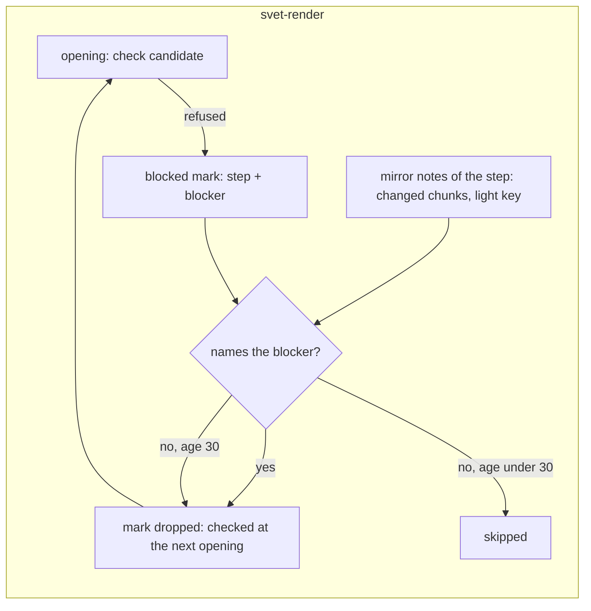

# 0109: A blocked chunk is checked again when its blocker clears: the start on a streamed world

> **Status:** draft (2026-11-26, architect; awaits the owner's go). Phases 1 to 3 do not depend on the open owner question; Phase 5 exists only under one of its answers.
> **Created:** 2026-11-26
> **Milestone:** none (a fix in the start-up path; follows Plan 0099, `docs/roadmap.md` M9's bake thread)
> **Related ADRs:** [ADR-0059](../adrs/0059-loading-runs-as-time-sliced-steps-on-the-apps-frame-loop-behind-an-engine-loading-frame.md) (the pre-roll and its start-up budgets; not changed unless the owner picks the bound, and then by a new ADR, see Phase 5), ADR-0070's amendment (the column rule; not changed), ADR-0046 (the reach rule; not changed)

## TL;DR

The live bake queue skips a chunk it found not ready for 30 steps, whatever happens to what blocked it. At a start on a streamed world the camera's chunk is always blocked at step 1 and is ready about four steps later, so every start waits about 25 steps for nothing, and when the check at step 31 lands in an upload backlog it waits 30 more, once or twice (26 to 45 s on lavapipe, 25 s on the RTX host in one run of five). This plan makes the queue check a blocked chunk again at the first opening after its blocker clears, with the 30 steps kept as the longest it goes unchecked. First observable: the switched outdoor run's pre-roll ends within a few steps of the camera's chunk becoming bakeable, in every run, where it reads 32, 62 or 95 steps today.

## Context & problem

Read in [Plan 0106](done/0106-no-gate-test-passes-by-a-clock-the-red-dig-test-stepped-by-count-the-sweep-and-a-gate-script.md), Rulings 3 to 5, from its Phases 10 and 11 (`docs/plans/logs/0106.md`). What is established there, and by what:

- **From the code:** a candidate refused by `bakeable` or `lights_ready_near` is stamped with the step and skipped until `QUEUE_RECHECK` (30) steps have passed (`bake/queue/open.rs`, `list.rs`, `mod.rs`); the stamp leaves early only when the chunk leaves the mirror, its own prepared masks arrive or an edit box touches it. A change in its reach drops its cached reach verdict and not the stamp.
- **From the rows:** in all eight traced tip runs and both runs at `c87bf7a6` the camera's chunk is bakeable 17 to 27 steps before the check at 31 opens it; the long pre-rolls are that check, and the next, failing on a chunk waiting to upload in a column over the reach footprint.
- **Derived, not measured in a window:** a start pays the wait on every adapter (Plan 0106, "What a start pays today").

The owner's standing complaint is the wait for light at a start (2026-11-20). The constant is a count of steps written for frames of a few milliseconds; a pre-roll step on a streamed start takes 0.1 to 0.3 s.

Two things this plan does **not** assume. Which chunk held a column at the failed checks is unnamed and does not matter to the fix. Why a streamed start's lockstep step costs about three times as much since `e1628197` (65 ms against 152 to 303 ms a step on lavapipe) is unread: Phase 3 reads it and fixes nothing.

**Open, the owner's (a stability question, not decided here):** when the camera's chunk cannot bake at a start because its surroundings are still streaming in, does the first frame **wait for it**, with the wait cut to the least the stream allows (arm A), or does start-up **end on a bound** and show the frame with that chunk's light still landing in view (arm B)? Phases 1 to 3 are the wait cut to its least and serve both arms. Phase 4 is where the owner looks and answers. Phase 5 is arm B and is written only if he picks it.

## Decision

A blocked mark records what blocked it, and the candidate is checked again at the first opening after that blocker's state changes; the age of 30 steps stays as the longest a blocked candidate goes unchecked. The opening's count of checks a step is unchanged.

Rejected:
- **A smaller `QUEUE_RECHECK`.** Still an age: a check that misses by one step waits the whole of it again, and the constant guards the check budget for the candidates behind (the comment at the opening's walk).
- **Checking every blocked candidate at every opening.** At a streamed world's edge thousands of candidates are blocked; the nearest would spend every check every step and the ready ones behind them would never be reached.
- **Dropping the stamp on any mirror change within the reach.** While a world streams in, some chunk in a near candidate's reach changes at almost every step: this is the previous option for the near candidates.
- **Raising the sync's budget in the pre-roll, or baking under a column with an upload pending.** The first moves the backlog, not the wait (the short mode has no backlog and waits 25 steps); the second is ADR-0070's amendment reversed.
- **A special case for the pre-roll's near chunks.** The live queue has the same wait at a streamed edge in flight; one rule for both.

No ADR: the rule replaces a constant's use with the event the constant stood in for, and the rejected options above are recorded here. An ADR is owed only if the owner picks arm B (it changes ADR-0059's rule for what the first frame waits for).

## Architecture diagram



## Implementation phases

One dev brief a phase. Every GPU run alone under the exclusive perf lock, its load1 logged, projected from its first stage's stamp and stopped past 5 minutes; a phase holds the lock under 15 minutes in all. No scene, source, flag or assertion of an existing test is changed to make a bar.

### Phase 1: a blocked chunk is checked again when its blocker clears
- **Owner skill:** dev
- **What:** The stamp in `BakeQueue::blocked` carries its blocker: the first chunk of the reach found waiting to upload or not resident full (`reach_by` already stops there), or the first chunk that holds a footprint column from final (`column_final`'s first failing chunk), or the lights. The step drops the stamp of every candidate whose blocker the step's mirror notes name as changed (a chunk blocker), or when the light key changed (a lights blocker), so the next opening checks it; a check that finds another blocker stamps it again with that one. `QUEUE_RECHECK` stays as the age at which a stamp is dropped with no event. The count of checks an opening makes (`QUEUE_CHECKS`, `QUEUE_CHECKS_UNSLICED`) and the walk's order are unchanged. The books' copy of the blocked set (`queue/books.rs`) keeps its meaning (a set of chunks). The shape of the index from blocker to candidates is the dev's.
- **Files touched:** `crates/svet-render/src/bake/queue/{mod,open,list,step,reach,message,books}.rs`, `crates/svet-render/src/gpu_world/columns.rs` (only if the first failing chunk needs a reading form of `column_is_final`), `crates/svet-render/src/bake/queue/tests.rs`, `docs/plans/logs/0109.md`.
- **Done when:** Four tests beside `a_chunk_absent_high_in_a_column_holds_the_bake` (`queue/tests.rs`, on that rig and in its tier; each under 1 s, stated with its wall in the log), each stepping the queue by count:
  (a) a candidate whose reach is ready and whose only blocker is one chunk waiting to upload in a footprint column **outside its reach** is refused at step 1; the chunk uploads before step `k` for `k` = 3 and `k` = 17; the candidate's job is opened by the opening of step `k`, not at step 31.
  (b) two blockers: the first clears at step 3 and the candidate is checked at step 3, refused and stamped with the second; no job; the second clears at step 9 and the job opens at step 9.
  (c) no event: with the blocker unchanged through steps 2 to 30 the candidate is checked at no opening before step 31 (`QueueStats::reach_checks` and the refusals counted do not move for it) and is checked at step 31.
  (d) the check budget: with more blocked candidates than an opening's checks and one ready candidate behind them in the order, an event that clears one blocker leaves the ready candidate opened no later than it is before this phase (the step is asserted equal to the step read on the base, stated in the test).
  Then the reading that the rule reaches the run: Plan 0106 Phase 11's command line (`--headless --adapter llvmpipe --source showcase --frames 3 --switch-at 0 --render 64x36 --near 0 --coarse 0 --loading-screen on`) eight times on lavapipe; the log holds each run's `pre-roll:` line, the full chunks streamed at its end, and whether the camera's chunk's block is provisional at frame 0. **Bar:** no run's pre-roll is over 31 steps (the least any run reads today is 32), and the eight step counts are given as they fall with their spread; a run over 31 is logged with its `bake queue:` line and is a stop. The quick tier, `--binaries` for the queue's gpu binaries the dev names, clippy, fmt, the check scripts.
- **Stops (report, change nothing to pass):** the mirror's notes not naming a chunk whose pending state changed (the event the rule needs is then missing: report what the notes carry); test (d) moving the ready candidate later; any golden or pinned count elsewhere in the gate moving (name the test and both values: a start that opens the camera's chunk 25 steps sooner can move what a later frame reads, and that is the architect's to rule, not a bar to re-bless).

### Phase 2: the switched start before and after, on both adapters
- **Owner skill:** dev
- **What:** A reading on the tree Phase 1 leaves, no code change: the same command line five times on the RTX adapter (without `--adapter`) and, for the default start a window makes, `--source` the outdoor world started directly with the default near shell and coarse pass, headless, three times on each adapter. Per run: the `pre-roll:` and `bake queue:` lines, the steps, chunks baked and ms, the count of near chunks stamped blocked at step 1 and the step each was opened (a local print, **not committed**), and the chunks provisional at frame 0 with the catch-ups queued in the first 120 frames.
- **Files touched:** `docs/plans/logs/0109.md`.
- **Done when:** the log holds the runs beside Plan 0106 Phase 11's rows for the same command line (32 and 95 steps on the RTX, 32 to 97 on lavapipe), one sentence on whether any run still waits on an age of 30, and one on what the first frames show that they did not before (provisional blocks re-baked in view, or none), as counts. A run that still reads over 31 steps is reported with its trace and nothing is changed.

### Phase 3: where the lockstep step's time went since the bake thread's merge (a reading)
- **Owner skill:** dev
- **What:** The switched run's pre-roll at the tip and on a worktree at `c87bf7a6` (its own target directory, built outside the lock), two runs each on lavapipe, with a local print, **not committed**, of each pre-roll step's parts: the streamer's update and poll, `apply_events`, `take_prepared`, the sync (its `SyncStats` stages and chunks), the mirror's notes, the queue step's own stages (`StepStages`), and the chunks that arrived that step. At most two builds.
- **Files touched:** `docs/plans/logs/0109.md`.
- **Done when:** the log holds, per tree, the median of each part over the steps before the first job opens and the part or parts that hold the growth from about 65 ms to 150 to 300 ms a step, each as ms a step and ms a chunk arrived; or the statement that the parts printed do not hold it. Nothing is fixed: a part named goes to the architect, who routes it (Plan 0107 reads the sync and may already own it).
- **Stops:** the print not applying at `c87bf7a6` without more than print lines changing (read the tip alone and say so).

### Phase 4: the owner looks at the start and answers
- **Owner skill:** human
- **What:** On Linux, with Phase 2's rows in hand and in the same sitting as [Plan 0108](0108-the-start-up-readings-a-shorter-pre-roll-and-the-cold-pipelines-split.md) Phase 2 if that lane has reached it: the outdoor world started in a window on the tree Phase 1 leaves. The owner answers the open question: the first frame waits for the camera's chunk (arm A: this plan's dev work is then done), or start-up ends on a bound with that chunk's light landing in view (arm B: Phase 5 is written).
- **Files touched:** none (the architect records the answer as a dated amendment).
- **Done when:** the answer is recorded in this plan. No camera hold and no drained pre-roll in the window run.

### Phase 5: arm B, start-up ends on a bound (written only if the owner picks it)
- **Owner skill:** dev
- **What:** Not written. If the owner picks arm B the architect writes it with its ADR (what the first frame waits for, against ADR-0059) from Phase 2's rows: the bound's unit (steps, not wall time, after Plan 0106's Ruling 1), what the frame shows for a near chunk with no block, and the image bar that defends "no flicker" on it. Under arm A this phase is struck.
- **Files touched:** named then.
- **Done when:** stated then.

### Phase 6: the switch test's tier and `RUN_BOUND`
- **Owner skill:** dev
- **What:** What Plan 0106 reserved as its Phase 12, on the tree this plan leaves (after Phase 1 under arm A, after Phase 5 under arm B). `a_source_switch_shows_the_loading_frames_before_the_new_world` (`gpu_loading`) by name five times alone on lavapipe; then ten loaded runs of a `gpu_shutdown` child, and `RUN_BOUND` resized by the rule Plan 0106 Phase 3 used for its kill guards.
- **Files touched:** `apps/flythrough/tests/gpu_shutdown.rs` (the constant and its comment), `apps/flythrough/tests/gpu_loading.rs` (the soak mark, only under the second outcome below), `docs/nfr/07-startup-and-build.md` (the test's listed time), `scripts/test-clocks-allow.txt` (the guard's row, if its ratio changes), `docs/plans/logs/0109.md`.
- **Done when:** the log holds the five walls and the ten child walls with their loads. Tier, by Plan 0106's Ruling 3: at or under 20 s alone in all five, the test stays in the gate under `docs/nfr/07-startup-and-build.md`'s exception with its listed time corrected to the median; over that in any run, the five walls go to the architect with each run's `pre-roll:` line and the test is **not** marked by the dev. `RUN_BOUND` is set from the slowest of the ten loaded child runs by that rule, with the ratio in its comment; the quick tier, clippy, fmt, the check scripts.

## Data shapes

```rust
// illustrative: what a blocked mark holds
enum Blocker {
    Chunk([i32; 3]), // in the reach or in a footprint column: waiting to upload, or not held full
    Lights,          // a light range near the candidate not current
}
struct Blocked { at: u64, by: Blocker }
```

## Budgets

- **The frame** (`docs/nfr.md`, the bake queue's step): the rule adds one lookup a changed chunk a step against the index of blockers, and no walk. Phase 1's log states the queue step's `S_FORGET` stage (or the stage the dev puts the drop in) before and after on the switched run, as a reading on lavapipe at the dev reference; a figure without that reading is a guess.
- **Start-up** (`docs/nfr.md` section 7, `docs/nfr/07-startup-and-build.md`): the switch test's listed time, corrected at Phase 6. The pre-roll's seconds on a streamed start are Plan 0108's readings.
- **Memory:** one blocker a blocked candidate (16 bytes) and one index entry; bounded by the pool of candidates.

## Risks & open questions

- **Earlier is not the same picture.** A camera chunk opened at step 5 bakes with a fifth of the world streamed that it has at step 31; under `column_wait` off its block is provisional where a column is not final, and the catch-up bakes it again after the first frame. Today's starts already end with provisional blocks (402 of 402 in a long run's line), so this is no change in kind, but it can be a change in what is seen in the first seconds. Phase 2 counts it and Phase 4 is where the owner sees it. It is part of the open question, not decided here.
- **The live queue changes too**, not only the pre-roll: a chunk at a streamed edge in flight is opened when its last neighbour uploads instead of up to 30 frames later. Light lands sooner; the check budget is defended by test (d).
- **A blocker that flaps** (a chunk re-uploaded every step, a streamed edge under a moving camera) rechecks its candidates every step. Each recheck is one of the opening's bounded checks; the stop in Phase 1 (d) covers the order, and the log states the checks an opening spends on rechecks in the switched run.
- **The step's threefold cost is unattributed** (Phase 3). If it is the shadow's notes, the fix belongs to the bake thread's follow-ups, not here.
- **Open, the owner's:** the question above.

## What this plan does NOT do

- Change the column rule, the reach rule, the sync's budget or `column_wait`'s default.
- Fix the step's cost (Phase 3 reads it; routed by the architect).
- Change the pre-roll's box or cap, or step headless runs by count by default (`docs/backlog.md`).
- Add a setting: the rule has no off arm (the age remains inside it).
- Any scene, source or assertion changed for a check; any missed bar restated.

## Implementation log

> Written by `dev`: one row per phase as its commit lands, then the close block. Readings, run
> counts and attempts go to `docs/plans/logs/0109.md`.

| phase | owner | state | commit |
|---|---|---|---|

### Notes

### Close triggers

## Followups
