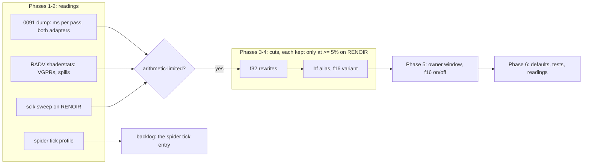

# 0110: The math hot paths, measured then cut: shader math and f16 by adapter

> **Status:** draft
> **Created:** 2026-11-27
> **Milestone:** M7 in `docs/roadmap.md` (tooling; the profiler this plan reads through is Plan 0091's)
> **Related ADRs:** [ADR-0088](../adrs/0088-half-precision-shader-math-from-one-source-built-per-adapter.md)
> (proposed: f16 from one source, built per adapter); reads through
> [ADR-0077](../adrs/0077-frame-profiling-through-the-profiling-facade-with-puffin-behind-an-app-feature.md)
> (the profiler)

## TL;DR

This plan cuts arithmetic only where a reading has shown that arithmetic is the cost. It
starts after Plan 0091 closes (owner, 2026-11-27), and its instrument is 0091's dump and GPU
lane. Phase 1 ranks every GPU pass by milliseconds on both adapters, next to each pipeline's
register count and spills, and profiles the 64-spider mover tick. Phase 2 is the owner's clock
sweep on the Radeon. It lowers the shader clock while leaving memory alone. A pass whose time
grows with the shader clock is limited by arithmetic, and only those passes are edited.

The cuts come in two forms:
- **`f32` rewrites:** constant `pow` becomes multiplies, `1 / length` becomes `inverseSqrt`,
  `length` compares become `dot` compares.
- **`f16` arithmetic behind `SHADER_F16`:** one source built per adapter (ADR-0088), a render
  setting, and the owner's eye on banding and flicker.

The deterministic crates' integer square root (`svet_sim::body::isqrt`) is left alone (owner,
2026-11-27): it is exact and deterministic, and the tick's likely costs are not arithmetic. The
spider tick is still profiled in Phase 1, as a reading for the backlog.

A change is kept only if it saves at least 5 % of its pass or tick on the Radeon RENOIR
(owner, 2026-11-27). Otherwise it is reverted and its reading recorded. The first thing the
reader sees is a table in `docs/plans/logs/0110.md`. It lists each pass's milliseconds on
both adapters, its VGPRs and spills, and its clock sensitivity. The table names the passes the
later phases may touch.

## Context & problem

This plan grew out of a 2026-11-27 conversation: could fast-math tricks of the Quake III kind
speed up heavy calculations? The answer depends on where the time goes.

- **The bit-level inverse square root itself is no use on the GPU.** `inverseSqrt`, `exp2` and
  the trigonometric functions are native single instructions. A grep of
  `crates/svet-render/src/shaders` on 2026-11-27 found the heavy calls in the dozens (`sqrt`,
  `exp`, `pow`, `normalize`, `length`) and `inverseSqrt` only a handful of times. Count them
  again at Phase 1 rather than trusting these numbers.
- **The ray march is likely limited by memory, not arithmetic.** This is a guess, not a
  reading. `docs/nfr.md` section 1 budgets the Portable class by storage reads per ray. If the
  guess holds for a pass, rewriting its arithmetic saves nothing, which is why the clock sweep
  comes first.
- **The deterministic crates already use the Quake idea.** `svet_sim::body::isqrt`
  (`crates/svet-sim/src/body.rs`) seeds Newton's method from the bit length and refines it in
  integers. Each step divides `u128` by `u128`, which x86-64 does with a library call, not an
  instruction. `isqrt` has callers in `svet-sim` (sweeps, the controller, arcs), `svet-entity`
  (model bounds, quaternions) and `svet-world` (shapes).
- **The one CPU figure already read is the spider tick.** Plan 0079 read 64 spiders' movers at
  2.8 ms a tick on the showcase, against a guess of 1.5 ms. The backlog entry ("The spider's
  mover tick costs twice the guess") lists suspects, and none of them is attributed yet.
  Arithmetic (`solid_gradient` at 0.92 µs a call, the sweeps' roots) is one suspect among
  allocation and dwell.

Figures touched: `docs/nfr.md` section 2 (the Floor split's primary rays, lighting, denoise and
upscale lines, and the Portable line), and section 8 (the movers' tick).

Constraints:
- **Determinism (`references/best-practices.md`):** no `f32` anywhere between input and output
  in the deterministic crates. That rules out seeding `isqrt` from `f64::sqrt`, even though IEEE
  754 rounds `sqrt` correctly. Approximate instructions (`rsqrtss`, `rcpss`) are ruled out too,
  because Intel and AMD return different bits.
- **Stable image first (owner, 2026-11-03):** `f16` must not band or flicker.

## Decision

The plan runs in three steps.

1. **Read first.** Per-pass milliseconds come from Plan 0091's dump on both adapters, register
   counts from RADV's `shaderstats`, and the clock sweep separates arithmetic from memory.
2. **Edit only what the readings attribute.** `f32` rewrites go in first. Then `f16` goes into
   the same passes through the `hf` alias (ADR-0088), and the owner's window decides its
   default. The integer root is not touched.
3. **Apply one keep bar to every change:** at least 5 % of the pass or tick on the Radeon
   RENOIR, and more than the spread between runs.

Rejected options:
- **The Quake bit hack in WGSL.** It loses to the native `inverseSqrt` on every adapter.
- **Starting before Plan 0091.** The owner chose to wait for the profiler, for cleaner
  readings.
- **Keeping any measured win on the RTX.** `docs/nfr.md` says not to judge against the dev box.
- **`f16` as storage only.** It saves bandwidth, not arithmetic (ADR-0088, Alternative B).
- **Requiring `SHADER_F16`.** That would shut out unknown adapters (ADR-0088, Alternative A).
- **Any change to `isqrt`** (a `u64` fast path, or an `f64` seed, which the float ban rules
  out anyway). It is exact and deterministic, and the tick's suspects are elsewhere (owner,
  2026-11-27).

## Architecture diagram



## Implementation phases

Every reading runs on a quiet box: load1 under 2, no lane building, under the perf lock. Each
figure is the median of 5 runs. The spread is the gap between the fastest and slowest of the 5
runs of the unchanged tree. A change is **kept** only if its saving on the Radeon RENOIR is at
least 5 % of the pass or tick it touches and also larger than that spread. Otherwise it is
reverted and its reading goes in the log. RTX readings are taken beside it and labelled "dev
reference".

### Phase 1: The readings table: passes by ms, registers, the tick's profile

- **Owner skill:** dev
- **What:** Fill `docs/plans/logs/0110.md` with one row per GPU pass and one block for the
  spider tick. Add the clock-sweep script that Phase 2 runs.
- **Readings:**
  - Plan 0091's `--profiler-dump` on the tester's four benchmark paths, Floor profile, both
    adapters. For each pass, its median ms and its share of the frame.
  - `RADV_DEBUG=shaderstats` on the RENOIR. For each pipeline, VGPRs, SGPRs, spills and waves
    per SIMD.
  - A fresh grep count of `pow`, `sqrt`, `exp`, `length`, `normalize` and `inverseSqrt` per
    shader file.
  - 64 spiders on the showcase, with the wander on, as Plan 0079's Phase 4 ran them (its
    readings log names the run). The 0091 scopes inside `Walkers::tick` give the tick's split.
    `samply` gives the split below the scopes. The readings go to the backlog entry ("The
    spider's mover tick costs twice the guess"); this plan changes nothing in the tick.
- **Files touched:** `docs/plans/logs/0110.md`, `scripts/gpu-clock-sweep.sh` (new, Linux, RADV
  only), and scope lines inside `Walkers::tick` (`apps/flythrough/src/`) if 0091 left it as one
  scope.
- **The clock-sweep script:**
  - It uses the `amdgpu` sysfs `power_dpm_force_performance_level = manual` and `pp_dpm_sclk`
    to pin the shader clock at its top level, then at about 75 % and about 50 % of it. Memory
    and fabric clocks stay at their defaults.
  - At each level it runs the same dump (5 runs) and restores `auto` on exit, including on
    error, via a `trap`.
  - It prints one table: pass, ms at each level, and the sensitivity `s`.
- **Done when:**
  - The log holds the pass table for both adapters, the shaderstats table and the tick's
    profile, each with machine, commit and load.
  - `scripts/gpu-clock-sweep.sh --dry-run` prints the sysfs writes it would make and the runs it
    would start, without root.
  - No engine code changed beyond scope lines.
  - No test is added in this phase (readings only).

### Phase 2: The owner's clock sweep on the Radeon

- **Owner skill:** human
- **What:** The owner runs `sudo scripts/gpu-clock-sweep.sh` once on a quiet box (about 10 to
  15 minutes; it needs root to write sysfs). The dev or orchestrator pings when it is ready.
- **How `s` is read:** for each pass, `s = (t_low / t_top - 1) / (f_top / f_low - 1)`.
  - A pass limited purely by arithmetic scales with `1 / f`, so `s = 1`. Example: at 75 % clock
    it takes 1.333 times as long, and `(1.333 - 1) / (1.333 - 1) = 1`.
  - A pass limited purely by memory does not move, so `s = 0`.
  - A pass is **arithmetic-limited** when `s >= 0.5` at both lower levels.
- **Done when:** The sweep's table is in `docs/plans/logs/0110.md`, with the clock levels the
  sysfs actually took, and `auto` was restored (the script reads it back and prints it). The
  arithmetic-limited passes are listed there. If none qualify, Phases 3 and 4 make no shader
  change and record why. The list is the contract for those phases.

### Phase 3: f32 rewrites in the arithmetic-limited passes

- **Owner skill:** dev
- **What:** In the passes Phase 2 named, and only there, apply these rewrites:
  - `pow(x, c)` with a small integer or half-integer constant `c` becomes multiplies, or
    multiplies and one `sqrt`.
  - `1.0 / length(v)` becomes `inverseSqrt(dot(v, v))`.
  - `length(a) < r` becomes `dot(a, a) < r * r` (only where `r >= 0`).
  - `normalize(v)` beside a `length(v)` of the same `v` is computed once.
  - `exp(k * x)` with a constant `k` becomes `exp2(k' * x)`, where `k' = k * log2(e)` is folded
    as a `const`.
  - Loop-invariant terms are hoisted out of the march loop.
  Each rewrite group is one commit inside the phase, read under the keep bar, and reverted if it
  misses.
- **Files touched:** the arithmetic-limited passes' files under
  `crates/svet-render/src/shaders/`, and `docs/plans/logs/0110.md`.
- **Done when:**
  - Every golden image of the touched passes passes at its existing tolerance on lavapipe, with
    no re-bless. If a rewrite needs a re-bless, it is reverted, unless the image difference is
    under the golden's own tolerance and the log says so.
  - The log holds each group's before and after ms on the RENOIR, the spread, and the verdict.
  - Expected wall time: the touched passes' existing `gpu_*` binaries, which the phase names
    when Phase 2 has named the passes.

### Phase 4: The `hf` alias and the f16 variant (exploration)

- **Owner skill:** dev
- **What:** Implement ADR-0088.
  - **Device request:** `svet-app`'s device request and `test_support` ask for `SHADER_F16`
    when `adapter.features()` has it.
  - **Render setting:** `RenderSettings` gains `shader_f16: bool`, default off until Phase 5.
    The fly-through shows it in the menu, and its mode shows in the window.
  - **Compose:** `frame/compose.rs` emits `enable f16;` and `alias hf = f16;` before the
    prelude when the device has the feature and the setting is on, and `alias hf = f32;`
    otherwise.
  - **Shaders:** in the arithmetic-limited passes only, locals that hold bounded values (unit
    vectors, weights in [0, 1], albedo, colours after the exposure scale) become `hf`. Positions,
    distances, ray `t`, depths, accumulation, history and exposure luminance stay `f32`, as
    ADR-0088 rules.
  - **Restart:** a toggle of the setting rebuilds the affected pipelines, or marks the setting
    as needing a restart in the profile row, whichever the existing settings machinery gives.
  - **Exploration:** this phase writes no new golden image.
- **Files touched:** `crates/svet-app/src/shell.rs`, `crates/svet-render/src/test_support.rs`,
  `crates/svet-render/src/frame/compose.rs`, the render settings module, the passes' WGSL, the
  fly-through's menu and HUD rows, `docs/flythrough.md`, and `docs/plans/logs/0110.md`.
- **Done when:**
  - **Compose test (CPU, under 0.1 s):** the composed source of a pass begins with
    `enable f16;` exactly when both the feature and the setting are present, and declares
    `alias hf = f32;` otherwise. Every hot module parses through naga under both aliases.
  - **Readings, not gates:** with `shader_f16` on and off, the log holds each arithmetic-limited
    pass's ms on the RENOIR and the RTX, its VGPRs, and the keep verdict per pass. A pass that
    misses goes back to `f32` types in the source, so it runs `f32` on every adapter.
  - **Still images:** stills of the cave and forest poses under both settings are in the log for
    the owner.

### Phase 5: The owner's window: f16 on and off

- **Owner skill:** human
- **What:** On Linux, with the Floor profile, the owner flies a slow pan in the forest and the
  cave and digs once. They toggle `shader_f16` from the menu. The question: is there banding,
  flicker or a colour shift with it on? The answer picks the default (on, off, or on in named
  profiles only). The window shows the mode, and stdout stays visible.
- **Done when:** The owner's answer and the default it picks are recorded in the plan's log.

### Phase 6: Defaults, image tests against the pick, the budget readings

- **Owner skill:** dev
- **What:** Set `shader_f16`'s default per profile from Phase 5.
- **Files touched:** the render settings and profiles, `crates/svet-render/tests/gpu_precision.rs`
  (new), `docs/nfr.md` and `docs/nfr/02-frame-budget.md`, and `docs/plans/logs/0110.md`.
- **Done when:**
  - **Image test:** `gpu_precision` renders the cave pose at 256 x 144 on lavapipe under
    `shader_f16` on and off, and asserts an SSIM of at least 0.98 between the two. It also
    asserts that every pixel's luminance differs by at most 2/255 after tone mapping. Expected
    wall time is about 5 s on lavapipe, so it runs in the gate. Measure the real image
    difference first, and set the floor at the measured value minus a margin, which the log
    records, if 0.98 is looser.
  - **Profile test:** a CPU test reads each profile's `shader_f16` row against the pick.
  - **Budget readings:** the final per-pass readings on both adapters are in
    `docs/nfr/02-frame-budget.md`, with machine and commit.

## Data shapes

```rust
// illustrative
pub struct RenderSettings {
    // ...
    /// Build the hot passes with f16 arithmetic where the device has SHADER_F16 (ADR-0088).
    pub shader_f16: bool,
}
```

```wgsl
// illustrative: the head compose.rs emits, f16 variant
enable f16;
alias hf = f16;
// the prelude's consts follow
```

## Budgets

- **`docs/nfr.md` section 2, the Floor split:**
  - **Which lines move:** primary rays 3.0, lighting 4.0, denoise 2.0 and upscale 3.0 ms
    (whichever passes Phase 2 names), plus the Portable 33.3 ms line.
  - **Expected effect:** zero on the passes limited by memory. On the arithmetic-limited passes
    of the RENOIR it is a guess: 5 to 20 % from the `f32` rewrites and `f16` together. Nothing
    is claimed for the RTX.
  - **How the close measures it:** Plan 0091's dump on the four benchmark paths, Floor and
    Portable, both adapters, a quiet box, medians of 5.
- **`docs/nfr.md` section 8, the movers' tick:** read again at Phase 1 as a reading only (2.8 ms
  at 64 spiders on the showcase in Plan 0079); no change expected.
- **Startup (`docs/nfr.md` section 7):** one variant is compiled per run, so the pipeline count
  is unchanged. The close reads the cold start on the RTX against Plan 0108's figure to confirm
  that `enable f16;` adds no compile cost to speak of.

## Risks & open questions

- **Nothing may qualify.** If no pass reaches `s >= 0.5`, Phases 3 and 4 change nothing. That
  is a valid outcome, and the plan then closes as readings. The readings still
  serve 0091's users and the backlog.
- **The clock sweep may not hold.** The RENOIR's firmware may ignore a manual level, or the
  memory clock may follow the shader clock. The script reads back the clocks that actually
  applied and the log records them. If the sweep cannot separate the two clocks, the fallback is
  Radeon GPU Profiler captures (`MESA_VK_TRACE=rgp`) of the top three passes, read by the owner.
  That would be an amendment, not a silent switch.
- **Determinism:** nothing in the deterministic crates changes. The plan edits WGSL and the
  render settings only.
- **GPU features:** DX12's `SHADER_F16` depends on the driver's shader model. Windows is checked
  once in a while (owner, 2026-11-15), not in this plan. The `f32` alias is the fallback on any
  device without the feature.
- **Image stability:** `f16` in a value that feeds history would flicker. ADR-0088's rule keeps
  history and accumulation in `f32`, the close review greps every `hf` use against that rule,
  and Phase 5 is the eye's check.
- **Plan 0092 (hot reload):** if it lands first, the rebuilt pipelines must go through the same
  compose head. Its source path is `compose`, so they do by construction. The review checks it.

## What this plan does NOT do

- **No storage repacking** (`f16` buffers or textures) for memory-limited passes. If the
  readings name one, it goes to the backlog with its figure.
- **No algorithmic change** to the march (empty-space skipping, brick order) or to the bake. That
  is not arithmetic, and it is not this plan's.
- **No fix for the spider tick's allocation or dwell suspects.** Their readings go to the
  backlog entry ("The spider's mover tick costs twice the guess").
- **No Quake-style bit hack anywhere.**
- **No Windows reading.**
- **No change to the floor's required features.**

## Implementation log

> Written by `dev`: one row per phase as its commit lands, then the close block. Readings,
> attempts and resume notes go to `docs/plans/logs/0110.md`.

| phase | owner | state | commit |
|---|---|---|---|
| 1: The readings table | dev | not started | |
| 2: The owner's clock sweep | human | not started | |
| 3: f32 rewrites | dev | not started | |
| 4: The hf alias and the f16 variant | dev | not started | |
| 5: The owner's window, f16 on and off | human | not started | |
| 6: Defaults, image tests, readings | dev | not started | |

### Notes

### Close triggers

## Followups
