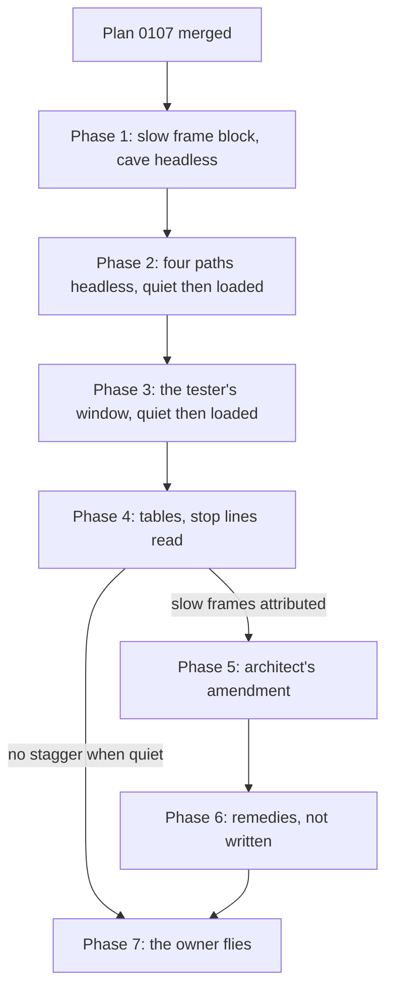

# 0111: The stagger in flight on streamed scenes: read quiet after Plan 0107, then cut

> **Status:** in-progress (2026-11-27: Phases 1 to 5 landed; the owner answered Phase 5's questions, all recommended; 6a next). Was: approved (2026-11-27, owner: "go, recommended": it starts after Plan 0107 merges and does not wait for Plan 0091; he takes Phase 3's window runs in a ten-minute quiet slot; if stop line 1 fires a tester README note is enough). Was: draft (2026-11-27; the owner's go on drafting: "go both"; he approves the draft
> before any dev work). Drafted with no interview from the owner's tester report and Plan 0107's
> Phase 1 reading; the guesses and the questions left are under "Risks & open questions", each
> with a recommended option.
> **Lane order:** starts after [Plan 0107](done/0107-the-mirrors-slot-image-packed-on-the-stream-workers.md)
> merges, so it measures only what that plan leaves.
> **Created:** 2026-11-27
> **Milestone:** cross-cutting: the streaming lines of `docs/nfr.md` sections 2 and 5 (M10's
> performance work in [`docs/roadmap.md`](../roadmap.md) is the nearest home)
> **Related ADRs:** none new. No mechanism is chosen here, so there is no rejected alternative
> to record; the amendment that writes the remedies writes an ADR if one of them has one.
> [ADR-0056](../adrs/0056-the-mirrors-slot-image-is-packed-on-the-stream-workers-and-the-render-thread-only-allocates-and-copies.md),
> [ADR-0017](../adrs/0017-mirror-cpu-work-bounded-in-the-frame-loop-narrowing-on-stream-workers.md),
> [ADR-0022](../adrs/0022-mirror-uploads-through-a-staging-belt-and-copy-commands.md) and
> [ADR-0083](../adrs/0083-the-live-bake-queue-runs-on-a-bake-thread-the-render-thread-applies-its-write-lists-and-issues-its-submits.md)
> own the parts a remedy may touch.

## TL;DR

The owner flew the released v0.79.1 tester archive and said: "there is quite a bit of a stagger
when we were flying". His reports put it on the CPU side of the three streamed scenes, on a
loaded box. Plan 0107 takes part of the mirror's sync off the render thread. This plan reads
what is left, on the tree that holds Plan 0107, on a **quiet** box: the four tester benchmark
paths at the tester's settings, every frame over 33 ms attributed to a stage, with a loaded
re-run beside it so the load's share is a number. No remedy is designed now: the architect
reads those tables and writes the remedy phases as an amendment. The plan can end at the
reading (the quiet runs show no stagger: it was the box). The owner closes it by flying the same
paths. The first thing to see is a `slow frame:` block at the end of a headless cave run and a
table in `docs/plans/logs/0111.md` that says which stage each slow frame went to.

## Context & problem

**The complaint and its report** (the backlog's "The v0.79.1 tester archive on the owner's
box", [`docs/backlog.md`](../backlog.md); the raw folder is kept outside the repo in the main
checkout's `live/owner-notes/2026-11-27-tester-0.79.1/`). Commit `1572f61f`, RTX 3080 Laptop,
Ryzen 9 5900HS (16 logical CPUs), Wayland, 2560 x 1440 output, FSR 2 at 1.5, Floor, the
tester's window (`pacing: free`, present mode `Immediate`), the bake thread on, 8 stream
workers. **The box was loaded** (load1 about 15 to 45), so every figure below is indicative.

| ms, or frames | cave | castle | outdoor | showcase (no streaming) |
|---|---|---|---|---|
| wall p50 / p99 / max (`frames:`) | 14.6 / 114.2 / 231 | 16.3 / 127.7 / 501 | 15.7 / 57.7 / 242 | 13.6 / 22.2 / 64 |
| frame CPU p99 / max | 110.4 / 206 | 123.3 / 477 | 55.9 / 232 | 14.9 / 63 |
| `update + poll + sync` p99 / max | 61.0 / 105.8 | 79.5 / 325.3 | 31.4 / 156.5 | 0.17 / 3.0 |
| the sync alone, max (`run.json`) | 102.6 | 144.4 | 156.2 | none |
| bake thread render laps, `total` p99 / max | 47.4 / 124 | 38.0 / 143 | 19.0 / 143 | 6.0 / 22 |
| frames whose laps took over 4.0 ms, of all | 278 of 1010 | 453 of 1429 | 362 of 4039 | 66 of 1930 |
| march GPU p50 / p99 | 8.9 / 14.7 | 9.4 / 16.3 | 13.3 / 24.6 | 10.5 / 17.2 |

`run.json` counts 90 to 132 frames over 33 ms and 17 to 22 over 100 ms a streamed run, and 2
over 33 ms on the showcase.

**What the report already says, and what it cannot say:**

- The GPU is steady; the tail is inside the frame's CPU span. Wall p99 less frame CPU p99 is
  1.8 to 4.3 ms on the streamed scenes, so the tail is not the present or the compositor.
- The sync is one tail, and Plan 0107 takes part of it. Its Phase 1 (that lane's
  `docs/plans/logs/0107.md`) reads these reports as: `size` and the emitter scan leave whole,
  13 to 79 % of `alloc` leaves (20 to 75 % of the slowest syncs), `copy`, `select`, the lock,
  `poll` and `light place` stay (its Phase 6 cuts `light place`).
- **There is a second tail Plan 0107 does not touch.** Frame CPU p99 is 1.55 to 1.81 times
  `update + poll + sync`'s. The render thread's laps for the bake thread (`build`, `take`,
  `issue`, `apply`, `collect`, `send`) take over 4.0 ms in 9 to 32 % of frames, with `build`
  the largest lap most often (p99 9.1 to 37.9 ms). The `wait` lap is 0.000 at p50, p99 and max
  in every run: the render thread does not block on the bake thread there.
- **`poll` or `update` holds a third.** The castle's `update + poll + sync` maximum is 325.3 ms
  and its slowest sync 144.4 ms, so one frame spent at least 180 ms outside the sync.
- **The same work cost ten times as much on the owner's box.** The cave's slowest sync packed
  10 445 bricks with `alloc` at 73.5 ms; Plan 0107's own headless reading (load 8 to 14,
  1080p) packed 13 230 bricks with `alloc` at 7.4 ms. That is preemption, page faults or
  memory pressure, not more work, and no printed line tells them apart.
- **Percentiles of different series do not add.** No line joins one frame's wall time to that
  frame's stages, the acquire and the present are outside the CPU span, and no timer brackets
  `configure_frame`, the encode or the submit
  ([the review of 2026-11-26](../reviews/2026-11-26-work-off-the-render-thread.md), section 1).
  So the report cannot say which stage a given slow frame went to.

**The rule this plan follows** (architect skill; Plan 0047's lesson): a plan that chases a
defect seen on screen measures before it commits to a mechanism. The owner's standing rules
bind it too: stable image first; a loaded reading is not a quiet one; a missed bar goes to an
architect reading before any fix; no run past about 20 minutes under the perf lock; no scene
edited; no camera held in a window run; a frame-pacing complaint is the owner's to close by
eye.

It serves the consumer's streaming requirement (`project-context.md`: a streamed world walked
without hitches) and touches `docs/nfr.md` section 2 (the streaming line, `update + poll +
sync` p99) and section 5.

## Decision

Read first, on the tree with Plan 0107, quiet and loaded, headless and in the tester's window;
attribute each frame over 33.3 ms to a stage; then the architect writes the remedies. The
binary gains one print (a `slow frame:` block at exit) and the timers it needs, with no change
to what a frame does.

Shapes not taken, one sentence each (none is a mechanism, so no ADR): **cutting `copy` and
`select` now from the owner's report** (a loaded reading, and the second tail is larger than
either); **waiting for Plan 0091's profiler** to attribute the frames (it is the better
instrument, but it is not built, and a tester's `log.txt` cannot carry its dump; see owner
question 1); **closing the complaint on a quiet headless run alone** (the owner judges frame
pacing in the window).

## Architecture diagram



## Implementation phases

Each phase ships as its own commit, **one phase a dev brief**, each small enough for a fresh
agent. Every phase carries exactly one `**Owner skill:**`. Phases 1 to 4 are readings:
no gate test passes by a clock, and every time is a printed reading.

**The commands.** The tester's own lines, from the owner's `tester.log`:

- cave: `flythrough --source cave --lamp off --tester --path cave --path-mode bench --render 2560x1440 --profile floor --report DIR`
- showcase: `--source showcase --lamp off --tester --path showcase ...`
- castle: `--castle --lamp off --tester --path castle ...`
- outdoor: `--source outdoor --spawn outside --trees sparse --sun 10,180 --lamp off --tester --path outdoor ...`

Headless, `--tester` is replaced by `--headless --adapter RTX --bake-thread on`, and the banner
must read `bake thread on`. Release build, the exclusive perf lock, a 16 GiB scope, load1
recorded at the start and end of every run.

**Quiet** means load1 at most 2 at a run's start (lane rule 7). A run that starts above it is
labelled loaded and does not count as quiet; the dev asks the orchestrator for a slot with no
lane building and does not wait under the lock.

**Loaded** means 32 single-thread busy loops (two a logical CPU), started 60 s before the run
(load1 is then about 20, inside the owner's 15 to 45) and stopped by PID after it. It is a
stand-in for the owner's builds: it preempts, and it adds no memory or disk pressure. The log
says so beside every loaded row.

**Time.** A run is its load (3 to 15 s in the owner's report) plus its path (about 20 to 75 s
there). The dev projects each hold from its first run; a hold projected past 20 minutes is not
started, and the phase goes back to the architect.

### Phase 1: the `slow frame:` block, and the cave read with it
- **Owner skill:** dev
- **What:** A print at exit, no behaviour change: for every frame whose wall time is over
  33.3 ms, that frame's own stages, joined by frame. Kept in a bounded buffer during the run
  and printed at teardown (the 64 slowest frames, one line each, then one `slow frames:`
  summary over all of them). A line names: the frame's index and path second; wall; the
  acquire; `update`; `poll` with the chunks it applied; the sync and its `select`, `size`,
  `light place`, `note`, `copy`, `alloc`, lock wait and packed bricks; the bake thread's render
  laps (`build`, `take`, `issue`, `apply`, `collect`, `send`, `wait`); the rest of the frame's
  preparation, the encode and the submit; the present; **the rest** (wall less every named
  stage); and, on Linux, the render thread's involuntary context switches and minor and major
  page faults in that frame. The summary gives the count over 33.3 and over 100 ms, and for
  each stage the number of slow frames in which it is the largest and its mean over them, as
  the `bake thread render laps:` line does. New timers go only where none exists: the acquire
  and the present in the shell, and the preparation, encode and submit. No new dependency;
  `run.json` and its schema are unchanged.
  Then one quiet headless cave run with the block read into the log.
- **Files touched:** `crates/svet-app/src/shell.rs`, `apps/flythrough/src/run/frame.rs`,
  `apps/flythrough/src/run/hud_feed.rs`, `apps/flythrough/src/run/queue.rs`,
  `docs/flythrough.md` (the exit lines), `docs/plans/logs/0111.md`.
- **Done when:** A CPU test (`a_slow_frame_line_names_every_stage_and_the_rest`, in the
  fly-through's unit tests, under 1 s, no GPU and no clock: it feeds fixed numbers) shows that
  a frame of 40.0 ms wall with stages summing to 31.5 ms prints `rest 8.500`, that a frame of
  33.3 ms prints no line, and that the summary names the largest stage of each of three made-up
  frames. The headless cave run's log section holds the `frames:` exit line, the `slow
  frames:` summary and the block, with load1, and states the share of slow frames whose `rest`
  is over a fifth of their wall. Wall p50 of that run against the same run on the phase's
  parent commit is stated (the print's cost; a reading, expected within the run-to-run spread).

### Phase 2: the four paths headless, quiet, then loaded
- **Owner skill:** dev
- **What:** No code. Hold A (quiet): the four paths headless. Hold B (loaded): the three
  streamed paths headless under the 32 busy loops. Hold C (quiet): the cave at `--workers 4`
  beside the default 8. One table a hold in the log.
- **Files touched:** `docs/plans/logs/0111.md`.
- **Done when:** The log holds, for each run: load1 at start and end; `run.json`'s
  `over_33ms` and `over_100ms`; wall, frame CPU and `update + poll + sync` p50 / p99 / max;
  the `slow frames:` summary (the largest stage's counts, the `rest`, the context switches and
  page faults over the slow frames); `bake thread render laps:` `total` and `build` p99; chunks
  resident at the path's end. Each quiet row is at load1 at most 2 or is labelled loaded. The
  log states, per streamed path, quiet against loaded: the ratio of `over_33ms`, and which
  stages grew. No conclusion is written.

### Phase 3: the same paths in the tester's window, quiet, then loaded
- **Owner skill:** human
- **What:** Only the owner's desktop shows a window (lane rule 10). The orchestrator's
  live-session runner plays the four benchmark paths through `svet-tester` (a release build of
  the Phase 1 tree), once on a quiet box and the three streamed paths once under the same 32
  busy loops, with stdout visible. The camera follows the path; nothing holds it. The owner
  need not judge anything here, but a word on whether the quiet run staggered is recorded if
  he gives one.
- **Files touched:** none in the repo; the report folders go beside the owner's first one
  under the main checkout's `live/owner-notes/`.
- **Done when:** Seven report folders exist, each with `run.json` and a `log.txt` that holds
  the `slow frame:` block, and the runner's note gives load1 at each run's start.

### Phase 4: the window's tables, and the stop lines read
- **Owner skill:** dev
- **What:** No code. Phase 3's folders into the log as Phase 2's table, beside the owner's
  v0.79.1 figures; then each stop line below read against the tables, as a fact.
- **Files touched:** `docs/plans/logs/0111.md`.
- **Done when:** The log holds the window's table, and for each stop line "fires" or "does
  not fire" with the figures it was read from. The dev stops there.

**The stop lines.** Each is read from the quiet windowed runs unless it says otherwise.

1. **It was the box.** On each streamed path, quiet: `over_100ms` is 0 and `over_33ms` is at
   most 2 (the showcase's count on the owner's loaded box), and the loaded re-run brings back
   tens. Then no remedy is written: the plan goes to Phase 7 on a quiet box, and closes with a
   backlog note on running the tester beside builds.
2. **Not the CPU.** Slow frames remain, and in most of them the acquire, the present and the
   `rest` together are over half the wall. Then the remedies are not render-thread work at
   all, and the amendment starts from the shell and the present path.
3. **Not attributed.** In over a third of the slow frames `rest` is over a fifth of the wall.
   Then the print is short of a stage: the architect names the span to split, and one more
   print phase runs before any remedy.
4. **Plan 0107 moved the wrong part.** The sync's stages Plan 0107 was to remove (`size`,
   `note`) are still the largest stage in any slow frame. That is Plan 0107's finding, routed
   to its close review, not a remedy here.
5. **The hold's time.** A hold projects past 20 minutes from its first run: stop, architect.

### Phase 5: the architect reads the tables and writes the remedies
- **Owner skill:** human
- **What:** A product call on a reading: the architect (in a fresh session, with Phases 1 to
  4's log) writes "Amended (architect, after Phase 4)" into this plan: the remedy phases, each
  for a stage the tables attribute slow frames to, each with its bar on the same runs, in the
  order of slow frames removed; an ADR where a remedy has a rejected alternative; the hitch
  bar for `docs/nfr.md`; and what may run beside the lanes then open. The owner approves the
  amendment before any remedy starts.
- **Files touched:** this plan, `docs/plans/README.md`, perhaps `docs/adrs/`.
- **Done when:** The amendment is approved by the owner, or a stop line has sent the plan to
  Phase 7.

### Phase 6: the remedies (not written)
- **Owner skill:** dev
- **What:** Not written. Phase 5's amendment replaces this phase with its own, one remedy a
  phase. No dev starts it as it stands.
- **Files touched:** not known.
- **Done when:** Set by the amendment. Each remedy re-runs Phase 2's quiet hold and states its
  `over_33ms` and the attributed stage before and after; a remedy that does not move its stage
  is reverted and its reading kept.

### Phase 7: the owner flies the same paths
- **Owner skill:** human
- **What:** The owner runs the tester's four benchmarks on the plan's tip (a release build
  through `svet-tester`), on a quiet box, and flies the streamed scenes by hand as he likes,
  and says whether the stagger is gone. His word closes the complaint; the figures beside it
  are readings.
- **Files touched:** none.
- **Done when:** The owner has said "gone", or has named what he still sees, which goes to an
  architect reading and not to a fix.

## The candidates, as hypotheses

None is chosen. Each names what in the owner's (loaded) report suggests it and what in Phases
1 to 4 would falsify it.

| # | Hypothesis | What suggests it | Falsified if |
|---|---|---|---|
| 1 | The sync's `copy`, `select` and what is left of `alloc`, on the render thread | slowest syncs: `alloc` 73 to 91 ms, `copy` up to 82, `select` up to 33 | quiet, the sync is the largest stage in few slow frames, or its share of their wall is small |
| 2 | The render thread's bake laps, `build` first, then `issue` and `apply` | `total` p99 19 to 47 ms; over 4.0 ms in 9 to 32 % of frames; the showcase reads 6.0 | quiet, `total` p99 is back near Plan 0099's 1.2 to 1.3 ms and no slow frame has a lap as its largest stage |
| 3 | The render thread waits on the bake thread or on a chunk lock | the `build` lap's name; ADR-0083's shared locks | already unlikely: the `wait` lap is 0.000 at max and `lock wait` p99 is 0.04 ms (max 2.0); falsified if both stay so quiet |
| 4 | `poll` applies every finished chunk in one frame, with no cap | the castle's frame with at least 180 ms outside the sync; Plan 0107's reading of `poll` max 18.8 ms | `poll` and `update` are never the largest stage of a slow frame |
| 5 | Allocator and page-fault cost while chunks arrive | the same brick count costing ten times the `alloc` on the owner's box | the slow frames show no page faults over the run's mean, quiet and loaded |
| 6 | The stream workers and the bake's threads take the render thread's cores | 8 workers, the bake thread and its listers beside the render thread on 8 physical cores | quiet, the slow frames carry no involuntary context switch, and `--workers 4` reads the same slow frames a resident chunk |
| 7 | The box's load alone | load1 15 to 45; the lane's reading at load 8 to 14 has `update + poll + sync` p99 at 15 ms against 61 to 79 | stop line 1 does not fire: slow frames remain when quiet |
| 8 | The frame's untimed span: `configure_frame`, the encode, the submit, the HUD | frame CPU p99 well over `update + poll + sync` p99; no timer there | their sum is small in every slow frame |
| 9 | The present, the Wayland frame callback, or the copy between adapters | the complaint is of pacing; the window's surface path is unread on the CPU | wall less frame CPU stays a few ms in the slow frames (it reads 1.8 to 4.3 at p99 already), and the acquire and present are small |
| 10 | The path's own feedback: a bench path runs by wall time, so a slow frame moves the camera further and more chunks arrive in the next | slow frames in runs (`sync:` lines with a p50 of 12 to 40 ms over a second) | slow frames are isolated, not in runs, in the block's frame indices |
| 11 | Uneven frame times under 33 ms read as stagger at 165 Hz with no frame callback | wall p50 14.6 to 16.3 ms with p95 29 to 53 | only the owner's eye in Phase 7 on a quiet box; a figure cannot close it |

## Data shapes

One exit line a slow frame; illustrative, the names are the dev's:

```
slow frame: 539 at 11.2 s, wall 108.4 ms: acquire 0.1, update 0.3, poll 2.1 (41 chunks), sync 102.6 (select 7.5, size 0.0, place 0.7, note 0.0, copy 10.2, alloc 73.5, lock 0.0; 10445 bricks), laps 1.9 (build 0.1, take 0.1, issue 0.9, apply 0.4, collect 0.1, send 0.0, wait 0.0), prepare 0.6, encode 0.3, submit 0.2, present 0.1, rest 0.2; switches 3, faults 1210 minor 0 major
```

## Budgets

- **`docs/nfr.md` section 2, the streaming line** (1.0 ms; `update + poll + sync` p99 at most
  16.6 ms, met at 14.82 ms quiet on the cave bench at 1080p): Phases 2 and 4 re-read it at the
  tester's 2560 x 1440, RTX 3080 Laptop, quiet and loaded. A reading, not a new bar.
- **No line of `docs/nfr.md` counts hitches.** `over_33ms` lives in `run.json` only. A bar
  ("frames over 33 ms a minute in flight, quiet") written now would be a guess; Phase 5's
  amendment proposes it from Phase 4's tables, and the close measures it on the same runs.
- **The print's cost:** a few clock reads and one small record a frame; Phase 1 states the
  cave's wall p50 with and without it.
- The RTX 3080 Laptop is the dev box, not the floor. The RENOIR is not read in Phases 1 to 4
  (the complaint is on the RTX); the amendment names its run for any remedy that moves work
  between threads, because the floor has no idle core.

## Risks & open questions

- **Beside the M10 lanes (Plans 0081 and 0033): Phases 1 to 4 may run beside them.** Their
  code is a print in the fly-through and the shell. The conflict is the box, not the files: a
  quiet reading needs about ten minutes with no lane building, so the orchestrator gives the
  holds a slot. **Phase 6 may not be assumed to run beside them.** The candidates sit in
  `crates/svet-world/src/stream/`, `crates/svet-render/src/gpu_world/` and
  `crates/svet-render/src/bake/link.rs`, which Plan 0033's world and streamer briefs and its
  render brief edit; Plan 0081's march and styled-face work is unlikely to collide. The
  amendment says, per remedy. If Plan 0033's far field merges before Phase 7 the streaming
  load changes, and Phase 2's quiet hold is re-read on the merged tree first.
- **Plan 0107 is the base.** If it stops at its own stop line or closes with a part missed,
  this plan still starts at its merge and reads what the tree does; stop line 4 routes a
  finding back.
- **Plan 0110 (the math hot paths) does not overlap.** Its ground is GPU pass arithmetic and
  the mover tick in `svet-sim`; the benchmark paths run no movers, and the GPU is steady in
  the report. If a slow frame here is attributed to arithmetic on the render thread, it is
  named in the amendment and offered to that plan.
- **Plan 0091 (the frame profiler)** will time the same spans with scopes. If it merges first,
  Phase 1 takes its timers from the scopes and adds only the block; if after, its lane
  replaces Phase 1's timers. The block stays either way: it is what a tester's `log.txt`
  carries.
- **Headless is not the window.** A headless bench frame steps the path 1/60 s whatever it
  took, and presents nothing; the window runs by wall time. Phase 2 can show less than Phase 3.
  The stop lines read the window.
- **The synthetic load is a guess at the owner's.** Busy loops preempt; rustc also takes
  memory bandwidth, page cache and disk. If the loaded re-run does not bring the owner's
  counts back, the log says so, and hypothesis 5 stays open.
- **Threading and determinism:** none touched in Phases 1 to 4. A remedy that moves work
  between threads names its lockstep mode and its identity test in the amendment, as Plan
  0107 does.

**Owner questions** (each with a recommendation; none blocks Phase 1 but the first):

1. **Start after Plan 0107 merges, or wait for Plan 0091's profiler too?** Recommended: after
   0107, not waiting. The block is small, and every later tester report then attributes its
   own slow frames.
2. **Phase 3 needs a quiet box with you near it for about ten minutes** (seven benchmark runs
   in the window, no judgement asked). Recommended: one slot, the lanes paused for it.
3. **If stop line 1 fires** (no stagger when quiet), is a note in the tester's README ("close
   other heavy programs") enough, or do you want the engine to hold up under a loaded box as
   a goal of its own? Recommended: the note, and the loaded table kept as a reading; a loaded
   box is not a budget line today.

## What this plan does NOT do

- Design or pick a remedy. Phase 5's amendment does.
- Touch the start-up, the pre-roll or the queue's start (Plans 0108 and 0109).
- The tester's frame-rate readout and the asset path of a packed build (the backlog entry's
  other two halves, a chore already started).
- Edit a scene or a path, hold the camera, or add a gate test that passes by a clock.
- Read Windows or the RENOIR in Phases 1 to 4.
- Build a profiler (Plan 0091), or change `run.json`'s schema.


## Implementation log

> Written by `dev`: one row per phase as its commit lands, then the close block. **The phases
> above are the contract. This section records what happened.** Observations, never conclusions:
> no pass list, no self-assessment. Deviations and unmet done-whens are **always** disclosed.
> Keep it shorter than `## Implementation phases`. Readings, gate counts, attempts, sweeps and
> resume notes go to the plan's readings log, `docs/plans/logs/0111.md` (started from
> `templates/readings-log.md`), and this section links it once it exists.

Readings: [`logs/0111.md`](logs/0111.md).

| phase | owner | state | commit |
|---|---|---|---|
| 1: the `slow frame:` block, and the cave read with it | dev | done; deviations: the block in a new `run/slow_frames.rs` (declared and printed from `run/mod.rs`), `svet-app`'s `lib.rs` and the fly-through's `app.rs` touched, `queue.rs` not; an `events` stage added | 0e317422 |
| 2: the four paths headless, quiet, then loaded | dev | done; unmet as stated: chunks resident at the path's end (no line prints it; the nearest printed counts given); Hold C runs its own 8-worker cave beside `--workers 4` | dc1337b6 |
| 3: the same paths in the tester's window | human | done 2026-11-27 20:12-20:43; folders `live/owner-notes/2026-11-27-0111-p3/{q-cave,q-showcase,q-castle,q-outdoor,l-cave,l-castle,l-outdoor}` (+ `q-cave-try1`, `q-showcase-try1`, a first attempt before the owner's restart); owner: quiet "nope all good", loaded "a bit" more; deviations: launched as the tester's command lines by the runner, not through `svet-tester`; exit codes not recorded | (no commit) |
| 4: the window's tables, and the stop lines read | dev | done; stop lines 1 to 5 read, none fires; deviations: `q-showcase` and `q-outdoor` started at load1 2.31 and 2.87, labelled loaded | committed with this row |
| 5: the architect's amendment | human | done 2026-11-27 (the amendments of that date: Phase 5, the owner's answers, 6a's bars, 6a''s reading) | (docs) |
| 6: the remedies (not written) | dev | not written | |
| 6a: the shadow's notes across a window move are a delta | dev | code and test landed; bars missed: quiet `build` max (10.540, 10.871 against under 8) and `build`-led slow frames (11, 9 against 0); `build` p99 bars met; at the architect; deviations in the log | 1795738b (code), fffd2847 (reading) |
| 6a': the z move's every-column read goes | dev | done; bar missed: quiet F lines' `build` mean (7.118, 6.597 against under 6.0); the other bars met, stop rule not fired; deviations in the log | 0c7d353b (code), 6b2cd2d8 (reading) |
| 6b: the slab's frame, read in four arms | dev | done (a reading on `0c7d353b`, no code); Hold D (Plan 0107's conditions) run; deviations: D before C, D's `--report` dropped (`over_33ms` from the summary), D's full residency not reached in any run, the copy-led split over the printed lines only | 6c926800 |
| 6c: the picks from 6b | human | done 2026-11-28 (the amendment "6c's picks": both defaults flip as one pair; ADR-0089 proposed) | 14f500ea |
| 6d: the picked defaults, and the identity test the flip owes | dev | code and tests landed (`--sync-ms 6` and `--mirror-pack workers` the defaults, `MirrorConfig::new` packs `Workers`, the banner's `mirror sync` row); the holds pending; deviations in the log | committed with this row |
| 7: the owner flies the same paths | human | not started | |

### Notes

_(Empty.)_

### Close triggers

_(Facts for the architect. No recommendations, and no suggested version bump.)_

- **What shipped:** feature / fix-only / docs-chore-only
- **Public API changed:** types, traits, functions, shader interfaces, config (list them, or none)
- **Budget readings:** each `nfr.md` figure touched, with its measured value, machine and commit
- **Gate at the tip:** the commands run (build, nextest, doctests, clippy, fmt, deny), exit codes, test counts
- **Outstanding `human` phases:** which, or none

## Followups

- A hitch line for `docs/nfr.md` section 2, proposed at Phase 5.

## Amended 2026-11-27 (architect, Phase 5)

Read from Phases 1 to 4 ([logs/0111.md](logs/0111.md)), the raw window folders
(`live/owner-notes/2026-11-27-0111-p3/`, outside the repo) and the tree at `48b68ed6`
(`crates/svet-render/src/bake/queue/shadow.rs`, `frame/baked.rs`, `frame/bake_thread.rs`,
`bake/link.rs`, `bake/writes.rs`, `gpu_world/window.rs`, `gpu_world/slot.rs`,
`gpu_world/mod.rs`, `gpu_world/columns.rs`, `crates/svet-world/src/stream/mod.rs`,
`stream/residency.rs`, `stream/workers.rs`). No run was made for this reading. **Phase 6 is
replaced by Phases 6a to 6g below**, one remedy a phase, one phase a dev brief, in the order
of slow frames they are expected to remove. The owner approves before any of them starts.

### What the tables say, read against the code

The quiet window's slow frames are of **two kinds, one frame apart**, and the code names both.

**Kind F, the focus-move frame** (cave 32 of 34, outdoor 9 of 18, castle 3 of 11 in the
quiet window; the pairs 736/737, 1199/1200 and 3398/3399 of Phase 1's cave are an F frame and
its A frame). Its signature: `poll` 3.5 to 7 ms with **0 chunks**, `events` 3 to 4, `copy` 3.5
to 9 with 0 bricks, `build` 13 to 15, `update` 1 to 1.5. What runs: the camera crosses a chunk
boundary; `Streamer::update` re-keys the job queue under the workers' lock (`update`); the
poll's sweep classifies the shells that crossed out of the keep balls and evicts the slab
under the store's write lock (`poll`); the mirror drops every evicted record, 512 entries and
their slots each (`events`); `reconcile_window` drops the leaving slab and enqueues the
entering one, and the sync's `copy` writes the wrapped table's cleared runs and the column
map's dirty tiles, one `write_texture` a tile (`copy`); and then **`notes` in
`bake/queue/shadow.rs` reads the whole mirror**: `whole` is true whenever the window differs
from the last notes', so `chunk_note` runs over every mirrored and pending chunk (about 58 000
at full residency, 17 077 full and 40 700 LOD-only: three hash lookups each) and
`column_lowest` over the window's 51 x 51 columns. That is the `build` lap of 13 to 15 ms, on
the render thread, once a chunk crossed. The backlog's "The mirror's notes for the bake's
shadow: a whole read on the render thread" predicted it from the code; this is the reading it
asked for.

**Kind A, the arrival frame**, the one after: `poll` 200 to 500 chunks, `sync` 13 to 33 ms
(`alloc` 6 to 7.5 over about 13 000 bricks, `size` 2 to 3, `note` 1.7, `place` 1, `copy` 1.3,
`select` 0.7), `build` 4 to 5, `issue` 2.5 to 3.3. What runs: the focus move queued a slab of
jobs nearest first; eight workers finish it inside one frame (the cave's chunks are cheap to
generate or restore), so one poll absorbs the whole slab and one sync uploads it, with
`sync_budget_bytes` at `u64::MAX` and `sync_budget_time` `None` (the fly-through's `--sync-ms`
default). The per-brick walk (`upload_brick`: pack, `pool.alloc`, stage, entry) is about 0.5 us
a brick; the sync costs about 65 us a chunk on every path (cave 13 ms / 200, castle 19.6 / 305,
outdoor 32.8 / 504). **Hold C's `--workers 4` reads 15 against 178 because the slab takes two
frames to produce and lands in two polls**, not because the workers take the render thread's
core: `alloc`'s mean over the slow frames fell 6.3 to 1.2 ms and `poll` and `build` grew. The
bricks are the same; the frame they land in is the lever.

**The rest, smaller:**

- **The castle's two 125 ms frames** (722 and 2321; its `over_100ms` 2) are a **focus jump**
  (`Refocus::Jump`, `update` 10 to 12 ms rebuilding the queue, the full sweep evicting
  thousands under the store lock, `poll` 42 to 47, `events` 32 to 34, `build` 13 to 14): the
  path cuts between viewpoints, and every cost above lands at once.
- **The outdoor's `apply` frames** (6 of 18 in the window, 12 of 110 headless; 12 to 65 ms):
  `Lists::apply` writes the bake thread's lists under `THREAD_LIST_CAP` (1 MiB), **one
  `queue.write_buffer` a store write** (`Store::emit` pushes a `Write` per block, table word
  and summary; `apply_list` writes each). The count of writes a list is not printed; the
  outdoor's lists are the largest (sky and sun records). A wgpu write costs tens of
  microseconds whatever its size, so the count, not the bytes, is the likely cost (a guess
  until 6e counts it).
- **Loaded, the same frames inflated**, plus two waits that only load shows: `update` 13 to 32
  ms in 13 of `l-outdoor`'s 41 (the render thread takes the workers' queue `Mutex` in
  `shift_queue`; a worker preempted inside its pop holds it for a scheduler quantum) and
  `send` 2.6 to 3.7 ms (the bake thread's inbox lock, the same shape). The per-brick walk
  doubles under preemption (`alloc` 13 to 22 ms in the loaded cave's A frames) because it is
  the longest unbroken CPU stretch of the frame.
- **Headless `present` (6 to 9 ms a slow frame) is the `device.poll` wait**, the GPU's time,
  and reads 0.2 ms in the window: not a render-thread stage, and no remedy's target. It is
  why the headless count swings run to run (47, 170, 178 on one binary): a frame near 33 ms
  crosses on the GPU's clocks. The bars below read stages and attributed counts, not the raw
  count alone.

**The hypotheses, settled:** 1 (the sync's `copy`, `select`, `alloc`) stands for kind A, as
the slab's size, not a per-brick cost alone; 2 (the bake laps) stands as `build`, the whole
notes; 3 falsified (`wait` 0.000, `lock` at most 0.4 ms); 4 (no cap on `poll`) stands as the
slab, with the sync, not `poll` alone; 5 falsified quiet (faults a slow frame 23 to 127, a
fraction of a millisecond); 6 reframed (Hold C: the slab's spread, not the cores); 7
falsified (stop line 1); 8 falsified (`prepare`, `encode`, `submit` under 2.5 ms together);
9 falsified (acquire and present under 0.3 ms in the window); 10 stands (the F and A pairs are
runs of two); 11 is Phase 7's.

### The remedies: Phases 6a to 6g

The rules of every remedy phase: release, the RTX picked by name, the exclusive perf lock, a
16 GiB scope, load1 printed at each run's start and end; **quiet** is load1 at most 2 at the
start; the hold is projected from its first run and not started past 20 minutes; the arms
alternate (A B A B), two runs an arm; the parent commit's binary is the base arm. **The
reading of record is the quiet headless cave at the tester's line** (Phase 2's), with the
castle where a phase names it; the loaded re-run is Phase 2's Hold B (32 busy loops, 60 s
lead), one run an arm. Each phase's log section holds Phase 2's fields for every run, and
states its bar as met or missed with the figures; a remedy that misses is reverted and its
reading kept (the plan's Phase 6 rule). The window's figures come from Phase 7.

#### Phase 6a: the shadow's notes across a window move are a delta
- **Owner skill:** dev
- **What:** In `notes` (`bake/queue/shadow.rs`), `whole` is true only when the mirror gives no
  change list (`changed.is_none()`: the first frame, an overflow past `CHANGES_MAX`). A window
  move sends the change list as every other frame does: the mirror already notes every chunk
  the move touches (`drop_chunk` through `drop_record` and `unqueue`, `enqueue` on the
  entering slab), so the shadow's `take` removes the leaving chunks (their note reads
  `ChunkNote::default()`) and adds the entering ones. The columns: the changed chunks'
  columns as today, and **every column of the window when the window's z range changed**
  (`column_lowest` reads the range), since no chunk change names those. On the bake side,
  `Shadow::take` prunes `columns` outside the new window when the window changed (a bounded
  map; the bake thread's time). `ShadowNotes::then` is unchanged: `changed` stays `None` only
  when a whole is pending. `light_notes` stays as it is (whole when the light key changes);
  its time is read in this phase's rows, not cut.
- **Files touched:** `crates/svet-render/src/bake/queue/shadow.rs`, its tests
  (`bake/queue/tests.rs` or a sibling), `docs/plans/logs/0111.md`.
- **Done when:** A CPU test (under 1 s, no GPU, no clock) feeds a model mirror of about 2 000
  chunks in a window and moves the window by one chunk in x, then in z, then jumps it: after
  each move the notes read `whole` false with at most the chunks the mirror's change list
  names, and the shadow that took them answers `is_mirrored`, `is_lod`, `is_pending` and
  `column_lowest` for every chunk and column of the new window exactly as a shadow fed whole
  notes does (the oracle); after the z move the notes carry every column of the window; the
  first frame's notes still read `whole` true. The quiet headless cave, two runs an arm
  alternated against the parent: `build` p99 (the `bake thread render laps:` line) under 5.0
  ms (Phase 2 Hold A 13.764, Hold C 9.778; the window 4.961; the A frames' 4 to 5 ms of
  `chunk_note` over the slab and `light_notes` stay, about 1 % of the frames), `build` max
  under 8 ms (Hold A's p99 says 13.8 or more), and slow frames whose largest stage is `build`
  0 in both runs (Hold A 49, Hold C 43, the window 32). The loaded cave, one run an arm:
  `build` p99 under 8.0 ms (Hold B 17.096). The first pre-roll step's notes time is
  unchanged (Plan 0109's reading: the first frame stays whole).
- **Expected cut (a guess):** the F frames leave the slow set: the window's quiet cave 34 to
  under 8, outdoor 17 to about 8, castle 10 to about 7; every loaded F frame 13 to 15 ms
  shorter.
- **Stop rule:** `build` p99 under 2.0 ms but the cave's slow-frame count not lower in either
  run than the parent's in the same hold: stop, the architect reads what replaced it.
- **Beside the lanes:** yes. `shadow.rs` is no brief's of Plans 0033 or 0081.

#### Phase 6b: the slab's frame, read in four arms
- **Owner skill:** dev
- **What:** No code. The arrival slab spread over frames, and the slot image, read as
  settings that exist: `--sync-ms 6` (the mirror's time budget: selection stops sizing and the
  upload stops writing whole chunks once 6 ms are spent, the rest stay pending nearest first)
  and `--mirror-pack workers` (ADR-0056, Plan 0107), on the Phase 6a tip. Hold A, the quiet
  cave, four arms alternated, two runs each: default, `--sync-ms 6`, `--mirror-pack workers`,
  both (about 9 minutes). Hold B, the quiet castle, two arms alternated, two runs each: default
  and both (about 2.5 minutes). Hold C, the loaded cave, one run an arm: default and both. The
  arithmetic behind 6 ms: a chunk costs about 65 us in the sync on every path (above), so 6 ms
  carries about 90 chunks a frame and a slab of 200 to 500 lands over 3 to 6 frames, 30 to 60
  ms at the window's rate; the budget stops between chunks, so a chunk is never half-written
  (`gpu_mirror_budget::a_sync_stops_at_its_time_budget` already defends that). ADR-0056's
  Alternative A rejected a time budget on Plan 0064's reading (residency p95 3.0 to 13.7 s
  against 0.30 s): that was at about 300 us a chunk against a 2 to 8 ms budget, 7 to 27
  chunks a frame, with the queue behind; today's 65 us gives about 90 a frame against a slab
  every 2 to 3 s, so the backlog clears in tens of milliseconds, by arithmetic. This phase
  reads whether it does.
- **Files touched:** `docs/plans/logs/0111.md`.
- **Done when:** The log holds Phase 2's fields for every run, plus per arm: sync max and p99
  (the `frames:` line), `alloc` p99, slow frames whose largest stage is `alloc`, `size` or
  `copy`, `full residency after` and the `streaming:` fill at 5 s and 15 s. Per arm against
  the default: the ratio of `over_33ms` and of the sync-led slow frames, and whether `full
  residency after` is later by more than 10 %. No conclusion is written. Plan 0107's
  conditions 2 and 3 for the `workers` arm (the eight-CPU stand-in's fresh forest, two pairs
  alternated, `march GPU` p50 not following the arm; its full residency not later by more than
  10 %) are read in a Hold D of about 5 minutes **only if** Hold A's `workers` arm shows
  fewer slow frames than the default in both runs.
- **Stop rule:** a hold projected past 20 minutes from its first run is not started.
- **Beside the lanes:** yes (no code).

#### Phase 6c: the picks from 6b
- **Owner skill:** human
- **What:** The architect reads 6b's rows and picks, for each setting, default on or off, by
  the rule: a default flips when the arm shows fewer sync-led slow frames in both quiet cave
  runs and fewer `over_33ms` in the loaded one, with `full residency after` not later by more
  than 10 %; `workers` also needs Plan 0107's conditions 2 and 3. A flip of the time budget
  gets an ADR (the rejected alternatives: a cap on the chunks a `poll` absorbs, which bounds
  `poll` and `events` too but not `copy`'s table runs; fewer workers, which Hold C showed and
  which slows every load; and ADR-0056's Alternative A's reading, explained by the arithmetic
  above). The owner approves the picks.
- **Files touched:** this plan (an appended section), `docs/adrs/` if a budget flips,
  `docs/adrs/README.md`, `docs/plans/README.md`.
- **Done when:** The picks are written with the rows they rest on, and approved.

#### Phase 6d: the picked defaults, and the identity test the flip owes
- **Owner skill:** dev
- **What:** The defaults 6c picked: `--sync-ms` in `apps/flythrough/src/cli` (and the tester's
  line, which takes the fly-through's defaults) and, if picked, `MirrorConfig::packing` in
  `crates/svet-render/src/gpu_world/mod.rs` with the fly-through's `--mirror-pack`. Both stay
  settings with their other arm (the owner's rule). If `workers` flips, Plan 0107's owed test
  lands here: `gpu_mirror_image` at `r_lod` above `r_full` with a focus move that promotes and
  demotes a record, asserting the pool, the records, the table and the light samples equal
  byte for byte against the inline arm (lavapipe, under the soak line, its time stated).
  The HUD rows and the start-up banner show the new defaults. If 6c picks nothing, this
  phase is skipped and the log says so.
- **Files touched:** `apps/flythrough/src/cli/flags.rs`, `apps/flythrough/src/cli/settings.rs`,
  `crates/svet-render/src/gpu_world/mod.rs`, `crates/svet-render/tests/gpu_mirror_image.rs`,
  `docs/flythrough.md`, `docs/plans/logs/0111.md`.
- **Done when:** `flythrough --help` and the banner name the picked defaults; the settings-row
  test of the fly-through (`gpu_settings_rows`) reads them; the quiet headless cave at the
  defaults, two runs alternated against 6a's tip: slow frames whose largest stage is `alloc`,
  `size` or `copy` 0 in both (Hold A 116, Hold C 128; the window 2), the `frames:` line's
  slowest sync under 10 ms (Phase 1's cave 15.5 ms), `full residency after` within 10 % of
  6a's. The loaded cave, one run an arm:
  `over_33ms` at most half of 6a's.
- **Expected cut (a guess):** the A frames leave the quiet set (cave 2, castle 5, outdoor 2 in
  the window); the loaded cave's 124 `alloc`-led frames become about a third as many, each a
  budgeted sync.
- **Stop rule:** `full residency after` later by more than 10 % in either run: revert the
  default, keep the reading, the architect.
- **Beside the lanes:** yes; `cli/` and `MirrorConfig`'s default are no brief's of 0033 or 0081.

#### Phase 6e: the outdoor's `apply`: the write lists' count read, then coalesced
- **Owner skill:** dev
- **What:** First the count: the `slow frame:` line's `apply` gains the writes applied and
  their bytes in that frame (two numbers from `Lists::apply`, no new timer), and one quiet
  headless outdoor run reads them for its `apply`-led frames. Then, if a slow frame's `apply`
  holds hundreds of writes, `apply_list` merges adjacent writes of one kind whose offsets are
  contiguous into one `write_buffer` (a range check and one copy into a staging `Vec` kept
  across frames; whether the store's lists are mostly contiguous is part of the count), so a
  list of n block writes costs a handful of wgpu calls. The landing word's patch runs before the merge,
  as today. If the count reads low (tens a frame), the cost is per byte, not per call, and the
  phase stops at the reading for the architect.
- **Files touched:** `crates/svet-render/src/bake/writes.rs`, `apps/flythrough/src/run/slow_frames.rs`,
  `docs/flythrough.md`, `docs/plans/logs/0111.md`.
- **Done when:** A CPU test on `Lists::apply` with a recorder applier: a list of 300 writes of
  one kind at contiguous offsets applies as one write of their joined bytes, a gap or a kind
  change starts a new one, and a landing word written into a merged range reads the frame's
  word (the existing `a_fade_ahead_of_its_landing_list_keeps_the_applied_word` still passes).
  The quiet headless outdoor, two runs alternated against 6d's tip: `apply` p99 (the laps
  line) under 2.0 ms and `apply` max under 8 ms (the window read 3.446 / 64.697; Hold A's
  outdoor slow frames had `apply` as the largest stage 12 times); slow frames whose largest
  stage is `apply` 0 in both runs.
- **Expected cut (a guess):** the outdoor's 6 `apply` frames (window) and 12 (headless) leave.
- **Stop rule:** the count reads under 50 writes in every `apply`-led frame: stop at the
  reading.
- **Beside the lanes:** yes; `writes.rs` is no brief's of 0033 or 0081.

#### Phase 6f: the sweep's evictions and the mirror's drops spread over frames
- **Owner skill:** dev
- **What:** For the focus jump (the castle's two 125 ms frames) and the loaded F frames: the
  poll's sweep hands at most `EVICT_PER_POLL` evictions and demotions to the store lock a
  poll (a constant the dev sets from a reading this phase adds to the `slow frame:` line, the
  chunks a poll evicted: the castle's jump evicted them in 42 to 47 ms of `poll`, and the
  count is not printed today; 256 is the guess), keeping the rest sorted for the next poll;
  the mirror's `apply_events` then drops only what arrived, so `events` is bounded by the
  same count. A chunk past its keep ball lingers a few frames, mirrored and unseen; nothing
  reads it. The frame a chunk leaves in already depends on the workers' timing; the set and
  the order of evictions are unchanged, only their frame. A full sweep's
  `rebuild_queue` (`update` 10 to 12 ms on a jump) is read, not cut, in this phase.
- **Files touched:** `crates/svet-world/src/stream/mod.rs`, `crates/svet-world/src/stream/residency.rs`,
  their tests, `docs/plans/logs/0111.md`.
- **Done when:** A CPU test: a focus jump that puts 1 000 resident chunks past the LOD ball
  evicts at most `EVICT_PER_POLL` a poll and all of them within the polls the arithmetic
  gives, in the sweep's order, the oracle sweep agreeing with the incremental one at every
  poll (`stream-oracle`). The quiet headless castle, two runs alternated against 6e's tip:
  `over_100ms` 0 in both (Hold A 1; the window 2) and `poll` max under 10 ms (Hold A's
  `update + poll + sync` max 79.3); the quiet cave's `poll` and `events` means over the slow
  frames not above the parent's by more than 0.5 ms.
- **Expected cut (a guess):** the castle's two 100 ms frames, and 5 to 10 ms off every F
  frame under load.
- **Stop rule:** the castle's `over_100ms` still 1 or more in both runs with `poll` under 10
  ms: the cost moved elsewhere (`update`'s rebuild, `build`); stop for the architect.
- **Beside the lanes:** **no.** `stream/mod.rs` and `residency.rs` are Plan 0033's streamer
  brief's; this phase runs after that brief merges, or in its lane's order.

#### Phase 6g: the render thread never waits on the workers' queue lock
- **Owner skill:** dev
- **What:** Loaded only (the owner's question 2 below gates it). `Streamer::update` hands the
  new focus to a slot the workers read (`Mutex<Option<Refocus>>` beside the queue, taken for
  a store only) and the next worker to take the queue lock applies the shift or rebuild
  before it pops; the render thread never takes `shared.queue`. The quiet `update` of 1 to
  1.5 ms moves to a worker with it. `send`'s inbox lock (`ThreadLink::send`) is read in this
  phase's rows; cut here only if its shape is the same and the fix is a `try_lock` with the
  message carried to the next frame.
- **Files touched:** `crates/svet-world/src/stream/mod.rs`, `crates/svet-world/src/stream/workers.rs`,
  `crates/svet-world/src/stream/residency.rs`, their tests, `docs/plans/logs/0111.md`.
- **Done when:** A CPU test: a focus step while a test thread holds the queue lock returns
  from `update` (a hang is the failure, under nextest's timeout; no clock is read), and the
  queue reads the shifted keys once the lock is released and a worker ran. The loaded outdoor, one run an arm against 6f's tip:
  slow frames whose largest stage is `update` 0 (`l-outdoor` 13; Hold B 8); `update` max
  under 5 ms (Hold B's outdoor: `update` mean 2.747 ms over its slow frames, 8 led by it).
  The quiet cave's `update` mean over the slow frames under 0.3 ms (1.2 today).
- **Expected cut (a guess):** the loaded outdoor's 13 `update` frames; nothing quiet.
- **Stop rule:** `update` max under 5 ms but the loaded `over_33ms` not lower: stop at the
  reading.
- **Beside the lanes:** **no**, as 6f.

### The hitch line for `docs/nfr.md` section 2 (a proposal, to be measured)

No line counts hitches today. Proposed, from Phase 4's quiet window (cave 34 in 80 s, castle
10 in 37 s, outdoor 17 in 75 s: 25, 16 and 14 a minute): **frames over 33.3 ms a minute of
the tester's benchmark path, quiet, the RTX host's window: at most 5 on each streamed path,
and none over 100 ms outside a focus jump.** The figure is a quarter of today's and a guess;
Phase 7's `run.json` sets the reading, and the close writes the measured count beside the
line. The headless cave is not the line's reading (the `present` wait above).

### What runs beside the lanes

Phases 6a to 6e run beside Plans 0033 and 0081 (their files are no brief's). Phases 6f and 6g
edit `crates/svet-world/src/stream/`, Plan 0033's streamer brief's ground, and run after it or
in that lane's order. If Plan 0033's far field merges before Phase 7, Hold A is re-read on the
merged tree first (the plan's risk, unchanged).

### Owner questions (each with the recommended option first; none is answered here)

1. **Phase 6's order and scope: 6a, then 6b to 6d, then 6e, then 6f, with 6g gated by
   question 2?** Recommended: yes, as written, 6a first since it removes the most frames for
   the least code. Alternative: 6b to 6d first (settings that exist, no code, a reading in
   an afternoon), 6a after; this delays the largest cut by a day.
2. **Does the engine hold up under a loaded box as a goal, or are the loaded tables readings
   only?** Recommended: readings only, with Phase 6g deferred to the backlog ("Plan 0107's
   leftovers" grows a line) unless 6a to 6f's loaded re-runs still show `update`-led frames;
   a loaded box is not a budget line, and the tester's README says "close other heavy
   programs". Alternative: 6g in this plan, after 6f.
3. **The castle's focus jump (two 125 ms frames): Phase 6f in this plan, or parked?**
   Recommended: 6f in this plan, since it also trims the loaded F frames and its file is one
   the plan already names. Alternative: park it in the backlog with the reading; a scene cut
   can hide behind a fade in a game, and the owner judges the castle in Phase 7.
4. **A default flip in 6c on the rule written there, or every flip asked of you?**
   Recommended: the rule, with the picks shown to you before 6d starts (the phase is yours to
   approve). Alternative: each flip its own question.

## Amended 2026-11-27 (owner, the Phase 5 questions)

"All recommended" (owner, 2026-11-27), so the recommended option of each question of the section "Amended 2026-11-27 (architect, Phase 5)" stands:

1. **Order and scope:** 6a, then 6b to 6d, then 6e, then 6f, one dev brief each.
2. **Under a loaded box:** readings only. 6g goes to the backlog unless the loaded re-runs after 6a to 6f still show `update`-led frames.
3. **The castle's focus jump:** 6f in this plan. It does not run beside Plan 0033's streamer brief.
4. **Default flips at 6c:** by the written rule, the picks shown to the owner before 6d.

## Amended 2026-11-27 (architect, 6a's bars)

Read from the Phase 6a section of [logs/0111.md](logs/0111.md), the diff `b8d74e5b..1795738b`
and the tree at `1795738b` (`crates/svet-render/src/bake/queue/shadow.rs`,
`gpu_world/columns.rs`, `gpu_world/window.rs`, `gpu_world/mod.rs`, `gpu_world/lights.rs`,
`gpu_world/slot.rs`, `frame/baked.rs`). No run was made for this reading.

### The ruling: 6a stays at `1795738b`; Phase 6a' finishes it

Phase 6a met its first bar (quiet `build` p99 10.753 / 13.795 to 4.790 / 4.773 ms against 5.0)
and its loaded bar (16.926 to 5.993 against 8.0), and the quiet cave's slow count fell in both
runs (227 to 174, 178 to 147; `over_33ms` 222 / 177 to 168 / 146). It missed `build` max (10.540
/ 10.871 against 8) and the build-led slow frames (11 / 9 against 0). The Phase 6 rule says a
remedy that misses is reverted. **Not here:** the dev's attribution run puts the whole of the
miss on one read the phase's own text asked for, the every-column `column_lowest` on a z move
(2 601 columns, about 5.5 ms of the 7.1 to 10.5 ms frames), and the code reading below shows
that read is unnecessary, so a revert would give up a measured cut to redo a deletion. The
phase's text was wrong on the code, and that is the architect's error (Phase 5's "every column
of the window when the window's z range changed"), not the dev's. 6a' below removes the read
and carries 6a's bars. The owner may overrule in the morning (question 1); a revert is one
`git revert 1795738b`.

### What the code says

**The column map holds the window's chunks only, so the z range adds nothing a chunk change
does not name.** `ColumnMap::sheets` (`gpu_world/columns.rs`) gains a sheet in `note_columns`,
called by `upload` (`gpu_world/window.rs`) after `upload_record` placed the chunk, which notes
it (`slot.rs`, `note_change` before `recs.mirrored.insert`); it loses a sheet in `drop_record`
(`gpu_world/mod.rs`), which notes the chunk in the same breath (`note_change` then
`columns.remove`). `reconcile_window` (`window.rs`) drops every leaving chunk, mirrored or
pending, with `drop_chunk` inside the `sync` that moves the window, before `window.min` is set,
and queues each entering one with `enqueue`, which notes it. `sync` runs before
`bake_queue_frame` reads the notes (`frame/baked.rs`), so at `notes` every sheet lies inside the
window, and `lowest_top` over the window's z range reads every sheet of its column whatever the
range's position. A column's lowest top changes only when a sheet of it is set or removed, and
each of those notes its chunk. The window's size is set at construction and never assigned
again, so `z_moved`'s size clause has nothing to catch. The 6a test's model agrees (its
`column_lowest` filters by the z range, but its chunks all lie in the window), which is why the
test could not see the read was redundant: nothing modelled the hazard it guards against.

**`light_notes` walks every chunk with lights because the key carries no coordinate.**
`GpuWorld::light_notes` (`gpu_world/lights.rs`) iterates `lights.chunks` (16 800 to 17 900 in
the cave), scans each chunk's `bricks` lists for a non-empty one and looks the chunk up in
`dirty`, then sorts; `light_key` is `(epoch, changes)`, two counters bumped by `touch()` at
seven sites (`note_lights`, `take_lights`, `drop_lights`, `write_chunk_lights`'s removal of an
emptied chunk, `released`, the dirty mark after an upload in `slot.rs`, and the walk's
`changes += 1` after `write_walk`), none of which records the chunk. `Shadow::take` replaces its
`lights` `Vec` whole (`clone_from`), and `emitters_near` and `lights_ready_near` scan it
linearly on the bake thread. The dev's attribution read it in 377 of 4 260 frames at 1.0 to 3.2
ms (median 2.4): it is inside every F frame (a move drops lights, which touches) and in about 8
% of the others. Not a hitch by itself; the largest part of what an F frame's `build` will hold
once 6a' lands.

**The x and y moves' 5.0 to 5.3 ms** are the changed chunks' `chunk_note` (600 to 1 300, three
hash lookups each), their columns' `column_lowest` (400 to 610 at about 2 us) and `light_notes`.
After 6a' a z move costs the same.

#### Phase 6a': the z move's every-column read goes
- **Owner skill:** dev
- **What:** In `notes` (`bake/queue/shadow.rs`), the `z_moved` branch and `all_columns` on the
  delta path go: the delta's columns are the changed chunks' columns, on every move alike;
  `all_columns` stays for `whole`. The `columns` field's doc and the module doc say why (the
  map holds the window's sheets only, dropped in the sync that moves the window). The
  mechanism is defended on both sides: the real mirror's invariant by a GPU test, the shadow's
  reading by the CPU oracle. `GpuWorld` gains a `#[doc(hidden)] pub fn
  column_sheets_outside_window(&self) -> usize` (a count over `columns.sheets`) for the test.
- **Files touched:** `crates/svet-render/src/bake/queue/shadow.rs` (and its test module),
  `crates/svet-render/src/gpu_world/columns.rs` or `mod.rs` (the accessor), one of
  `crates/svet-render/tests/gpu_mirror_tiers.rs` or `gpu_mirror_image.rs` (whichever already
  moves the focus; a z move is added if neither has one), `docs/plans/logs/0111.md`.
- **Done when:** (1) The 6a CPU test's z-move assertion flips: after the z move the notes
  carry at most the changed chunks' columns (not every column), and `same_as_whole` still
  holds for every chunk and column of the old and new windows after every move and arrivals
  frame; the model's `column_lowest` drops its z-range filter (the real map has none to
  apply), so the oracle reads what the mirror does. Under 1 s, no GPU, no clock. (2) A
  lavapipe test in the named `gpu_*` binary streams a world whose chunks span at least three
  chunk layers in z, moves the focus so the window moves in x, in z and by a jump, syncing
  after each, and asserts `column_sheets_outside_window()` is 0 after every sync and that
  `column_lowest(x, y)` for every column of the window equals a fold over the mirror's full
  and LOD-only chunks of that column (the test's own oracle from `full_chunks` and the world's
  bricks is acceptable; a simpler oracle is the same call before and after a z-only move with
  no chunk arrived or dropped, which must read equal); under the soak line, its time stated.
  (3) The quiet headless cave at the tester's line, two runs an arm alternated, the base arm
  `1795738b` (6a's tip) and the parent `b8d74e5b` read from 6a's rows, not re-run: `build` p99
  under 5.0 ms (6a 4.790 / 4.773), **`build` max under 8 ms** (6a 10.540 / 10.871), the F
  lines' `build` mean under 6.0 ms (6a 9.849 / 10.460; the x and y moves read 5.0 to 5.3), and
  **slow frames whose largest stage is `build` 0 in both runs** where a frame counts only if
  its `build` is 8 ms or more (a build-led frame under that is the headless `present` wait
  crossing 33 ms on the GPU's clocks, as Phase 5 said; it is listed in the log, not counted).
  The loaded cave, one run an arm against 6a's tip: `build` p99 under 8.0 ms (6a 5.993) and
  `build` max under 20 ms (6a 29.885). The hold is projected from its first run (6a's: about
  8 minutes quiet, 3.5 loaded).
- **Expected cut (a guess):** the 15 z-move frames of 7.1 to 10.5 ms read 4 to 5.5; the quiet
  cave's build-led slow frames 9 to 11 become 0 to 2, the rest `present`.
- **Stop rule:** `build` max still 8 ms or more in either quiet run with the every-column read
  gone: stop, the dev's attribution rig (`live/p6a-instrument.py`) is run once on the tip and
  the architect reads what is left. A hold projected past 20 minutes is not started.
- **Beside the lanes:** yes. `shadow.rs` and the mirror's test binaries are no brief's of
  Plans 0033 or 0081 (0033 names `gpu_world/columns.rs` for its level tiles; the accessor
  goes in `mod.rs` if that brief has started).

#### Phase 6a'': the light notes as a delta (awaits the owner's go, question 2)
- **Owner skill:** dev
- **What:** The mirror records the chunk at every site that touches the lights
  (`Lights::touch` gains a coordinate; the walk's `changes += 1` records each chunk
  `write_walk` placed, evicted or refused), in a `noted` set beside `Changes` with the same
  overflow rule (`None` past `CHANGES_MAX`, then whole). `light_notes` takes the set and returns
  those chunks' notes, a chunk no longer in `lights.chunks` as `LightNote::default()`; the
  whole read stays for `whole` and the overflow. `ShadowNotes::lights` becomes the chunk
  list's shape (each chunk once, newest wins in `then`, `whole` replaces), `Shadow::lights` a
  `ChunkMap<LightNote>` (`emitters_near` and `lights_ready_near` iterate it as today), and the
  bake side's `blocked.lights_changed()` trigger in `step.rs` reads `lights.is_some()` as now.
  The test models in `blocked_tests.rs` and `split_tests.rs` gain the delta.
- **Files touched:** `crates/svet-render/src/gpu_world/lights.rs`, `gpu_world/slot.rs` (the
  dirty mark's site), `gpu_world/window.rs` (the set beside `Changes`), `bake/queue/shadow.rs`,
  `bake/queue/blocked_tests.rs`, `bake/queue/split_tests.rs`, one `gpu_*` binary,
  `docs/plans/logs/0111.md`.
- **Done when:** `the_shadow_membership_answers_as_the_mirror_does` extends its recorded
  sequence with light deltas (ranges written, moved, dropped, dirtied, emptied) and still
  equals the oracle after every message, including a `then` of three stalled frames; a
  lavapipe test streams a lit world (the cave's lamps or a seeded one), moves the focus and
  digs, and after every sync asserts the shadow fed the deltas answers `emitters_near` and
  `lights_ready_near` for every chunk of the window as one fed `light_notes()` whole does
  (through a `#[doc(hidden)]` accessor or the bake's test rig); under the soak line, its time
  stated. The quiet headless cave, two runs an arm alternated against 6a''s tip: `build` p99
  under 3.0 ms and the F lines' `build` mean under 3.0 ms (6a' sets both bases), `build` max
  under 8 ms; `over_33ms` not higher than 6a''s in either run. The loaded cave, one run an arm:
  `build` p99 under 5.0 ms.
- **Expected cut (a guess):** 1 to 3 ms off every F frame and off about 8 % of the others; no
  slow frame of the quiet cave leaves on this alone.
- **Stop rule:** the oracle test finds a touch site the delta misses that the dev cannot name
  from the code within the phase: stop, the architect; the mechanism is not shipped with a
  known miss. A hold projected past 20 minutes is not started.
- **Beside the lanes:** yes; `gpu_world/lights.rs`, `slot.rs` and `window.rs` are no brief's of
  Plans 0033 or 0081.

### The order, and what runs meanwhile

6a' first: the code is a deletion and two tests, and 6b, 6c and 6d then rest on one base. **6b
may start on `1795738b` if the lane is otherwise idle:** its four arms compare settings on one
binary and its fields (sync-led slow frames, `alloc` p99, the sync max, residency) do not read
`build`; its runs and 6a''s serialize under the perf lock, and the log names the tip it ran
on. 6a'' runs after 6b's reading, only on the owner's go. 6c to 6f are unchanged; where a phase
says "against 6a's tip" it means the tip it stacks on (6a', or 6a'' if run).

### Not done, and why

- **(b) a cheaper `column_lowest`:** after 6a' the columns read on a move are the changed
  chunks' 400 to 610 at about 2 us, about 1 ms. The flush already builds each dirty column's
  tile (`ColumnMap::flush`), so a `slot_lowest` kept beside `slot_tops` would make the read
  O(1) for a flushed column; parked in the backlog ("The mirror's notes for the bake's shadow")
  until a reading after 6a' and 6a'' still names the columns.
- **(d) restating the bars:** only the noise clause above (a build-led frame under 8 ms is
  `present`'s jitter), which Phase 5 already stated in prose; the figures stand.
- **(e) a revert:** above.

### Owner questions (each with the recommended option first)

1. **Keep 6a at `1795738b` and finish it with 6a', against the Phase 6 revert rule?**
   Recommended: keep (the p99 bar met, the slow count lower in both runs, the miss attributed
   to a read the code shows redundant). Alternative: revert and re-land 6a and 6a' as one
   commit (the same code, a cleaner history, half a day). **The lane proceeds on the
   recommendation:** 6a' is 6a's own file and text, inside the approval 6a already has.
2. **Phase 6a'' (the light notes as a delta), after 6b's reading?** Recommended: yes; it is the
   largest part of the F frame's `build` after 6a' and about 2.4 ms in 8 % of all frames, and
   the F frame stays a hitch under load until 6f. Alternative: park it (the backlog's "The
   mirror's notes for the bake's shadow" entry grows a line) and let Phase 7's window say
   whether the F frame still shows. **The lane waits for the morning on this one:** new code
   in `gpu_world/lights.rs` is outside 6a's approval.

## Amended 2026-11-27 (architect, 6a''s reading)

Read from the Phase 6a' section of [logs/0111.md](logs/0111.md) and the tree at `0c7d353b`
(`crates/svet-render/src/gpu_world/mod.rs` `sync_into`, `window.rs` `reconcile_window` and
`StageClock`, `stage.rs` `flush_table` and `write_table_run`, `columns.rs` `flush`,
`apps/flythrough/src/run/slow_frames.rs`). No run was made for this reading.

### The ruling: 6a' is done at `0c7d353b`; its missed bar is restated, not re-run

Three of the four quiet bars are met, and the two that carried the mechanism's claim are met
with room: `build` max 10.569 / 10.503 to 7.746 / 7.871 against 8, and the build-led slow
frames (`build` 8 ms or more) 11 / 10 to 0 / 0. The loaded bars are met (indicative: Plan 0033's
lane built beside the hold; the loaded tip's `full residency after` of 82 s and its 149 s run
are that box, not the code, and 6b's Hold C re-reads the tip loaded). The stop rule did not
fire. **The missed bar (the F lines' `build` mean under 6.0 ms; 7.118 / 6.597) was mis-set,
and the error is the architect's.** It reads the mean over the F lines that survive among the
64 slowest frames, a tail statistic: as the F frames leave the slow set (12 / 9 to 4 / 3), the
survivors are the frames whose every stage ran long, and their mean rises toward the
population's maximum as their count falls. The figure the bar was set from (the x and y moves'
notes at 5.0 to 5.3 ms, from 6a's attribution rig) is a population figure over every move, and
the population's bound is what `build` max reads: under 8 ms, met. A bar read over survivors
cannot be met by removing frames from the set; it is not a reading of the mechanism and it is
dropped here. **No code and no run is owed on 6a'.** 6a'' keeps the same error in its own bars;
restated below.

### What the seven remaining F lines hold, read from the code

`build` 4.9 to 7.9 ms: the changed chunks' `chunk_note` (600 to 1 300, three hash lookups
each), their columns' `column_lowest` (400 to 610 at about 2 us), and `light_notes` (1.0 to
3.2 ms, inside every F frame since a move drops lights). That is 6a''s territory (the light
notes) and the parked `slot_lowest` (the columns); 6a' adds nothing to either.

`copy` 4.8 to 9.5 ms, each line's largest stage, with **0 bricks**. The `Copy` lap of `sync_into`
holds, on a frame that uploads nothing: `flush_table` (the leaving slab's cleared table entries
in runs, entries closer than `TABLE_GAP` sharing a run, each run a belt write), `flush_records`,
`ColumnMap::flush` (one `write_texture` a tile for every dirty column and **every tile slot
that now names another column**: on a one-chunk move in x or y that is a strip of the map's
side in tiles, about 51), and `belt.finish`. **This is the window move's own cost, O(the
window's face), not the slab's upload, and `--sync-ms` does not reach it:** the time budget
stops selection and whole-chunk uploads; the table clears and the column tiles are written
after it whatever it reads. Phase 5's F signature already carried `copy` 3.5 to 9 with 0
bricks; no remedy phase owns it yet. The `slow frame:` line prints neither `SyncStats::writes`
nor `column_tiles`, so which of the four is the cost is a guess until counted; the call
count (tens of microseconds a wgpu write, as 6e says) is the likelier cost than the bytes.

### 6b runs next, on `0c7d353b`, tonight

6b stands as written (its fields do not read `build`) with **one field added to its rows, no
code:** per run, the copy-led slow lines split by `0 bricks` (the window move's `copy`) against
bricks above 0 (the slab's), since the time budget can move only the second. Its three holds
project from 6a''s runs at about 87 s a quiet cave run (Hold A about 12 minutes, Hold B about
4, Hold C about 4 with its lead), each under the 20-minute line on its own; the holds take the
lock one at a time and wait for load1 at most 2 outside it, as 6a' did. 6c reads 6b as
written, with the 0-brick copy-led lines left out of its flip rule.

**6d's bar is restated:** "slow frames whose largest stage is `alloc`, `size` or `copy` 0 in
both runs" counts a copy-led frame only with bricks above 0; a copy-led line with 0 bricks is
listed and is 6h's.

### 6a''s bars, restated (the phase still awaits the owner's go, question 2 above)

The F lines' `build` mean under 3.0 ms goes, for the reason above. In its place: the
attribution rig (`live/p6a-instrument.py`, the stop rule's instrument) run once on 6a''s tip,
quiet, reads `light_notes` under 0.2 ms on every non-whole frame (a delta over the changed
chunks only; 1.0 to 3.2 ms today on 377 of 4 260 frames); `build` max under 7.0 ms (6a' 7.746
/ 7.871; the smallest `light_notes` reading is 1.0, so by arithmetic the max falls at least that
far, and a miss says the move frame's notes grew elsewhere); `build` p99 under 3.0 ms and the
loaded `build` p99 under 5.0 ms stay as written.

#### Phase 6h: the window move's `copy`, counted, then coalesced (awaits the owner's go, question 3)
- **Owner skill:** dev
- **What:** 6e's shape. First the count: the `slow frame:` line's sync part gains `writes` and
  `tiles` (`SyncStats::writes` and `column_tiles`, two numbers the sync already keeps, no new
  timer), and one quiet headless cave run reads them for its F lines. Then, if a copy-led F
  line holds tens of tiles or table runs: `ColumnMap::flush` writes the tiles of one contiguous
  strip of slots as one `write_texture` of the strip's region (a strip that wraps the texture's
  edge is two), gathering the texels into a `Vec` kept across frames; and `flush_table` is
  left as it is unless the count puts the cost there (its runs already merge within
  `TABLE_GAP`). If the count reads low (under 20 writes and tiles together in every copy-led F
  line), the cost is per byte or in `belt.finish`, and the phase stops at the reading for the
  architect.
- **Files touched:** `crates/svet-render/src/gpu_world/columns.rs`, `gpu_world/stage.rs` (only
  if the count names the table), `apps/flythrough/src/run/slow_frames.rs`, `docs/flythrough.md`,
  `docs/plans/logs/0111.md`.
- **Done when:** A CPU test on the column map with a recording writer: a window move by one
  chunk in x marks the strip's slots and the flush writes them as one region (two when the
  strip wraps), every texel equal to the per-tile writes' (the oracle: the flush as it is
  today, kept in the test); a move in y likewise; a lone dirty column writes one tile. The
  quiet headless cave, two runs alternated against the tip it stacks on: copy-led slow lines
  with 0 bricks 0 in both runs (6a' tip 6 / 5), `over_33ms` not higher than the base's in
  either run, `full residency after` within 10 % of the base's.
- **Expected cut (a guess):** the quiet cave's last 3 to 4 F frames leave the slow set; under
  load every F frame is 3 to 8 ms shorter.
- **Stop rule:** the count reads under 20 in every copy-led F line: stop at the reading. A
  hold projected past 20 minutes is not started.
- **Beside the lanes:** yes for `stage.rs` and `slow_frames.rs`; `columns.rs` is named by Plan
  0033's level tiles brief, so 6h's flush change waits for that brief's merge or runs in its
  lane's order (the count half does not touch it).

### The order now

6a' done. 6b tonight on `0c7d353b`; 6c (the architect) on its rows; 6d; then 6a'' and 6h in
either order if the owner says go to them (6a'' first: `gpu_world/lights.rs` is no brief's);
6e; 6f after Plan 0033's streamer brief. Where a later phase says "against 6a's tip" it means
the tip it stacks on. The window's figures stay Phase 7's.

### Owner questions (new; each with the recommended option first)

3. **Phase 6h (the window move's `copy`: the count, then the strip's tiles as one write)?**
   Recommended: the count half now (two numbers on a line that exists, the shape of 6e's first
   half) and the cut half on its reading. Alternative: park it in the backlog ("The mirror's
   notes for the bake's shadow" grows a line) until Phase 7's window says whether the F frame
   still shows; quiet it is 7 lines of 162 and 156, and the loaded box is where it bites.

## Amended 2026-11-28 (architect, 6c's picks)

Read from the Phase 6b section of [logs/0111.md](logs/0111.md) (its tables under `live/p6b/`,
outside the repo), ADR-0056's Outcome, the fly-through's `cli/parse.rs`, `setup.rs`
(`start_streaming`), `run/loading/pre_roll.rs` and `gpu_world/mod.rs` (`MirrorConfig::new`) at
`0c7d353b`. No run was made for this reading. The owner's standing answer (Phase 5, question 4)
lets the picks follow the written rule; they are shown here before 6d starts, and the owner may
overrule them in the morning (question 4 below). The ADR the earlier amendment said a budget
flip owes is [ADR-0089](../adrs/0089-the-streamed-mirrors-sync-takes-a-6-ms-budget-a-frame-on-top-of-the-workers-slot-image.md).

### The picks, shown to the owner

**Both defaults flip, as one pair: `--sync-ms 6` and `--mirror-pack workers`** (the 6b arm
`both`), in the fly-through and so in the tester. Each stays a setting with its other arm
(`--sync-ms 0`, `--mirror-pack inline`; the `U` key). The rows they rest on, 6b's binary
`0c7d353b`, RTX 3080 Laptop, release, quiet:

| reading (default, then `both`) | cave run 1 | cave run 2 | castle run 1 | castle run 2 |
|---|---|---|---|---|
| `over_33ms` | 141 to 14 | 150 to 8 | 43 to 3 | 32 to 3 |
| sync-led slow frames (`alloc` + `size` + `copy`) | 132 to 8 | 143 to 3 | 29 to 0 | 20 to 0 |
| the same with the 0-brick copy-led lines left out (6h's) | 129 to 0 | 141 to 0 | 29 to 0 | 20 to 0 |
| sync p99 / max, ms | 17.2 / 18.6 to 7.9 / 10.6 | 17.3 / 18.9 to 8.0 / 10.1 | 17.0 / 19.0 to 7.8 / 15.7 | 16.6 / 18.4 to 8.0 / 16.5 |
| `full residency after`, s | 12.73 to 13.43 (+5.5 %) | 12.69 to 13.29 (+4.7 %) | 10.48 to 10.21 (-2.6 %) | 10.38 to 10.14 (-2.3 %) |
| fill at 5 s / 15 s, mirrored | equal | equal | equal | equal |
| the run's wall, s | 67 to 67 | 67 to 67 | 36 to 35 | 35 to 35 |

Loaded (one run an arm, 32 busy loops): `over_33ms` 306 to 52 (0.17), sync-led 280 to 13, sync
max 41.8 to 18.6 ms; `full residency after` 14.68 to 17.60 s (+19.9 %), a reading, not a measure
(below). Plan 0107's conditions for `workers` (Hold D, the eight-CPU stand-in's fresh forest, two
pairs): `march GPU` p50 +1.3 % then -2.2 %, not following the arm (condition 2 met); full
residency reached in no run of either arm, so condition 3 is read on the nearest figure the runs
give, the fill at 5 s and 15 s: -1.5 %, +0.5 %, +0.1 %, +1.5 % (met on that figure, in neither
direction).

### The rule, applied, and the two readings it needed settled

**The residency clause reads the quiet holds.** The rule's sentence left the hold open; it is
read as the plan's Phase 5 rules read every remedy: "the reading of record is the quiet headless
cave at the tester's line", the loaded re-run beside it at one run an arm, and the owner's Phase
5 answer 2 makes the loaded tables readings only. 6d's stop rule already says "either run", the
two quiet runs. The loaded figure could not be a measure here anyway: Hold C's two runs were not
at one load. load1 read 21.6 at the default run's start and 33.8 at `both`'s (the busy loops'
one-minute average was still climbing through the default run, which started 60 s after the
loops), so the +19.9 % compares a run under a rising load with one under the settled load, in
that order. The default's own loaded residency is +15 % over its quiet one from the load alone.
6d's loaded run reads load1 at both starts and re-runs the pair once if they differ by more than
20 % (below), so the next loaded figure is at least comparable.

**The two settings are picked as a pair, not each alone.** The rule says "for each setting",
and 6b's arms show why that cannot be done setting by setting: `--sync-ms 6` alone passes the
sync-led clause (6 / 8) but **misses the residency clause** (+11.9 %, +12.3 %), while the pair
passes it (+5.5 %, +4.7 %). The arithmetic is ADR-0056's own: the budget rations the sync's
time, so the chunks it carries a frame are the budget over the per-chunk cost; `workers` cuts
that cost (the image is copied, not packed), so the same 6 ms carries more chunks and the
backlog clears sooner. `workers` alone passes every quiet clause (23 / 29 sync-led, residency
-1.6 %, -2.1 %) and conditions 2 and 3, but leaves 17 to 23 `alloc`-led frames and was not run
loaded on its own; it is not the pick because the pair empties the sync-led set (0 / 0 with the
0-brick lines out) and the rule's loaded clause is read on the pair. No further 6b run is
needed to pick: a `workers`-alone loaded run would only tell whether a weaker pick also passes.

**The sync max of 10 to 11 ms under a 6 ms budget is not the budget failing.** The budget stops
selection and whole-chunk uploads; the frame's `copy` then writes the leaving slab's cleared
table runs and the column map's dirty tiles whatever it read (6a''s reading: 4.8 to 9.5 ms on a
move frame with 0 bricks, Phase 6h's). The 6b `sync6` and `both` arms' slowest syncs are a
budgeted upload plus that flush, or the one chunk that crosses the budget uploaded whole. 6d's
"slowest sync under 10 ms" bar was set at Phase 5 before 6a' read the flush, and is restated
below at 12 ms with the p99 beside it; 6h owns the rest.

**The residency the pair costs (+5 %, 0.6 to 0.7 s on 12.7) is paid for what the owner asked
for first.** The fill at 5 s and 15 s is equal in every quiet arm (what the camera sees is in
place at the same time); the 0.7 s moves the moment the last of 57 777 chunks lands. Against it:
the quiet cave's frames over 33 ms fall by a factor of ten to twenty and the castle's by
fourteen. If the owner weighs the 0.7 s higher, `--sync-ms 0` restores it (question 4).

### What 6d builds (its text above stands; this restates its bars and adds what the code shows)

- **The defaults** in `apps/flythrough/src/cli/parse.rs` (`sync_time: Some(6 ms)`,
  `mirror_pack: Packing::Workers`), the flags' help in `cli/flags.rs` naming them (`[6; 0
  none]`, `[workers]`), `MirrorConfig::new`'s `packing` and `Packing`'s `#[default]` in
  `crates/svet-render/src/gpu_world/` (`sync_budget_time` stays `None` there: a consumer names
  its frame's share; the fly-through's and the tester's default is the 6 ms), the HUD's
  `QueueModes` default (`hud/modes.rs`), `docs/flythrough.md`'s two flag rows and the `U` key
  row. The tester passes no `--sync-ms` or `--mirror-pack` (`apps/tester/src/run.rs`), so it
  takes the new defaults with no change. `enter_pre_roll` restores `args.sync_time` after the
  sliced start, so the pre-roll streams under the 6 ms too, as 6b's arms did.
- **The tests that name the defaults:** `cli/tests.rs`
  `the_sync_ms_flag_parses_and_zero_is_no_budget` (no flags reads 6 ms; `0` reads none),
  `cli/tests/mirror_pack.rs` `the_mirror_pack_flag_names_both_packings` (no flags reads
  `Workers`), `apps/flythrough/tests/gpu_settings_rows.rs` (`build.sync_budget_time` reads the
  default), and whichever `--mode-text` or banner golden carries `mirror pack inline`.
- **Plan 0107's owed identity test** in `crates/svet-render/tests/gpu_mirror_image.rs`: the
  `Rich` world at `r_lod` above `r_full` (2 and 4, say), a focus move that promotes a LOD
  record to full with its image held and demotes a full one, then the pool, the records, the
  table and the light samples equal byte for byte against the inline arm after every sync;
  lavapipe, under the soak line, its time stated. One short debug-build headless cave glide at
  the defaults, exit 0 (the debug re-pack compares armed; the backlog's other owed check),
  frames and time stated in the log.
- **Bars, the quiet headless cave at the defaults, two runs alternated against the base arm**
  (`0c7d353b` at its defaults, 6b's `default` rows may stand for it if the dev's base runs read
  within their spread): slow frames whose largest stage is `alloc`, `size` or `copy` with
  bricks above 0: 0 in both (6b `both` 0 / 0; base 129 / 141); `over_33ms` at most a quarter
  of the base's in both (6b 0.10, 0.05); sync p99 under 9 ms (6b 7.9 / 8.0; base 17.2) and the
  slowest sync under 12 ms (6b 10.6 / 10.1; the flush, above); `full residency after` not later
  than the base's by more than 10 % in either run (6b +5.5 %, +4.7 %); the `streaming:` fill at
  5 s and 15 s not below the base's by more than 1 % (6b equal); the start-up's first-frame
  mark (Hold D's `first frame` column) not later by more than 10 %. The castle is not re-run:
  6b's Hold B is its reading (43 / 32 to 3 / 3, residency -2.5 %). **The loaded cave, one run an
  arm, 32 loops, 60 s lead, the base first:** load1 printed at both starts and within 20 % of
  each other, else the pair is run once more after the loops settle (wait until load1 moves
  under 10 % a minute); `over_33ms` at most half the base's (6b 0.17); the loaded residency
  logged, not a bar.
- **Stop rule:** `full residency after` later by more than 10 % in either quiet run, or the
  fill at 5 s or 15 s below the base's by more than 1 % in both: revert both defaults in one
  commit, keep the reading, the architect. A hold projected past 20 minutes is not started
  (6b: 67 s a quiet cave run, so the quiet hold is about 6 minutes with its waits, the loaded
  about 4).
- **The named `gpu_*` binaries:** `gpu_mirror_image` (svet-render) and `gpu_settings_rows`
  (flythrough), `test-changed.mjs --profile gpu --binaries`; the tip's full gpu tier is the
  plan's.
- **The log:** the dev adds the Implementation log's rows for Phase 5 (done, the amendments of
  2026-11-27) and 6c (done 2026-11-28, this section) with 6d's.

**Bookkeeping at the close, the architect's:** ADR-0089 accepted; ADR-0056's Outcome gains a
dated line (the default flipped, Plan 0111 6d); `docs/nfr.md` section 5's "off by default"
sentence on the slot images and section 2's streaming row (its `inline` default) are refreshed
from 6d's rows; the backlog's "Plan 0107's leftovers" loses the conditions, the stand-in run and
the identity test (marked here, removed at the close).

### 6d may run tonight

The picks follow the written rule with the two readings settled above and no owner decision
that is new: the rule's hold (the plan's own reading of record), the pair (the rule read on the
arm that was run), and a bar restated for a cost 6a' already attributed. Both defaults stay
settings, and the revert is one commit. 6d proceeds; the owner's morning word may revert it.

### Owner questions (new; each with the recommended option first)

4. **The pair as the default (`--sync-ms 6 --mirror-pack workers`), at +5 % on the quiet full
   residency (0.7 s on 12.7) for a tenth of the frames over 33 ms?** Recommended: yes, as
   picked. Alternative: `workers` alone (a quarter of the frames, residency -2 %, 17 to 23
   `alloc`-led frames stay; its loaded run was not taken and would be about 4 minutes).
5. **Condition 3 of Plan 0107 read on the fill at 5 s and 15 s** (full residency was reached
   in no Hold D run of either arm, so the condition as written cannot be read on that command)?
   Recommended: accept the fill as the condition's measure; a run long enough to reach the
   stand-in's full residency would be about 90 s an arm, four runs, and reads a tail the owner
   does not wait for. Alternative: run it (about 8 minutes under the lock) before the flip.
