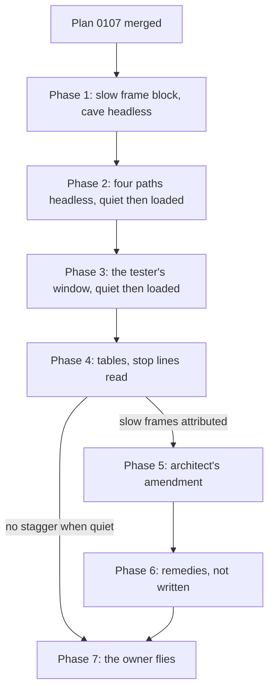

# 0111: The stagger in flight on streamed scenes: read quiet after Plan 0107, then cut

> **Status:** approved (2026-11-27, owner: "go, recommended": it starts after Plan 0107 merges and does not wait for Plan 0091; he takes Phase 3's window runs in a ten-minute quiet slot; if stop line 1 fires a tester README note is enough). Was: draft (2026-11-27; the owner's go on drafting: "go both"; he approves the draft
> before any dev work). Drafted with no interview from the owner's tester report and Plan 0107's
> Phase 1 reading; the guesses and the questions left are under "Risks & open questions", each
> with a recommended option.
> **Lane order:** starts after [Plan 0107](0107-the-mirrors-slot-image-packed-on-the-stream-workers.md)
> merges, so it measures only what that plan leaves.
> **Created:** 2026-11-27
> **Milestone:** cross-cutting: the streaming lines of `docs/nfr.md` sections 2 and 5 (M10's
> performance work in [`docs/roadmap.md`](../roadmap.md) is the nearest home)
> **Related ADRs:** none new. No mechanism is chosen here, so there is no rejected alternative
> to record; the amendment that writes the remedies writes an ADR if one of them has one.
> [ADR-0056](../adrs/0056-the-mirrors-slot-image-is-packed-on-the-stream-workers-and-the-render-thread-only-allocates-and-copies.md),
> [ADR-0017](../adrs/0017-mirror-cpu-work-bounded-in-the-frame-loop-narrowing-on-stream-workers.md),
> [ADR-0022](../adrs/0022-mirror-uploads-through-a-staging-belt-and-copy-commands.md) and
> [ADR-0083](../adrs/0083-the-live-bake-queue-runs-on-a-bake-thread-the-render-thread-applies-its-write-lists-and-issues-its-submits.md)
> own the parts a remedy may touch.

## TL;DR

The owner flew the released v0.79.1 tester archive and said: "there is quite a bit of a stagger
when we were flying". His reports put it on the CPU side of the three streamed scenes, on a
loaded box. Plan 0107 takes part of the mirror's sync off the render thread. This plan reads
what is left, on the tree that holds Plan 0107, on a **quiet** box: the four tester benchmark
paths at the tester's settings, every frame over 33 ms attributed to a stage, with a loaded
re-run beside it so the load's share is a number. No remedy is designed now: the architect
reads those tables and writes the remedy phases as an amendment. The plan can end at the
reading (the quiet runs show no stagger: it was the box). The owner closes it by flying the same
paths. The first thing to see is a `slow frame:` block at the end of a headless cave run and a
table in `docs/plans/logs/0111.md` that says which stage each slow frame went to.

## Context & problem

**The complaint and its report** (the backlog's "The v0.79.1 tester archive on the owner's
box", [`docs/backlog.md`](../backlog.md); the raw folder is kept outside the repo in the main
checkout's `live/owner-notes/2026-11-27-tester-0.79.1/`). Commit `1572f61f`, RTX 3080 Laptop,
Ryzen 9 5900HS (16 logical CPUs), Wayland, 2560 x 1440 output, FSR 2 at 1.5, Floor, the
tester's window (`pacing: free`, present mode `Immediate`), the bake thread on, 8 stream
workers. **The box was loaded** (load1 about 15 to 45), so every figure below is indicative.

| ms, or frames | cave | castle | outdoor | showcase (no streaming) |
|---|---|---|---|---|
| wall p50 / p99 / max (`frames:`) | 14.6 / 114.2 / 231 | 16.3 / 127.7 / 501 | 15.7 / 57.7 / 242 | 13.6 / 22.2 / 64 |
| frame CPU p99 / max | 110.4 / 206 | 123.3 / 477 | 55.9 / 232 | 14.9 / 63 |
| `update + poll + sync` p99 / max | 61.0 / 105.8 | 79.5 / 325.3 | 31.4 / 156.5 | 0.17 / 3.0 |
| the sync alone, max (`run.json`) | 102.6 | 144.4 | 156.2 | none |
| bake thread render laps, `total` p99 / max | 47.4 / 124 | 38.0 / 143 | 19.0 / 143 | 6.0 / 22 |
| frames whose laps took over 4.0 ms, of all | 278 of 1010 | 453 of 1429 | 362 of 4039 | 66 of 1930 |
| march GPU p50 / p99 | 8.9 / 14.7 | 9.4 / 16.3 | 13.3 / 24.6 | 10.5 / 17.2 |

`run.json` counts 90 to 132 frames over 33 ms and 17 to 22 over 100 ms a streamed run, and 2
over 33 ms on the showcase.

**What the report already says, and what it cannot say:**

- The GPU is steady; the tail is inside the frame's CPU span. Wall p99 less frame CPU p99 is
  1.8 to 4.3 ms on the streamed scenes, so the tail is not the present or the compositor.
- The sync is one tail, and Plan 0107 takes part of it. Its Phase 1 (that lane's
  `docs/plans/logs/0107.md`) reads these reports as: `size` and the emitter scan leave whole,
  13 to 79 % of `alloc` leaves (20 to 75 % of the slowest syncs), `copy`, `select`, the lock,
  `poll` and `light place` stay (its Phase 6 cuts `light place`).
- **There is a second tail Plan 0107 does not touch.** Frame CPU p99 is 1.55 to 1.81 times
  `update + poll + sync`'s. The render thread's laps for the bake thread (`build`, `take`,
  `issue`, `apply`, `collect`, `send`) take over 4.0 ms in 9 to 32 % of frames, with `build`
  the largest lap most often (p99 9.1 to 37.9 ms). The `wait` lap is 0.000 at p50, p99 and max
  in every run: the render thread does not block on the bake thread there.
- **`poll` or `update` holds a third.** The castle's `update + poll + sync` maximum is 325.3 ms
  and its slowest sync 144.4 ms, so one frame spent at least 180 ms outside the sync.
- **The same work cost ten times as much on the owner's box.** The cave's slowest sync packed
  10 445 bricks with `alloc` at 73.5 ms; Plan 0107's own headless reading (load 8 to 14,
  1080p) packed 13 230 bricks with `alloc` at 7.4 ms. That is preemption, page faults or
  memory pressure, not more work, and no printed line tells them apart.
- **Percentiles of different series do not add.** No line joins one frame's wall time to that
  frame's stages, the acquire and the present are outside the CPU span, and no timer brackets
  `configure_frame`, the encode or the submit
  ([the review of 2026-11-26](../reviews/2026-11-26-work-off-the-render-thread.md), section 1).
  So the report cannot say which stage a given slow frame went to.

**The rule this plan follows** (architect skill; Plan 0047's lesson): a plan that chases a
defect seen on screen measures before it commits to a mechanism. The owner's standing rules
bind it too: stable image first; a loaded reading is not a quiet one; a missed bar goes to an
architect reading before any fix; no run past about 20 minutes under the perf lock; no scene
edited; no camera held in a window run; a frame-pacing complaint is the owner's to close by
eye.

It serves the consumer's streaming requirement (`project-context.md`: a streamed world walked
without hitches) and touches `docs/nfr.md` section 2 (the streaming line, `update + poll +
sync` p99) and section 5.

## Decision

Read first, on the tree with Plan 0107, quiet and loaded, headless and in the tester's window;
attribute each frame over 33.3 ms to a stage; then the architect writes the remedies. The
binary gains one print (a `slow frame:` block at exit) and the timers it needs, with no change
to what a frame does.

Shapes not taken, one sentence each (none is a mechanism, so no ADR): **cutting `copy` and
`select` now from the owner's report** (a loaded reading, and the second tail is larger than
either); **waiting for Plan 0091's profiler** to attribute the frames (it is the better
instrument, but it is not built, and a tester's `log.txt` cannot carry its dump; see owner
question 1); **closing the complaint on a quiet headless run alone** (the owner judges frame
pacing in the window).

## Architecture diagram



## Implementation phases

Each phase ships as its own commit, **one phase a dev brief**, each small enough for a fresh
agent. Every phase carries exactly one `**Owner skill:**`. Phases 1 to 4 are readings:
no gate test passes by a clock, and every time is a printed reading.

**The commands.** The tester's own lines, from the owner's `tester.log`:

- cave: `flythrough --source cave --lamp off --tester --path cave --path-mode bench --render 2560x1440 --profile floor --report DIR`
- showcase: `--source showcase --lamp off --tester --path showcase ...`
- castle: `--castle --lamp off --tester --path castle ...`
- outdoor: `--source outdoor --spawn outside --trees sparse --sun 10,180 --lamp off --tester --path outdoor ...`

Headless, `--tester` is replaced by `--headless --adapter RTX --bake-thread on`, and the banner
must read `bake thread on`. Release build, the exclusive perf lock, a 16 GiB scope, load1
recorded at the start and end of every run.

**Quiet** means load1 at most 2 at a run's start (lane rule 7). A run that starts above it is
labelled loaded and does not count as quiet; the dev asks the orchestrator for a slot with no
lane building and does not wait under the lock.

**Loaded** means 32 single-thread busy loops (two a logical CPU), started 60 s before the run
(load1 is then about 20, inside the owner's 15 to 45) and stopped by PID after it. It is a
stand-in for the owner's builds: it preempts, and it adds no memory or disk pressure. The log
says so beside every loaded row.

**Time.** A run is its load (3 to 15 s in the owner's report) plus its path (about 20 to 75 s
there). The dev projects each hold from its first run; a hold projected past 20 minutes is not
started, and the phase goes back to the architect.

### Phase 1: the `slow frame:` block, and the cave read with it
- **Owner skill:** dev
- **What:** A print at exit, no behaviour change: for every frame whose wall time is over
  33.3 ms, that frame's own stages, joined by frame. Kept in a bounded buffer during the run
  and printed at teardown (the 64 slowest frames, one line each, then one `slow frames:`
  summary over all of them). A line names: the frame's index and path second; wall; the
  acquire; `update`; `poll` with the chunks it applied; the sync and its `select`, `size`,
  `light place`, `note`, `copy`, `alloc`, lock wait and packed bricks; the bake thread's render
  laps (`build`, `take`, `issue`, `apply`, `collect`, `send`, `wait`); the rest of the frame's
  preparation, the encode and the submit; the present; **the rest** (wall less every named
  stage); and, on Linux, the render thread's involuntary context switches and minor and major
  page faults in that frame. The summary gives the count over 33.3 and over 100 ms, and for
  each stage the number of slow frames in which it is the largest and its mean over them, as
  the `bake thread render laps:` line does. New timers go only where none exists: the acquire
  and the present in the shell, and the preparation, encode and submit. No new dependency;
  `run.json` and its schema are unchanged.
  Then one quiet headless cave run with the block read into the log.
- **Files touched:** `crates/svet-app/src/shell.rs`, `apps/flythrough/src/run/frame.rs`,
  `apps/flythrough/src/run/hud_feed.rs`, `apps/flythrough/src/run/queue.rs`,
  `docs/flythrough.md` (the exit lines), `docs/plans/logs/0111.md`.
- **Done when:** A CPU test (`a_slow_frame_line_names_every_stage_and_the_rest`, in the
  fly-through's unit tests, under 1 s, no GPU and no clock: it feeds fixed numbers) shows that
  a frame of 40.0 ms wall with stages summing to 31.5 ms prints `rest 8.500`, that a frame of
  33.3 ms prints no line, and that the summary names the largest stage of each of three made-up
  frames. The headless cave run's log section holds the `frames:` exit line, the `slow
  frames:` summary and the block, with load1, and states the share of slow frames whose `rest`
  is over a fifth of their wall. Wall p50 of that run against the same run on the phase's
  parent commit is stated (the print's cost; a reading, expected within the run-to-run spread).

### Phase 2: the four paths headless, quiet, then loaded
- **Owner skill:** dev
- **What:** No code. Hold A (quiet): the four paths headless. Hold B (loaded): the three
  streamed paths headless under the 32 busy loops. Hold C (quiet): the cave at `--workers 4`
  beside the default 8. One table a hold in the log.
- **Files touched:** `docs/plans/logs/0111.md`.
- **Done when:** The log holds, for each run: load1 at start and end; `run.json`'s
  `over_33ms` and `over_100ms`; wall, frame CPU and `update + poll + sync` p50 / p99 / max;
  the `slow frames:` summary (the largest stage's counts, the `rest`, the context switches and
  page faults over the slow frames); `bake thread render laps:` `total` and `build` p99; chunks
  resident at the path's end. Each quiet row is at load1 at most 2 or is labelled loaded. The
  log states, per streamed path, quiet against loaded: the ratio of `over_33ms`, and which
  stages grew. No conclusion is written.

### Phase 3: the same paths in the tester's window, quiet, then loaded
- **Owner skill:** human
- **What:** Only the owner's desktop shows a window (lane rule 10). The orchestrator's
  live-session runner plays the four benchmark paths through `svet-tester` (a release build of
  the Phase 1 tree), once on a quiet box and the three streamed paths once under the same 32
  busy loops, with stdout visible. The camera follows the path; nothing holds it. The owner
  need not judge anything here, but a word on whether the quiet run staggered is recorded if
  he gives one.
- **Files touched:** none in the repo; the report folders go beside the owner's first one
  under the main checkout's `live/owner-notes/`.
- **Done when:** Seven report folders exist, each with `run.json` and a `log.txt` that holds
  the `slow frame:` block, and the runner's note gives load1 at each run's start.

### Phase 4: the window's tables, and the stop lines read
- **Owner skill:** dev
- **What:** No code. Phase 3's folders into the log as Phase 2's table, beside the owner's
  v0.79.1 figures; then each stop line below read against the tables, as a fact.
- **Files touched:** `docs/plans/logs/0111.md`.
- **Done when:** The log holds the window's table, and for each stop line "fires" or "does
  not fire" with the figures it was read from. The dev stops there.

**The stop lines.** Each is read from the quiet windowed runs unless it says otherwise.

1. **It was the box.** On each streamed path, quiet: `over_100ms` is 0 and `over_33ms` is at
   most 2 (the showcase's count on the owner's loaded box), and the loaded re-run brings back
   tens. Then no remedy is written: the plan goes to Phase 7 on a quiet box, and closes with a
   backlog note on running the tester beside builds.
2. **Not the CPU.** Slow frames remain, and in most of them the acquire, the present and the
   `rest` together are over half the wall. Then the remedies are not render-thread work at
   all, and the amendment starts from the shell and the present path.
3. **Not attributed.** In over a third of the slow frames `rest` is over a fifth of the wall.
   Then the print is short of a stage: the architect names the span to split, and one more
   print phase runs before any remedy.
4. **Plan 0107 moved the wrong part.** The sync's stages Plan 0107 was to remove (`size`,
   `note`) are still the largest stage in any slow frame. That is Plan 0107's finding, routed
   to its close review, not a remedy here.
5. **The hold's time.** A hold projects past 20 minutes from its first run: stop, architect.

### Phase 5: the architect reads the tables and writes the remedies
- **Owner skill:** human
- **What:** A product call on a reading: the architect (in a fresh session, with Phases 1 to
  4's log) writes "Amended (architect, after Phase 4)" into this plan: the remedy phases, each
  for a stage the tables attribute slow frames to, each with its bar on the same runs, in the
  order of slow frames removed; an ADR where a remedy has a rejected alternative; the hitch
  bar for `docs/nfr.md`; and what may run beside the lanes then open. The owner approves the
  amendment before any remedy starts.
- **Files touched:** this plan, `docs/plans/README.md`, perhaps `docs/adrs/`.
- **Done when:** The amendment is approved by the owner, or a stop line has sent the plan to
  Phase 7.

### Phase 6: the remedies (not written)
- **Owner skill:** dev
- **What:** Not written. Phase 5's amendment replaces this phase with its own, one remedy a
  phase. No dev starts it as it stands.
- **Files touched:** not known.
- **Done when:** Set by the amendment. Each remedy re-runs Phase 2's quiet hold and states its
  `over_33ms` and the attributed stage before and after; a remedy that does not move its stage
  is reverted and its reading kept.

### Phase 7: the owner flies the same paths
- **Owner skill:** human
- **What:** The owner runs the tester's four benchmarks on the plan's tip (a release build
  through `svet-tester`), on a quiet box, and flies the streamed scenes by hand as he likes,
  and says whether the stagger is gone. His word closes the complaint; the figures beside it
  are readings.
- **Files touched:** none.
- **Done when:** The owner has said "gone", or has named what he still sees, which goes to an
  architect reading and not to a fix.

## The candidates, as hypotheses

None is chosen. Each names what in the owner's (loaded) report suggests it and what in Phases
1 to 4 would falsify it.

| # | Hypothesis | What suggests it | Falsified if |
|---|---|---|---|
| 1 | The sync's `copy`, `select` and what is left of `alloc`, on the render thread | slowest syncs: `alloc` 73 to 91 ms, `copy` up to 82, `select` up to 33 | quiet, the sync is the largest stage in few slow frames, or its share of their wall is small |
| 2 | The render thread's bake laps, `build` first, then `issue` and `apply` | `total` p99 19 to 47 ms; over 4.0 ms in 9 to 32 % of frames; the showcase reads 6.0 | quiet, `total` p99 is back near Plan 0099's 1.2 to 1.3 ms and no slow frame has a lap as its largest stage |
| 3 | The render thread waits on the bake thread or on a chunk lock | the `build` lap's name; ADR-0083's shared locks | already unlikely: the `wait` lap is 0.000 at max and `lock wait` p99 is 0.04 ms (max 2.0); falsified if both stay so quiet |
| 4 | `poll` applies every finished chunk in one frame, with no cap | the castle's frame with at least 180 ms outside the sync; Plan 0107's reading of `poll` max 18.8 ms | `poll` and `update` are never the largest stage of a slow frame |
| 5 | Allocator and page-fault cost while chunks arrive | the same brick count costing ten times the `alloc` on the owner's box | the slow frames show no page faults over the run's mean, quiet and loaded |
| 6 | The stream workers and the bake's threads take the render thread's cores | 8 workers, the bake thread and its listers beside the render thread on 8 physical cores | quiet, the slow frames carry no involuntary context switch, and `--workers 4` reads the same slow frames a resident chunk |
| 7 | The box's load alone | load1 15 to 45; the lane's reading at load 8 to 14 has `update + poll + sync` p99 at 15 ms against 61 to 79 | stop line 1 does not fire: slow frames remain when quiet |
| 8 | The frame's untimed span: `configure_frame`, the encode, the submit, the HUD | frame CPU p99 well over `update + poll + sync` p99; no timer there | their sum is small in every slow frame |
| 9 | The present, the Wayland frame callback, or the copy between adapters | the complaint is of pacing; the window's surface path is unread on the CPU | wall less frame CPU stays a few ms in the slow frames (it reads 1.8 to 4.3 at p99 already), and the acquire and present are small |
| 10 | The path's own feedback: a bench path runs by wall time, so a slow frame moves the camera further and more chunks arrive in the next | slow frames in runs (`sync:` lines with a p50 of 12 to 40 ms over a second) | slow frames are isolated, not in runs, in the block's frame indices |
| 11 | Uneven frame times under 33 ms read as stagger at 165 Hz with no frame callback | wall p50 14.6 to 16.3 ms with p95 29 to 53 | only the owner's eye in Phase 7 on a quiet box; a figure cannot close it |

## Data shapes

One exit line a slow frame; illustrative, the names are the dev's:

```
slow frame: 539 at 11.2 s, wall 108.4 ms: acquire 0.1, update 0.3, poll 2.1 (41 chunks), sync 102.6 (select 7.5, size 0.0, place 0.7, note 0.0, copy 10.2, alloc 73.5, lock 0.0; 10445 bricks), laps 1.9 (build 0.1, take 0.1, issue 0.9, apply 0.4, collect 0.1, send 0.0, wait 0.0), prepare 0.6, encode 0.3, submit 0.2, present 0.1, rest 0.2; switches 3, faults 1210 minor 0 major
```

## Budgets

- **`docs/nfr.md` section 2, the streaming line** (1.0 ms; `update + poll + sync` p99 at most
  16.6 ms, met at 14.82 ms quiet on the cave bench at 1080p): Phases 2 and 4 re-read it at the
  tester's 2560 x 1440, RTX 3080 Laptop, quiet and loaded. A reading, not a new bar.
- **No line of `docs/nfr.md` counts hitches.** `over_33ms` lives in `run.json` only. A bar
  ("frames over 33 ms a minute in flight, quiet") written now would be a guess; Phase 5's
  amendment proposes it from Phase 4's tables, and the close measures it on the same runs.
- **The print's cost:** a few clock reads and one small record a frame; Phase 1 states the
  cave's wall p50 with and without it.
- The RTX 3080 Laptop is the dev box, not the floor. The RENOIR is not read in Phases 1 to 4
  (the complaint is on the RTX); the amendment names its run for any remedy that moves work
  between threads, because the floor has no idle core.

## Risks & open questions

- **Beside the M10 lanes (Plans 0081 and 0033): Phases 1 to 4 may run beside them.** Their
  code is a print in the fly-through and the shell. The conflict is the box, not the files: a
  quiet reading needs about ten minutes with no lane building, so the orchestrator gives the
  holds a slot. **Phase 6 may not be assumed to run beside them.** The candidates sit in
  `crates/svet-world/src/stream/`, `crates/svet-render/src/gpu_world/` and
  `crates/svet-render/src/bake/link.rs`, which Plan 0033's world and streamer briefs and its
  render brief edit; Plan 0081's march and styled-face work is unlikely to collide. The
  amendment says, per remedy. If Plan 0033's far field merges before Phase 7 the streaming
  load changes, and Phase 2's quiet hold is re-read on the merged tree first.
- **Plan 0107 is the base.** If it stops at its own stop line or closes with a part missed,
  this plan still starts at its merge and reads what the tree does; stop line 4 routes a
  finding back.
- **Plan 0110 (the math hot paths) does not overlap.** Its ground is GPU pass arithmetic and
  the mover tick in `svet-sim`; the benchmark paths run no movers, and the GPU is steady in
  the report. If a slow frame here is attributed to arithmetic on the render thread, it is
  named in the amendment and offered to that plan.
- **Plan 0091 (the frame profiler)** will time the same spans with scopes. If it merges first,
  Phase 1 takes its timers from the scopes and adds only the block; if after, its lane
  replaces Phase 1's timers. The block stays either way: it is what a tester's `log.txt`
  carries.
- **Headless is not the window.** A headless bench frame steps the path 1/60 s whatever it
  took, and presents nothing; the window runs by wall time. Phase 2 can show less than Phase 3.
  The stop lines read the window.
- **The synthetic load is a guess at the owner's.** Busy loops preempt; rustc also takes
  memory bandwidth, page cache and disk. If the loaded re-run does not bring the owner's
  counts back, the log says so, and hypothesis 5 stays open.
- **Threading and determinism:** none touched in Phases 1 to 4. A remedy that moves work
  between threads names its lockstep mode and its identity test in the amendment, as Plan
  0107 does.

**Owner questions** (each with a recommendation; none blocks Phase 1 but the first):

1. **Start after Plan 0107 merges, or wait for Plan 0091's profiler too?** Recommended: after
   0107, not waiting. The block is small, and every later tester report then attributes its
   own slow frames.
2. **Phase 3 needs a quiet box with you near it for about ten minutes** (seven benchmark runs
   in the window, no judgement asked). Recommended: one slot, the lanes paused for it.
3. **If stop line 1 fires** (no stagger when quiet), is a note in the tester's README ("close
   other heavy programs") enough, or do you want the engine to hold up under a loaded box as
   a goal of its own? Recommended: the note, and the loaded table kept as a reading; a loaded
   box is not a budget line today.

## What this plan does NOT do

- Design or pick a remedy. Phase 5's amendment does.
- Touch the start-up, the pre-roll or the queue's start (Plans 0108 and 0109).
- The tester's frame-rate readout and the asset path of a packed build (the backlog entry's
  other two halves, a chore already started).
- Edit a scene or a path, hold the camera, or add a gate test that passes by a clock.
- Read Windows or the RENOIR in Phases 1 to 4.
- Build a profiler (Plan 0091), or change `run.json`'s schema.

## Implementation log

> Written by `dev`: one row per phase as its commit lands, then the close block. **The phases
> above are the contract. This section records what happened.** Observations, never conclusions:
> no pass list, no self-assessment. Deviations and unmet done-whens are **always** disclosed.
> Keep it shorter than `## Implementation phases`. Readings, gate counts, attempts, sweeps and
> resume notes go to the plan's readings log, `docs/plans/logs/0111.md` (started from
> `templates/readings-log.md`), and this section links it once it exists.

| phase | owner | state | commit |
|---|---|---|---|
| 1: the `slow frame:` block, and the cave read with it | dev | not started | |
| 2: the four paths headless, quiet, then loaded | dev | not started | |
| 3: the same paths in the tester's window | human | not started | |
| 4: the window's tables, and the stop lines read | dev | not started | |
| 5: the architect's amendment | human | not started | |
| 6: the remedies (not written) | dev | not written | |
| 7: the owner flies the same paths | human | not started | |

### Notes

_(Empty.)_

### Close triggers

_(Facts for the architect. No recommendations, and no suggested version bump.)_

- **What shipped:** feature / fix-only / docs-chore-only
- **Public API changed:** types, traits, functions, shader interfaces, config (list them, or none)
- **Budget readings:** each `nfr.md` figure touched, with its measured value, machine and commit
- **Gate at the tip:** the commands run (build, nextest, doctests, clippy, fmt, deny), exit codes, test counts
- **Outstanding `human` phases:** which, or none

## Followups

- A hitch line for `docs/nfr.md` section 2, proposed at Phase 5.
